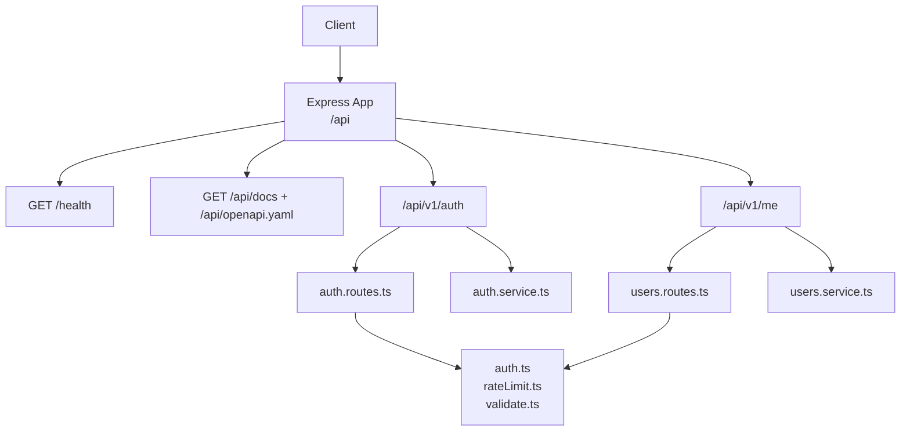
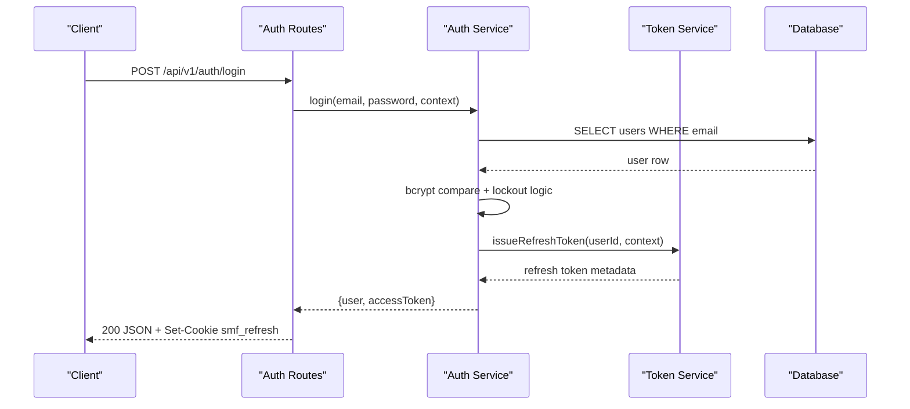
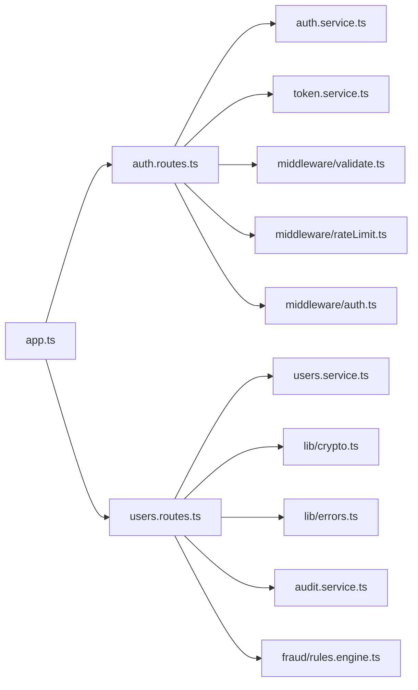

# API Reference

<cite>
**Referenced Files in This Document**
- [app.ts](file://backend/src/app.ts)
- [openapi.yaml](file://backend/openapi.yaml)
- [auth.routes.ts](file://backend/src/modules/auth/auth.routes.ts)
- [auth.service.ts](file://backend/src/modules/auth/auth.service.ts)
- [users.routes.ts](file://backend/src/modules/users/users.routes.ts)
- [users.service.ts](file://backend/src/modules/users/users.service.ts)
- [rateLimit.ts](file://backend/src/middleware/rateLimit.ts)
- [auth.ts](file://backend/src/middleware/auth.ts)
- [errors.ts](file://backend/src/lib/errors.ts)
</cite>

## Table of Contents
1. [Introduction](#introduction)
2. [Project Structure](#project-structure)
3. [Core Components](#core-components)
4. [Architecture Overview](#architecture-overview)
5. [Detailed Component Analysis](#detailed-component-analysis)
6. [Dependency Analysis](#dependency-analysis)
7. [Performance Considerations](#performance-considerations)
8. [Troubleshooting Guide](#troubleshooting-guide)
9. [Conclusion](#conclusion)
10. [Appendices](#appendices)

## Introduction
This document describes the SecureMicrofinance REST API. It covers authentication, user profile management, versioning, security, rate limiting, error handling, and practical client guidance. The API is a Node.js Express application exposing OpenAPI 3.0.3 documentation at `/api/docs` and serving the spec at `/api/openapi.yaml`.

The current production base path is `/api`, with versioned endpoints under `/api/v1`. The only implemented feature set includes:
- Health check
- Authentication (register, login, refresh, logout, get current user, change password)
- Borrower profile read/update
- Lender profile read

There are no loan or administrative endpoints implemented yet; this reference documents what exists and how to extend it safely.

## Project Structure
The backend organizes routes by module, middleware for cross-cutting concerns, services for business logic, and shared libraries for errors, cryptography, and configuration.



**Diagram sources**
- [app.ts:65-87](file://backend/src/app.ts#L65-L87)
- [auth.routes.ts:51-121](file://backend/src/modules/auth/auth.routes.ts#L51-L121)
- [users.routes.ts:38-108](file://backend/src/modules/users/users.routes.ts#L38-L108)

**Section sources**
- [app.ts:16-93](file://backend/src/app.ts#L16-L93)
- [openapi.yaml:1-18](file://backend/openapi.yaml#L1-L18)

## Core Components
- Application bootstrap and middleware pipeline: security headers, CORS, JSON parsing, request context, global rate limiting, health endpoint, OpenAPI docs, route mounting, not-found handler, and error handler.
- Authentication module: register, login, refresh, logout, current user, and password change.
- User profile module: borrower profile read and update with encryption and blind indexes.
- Middleware: bearer token verification, role checks, auditor write denial, validation, and rate limiters.
- Error layer: typed application errors mapped to stable JSON responses.

**Section sources**
- [app.ts:23-93](file://backend/src/app.ts#L23-L93)
- [auth.routes.ts:15-121](file://backend/src/modules/auth/auth.routes.ts#L15-L121)
- [users.routes.ts:19-108](file://backend/src/modules/users/users.routes.ts#L19-L108)
- [rateLimit.ts:5-51](file://backend/src/middleware/rateLimit.ts#L5-L51)
- [auth.ts:7-68](file://backend/src/middleware/auth.ts#L7-L68)
- [errors.ts:8-40](file://backend/src/lib/errors.ts#L8-L40)

## Architecture Overview
The API uses short-lived JWT access tokens and httpOnly refresh cookies. Access tokens carry user identity and role; every protected route re-validates the token and reloads the user from the database so account suspension takes effect immediately. Sensitive borrower data is encrypted at rest and masked on read. Blind indexes allow duplicate identity detection without decrypting values.



**Diagram sources**
- [auth.routes.ts:64-73](file://backend/src/modules/auth/auth.routes.ts#L64-L73)
- [auth.service.ts:114-198](file://backend/src/modules/auth/auth.service.ts#L114-L198)

## Detailed Component Analysis

### Global Configuration and Versioning
- Base path: `/api`
- Versioned routes: `/api/v1/*`
- OpenAPI spec served at `/api/openapi.yaml`; interactive docs at `/api/docs`
- Health endpoint: `GET /api/health` returns service status and chain mode

Versioning strategy:
- URL-based versioning under `/v1`.
- New major versions should be introduced as `/v2` when breaking changes occur.

Security posture:
- Helmet configured with minimal policy for API-only usage.
- CORS allows configured web origin plus local development origins.
- Request ID propagated via context and exposed through response headers where applicable.

**Section sources**
- [app.ts:23-93](file://backend/src/app.ts#L23-L93)
- [openapi.yaml:11-18](file://backend/openapi.yaml#L11-L18)

### Authentication Endpoints

#### Register
- Method: `POST`
- URL: `/api/v1/auth/register`
- Authentication: None
- Rate limiting: Tight per-IP-and-email limiter
- Request body schema:
  - `email`: string, valid email format
  - `password`: string, minimum 10 characters, must include a letter and a digit
  - `fullName`: string, trimmed, length 2–120
  - `role`: enum `borrower` or `lender`
  - `businessName`: optional string for lenders
- Success response: `201 Created`
  - JSON object containing:
    - `user`: public user object
    - `accessToken`: short-lived JWT
  - Cookie: `smf_refresh` (httpOnly, SameSite=Strict, Path=/api/v1/auth)
- Error responses:
  - `400 Bad Request`: Validation failure
  - `409 Conflict`: Email already registered

Example call:
```text
POST /api/v1/auth/register
Content-Type: application/json
{
  "email": "grace@example.com",
  "password": "Passw0rd!demo",
  "fullName": "Grace Wanjiku",
  "role": "borrower"
}
```

Expected success response:
```json
{
  "user": {
    "id": "a1b2c3d4-e5f6-7890-abcd-ef1234567890",
    "email": "grace@example.com",
    "fullName": "Grace Wanjiku",
    "role": "borrower",
    "createdAt": "2025-01-01T12:00:00.000Z"
  },
  "accessToken": "eyJhbGciOiJIUzI1NiIsInR5cCI6..."
}
```

Implementation notes:
- Passwords are hashed with bcrypt before storage.
- Registration creates either a lender or borrower profile.
- Audit records are written within the same transaction as user creation.

**Section sources**
- [openapi.yaml:38-80](file://backend/openapi.yaml#L38-L80)
- [auth.routes.ts:20-62](file://backend/src/modules/auth/auth.routes.ts#L20-L62)
- [auth.service.ts:61-112](file://backend/src/modules/auth/auth.service.ts#L61-L112)

#### Login
- Method: `POST`
- URL: `/api/v1/auth/login`
- Authentication: None
- Rate limiting: Tight per-IP-and-email limiter
- Request body schema:
  - `email`: string, valid email format
  - `password`: string
- Success response: `200 OK`
  - JSON object containing:
    - `user`: public user object
    - `accessToken`: short-lived JWT
  - Cookie: `smf_refresh`
- Error responses:
  - `401 Unauthorized`: Invalid credentials or inactive account
  - `423 Locked`: Account temporarily locked after repeated failures

Example call:
```text
POST /api/v1/auth/login
Content-Type: application/json
{
  "email": "grace@example.com",
  "password": "Passw0rd!demo"
}
```

Expected success response:
```json
{
  "user": {
    "id": "a1b2c3d4-e5f6-7890-abcd-ef1234567890",
    "email": "grace@example.com",
    "fullName": "Grace Wanjiku",
    "role": "borrower",
    "createdAt": "2025-01-01T12:00:00.000Z"
  },
  "accessToken": "eyJhbGciOiJIUzI1NiIsInR5cCI6..."
}
```

Security behavior:
- Unknown emails and wrong passwords return the same generic message to prevent enumeration.
- Failed attempts increment counters and can lock the account for a configurable period.

**Section sources**
- [openapi.yaml:81-111](file://backend/openapi.yaml#L81-L111)
- [auth.routes.ts:64-73](file://backend/src/modules/auth/auth.routes.ts#L64-L73)
- [auth.service.ts:114-198](file://backend/src/modules/auth/auth.service.ts#L114-L198)

#### Refresh Token
- Method: `POST`
- URL: `/api/v1/auth/refresh`
- Authentication: Uses httpOnly cookie only
- Behavior: Rotates the refresh token; replaying an old token revokes the whole family
- Success response: `200 OK`
  - JSON object containing:
    - `user`: public user object
    - `accessToken`: new short-lived JWT
  - Cookie: `smf_refresh` rotated
- Error responses:
  - `401 Unauthorized`: Missing or invalid refresh token

Example call:
```text
POST /api/v1/auth/refresh
Cookie: smf_refresh=<token>
```

Expected success response:
```json
{
  "user": {
    "id": "a1b2c3d4-e5f6-7890-abcd-ef1234567890",
    "email": "grace@example.com",
    "fullName": "Grace Wanjiku",
    "role": "borrower",
    "createdAt": "2025-01-01T12:00:00.000Z"
  },
  "accessToken": "eyJhbGciOiJIUzI1NiIsInR5cCI6..."
}
```

**Section sources**
- [openapi.yaml:113-129](file://backend/openapi.yaml#L113-L129)
- [auth.routes.ts:75-96](file://backend/src/modules/auth/auth.routes.ts#L75-L96)

#### Logout
- Method: `POST`
- URL: `/api/v1/auth/logout`
- Authentication: Uses httpOnly cookie only
- Behavior: Revokes the current refresh token and clears the cookie
- Success response: `204 No Content`

Example call:
```text
POST /api/v1/auth/logout
Cookie: smf_refresh=<token>
```

**Section sources**
- [openapi.yaml:131-138](file://backend/openapi.yaml#L131-L138)
- [auth.routes.ts:98-103](file://backend/src/modules/auth/auth.routes.ts#L98-L103)

#### Current User
- Method: `GET`
- URL: `/api/v1/auth/me`
- Authentication: Bearer JWT required
- Response: `200 OK`
  - JSON object containing:
    - `user`: public user object
    - `profile`: profile summary with masked sensitive fields

Example call:
```text
GET /api/v1/auth/me
Authorization: Bearer <accessToken>
```

Expected response:
```json
{
  "user": {
    "id": "a1b2c3d4-e5f6-7890-abcd-ef1234567890",
    "email": "grace@example.com",
    "fullName": "Grace Wanjiku",
    "role": "borrower",
    "createdAt": "2025-01-01T12:00:00.000Z"
  },
  "profile": {
    "nationalIdMasked": "2345***89",
    "phoneMasked": "0712***678",
    "occupation": "Tailor",
    "monthlyIncomeCents": 4200000
  }
}
```

**Section sources**
- [openapi.yaml:139-154](file://backend/openapi.yaml#L139-L154)
- [auth.routes.ts:105-108](file://backend/src/modules/auth/auth.routes.ts#L105-L108)

#### Change Password
- Method: `PATCH`
- URL: `/api/v1/auth/password`
- Authentication: Bearer JWT required
- Request body schema:
  - `currentPassword`: string
  - `newPassword`: string, minimum 10 characters, must include a letter and a digit
- Success response: `200 OK`
  - JSON object containing:
    - `message`: confirmation that sessions were revoked
  - Cookie: `smf_refresh` cleared
- Error responses:
  - `400 Bad Request`: Validation failure
  - `401 Unauthorized`: Wrong current password or missing token

Example call:
```text
PATCH /api/v1/auth/password
Authorization: Bearer <accessToken>
Content-Type: application/json
{
  "currentPassword": "OldPassw0rd!",
  "newPassword": "NewPassw0rd!1"
}
```

Expected response:
```json
{
  "message": "Password updated. Please sign in again."
}
```

**Section sources**
- [openapi.yaml:156-174](file://backend/openapi.yaml#L156-L174)
- [auth.routes.ts:110-121](file://backend/src/modules/auth/auth.routes.ts#L110-L121)
- [auth.service.ts:200-243](file://backend/src/modules/auth/auth.service.ts#L200-L243)

### Profile Endpoints

#### Get Own Profile
- Method: `GET`
- URL: `/api/v1/me/profile`
- Authentication: Bearer JWT required
- Response: `200 OK`
  - JSON object containing:
    - `profile`: profile summary with masked sensitive fields
- Error responses:
  - `401 Unauthorized`: Missing or invalid token

Example call:
```text
GET /api/v1/me/profile
Authorization: Bearer <accessToken>
```

Expected response:
```json
{
  "profile": {
    "nationalIdMasked": "2345***89",
    "phoneMasked": "0712***678",
    "occupation": "Tailor",
    "monthlyIncomeCents": 4200000
  }
}
```

**Section sources**
- [openapi.yaml:176-190](file://backend/openapi.yaml#L176-L190)
- [users.routes.ts:40-43](file://backend/src/modules/users/users.routes.ts#L40-L43)
- [users.service.ts:19-59](file://backend/src/modules/users/users.service.ts#L19-L59)

#### Update Borrower Profile
- Method: `PUT`
- URL: `/api/v1/me/profile`
- Authentication: Bearer JWT required
- Authorization: Only borrowers can update; auditors are denied writes; lenders have no borrower profile
- Rate limiting: Write limiter applied
- Request body schema:
  - `nationalId`: optional string, length 5–32
  - `phone`: optional string, length 9–20
  - `occupation`: optional string, max 80
  - `monthlyIncomeCents`: optional integer, non-negative
  - `dateOfBirth`: optional string in `YYYY-MM-DD` format
  - `address`: optional string, max 200
- Success response: `200 OK`
  - JSON object containing:
    - `profile`: updated profile summary
    - `message`: confirmation
- Error responses:
  - `400 Bad Request`: Validation failure or no fields supplied
  - `401 Unauthorized`: Missing or invalid token
  - `403 Forbidden`: Auditor write attempt or non-borrower update

Example call:
```text
PUT /api/v1/me/profile
Authorization: Bearer <accessToken>
Content-Type: application/json
{
  "nationalId": "23456789",
  "phone": "0712 345 678",
  "occupation": "Tailor",
  "monthlyIncomeCents": 4200000,
  "dateOfBirth": "1994-04-18",
  "address": "Kawangware, Nairobi"
}
```

Expected response:
```json
{
  "profile": {
    "nationalIdMasked": "2345***89",
    "phoneMasked": "0712***678",
    "occupation": "Tailor",
    "monthlyIncomeCents": 4200000
  },
  "message": "Profile updated"
}
```

Data protection details:
- National ID and phone are encrypted before persistence and stored alongside blind indexes for duplicate detection.
- Date of birth and address are also encrypted.
- On read, sensitive values are decrypted then masked so raw values never leave the API.

**Section sources**
- [openapi.yaml:191-229](file://backend/openapi.yaml#L191-L229)
- [users.routes.ts:26-108](file://backend/src/modules/users/users.routes.ts#L26-L108)
- [users.service.ts:1-60](file://backend/src/modules/users/users.service.ts#L1-L60)

### Health Endpoint
- Method: `GET`
- URL: `/api/health`
- Authentication: None
- Response: `200 OK`
  - JSON object containing:
    - `status`: always `ok`
    - `service`: service name
    - `chainMode`: ledger mode indicator
    - `time`: ISO timestamp

Example call:
```text
GET /api/health
```

Expected response:
```json
{
  "status": "ok",
  "service": "secure-microfinance-api",
  "chainMode": "local",
  "time": "2025-01-01T12:00:00.000Z"
}
```

**Section sources**
- [app.ts:65-72](file://backend/src/app.ts#L65-L72)
- [openapi.yaml:19-37](file://backend/openapi.yaml#L19-L37)

## Dependency Analysis
The following diagram shows how routes depend on middleware, services, and shared libraries.



**Diagram sources**
- [app.ts:86-87](file://backend/src/app.ts#L86-L87)
- [auth.routes.ts:1-13](file://backend/src/modules/auth/auth.routes.ts#L1-L13)
- [users.routes.ts:1-17](file://backend/src/modules/users/users.routes.ts#L1-L17)

**Section sources**
- [auth.routes.ts:1-13](file://backend/src/modules/auth/auth.routes.ts#L1-L13)
- [users.routes.ts:1-17](file://backend/src/modules/users/users.routes.ts#L1-L17)

## Performance Considerations
- JSON payload size is limited to 200 KB to reduce abuse surface.
- Global rate limiting applies across all endpoints; auth endpoints use stricter limits keyed by IP and submitted email.
- Write operations are additionally rate-limited per authenticated user or IP.
- Protected routes perform a database lookup to validate account status, ensuring immediate enforcement of suspensions.
- Database queries use parameterized statements to avoid injection and improve plan caching.

[No sources needed since this section provides general guidance]

## Troubleshooting Guide

Common HTTP statuses and meanings:
- `200 OK`: Successful operation
- `201 Created`: Resource created successfully
- `204 No Content`: Successful deletion or logout
- `400 Bad Request`: Input validation failed
- `401 Unauthorized`: Missing, invalid, or expired credentials
- `403 Forbidden`: Insufficient permissions or role violation
- `404 Not Found`: Resource does not exist
- `409 Conflict`: Duplicate resource such as existing email
- `422 Unprocessable Entity`: Semantic validation failure
- `423 Locked`: Account temporarily locked due to repeated failures
- `429 Too Many Requests`: Rate limit exceeded

Error response shape:
```json
{
  "error": {
    "code": "UNAUTHORIZED",
    "message": "Authentication required",
    "details": null,
    "requestId": "req-abc123"
  }
}
```

Debugging tips:
- Use `/api/health` to verify service availability.
- Check CORS settings if requests originate from unexpected origins.
- Inspect `X-Request-Id` in responses to correlate logs.
- For auth issues, ensure the `smf_refresh` cookie is present and not blocked by browser policies.
- When testing locally, confirm allowed origins include `http://localhost:5173` or your dev server URL.

**Section sources**
- [errors.ts:8-40](file://backend/src/lib/errors.ts#L8-L40)
- [app.ts:45-58](file://backend/src/app.ts#L45-L58)
- [auth.ts:18-41](file://backend/src/middleware/auth.ts#L18-L41)

## Conclusion
The SecureMicrofinance API currently implements secure authentication and self-service profile management with strong defaults for security, validation, and auditability. Loan and administrative endpoints are not implemented in this codebase; they should follow the established patterns:
- Use URL versioning under `/api/v1`
- Protect endpoints with bearer tokens and role checks
- Apply input validation and rate limiting
- Encrypt sensitive fields and mask them on read
- Record audit events for state-changing actions

Extending the API with these practices will maintain consistency and security across future features.

[No sources needed since this section summarizes without analyzing specific files]

## Appendices

### Security and Authentication Summary
- Access tokens: short-lived JWTs carrying user identity and role
- Refresh tokens: httpOnly cookies rotated on each refresh; reuse detection revokes families
- Password hashing: bcrypt with configurable cost
- Lockout: configurable failed-attempt threshold and lock duration
- Role enforcement: bearer verification plus role gate; auditors are read-only

**Section sources**
- [auth.ts:7-68](file://backend/src/middleware/auth.ts#L7-L68)
- [auth.service.ts:15-24](file://backend/src/modules/auth/auth.service.ts#L15-L24)
- [openapi.yaml:231-236](file://backend/openapi.yaml#L231-L236)

### Rate Limiting Summary
- Global limiter: broad cap per IP
- Auth limiter: strict cap per IP and email
- Write limiter: per-user or per-IP cap for mutations
- Test environment bypasses limiters for deterministic tests

**Section sources**
- [rateLimit.ts:5-51](file://backend/src/middleware/rateLimit.ts#L5-L51)

### Data Protection Summary
- Encryption: AES-256-GCM for sensitive fields
- Blind indexes: HMAC-based duplicate detection without decryption
- Masking: sensitive values are masked before being returned to clients

**Section sources**
- [users.routes.ts:22-25](file://backend/src/modules/users/users.routes.ts#L22-L25)
- [users.service.ts:5-8](file://backend/src/modules/users/users.service.ts#L5-L8)