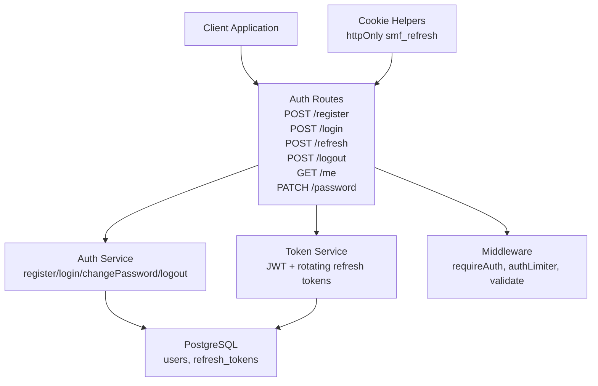
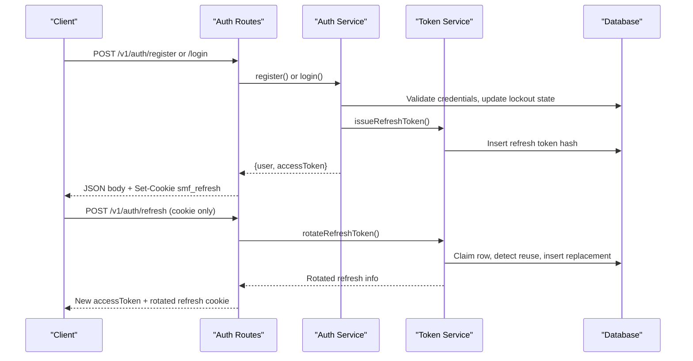
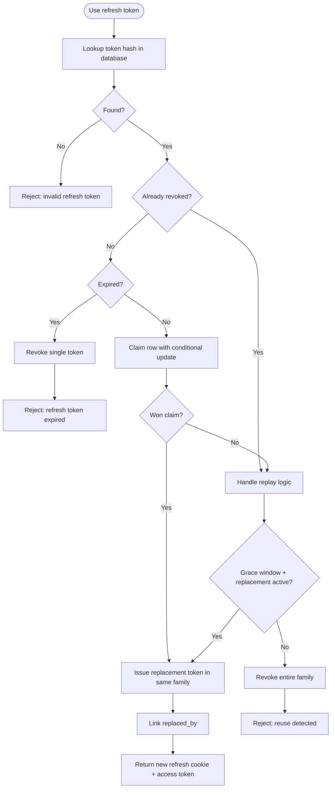
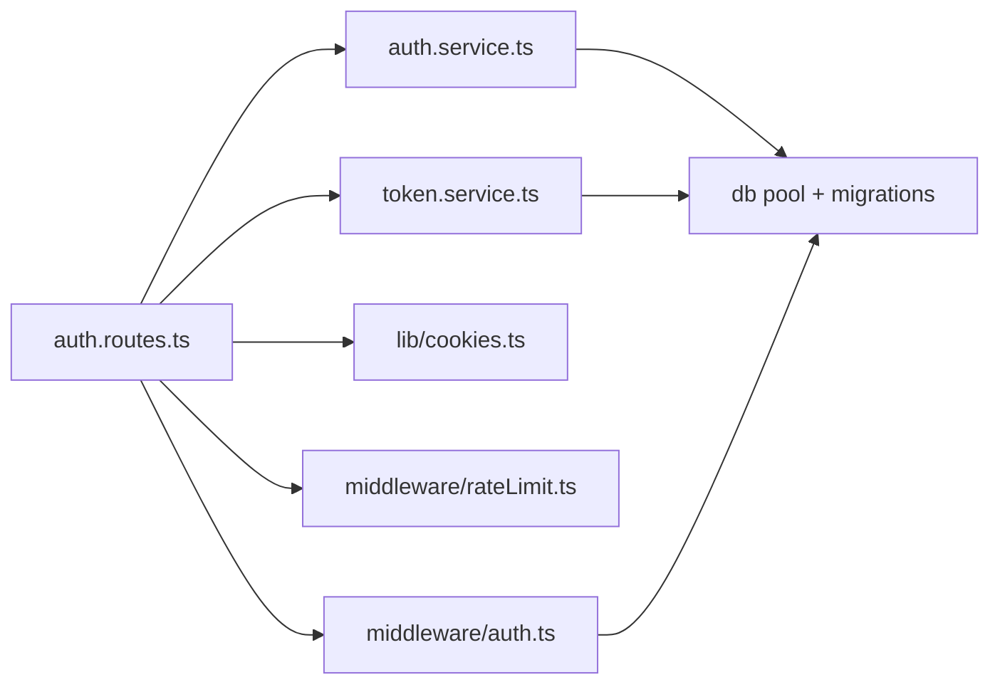

# Authentication API

<cite>
**Referenced Files in This Document**
- [auth.routes.ts](file://backend/src/modules/auth/auth.routes.ts)
- [auth.service.ts](file://backend/src/modules/auth/auth.service.ts)
- [token.service.ts](file://backend/src/modules/auth/token.service.ts)
- [openapi.yaml](file://backend/openapi.yaml)
- [auth.ts](file://backend/src/middleware/auth.ts)
- [rateLimit.ts](file://backend/src/middleware/rateLimit.ts)
- [cookies.ts](file://backend/src/lib/cookies.ts)
- [001_core_auth.sql](file://backend/src/db/migrations/001_core_auth.sql)
- [auth.test.ts](file://backend/test/auth.test.ts)
</cite>

## Table of Contents
1. [Introduction](#introduction)
2. [Project Structure](#project-structure)
3. [Core Components](#core-components)
4. [Architecture Overview](#architecture-overview)
5. [Detailed Component Analysis](#detailed-component-analysis)
6. [Dependency Analysis](#dependency-analysis)
7. [Performance Considerations](#performance-considerations)
8. [Troubleshooting Guide](#troubleshooting-guide)
9. [Conclusion](#conclusion)

## Introduction
This document describes the authentication API for the SecureMicrofinance backend. It covers user registration, login, token refresh, logout, current-user lookup, and password changes. It explains HTTP methods, URL patterns, request and response schemas, authentication requirements, error handling, security controls such as account lockout and rate limiting, and the JWT and refresh-token lifecycle.

The API root is `/api`, with versioned endpoints under `/api/v1`. The OpenAPI specification defines the canonical contract, while the Express routes implement it.

## Project Structure
Authentication functionality lives in the `modules/auth` layer, with shared middleware for authorization, rate limiting, cookies, and database access.

**Diagram sources**
- [auth.routes.ts:53-120](file://backend/src/modules/auth/auth.routes.ts#L53-L120)
- [auth.service.ts:61-261](file://backend/src/modules/auth/auth.service.ts#L61-L261)
- [token.service.ts:28-205](file://backend/src/modules/auth/token.service.ts#L28-L205)
- [auth.ts:18-41](file://backend/src/middleware/auth.ts#L18-L41)
- [rateLimit.ts:24-34](file://backend/src/middleware/rateLimit.ts#L24-L34)
- [cookies.ts:11-28](file://backend/src/lib/cookies.ts#L11-L28)

**Section sources**
- [openapi.yaml:12-175](file://backend/openapi.yaml#L12-L175)
- [auth.routes.ts:15-120](file://backend/src/modules/auth/auth.routes.ts#L15-L120)

## Core Components
- **Auth routes**: Define HTTP endpoints, input validation, cookie handling, and call service functions.
- **Auth service**: Implements business logic for registration, login, password change, logout, audit logging, and session revocation.
- **Token service**: Signs short-lived JWT access tokens, issues and rotates opaque refresh tokens, detects reuse, and revokes sessions.
- **Authorization middleware**: Verifies Bearer access tokens and loads the active principal from the database.
- **Rate limiting**: Applies global, per-email auth, and write limits; bypassed in tests.
- **Cookie helpers**: Set and clear the httpOnly refresh cookie with strict SameSite policy.
- **Database schema**: Defines users, profiles, and rotating refresh tokens.

**Section sources**
- [auth.routes.ts:53-120](file://backend/src/modules/auth/auth.routes.ts#L53-L120)
- [auth.service.ts:15-261](file://backend/src/modules/auth/auth.service.ts#L15-L261)
- [token.service.ts:10-205](file://backend/src/modules/auth/token.service.ts#L10-L205)
- [auth.ts:18-68](file://backend/src/middleware/auth.ts#L18-L68)
- [rateLimit.ts:14-47](file://backend/src/middleware/rateLimit.ts#L14-L47)
- [cookies.ts:4-28](file://backend/src/lib/cookies.ts#L4-L28)
- [001_core_auth.sql:17-95](file://backend/src/db/migrations/001_core_auth.sql#L17-L95)

## Architecture Overview
The authentication flow uses two token types:
- Access token: a short-lived JWT sent via `Authorization: Bearer`.
- Refresh token: an opaque value stored only in an httpOnly cookie and hashed server-side; rotated on every use.

**Diagram sources**
- [auth.routes.ts:53-96](file://backend/src/modules/auth/auth.routes.ts#L53-L96)
- [auth.service.ts:61-197](file://backend/src/modules/auth/auth.service.ts#L61-L197)
- [token.service.ts:64-194](file://backend/src/modules/auth/token.service.ts#L64-L194)

## Detailed Component Analysis

### Endpoints Reference

#### Register
- **Method**: `POST`
- **URL**: `/api/v1/auth/register`
- **Authentication**: None
- **Rate limiting**: Auth limiter applied
- **Request body**:
  - `email`: string, valid email format
  - `password`: string, minimum 10 characters, must contain a letter and a digit
  - `fullName`: string, trimmed, minimum 2 characters
  - `role`: enum `borrower` or `lender`
  - `businessName`: optional string for lenders
- **Success response**: `201 Created`
  - JSON object containing:
    - `user`: public user object with `id`, `email`, `fullName`, `role`, `createdAt`
    - `accessToken`: short-lived JWT
  - Header: `Set-Cookie: smf_refresh=<opaque-refresh-token>; HttpOnly; SameSite=Strict; Path=/api/v1/auth; Expires=<expiresAt>`
- **Errors**:
  - `400 Bad Request`: Validation failure
  - `409 Conflict`: Email already registered
  - `429 Too Many Requests`: Rate limited by IP and email bucket

**Section sources**
- [auth.routes.ts:20-62](file://backend/src/modules/auth/auth.routes.ts#L20-L62)
- [auth.service.ts:61-112](file://backend/src/modules/auth/auth.service.ts#L61-L112)
- [openapi.yaml:38-80](file://backend/openapi.yaml#L38-L80)
- [rateLimit.ts:24-34](file://backend/src/middleware/rateLimit.ts#L24-L34)
- [cookies.ts:11-18](file://backend/src/lib/cookies.ts#L11-L18)

#### Login
- **Method**: `POST`
- **URL**: `/api/v1/auth/login`
- **Authentication**: None
- **Rate limiting**: Auth limiter applied
- **Request body**:
  - `email`: string, valid email format
  - `password`: string
- **Success response**: `200 OK`
  - JSON object containing:
    - `user`: public user object
    - `accessToken`: short-lived JWT
  - Header: `Set-Cookie: smf_refresh=<opaque-refresh-token>; HttpOnly; SameSite=Strict; Path=/api/v1/auth; Expires=<expiresAt>`
- **Errors**:
  - `401 Unauthorized`: Invalid email or password; inactive account
  - `423 Locked`: Account temporarily locked after repeated failed logins
  - `429 Too Many Requests`: Rate limited by IP and email bucket

Security behavior:
- Unknown emails and wrong passwords return the same generic message to prevent enumeration.
- Failed attempts increment `failed_attempts`; after reaching the configured threshold, the account is locked until `locked_until`.
- Successful login resets failed attempts and clears the lock.

**Section sources**
- [auth.routes.ts:41-73](file://backend/src/modules/auth/auth.routes.ts#L41-L73)
- [auth.service.ts:114-197](file://backend/src/modules/auth/auth.service.ts#L114-L197)
- [openapi.yaml:81-111](file://backend/openapi.yaml#L81-L111)
- [001_core_auth.sql:17-31](file://backend/src/db/migrations/001_core_auth.sql#L17-L31)

#### Refresh
- **Method**: `POST`
- **URL**: `/api/v1/auth/refresh`
- **Authentication**: None at route level; requires a valid refresh cookie
- **Request headers**:
  - `Cookie: smf_refresh=<opaque-refresh-token>`
- **Success response**: `200 OK`
  - JSON object containing:
    - `user`: public user object
    - `accessToken`: new short-lived JWT
  - Header: `Set-Cookie: smf_refresh=<rotated-refresh-token>; HttpOnly; SameSite=Strict; Path=/api/v1/auth; Expires=<newExpiresAt>`
- **Errors**:
  - `401 Unauthorized`: Missing refresh cookie, invalid token, expired token, or reuse detected
  - `429 Too Many Requests`: Rate limited by IP and email bucket

Rotation behavior:
- Every successful refresh rotates the token and stores a replacement reference.
- Reuse of a superseded token outside the concurrency grace window revokes the entire token family.
- Concurrent double-submit within the grace window is treated as benign and returns success for both requests.

**Section sources**
- [auth.routes.ts:75-96](file://backend/src/modules/auth/auth.routes.ts#L75-L96)
- [token.service.ts:94-194](file://backend/src/modules/auth/token.service.ts#L94-L194)
- [openapi.yaml:113-129](file://backend/openapi.yaml#L113-L129)

#### Logout
- **Method**: `POST`
- **URL**: `/api/v1/auth/logout`
- **Authentication**: None at route level; requires a refresh cookie if present
- **Request headers**:
  - `Cookie: smf_refresh=<opaque-refresh-token>` (optional)
- **Success response**: `204 No Content`
- **Side effects**:
  - Revokes the provided refresh token if present
  - Clears the refresh cookie
  - Logs an audit event

**Section sources**
- [auth.routes.ts:98-103](file://backend/src/modules/auth/auth.routes.ts#L98-L103)
- [auth.service.ts:245-261](file://backend/src/modules/auth/auth.service.ts#L245-L261)
- [openapi.yaml:131-137](file://backend/openapi.yaml#L131-L137)

#### Current User
- **Method**: `GET`
- **URL**: `/api/v1/auth/me`
- **Authentication**: Required
  - Header: `Authorization: Bearer <access-token>`
- **Success response**: `200 OK`
  - JSON object containing:
    - `user`: authenticated principal
    - `profile`: profile summary
- **Errors**:
  - `401 Unauthorized`: Missing, invalid, or expired bearer token; account not found or inactive

Authorization behavior:
- The middleware verifies the JWT and reloads the user from the database so suspended accounts lose access immediately.

**Section sources**
- [auth.routes.ts:105-108](file://backend/src/modules/auth/auth.routes.ts#L105-L108)
- [auth.ts:18-41](file://backend/src/middleware/auth.ts#L18-L41)
- [openapi.yaml:139-154](file://backend/openapi.yaml#L139-L154)

#### Change Password
- **Method**: `PATCH`
- **URL**: `/api/v1/auth/password`
- **Authentication**: Required
  - Header: `Authorization: Bearer <access-token>`
- **Request body**:
  - `currentPassword`: string
  - `newPassword`: string, minimum 10 characters, must contain a letter and a digit
- **Success response**: `200 OK`
  - JSON object containing:
    - `message`: confirmation that password was updated and all sessions were revoked
  - Side effect: refresh cookie is cleared
- **Errors**:
  - `400 Bad Request`: Validation failure
  - `401 Unauthorized`: Incorrect current password or missing/invalid bearer token

Security behavior:
- On success, all refresh tokens for the user are revoked, forcing re-authentication across devices.

**Section sources**
- [auth.routes.ts:110-120](file://backend/src/modules/auth/auth.routes.ts#L110-L120)
- [auth.service.ts:200-243](file://backend/src/modules/auth/auth.service.ts#L200-L243)
- [openapi.yaml:156-174](file://backend/openapi.yaml#L156-L174)

### Request and Response Schemas

#### PublicUser
- `id`: string, UUID
- `email`: string, email format
- `fullName`: string
- `role`: enum `borrower`, `lender`, `auditor`
- `createdAt`: string, ISO date-time

#### Session
- `user`: PublicUser
- `accessToken`: string, JWT

#### Error
- `error.code`: string, e.g., `UNAUTHORIZED`, `CONFLICT`, `RATE_LIMITED`
- `error.message`: string
- `error.details`: nullable object
- `error.requestId`: string

**Section sources**
- [openapi.yaml:238-274](file://backend/openapi.yaml#L238-L274)

### Security Controls

#### Password Hashing
- Passwords are hashed using bcrypt with a configurable cost before storage.
- Hashes are never returned in responses.

**Section sources**
- [auth.service.ts:66-67](file://backend/src/modules/auth/auth.service.ts#L66-L67)
- [auth.test.ts:27-31](file://backend/test/auth.test.ts#L27-L31)

#### Account Lockout
- After a configured number of consecutive failed login attempts, the account is locked until a time window elapses.
- A locked account returns a specific locked status even if the correct password is supplied.
- Successful login resets failed attempts and clears the lock.

**Section sources**
- [auth.service.ts:150-180](file://backend/src/modules/auth/auth.service.ts#L150-L180)
- [001_core_auth.sql:17-31](file://backend/src/db/migrations/001_core_auth.sql#L17-L31)
- [auth.test.ts:81-98](file://backend/test/auth.test.ts#L81-L98)

#### Rate Limiting
- Global limiter: applies across the application.
- Auth limiter: tighter limit keyed by IP and submitted email to mitigate brute force.
- Write limiter: protects state-changing operations.
- Limits are bypassed in test environments.

**Section sources**
- [rateLimit.ts:14-47](file://backend/src/middleware/rateLimit.ts#L14-L47)

#### Cookie Security
- Refresh token is stored in an httpOnly cookie to prevent JavaScript access.
- Cookie is scoped to the authentication path and uses SameSite=Strict.
- In production, the secure flag is enabled.

**Section sources**
- [cookies.ts:4-28](file://backend/src/lib/cookies.ts#L4-L28)

### JWT and Refresh Token Lifecycle

#### Access Token
- Short-lived JWT signed with a secret.
- Contains subject (`sub`), role, and type.
- Sent explicitly via `Authorization: Bearer`.
- Verified by middleware, which also checks account status in the database.

**Section sources**
- [token.service.ts:28-46](file://backend/src/modules/auth/token.service.ts#L28-L46)
- [auth.ts:18-41](file://backend/src/middleware/auth.ts#L18-L41)

#### Refresh Token
- Opaque random value stored client-side only in an httpOnly cookie.
- Server stores only its SHA-256 hash along with metadata.
- Tokens belong to a family; rotation records a replacement link.
- Reuse detection revokes the whole family when abuse is suspected.
- Grace window allows concurrent double-submits without treating them as theft.

**Diagram sources**
- [token.service.ts:94-194](file://backend/src/modules/auth/token.service.ts#L94-L194)

**Section sources**
- [token.service.ts:10-205](file://backend/src/modules/auth/token.service.ts#L10-L205)
- [001_core_auth.sql:78-95](file://backend/src/db/migrations/001_core_auth.sql#L78-L95)
- [auth.test.ts:100-132](file://backend/test/auth.test.ts#L100-L132)

### Common Authentication Flows

#### Registration Flow
1. Client sends `POST /api/v1/auth/register` with validated payload.
2. Server validates email uniqueness and password strength.
3. Server hashes password and creates user and profile rows.
4. Server issues a refresh token and signs an access token.
5. Server sets the httpOnly refresh cookie and returns the user plus access token.

**Section sources**
- [auth.routes.ts:53-62](file://backend/src/modules/auth/auth.routes.ts#L53-L62)
- [auth.service.ts:61-112](file://backend/src/modules/auth/auth.service.ts#L61-L112)

#### Login Flow
1. Client sends `POST /api/v1/auth/login` with email and password.
2. Server normalizes email and performs constant-time comparison to avoid enumeration.
3. Server checks lockout and account status.
4. On success, server resets failed attempts, issues refresh token, and signs access token.
5. Server sets the httpOnly refresh cookie and returns the user plus access token.

**Section sources**
- [auth.routes.ts:64-73](file://backend/src/modules/auth/auth.routes.ts#L64-L73)
- [auth.service.ts:114-197](file://backend/src/modules/auth/auth.service.ts#L114-L197)

#### Token Refresh Flow
1. Client sends `POST /api/v1/auth/refresh` with the refresh cookie.
2. Server looks up the token hash and evaluates expiry and revocation.
3. Server claims the row to prevent race conditions.
4. If reuse is detected outside the grace window, the entire family is revoked.
5. Otherwise, server issues a replacement token and links it to the previous one.
6. Server returns a new access token and rotated refresh cookie.

**Section sources**
- [auth.routes.ts:75-96](file://backend/src/modules/auth/auth.routes.ts#L75-L96)
- [token.service.ts:154-194](file://backend/src/modules/auth/token.service.ts#L154-L194)

#### Logout Flow
1. Client sends `POST /api/v1/auth/logout` with the refresh cookie.
2. Server revokes the refresh token if present.
3. Server clears the refresh cookie and returns no content.

**Section sources**
- [auth.routes.ts:98-103](file://backend/src/modules/auth/auth.routes.ts#L98-L103)
- [auth.service.ts:245-261](file://backend/src/modules/auth/auth.service.ts#L245-L261)

#### Password Change Flow
1. Client sends `PATCH /api/v1/auth/password` with current and new password.
2. Server verifies the current password.
3. Server hashes the new password and revokes all refresh tokens for the user.
4. Server clears the refresh cookie and returns a confirmation message.

**Section sources**
- [auth.routes.ts:110-120](file://backend/src/modules/auth/auth.routes.ts#L110-L120)
- [auth.service.ts:200-243](file://backend/src/modules/auth/auth.service.ts#L200-L243)

## Dependency Analysis

**Diagram sources**
- [auth.routes.ts:1-120](file://backend/src/modules/auth/auth.routes.ts#L1-L120)
- [auth.service.ts:1-261](file://backend/src/modules/auth/auth.service.ts#L1-L261)
- [token.service.ts:1-205](file://backend/src/modules/auth/token.service.ts#L1-L205)
- [auth.ts:1-68](file://backend/src/middleware/auth.ts#L1-L68)
- [rateLimit.ts:1-51](file://backend/src/middleware/rateLimit.ts#L1-L51)
- [cookies.ts:1-28](file://backend/src/lib/cookies.ts#L1-L28)
- [001_core_auth.sql:17-95](file://backend/src/db/migrations/001_core_auth.sql#L17-L95)

**Section sources**
- [auth.routes.ts:1-120](file://backend/src/modules/auth/auth.routes.ts#L1-L120)
- [auth.service.ts:1-261](file://backend/src/modules/auth/auth.service.ts#L1-L261)
- [token.service.ts:1-205](file://backend/src/modules/auth/token.service.ts#L1-L205)

## Performance Considerations
- Access tokens are short-lived to reduce exposure and allow immediate account suspension through database-backed authorization.
- Refresh token rotation avoids long-lived secrets in memory and reduces risk from token leakage.
- Database reads during authorization ensure suspended accounts are blocked immediately rather than waiting for token expiration.
- Rate limiting mitigates credential stuffing and brute-force attacks.
- Audit logging adds overhead but provides essential forensic visibility.

[No sources needed since this section provides general guidance]

## Troubleshooting Guide

### Common Errors and Causes
- `400 Bad Request`: Input validation failed; check email format, password rules, and required fields.
- `401 Unauthorized`:
  - Missing or malformed `Authorization` header for protected endpoints.
  - Invalid, expired, or tampered access token.
  - Missing refresh cookie or invalid refresh token.
  - Account not found or inactive.
- `409 Conflict`: Duplicate email during registration.
- `423 Locked`: Account temporarily locked due to too many failed login attempts.
- `429 Too Many Requests`: Rate limit exceeded; slow down retries.

### Debugging Steps
- Verify the presence and correctness of the `Authorization: Bearer` header for protected endpoints.
- Confirm the refresh cookie is present for `/refresh` and `/logout`.
- Inspect audit logs for actions like `auth.login_failed`, `auth.refresh_reuse_detected`, and `auth.password_change`.
- Check database columns `failed_attempts` and `locked_until` for lockout state.
- Ensure the client does not store the access token in persistent storage; it should be kept in memory.

**Section sources**
- [auth.ts:18-41](file://backend/src/middleware/auth.ts#L18-L41)
- [auth.service.ts:136-197](file://backend/src/modules/auth/auth.service.ts#L136-L197)
- [token.service.ts:154-194](file://backend/src/modules/auth/token.service.ts#L154-L194)
- [auth.test.ts:65-153](file://backend/test/auth.test.ts#L65-L153)

### Best Practices for Client Implementation
- Store the access token in memory only; do not persist it in localStorage or cookies.
- Send the access token via `Authorization: Bearer` for protected endpoints.
- Use the refresh cookie automatically for `/refresh` and `/logout`; do not manually manipulate the cookie value.
- Implement retry logic with backoff when receiving `429 Too Many Requests`.
- On `401 Unauthorized`, attempt a single refresh; if refresh fails, prompt the user to sign in again.
- After changing the password, clear local tokens and require re-login.
- Respect cookie scoping: refresh operations must target `/api/v1/auth`.

**Section sources**
- [token.service.ts:10-19](file://backend/src/modules/auth/token.service.ts#L10-L19)
- [cookies.ts:4-18](file://backend/src/lib/cookies.ts#L4-L18)
- [openapi.yaml:231-236](file://backend/openapi.yaml#L231-L236)

## Conclusion
The authentication API implements a robust, security-focused design:
- Short-lived JWT access tokens for resource authorization.
- Opaque, rotated refresh tokens with reuse detection and family revocation.
- Strong password hashing, generic error messages, and account lockout.
- Strict cookie policies and rate limiting to mitigate common threats.
- Comprehensive audit logging for accountability and forensics.

Clients should follow the documented flows, handle errors gracefully, and adhere to the security best practices outlined above.