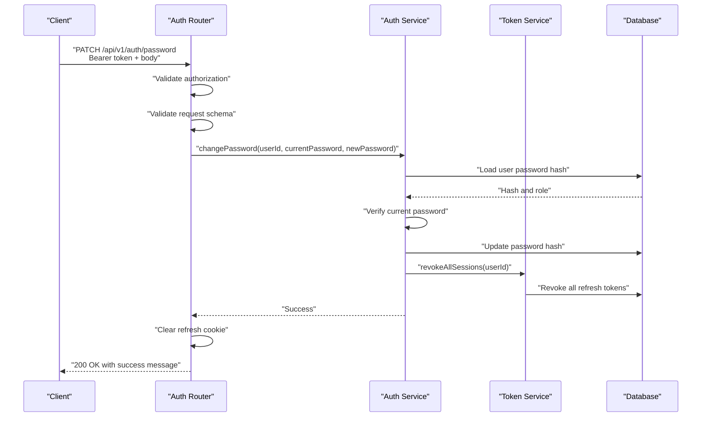
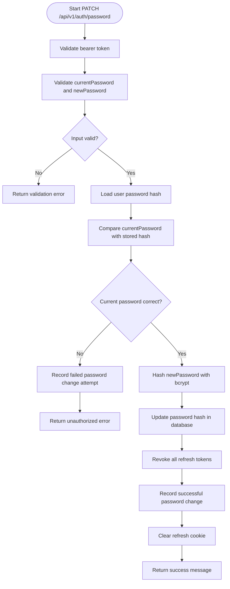
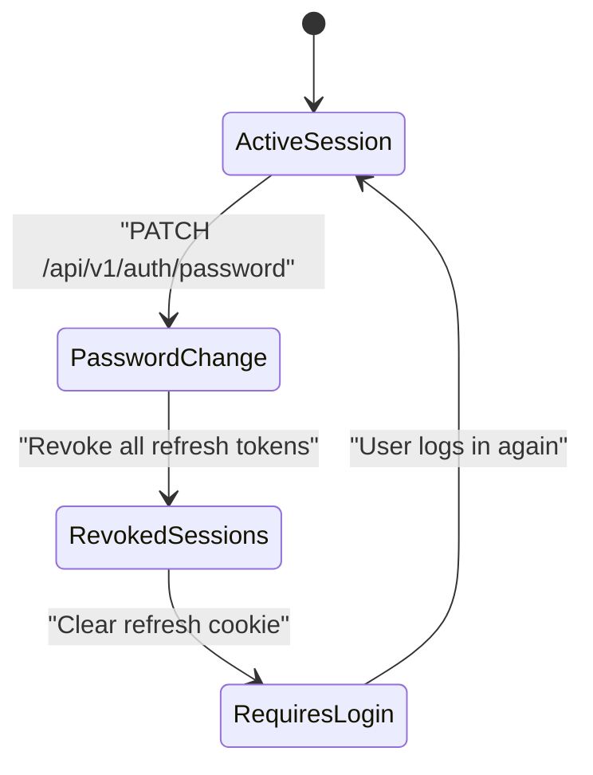
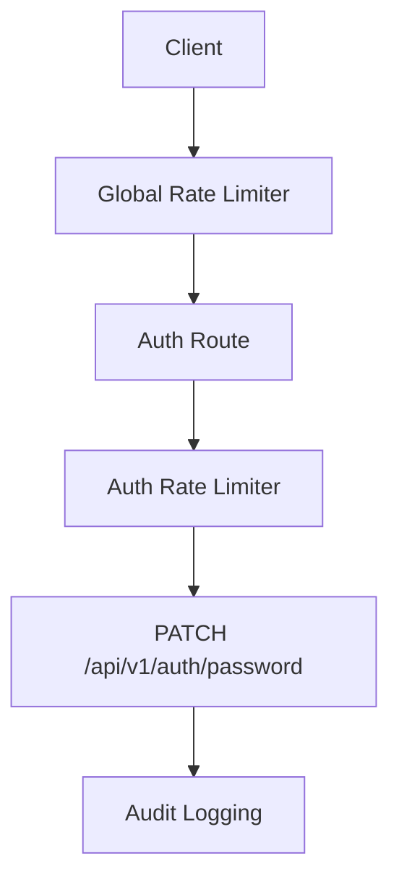

# Password Management

<cite>
**Referenced Files in This Document**
- [auth.routes.ts](file://backend/src/modules/auth/auth.routes.ts)
- [auth.service.ts](file://backend/src/modules/auth/auth.service.ts)
- [token.service.ts](file://backend/src/modules/auth/token.service.ts)
- [rateLimit.ts](file://backend/src/middleware/rateLimit.ts)
- [errors.ts](file://backend/src/lib/errors.ts)
- [env.ts](file://backend/src/config/env.ts)
- [openapi.yaml](file://backend/openapi.yaml)
</cite>

## Table of Contents
1. [Introduction](#introduction)
2. [Endpoint Summary](#endpoint-summary)
3. [Request Validation](#request-validation)
4. [Password Change Workflow](#password-change-workflow)
5. [Security Validation and Controls](#security-validation-and-controls)
6. [Response Model](#response-model)
7. [Error Responses](#error-responses)
8. [Session and Token Implications](#session-and-token-implications)
9. [Brute Force Protection](#brute-force-protection)
10. [Example Requests and Responses](#example-requests-and-responses)
11. [Security Considerations](#security-considerations)
12. [Troubleshooting Guide](#troubleshooting-guide)
13. [Conclusion](#conclusion)

## Introduction
This document provides detailed API documentation for the password management endpoint used to change a user’s password. It explains the request format, validation rules, processing workflow, security controls, response behavior, and the security implications of changing a password on existing sessions and tokens.

The implementation is part of an authentication module that uses short-lived access tokens, httpOnly refresh cookies, bcrypt password hashing, audit logging, rate limiting, and session revocation.

## Endpoint Summary
- Method: `PATCH`
- Path: `/api/v1/auth/password`
- Authentication: Required via bearer JWT access token
- Purpose: Validate the current password, update it with a secure hash, revoke all active refresh tokens, clear the refresh cookie, and require the client to re-authenticate.



**Diagram sources**
- [auth.routes.ts:110-120](file://backend/src/modules/auth/auth.routes.ts#L110-L120)
- [auth.service.ts:200-243](file://backend/src/modules/auth/auth.service.ts#L200-L243)
- [token.service.ts:203-205](file://backend/src/modules/auth/token.service.ts#L203-L205)

**Section sources**
- [openapi.yaml:156-174](file://backend/openapi.yaml#L156-L174)
- [auth.routes.ts:110-120](file://backend/src/modules/auth/auth.routes.ts#L110-L120)

## Request Validation
The endpoint enforces strict input validation before any database or cryptographic operations occur.

### Request Body Schema
| Field | Type | Required | Validation Rules | Description |
|---|---|---:|---|---|
| `currentPassword` | string | Yes | Minimum 1 character, maximum 128 characters | The user’s current password used for verification. |
| `newPassword` | string | Yes | Minimum 10 characters, maximum 128 characters, must contain at least one letter and one digit | The new password. |

These rules are defined by the route-level schema and reused from the shared password policy.

### Validation Behavior
- If `currentPassword` is missing, empty, or exceeds the length limit, the request fails validation.
- If `newPassword` does not meet the minimum length, maximum length, letter, or digit requirements, the request fails validation.
- Validation errors return a structured error response indicating bad request input.

**Section sources**
- [auth.routes.ts:26-31](file://backend/src/modules/auth/auth.routes.ts#L26-L31)
- [auth.routes.ts:46-49](file://backend/src/modules/auth/auth.routes.ts#L46-L49)
- [openapi.yaml:161-170](file://backend/openapi.yaml#L161-L170)

## Password Change Workflow
The password change flow follows a defensive, auditable sequence:

1. **Authorization check**: The request must include a valid bearer access token.
2. **Schema validation**: The request body is validated against the password change schema.
3. **User lookup**: The service loads the stored password hash and role for the authenticated user.
4. **Current password verification**: The provided current password is compared against the stored hash using bcrypt.
5. **New password hashing**: If verification succeeds, the new password is hashed with bcrypt.
6. **Database update**: The user’s password hash is updated.
7. **Session revocation**: All active refresh tokens for the user are revoked.
8. **Audit logging**: A successful password change event is recorded.
9. **Cookie clearing**: The server clears the refresh cookie because all sessions are invalidated.
10. **Response**: The client receives a success message instructing it to sign in again.



**Diagram sources**
- [auth.routes.ts:110-120](file://backend/src/modules/auth/auth.routes.ts#L110-L120)
- [auth.service.ts:200-243](file://backend/src/modules/auth/auth.service.ts#L200-L243)
- [token.service.ts:203-205](file://backend/src/modules/auth/token.service.ts#L203-L205)

**Section sources**
- [auth.service.ts:200-243](file://backend/src/modules/auth/auth.service.ts#L200-L243)

## Security Validation and Controls
The password change endpoint implements several security controls:

- **Bcrypt hashing**: Passwords are never stored in plaintext; both verification and storage use bcrypt.
- **Cost factor**: The bcrypt cost is configurable and defaults to a strong value suitable for production.
- **Generic failure messages**: Errors avoid leaking whether the account exists or whether the wrong field failed.
- **Audit logging**: Failed and successful password changes are logged with actor context, IP, user agent, and request ID.
- **Session revocation**: Changing a password invalidates all refresh tokens for the user, forcing re-authentication.
- **Cookie hygiene**: The refresh cookie is cleared after a successful password change.
- **Rate limiting**: Authentication endpoints are protected by a tighter rate limiter keyed by IP and email.
- **Account lockout**: While login has explicit lockout logic, password change failures are still audited and limited by rate limiting.

**Section sources**
- [auth.service.ts:15-24](file://backend/src/modules/auth/auth.service.ts#L15-L24)
- [auth.service.ts:200-243](file://backend/src/modules/auth/auth.service.ts#L200-L243)
- [token.service.ts:10-19](file://backend/src/modules/auth/token.service.ts#L10-L19)
- [rateLimit.ts:23-34](file://backend/src/middleware/rateLimit.ts#L23-L34)
- [env.ts:37-46](file://backend/src/config/env.ts#L37-L46)

## Response Model
On success, the endpoint returns HTTP 200 with a JSON body containing a confirmation message.

| Field | Type | Description |
|---|---|---|
| `message` | string | Confirmation that the password was updated and that the client should sign in again. |

After a successful password change:
- All refresh tokens are revoked.
- The refresh cookie is cleared.
- Existing access tokens may still be valid until they expire, but subsequent refresh attempts will fail because refresh tokens are revoked.
- Clients should treat this as a forced logout and redirect users to the login page.

**Section sources**
- [auth.routes.ts:117-120](file://backend/src/modules/auth/auth.routes.ts#L117-L120)
- [openapi.yaml:171-174](file://backend/openapi.yaml#L171-L174)

## Error Responses
The endpoint can return multiple error responses depending on validation, authentication, and business logic outcomes.

| Status | Meaning | Typical Cause |
|---:|---|---|
| 400 | Bad request | Invalid or missing fields in the request body. |
| 401 | Unauthorized | Missing, invalid, or expired bearer token; incorrect current password; account not found. |
| 429 | Too many requests | Rate limit exceeded due to excessive authentication attempts. |

Error responses follow a consistent application error shape with fields such as error code, message, optional details, and request ID.

**Section sources**
- [errors.ts:8-40](file://backend/src/lib/errors.ts#L8-L40)
- [openapi.yaml:264-285](file://backend/openapi.yaml#L264-L285)

## Session and Token Implications
Changing a password has immediate security consequences for active sessions:

- **Refresh tokens**: All refresh tokens associated with the user are revoked. Any future call to the refresh endpoint will fail.
- **Access tokens**: Short-lived access tokens may remain valid until their expiration time, but they cannot be refreshed once revoked.
- **Browser state**: The server clears the refresh cookie, so the client loses its ability to obtain new access tokens without re-authentication.
- **Client behavior**: After receiving the success response, clients should clear in-memory access tokens, navigate to login, and prompt the user to sign in again.



**Diagram sources**
- [auth.service.ts:228-230](file://backend/src/modules/auth/auth.service.ts#L228-L230)
- [token.service.ts:203-205](file://backend/src/modules/auth/token.service.ts#L203-L205)
- [auth.routes.ts:117-120](file://backend/src/modules/auth/auth.routes.ts#L117-L120)

**Section sources**
- [token.service.ts:203-205](file://backend/src/modules/auth/token.service.ts#L203-L205)
- [auth.routes.ts:117-120](file://backend/src/modules/auth/auth.routes.ts#L117-L120)

## Brute Force Protection
The password change endpoint benefits from layered protection against brute force and credential stuffing:

- **Authentication rate limiter**: A tighter limiter restricts authentication-related requests per IP and email.
- **General rate limiter**: A global limiter protects the API from excessive traffic.
- **Write limiter**: Write-heavy operations are also rate-limited per user or IP.
- **Audit logging**: Failed password change attempts are recorded for monitoring and incident response.
- **Generic error messages**: Responses do not reveal whether the failure was due to wrong credentials or invalid input.



**Diagram sources**
- [rateLimit.ts:14-47](file://backend/src/middleware/rateLimit.ts#L14-L47)
- [auth.routes.ts:110-120](file://backend/src/modules/auth/auth.routes.ts#L110-L120)
- [auth.service.ts:212-226](file://backend/src/modules/auth/auth.service.ts#L212-L226)

**Section sources**
- [rateLimit.ts:14-47](file://backend/src/middleware/rateLimit.ts#L14-L47)
- [auth.service.ts:212-226](file://backend/src/modules/auth/auth.service.ts#L212-L226)

## Example Requests and Responses

### Successful Password Change
- **Method**: `PATCH`
- **Path**: `/api/v1/auth/password`
- **Headers**:
  - `Authorization: Bearer <jwt>`
  - `Content-Type: application/json`
- **Body**:
  ```json
  {
    "currentPassword": "OldSecurePass1",
    "newPassword": "NewStrongPass2"
  }
  ```
- **Response**:
  - Status: `200 OK`
  - Body:
    ```json
    {
      "message": "Password updated. Please sign in again."
    }
    ```

### Validation Error
- **Cause**: Missing or invalid fields.
- **Response**:
  - Status: `400 Bad Request`
  - Body: Structured error with code, message, optional details, and request ID.

### Incorrect Current Password
- **Cause**: Provided current password does not match the stored hash.
- **Response**:
  - Status: `401 Unauthorized`
  - Body: Structured error indicating authentication failure.

### Rate Limited
- **Cause**: Too many authentication attempts within the configured window.
- **Response**:
  - Status: `429 Too Many Requests`
  - Body: Structured error indicating rate limiting.

**Section sources**
- [openapi.yaml:156-174](file://backend/openapi.yaml#L156-L174)
- [auth.routes.ts:110-120](file://backend/src/modules/auth/auth.routes.ts#L110-L120)
- [auth.service.ts:200-243](file://backend/src/modules/auth/auth.service.ts#L200-L243)
- [errors.ts:8-40](file://backend/src/lib/errors.ts#L8-L40)

## Security Considerations
When implementing or integrating with this endpoint, consider the following:

- **Never log passwords**: Passwords should not appear in logs, metrics, or error payloads.
- **Use HTTPS**: Always transmit credentials over TLS to prevent interception.
- **Enforce strong passwords**: The new password must satisfy minimum complexity requirements.
- **Handle forced logout gracefully**: After a successful password change, clients should clear tokens and redirect to login.
- **Monitor audit logs**: Track failed password change attempts and unusual patterns.
- **Avoid exposing sensitive details**: Do not return information about which field failed validation or whether the account exists.
- **Rotate secrets regularly**: Access and refresh token secrets should be managed securely and rotated according to organizational policy.
- **Treat access tokens as short-lived**: Even if an access token remains valid briefly after password change, refresh capability is revoked.

[No sources needed since this section provides general guidance]

## Troubleshooting Guide
Common issues and how to resolve them:

| Symptom | Likely Cause | Resolution |
|---|---|---|
| Client receives `400 Bad Request` after password change | Invalid request body | Ensure `currentPassword` and `newPassword` meet validation rules. |
| Client receives `401 Unauthorized` | Wrong current password or invalid bearer token | Verify the current password and access token validity. |
| Refresh calls fail after password change | Refresh tokens were revoked | Require the user to log in again. |
| Browser still shows old session state | Client did not clear tokens or navigate to login | Clear in-memory tokens and redirect to login. |
| Rate limit errors occur | Too many authentication attempts | Slow down requests and investigate possible abuse. |

**Section sources**
- [auth.routes.ts:110-120](file://backend/src/modules/auth/auth.routes.ts#L110-L120)
- [auth.service.ts:200-243](file://backend/src/modules/auth/auth.service.ts#L200-L243)
- [rateLimit.ts:14-47](file://backend/src/middleware/rateLimit.ts#L14-L47)

## Conclusion
The `PATCH /api/v1/auth/password` endpoint provides a secure, auditable mechanism for changing user passwords. It validates inputs strictly, verifies the current password, hashes the new password securely, revokes all refresh tokens, clears the refresh cookie, and requires re-authentication. Combined with rate limiting, generic error messages, and audit logging, it offers strong protection against brute force attacks and session hijacking while maintaining a clear, predictable API contract.

[No sources needed since this section summarizes without analyzing specific files]