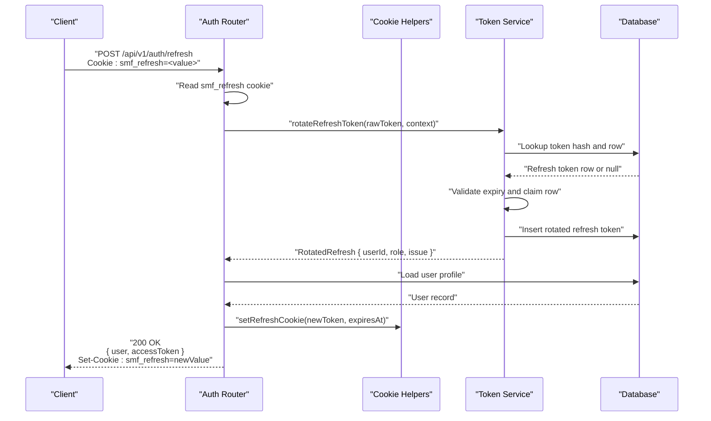
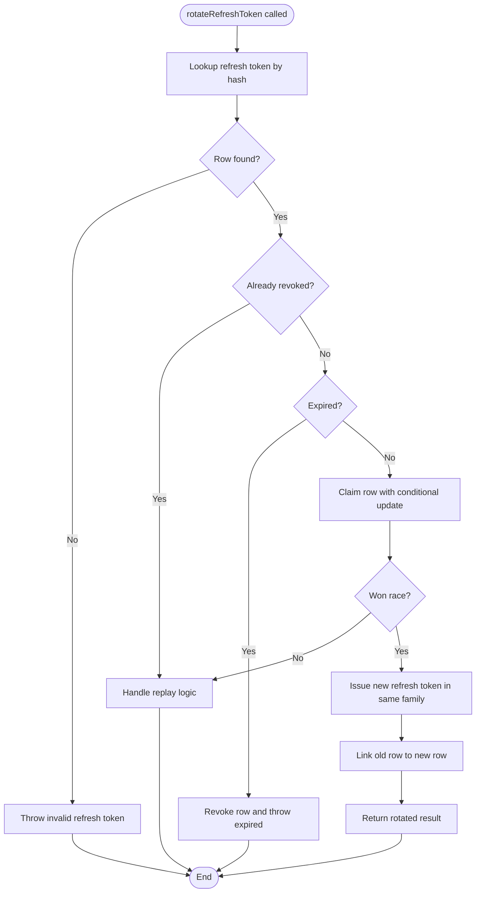
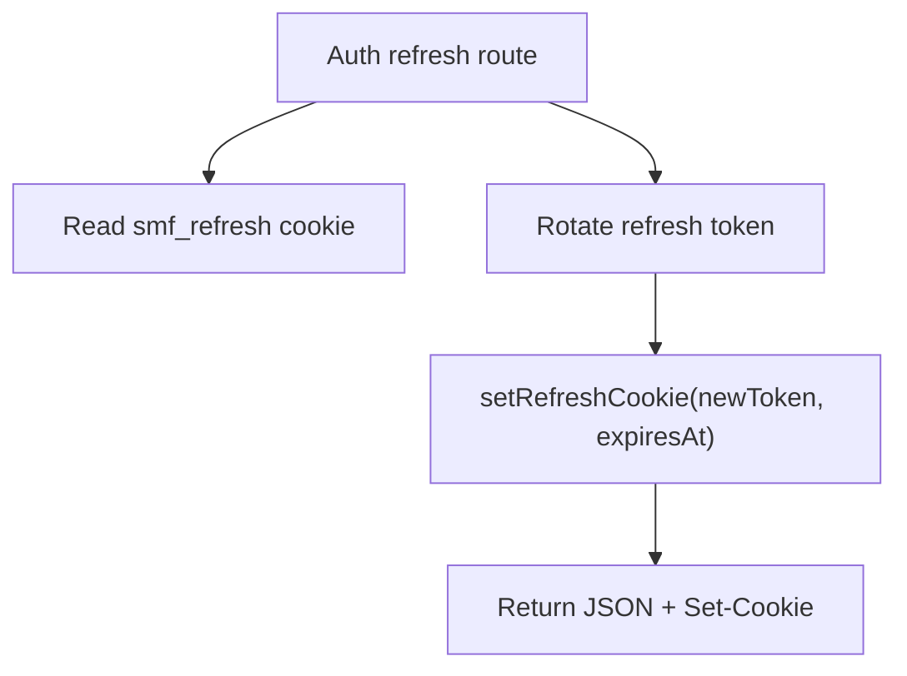
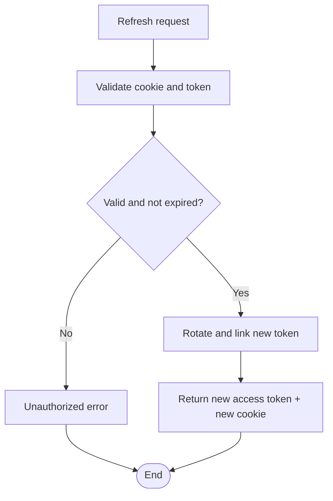
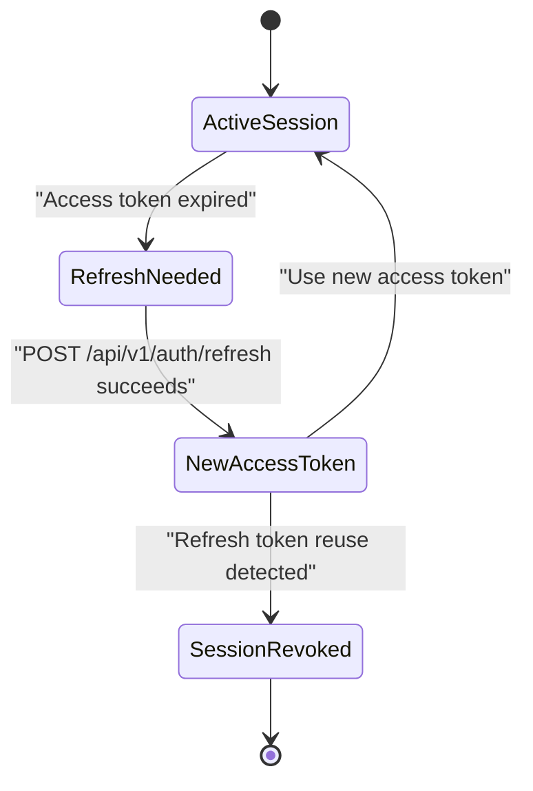

# Token Refresh

<cite>
**Referenced Files in This Document**
- [auth.routes.ts](file://backend/src/modules/auth/auth.routes.ts)
- [token.service.ts](file://backend/src/modules/auth/token.service.ts)
- [cookies.ts](file://backend/src/lib/cookies.ts)
- [openapi.yaml](file://backend/openapi.yaml)
</cite>

## Table of Contents
1. [Introduction](#introduction)
2. [Endpoint Summary](#endpoint-summary)
3. [Request and Response Flow](#request-and-response-flow)
4. [Refresh Token Rotation Model](#refresh-token-rotation-model)
5. [Cookie Behavior and Automatic Updates](#cookie-behavior-and-automatic-updates)
6. [Error Handling and Security Considerations](#error-handling-and-security-considerations)
7. [Access Token Lifecycle Relationship](#access-token-lifecycle-relationship)
8. [Examples](#examples)
9. [Troubleshooting Guide](#troubleshooting-guide)
10. [Conclusion](#conclusion)

## Introduction
This document explains the token refresh endpoint used to renew short-lived access tokens without requiring the user to re-enter credentials. The refresh mechanism is cookie-based, rotates the refresh token on every successful use, and protects against replay attacks by revoking related tokens when reuse is detected.

The implementation uses:
- An httpOnly, SameSite=Strict refresh cookie for secure storage.
- A server-side refresh token store that keeps only a hash of the refresh token.
- Token rotation with concurrency-safe claiming and family-wide revocation on suspicious reuse.
- A new short-lived JWT access token returned on each successful refresh.

## Endpoint Summary
- Method: POST
- Path: /api/v1/auth/refresh
- Authentication: No bearer token required; authentication is performed using the refresh cookie.
- Purpose: Rotate the refresh token and return a new access token.

Key behavior:
- Reads the refresh token from the `smf_refresh` cookie.
- Validates and rotates the refresh token.
- Sets a new refresh cookie with an updated expiration.
- Returns a new access token and current user information.

**Section sources**
- [openapi.yaml:113-129](file://backend/openapi.yaml#L113-L129)
- [auth.routes.ts:75-96](file://backend/src/modules/auth/auth.routes.ts#L75-L96)

## Request and Response Flow
The refresh flow proceeds as follows:

**Diagram sources**
- [auth.routes.ts:75-96](file://backend/src/modules/auth/auth.routes.ts#L75-L96)
- [token.service.ts:154-195](file://backend/src/modules/auth/token.service.ts#L154-L195)
- [cookies.ts:11-18](file://backend/src/lib/cookies.ts#L11-L18)

### Request Details
- Headers:
  - Cookie: `smf_refresh=<opaque-refresh-token>`
- Body: None
- Access token is not required for this endpoint because the refresh cookie is the session credential.

### Response Details
- Success response:
  - Status code: `200`
  - JSON body contains:
    - `user`: public user object including identifier, email, full name, role, and creation time.
    - `accessToken`: a new short-lived JWT access token.
- Cookie response:
  - `Set-Cookie: smf_refresh=<new-refresh-token>`
  - Cookie options include httpOnly, secure (in production), SameSite=Strict, and path `/api/v1/auth`.

**Section sources**
- [auth.routes.ts:75-96](file://backend/src/modules/auth/auth.routes.ts#L75-L96)
- [openapi.yaml:247-253](file://backend/openapi.yaml#L247-L253)
- [cookies.ts:11-18](file://backend/src/lib/cookies.ts#L11-L18)

## Refresh Token Rotation Model
The refresh token system is designed around rotation and reuse detection:

- Refresh tokens are opaque random values stored only as SHA-256 hashes.
- Each refresh request claims exactly one stored refresh token row.
- On success, a new refresh token is issued and linked to the same token family.
- If a previously rotated token is reused outside a small concurrency grace window, the entire token family is revoked.
- Concurrent double-submits from the same session can be tolerated within a configured grace period.

**Diagram sources**
- [token.service.ts:154-195](file://backend/src/modules/auth/token.service.ts#L154-L195)
- [token.service.ts:104-145](file://backend/src/modules/auth/token.service.ts#L104-L145)

### Key Concepts
- **Opaque refresh token**: A random value sent only in the cookie; never exposed to JavaScript.
- **Hash-only storage**: Only the SHA-256 hash is stored in the database.
- **Family grouping**: Related refresh tokens share a family ID so that theft can trigger family-wide revocation.
- **Concurrent safety**: Conditional updates prevent two requests from rotating the same token simultaneously.
- **Grace window**: A short allowed overlap for benign concurrent refreshes, such as multiple browser tabs.

**Section sources**
- [token.service.ts:10-19](file://backend/src/modules/auth/token.service.ts#L10-L19)
- [token.service.ts:64-76](file://backend/src/modules/auth/token.service.ts#L64-L76)
- [token.service.ts:154-195](file://backend/src/modules/auth/token.service.ts#L154-L195)

## Cookie Behavior and Automatic Updates
The refresh cookie is managed automatically by the refresh endpoint:

- The cookie name is configured via environment settings and defaults to `smf_refresh`.
- The cookie is set with:
  - `httpOnly: true` to prevent client-side script access.
  - `secure: true` in production to require HTTPS.
  - `sameSite: 'strict'` to reduce CSRF risk.
  - `path: '/api/v1/auth'` to scope the cookie to authentication endpoints.
  - `expires` set to the refresh token expiration time.

On successful refresh:
- The route calls the cookie helper with the newly issued refresh token and its expiration.
- The client receives both a new access token and a refreshed cookie.

**Diagram sources**
- [auth.routes.ts:75-96](file://backend/src/modules/auth/auth.routes.ts#L75-L96)
- [cookies.ts:11-18](file://backend/src/lib/cookies.ts#L11-L18)

**Section sources**
- [cookies.ts:4-8](file://backend/src/lib/cookies.ts#L4-L8)
- [cookies.ts:11-18](file://backend/src/lib/cookies.ts#L11-L18)
- [auth.routes.ts:75-96](file://backend/src/modules/auth/auth.routes.ts#L75-L96)

## Error Handling and Security Considerations
### Common Errors
- Missing refresh cookie:
  - The route throws an unauthorized error when the `smf_refresh` cookie is absent.
- Invalid refresh token:
  - Thrown when no matching token hash exists in the database.
- Expired refresh token:
  - Thrown after marking the token row as revoked.
- Refresh token reuse detected:
  - Thrown when a previously rotated token is reused outside the concurrency grace window.
  - The entire token family is revoked to prevent replay attacks.

### Security Properties
- Token rotation prevents long-lived reuse of the same refresh token.
- Hash-only storage reduces exposure if the database is compromised.
- Family-wide revocation limits damage from stolen refresh tokens.
- httpOnly and SameSite=Strict cookies reduce XSS and CSRF risks.
- Access tokens remain short-lived and are kept in memory by the client.

**Diagram sources**
- [auth.routes.ts:75-96](file://backend/src/modules/auth/auth.routes.ts#L75-L96)
- [token.service.ts:154-195](file://backend/src/modules/auth/token.service.ts#L154-L195)

**Section sources**
- [auth.routes.ts:75-96](file://backend/src/modules/auth/auth.routes.ts#L75-L96)
- [token.service.ts:154-195](file://backend/src/modules/auth/token.service.ts#L154-L195)
- [token.service.ts:104-145](file://backend/src/modules/auth/token.service.ts#L104-L145)
- [cookies.ts:4-8](file://backend/src/lib/cookies.ts#L4-L8)

## Access Token Lifecycle Relationship
The refresh endpoint does not validate the existing access token. Instead, it validates the refresh cookie and issues a new access token. This separation has important lifecycle implications:

- Access tokens are short-lived JWTs intended for immediate API authorization.
- Refresh tokens are longer-lived and used only to obtain new access tokens.
- Successful refresh replaces both:
  - The refresh cookie with a new value.
  - The access token in the application state.
- Clients should replace their in-memory access token after receiving a refresh response.

**Diagram sources**
- [token.service.ts:10-19](file://backend/src/modules/auth/token.service.ts#L10-L19)
- [auth.routes.ts:75-96](file://backend/src/modules/auth/auth.routes.ts#L75-L96)

**Section sources**
- [token.service.ts:10-19](file://backend/src/modules/auth/token.service.ts#L10-L19)
- [openapi.yaml:231-236](file://backend/openapi.yaml#L231-L236)
- [openapi.yaml:247-253](file://backend/openapi.yaml#L247-L253)

## Examples
### Successful Token Refresh
- Request:
  - Method: POST
  - URL: `/api/v1/auth/refresh`
  - Cookie: `smf_refresh=<valid-refresh-token>`
- Response:
  - Status: `200`
  - Body: `{ user, accessToken }`
  - Header: `Set-Cookie: smf_refresh=<new-refresh-token>`

Expected client behavior:
- Replace the stored access token.
- Use the new access token for subsequent authenticated requests.
- Let the browser manage the refreshed cookie automatically.

### Expired Refresh Token Handling
- Request:
  - Uses an expired refresh cookie.
- Server behavior:
  - Marks the token row as revoked.
  - Returns an unauthorized error indicating the refresh token is expired.
- Client behavior:
  - Treat the session as invalid.
  - Redirect the user to login.

### Refresh Token Reuse Detected
- Scenario:
  - A refresh token is used after it has already been rotated.
  - The reuse occurs outside the concurrency grace window.
- Server behavior:
  - Revokes all refresh tokens in the same family.
  - Returns an unauthorized error indicating refresh token reuse was detected.
- Client behavior:
  - Clear local session state.
  - Require the user to log in again.

**Section sources**
- [auth.routes.ts:75-96](file://backend/src/modules/auth/auth.routes.ts#L75-L96)
- [token.service.ts:154-195](file://backend/src/modules/auth/token.service.ts#L154-L195)
- [openapi.yaml:113-129](file://backend/openapi.yaml#L113-L129)

## Troubleshooting Guide
### Symptom: Refresh returns missing refresh token
- Cause:
  - The `smf_refresh` cookie is not present.
- Checks:
  - Confirm the client sends cookies with the request.
  - Verify the cookie path matches `/api/v1/auth`.
  - Ensure the client is not blocking third-party or cross-origin cookies incorrectly.

### Symptom: Refresh returns invalid refresh token
- Cause:
  - The cookie value does not match any stored token hash.
- Checks:
  - Confirm the cookie has not been cleared or overwritten.
  - Check whether logout or password change revoked sessions.
  - Verify the client is not sending a stale or manually edited cookie.

### Symptom: Refresh returns expired refresh token
- Cause:
  - The refresh token exceeded its configured lifetime.
- Checks:
  - Review refresh token TTL configuration.
  - Determine whether the session remained idle beyond the refresh window.
  - Prompt the user to log in again.

### Symptom: Refresh returns refresh token reuse detected
- Cause:
  - A previously rotated refresh token was replayed outside the concurrency grace window.
- Checks:
  - Investigate whether multiple tabs or retries caused concurrent refreshes.
  - Review audit logs for reuse detection events.
  - Treat the session as compromised and force reauthentication.

**Section sources**
- [auth.routes.ts:75-96](file://backend/src/modules/auth/auth.routes.ts#L75-L96)
- [token.service.ts:154-195](file://backend/src/modules/auth/token.service.ts#L154-L195)
- [cookies.ts:11-18](file://backend/src/lib/cookies.ts#L11-L18)

## Conclusion
The `/api/v1/auth/refresh` endpoint provides a secure, rotation-based mechanism for renewing access tokens. By storing only hashed refresh tokens, rotating them on every use, and revoking related tokens on suspicious reuse, the system balances usability with strong protection against replay and theft. Clients should treat the refresh response as a complete session renewal: replace the access token and rely on the automatically updated refresh cookie.