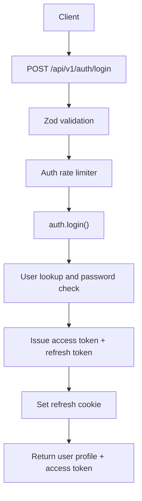
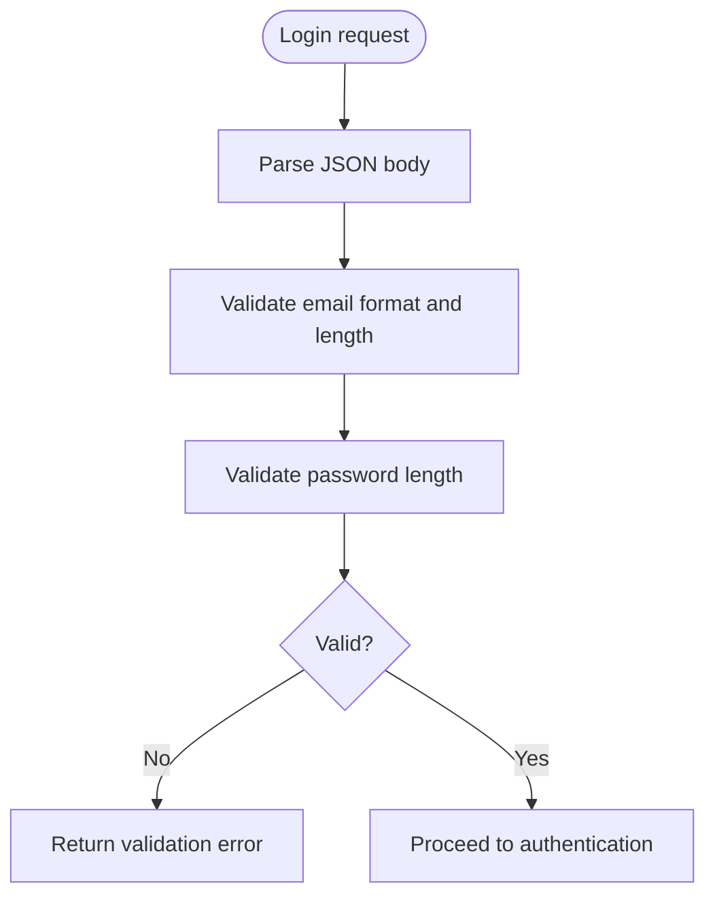
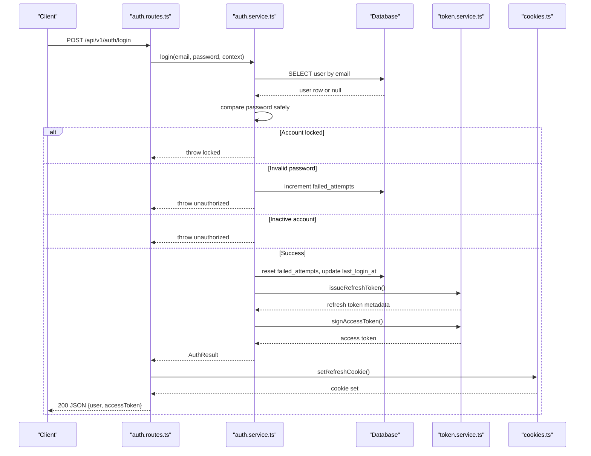
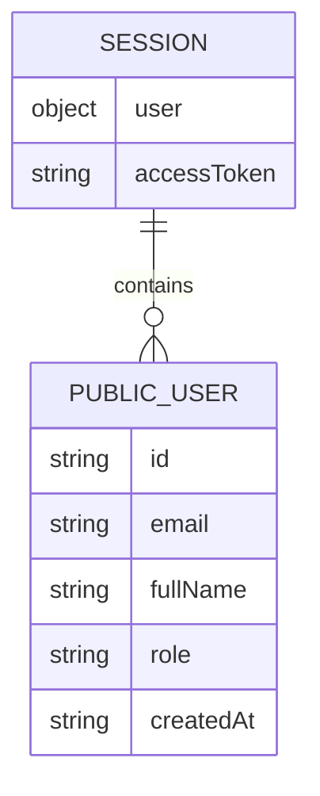
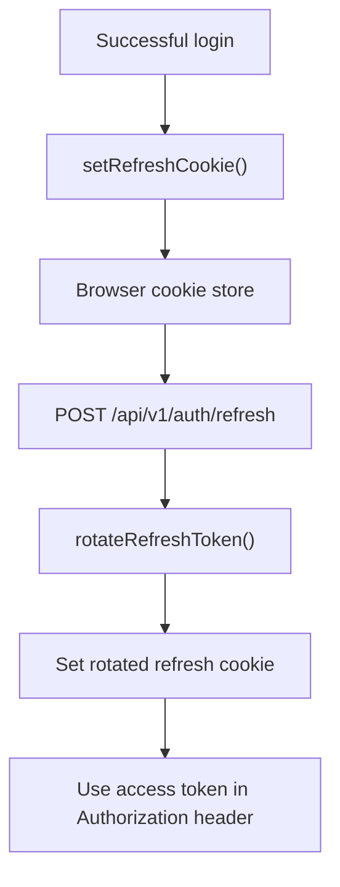
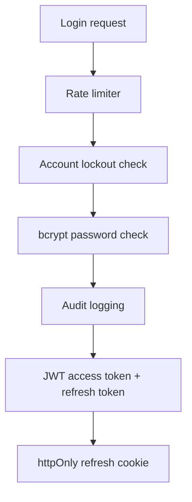
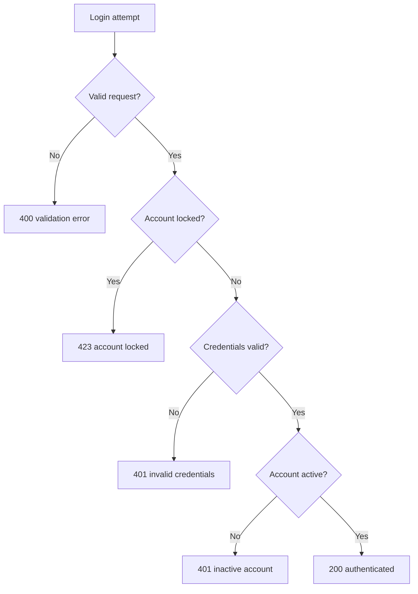
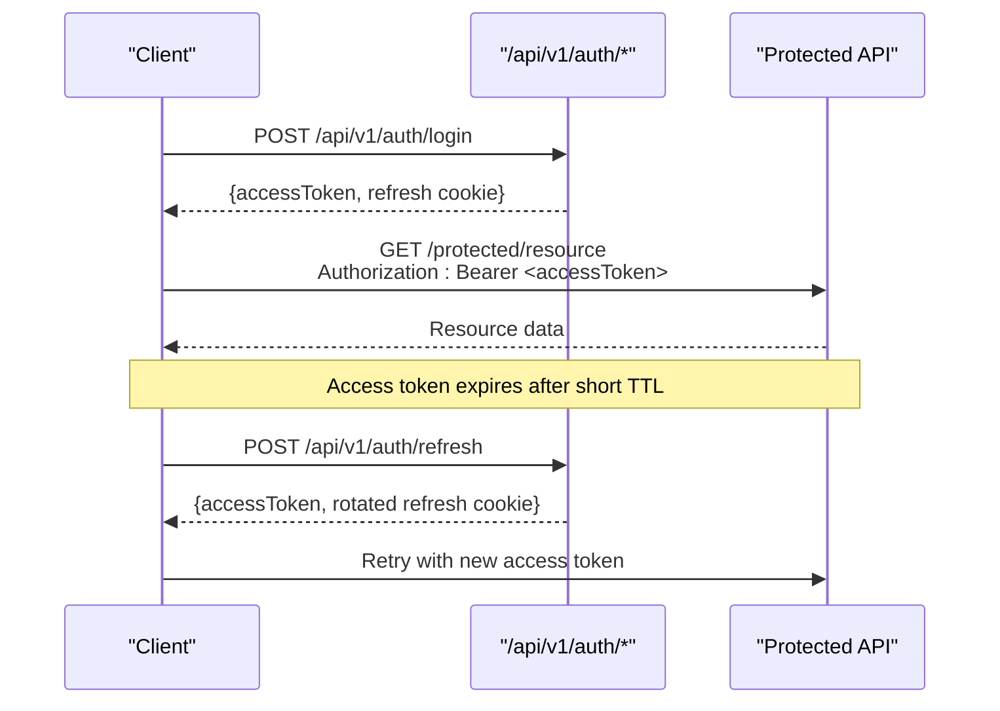
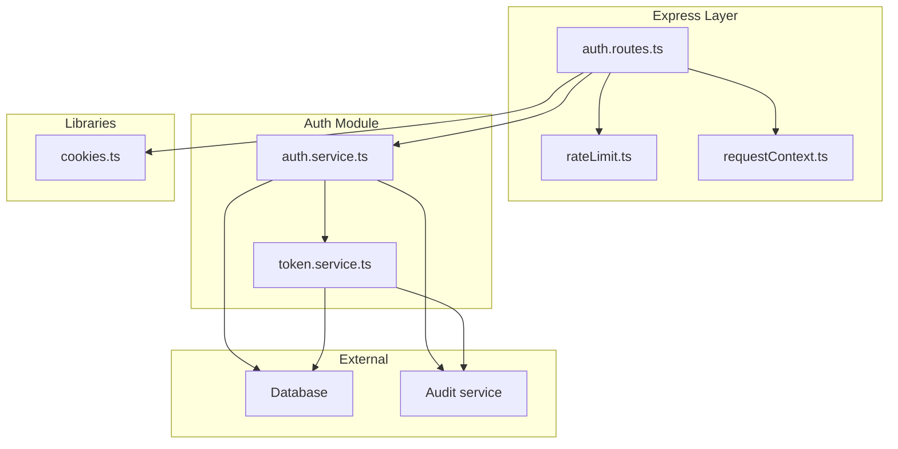

# User Login

<cite>
**Referenced Files in This Document**   
- [auth.routes.ts](file://backend/src/modules/auth/auth.routes.ts)
- [auth.service.ts](file://backend/src/modules/auth/auth.service.ts)
- [token.service.ts](file://backend/src/modules/auth/token.service.ts)
- [rateLimit.ts](file://backend/src/middleware/rateLimit.ts)
- [requestContext.ts](file://backend/src/middleware/requestContext.ts)
- [cookies.ts](file://backend/src/lib/cookies.ts)
- [openapi.yaml](file://backend/openapi.yaml)
</cite>

## Table of Contents
1. [Introduction](#introduction)
2. [Endpoint Summary](#endpoint-summary)
3. [Request Validation](#request-validation)
4. [Authentication Flow](#authentication-flow)
5. [Response Structure](#response-structure)
6. [Refresh Token Cookie and Session Management](#refresh-token-cookie-and-session-management)
7. [Security Controls](#security-controls)
8. [Error Scenarios](#error-scenarios)
9. [Post-Login API Access Pattern](#post-login-api-access-pattern)
10. [Architecture Overview](#architecture-overview)
11. [Troubleshooting Guide](#troubleshooting-guide)
12. [Conclusion](#conclusion)

## Introduction
This document explains the user login endpoint for the SecureMicrofinance backend. It covers the complete authentication flow from HTTP request to response, including validation, credential verification, token issuance, refresh cookie handling, session management, security controls, and how successful login enables subsequent API access.

The implementation is a Node.js Express application using Zod for input validation, bcrypt for password hashing, JWT for short-lived access tokens, and an opaque rotated refresh token stored in an httpOnly cookie.

## Endpoint Summary
- Method: `POST`
- Path: `/api/v1/auth/login`
- Purpose: Authenticate a user by email and password, return a short-lived access token, and establish a refresh token cookie for later token rotation.
- Authentication required: No
- Rate limiting: Applied per IP and email combination before route handlers run.

**Diagram sources**
- [auth.routes.ts:64-73](file://backend/src/modules/auth/auth.routes.ts#L64-L73)
- [auth.service.ts:114-197](file://backend/src/modules/auth/auth.service.ts#L114-L197)
- [token.service.ts:28-34](file://backend/src/modules/auth/token.service.ts#L28-L34)
- [token.service.ts:64-76](file://backend/src/modules/auth/token.service.ts#L64-L76)
- [cookies.ts:11-18](file://backend/src/lib/cookies.ts#L11-L18)

**Section sources**
- [openapi.yaml:81-111](file://backend/openapi.yaml#L81-L111)
- [auth.routes.ts:64-73](file://backend/src/modules/auth/auth.routes.ts#L64-L73)

## Request Validation
The login request body is validated with Zod before reaching the authentication service.

| Field | Type | Rules | Notes |
|---|---|---|---|
| `email` | string | Trimmed, maximum 254 characters, must match an email-like pattern | Normalized to lowercase in the service layer |
| `password` | string | Minimum 1 character, maximum 128 characters | The stricter registration password policy does not apply here |

Validation failures produce a client error response with a validation error structure. The OpenAPI specification documents this endpoint as requiring both `email` and `password`.

**Diagram sources**
- [auth.routes.ts:41-44](file://backend/src/modules/auth/auth.routes.ts#L41-L44)
- [openapi.yaml:90-99](file://backend/openapi.yaml#L90-L99)

**Section sources**
- [auth.routes.ts:41-44](file://backend/src/modules/auth/auth.routes.ts#L41-L44)
- [openapi.yaml:81-99](file://backend/openapi.yaml#L81-L99)

## Authentication Flow
The login handler delegates credential verification to the authentication service.

### Step-by-step flow
1. The route extracts `email` and `password` from the validated request body.
2. The service normalizes the email.
3. The service queries the user record by email.
4. A constant-time-style comparison is performed even when no user exists, preventing account enumeration through timing differences.
5. If the account is locked due to repeated failed attempts, the request fails immediately.
6. If the password is incorrect, the failed attempt counter increases and may trigger temporary lockout.
7. If the account is inactive, login is rejected.
8. On success, failed attempts are reset, last login time is updated, audit records are written, and tokens are issued.

**Diagram sources**
- [auth.routes.ts:64-73](file://backend/src/modules/auth/auth.routes.ts#L64-L73)
- [auth.service.ts:114-197](file://backend/src/modules/auth/auth.service.ts#L114-L197)
- [token.service.ts:28-34](file://backend/src/modules/auth/token.service.ts#L28-L34)
- [token.service.ts:64-76](file://backend/src/modules/auth/token.service.ts#L64-L76)
- [cookies.ts:11-18](file://backend/src/lib/cookies.ts#L11-L18)

**Section sources**
- [auth.service.ts:114-197](file://backend/src/modules/auth/auth.service.ts#L114-L197)
- [auth.routes.ts:64-73](file://backend/src/modules/auth/auth.routes.ts#L64-L73)

## Response Structure
On successful authentication, the endpoint returns HTTP 200 with a JSON object containing:

| Property | Type | Description |
|---|---|---|
| `user` | object | Public user profile |
| `accessToken` | string | Short-lived JWT used for subsequent API authorization |

### Public user profile fields
| Field | Type | Meaning |
|---|---|---|
| `id` | string | User identifier |
| `email` | string | Normalized email address |
| `fullName` | string | Display name |
| `role` | string | Role such as borrower, lender, or auditor |
| `createdAt` | string | ISO timestamp of account creation |

The OpenAPI schema defines the response as a `Session` object containing `user` and `accessToken`.

**Diagram sources**
- [openapi.yaml:247-253](file://backend/openapi.yaml#L247-L253)
- [openapi.yaml:239-246](file://backend/openapi.yaml#L239-L246)

**Section sources**
- [auth.service.ts:33-55](file://backend/src/modules/auth/auth.service.ts#L33-L55)
- [openapi.yaml:101-105](file://backend/openapi.yaml#L101-L105)
- [openapi.yaml:239-253](file://backend/openapi.yaml#L239-L253)

## Refresh Token Cookie and Session Management
After login, the server sets a refresh token cookie named according to configuration. The cookie has these security properties:

| Property | Value | Reason |
|---|---|---|
| Name | Configured cookie name | Defined in environment configuration |
| HttpOnly | true | Prevents JavaScript access |
| Secure | true in production | Ensures HTTPS-only transmission |
| SameSite | strict | Reduces CSRF risk |
| Path | `/api/v1/auth` | Limits cookie scope to auth endpoints |
| Expires | Refresh token expiry | Matches refresh token lifetime |

The refresh token itself is not sent in the request body. Instead, it is stored as an opaque value in the cookie and hashed in the database. Subsequent token refresh uses the `/api/v1/auth/refresh` endpoint, which rotates the refresh token and issues a new access token.

**Diagram sources**
- [cookies.ts:11-18](file://backend/src/lib/cookies.ts#L11-L18)
- [auth.routes.ts:75-96](file://backend/src/modules/auth/auth.routes.ts#L75-L96)
- [token.service.ts:154-195](file://backend/src/modules/auth/token.service.ts#L154-L195)

**Section sources**
- [cookies.ts:1-29](file://backend/src/lib/cookies.ts#L1-L29)
- [auth.routes.ts:75-96](file://backend/src/modules/auth/auth.routes.ts#L75-L96)
- [token.service.ts:64-76](file://backend/src/modules/auth/token.service.ts#L64-L76)
- [token.service.ts:154-195](file://backend/src/modules/auth/token.service.ts#L154-L195)

## Security Controls
The login endpoint implements several security measures:

### Rate Limiting
- Global rate limiter applies across the application.
- A tighter auth-specific limiter restricts authentication attempts per IP and submitted email.
- In test environments, rate limiters are bypassed for deterministic testing.

### Account Lockout
- Failed password attempts increment a counter.
- After reaching the configured maximum attempts, the account is temporarily locked.
- While locked, login requests receive a specific locked-account response.
- Successful login resets failed attempts and clears the lock.

### Credential Handling
- Passwords are compared using bcrypt.
- Unknown emails and wrong passwords return the same generic message to prevent account enumeration.
- Audit logs record login attempts, failures, and successes with contextual information.

### IP Tracking and User Agent Logging
- Client IP is extracted from forwarded headers when available.
- User agent is captured and limited in size.
- Both values are attached to audit records for login events.

### Token Security
- Access tokens are short-lived JWTs intended for memory-only storage on the client.
- Refresh tokens are opaque, rotated on use, and stored only as hashes.
- Reuse of a previously rotated refresh token can revoke the entire token family.

**Diagram sources**
- [rateLimit.ts:14-47](file://backend/src/middleware/rateLimit.ts#L14-L47)
- [auth.service.ts:132-177](file://backend/src/modules/auth/auth.service.ts#L132-L177)
- [requestContext.ts:15-28](file://backend/src/middleware/requestContext.ts#L15-L28)
- [token.service.ts:10-19](file://backend/src/modules/auth/token.service.ts#L10-L19)

**Section sources**
- [rateLimit.ts:1-51](file://backend/src/middleware/rateLimit.ts#L1-L51)
- [auth.service.ts:15-24](file://backend/src/modules/auth/auth.service.ts#L15-L24)
- [auth.service.ts:132-197](file://backend/src/modules/auth/auth.service.ts#L132-L197)
- [requestContext.ts:1-29](file://backend/src/middleware/requestContext.ts#L1-L29)
- [token.service.ts:10-19](file://backend/src/modules/auth/token.service.ts#L10-L19)

## Error Scenarios

### Successful Login
- Status: `200 OK`
- Body: `user` and `accessToken`
- Cookie: Refresh token cookie is set
- Audit: Login success recorded

### Invalid Credentials
- Status: `401 Unauthorized`
- Body: Generic error indicating invalid email or password
- Behavior: Failed attempt counter increases; no distinction between unknown email and wrong password

### Account Temporarily Locked
- Status: `423 Locked`
- Body: Error indicating temporary lockout after repeated failed logins
- Cause: Exceeded maximum failed login attempts within the configured window

### Validation Failure
- Status: Typically `400 Bad Request`
- Body: Validation error structure
- Cause: Missing or malformed `email` or `password`

### Inactive Account
- Status: `401 Unauthorized`
- Body: Error indicating the account is not active
- Cause: Account status is not active

**Diagram sources**
- [auth.service.ts:150-177](file://backend/src/modules/auth/auth.service.ts#L150-L177)
- [openapi.yaml:101-111](file://backend/openapi.yaml#L101-L111)

**Section sources**
- [auth.service.ts:150-177](file://backend/src/modules/auth/auth.service.ts#L150-L177)
- [openapi.yaml:81-111](file://backend/openapi.yaml#L81-L111)

## Post-Login API Access Pattern
After login, clients should:

1. Store the access token in memory only.
2. Include the access token in the `Authorization: Bearer <token>` header for protected endpoints.
3. Use the refresh endpoint when the access token expires.
4. Send the refresh cookie automatically for `/api/v1/auth/refresh`.
5. Call logout to revoke the current refresh token and clear the cookie when appropriate.

**Diagram sources**
- [auth.routes.ts:64-96](file://backend/src/modules/auth/auth.routes.ts#L64-L96)
- [token.service.ts:28-46](file://backend/src/modules/auth/token.service.ts#L28-L46)
- [openapi.yaml:231-236](file://backend/openapi.yaml#L231-L236)

**Section sources**
- [auth.routes.ts:64-96](file://backend/src/modules/auth/auth.routes.ts#L64-L96)
- [token.service.ts:28-46](file://backend/src/modules/auth/token.service.ts#L28-L46)
- [openapi.yaml:231-253](file://backend/openapi.yaml#L231-L253)

## Architecture Overview
The login endpoint spans routing, validation, business logic, token handling, cookies, rate limiting, and request context.

**Diagram sources**
- [auth.routes.ts:1-121](file://backend/src/modules/auth/auth.routes.ts#L1-L121)
- [auth.service.ts:1-262](file://backend/src/modules/auth/auth.service.ts#L1-L262)
- [token.service.ts:1-206](file://backend/src/modules/auth/token.service.ts#L1-L206)
- [rateLimit.ts:1-51](file://backend/src/middleware/rateLimit.ts#L1-L51)
- [requestContext.ts:1-29](file://backend/src/middleware/requestContext.ts#L1-L29)
- [cookies.ts:1-29](file://backend/src/lib/cookies.ts#L1-L29)

## Troubleshooting Guide

### Common Issues
- **Too many authentication attempts**: Indicates rate limiting or account lockout. Check whether the same IP and email combination exceeded limits or whether the account reached the failed attempt threshold.
- **Invalid email or password**: This is intentionally generic. Do not assume whether the email exists or the password is wrong.
- **Account temporarily locked**: Wait for the configured lock duration or contact support if lockout persists.
- **Refresh token reuse detected**: Occurs when a superseded refresh token is replayed outside the concurrency grace window. The client should re-authenticate.
- **Missing refresh cookie**: Ensure the client sends cookies for the `/api/v1/auth` path and that the browser allows cookies.

### Debugging Tips
- Inspect the `X-Request-Id` header returned by the request context middleware.
- Correlate client errors with audit records using the request ID.
- Verify cookie attributes: httpOnly, secure (in production), SameSite=strict, and path `/api/v1/auth`.
- Confirm that protected endpoints include the access token in the `Authorization` header.

**Section sources**
- [rateLimit.ts:23-34](file://backend/src/middleware/rateLimit.ts#L23-L34)
- [auth.service.ts:150-177](file://backend/src/modules/auth/auth.service.ts#L150-L177)
- [token.service.ts:104-145](file://backend/src/modules/auth/token.service.ts#L104-L145)
- [requestContext.ts:4-13](file://backend/src/middleware/requestContext.ts#L4-L13)
- [cookies.ts:4-8](file://backend/src/lib/cookies.ts#L4-L8)

## Conclusion
The `/api/v1/auth/login` endpoint provides a secure, auditable authentication flow. It validates inputs, prevents account enumeration, enforces rate limits and account lockout, issues short-lived access tokens, and establishes a safe refresh token cookie. Clients should use the access token for API authorization and rotate refresh tokens through the dedicated refresh endpoint while respecting cookie and security constraints.