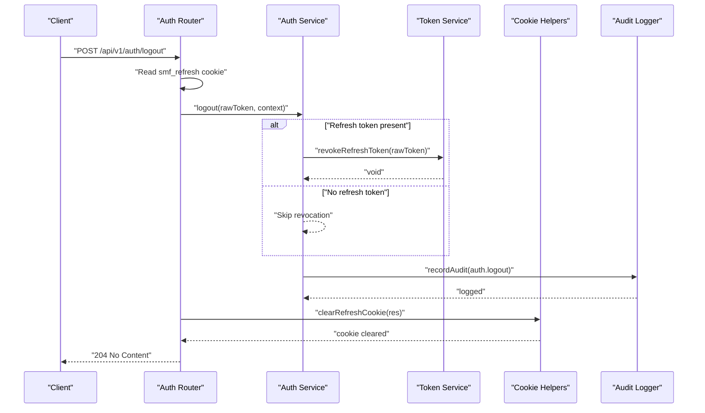
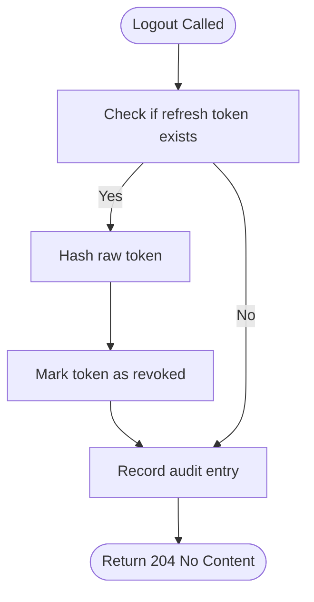
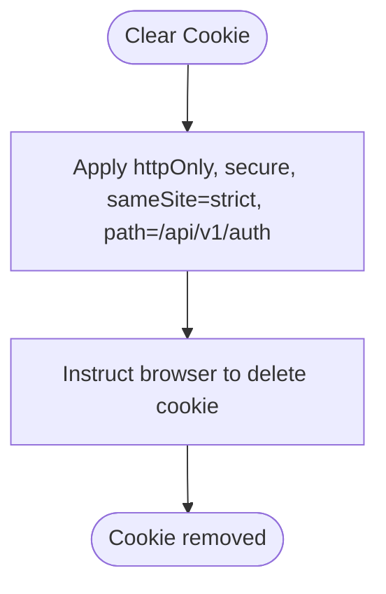
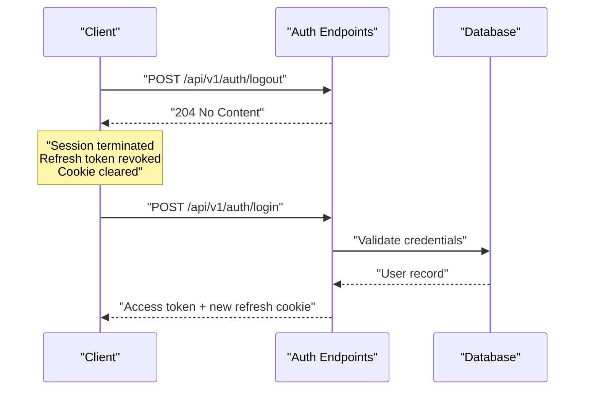
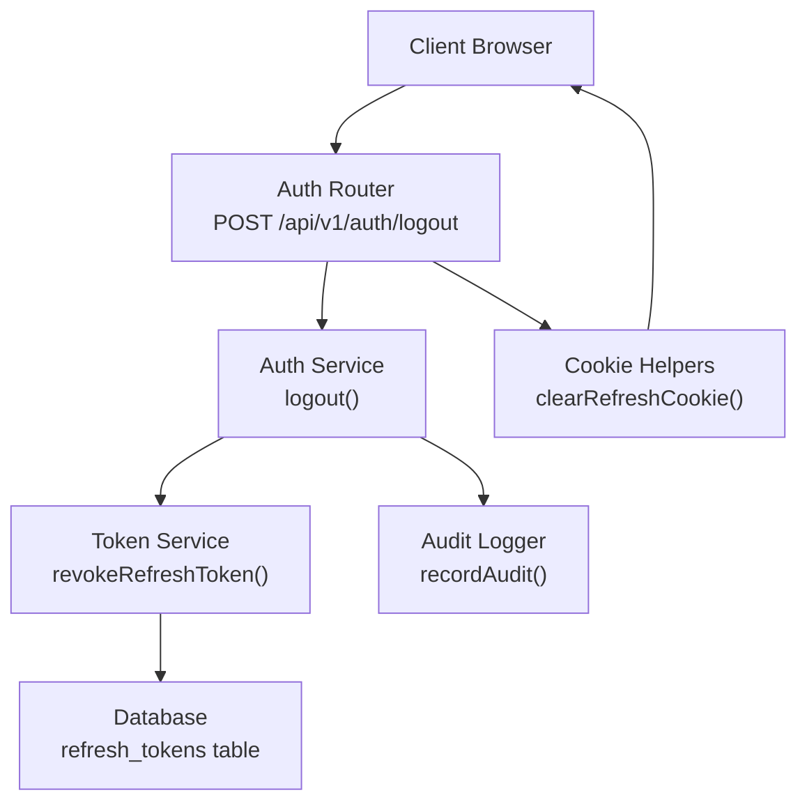

# User Logout

<cite>
**Referenced Files in This Document**
- [auth.routes.ts](file://backend/src/modules/auth/auth.routes.ts)
- [auth.service.ts](file://backend/src/modules/auth/auth.service.ts)
- [token.service.ts](file://backend/src/modules/auth/token.service.ts)
- [cookies.ts](file://backend/src/lib/cookies.ts)
- [auth.ts](file://backend/src/middleware/auth.ts)
- [openapi.yaml](file://backend/openapi.yaml)
</cite>

## Table of Contents
1. [Introduction](#introduction)
2. [Endpoint Summary](#endpoint-summary)
3. [Request and Response Model](#request-and-response-model)
4. [Logout Process Flow](#logout-process-flow)
5. [Refresh Token Invalidation](#refresh-token-invalidation)
6. [Cookie Cleanup Behavior](#cookie-cleanup-behavior)
7. [Audit Trail Logging](#audit-trail-logging)
8. [Client-Side Implications](#client-side-implications)
9. [Error Handling and Edge Cases](#error-handling-and-edge-cases)
10. [Security Considerations](#security-considerations)
11. [Relationship to Subsequent Authentication](#relationship-to-subsequent-authentication)
12. [Architecture Overview](#architecture-overview)
13. [Troubleshooting Guide](#troubleshooting-guide)
14. [Conclusion](#conclusion)

## Introduction
This document provides comprehensive API documentation for the user logout endpoint that terminates active sessions and clears refresh tokens. The endpoint is designed to be safe even when no refresh token is present, while ensuring that any existing refresh token is invalidated and an audit record is created. After a successful logout, clients must re-authenticate because the session’s refresh capability has been revoked.

The implementation uses:
- An HTTP-only, SameSite-Strict refresh cookie.
- A server-side refresh token store where only hashed values are persisted.
- Audit logging for every logout action.
- A 204 No Content response to indicate successful termination without returning sensitive data.

## Endpoint Summary
- **Method:** `POST`
- **Path:** `/api/v1/auth/logout`
- **Authentication:** Not required by the route itself; it operates on the refresh cookie rather than requiring a bearer token.
- **Purpose:** Revoke the current refresh token if present, clear the refresh cookie, and log the logout event.
- **Success Response:** `204 No Content`.
- **OpenAPI Definition:** The OpenAPI specification documents this endpoint under `/v1/auth/logout` with a `204` success response.

**Section sources**
- [auth.routes.ts:98-103](file://backend/src/modules/auth/auth.routes.ts#L98-L103)
- [openapi.yaml:131-138](file://backend/openapi.yaml#L131-L138)

## Request and Response Model
### Request
- **Headers:**
  - `Cookie`: Contains the refresh token cookie named according to configuration.
- **Body:** None.
- **Query Parameters:** None.
- **Content-Type:** Not applicable because there is no request body.

### Response
- **Success:** `204 No Content`.
- **No Body:** The response intentionally contains no JSON payload.
- **Cookies:** The refresh cookie is cleared in the response.

### Example Success Scenario
A client sends a POST request to `/api/v1/auth/logout` with the refresh cookie attached. The server revokes the token (if present), clears the cookie, and returns `204 No Content`.

**Section sources**
- [auth.routes.ts:98-103](file://backend/src/modules/auth/auth.routes.ts#L98-L103)
- [openapi.yaml:131-138](file://backend/openapi.yaml#L131-L138)

## Logout Process Flow
The logout flow consists of four main steps:
1. Extract the raw refresh token from the cookie.
2. Revoke the refresh token if it exists.
3. Clear the refresh cookie.
4. Return `204 No Content`.

**Diagram sources**
- [auth.routes.ts:98-103](file://backend/src/modules/auth/auth.routes.ts#L98-L103)
- [auth.service.ts:245-261](file://backend/src/modules/auth/auth.service.ts#L245-L261)
- [token.service.ts:197-201](file://backend/src/modules/auth/token.service.ts#L197-L201)
- [cookies.ts:21-28](file://backend/src/lib/cookies.ts#L21-L28)

**Section sources**
- [auth.routes.ts:98-103](file://backend/src/modules/auth/auth.routes.ts#L98-L103)
- [auth.service.ts:245-261](file://backend/src/modules/auth/auth.service.ts#L245-L261)

## Refresh Token Invalidation
When a refresh token is present, the logout process invalidates it by marking it as revoked in the database. Only the SHA-256 hash of the token is stored, so the server never persists the raw token value.

Key behaviors:
- If the token exists and is not already revoked, it is marked as revoked.
- If the token is missing or already revoked, the operation still succeeds.
- The audit log records whether a token was present during logout.

**Diagram sources**
- [auth.service.ts:245-261](file://backend/src/modules/auth/auth.service.ts#L245-L261)
- [token.service.ts:197-201](file://backend/src/modules/auth/token.service.ts#L197-L201)

**Section sources**
- [auth.service.ts:245-261](file://backend/src/modules/auth/auth.service.ts#L245-L261)
- [token.service.ts:197-201](file://backend/src/modules/auth/token.service.ts#L197-L201)

## Cookie Cleanup Behavior
After logout, the refresh cookie is cleared using the same security attributes used when setting it:
- `httpOnly`: Prevents JavaScript access.
- `secure`: Enforced in production.
- `sameSite: strict`: Prevents CSRF on refresh and logout endpoints.
- `path`: Scoped to `/api/v1/auth`.

**Diagram sources**
- [cookies.ts:11-18](file://backend/src/lib/cookies.ts#L11-L18)
- [cookies.ts:21-28](file://backend/src/lib/cookies.ts#L21-L28)

**Section sources**
- [auth.routes.ts:98-103](file://backend/src/modules/auth/auth.routes.ts#L98-L103)
- [cookies.ts:21-28](file://backend/src/lib/cookies.ts#L21-L28)

## Audit Trail Logging
Every logout attempt is recorded in the audit system. The audit entry includes:
- Action: `auth.logout`
- Entity type: `session`
- Actor user ID: Optional, based on context.
- Detail: Whether a refresh token was present.
- IP address, user agent, and request ID from the request context.

This ensures that logout events can be traced for security and compliance purposes.

**Section sources**
- [auth.service.ts:245-261](file://backend/src/modules/auth/auth.service.ts#L245-L261)

## Client-Side Implications
After receiving `204 No Content`, the client should:
1. Treat the session as terminated.
2. Remove local state related to authentication, such as in-memory access tokens.
3. Redirect the user to the login page.
4. Require re-authentication before allowing access to protected resources.

Important notes:
- The access token may still be valid for a short time, but the refresh token is revoked.
- Without a valid refresh token, the client cannot obtain new access tokens through the refresh flow.
- Any subsequent request to protected endpoints will fail once the access token expires or is rejected.

**Section sources**
- [auth.routes.ts:98-103](file://backend/src/modules/auth/auth.routes.ts#L98-L103)
- [token.service.ts:10-19](file://backend/src/modules/auth/token.service.ts#L10-L19)

## Error Handling and Edge Cases
### Missing Refresh Token
If the refresh cookie is absent, logout still succeeds:
- No token revocation occurs.
- The cookie cleanup call remains safe.
- The audit log records that no token was present.

This design prevents attackers from inferring account existence solely through logout behavior.

### Already Revoked Token
If the refresh token is already revoked, the logout operation still completes successfully. This avoids leaking information about prior revocation attempts.

### Response Behavior
- Successful logout always returns `204 No Content`.
- There is no error response defined for logout in the OpenAPI spec for normal cases.
- Unexpected server errors would be handled by the application’s global error middleware, but normal logout paths do not throw.

**Section sources**
- [auth.routes.ts:98-103](file://backend/src/modules/auth/auth.routes.ts#L98-L103)
- [auth.service.ts:245-261](file://backend/src/modules/auth/auth.service.ts#L245-L261)
- [openapi.yaml:131-138](file://backend/openapi.yaml#L131-L138)

## Security Considerations
### Refresh Token Storage
- The refresh token is stored in an HTTP-only cookie.
- It is scoped to `/api/v1/auth`.
- It uses `SameSite=Strict` to reduce CSRF risk.
- Only the SHA-256 hash is stored in the database.

### Session Reuse Prevention
- Once revoked, a refresh token cannot be reused.
- Reuse detection is implemented in the refresh rotation logic, which also protects against replay attacks.
- Logout explicitly revokes the token associated with the current cookie.

### Access Token Behavior
- The access token is short-lived and sent via the `Authorization: Bearer` header.
- It is kept in memory by the frontend and not stored in persistent storage.
- Even if the access token is temporarily valid after logout, the absence of a refresh token prevents long-term session recovery.

### Account Enumeration Protection
- Logout does not reveal whether an account existed.
- Missing cookies or invalid tokens do not produce distinct error responses for normal logout flows.

**Section sources**
- [cookies.ts:4-8](file://backend/src/lib/cookies.ts#L4-L8)
- [cookies.ts:11-18](file://backend/src/lib/cookies.ts#L11-L18)
- [token.service.ts:10-19](file://backend/src/modules/auth/token.service.ts#L10-L19)
- [token.service.ts:154-195](file://backend/src/modules/auth/token.service.ts#L154-L195)

## Relationship to Subsequent Authentication
After logout:
- The refresh token is revoked.
- The refresh cookie is cleared.
- The client must authenticate again using `/api/v1/auth/login`.
- Upon successful login, a new refresh token is issued and set as a cookie.
- Protected endpoints require a valid access token in the `Authorization` header.

**Diagram sources**
- [auth.routes.ts:64-73](file://backend/src/modules/auth/auth.routes.ts#L64-L73)
- [auth.routes.ts:98-103](file://backend/src/modules/auth/auth.routes.ts#L98-L103)
- [auth.ts:18-41](file://backend/src/middleware/auth.ts#L18-L41)

**Section sources**
- [auth.routes.ts:64-73](file://backend/src/modules/auth/auth.routes.ts#L64-L73)
- [auth.routes.ts:98-103](file://backend/src/modules/auth/auth.routes.ts#L98-L103)
- [auth.ts:18-41](file://backend/src/middleware/auth.ts#L18-L41)

## Architecture Overview
The logout endpoint integrates routing, service logic, token management, cookie handling, and audit logging.

**Diagram sources**
- [auth.routes.ts:98-103](file://backend/src/modules/auth/auth.routes.ts#L98-L103)
- [auth.service.ts:245-261](file://backend/src/modules/auth/auth.service.ts#L245-L261)
- [token.service.ts:197-201](file://backend/src/modules/auth/token.service.ts#L197-L201)
- [cookies.ts:21-28](file://backend/src/lib/cookies.ts#L21-L28)

## Troubleshooting Guide
### Symptom: Logout Returns 204 But Client Remains Logged In
**Likely Causes:**
- The client did not clear its in-memory access token.
- The client is still using a cached access token.
- The client did not redirect to the login page.

**Resolution:**
- Clear frontend authentication state.
- Redirect to the login page.
- Ensure subsequent requests require re-authentication.

### Symptom: Logout Succeeds But Refresh Fails Later
**Likely Causes:**
- The refresh token was revoked by logout.
- The refresh cookie was cleared.
- A previous refresh rotation caused reuse detection.

**Resolution:**
- Force re-login.
- Verify that the client sends the updated refresh cookie after login.

### Symptom: Logout Works Without a Cookie
**Explanation:**
- This is expected behavior.
- Logout is idempotent and safe when no refresh token is present.
- The audit log will show that no token was present.

**Section sources**
- [auth.routes.ts:98-103](file://backend/src/modules/auth/auth.routes.ts#L98-L103)
- [auth.service.ts:245-261](file://backend/src/modules/auth/auth.service.ts#L245-L261)
- [token.service.ts:154-195](file://backend/src/modules/auth/token.service.ts#L154-L195)

## Conclusion
The `/api/v1/auth/logout` endpoint provides a secure, auditable way to terminate user sessions. It revokes the refresh token when present, clears the HTTP-only refresh cookie, and logs the event. Clients must treat a `204 No Content` response as a full session termination and require re-authentication. The design minimizes information leakage, prevents session reuse, and aligns with best practices for token-based authentication.