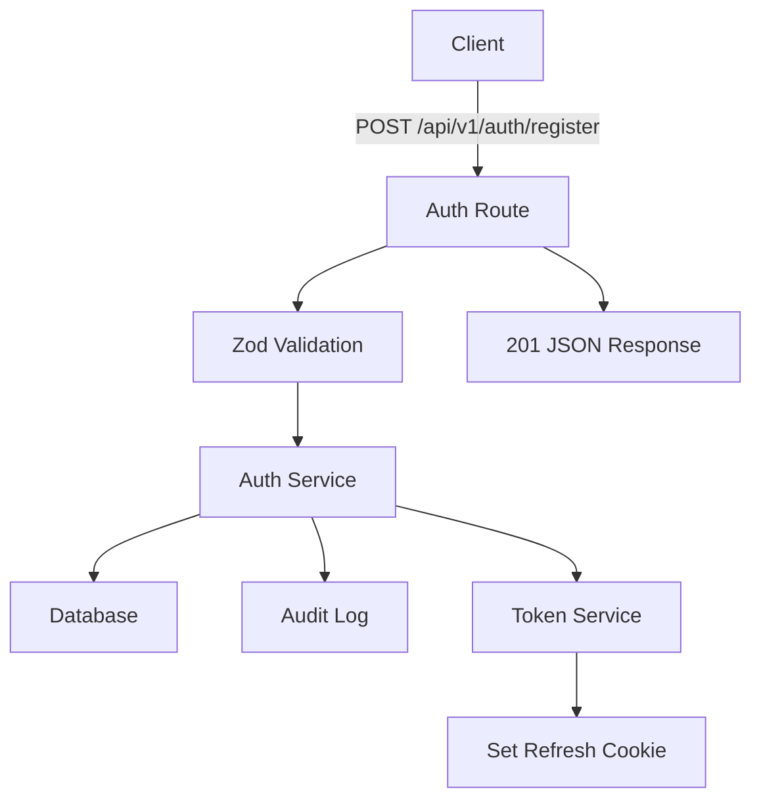
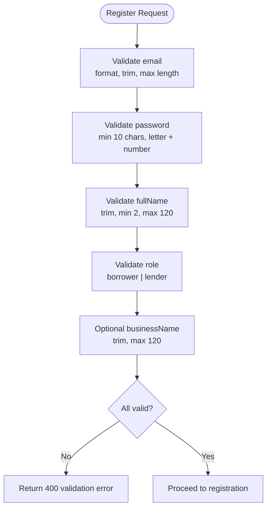
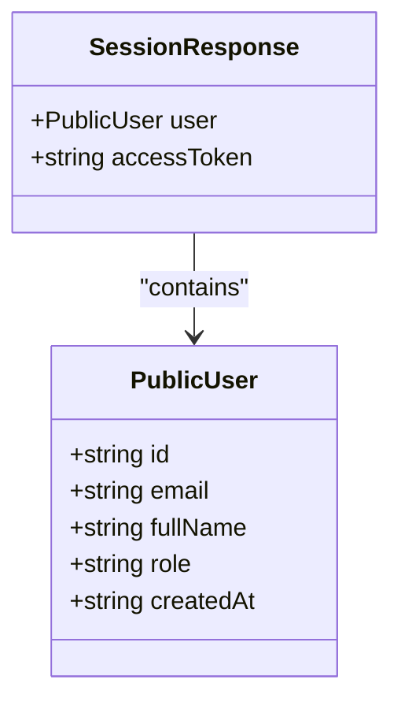
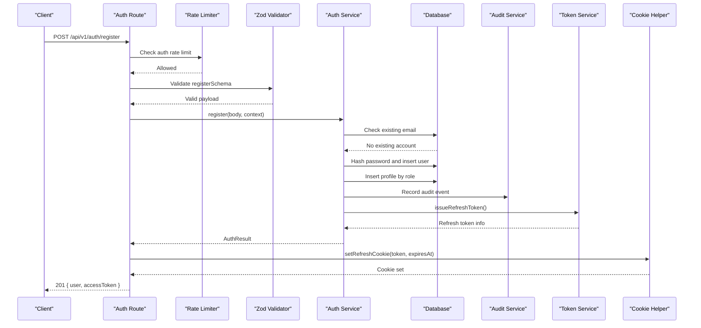
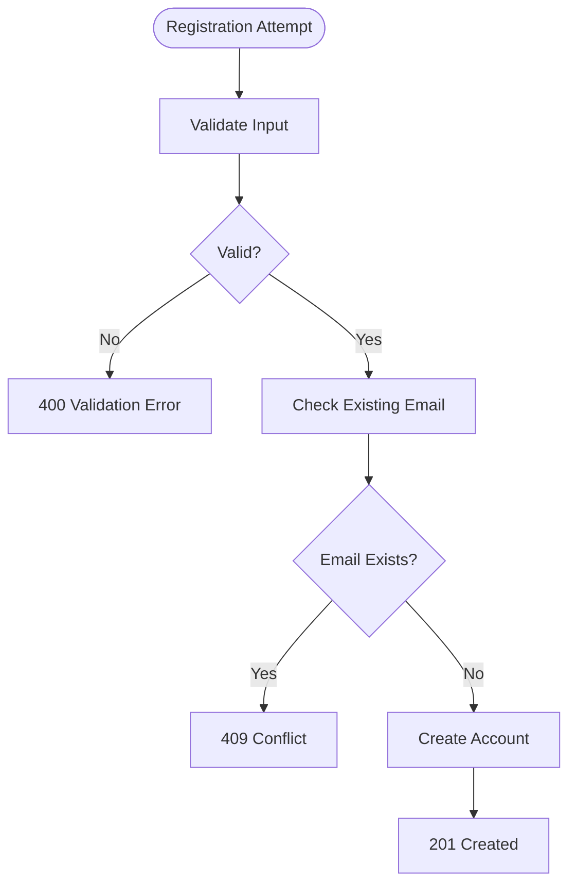
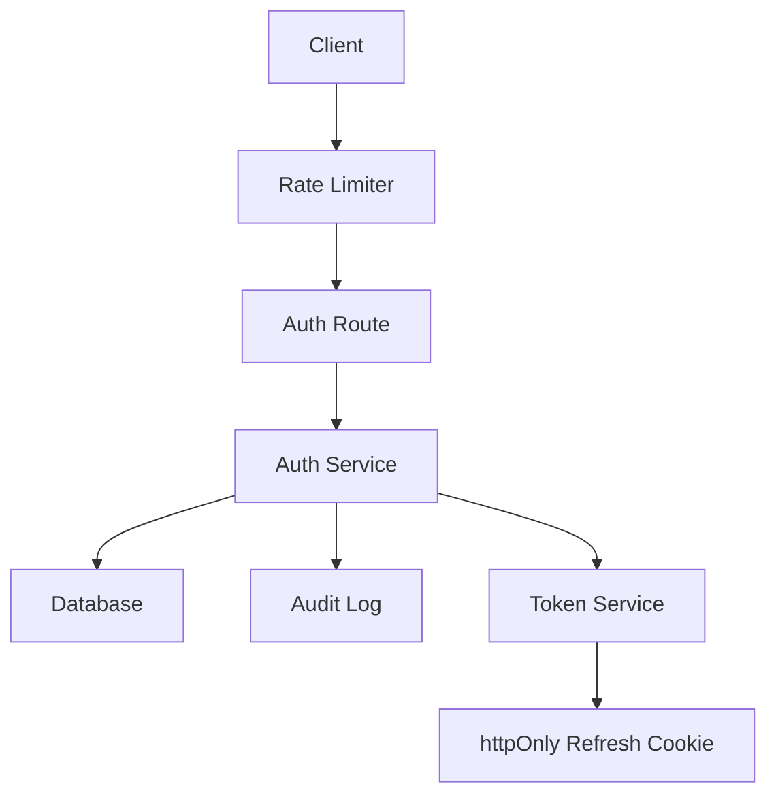
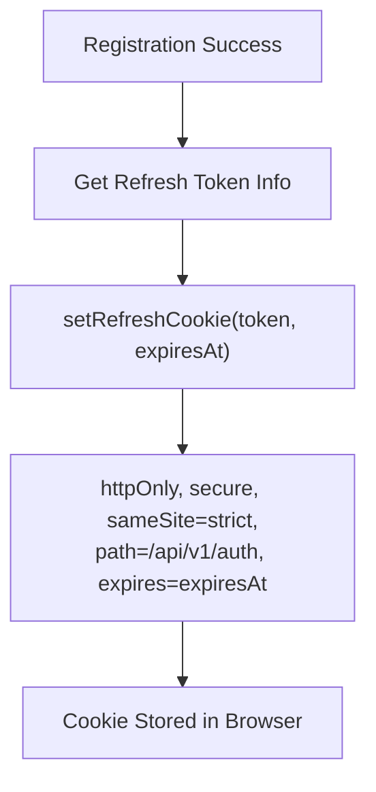
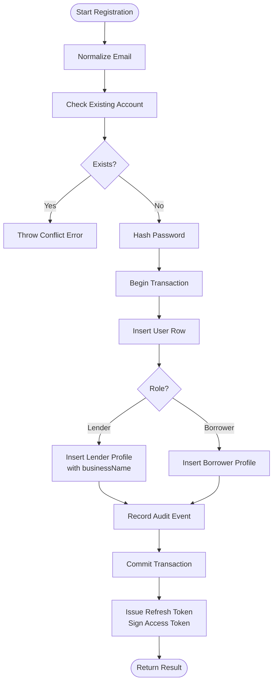

# User Registration

<cite>
**Referenced Files in This Document**
- [auth.routes.ts](file://backend/src/modules/auth/auth.routes.ts)
- [auth.service.ts](file://backend/src/modules/auth/auth.service.ts)
- [token.service.ts](file://backend/src/modules/auth/token.service.ts)
- [rateLimit.ts](file://backend/src/middleware/rateLimit.ts)
- [cookies.ts](file://backend/src/lib/cookies.ts)
- [openapi.yaml](file://backend/openapi.yaml)
</cite>

## Table of Contents
1. [Introduction](#introduction)
2. [Endpoint Summary](#endpoint-summary)
3. [Request Schema and Validation](#request-schema-and-validation)
4. [Response Structure](#response-structure)
5. [Successful Registration Flow](#successful-registration-flow)
6. [Error Responses](#error-responses)
7. [Security Considerations](#security-considerations)
8. [Refresh Token Cookie Behavior](#refresh-token-cookie-behavior)
9. [Account Creation Process](#account-creation-process)
10. [Examples](#examples)
11. [Troubleshooting Guide](#troubleshooting-guide)
12. [Conclusion](#conclusion)

## Introduction
This document provides detailed API documentation for the user registration endpoint used to create borrower or lender accounts. It covers the request body schema, validation rules, response structure, error behavior, security controls such as rate limiting and IP tracking, automatic refresh token cookie handling, and the full account creation process.

The implementation uses:
- Express routes with Zod-based request validation.
- A service layer that hashes passwords, creates users, writes audit records, and issues tokens.
- JWT access tokens and httpOnly refresh tokens stored in a database-backed token store.
- Rate limiters scoped by IP and email to prevent brute-force and credential stuffing.

## Endpoint Summary
- Method: `POST`
- Path: `/api/v1/auth/register`
- Authentication: None (public endpoint)
- Purpose: Create a new user account and return an access token while setting a secure refresh token cookie.

**Diagram sources**
- [auth.routes.ts:53-62](file://backend/src/modules/auth/auth.routes.ts#L53-L62)
- [auth.service.ts:61-112](file://backend/src/modules/auth/auth.service.ts#L61-L112)
- [token.service.ts:64-76](file://backend/src/modules/auth/token.service.ts#L64-L76)
- [cookies.ts:11-19](file://backend/src/lib/cookies.ts#L11-L19)

**Section sources**
- [openapi.yaml:38-80](file://backend/openapi.yaml#L38-L80)
- [auth.routes.ts:53-62](file://backend/src/modules/auth/auth.routes.ts#L53-L62)

## Request Schema and Validation
The registration request must be sent as JSON with the following fields:

- Required fields:
  - `email`: Valid email format, trimmed, maximum length 254 characters.
  - `password`: Minimum 10 characters, maximum 128 characters, must contain at least one letter and one digit.
  - `fullName`: Trimmed string, minimum 2 characters, maximum 120 characters.
  - `role`: Enumeration value; allowed values are `borrower` and `lender`.
- Optional field:
  - `businessName`: Trimmed string, maximum 120 characters; typically used when registering a lender.

Validation is enforced by Zod schemas before the request reaches the business logic. Invalid payloads produce a client error response.

**Diagram sources**
- [auth.routes.ts:20-39](file://backend/src/modules/auth/auth.routes.ts#L20-L39)

**Section sources**
- [auth.routes.ts:20-39](file://backend/src/modules/auth/auth.routes.ts#L20-L39)
- [openapi.yaml:46-63](file://backend/openapi.yaml#L46-L63)

## Response Structure
On successful registration, the server returns HTTP 201 with a JSON body containing:

- `user`: Public user object with:
  - `id`: User identifier.
  - `email`: Normalized email.
  - `fullName`: User’s full name.
  - `role`: Account role (`borrower` or `lender`).
  - `createdAt`: ISO timestamp of account creation.
- `accessToken`: Short-lived JWT used for authenticated requests.

Additionally, the server sets an httpOnly refresh token cookie named according to configuration. The OpenAPI specification documents this cookie under the `Set-Cookie` header.

**Diagram sources**
- [auth.service.ts:33-45](file://backend/src/modules/auth/auth.service.ts#L33-L45)
- [openapi.yaml:238-253](file://backend/openapi.yaml#L238-L253)

**Section sources**
- [auth.routes.ts:60-61](file://backend/src/modules/auth/auth.routes.ts#L60-L61)
- [auth.service.ts:33-45](file://backend/src/modules/auth/auth.service.ts#L33-L45)
- [openapi.yaml:64-73](file://backend/openapi.yaml#L64-L73)

## Successful Registration Flow
The registration flow performs these steps:

1. Receive the POST request at `/api/v1/auth/register`.
2. Apply rate limiting using an auth-specific limiter keyed by IP and submitted email.
3. Validate the request body against the registration schema.
4. Normalize the email and check for duplicate accounts.
5. Hash the password securely.
6. Insert the user into the database within a transaction.
7. Create the appropriate profile row based on role:
   - Lenders receive a lender profile row including optional business name.
   - Borrowers receive a borrower profile row.
8. Record an audit event for account creation.
9. Issue a refresh token and sign an access token.
10. Set the refresh token cookie.
11. Return HTTP 201 with the public user object and access token.

**Diagram sources**
- [auth.routes.ts:53-62](file://backend/src/modules/auth/auth.routes.ts#L53-L62)
- [auth.service.ts:61-112](file://backend/src/modules/auth/auth.service.ts#L61-L112)
- [token.service.ts:64-76](file://backend/src/modules/auth/token.service.ts#L64-L76)
- [cookies.ts:11-19](file://backend/src/lib/cookies.ts#L11-L19)

**Section sources**
- [auth.routes.ts:53-62](file://backend/src/modules/auth/auth.routes.ts#L53-L62)
- [auth.service.ts:61-112](file://backend/src/modules/auth/auth.service.ts#L61-L112)
- [token.service.ts:64-76](file://backend/src/modules/auth/token.service.ts#L64-L76)
- [cookies.ts:11-19](file://backend/src/lib/cookies.ts#L11-L19)

## Error Responses
Common error responses include:

- **400 Bad Request**: Validation failure due to invalid email format, weak password, missing required fields, or unsupported role.
- **409 Conflict**: Duplicate email already registered.
- **429 Too Many Requests**: Rate limit exceeded for authentication attempts.
- **5xx Server Error**: Internal server errors during database operations or hashing.

For duplicate emails, the service explicitly throws a conflict error after checking for an existing account. For validation failures, the middleware returns a structured error response defined in the OpenAPI spec.

**Diagram sources**
- [auth.routes.ts:53-62](file://backend/src/modules/auth/auth.routes.ts#L53-L62)
- [auth.service.ts:61-64](file://backend/src/modules/auth/auth.service.ts#L61-L64)
- [openapi.yaml:74-79](file://backend/openapi.yaml#L74-L79)

**Section sources**
- [auth.service.ts:61-64](file://backend/src/modules/auth/auth.service.ts#L61-L64)
- [openapi.yaml:74-79](file://backend/openapi.yaml#L74-L79)

## Security Considerations
- **Password Handling**: Passwords are hashed using bcrypt with a configurable cost factor. Passwords are never logged or returned.
- **Rate Limiting**:
  - Global rate limiter applies across the API.
  - Auth-specific limiter restricts authentication attempts per IP and email combination.
  - Write limiter protects write endpoints.
- **IP Tracking**: Registration requests capture the client IP and user agent for audit logging.
- **Access Token Strategy**: Access tokens are short-lived JWTs intended for memory-only storage in the frontend.
- **Refresh Token Strategy**: Refresh tokens are opaque, rotated on use, stored as SHA-256 hashes, and protected via httpOnly cookies. Reuse detection revokes entire token families to mitigate theft.
- **Audit Logging**: Every registration success is recorded with actor details, IP, user agent, and request ID.

**Diagram sources**
- [rateLimit.ts:14-47](file://backend/src/middleware/rateLimit.ts#L14-L47)
- [auth.routes.ts:53-62](file://backend/src/modules/auth/auth.routes.ts#L53-L62)
- [auth.service.ts:61-112](file://backend/src/modules/auth/auth.service.ts#L61-L112)
- [token.service.ts:10-19](file://backend/src/modules/auth/token.service.ts#L10-L19)
- [cookies.ts:4-8](file://backend/src/lib/cookies.ts#L4-L8)

**Section sources**
- [rateLimit.ts:14-47](file://backend/src/middleware/rateLimit.ts#L14-L47)
- [auth.service.ts:15-24](file://backend/src/modules/auth/auth.service.ts#L15-L24)
- [token.service.ts:10-19](file://backend/src/modules/auth/token.service.ts#L10-L19)
- [cookies.ts:4-8](file://backend/src/lib/cookies.ts#L4-L8)

## Refresh Token Cookie Behavior
When registration succeeds, the server automatically sets a refresh token cookie:

- Cookie name: Configured via environment settings.
- HttpOnly: Enabled to prevent JavaScript access.
- Secure: Enabled in production environments.
- SameSite: Strict to reduce CSRF risk.
- Path: Scoped to `/api/v1/auth`.
- Expiration: Based on configured refresh token TTL.

The cookie is set immediately after the registration service returns the refresh token information.

**Diagram sources**
- [auth.routes.ts:60-61](file://backend/src/modules/auth/auth.routes.ts#L60-L61)
- [cookies.ts:11-19](file://backend/src/lib/cookies.ts#L11-L19)

**Section sources**
- [auth.routes.ts:60-61](file://backend/src/modules/auth/auth.routes.ts#L60-L61)
- [cookies.ts:11-19](file://backend/src/lib/cookies.ts#L11-L19)

## Account Creation Process
The account creation process ensures data consistency and security:

1. Normalize the email address.
2. Check for existing accounts by normalized email.
3. Hash the password using bcrypt.
4. Begin a database transaction.
5. Insert the user record with email, password hash, role, and full name.
6. Insert the corresponding profile record:
   - Lender profiles include optional business name.
   - Borrower profiles are created without business name.
7. Record an audit event inside the same transaction.
8. Commit the transaction.
9. Issue a refresh token and sign an access token.
10. Return the public user object and access token.

**Diagram sources**
- [auth.service.ts:61-112](file://backend/src/modules/auth/auth.service.ts#L61-L112)

**Section sources**
- [auth.service.ts:61-112](file://backend/src/modules/auth/auth.service.ts#L61-L112)

## Examples
Below are conceptual examples describing expected request and response shapes. Do not copy exact secrets or tokens from any source.

### Successful Registration
- Request:
  - Method: `POST`
  - Path: `/api/v1/auth/register`
  - Body:
    - `email`: `"alice@example.com"`
    - `password`: `"SecurePass1"`
    - `fullName`: `"Alice Mwangi"`
    - `role`: `"lender"`
    - `businessName`: `"Mwangi Trading"`
- Response:
  - Status: `201 Created`
  - Body:
    - `user`: Object with `id`, `email`, `fullName`, `role`, `createdAt`
    - `accessToken`: JWT string
  - Headers:
    - `Set-Cookie`: Contains the refresh token cookie with secure attributes

### Duplicate Email Error
- Request: Same as above but email already exists.
- Response:
  - Status: `409 Conflict`
  - Body: Structured error object with code, message, and request ID

### Invalid Data Error
- Request:
  - `password`: `"short"`
  - `role`: `"auditor"`
- Response:
  - Status: `400 Bad Request`
  - Body: Structured error object indicating validation failure

**Section sources**
- [openapi.yaml:38-80](file://backend/openapi.yaml#L38-L80)
- [auth.routes.ts:53-62](file://backend/src/modules/auth/auth.routes.ts#L53-L62)
- [auth.service.ts:61-64](file://backend/src/modules/auth/auth.service.ts#L61-L64)

## Troubleshooting Guide
- **Validation Errors**: Ensure the email matches a standard format, the password meets complexity requirements, and the role is either `borrower` or `lender`.
- **Duplicate Email**: Use a different email address or verify whether the account already exists.
- **Rate Limited**: If you see a rate limit error, wait before retrying. The auth limiter is keyed by IP and email to prevent brute-force attacks.
- **Cookie Not Set**: Verify that the client accepts cookies and that the path scope matches `/api/v1/auth`. In development, ensure the secure flag does not block local testing if needed.
- **Access Token Issues**: Keep the access token in memory only and send it via the authorization header for subsequent requests.

**Section sources**
- [rateLimit.ts:23-34](file://backend/src/middleware/rateLimit.ts#L23-L34)
- [cookies.ts:11-19](file://backend/src/lib/cookies.ts#L11-L19)
- [auth.routes.ts:53-62](file://backend/src/modules/auth/auth.routes.ts#L53-L62)

## Conclusion
The user registration endpoint provides a secure, validated, and auditable way to create borrower or lender accounts. It enforces strong password rules, prevents enumeration through consistent error messages, tracks IP and user agent, limits authentication attempts, and manages session state through short-lived access tokens and secure refresh cookies. Clients should handle validation errors, duplicate account conflicts, and rate limiting appropriately, and should store the access token in memory while relying on the httpOnly refresh cookie for session rotation.