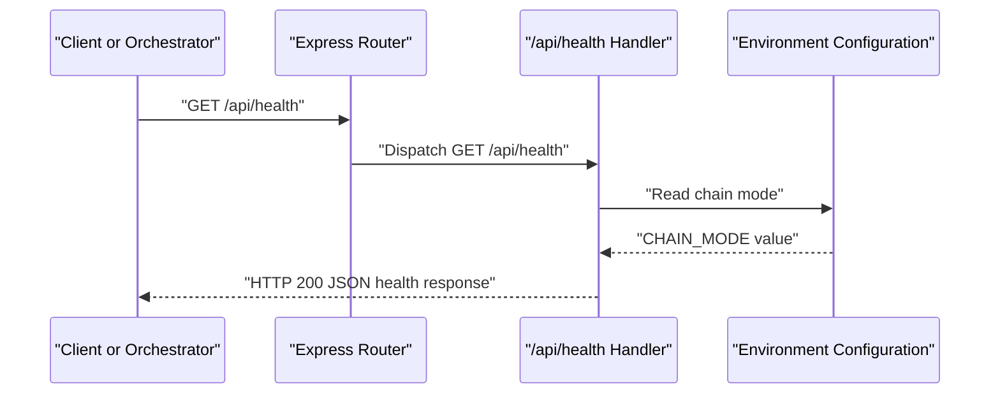
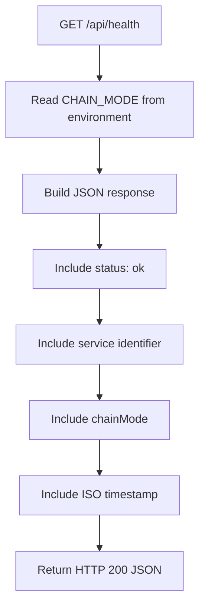
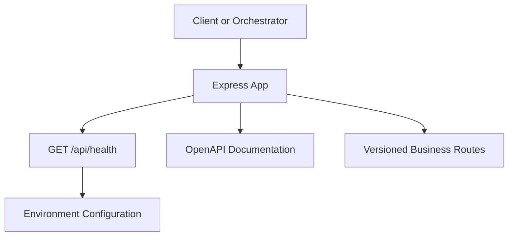
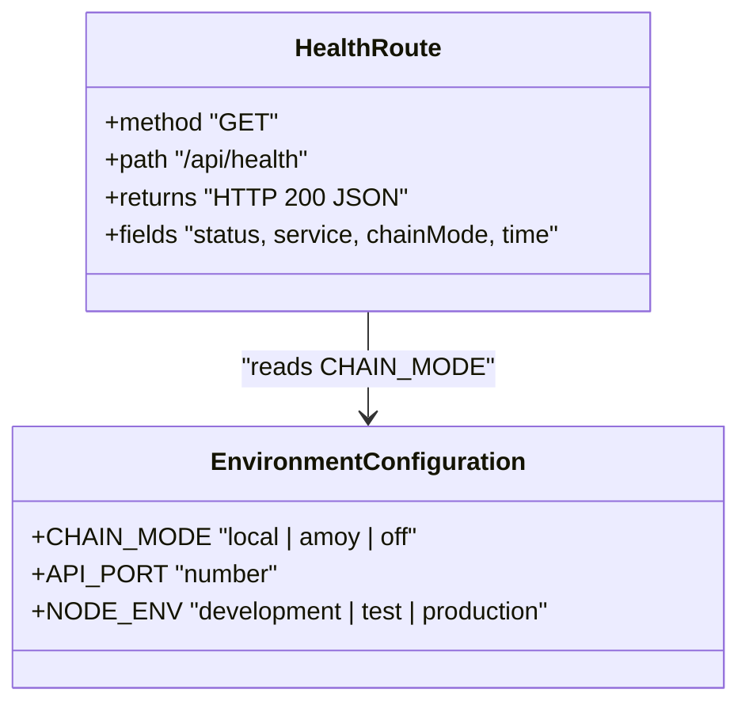
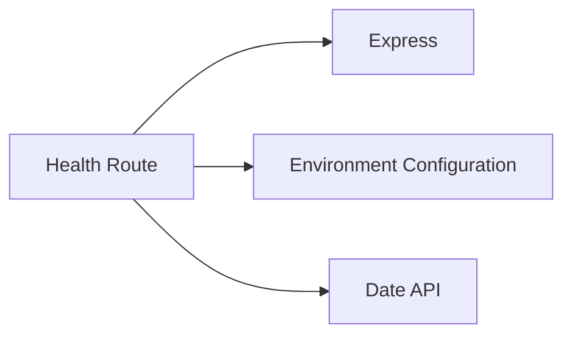

# Health Check API

<cite>
**Referenced Files in This Document**
- [app.ts](file://backend/src/app.ts)
- [env.ts](file://backend/src/config/env.ts)
- [openapi.yaml](file://backend/openapi.yaml)
- [server.ts](file://backend/src/server.ts)
- [AuditorDashboard.tsx](file://frontend/src/pages/auditor/AuditorDashboard.tsx)
</cite>

## Table of Contents
1. [Introduction](#introduction)
2. [Endpoint Summary](#endpoint-summary)
3. [Request Specification](#request-specification)
4. [Response Structure](#response-structure)
5. [Health Status Interpretation](#health-status-interpretation)
6. [Examples](#examples)
7. [Container Orchestration Integration](#container-orchestration-integration)
8. [Monitoring and Alerting Guidelines](#monitoring-and-alerting-guidelines)
9. [Architecture Overview](#architecture-overview)
10. [Detailed Component Analysis](#detailed-component-analysis)
11. [Troubleshooting Guide](#troubleshooting-guide)
12. [Conclusion](#conclusion)

## Introduction
This document describes the health check endpoint used for service monitoring and liveness probes. The endpoint exposes a lightweight JSON response that indicates whether the backend is alive, identifies the service, reports blockchain mode configuration, and includes a timestamp. It is intended for use by container orchestrators, load balancers, observability systems, and internal dashboards.

The implementation is an Express route returning HTTP 200 when the process can respond. It does not perform deep dependency checks such as database or blockchain connectivity; those should be handled by separate readiness or deeper health endpoints if required.

## Endpoint Summary
- Method: `GET`
- Path: `/api/health`
- Authentication: None
- Purpose: Liveness probe and basic service status indicator
- Content-Type: `application/json`
- Success status code: `200`

The OpenAPI specification also documents this endpoint under the `/health` path with the same response shape, while the runtime route is mounted at `/api/health`. Consumers behind an API root prefix should call `/api/health`; consumers using the OpenAPI base path may refer to `/health`.

**Section sources**
- [app.ts:66-73](file://backend/src/app.ts#L66-L73)
- [openapi.yaml:19-36](file://backend/openapi.yaml#L19-L36)

## Request Specification
The health endpoint accepts simple GET requests without headers, body, or authentication.

| Field | Required | Type | Description |
|---|---:|---|---|
| Method | Yes | String | `GET` |
| Path | Yes | String | `/api/health` |
| Headers | No | Object | No special headers are required |
| Body | No | N/A | Not used |

Because the route is registered after global middleware such as CORS, rate limiting, and request context, the response still reflects normal server behavior. However, it does not validate external dependencies.



**Diagram sources**
- [app.ts:66-73](file://backend/src/app.ts#L66-L73)
- [env.ts:51-51](file://backend/src/config/env.ts#L51-L51)

**Section sources**
- [app.ts:66-73](file://backend/src/app.ts#L66-L73)

## Response Structure
On success, the endpoint returns HTTP 200 with a JSON object containing four fields.

| Field | Type | Always Present | Description |
|---|---|---:|---|
| `status` | String | Yes | Health indicator. The current implementation always returns `ok`. |
| `service` | String | Yes | Human-readable service identifier. |
| `chainMode` | String | Yes | Blockchain mode from environment configuration. Valid values are `local`, `amoy`, or `off`. |
| `time` | String | Yes | ISO 8601 UTC timestamp generated at request time. |

### Field Details

- **`status`**: Indicates process-level health. A successful HTTP 200 means the Node.js process is running and the Express route responded. It does not prove that the database, blockchain RPC, or other downstream services are healthy.
- **`service`**: Identifies the API instance. In this project, the value is `secure-microfinance-api`.
- **`chainMode`**: Reflects the `CHAIN_MODE` environment variable. This is useful for distinguishing local development chains, test networks, or deployments where blockchain writes are disabled.
- **`time`**: Provides a monotonic reference point for latency measurement and log correlation. Use this field to compute round-trip delay between the client and the API.



**Diagram sources**
- [app.ts:66-73](file://backend/src/app.ts#L66-L73)
- [env.ts:51-51](file://backend/src/config/env.ts#L51-L51)

**Section sources**
- [app.ts:66-73](file://backend/src/app.ts#L66-L73)
- [env.ts:51-51](file://backend/src/config/env.ts#L51-L51)
- [openapi.yaml:29-36](file://backend/openapi.yaml#L29-L36)

## Health Status Interpretation
The current implementation treats any successful HTTP 200 response as healthy. Operators should interpret this as “process alive,” not “fully ready.”

| Condition | HTTP Status | Meaning | Recommended Action |
|---|---:|---|---|
| Process responds | `200` | Service process is alive and route handler executed | Treat as liveness OK |
| Network unreachable | Connection error | Container, pod, or network issue | Investigate deployment, networking, or port binding |
| Rate limited | Non-200 depending on limiter behavior | Too many requests | Reduce probe frequency or adjust rate limits |
| Server error | Non-200 | Unexpected failure before route handler | Inspect logs and application errors |

For readiness checks that verify database connectivity, blockchain RPC availability, or other dependencies, implement a separate endpoint that performs those checks and returns appropriate status codes or structured health details.

**Section sources**
- [app.ts:66-73](file://backend/src/app.ts#L66-L73)

## Examples

### Healthy Response
A typical healthy response contains the service identifier, blockchain mode, and timestamp.

```json
{
  "status": "ok",
  "service": "secure-microfinance-api",
  "chainMode": "local",
  "time": "2025-01-01T12:00:00.000Z"
}
```

### Unhealthy or Unreachable Scenarios
The endpoint itself does not return a dedicated unhealthy JSON payload. Instead, orchestration systems observe failures through non-successful HTTP responses or connection errors.

| Scenario | Expected Observation |
|---|---|
| Container not started | Connection refused or DNS resolution failure |
| Port blocked | Timeout or connection reset |
| Application crashed | No response until process restarts |
| Rate limit exceeded | Non-200 response according to rate limiter configuration |

### Frontend Health Display
The auditor dashboard fetches `/api/health` and displays either the returned health data or an unreachable state. This demonstrates how clients can consume the endpoint for operational visibility.

**Section sources**
- [app.ts:66-73](file://backend/src/app.ts#L66-L73)
- [AuditorDashboard.tsx:6-32](file://frontend/src/pages/auditor/AuditorDashboard.tsx#L6-L32)

## Container Orchestration Integration

### Kubernetes
Use the endpoint as both a liveness probe and, optionally, a startup probe. Because the endpoint only confirms process liveness, do not rely on it alone for readiness.

Recommended settings:
- Liveness probe: `GET /api/health`
- Startup probe: `GET /api/health` with longer initial delay and failure threshold
- Readiness probe: Implement a separate readiness endpoint that validates database and blockchain dependencies

Example concepts:
- Initial delay: allow the process to start and initialize configuration
- Period: avoid excessive probing; every few seconds is usually sufficient
- Failure threshold: tolerate transient failures during startup
- Success threshold: recover quickly once the endpoint responds successfully

### Docker Compose
Use the endpoint in healthcheck definitions to monitor container lifecycle.

Recommended concepts:
- Test command: HTTP GET against `/api/health`
- Interval: regular polling interval
- Timeout: short timeout to fail fast
- Retries: allow retries during startup

### Load Balancers and Proxies
Expose `/api/health` to internal load balancers and ingress controllers. Keep it unauthenticated because orchestrators and proxies cannot provide application credentials. Ensure CORS and security headers do not block internal health-check clients.

**Section sources**
- [app.ts:66-73](file://backend/src/app.ts#L66-L73)
- [server.ts:8-12](file://backend/src/server.ts#L8-L12)

## Monitoring and Alerting Guidelines

### Metrics to Collect
- Probe success rate over time
- Probe latency using the `time` field
- Chain mode distribution across environments
- Error rates for `/api/health`

### Alert Rules
- Liveness failures persisting beyond the configured failure threshold
- Latency spikes indicating slow process scheduling or resource pressure
- Unexpected changes in `chainMode` outside deployment boundaries

### Log Correlation
Use the `time` field to correlate probe requests with application logs. Combine this with request IDs from the request context middleware when investigating broader issues.

### Dashboard Recommendations
- Show current `status`, `service`, and `chainMode`
- Plot probe latency over time
- Highlight recent failures and recovery events
- Separate views for liveness and readiness when readiness checks are added

**Section sources**
- [app.ts:66-73](file://backend/src/app.ts#L66-L73)

## Architecture Overview
The health endpoint is part of the Express application factory. It runs early in the route registration phase, before versioned business routers.



**Diagram sources**
- [app.ts:66-89](file://backend/src/app.ts#L66-L89)
- [env.ts:98-105](file://backend/src/config/env.ts#L98-L105)

**Section sources**
- [app.ts:66-89](file://backend/src/app.ts#L66-L89)

## Detailed Component Analysis

### Health Route Implementation
The health route is defined inside the Express application factory. It returns a fixed status, service name, blockchain mode, and current timestamp.

Key behaviors:
- Returns HTTP 200 with JSON
- Uses environment configuration for `chainMode`
- Generates a new timestamp per request
- Does not authenticate or authorize callers
- Does not check database, blockchain, or other dependencies



**Diagram sources**
- [app.ts:66-73](file://backend/src/app.ts#L66-L73)
- [env.ts:51-51](file://backend/src/config/env.ts#L51-L51)

**Section sources**
- [app.ts:66-73](file://backend/src/app.ts#L66-L73)
- [env.ts:51-51](file://backend/src/config/env.ts#L51-L51)

### OpenAPI Contract
The OpenAPI file documents the `/health` endpoint as a liveness probe with the same response schema. This contract is useful for API documentation, client generation, and automated validation.

Important points:
- Tagged under `health`
- No authentication required
- Response schema includes `status`, `service`, `chainMode`, and `time`

**Section sources**
- [openapi.yaml:19-36](file://backend/openapi.yaml#L19-L36)

### Environment Configuration
Blockchain mode is validated and exposed through the configuration module. The health endpoint reads this value directly.

Valid values:
- `local`: Local blockchain development mode
- `amoy`: Testnet-style blockchain mode
- `off`: Blockchain writes disabled

**Section sources**
- [env.ts:51-51](file://backend/src/config/env.ts#L51-L51)
- [env.ts:98-105](file://backend/src/config/env.ts#L98-L105)

### Server Startup and Observability
The server prints startup information including the API port, documentation URL, and blockchain mode. This complements the health endpoint by providing human-readable startup diagnostics.

**Section sources**
- [server.ts:8-12](file://backend/src/server.ts#L8-L12)

### Frontend Consumer
The auditor dashboard demonstrates a real consumer pattern:
- Fetch `/api/health`
- Treat successful response as healthy
- Display returned health data
- Handle unreachable cases gracefully

**Section sources**
- [AuditorDashboard.tsx:6-32](file://frontend/src/pages/auditor/AuditorDashboard.tsx#L6-L32)

## Dependency Analysis
The health endpoint has minimal dependencies:
- Express router for HTTP handling
- Environment configuration for `chainMode`
- Standard library for timestamp generation

It intentionally avoids coupling to databases, blockchain clients, or business modules. This keeps the liveness probe fast and resilient.



**Diagram sources**
- [app.ts:66-73](file://backend/src/app.ts#L66-L73)
- [env.ts:98-105](file://backend/src/config/env.ts#L98-L105)

**Section sources**
- [app.ts:66-73](file://backend/src/app.ts#L66-L73)

## Performance Considerations
- The endpoint is lightweight and synchronous.
- It performs no I/O beyond reading an in-memory configuration value.
- It should not be rate-limited aggressively, as orchestrators depend on timely responses.
- Avoid adding expensive operations such as database queries or blockchain calls to this liveness endpoint.
- If deeper health checks are needed, implement a separate readiness endpoint so liveness remains cheap.

[No sources needed since this section provides general guidance]

## Troubleshooting Guide

### Common Issues
| Symptom | Likely Cause | Resolution |
|---|---|---|
| Health endpoint never responds | Container not starting or port not bound | Check server startup logs and port configuration |
| Health endpoint returns non-200 unexpectedly | Rate limiter or proxy blocking | Review rate limits, CORS, and proxy rules |
| `chainMode` differs from expected | Environment variable misconfiguration | Verify `CHAIN_MODE` in deployment configuration |
| Latency increases | System resource pressure | Check CPU, memory, and container scheduling |
| Dashboard shows unreachable | Network or DNS failure | Validate service discovery and network policies |

### Diagnostic Steps
1. Call `/api/health` manually using a tool such as `curl`.
2. Compare the `time` field with local clock to estimate latency.
3. Confirm `chainMode` matches the intended environment.
4. Check application logs around the time of failure.
5. Verify that orchestrator probes are configured with appropriate delays and thresholds.

**Section sources**
- [app.ts:66-73](file://backend/src/app.ts#L66-L73)
- [server.ts:8-12](file://backend/src/server.ts#L8-L12)

## Conclusion
The `/api/health` endpoint provides a simple, reliable liveness signal for the SecureMicrofinance API. It returns a small JSON object with status, service identification, blockchain mode, and a timestamp. Use it for process liveness checks and basic operational visibility. For readiness checks that require database or blockchain verification, implement additional endpoints that perform those validations explicitly.

[No sources needed since this section summarizes without analyzing specific files]