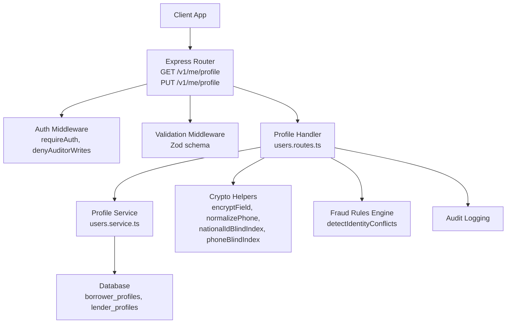
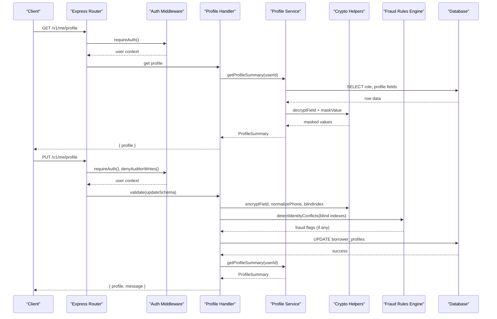
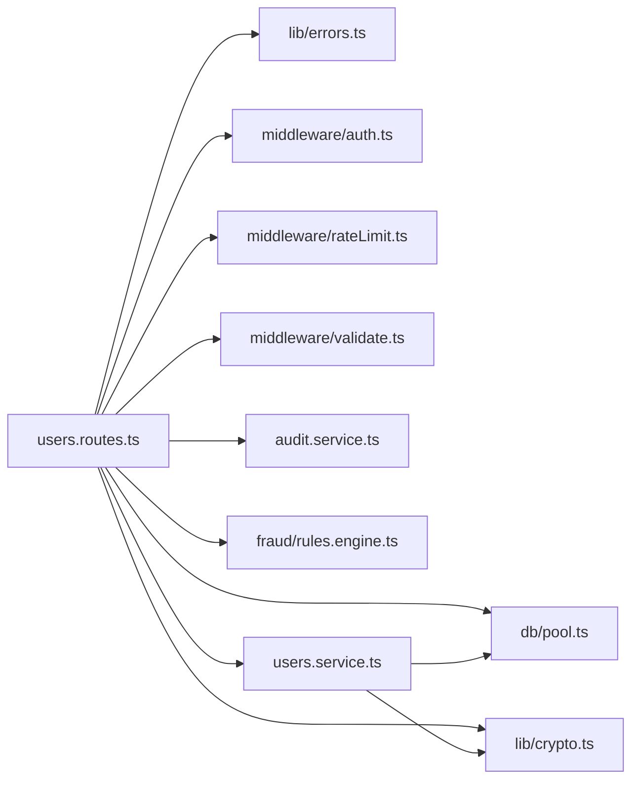

# User Profile API

<cite>
**Referenced Files in This Document**
- [users.routes.ts](file://backend/src/modules/users/users.routes.ts)
- [users.service.ts](file://backend/src/modules/users/users.service.ts)
- [crypto.ts](file://backend/src/lib/crypto.ts)
- [auth.ts](file://backend/src/middleware/auth.ts)
- [rules.engine.ts](file://backend/src/modules/fraud/rules.engine.ts)
- [openapi.yaml](file://backend/openapi.yaml)
- [001_core_auth.sql](file://backend/src/db/migrations/001_core_auth.sql)
- [ProfilePage.tsx](file://frontend/src/pages/ProfilePage.tsx)
</cite>

## Table of Contents
1. [Introduction](#introduction)
2. [Project Structure](#project-structure)
3. [Core Components](#core-components)
4. [Architecture Overview](#architecture-overview)
5. [Detailed Component Analysis](#detailed-component-analysis)
6. [Dependency Analysis](#dependency-analysis)
7. [Performance Considerations](#performance-considerations)
8. [Troubleshooting Guide](#troubleshooting-guide)
9. [Conclusion](#conclusion)

## Introduction
This document provides detailed API documentation for user profile management endpoints focused on borrower profiles. It covers:
- Reading a profile via GET
- Updating a borrower profile via PUT
- Field validation rules
- Encryption and blind indexing for sensitive data such as national ID and phone number
- Role-based access control where auditors are read-only and lenders cannot modify borrower profiles
- Masked field responses
- Error scenarios
- Data privacy and security considerations

The endpoints are part of the SecureMicrofinance backend and are documented both in code and in the OpenAPI specification.

## Project Structure
The relevant implementation is located under the backend module structure:
- Route handlers for profile operations live in the users module
- Profile reading logic lives in the users service
- Cryptographic helpers for encryption, normalization, masking, and blind indexing live in the crypto library
- Authentication and role enforcement live in the auth middleware
- Fraud detection uses blind indexes to detect duplicate identities without decrypting data
- Database schema defines encrypted columns and blind index columns for borrower profiles
- The OpenAPI spec documents request/response shapes and error responses
- The frontend profile page consumes masked profile data and submits updates

**Diagram sources**
- [users.routes.ts:40-107](file://backend/src/modules/users/users.routes.ts#L40-L107)
- [users.service.ts:19-59](file://backend/src/modules/users/users.service.ts#L19-L59)
- [crypto.ts:29-84](file://backend/src/lib/crypto.ts#L29-L84)
- [auth.ts:18-68](file://backend/src/middleware/auth.ts#L18-L68)
- [rules.engine.ts:98-143](file://backend/src/modules/fraud/rules.engine.ts#L98-L143)

**Section sources**
- [users.routes.ts:1-108](file://backend/src/modules/users/users.routes.ts#L1-L108)
- [users.service.ts:1-60](file://backend/src/modules/users/users.service.ts#L1-L60)
- [crypto.ts:1-97](file://backend/src/lib/crypto.ts#L1-L97)
- [auth.ts:1-69](file://backend/src/middleware/auth.ts#L1-L69)
- [rules.engine.ts:1-275](file://backend/src/modules/fraud/rules.engine.ts#L1-L275)
- [openapi.yaml:176-228](file://backend/openapi.yaml#L176-L228)
- [001_core_auth.sql:40-58](file://backend/src/db/migrations/001_core_auth.sql#L40-L58)

## Core Components
- Profile routes define GET and PUT endpoints for self-service profile access and updates.
- Profile service returns a role-aware summary with masked sensitive fields.
- Crypto helpers provide AES-256-GCM encryption, HMAC blind indexing, normalization, and masking.
- Auth middleware enforces bearer token authentication and auditor write denial.
- Fraud engine detects identity conflicts using blind indexes without decryption.
- Database schema stores encrypted PII and blind indexes for duplicate detection.

Key responsibilities:
- Validation: Zod schema validates optional fields before persistence.
- Security: Sensitive fields are encrypted at rest; blind indexes enable duplicate checks without plaintext exposure.
- Privacy: Responses mask sensitive values; raw values never leave the API.
- Access Control: Auditors are read-only; lenders have no borrower profile; only borrowers can update their own profile.

**Section sources**
- [users.routes.ts:26-36](file://backend/src/modules/users/users.routes.ts#L26-L36)
- [users.service.ts:9-17](file://backend/src/modules/users/users.service.ts#L9-L17)
- [crypto.ts:4-16](file://backend/src/lib/crypto.ts#L4-L16)
- [auth.ts:18-68](file://backend/src/middleware/auth.ts#L18-L68)
- [rules.engine.ts:98-143](file://backend/src/modules/fraud/rules.engine.ts#L98-L143)
- [001_core_auth.sql:40-58](file://backend/src/db/migrations/001_core_auth.sql#L40-L58)

## Architecture Overview
The profile API follows a layered architecture:
- HTTP layer exposes REST endpoints under /v1/me/profile
- Middleware enforces authentication and role-based restrictions
- Route handler orchestrates validation, encryption, blind indexing, fraud checks, and database updates
- Service layer abstracts profile retrieval and applies role-specific response shaping
- Crypto utilities ensure secure storage and safe masking
- Fraud engine flags potential duplicate identities based on blind indexes

**Diagram sources**
- [users.routes.ts:40-107](file://backend/src/modules/users/users.routes.ts#L40-L107)
- [users.service.ts:19-59](file://backend/src/modules/users/users.service.ts#L19-L59)
- [crypto.ts:29-84](file://backend/src/lib/crypto.ts#L29-L84)
- [rules.engine.ts:98-143](file://backend/src/modules/fraud/rules.engine.ts#L98-L143)

## Detailed Component Analysis

### GET /v1/me/profile
Purpose:
- Read the authenticated user’s profile summary.
- For borrowers: return masked national ID and phone, plus occupation and monthly income.
- For lenders: return business name, default rate basis points, and maximum principal amount.
- For auditors: return an empty profile shape to enforce read-only visibility.

Response model:
- profile object containing:
  - nationalIdMasked: string or null
  - phoneMasked: string or null
  - occupation: string or null
  - monthlyIncomeCents: integer or null
  - businessName: string or null (lenders)
  - defaultRateBps: integer or null (lenders)
  - maxPrincipalCents: integer or null (lenders)

Security and privacy:
- Requires valid bearer token.
- Sensitive values are decrypted only at the edge and immediately masked; raw values never leave the API.

Error scenarios:
- Unauthorized: missing, invalid, or expired credentials.

Example response:
- Borrower: { profile: { nationalIdMasked: "2345***89", phoneMasked: "0712***678", occupation: "Tailor", monthlyIncomeCents: 4200000 } }
- Lender: { profile: { businessName: "Grace Finance", defaultRateBps: 1000, maxPrincipalCents: 5000000 } }
- Auditor: { profile: { nationalIdMasked: null, phoneMasked: null, occupation: null, monthlyIncomeCents: null } }

**Section sources**
- [users.routes.ts:40-43](file://backend/src/modules/users/users.routes.ts#L40-L43)
- [users.service.ts:19-59](file://backend/src/modules/users/users.service.ts#L19-L59)
- [openapi.yaml:176-190](file://backend/openapi.yaml#L176-L190)

### PUT /v1/me/profile
Purpose:
- Update a borrower profile with optional fields.
- Encrypt sensitive fields before storage.
- Generate blind indexes for duplicate detection.
- Enforce role-based access: only borrowers can update; auditors are read-only; lenders have no borrower profile.

Request body fields:
- nationalId: string, length 5–32, optional
- phone: string, length 9–20, optional
- occupation: string, max length 80, optional
- monthlyIncomeCents: integer, minimum 0, optional
- dateOfBirth: string matching YYYY-MM-DD, optional
- address: string, max length 200, optional

Validation rules:
- All fields are optional but must conform to type and length constraints.
- dateOfBirth must match the specified pattern.
- At least one field must be supplied; otherwise, a bad request error is returned.

Encryption and blind indexing:
- nationalId:
  - Encrypted with AES-256-GCM into national_id_enc
  - Blind indexed with HMAC-SHA256 into national_id_bi
  - Normalized before blind indexing
  - Fraud check triggered to detect duplicates across accounts
- phone:
  - Normalized to canonical form
  - Encrypted with AES-256-GCM into phone_enc
  - Blind indexed with HMAC-SHA256 into phone_bi
  - Fraud check triggered to detect duplicates across accounts
- dateOfBirth and address:
  - Encrypted with AES-256-GCM into respective *_enc columns
- occupation and monthlyIncomeCents:
  - Stored as plain text/integer in non-sensitive columns

Access control:
- requireAuth ensures bearer token validity and loads user context.
- denyAuditorWrites blocks auditors from state-changing operations.
- Handler enforces that only borrowers can update borrower profiles; other roles receive forbidden errors.

Data flow:
- Request validated by Zod schema
- Allowed fields mapped to SQL parameterized updates
- Sensitive fields encrypted and blind-indexed
- Fraud engine invoked with blind indexes
- Database updated with parameterized query
- Audit log recorded
- Updated profile summary returned

Error scenarios:
- Unauthorized: missing, invalid, or expired credentials
- Forbidden: auditor attempting write; non-borrower attempting borrower profile update
- Bad request: validation failure; no fields supplied; unusable national ID

Example request:
- { nationalId: "23456789", phone: "0712 345 678", occupation: "Tailor", monthlyIncomeCents: 4200000, dateOfBirth: "1994-04-18", address: "Kawangware, Nairobi" }

Example response:
- { profile: { nationalIdMasked: "2345***89", phoneMasked: "0712***678", occupation: "Tailor", monthlyIncomeCents: 4200000 }, message: "Profile updated" }

**Section sources**
- [users.routes.ts:45-107](file://backend/src/modules/users/users.routes.ts#L45-L107)
- [openapi.yaml:191-228](file://backend/openapi.yaml#L191-L228)
- [crypto.ts:29-84](file://backend/src/lib/crypto.ts#L29-L84)
- [rules.engine.ts:98-143](file://backend/src/modules/fraud/rules.engine.ts#L98-L143)
- [001_core_auth.sql:40-58](file://backend/src/db/migrations/001_core_auth.sql#L40-L58)

### Field Validation Rules
- nationalId: string, trimmed, min 5, max 32
- phone: string, trimmed, min 9, max 20
- occupation: string, trimmed, max 80
- monthlyIncomeCents: integer, min 0, max 1,000,000,000
- dateOfBirth: string matching YYYY-MM-DD
- address: string, trimmed, max 200

These rules are enforced by the Zod schema before any database mutation occurs.

**Section sources**
- [users.routes.ts:26-36](file://backend/src/modules/users/users.routes.ts#L26-L36)
- [openapi.yaml:199-211](file://backend/openapi.yaml#L199-L211)

### Encryption Mechanisms
- AES-256-GCM is used for field-level encryption at rest.
- Ciphertext format includes version, IV, tag, and base64-encoded ciphertext.
- Decryption verifies the auth tag; tampered ciphertext fails hard.
- Keys are loaded from environment configuration.

Sensitive fields encrypted:
- national_id_enc
- phone_enc
- date_of_birth_enc
- address_enc

**Section sources**
- [crypto.ts:4-16](file://backend/src/lib/crypto.ts#L4-L16)
- [crypto.ts:29-48](file://backend/src/lib/crypto.ts#L29-L48)
- [001_core_auth.sql:40-58](file://backend/src/db/migrations/001_core_auth.sql#L40-L58)

### Blind Indexing for Duplicate Detection
- HMAC-SHA256 blind indexes are computed over normalized values.
- National ID blind index uses normalized uppercase alphanumeric value.
- Phone blind index uses normalized canonical phone format.
- Blind indexes are stored in national_id_bi and phone_bi columns.
- Fraud engine compares blind indexes across accounts to detect identity conflicts without decrypting data.

Duplicate detection behavior:
- If a blind index matches another account, a critical fraud flag is raised.
- Emails associated with duplicate accounts are partially masked in the flag detail.

**Section sources**
- [crypto.ts:50-77](file://backend/src/lib/crypto.ts#L50-L77)
- [rules.engine.ts:98-143](file://backend/src/modules/fraud/rules.engine.ts#L98-L143)
- [001_core_auth.sql:55-58](file://backend/src/db/migrations/001_core_auth.sql#L55-L58)

### Role-Based Access Controls
- requireAuth validates bearer tokens and loads user context from the database.
- denyAuditorWrites prevents auditors from performing writes.
- Handler enforces that only borrowers can update borrower profiles.
- Lenders receive lender-specific profile data and cannot modify borrower profiles.

Role behaviors:
- Borrower: can read and update own profile; sensitive fields masked in responses.
- Lender: can read lender profile fields; no borrower profile access.
- Auditor: read-only access; profile endpoint returns empty profile shape.

**Section sources**
- [auth.ts:18-68](file://backend/src/middleware/auth.ts#L18-L68)
- [users.routes.ts:45-48](file://backend/src/modules/users/users.routes.ts#L45-L48)
- [users.service.ts:23-41](file://backend/src/modules/users/users.service.ts#L23-L41)

### Masked Field Responses
- maskValue produces a masked representation preserving first four and last three characters when possible.
- Short values are fully masked.
- National ID and phone are masked in profile responses.

Examples:
- "23456789" becomes "2345***89"
- "0712345678" becomes "0712***678"

**Section sources**
- [crypto.ts:79-84](file://backend/src/lib/crypto.ts#L79-L84)
- [users.service.ts:53-58](file://backend/src/modules/users/users.service.ts#L53-L58)

### Data Structures
ProfileSummary interface:
- nationalIdMasked: string | null
- phoneMasked: string | null
- occupation: string | null
- monthlyIncomeCents: number | null
- businessName?: string | null
- defaultRateBps?: number
- maxPrincipalCents?: number

Frontend usage:
- ProfilePage consumes profile data and displays masked values.
- Form inputs allow updating occupation, income, date of birth, address, and optionally national ID and phone.

**Section sources**
- [users.service.ts:9-17](file://backend/src/modules/users/users.service.ts#L9-L17)
- [ProfilePage.tsx:1-35](file://frontend/src/pages/ProfilePage.tsx#L1-L35)

## Dependency Analysis
The profile API depends on several modules:
- Express router for HTTP handling
- Zod for request validation
- Database pool for queries
- Crypto library for encryption and blind indexing
- Auth middleware for authentication and role enforcement
- Fraud rules engine for duplicate detection
- Audit service for logging changes

**Diagram sources**
- [users.routes.ts:1-17](file://backend/src/modules/users/users.routes.ts#L1-L17)
- [users.service.ts:1-3](file://backend/src/modules/users/users.service.ts#L1-L3)

**Section sources**
- [users.routes.ts:1-17](file://backend/src/modules/users/users.routes.ts#L1-L17)
- [users.service.ts:1-3](file://backend/src/modules/users/users.service.ts#L1-L3)

## Performance Considerations
- Parameterized SQL queries prevent injection and improve execution plans.
- Blind indexes enable efficient duplicate checks without decrypting rows.
- Field-level encryption adds CPU overhead but ensures data confidentiality at rest.
- Masking occurs after decryption at the edge, minimizing exposure time.
- Fraud checks use deterministic rules and indexed blind columns for fast lookups.

[No sources needed since this section provides general guidance]

## Troubleshooting Guide
Common issues and resolutions:
- Unauthorized responses: Ensure bearer token is present and valid; verify token expiration and account status.
- Forbidden responses: Confirm user role is borrower for PUT; auditors are read-only; lenders cannot modify borrower profiles.
- Bad request responses: Validate input against schema; ensure at least one field is provided; check date format and length constraints.
- Duplicate identity flags: Check fraud flags for identity_conflict; investigate blind index collisions across accounts.
- Encryption failures: Verify ciphertext format and keys; malformed blobs will throw errors during decryption.

Operational tips:
- Use audit logs to trace profile updates and identify who changed what.
- Monitor fraud flags for critical severity events indicating potential identity reuse.
- Rotate encryption keys carefully; ciphertext format supports versioning for key rotation.

**Section sources**
- [users.routes.ts:45-107](file://backend/src/modules/users/users.routes.ts#L45-L107)
- [users.service.ts:19-59](file://backend/src/modules/users/users.service.ts#L19-L59)
- [crypto.ts:37-48](file://backend/src/lib/crypto.ts#L37-L48)
- [rules.engine.ts:98-143](file://backend/src/modules/fraud/rules.engine.ts#L98-L143)

## Conclusion
The User Profile API provides secure, role-aware access to borrower profile data. GET returns masked sensitive fields tailored to the caller’s role, while PUT allows borrowers to update their profile with robust validation, encryption, and blind indexing for duplicate detection. Auditors are strictly read-only, and lenders cannot modify borrower profiles. The design emphasizes data privacy through field-level encryption and careful masking, while enabling efficient duplicate checks via blind indexes. Proper error handling and audit logging support operational visibility and forensic analysis.

[No sources needed since this section summarizes without analyzing specific files]