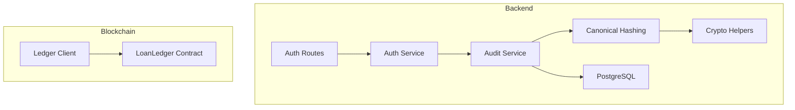
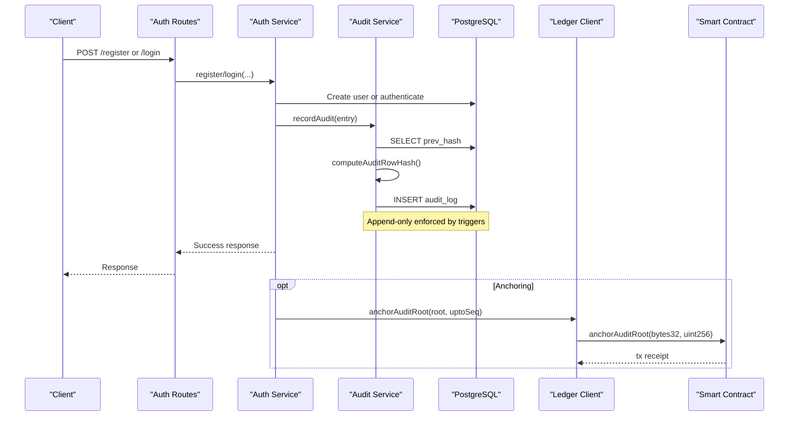
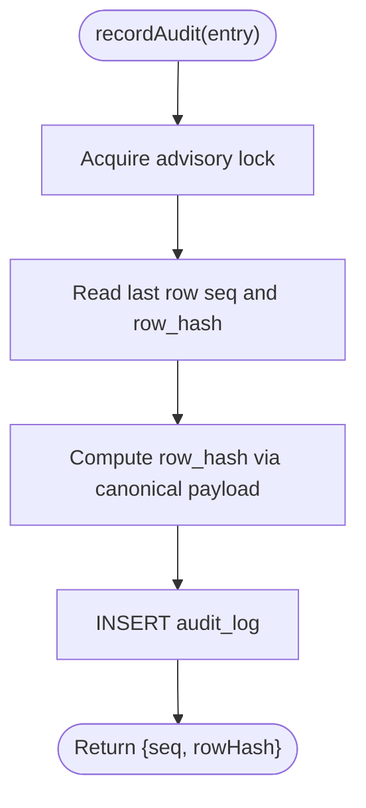
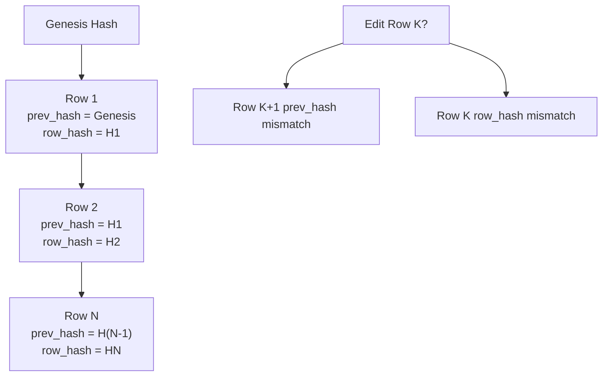
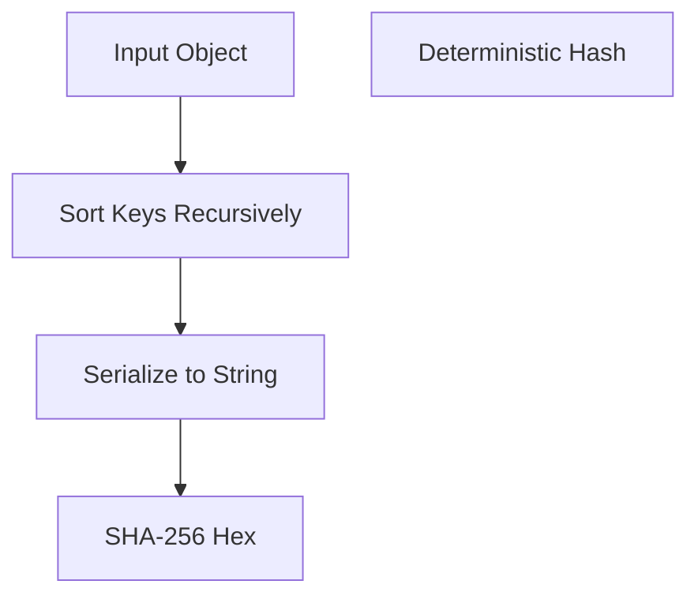
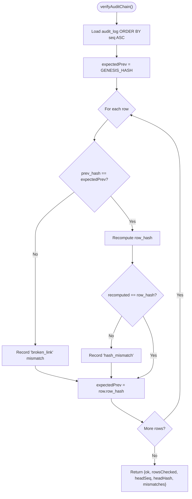
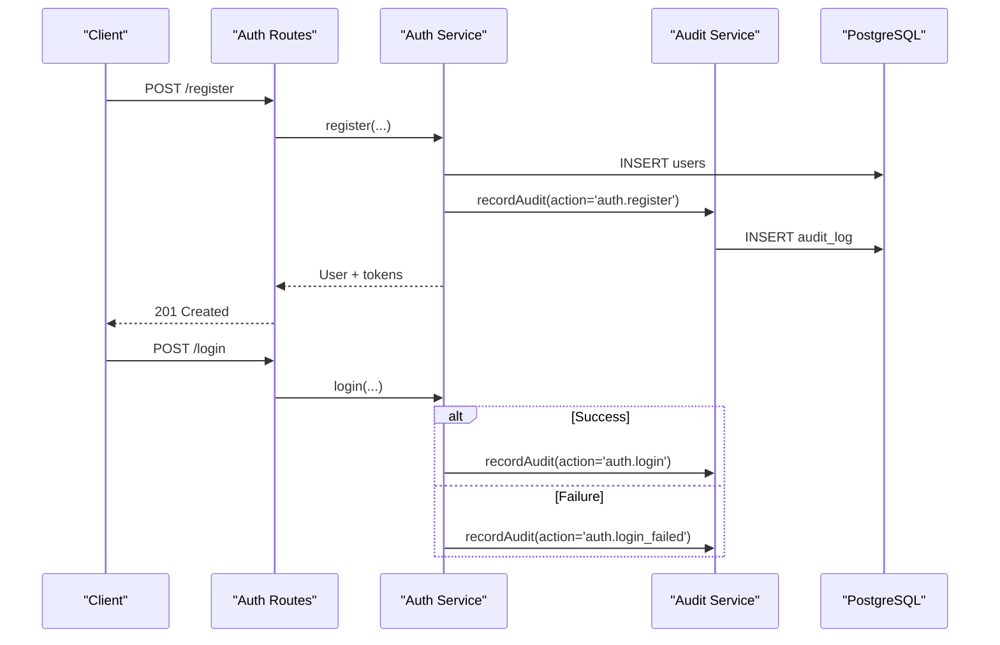
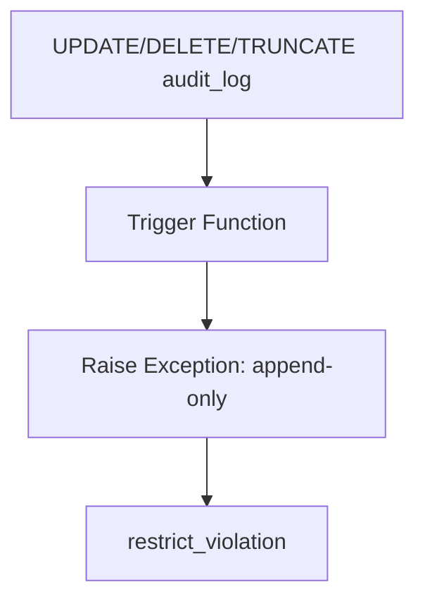
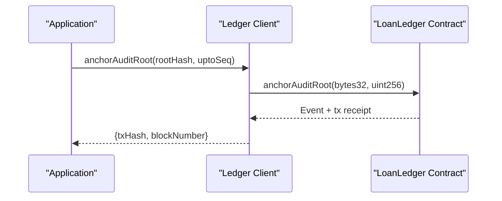
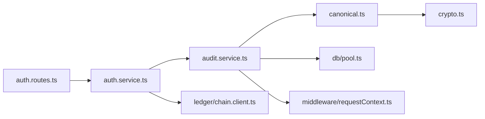

# Audit Trail System

<cite>
**Referenced Files in This Document**
- [audit.service.ts](file://backend/src/modules/audit/audit.service.ts)
- [canonical.ts](file://backend/src/lib/canonical.ts)
- [crypto.ts](file://backend/src/lib/crypto.ts)
- [004_fraud_audit.sql](file://backend/src/db/migrations/004_fraud_audit.sql)
- [auth.service.ts](file://backend/src/modules/auth/auth.service.ts)
- [auth.routes.ts](file://backend/src/modules/auth/auth.routes.ts)
- [chain.client.ts](file://backend/src/modules/ledger/chain.client.ts)
- [audit.test.ts](file://backend/test/audit.test.ts)
- [diag-audit.mjs](file://scripts/diag-audit.mjs)
</cite>

## Table of Contents
1. [Introduction](#introduction)
2. [Project Structure](#project-structure)
3. [Core Components](#core-components)
4. [Architecture Overview](#architecture-overview)
5. [Detailed Component Analysis](#detailed-component-analysis)
6. [Dependency Analysis](#dependency-analysis)
7. [Performance Considerations](#performance-considerations)
8. [Troubleshooting Guide](#troubleshooting-guide)
9. [Compliance and Audit Reporting](#compliance-and-audit-reporting)
10. [Conclusion](#conclusion)

## Introduction
This document explains the audit trail system implemented in the finance application. It covers:
- Append-only logging for critical operations
- Cryptographic hash chains that prevent tampering
- Canonicalization for consistent hashing
- Forensic verification procedures
- Examples of audit log entries and integrity checks
- The relationship between audit logs and blockchain anchoring
- Compliance considerations and reporting capabilities

The audit trail is designed so that every important action is recorded with actor identity, context, deterministic hashes, and database-level immutability. A verification routine recomputes hashes and links to detect any modification.

## Project Structure
The audit trail spans several layers:
- Database schema defines an append-only `audit_log` table, integrity tables, and triggers.
- The audit service writes rows, computes hashes, and verifies chain integrity.
- Canonicalization ensures deterministic serialization for hashing.
- Authentication flows record registration, login, logout, and password changes.
- A ledger client anchors audit roots on-chain when configured.
- Tests validate immutability, chaining, and tamper detection.
- A diagnostic script queries recent audit rows.

**Diagram sources**
- [auth.routes.ts:53-121](file://backend/src/modules/auth/auth.routes.ts#L53-L121)
- [auth.service.ts:61-261](file://backend/src/modules/auth/auth.service.ts#L61-L261)
- [audit.service.ts:37-118](file://backend/src/modules/audit/audit.service.ts#L37-L118)
- [canonical.ts:96-113](file://backend/src/lib/canonical.ts#L96-L113)
- [crypto.ts:21-23](file://backend/src/lib/crypto.ts#L21-L23)
- [chain.client.ts:110-116](file://backend/src/modules/ledger/chain.client.ts#L110-L116)

**Section sources**
- [004_fraud_audit.sql:58-121](file://backend/src/db/migrations/004_fraud_audit.sql#L58-L121)
- [audit.service.ts:37-118](file://backend/src/modules/audit/audit.service.ts#L37-L118)
- [auth.service.ts:61-261](file://backend/src/modules/auth/auth.service.ts#L61-L261)
- [chain.client.ts:110-116](file://backend/src/modules/ledger/chain.client.ts#L110-L116)

## Core Components
- Append-only audit writer: records structured events with actor, IP, user agent, request ID, and contextual details.
- Hash chain: each row stores a computed `row_hash` and a `prev_hash`, forming a tamper-evident sequence.
- Canonical serializer: sorts object keys recursively and serializes values deterministically before hashing.
- Integrity verifier: recomputes hashes and validates links across all rows.
- Database immutability: triggers block updates, deletes, and truncates on the audit table.
- Blockchain anchoring: optional anchoring of audit chain roots to a smart contract.

Key responsibilities:
- `audit.service.ts`: writing audit rows, computing hashes, verifying chain integrity.
- `canonical.ts`: canonical JSON serialization and audit row hashing.
- `crypto.ts`: SHA-256 and HMAC helpers used by canonicalization and other security features.
- `004_fraud_audit.sql`: schema, indexes, triggers, and anchor/integrity tables.
- `auth.service.ts` and `auth.routes.ts`: generating audit events for authentication actions.
- `chain.client.ts`: anchoring audit roots on-chain.

**Section sources**
- [audit.service.ts:37-118](file://backend/src/modules/audit/audit.service.ts#L37-L118)
- [canonical.ts:11-24](file://backend/src/lib/canonical.ts#L11-L24)
- [canonical.ts:96-113](file://backend/src/lib/canonical.ts#L96-L113)
- [crypto.ts:21-23](file://backend/src/lib/crypto.ts#L21-L23)
- [004_fraud_audit.sql:67-121](file://backend/src/db/migrations/004_fraud_audit.sql#L67-L121)
- [auth.service.ts:86-101](file://backend/src/modules/auth/auth.service.ts#L86-L101)
- [auth.service.ts:180-190](file://backend/src/modules/auth/auth.service.ts#L180-L190)
- [auth.service.ts:232-242](file://backend/src/modules/auth/auth.service.ts#L232-L242)
- [auth.service.ts:250-260](file://backend/src/modules/auth/auth.service.ts#L250-L260)
- [chain.client.ts:110-116](file://backend/src/modules/ledger/chain.client.ts#L110-L116)

## Architecture Overview
The audit trail integrates application logic, database constraints, and optional blockchain anchoring.

**Diagram sources**
- [auth.routes.ts:53-73](file://backend/src/modules/auth/auth.routes.ts#L53-L73)
- [auth.service.ts:61-111](file://backend/src/modules/auth/auth.service.ts#L61-L111)
- [auth.service.ts:114-197](file://backend/src/modules/auth/auth.service.ts#L114-L197)
- [audit.service.ts:37-94](file://backend/src/modules/audit/audit.service.ts#L37-L94)
- [chain.client.ts:110-116](file://backend/src/modules/ledger/chain.client.ts#L110-L116)

## Detailed Component Analysis

### Append-Only Audit Writer
The audit writer:
- Acquires an advisory lock to serialize writers and avoid chain forks.
- Reads the previous row’s hash (or genesis hash).
- Computes a deterministic row hash using canonicalized fields.
- Inserts a new row with `prev_hash`, `row_hash`, and contextual metadata.
- Returns sequence number and row hash for callers.

**Diagram sources**
- [audit.service.ts:37-94](file://backend/src/modules/audit/audit.service.ts#L37-L94)

**Section sources**
- [audit.service.ts:37-94](file://backend/src/modules/audit/audit.service.ts#L37-L94)

### Cryptographic Hash Chains
Each audit row includes:
- `seq`: monotonically increasing sequence number.
- `prev_hash`: hash of the previous row; first row links to a fixed genesis hash.
- `row_hash`: SHA-256 of a canonicalized payload including actor, action, entity, detail hash, IP, and timestamp.

Tamper resistance:
- Any change to a historical row invalidates its `row_hash`.
- Subsequent rows store the original `prev_hash`, causing broken links.
- Verification recomputes hashes and compares both stored hashes and links.

**Diagram sources**
- [canonical.ts:96-113](file://backend/src/lib/canonical.ts#L96-L113)
- [canonical.ts:115-116](file://backend/src/lib/canonical.ts#L115-L116)
- [audit.service.ts:142-190](file://backend/src/modules/audit/audit.service.ts#L142-L190)

**Section sources**
- [canonical.ts:96-113](file://backend/src/lib/canonical.ts#L96-L113)
- [canonical.ts:115-116](file://backend/src/lib/canonical.ts#L115-L116)
- [audit.service.ts:142-190](file://backend/src/modules/audit/audit.service.ts#L142-L190)

### Canonicalization Process
Canonicalization ensures deterministic hashing regardless of key ordering or representation differences:
- Recursively sorts object keys.
- Filters undefined values.
- Serializes arrays and objects consistently.
- Converts timestamps to ISO strings before hashing.
- Hashes the detail field separately to keep payloads compact.

**Diagram sources**
- [canonical.ts:11-24](file://backend/src/lib/canonical.ts#L11-L24)
- [canonical.ts:96-113](file://backend/src/lib/canonical.ts#L96-L113)
- [crypto.ts:21-23](file://backend/src/lib/crypto.ts#L21-L23)

**Section sources**
- [canonical.ts:11-24](file://backend/src/lib/canonical.ts#L11-L24)
- [canonical.ts:96-113](file://backend/src/lib/canonical.ts#L96-L113)
- [crypto.ts:21-23](file://backend/src/lib/crypto.ts#L21-L23)

### Forensic Analysis and Verification
Verification:
- Loads all audit rows ordered by sequence.
- Tracks expected previous hash starting from genesis.
- Recomputes each row’s hash using canonicalization.
- Reports mismatches and broken links.

**Diagram sources**
- [audit.service.ts:142-190](file://backend/src/modules/audit/audit.service.ts#L142-L190)
- [canonical.ts:115-116](file://backend/src/lib/canonical.ts#L115-L116)

**Section sources**
- [audit.service.ts:142-190](file://backend/src/modules/audit/audit.service.ts#L142-L190)

### Audit Log Generation for Critical Operations
Authentication operations generate audit entries:
- Registration: records user creation with email and role.
- Login success: records successful login with email.
- Login failure: records failed attempts with reasons such as unknown email, bad password, locked account, inactive account.
- Password change: records success and failure with session revocation details.
- Logout: records session termination and whether a refresh token was present.

**Diagram sources**
- [auth.routes.ts:53-73](file://backend/src/modules/auth/auth.routes.ts#L53-L73)
- [auth.service.ts:61-111](file://backend/src/modules/auth/auth.service.ts#L61-L111)
- [auth.service.ts:114-197](file://backend/src/modules/auth/auth.service.ts#L114-L197)
- [audit.service.ts:37-94](file://backend/src/modules/audit/audit.service.ts#L37-L94)

**Section sources**
- [auth.service.ts:86-101](file://backend/src/modules/auth/auth.service.ts#L86-L101)
- [auth.service.ts:136-190](file://backend/src/modules/auth/auth.service.ts#L136-L190)
- [auth.service.ts:232-242](file://backend/src/modules/auth/auth.service.ts#L232-L242)
- [auth.service.ts:250-260](file://backend/src/modules/auth/auth.service.ts#L250-L260)

### Database Immutability and Triggers
Database-level protections:
- Triggers block UPDATE, DELETE, and TRUNCATE on `audit_log`.
- Attempted mutations raise a specific error indicating append-only enforcement.
- Indexes optimize queries by entity, actor, time, and detail content.

**Diagram sources**
- [004_fraud_audit.sql:93-111](file://backend/src/db/migrations/004_fraud_audit.sql#L93-L111)

**Section sources**
- [004_fraud_audit.sql:67-91](file://backend/src/db/migrations/004_fraud_audit.sql#L67-L91)
- [004_fraud_audit.sql:93-111](file://backend/src/db/migrations/004_fraud_audit.sql#L93-L111)

### Relationship Between Audit Logs and Blockchain Anchoring
The ledger client supports:
- Recording transaction hashes on-chain.
- Verifying existence of records.
- Anchoring an audit root hash along with the highest sequence covered.

Anchoring workflow:
- Compute an audit root hash (for example, a Merkle root or the final chain head hash).
- Call `anchorAuditRoot` with the root and `uptoSeq`.
- Store the transaction hash and block number in local audit anchors.

**Diagram sources**
- [chain.client.ts:110-116](file://backend/src/modules/ledger/chain.client.ts#L110-L116)

**Section sources**
- [chain.client.ts:110-116](file://backend/src/modules/ledger/chain.client.ts#L110-L116)

### Example Audit Log Entries
Representative entries include:
- Registration: action `auth.register`, entity type `user`, actor user ID and role, detail containing email and role.
- Login success: action `auth.login`, entity type `user`, detail containing email.
- Login failure: action `auth.login_failed`, reason codes like `unknown_email`, `bad_password`, `account_locked`, `inactive_account`.
- Password change: action `auth.password_change`, detail indicating sessions revoked.
- Logout: action `auth.logout`, entity type `session`, detail indicating presence of refresh token.

These entries are generated by the auth service and written through the audit service.

**Section sources**
- [auth.service.ts:86-101](file://backend/src/modules/auth/auth.service.ts#L86-L101)
- [auth.service.ts:136-190](file://backend/src/modules/auth/auth.service.ts#L136-L190)
- [auth.service.ts:232-242](file://backend/src/modules/auth/auth.service.ts#L232-L242)
- [auth.service.ts:250-260](file://backend/src/modules/auth/auth.service.ts#L250-L260)

### Verification Procedures
To verify log integrity:
1. Run the verification function to load all audit rows.
2. Confirm the first row’s `prev_hash` equals the genesis hash.
3. For each subsequent row, confirm `prev_hash` equals the previous row’s `row_hash`.
4. Recompute each row’s hash using canonicalization and compare to stored `row_hash`.
5. Inspect mismatches list for `hash_mismatch` or `broken_link` reasons.

Tests demonstrate:
- Successful chain verification after normal operations.
- Detection of tampered rows even if triggers are disabled.
- Broken link propagation to following rows.

**Section sources**
- [audit.service.ts:142-190](file://backend/src/modules/audit/audit.service.ts#L142-L190)
- [audit.test.ts:56-91](file://backend/test/audit.test.ts#L56-L91)

## Dependency Analysis
The audit system depends on:
- Database pool utilities for transactions and queries.
- Request context middleware for IP, user agent, and request ID.
- Canonicalization and crypto modules for hashing.
- Auth service for generating audit events.
- Ledger client for optional blockchain anchoring.

**Diagram sources**
- [auth.routes.ts:53-121](file://backend/src/modules/auth/auth.routes.ts#L53-L121)
- [auth.service.ts:1-13](file://backend/src/modules/auth/auth.service.ts#L1-L13)
- [audit.service.ts:1-5](file://backend/src/modules/audit/audit.service.ts#L1-L5)
- [canonical.ts:1-1](file://backend/src/lib/canonical.ts#L1-L1)
- [chain.client.ts:1-3](file://backend/src/modules/ledger/chain.client.ts#L1-L3)

**Section sources**
- [auth.routes.ts:53-121](file://backend/src/modules/auth/auth.routes.ts#L53-L121)
- [auth.service.ts:1-13](file://backend/src/modules/auth/auth.service.ts#L1-L13)
- [audit.service.ts:1-5](file://backend/src/modules/audit/audit.service.ts#L1-L5)
- [canonical.ts:1-1](file://backend/src/lib/canonical.ts#L1-L1)
- [chain.client.ts:1-3](file://backend/src/modules/ledger/chain.client.ts#L1-L3)

## Performance Considerations
- Advisory locking serializes concurrent writers to maintain chain order; this avoids forks but may introduce contention under high write volume.
- Canonical JSON serialization adds CPU overhead proportional to payload size; keep detail payloads concise.
- Database indexes on entity, actor, created_at, and GIN index on detail support efficient forensic queries.
- Optional blockchain anchoring introduces network latency; anchoring should be scheduled or batched rather than performed per request.

[No sources needed since this section provides general guidance]

## Troubleshooting Guide
Common issues and diagnostics:
- Mutations blocked: attempting UPDATE, DELETE, or TRUNCATE on `audit_log` raises an append-only error due to triggers.
- Chain verification failures: mismatches indicate either hash mismatches or broken links; inspect the mismatches array for sequence numbers and reasons.
- Missing context: ensure IP, user agent, and request ID are captured via request context middleware.
- Diagnostic queries: use the diagnostic script to inspect recent audit rows and counts.

Operational steps:
- Run verification to identify tampering.
- Review trigger status if manual intervention occurred.
- Use indexes to filter by entity, actor, or time range.
- If anchoring is enabled, check contract status and RPC configuration.

**Section sources**
- [004_fraud_audit.sql:93-111](file://backend/src/db/migrations/004_fraud_audit.sql#L93-L111)
- [audit.service.ts:142-190](file://backend/src/modules/audit/audit.service.ts#L142-L190)
- [diag-audit.mjs:1-10](file://scripts/diag-audit.mjs#L1-L10)

## Compliance and Audit Reporting
Compliance-relevant properties:
- Append-only design prevents deletion or alteration of historical records.
- Deterministic hashing ensures tamper evidence.
- Actor identity, role, IP, user agent, and request correlation provide traceability.
- Integrity checks and audit anchors support external verification.

Reporting capabilities:
- Query audit logs by entity, actor, time, or detail fields.
- Generate integrity reports by running verification and recording results in `integrity_checks`.
- Optionally publish audit chain roots on-chain for third-party verification.

Best practices:
- Keep detail payloads minimal and non-sensitive.
- Regularly run verification and archive results.
- Monitor anchoring transactions and reconcile chain roots with database heads.

**Section sources**
- [004_fraud_audit.sql:113-136](file://backend/src/db/migrations/004_fraud_audit.sql#L113-L136)
- [audit.service.ts:142-190](file://backend/src/modules/audit/audit.service.ts#L142-L190)
- [chain.client.ts:110-116](file://backend/src/modules/ledger/chain.client.ts#L110-L116)

## Conclusion
The audit trail system provides a robust, tamper-evident record of critical operations. It combines application-level event generation, deterministic canonical hashing, database-level immutability, and optional blockchain anchoring. Verification routines enable forensic analysis and compliance reporting. By capturing actor identity, context, and cryptographic hashes, the system ensures that any attempt to alter historical records is detectable.

[No sources needed since this section summarizes without analyzing specific files]