# Authentication System

<cite>
**Referenced Files in This Document**
- [auth.routes.ts](file://backend/src/modules/auth/auth.routes.ts)
- [auth.service.ts](file://backend/src/modules/auth/auth.service.ts)
- [token.service.ts](file://backend/src/modules/auth/token.service.ts)
- [auth.ts](file://backend/src/middleware/auth.ts)
- [cookies.ts](file://backend/src/lib/cookies.ts)
- [crypto.ts](file://backend/src/lib/crypto.ts)
- [env.ts](file://backend/src/config/env.ts)
- [rateLimit.ts](file://backend/src/middleware/rateLimit.ts)
- [001_core_auth.sql](file://backend/src/db/migrations/001_core_auth.sql)
- [express.d.ts](file://backend/src/types/express.d.ts)
- [auth.test.ts](file://backend/test/auth.test.ts)
- [rbac.test.ts](file://backend/test/rbac.test.ts)
</cite>

## Table of Contents
1. [Introduction](#introduction)
2. [Project Structure](#project-structure)
3. [Core Components](#core-components)
4. [Architecture Overview](#architecture-overview)
5. [Detailed Component Analysis](#detailed-component-analysis)
6. [Dependency Analysis](#dependency-analysis)
7. [Performance Considerations](#performance-considerations)
8. [Troubleshooting Guide](#troubleshooting-guide)
9. [Conclusion](#conclusion)

## Introduction
This document explains the backend authentication system for the Finance application. It covers JWT-based access tokens, rotating refresh tokens stored as secure cookies, bcrypt password hashing, session revocation, role-based access control, and security controls such as rate limiting and CSRF-safe cookie configuration. The goal is to make the implementation understandable for both developers and reviewers while remaining grounded in the actual codebase.

## Project Structure
The authentication logic is implemented under the backend module with a clear separation between routing, service logic, token handling, middleware, configuration, and database schema:

- Routes define HTTP endpoints for registration, login, refresh, logout, profile retrieval, and password changes.
- Services implement business rules for user registration, login, password changes, and session management.
- Token utilities handle JWT signing/verification and refresh token rotation.
- Middleware enforces authentication, roles, and auditor write restrictions.
- Configuration validates environment variables and exposes runtime settings.
- Database migrations define users, profiles, and refresh token tables.

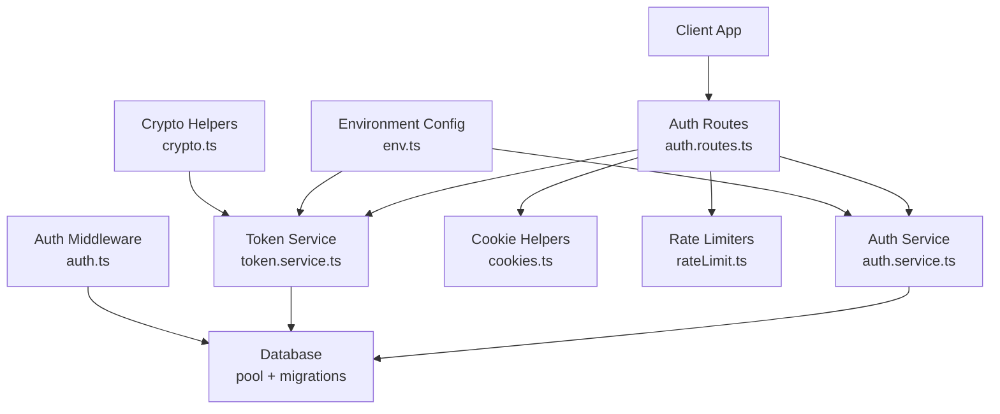

**Diagram sources**
- [auth.routes.ts:1-121](file://backend/src/modules/auth/auth.routes.ts#L1-L121)
- [auth.service.ts:1-262](file://backend/src/modules/auth/auth.service.ts#L1-L262)
- [token.service.ts:1-206](file://backend/src/modules/auth/token.service.ts#L1-L206)
- [auth.ts:1-69](file://backend/src/middleware/auth.ts#L1-L69)
- [cookies.ts:1-29](file://backend/src/lib/cookies.ts#L1-L29)
- [rateLimit.ts:1-51](file://backend/src/middleware/rateLimit.ts#L1-L51)
- [env.ts:1-101](file://backend/src/config/env.ts#L1-L101)
- [crypto.ts:1-97](file://backend/src/lib/crypto.ts#L1-L97)
- [001_core_auth.sql:1-95](file://backend/src/db/migrations/001_core_auth.sql#L1-L95)

**Section sources**
- [auth.routes.ts:1-121](file://backend/src/modules/auth/auth.routes.ts#L1-L121)
- [auth.service.ts:1-262](file://backend/src/modules/auth/auth.service.ts#L1-L262)
- [token.service.ts:1-206](file://backend/src/modules/auth/token.service.ts#L1-L206)
- [auth.ts:1-69](file://backend/src/middleware/auth.ts#L1-L69)
- [cookies.ts:1-29](file://backend/src/lib/cookies.ts#L1-L29)
- [rateLimit.ts:1-51](file://backend/src/middleware/rateLimit.ts#L1-L51)
- [env.ts:1-101](file://backend/src/config/env.ts#L1-L101)
- [crypto.ts:1-97](file://backend/src/lib/crypto.ts#L1-L97)
- [001_core_auth.sql:1-95](file://backend/src/db/migrations/001_core_auth.sql#L1-L95)

## Core Components
- Authentication routes expose endpoints for registration, login, refresh, logout, profile lookup, and password change. They validate input using Zod, apply rate limiting, and set or clear secure cookies.
- Auth service implements registration, login, password change, and logout with bcrypt hashing, account lockout, audit logging, and session revocation.
- Token service manages short-lived JWT access tokens and opaque refresh tokens. Refresh tokens are hashed and rotated; reuse outside a grace window revokes the entire token family.
- Auth middleware verifies Bearer tokens, loads the current user from the database, enforces active status, and provides role-based guards.
- Cookie helpers configure httpOnly, SameSite=Strict, path scoping, and production-only secure cookies.
- Environment config validates secrets and policy values such as token TTLs, bcrypt cost, and lockout thresholds.
- Rate limiters protect against brute force and credential stuffing by limiting requests per IP and per email.
- Database migration defines users, profiles, and refresh token storage with appropriate indexes and constraints.

**Section sources**
- [auth.routes.ts:1-121](file://backend/src/modules/auth/auth.routes.ts#L1-L121)
- [auth.service.ts:1-262](file://backend/src/modules/auth/auth.service.ts#L1-L262)
- [token.service.ts:1-206](file://backend/src/modules/auth/token.service.ts#L1-L206)
- [auth.ts:1-69](file://backend/src/middleware/auth.ts#L1-L69)
- [cookies.ts:1-29](file://backend/src/lib/cookies.ts#L1-L29)
- [env.ts:1-101](file://backend/src/config/env.ts#L1-L101)
- [rateLimit.ts:1-51](file://backend/src/middleware/rateLimit.ts#L1-L51)
- [001_core_auth.sql:1-95](file://backend/src/db/migrations/001_core_auth.sql#L1-L95)

## Architecture Overview
The authentication flow uses two tokens:
- Access token: a short-lived JWT sent via Authorization header. It contains the user ID and role.
- Refresh token: an opaque value stored in an httpOnly, SameSite=Strict cookie. Only its SHA-256 hash is persisted server-side.

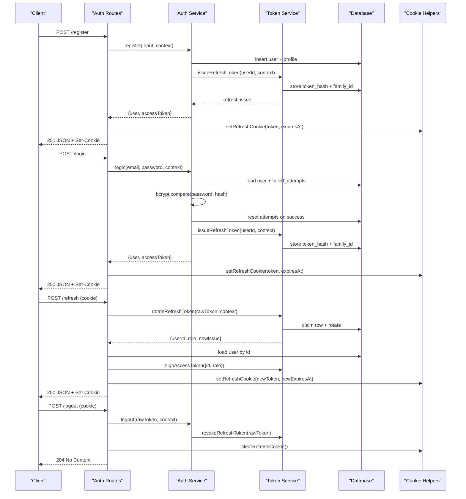

**Diagram sources**
- [auth.routes.ts:53-103](file://backend/src/modules/auth/auth.routes.ts#L53-L103)
- [auth.service.ts:61-198](file://backend/src/modules/auth/auth.service.ts#L61-L198)
- [token.service.ts:64-195](file://backend/src/modules/auth/token.service.ts#L64-L195)
- [cookies.ts:11-28](file://backend/src/lib/cookies.ts#L11-L28)

## Detailed Component Analysis

### Registration Workflow
Registration validates the request body, normalizes the email, checks uniqueness, hashes the password with bcrypt, creates the user and profile records within a transaction, audits the action, issues a refresh token, and returns the public user plus an access token. A secure refresh cookie is also set.

Key behaviors:
- Email normalization ensures lowercase storage and consistent lookups.
- Password hashing uses a configurable bcrypt cost.
- Role-specific profile creation supports borrower and lender accounts.
- Audit logging is performed inside the same transaction for consistency.
- Refresh token issuance stores only the SHA-256 hash of the token.

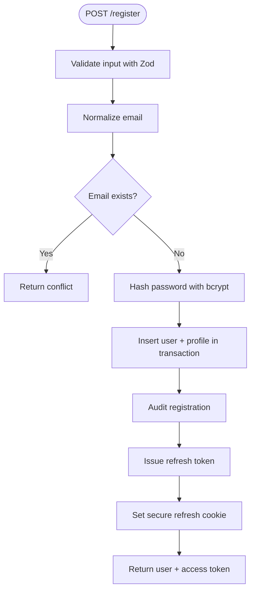

**Diagram sources**
- [auth.routes.ts:53-62](file://backend/src/modules/auth/auth.routes.ts#L53-L62)
- [auth.service.ts:61-112](file://backend/src/modules/auth/auth.service.ts#L61-L112)
- [crypto.ts:21-23](file://backend/src/lib/crypto.ts#L21-L23)
- [cookies.ts:11-18](file://backend/src/lib/cookies.ts#L11-L18)

**Section sources**
- [auth.routes.ts:53-62](file://backend/src/modules/auth/auth.routes.ts#L53-L62)
- [auth.service.ts:61-112](file://backend/src/modules/auth/auth.service.ts#L61-L112)
- [001_core_auth.sql:17-31](file://backend/src/db/migrations/001_core_auth.sql#L17-L31)
- [001_core_auth.sql:40-53](file://backend/src/db/migrations/001_core_auth.sql#L40-L53)
- [001_core_auth.sql:64-72](file://backend/src/db/migrations/001_core_auth.sql#L64-L72)

### Login Process
Login normalizes the email, performs constant-time bcrypt comparison regardless of whether the account exists, enforces account lockout after repeated failures, resets failed attempts on success, audits login events, and issues both an access token and a refresh token.

Security properties:
- Generic error messages prevent enumeration of valid emails.
- Account lockout is time-bounded and configurable.
- Successful logins reset failure counters and update last login timestamp.
- Audit logs capture IP, user agent, and request correlation IDs.

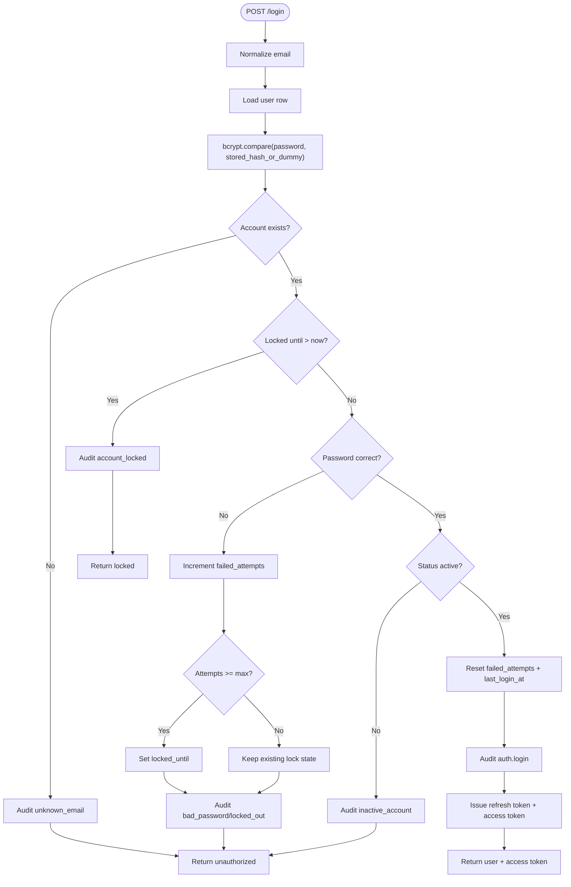

**Diagram sources**
- [auth.service.ts:114-198](file://backend/src/modules/auth/auth.service.ts#L114-L198)

**Section sources**
- [auth.service.ts:114-198](file://backend/src/modules/auth/auth.service.ts#L114-L198)
- [env.ts:44-46](file://backend/src/config/env.ts#L44-L46)

### Token Generation and Validation
Access tokens:
- Short-lived JWT signed with a secret configured in environment variables.
- Include subject (user ID), role, type, issuer, and audience.
- Verified with strict issuer and audience validation.

Refresh tokens:
- Opaque random tokens generated client-side and sent via cookie.
- Server stores only the SHA-256 hash along with family ID, expiry, and metadata.
- Rotation is atomic using conditional UPDATE to avoid double-use.
- Reuse detection treats concurrent double-submits within a grace window as benign; otherwise, it revokes the entire token family.

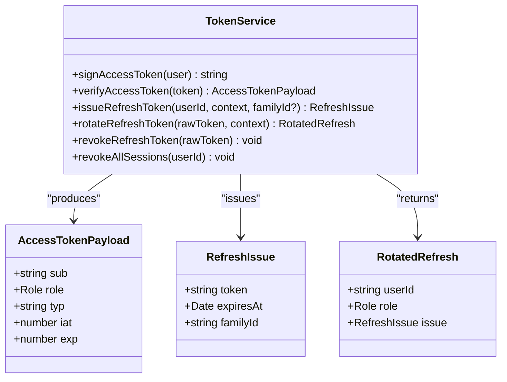

**Diagram sources**
- [token.service.ts:20-82](file://backend/src/modules/auth/token.service.ts#L20-L82)
- [token.service.ts:154-195](file://backend/src/modules/auth/token.service.ts#L154-L195)

**Section sources**
- [token.service.ts:28-46](file://backend/src/modules/auth/token.service.ts#L28-L46)
- [token.service.ts:64-76](file://backend/src/modules/auth/token.service.ts#L64-L76)
- [token.service.ts:154-195](file://backend/src/modules/auth/token.service.ts#L154-L195)
- [env.ts:37-43](file://backend/src/config/env.ts#L37-L43)

### Cookie Handling and Security
Refresh cookies are configured to be:
- httpOnly: not readable by JavaScript, mitigating XSS theft.
- SameSite=Strict: prevents CSRF on refresh/logout endpoints.
- Path-scoped to the authentication API path.
- Secure in production environments.

Logout clears the refresh cookie and revokes the token server-side.

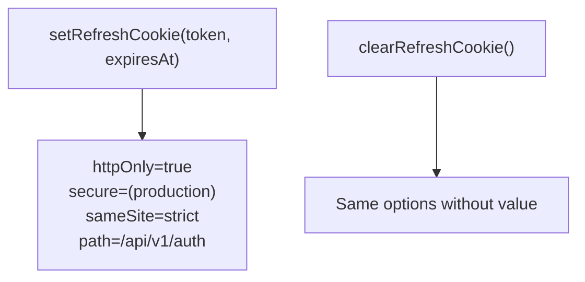

**Diagram sources**
- [cookies.ts:11-28](file://backend/src/lib/cookies.ts#L11-L28)

**Section sources**
- [cookies.ts:1-29](file://backend/src/lib/cookies.ts#L1-L29)
- [auth.routes.ts:98-103](file://backend/src/modules/auth/auth.routes.ts#L98-L103)

### Logout Procedures
Logout revokes the provided refresh token if present and clears the cookie. An audit record is written indicating whether a token was present.

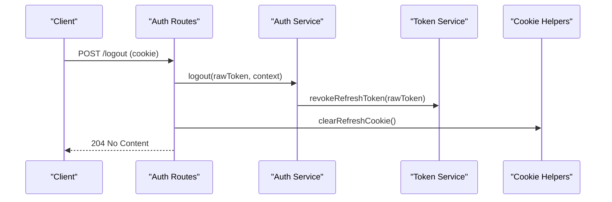

**Diagram sources**
- [auth.routes.ts:98-103](file://backend/src/modules/auth/auth.routes.ts#L98-L103)
- [auth.service.ts:245-261](file://backend/src/modules/auth/auth.service.ts#L245-L261)
- [token.service.ts:197-201](file://backend/src/modules/auth/token.service.ts#L197-L201)

**Section sources**
- [auth.routes.ts:98-103](file://backend/src/modules/auth/auth.routes.ts#L98-L103)
- [auth.service.ts:245-261](file://backend/src/modules/auth/auth.service.ts#L245-L261)

### Authentication Middleware and Role-Based Access Control
Authentication middleware:
- Requires a Bearer token in the Authorization header.
- Verifies the JWT with strict issuer and audience.
- Parses and validates the payload structure.
- Loads the user from the database to enforce up-to-date status and role.
- Attaches the authenticated principal to the request.

Role-based access control:
- requireRole enforces that the authenticated user has one of the allowed roles.
- denyAuditorWrites blocks auditors from any state-changing operations.
- Tests verify that tampered tokens are rejected and that roles are re-checked against the database.

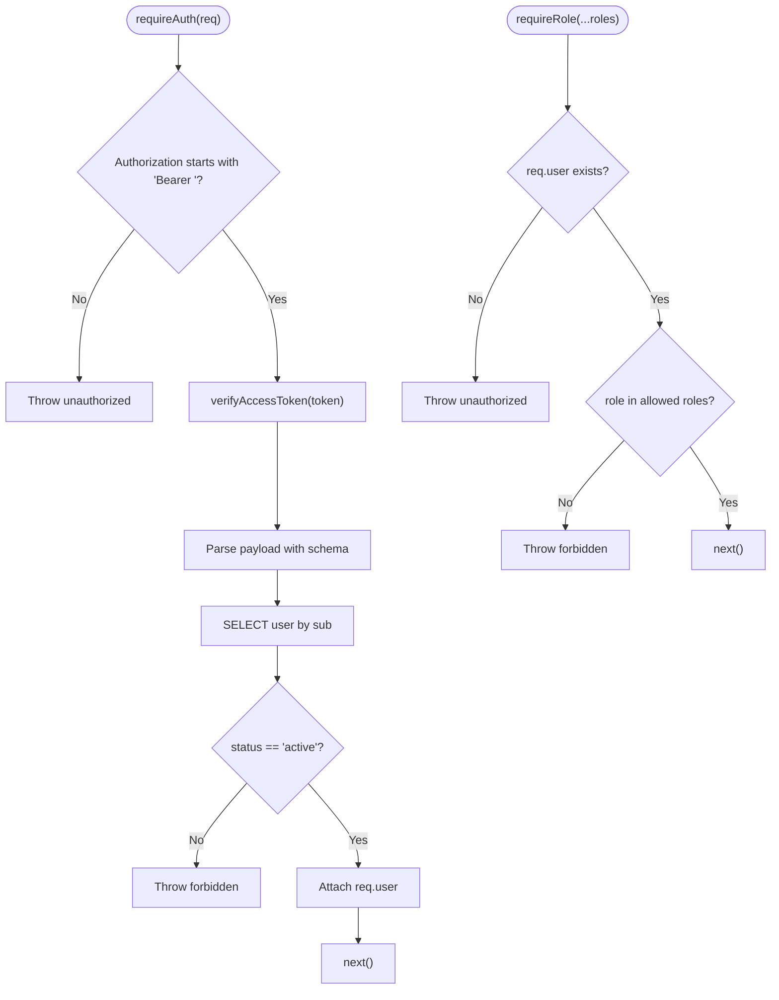

**Diagram sources**
- [auth.ts:18-56](file://backend/src/middleware/auth.ts#L18-L56)

**Section sources**
- [auth.ts:1-69](file://backend/src/middleware/auth.ts#L1-L69)
- [rbac.test.ts:12-73](file://backend/test/rbac.test.ts#L12-L73)
- [express.d.ts:1-22](file://backend/src/types/express.d.ts#L1-L22)

### Password Change and Session Revocation
Password change:
- Validates the current password.
- Hashes the new password with bcrypt.
- Updates the stored hash.
- Revokes all sessions for the user.
- Clears refresh cookies on the client side after successful change.

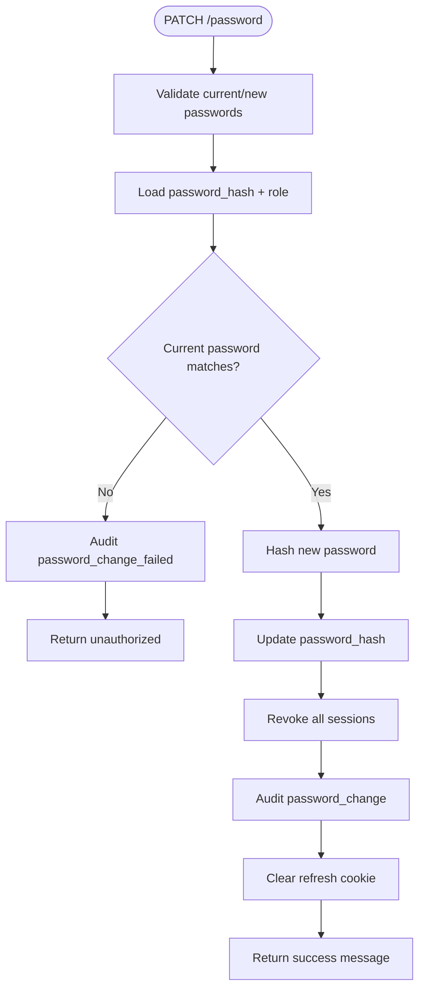

**Diagram sources**
- [auth.routes.ts:110-120](file://backend/src/modules/auth/auth.routes.ts#L110-L120)
- [auth.service.ts:200-243](file://backend/src/modules/auth/auth.service.ts#L200-L243)

**Section sources**
- [auth.routes.ts:110-120](file://backend/src/modules/auth/auth.routes.ts#L110-L120)
- [auth.service.ts:200-243](file://backend/src/modules/auth/auth.service.ts#L200-L243)

### Refresh Token Rotation and Reuse Detection
Rotation:
- Looks up the token by its SHA-256 hash.
- Checks expiration and revocation.
- Claims the row atomically to prevent concurrent rotation races.
- Issues a new refresh token in the same family and links the old token to the replacement.

Reuse detection:
- If a token is replayed after being revoked but within a grace window and a replacement is still active, it is treated as a concurrent double-submit and a new token is issued.
- Otherwise, the entire family is revoked and an error is returned.

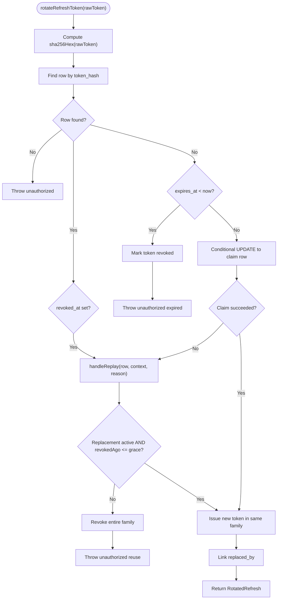

**Diagram sources**
- [token.service.ts:154-195](file://backend/src/modules/auth/token.service.ts#L154-L195)
- [token.service.ts:104-145](file://backend/src/modules/auth/token.service.ts#L104-L145)

**Section sources**
- [token.service.ts:104-145](file://backend/src/modules/auth/token.service.ts#L104-L145)
- [token.service.ts:154-195](file://backend/src/modules/auth/token.service.ts#L154-L195)

### Security Measures
- CSRF protection: Refresh cookies use SameSite=Strict, preventing cross-site requests from automatically sending them. Access tokens are explicitly passed via Authorization headers.
- Rate limiting: Global, auth-specific, and write-specific limits are applied. Auth limiter keys by IP and submitted email to slow brute-force attempts.
- Secure cookie configuration: httpOnly, SameSite=Strict, path scoping, and secure flag in production.
- Password hashing: bcryptjs with configurable cost.
- Account lockout: Configurable maximum failed attempts and lock duration.
- Audit logging: Every significant authentication event is recorded with contextual metadata.

**Section sources**
- [cookies.ts:1-29](file://backend/src/lib/cookies.ts#L1-L29)
- [rateLimit.ts:1-51](file://backend/src/middleware/rateLimit.ts#L1-L51)
- [auth.service.ts:15-24](file://backend/src/modules/auth/auth.service.ts#L15-L24)
- [env.ts:37-46](file://backend/src/config/env.ts#L37-L46)

## Dependency Analysis
The authentication subsystem depends on several modules and external libraries:

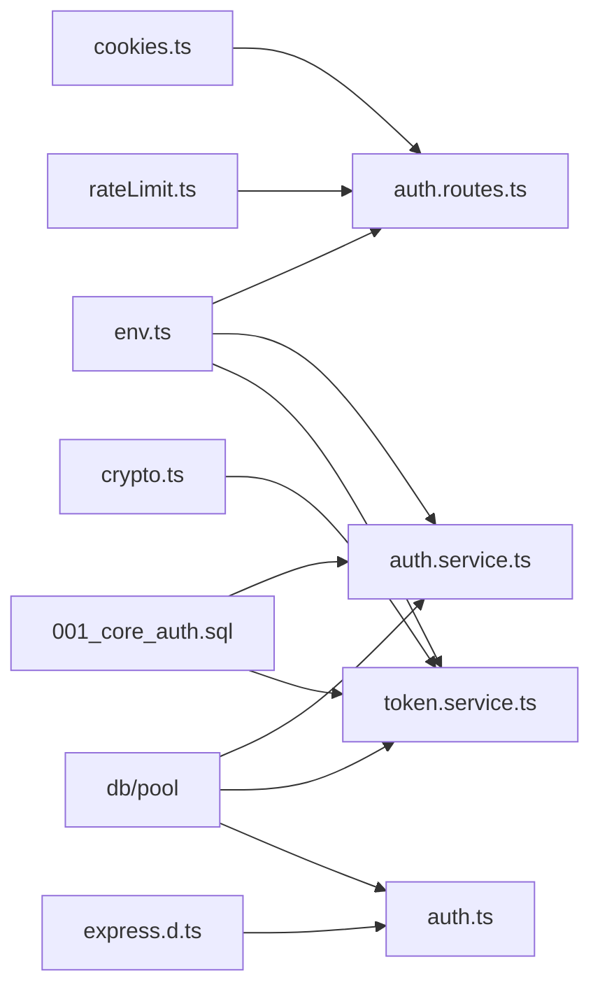

**Diagram sources**
- [env.ts:1-101](file://backend/src/config/env.ts#L1-L101)
- [crypto.ts:1-97](file://backend/src/lib/crypto.ts#L1-L97)
- [auth.routes.ts:1-121](file://backend/src/modules/auth/auth.routes.ts#L1-L121)
- [auth.service.ts:1-262](file://backend/src/modules/auth/auth.service.ts#L1-L262)
- [token.service.ts:1-206](file://backend/src/modules/auth/token.service.ts#L1-L206)
- [auth.ts:1-69](file://backend/src/middleware/auth.ts#L1-L69)
- [cookies.ts:1-29](file://backend/src/lib/cookies.ts#L1-L29)
- [rateLimit.ts:1-51](file://backend/src/middleware/rateLimit.ts#L1-L51)
- [express.d.ts:1-22](file://backend/src/types/express.d.ts#L1-L22)
- [001_core_auth.sql:1-95](file://backend/src/db/migrations/001_core_auth.sql#L1-L95)

**Section sources**
- [env.ts:1-101](file://backend/src/config/env.ts#L1-L101)
- [crypto.ts:1-97](file://backend/src/lib/crypto.ts#L1-L97)
- [auth.routes.ts:1-121](file://backend/src/modules/auth/auth.routes.ts#L1-L121)
- [auth.service.ts:1-262](file://backend/src/modules/auth/auth.service.ts#L1-L262)
- [token.service.ts:1-206](file://backend/src/modules/auth/token.service.ts#L1-L206)
- [auth.ts:1-69](file://backend/src/middleware/auth.ts#L1-L69)
- [cookies.ts:1-29](file://backend/src/lib/cookies.ts#L1-L29)
- [rateLimit.ts:1-51](file://backend/src/middleware/rateLimit.ts#L1-L51)
- [express.d.ts:1-22](file://backend/src/types/express.d.ts#L1-L22)
- [001_core_auth.sql:1-95](file://backend/src/db/migrations/001_core_auth.sql#L1-L95)

## Performance Considerations
- bcrypt cost: Adjust BCRYPT_COST based on deployment performance characteristics; higher values increase security but reduce throughput.
- JWT verification: Stateless verification is fast; however, middleware reloads the user from the database to enforce real-time status and role changes.
- Refresh token rotation: Atomic conditional updates prevent race conditions but add database writes; consider connection pooling and indexing strategies.
- Rate limiting: In-memory default limiter may not scale across multiple instances; consider a shared store like Redis for distributed deployments.
- Audit logging: Ensure audit writes do not block critical paths; batch or async logging can be considered if necessary.

[No sources needed since this section provides general guidance]

## Troubleshooting Guide
Common issues and resolutions:

- Missing or invalid Authorization header:
  - Symptom: 401 Unauthorized.
  - Cause: No Bearer token or malformed token.
  - Resolution: Ensure the client sends Authorization: Bearer <jwt>.

- Tampered or forged JWT:
  - Symptom: 401 Unauthorized.
  - Cause: Wrong signature, issuer, or audience.
  - Resolution: Verify the client uses the correct signing secret and token claims.

- Account locked after failed logins:
  - Symptom: 423 Locked.
  - Cause: Exceeded LOGIN_MAX_ATTEMPTS.
  - Resolution: Wait until locked_until passes or reset attempts administratively.

- Refresh token reuse detected:
  - Symptom: 401 Unauthorized after refresh.
  - Cause: Replay of a superseded token outside the grace window.
  - Resolution: Force re-login; the entire token family is revoked.

- Concurrent refresh requests:
  - Symptom: Both succeed within grace window.
  - Cause: Double-submit handled benignly.
  - Resolution: Accept both responses; ensure client handles updated cookies.

- Password change invalidates sessions:
  - Symptom: Existing refresh tokens fail after password change.
  - Cause: All sessions revoked intentionally.
  - Resolution: Prompt user to re-login with new credentials.

- CSRF concerns:
  - Symptom: Cross-site requests failing to send refresh cookie.
  - Cause: SameSite=Strict prevents automatic sending.
  - Resolution: Use explicit Authorization header for API calls; refresh/logout endpoints rely on SameSite protection.

- Rate limiting errors:
  - Symptom: 429 Too Many Requests.
  - Cause: Exceeded global, auth, or write limits.
  - Resolution: Slow down requests; investigate potential abuse.

**Section sources**
- [auth.test.ts:65-153](file://backend/test/auth.test.ts#L65-L153)
- [rbac.test.ts:12-73](file://backend/test/rbac.test.ts#L12-L73)
- [auth.ts:18-56](file://backend/src/middleware/auth.ts#L18-L56)
- [rateLimit.ts:14-47](file://backend/src/middleware/rateLimit.ts#L14-L47)

## Conclusion
The authentication system combines short-lived JWT access tokens with rotating refresh tokens stored securely in httpOnly, SameSite=Strict cookies. It enforces strong password hashing, account lockout, audit logging, and role-based access control. Refresh token rotation includes robust reuse detection to mitigate theft while tolerating benign concurrent requests. Security is reinforced through CSRF-safe cookies, rate limiting, and strict JWT verification. The design balances usability with strong security guarantees suitable for financial applications.

[No sources needed since this section summarizes without analyzing specific files]