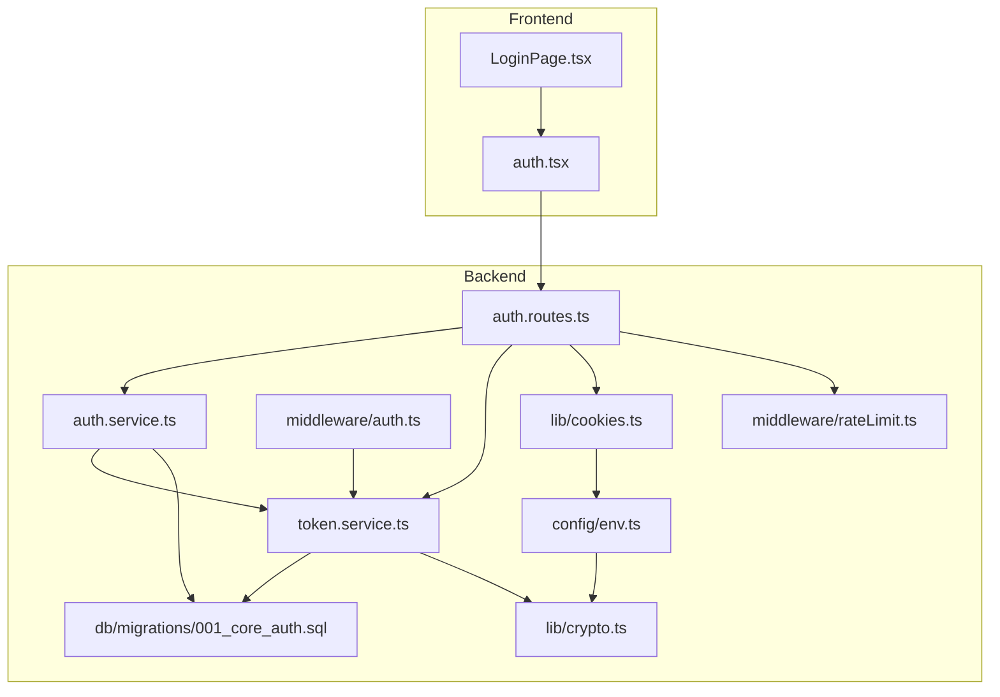
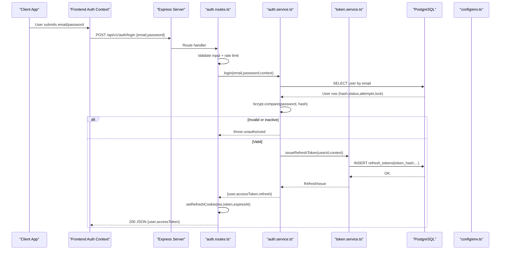
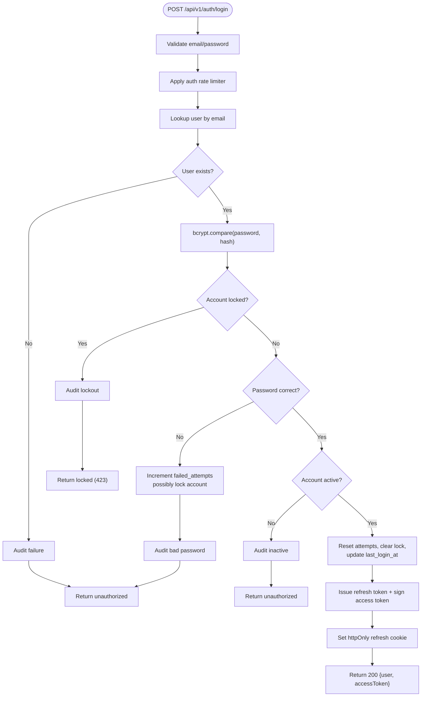
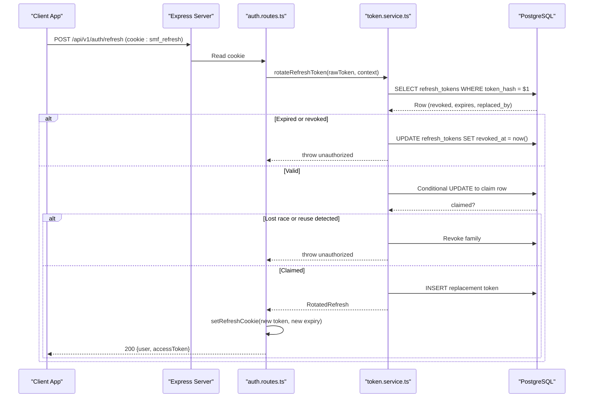
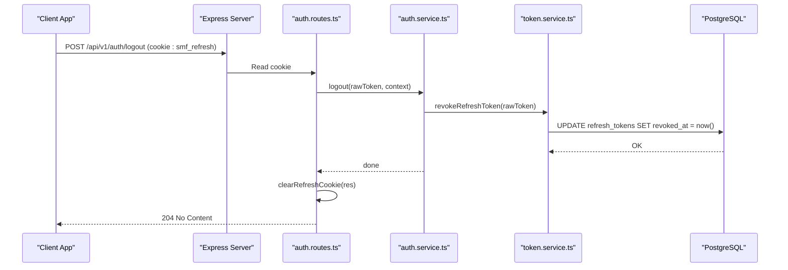
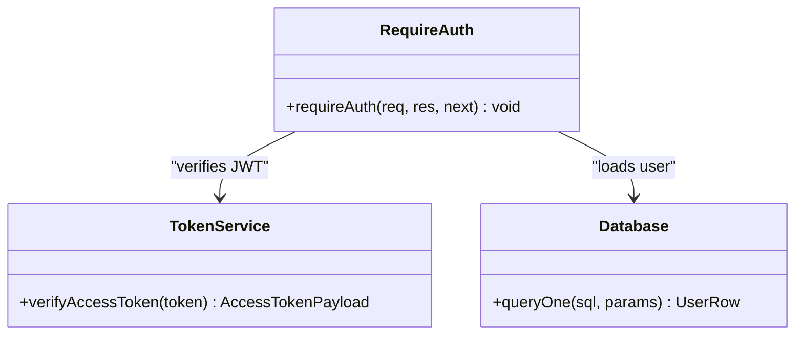
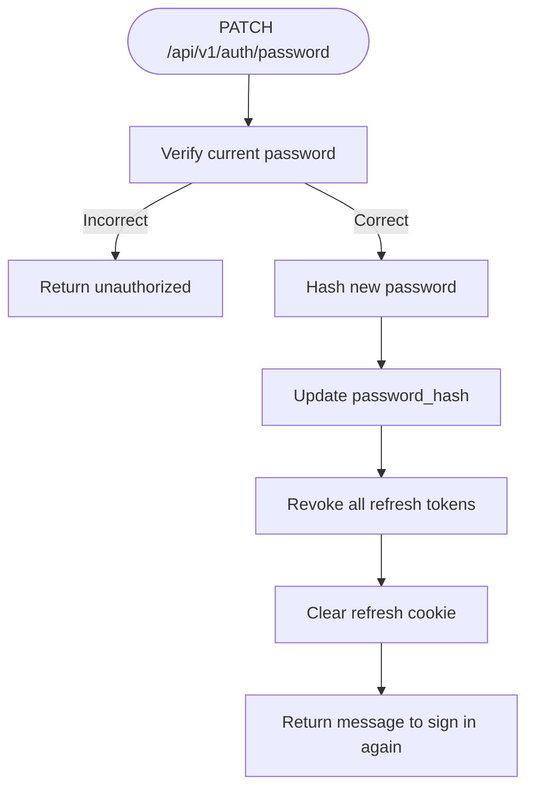
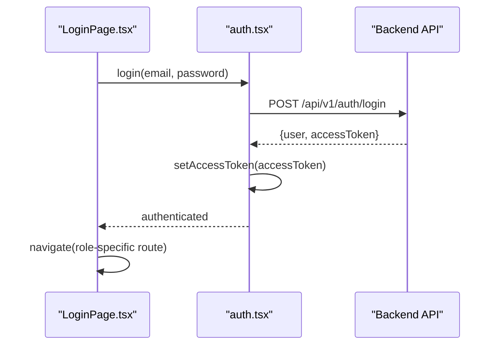
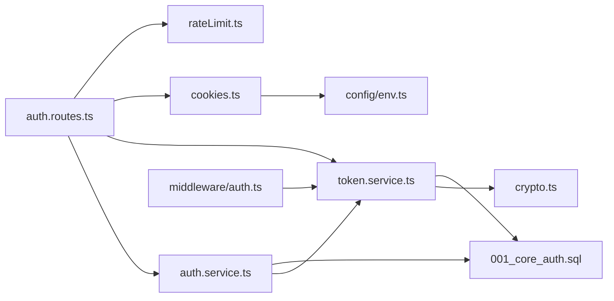

# Login & Logout Flows

<cite>
**Referenced Files in This Document**
- [auth.routes.ts](file://backend/src/modules/auth/auth.routes.ts)
- [auth.service.ts](file://backend/src/modules/auth/auth.service.ts)
- [token.service.ts](file://backend/src/modules/auth/token.service.ts)
- [auth.ts](file://backend/src/middleware/auth.ts)
- [rateLimit.ts](file://backend/src/middleware/rateLimit.ts)
- [cookies.ts](file://backend/src/lib/cookies.ts)
- [crypto.ts](file://backend/src/lib/crypto.ts)
- [env.ts](file://backend/src/config/env.ts)
- [001_core_auth.sql](file://backend/src/db/migrations/001_core_auth.sql)
- [openapi.yaml](file://backend/openapi.yaml)
- [LoginPage.tsx](file://frontend/src/pages/auth/LoginPage.tsx)
- [auth.tsx](file://frontend/src/lib/auth.tsx)
</cite>

## Table of Contents
1. [Introduction](#introduction)
2. [Project Structure](#project-structure)
3. [Core Components](#core-components)
4. [Architecture Overview](#architecture-overview)
5. [Detailed Component Analysis](#detailed-component-analysis)
6. [Dependency Analysis](#dependency-analysis)
7. [Performance Considerations](#performance-considerations)
8. [Troubleshooting Guide](#troubleshooting-guide)
9. [Conclusion](#conclusion)

## Introduction
This document explains the login and logout authentication flows for the SecureMicrofinance application. It covers:
- How credentials are validated and how passwords are verified with bcryptjs.
- How user sessions are created, including access token generation and refresh token handling.
- How logout revokes refresh tokens, clears cookies, and terminates sessions.
- Concrete API call examples, response formats, and error scenarios such as invalid credentials or locked accounts.
- Security considerations including brute-force protection, account lockout, secure cookie configuration, and session rotation.

The backend is an Express-based Node.js service; the frontend is a React SPA that stores the short-lived access token only in memory and uses an httpOnly refresh cookie for silent re-authentication.

## Project Structure
Authentication logic is primarily implemented under `backend/src/modules/auth`, with supporting middleware, cryptographic helpers, database schema, and OpenAPI documentation. The frontend contains the login page and the auth context that calls the backend endpoints.

**Diagram sources**
- [auth.routes.ts:1-121](file://backend/src/modules/auth/auth.routes.ts#L1-L121)
- [auth.service.ts:1-262](file://backend/src/modules/auth/auth.service.ts#L1-L262)
- [token.service.ts:1-206](file://backend/src/modules/auth/token.service.ts#L1-L206)
- [auth.ts:1-69](file://backend/src/middleware/auth.ts#L1-L69)
- [rateLimit.ts:1-51](file://backend/src/middleware/rateLimit.ts#L1-L51)
- [cookies.ts:1-29](file://backend/src/lib/cookies.ts#L1-L29)
- [crypto.ts:1-97](file://backend/src/lib/crypto.ts#L1-L97)
- [env.ts:1-101](file://backend/src/config/env.ts#L1-L101)
- [001_core_auth.sql:1-95](file://backend/src/db/migrations/001_core_auth.sql#L1-L95)
- [LoginPage.tsx:1-117](file://frontend/src/pages/auth/LoginPage.tsx#L1-L117)
- [auth.tsx:1-161](file://frontend/src/lib/auth.tsx#L1-L161)

**Section sources**
- [auth.routes.ts:1-121](file://backend/src/modules/auth/auth.routes.ts#L1-L121)
- [auth.service.ts:1-262](file://backend/src/modules/auth/auth.service.ts#L1-L262)
- [token.service.ts:1-206](file://backend/src/modules/auth/token.service.ts#L1-L206)
- [auth.ts:1-69](file://backend/src/middleware/auth.ts#L1-L69)
- [rateLimit.ts:1-51](file://backend/src/middleware/rateLimit.ts#L1-L51)
- [cookies.ts:1-29](file://backend/src/lib/cookies.ts#L1-L29)
- [crypto.ts:1-97](file://backend/src/lib/crypto.ts#L1-L97)
- [env.ts:1-101](file://backend/src/config/env.ts#L1-L101)
- [001_core_auth.sql:1-95](file://backend/src/db/migrations/001_core_auth.sql#L1-L95)
- [LoginPage.tsx:1-117](file://frontend/src/pages/auth/LoginPage.tsx#L1-L117)
- [auth.tsx:1-161](file://frontend/src/lib/auth.tsx#L1-L161)

## Core Components
- Authentication routes define `/login`, `/refresh`, and `/logout` endpoints, apply validation, rate limiting, and set/clear cookies.
- Authentication service implements credential lookup, bcrypt password verification, account lockout, audit logging, and session issuance.
- Token service manages JWT access tokens and rotating refresh tokens stored as SHA-256 hashes.
- Middleware validates bearer tokens and enforces active account status.
- Cookie helpers configure httpOnly, SameSite=Strict, and production-only secure cookies.
- Database migration defines users, profiles, and refresh_tokens tables.
- Frontend login page collects credentials and navigates after successful authentication.
- Frontend auth context performs login, register, logout, and silent session bootstrap.

**Section sources**
- [auth.routes.ts:1-121](file://backend/src/modules/auth/auth.routes.ts#L1-L121)
- [auth.service.ts:1-262](file://backend/src/modules/auth/auth.service.ts#L1-L262)
- [token.service.ts:1-206](file://backend/src/modules/auth/token.service.ts#L1-L206)
- [auth.ts:1-69](file://backend/src/middleware/auth.ts#L1-L69)
- [cookies.ts:1-29](file://backend/src/lib/cookies.ts#L1-L29)
- [001_core_auth.sql:1-95](file://backend/src/db/migrations/001_core_auth.sql#L1-L95)
- [LoginPage.tsx:1-117](file://frontend/src/pages/auth/LoginPage.tsx#L1-L117)
- [auth.tsx:1-161](file://frontend/src/lib/auth.tsx#L1-L161)

## Architecture Overview
The authentication architecture separates concerns across routes, services, middleware, and storage:
- Routes handle HTTP I/O, validation, and cookie management.
- Services implement business logic: credential checks, lockout, auditing, and token issuance.
- Token service handles JWT signing/verification and refresh token lifecycle.
- Middleware protects protected routes by verifying bearer tokens and checking account status.
- Storage persists hashed passwords, lockout state, and refresh token families.

**Diagram sources**
- [auth.routes.ts:64-73](file://backend/src/modules/auth/auth.routes.ts#L64-L73)
- [auth.service.ts:114-198](file://backend/src/modules/auth/auth.service.ts#L114-L198)
- [token.service.ts:64-76](file://backend/src/modules/auth/token.service.ts#L64-L76)
- [env.ts:93-100](file://backend/src/config/env.ts#L93-L100)
- [001_core_auth.sql:17-31](file://backend/src/db/migrations/001_core_auth.sql#L17-L31)
- [001_core_auth.sql:80-95](file://backend/src/db/migrations/001_core_auth.sql#L80-L95)

## Detailed Component Analysis

### Login Flow
The login flow authenticates a user, prevents enumeration via constant-time behavior, enforces lockout, and issues a short-lived access token plus a rotating refresh token.

Key steps:
1. Request arrives at `/api/v1/auth/login`.
2. Input is validated using Zod schemas for email and password.
3. Rate limiter applies per IP+email to mitigate brute force.
4. Service looks up the user by normalized email.
5. Password is compared using bcryptjs against the stored hash.
6. If the account is locked or inactive, appropriate errors are returned.
7. On success, failed attempts are reset, last login updated, and audit logged.
8. A refresh token is issued and stored as a SHA-256 hash; an access token is signed as a JWT.
9. The refresh cookie is set with httpOnly, SameSite=Strict, and path scoping.

**Diagram sources**
- [auth.routes.ts:41-44](file://backend/src/modules/auth/auth.routes.ts#L41-L44)
- [auth.routes.ts:64-73](file://backend/src/modules/auth/auth.routes.ts#L64-L73)
- [auth.service.ts:114-198](file://backend/src/modules/auth/auth.service.ts#L114-L198)
- [rateLimit.ts:23-34](file://backend/src/middleware/rateLimit.ts#L23-L34)
- [cookies.ts:11-19](file://backend/src/lib/cookies.ts#L11-L19)

Concrete API example:
- Request: `POST /api/v1/auth/login`
  - Body: `{ "email": "user@example.com", "password": "YourSecurePass1" }`
- Success Response: `200 OK`
  - Body: `{ "user": { "id": "...", "email": "...", "fullName": "...", "role": "borrower|lender|auditor", "createdAt": "..." }, "accessToken": "eyJhbGciOiJIUzI1NiIsInR5cCI6IkpXVCJ9..." }`
  - Headers: `Set-Cookie: smf_refresh=<opaque-token>; HttpOnly; SameSite=Strict; Path=/api/v1/auth; Expires=...`

Error scenarios:
- Invalid credentials: `401 Unauthorized` with generic message to prevent enumeration.
- Account temporarily locked: `423 Locked` after repeated failures.
- Inactive account: `401 Unauthorized` when status is not active.
- Validation failure: `400 Bad Request` if email/password do not meet schema constraints.

Security notes:
- bcryptjs cost is configurable via environment (`BCRYPT_COST`).
- Lockout threshold and duration are configurable (`LOGIN_MAX_ATTEMPTS`, `LOGIN_LOCK_MINUTES`).
- Audit logs every failure with reason categories without leaking which field was wrong.

**Section sources**
- [auth.routes.ts:41-44](file://backend/src/modules/auth/auth.routes.ts#L41-L44)
- [auth.routes.ts:64-73](file://backend/src/modules/auth/auth.routes.ts#L64-L73)
- [auth.service.ts:114-198](file://backend/src/modules/auth/auth.service.ts#L114-L198)
- [rateLimit.ts:23-34](file://backend/src/middleware/rateLimit.ts#L23-L34)
- [env.ts:44-46](file://backend/src/config/env.ts#L44-L46)
- [openapi.yaml:81-111](file://backend/openapi.yaml#L81-L111)

### Refresh Flow
The refresh endpoint rotates the refresh token and returns a new access token. It reads the opaque refresh token from the httpOnly cookie, verifies it, and rotates it atomically. Reuse outside a grace window revokes the entire token family.

Key steps:
1. Read `smf_refresh` cookie.
2. Hash the raw token and look up the matching row.
3. Check expiration and revocation.
4. Claim the row with conditional update to avoid concurrent fork.
5. Issue a replacement token within the same family.
6. Record audit events for concurrent use or reuse detection.
7. Set a new refresh cookie and return a new access token.

**Diagram sources**
- [auth.routes.ts:75-96](file://backend/src/modules/auth/auth.routes.ts#L75-L96)
- [token.service.ts:154-195](file://backend/src/modules/auth/token.service.ts#L154-L195)
- [cookies.ts:11-19](file://backend/src/lib/cookies.ts#L11-L19)
- [001_core_auth.sql:80-95](file://backend/src/db/migrations/001_core_auth.sql#L80-L95)

Concrete API example:
- Request: `POST /api/v1/auth/refresh`
  - Cookie: `smf_refresh=<opaque-token>`
- Success Response: `200 OK`
  - Body: `{ "user": { ... }, "accessToken": "new-jwt" }`
  - Headers: `Set-Cookie: smf_refresh=<new-opaque-token>; HttpOnly; SameSite=Strict; Path=/api/v1/auth; Expires=...`

Error scenarios:
- Missing cookie: `401 Unauthorized`.
- Invalid or expired token: `401 Unauthorized`.
- Reuse detected: `401 Unauthorized` with family revocation.

Security notes:
- Refresh tokens are opaque random values; only their SHA-256 hash is stored.
- Rotation is atomic to prevent concurrent forks.
- Reuse detection revokes the whole family to mitigate theft.

**Section sources**
- [auth.routes.ts:75-96](file://backend/src/modules/auth/auth.routes.ts#L75-L96)
- [token.service.ts:154-195](file://backend/src/modules/auth/token.service.ts#L154-L195)
- [cookies.ts:11-19](file://backend/src/lib/cookies.ts#L11-L19)
- [openapi.yaml:113-129](file://backend/openapi.yaml#L113-L129)

### Logout Flow
Logout revokes the current refresh token, clears the cookie, and records an audit event. Protected resources become inaccessible because the refresh token is no longer valid.

Key steps:
1. Read `smf_refresh` cookie.
2. Revoke the token hash in the database.
3. Clear the cookie on the response.
4. Return `204 No Content`.

**Diagram sources**
- [auth.routes.ts:98-103](file://backend/src/modules/auth/auth.routes.ts#L98-L103)
- [auth.service.ts:245-261](file://backend/src/modules/auth/auth.service.ts#L245-L261)
- [token.service.ts:197-201](file://backend/src/modules/auth/token.service.ts#L197-L201)
- [cookies.ts:21-28](file://backend/src/lib/cookies.ts#L21-L28)

Concrete API example:
- Request: `POST /api/v1/auth/logout`
  - Cookie: `smf_refresh=<opaque-token>`
- Success Response: `204 No Content`
- Behavior: Cookie cleared; subsequent refresh attempts fail until re-login.

Error scenarios:
- Missing cookie: Still returns `204 No Content`; server-side revocation is optional but audited.

Security notes:
- Revocation is immediate; all future refreshes with the same token will fail.
- Audit logs logout events with whether a token was present.

**Section sources**
- [auth.routes.ts:98-103](file://backend/src/modules/auth/auth.routes.ts#L98-L103)
- [auth.service.ts:245-261](file://backend/src/modules/auth/auth.service.ts#L245-L261)
- [token.service.ts:197-201](file://backend/src/modules/auth/token.service.ts#L197-L201)
- [cookies.ts:21-28](file://backend/src/lib/cookies.ts#L21-L28)
- [openapi.yaml:131-137](file://backend/openapi.yaml#L131-L137)

### Access Token Verification and Protected Routes
Protected routes require a Bearer JWT. The middleware verifies the token, parses its payload, and reloads the user from the database to enforce real-time status checks.

Key steps:
1. Extract `Authorization: Bearer <token>`.
2. Verify JWT signature, issuer, audience, and type.
3. Parse payload with strict schema.
4. Load user from database and check status is active.
5. Attach principal to request and proceed.

**Diagram sources**
- [auth.ts:18-41](file://backend/src/middleware/auth.ts#L18-L41)
- [token.service.ts:36-46](file://backend/src/modules/auth/token.service.ts#L36-L46)

Concrete API example:
- Request: `GET /api/v1/auth/me`
  - Header: `Authorization: Bearer <jwt>`
- Success Response: `200 OK`
  - Body: `{ "user": { ... }, "profile": { ... } }`

Error scenarios:
- Missing or malformed bearer token: `401 Unauthorized`.
- Expired or tampered token: `401 Unauthorized`.
- Inactive account: `403 Forbidden`.

Security notes:
- DB read ensures suspended/closed accounts lose access immediately.
- Payload parsing rejects unexpected fields.

**Section sources**
- [auth.ts:18-41](file://backend/src/middleware/auth.ts#L18-L41)
- [token.service.ts:36-46](file://backend/src/modules/auth/token.service.ts#L36-L46)
- [openapi.yaml:139-154](file://backend/openapi.yaml#L139-L154)

### Password Change and Session Termination
Changing a password verifies the current password, hashes the new one, revokes all sessions, and clears the refresh cookie so the client must log in again.

Key steps:
1. Load user’s password hash and role.
2. Verify current password with bcrypt.
3. Hash new password and update database.
4. Revoke all refresh tokens for the user.
5. Clear refresh cookie and respond with guidance to sign in again.

**Diagram sources**
- [auth.service.ts:200-243](file://backend/src/modules/auth/auth.service.ts#L200-L243)
- [auth.routes.ts:110-120](file://backend/src/modules/auth/auth.routes.ts#L110-L120)
- [token.service.ts:203-205](file://backend/src/modules/auth/token.service.ts#L203-L205)
- [cookies.ts:21-28](file://backend/src/lib/cookies.ts#L21-L28)

Concrete API example:
- Request: `PATCH /api/v1/auth/password`
  - Body: `{ "currentPassword": "...", "newPassword": "NewSecurePass1" }`
  - Header: `Authorization: Bearer <jwt>`
- Success Response: `200 OK`
  - Body: `{ "message": "Password updated. Please sign in again." }`
  - Headers: `Set-Cookie: smf_refresh=...; Max-Age=0; HttpOnly; SameSite=Strict; Path=/api/v1/auth`

Error scenarios:
- Incorrect current password: `401 Unauthorized`.
- Validation failure: `400 Bad Request`.

Security notes:
- All existing sessions are invalidated to prevent replay after password change.

**Section sources**
- [auth.service.ts:200-243](file://backend/src/modules/auth/auth.service.ts#L200-L243)
- [auth.routes.ts:110-120](file://backend/src/modules/auth/auth.routes.ts#L110-L120)
- [token.service.ts:203-205](file://backend/src/modules/auth/token.service.ts#L203-L205)
- [openapi.yaml:156-174](file://backend/openapi.yaml#L156-L174)

### Frontend Integration
The React login page collects credentials and calls the backend login endpoint through the auth context. On success, it sets the access token in memory and navigates to the role-appropriate dashboard.

Key behaviors:
- Calls `POST /api/v1/auth/login` with email and password.
- Stores the returned access token in memory (not localStorage).
- Navigates based on user role.
- Displays validation and server errors.

**Diagram sources**
- [LoginPage.tsx:25-40](file://frontend/src/pages/auth/LoginPage.tsx#L25-L40)
- [auth.tsx:94-103](file://frontend/src/lib/auth.tsx#L94-L103)

Concrete usage example:
- User enters email and password and clicks Sign in.
- On success, the app redirects to `/borrower`, `/lender`, or `/auditor` depending on role.
- On error, the UI shows a message and field-level errors.

**Section sources**
- [LoginPage.tsx:25-40](file://frontend/src/pages/auth/LoginPage.tsx#L25-L40)
- [auth.tsx:94-103](file://frontend/src/lib/auth.tsx#L94-L103)

## Dependency Analysis
Authentication components have clear dependencies:
- Routes depend on validation, rate limiting, cookies, and services.
- Services depend on database operations, bcrypt, and token utilities.
- Token service depends on crypto helpers and database.
- Middleware depends on token verification and database.
- Cookie helpers depend on environment configuration.

**Diagram sources**
- [auth.routes.ts:1-121](file://backend/src/modules/auth/auth.routes.ts#L1-L121)
- [auth.service.ts:1-262](file://backend/src/modules/auth/auth.service.ts#L1-L262)
- [token.service.ts:1-206](file://backend/src/modules/auth/token.service.ts#L1-L206)
- [auth.ts:1-69](file://backend/src/middleware/auth.ts#L1-L69)
- [cookies.ts:1-29](file://backend/src/lib/cookies.ts#L1-L29)
- [crypto.ts:1-97](file://backend/src/lib/crypto.ts#L1-L97)
- [env.ts:1-101](file://backend/src/config/env.ts#L1-L101)
- [001_core_auth.sql:1-95](file://backend/src/db/migrations/001_core_auth.sql#L1-L95)

**Section sources**
- [auth.routes.ts:1-121](file://backend/src/modules/auth/auth.routes.ts#L1-L121)
- [auth.service.ts:1-262](file://backend/src/modules/auth/auth.service.ts#L1-L262)
- [token.service.ts:1-206](file://backend/src/modules/auth/token.service.ts#L1-L206)
- [auth.ts:1-69](file://backend/src/middleware/auth.ts#L1-L69)
- [cookies.ts:1-29](file://backend/src/lib/cookies.ts#L1-L29)
- [crypto.ts:1-97](file://backend/src/lib/crypto.ts#L1-L97)
- [env.ts:1-101](file://backend/src/config/env.ts#L1-L101)
- [001_core_auth.sql:1-95](file://backend/src/db/migrations/001_core_auth.sql#L1-L95)

## Performance Considerations
- bcrypt hashing cost is configurable; higher costs increase security but also CPU usage.
- Refresh token rotation is designed to be fast and safe under concurrency using conditional updates.
- Rate limiting reduces load during brute-force attempts.
- Access token verification is lightweight; DB lookup for active status avoids stale permissions.

[No sources needed since this section provides general guidance]

## Troubleshooting Guide
Common issues and diagnostics:
- Invalid credentials: Ensure email normalization and bcrypt comparison are working; verify audit logs for `unknown_email` or `bad_password`.
- Account locked: Check `failed_attempts` and `locked_until`; wait for lockout period or unlock via admin process.
- Refresh token reuse: Investigate concurrent requests; ensure clients handle rotation gracefully and retry once.
- Missing refresh cookie: Confirm cookie domain/path settings and browser restrictions; ensure HTTPS in production.
- Expired access token: Use refresh endpoint; if refresh fails, prompt re-login.

Operational tips:
- Monitor audit events for `auth.login_failed`, `auth.refresh_reuse_detected`, and `auth.logout`.
- Review rate limiter metrics to detect credential stuffing patterns.
- Rotate secrets and keys according to policy; ensure environment variables are correctly loaded.

**Section sources**
- [auth.service.ts:136-171](file://backend/src/modules/auth/auth.service.ts#L136-L171)
- [token.service.ts:104-145](file://backend/src/modules/auth/token.service.ts#L104-L145)
- [rateLimit.ts:23-34](file://backend/src/middleware/rateLimit.ts#L23-L34)
- [cookies.ts:11-19](file://backend/src/lib/cookies.ts#L11-L19)

## Conclusion
The authentication system implements robust login and logout flows with strong security properties:
- Passwords are securely hashed with bcryptjs.
- Brute-force protection is enforced via rate limiting and account lockout.
- Sessions use short-lived JWT access tokens and rotating refresh tokens stored as hashes.
- Logout revokes refresh tokens and clears cookies.
- Protected routes verify tokens and enforce active account status.
- Frontend integrates cleanly, storing tokens only in memory and relying on httpOnly cookies for refresh.

These mechanisms collectively provide secure session management, resistance to common attacks, and clear operational visibility through audit logging.

[No sources needed since this section summarizes without analyzing specific files]