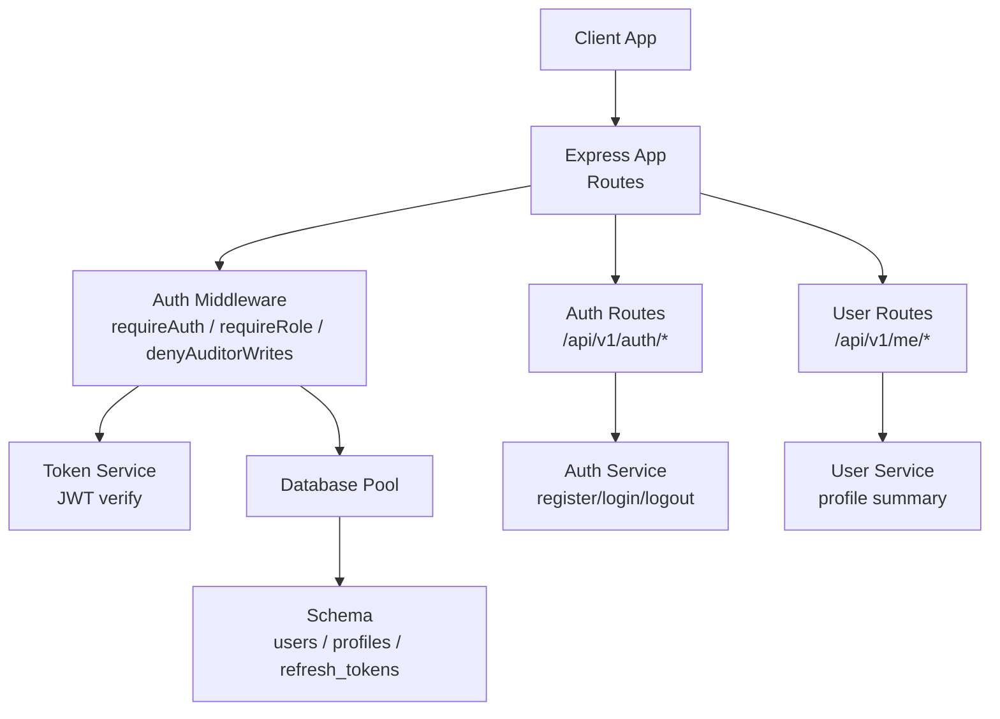
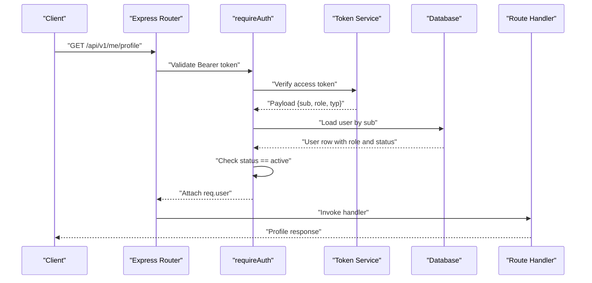
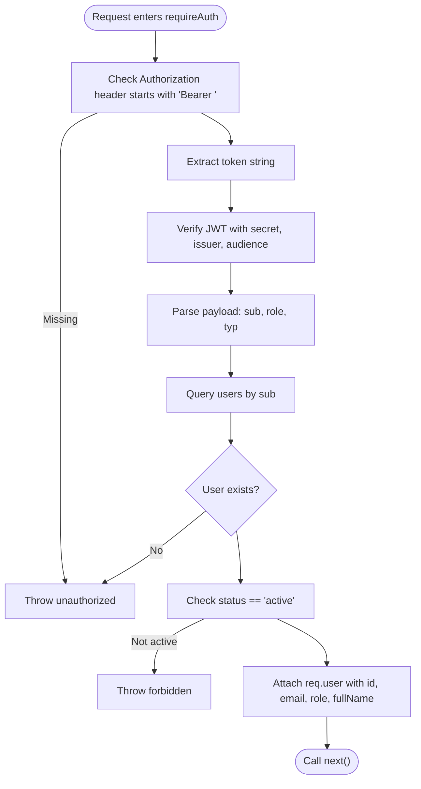
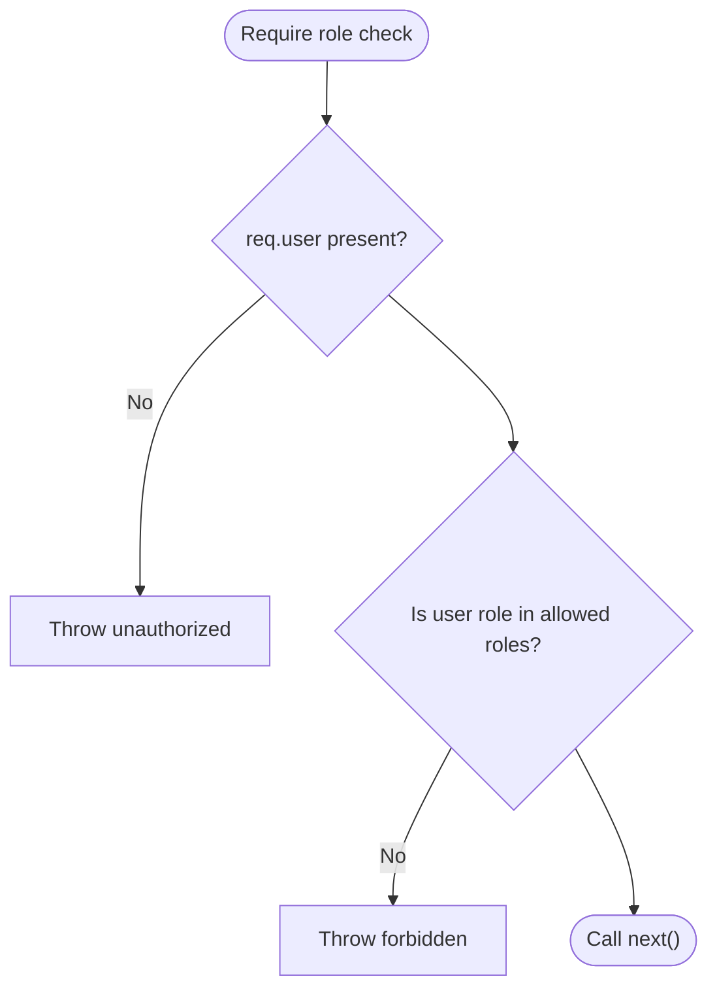
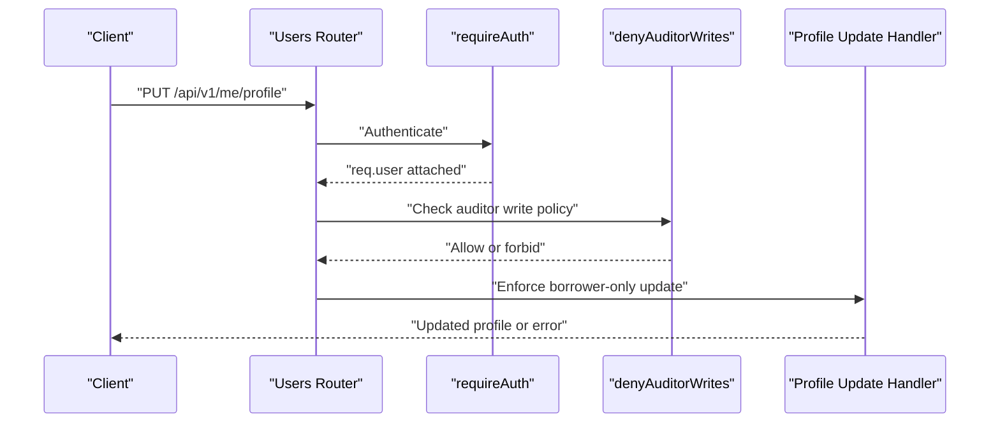
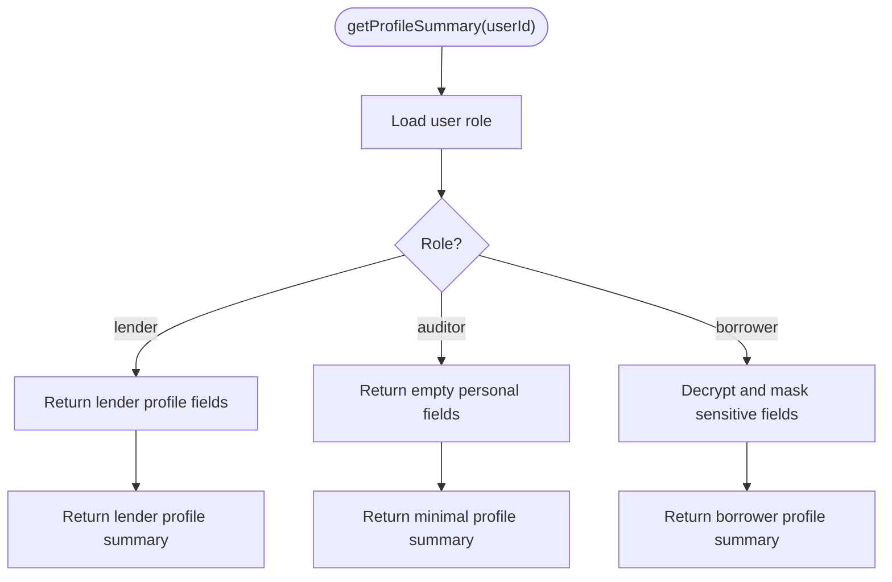
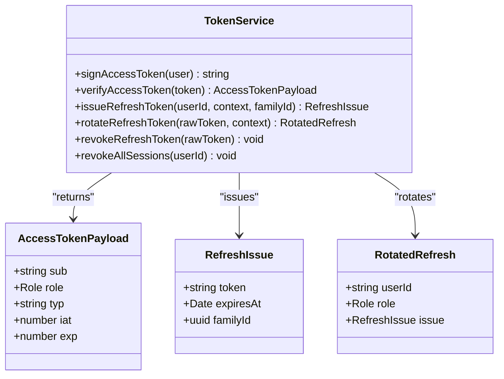
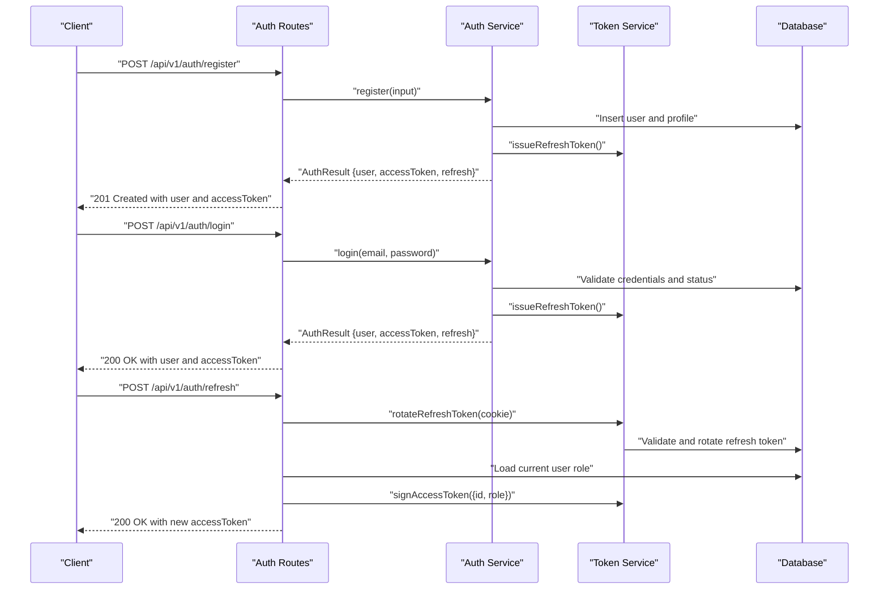
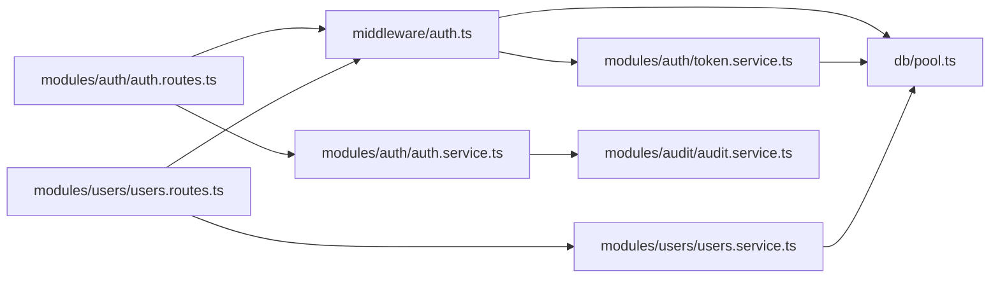

# Role-Based Access Control

<cite>
**Referenced Files in This Document**
- [auth.ts](file://backend/src/middleware/auth.ts)
- [express.d.ts](file://backend/src/types/express.d.ts)
- [auth.routes.ts](file://backend/src/modules/auth/auth.routes.ts)
- [auth.service.ts](file://backend/src/modules/auth/auth.service.ts)
- [token.service.ts](file://backend/src/modules/auth/token.service.ts)
- [users.routes.ts](file://backend/src/modules/users/users.routes.ts)
- [users.service.ts](file://backend/src/modules/users/users.service.ts)
- [001_core_auth.sql](file://backend/src/db/migrations/001_core_auth.sql)
- [rbac.test.ts](file://backend/test/rbac.test.ts)
- [app.ts](file://backend/src/app.ts)
</cite>

## Table of Contents
1. [Introduction](#introduction)
2. [Project Structure](#project-structure)
3. [Core Components](#core-components)
4. [Architecture Overview](#architecture-overview)
5. [Detailed Component Analysis](#detailed-component-analysis)
6. [Dependency Analysis](#dependency-analysis)
7. [Performance Considerations](#performance-considerations)
8. [Troubleshooting Guide](#troubleshooting-guide)
9. [Conclusion](#conclusion)

## Introduction
This document explains the role-based access control (RBAC) system implemented in the backend. The application defines three roles: borrower, lender, and auditor. Authentication is enforced through middleware that validates short-lived access tokens and reloads the user’s current role from the database. Authorization is enforced by per-route middleware that checks roles and prevents auditors from performing write operations.

The RBAC design ensures that:
- Only authenticated users can access protected routes.
- Roles are validated at runtime against the database rather than trusting token claims alone.
- Auditors have strict read-only access to state-changing endpoints.
- Borrowers and lenders are separated by profile data and allowed operations.

## Project Structure
The RBAC implementation spans middleware, authentication modules, user management, database schema, and tests. The most relevant parts are:



**Diagram sources**
- [app.ts:87-89](file://backend/src/app.ts#L87-L89)
- [auth.ts:18-68](file://backend/src/middleware/auth.ts#L18-L68)
- [auth.routes.ts:53-121](file://backend/src/modules/auth/auth.routes.ts#L53-L121)
- [users.routes.ts:40-107](file://backend/src/modules/users/users.routes.ts#L40-L107)
- [token.service.ts:28-46](file://backend/src/modules/auth/token.service.ts#L28-L46)
- [001_core_auth.sql:5-31](file://backend/src/db/migrations/001_core_auth.sql#L5-L31)

**Section sources**
- [app.ts:87-89](file://backend/src/app.ts#L87-L89)
- [auth.ts:18-68](file://backend/src/middleware/auth.ts#L18-L68)
- [auth.routes.ts:53-121](file://backend/src/modules/auth/auth.routes.ts#L53-L121)
- [users.routes.ts:40-107](file://backend/src/modules/users/users.routes.ts#L40-L107)

## Core Components
The RBAC system is built around these core components:

- **Role type**: A single enum-like type defines the allowed roles.
- **Authentication middleware**: Validates bearer tokens, verifies JWT signatures, loads the current user from the database, and attaches an authenticated principal to the request.
- **Authorization middleware**: Provides role gating and a write-denial rule for auditors.
- **Token service**: Signs and verifies short-lived access tokens and manages rotating refresh tokens.
- **Route handlers**: Apply authentication and authorization guards to specific endpoints.
- **Service layer**: Enforces role-specific behavior when reading or writing profile data.
- **Database schema**: Stores roles, account status, encrypted profile fields, and refresh tokens.

Key responsibilities:
- `requireAuth` enforces identity and active account status.
- `requireRole` enforces permitted roles per route.
- `denyAuditorWrites` blocks auditors from mutating state.
- Token verification uses a secret and audience/issuer validation.
- Refresh tokens are hashed and rotated with reuse detection.

**Section sources**
- [express.d.ts:1-8](file://backend/src/types/express.d.ts#L1-L8)
- [auth.ts:18-68](file://backend/src/middleware/auth.ts#L18-L68)
- [token.service.ts:28-46](file://backend/src/modules/auth/token.service.ts#L28-L46)
- [001_core_auth.sql:5-31](file://backend/src/db/migrations/001_core_auth.sql#L5-L31)

## Architecture Overview
The RBAC flow combines HTTP-level security, token validation, and database-backed authorization.



**Diagram sources**
- [auth.ts:18-41](file://backend/src/middleware/auth.ts#L18-L41)
- [token.service.ts:36-46](file://backend/src/modules/auth/token.service.ts#L36-L46)
- [users.routes.ts:40-43](file://backend/src/modules/users/users.routes.ts#L40-L43)

## Detailed Component Analysis

### Role Definitions and Data Model
Roles are defined centrally and used across the application. The database schema includes a role enum and related tables for borrowers and lenders.

- Role type: borrower, lender, auditor.
- Users table stores email, password hash, role, full name, and account status.
- Borrower and lender profiles store role-specific attributes.
- Refresh tokens are stored as hashes with family tracking and rotation metadata.

```mermaid
erDiagram
USERS {
uuid id PK
text email UK
text password_hash
enum role
text full_name
enum status
int failed_attempts
timestamptz locked_until
timestamptz last_login_at
timestamptz created_at
timestamptz updated_at
}
BORROWER_PROFILES {
uuid user_id PK FK
text national_id_enc
text national_id_bi
text phone_enc
text phone_bi
text date_of_birth_enc
text address_enc
text occupation
bigint monthly_income_cents
jsonb consent_flags
timestamptz created_at
timestamptz updated_at
}
LENDER_PROFILES {
uuid user_id PK FK
text business_name
bigint max_principal_cents
int default_rate_bps
int default_penalty_bps_per_day
timestamptz created_at
timestamptz updated_at
}
REFRESH_TOKENS {
uuid id PK
uuid user_id FK
char token_hash UK
uuid family_id
uuid replaced_by FK
timestamptz expires_at
timestamptz revoked_at
inet ip
text user_agent
timestamptz created_at
}
USERS ||--o{ BORROWER_PROFILES : "has one"
USERS ||--o{ LENDER_PROFILES : "has one"
USERS ||--o{ REFRESH_TOKENS : "issues"
```

**Diagram sources**
- [001_core_auth.sql:5-31](file://backend/src/db/migrations/001_core_auth.sql#L5-L31)
- [001_core_auth.sql:40-72](file://backend/src/db/migrations/001_core_auth.sql#L40-L72)
- [001_core_auth.sql:80-95](file://backend/src/db/migrations/001_core_auth.sql#L80-L95)

**Section sources**
- [express.d.ts:1-8](file://backend/src/types/express.d.ts#L1-L8)
- [001_core_auth.sql:5-31](file://backend/src/db/migrations/001_core_auth.sql#L5-L31)
- [001_core_auth.sql:40-72](file://backend/src/db/migrations/001_core_auth.sql#L40-L72)
- [001_core_auth.sql:80-95](file://backend/src/db/migrations/001_core_auth.sql#L80-L95)

### Authentication Middleware
The authentication middleware performs several critical checks:

- Requires a Bearer token header.
- Verifies the JWT signature, issuer, and audience.
- Parses and validates the token payload structure.
- Loads the user from the database using the token subject.
- Rejects missing or inactive accounts.
- Attaches the authenticated principal to the request.



**Diagram sources**
- [auth.ts:18-41](file://backend/src/middleware/auth.ts#L18-L41)
- [token.service.ts:36-46](file://backend/src/modules/auth/token.service.ts#L36-L46)

**Section sources**
- [auth.ts:18-41](file://backend/src/middleware/auth.ts#L18-L41)
- [token.service.ts:36-46](file://backend/src/modules/auth/token.service.ts#L36-L46)

### Authorization Middleware
Two authorization mechanisms are provided:

- `requireRole(...roles)`: Ensures the authenticated user has at least one of the specified roles.
- `denyAuditorWrites`: Blocks any write operation if the user’s role is auditor.

These are applied per route to enforce fine-grained access control.



**Diagram sources**
- [auth.ts:44-56](file://backend/src/middleware/auth.ts#L44-L56)

**Section sources**
- [auth.ts:44-56](file://backend/src/middleware/auth.ts#L44-L56)

### Protected Routes and Role-Specific Endpoints
Protected routes use the authentication and authorization middleware to restrict access:

- `/api/v1/auth/me`: Requires authentication; returns the current user and profile summary.
- `/api/v1/me/profile`: Requires authentication; reads borrower or lender profile data depending on role.
- `/api/v1/me/profile` (PUT): Requires authentication, denies auditor writes, and restricts updates to borrowers only.



**Diagram sources**
- [users.routes.ts:45-107](file://backend/src/modules/users/users.routes.ts#L45-L107)
- [auth.ts:62-68](file://backend/src/middleware/auth.ts#L62-L68)

**Section sources**
- [auth.routes.ts:105-121](file://backend/src/modules/auth/auth.routes.ts#L105-L121)
- [users.routes.ts:40-107](file://backend/src/modules/users/users.routes.ts#L40-L107)

### Permission Checking in Service Layers
Service layers enforce role-specific behavior beyond middleware:

- Profile summary retrieval branches based on role:
  - Lenders receive business-related fields.
  - Auditors receive no personal profile fields.
  - Borrowers receive masked sensitive fields after decryption.
- Profile updates are restricted to borrowers; other roles receive a forbidden error.



**Diagram sources**
- [users.service.ts:19-59](file://backend/src/modules/users/users.service.ts#L19-L59)

**Section sources**
- [users.service.ts:19-59](file://backend/src/modules/users/users.service.ts#L19-L59)
- [users.routes.ts:45-48](file://backend/src/modules/users/users.routes.ts#L45-L48)

### Token Strategy and Session Security
Access tokens are short-lived JWTs signed with a secret and validated with issuer and audience constraints. Refresh tokens are opaque, hashed, rotated, and tracked by family to detect replay attacks.

Key behaviors:
- Access tokens include user ID and role but are not trusted as the source of truth; the database is consulted on each request.
- Refresh tokens are stored as SHA-256 hashes and rotated on every use.
- Reuse outside a concurrency grace window revokes the entire token family.
- Password changes revoke all sessions for the user.



**Diagram sources**
- [token.service.ts:20-58](file://backend/src/modules/auth/token.service.ts#L20-L58)
- [token.service.ts:154-195](file://backend/src/modules/auth/token.service.ts#L154-L195)

**Section sources**
- [token.service.ts:28-46](file://backend/src/modules/auth/token_service.ts#L28-L46)
- [token.service.ts:64-76](file://backend/src/modules/auth/token.service.ts#L64-L76)
- [token.service.ts:154-195](file://backend/src/modules/auth/token.service.ts#L154-L195)
- [auth.service.ts:200-243](file://backend/src/modules/auth/auth.service.ts#L200-L243)

### Authentication Flow and Role Assignment
Registration allows creating borrowers and lenders. Auditors are not created via the public registration endpoint; they must be provisioned administratively. Login issues both an access token and a refresh token. The refresh endpoint rotates the refresh token and reissues an access token using the current database role.



**Diagram sources**
- [auth.routes.ts:53-96](file://backend/src/modules/auth/auth.routes.ts#L53-L96)
- [auth.service.ts:61-112](file://backend/src/modules/auth/auth.service.ts#L61-L112)
- [auth.service.ts:114-198](file://backend/src/modules/auth/auth.service.ts#L114-L198)
- [token.service.ts:64-76](file://backend/src/modules/auth/token.service.ts#L64-L76)

**Section sources**
- [auth.routes.ts:53-96](file://backend/src/modules/auth/auth.routes.ts#L53-L96)
- [auth.service.ts:61-112](file://backend/src/modules/auth/auth.service.ts#L61-L112)
- [auth.service.ts:114-198](file://backend/src/modules/auth/auth.service.ts#L114-L198)

## Dependency Analysis
The RBAC system has clear separation between middleware, services, routes, and storage:

- Middleware depends on token service and database pool.
- Routes depend on middleware and services.
- Services depend on database pool and audit logging.
- Tests validate RBAC behavior including token rejection, role enforcement, and auditor write denial.



**Diagram sources**
- [auth.ts:1-6](file://backend/src/middleware/auth.ts#L1-L6)
- [auth.routes.ts:1-13](file://backend/src/modules/auth/auth.routes.ts#L1-L13)
- [users.routes.ts:1-17](file://backend/src/modules/users/users.routes.ts#L1-L17)
- [token.service.ts:1-8](file://backend/src/modules/auth/token.service.ts#L1-L8)

**Section sources**
- [auth.ts:1-6](file://backend/src/middleware/auth.ts#L1-L6)
- [auth.routes.ts:1-13](file://backend/src/modules/auth/auth.routes.ts#L1-L13)
- [users.routes.ts:1-17](file://backend/src/modules/users/users.routes.ts#L1-L17)
- [token.service.ts:1-8](file://backend/src/modules/auth/token.service.ts#L1-L8)

## Performance Considerations
- Database reads during authentication ensure immediate effect of role or status changes, avoiding stale permissions from short-lived tokens.
- Token verification is lightweight; heavy work occurs only when necessary.
- Refresh token rotation uses conditional updates to avoid race conditions and reduce contention.
- Sensitive profile fields are decrypted only at the edge and immediately masked, minimizing exposure time.

[No sources needed since this section provides general guidance]

## Troubleshooting Guide
Common RBAC-related issues and their causes:

- Missing or malformed bearer token:
  - Cause: No Authorization header or invalid format.
  - Effect: Unauthorized response.
  - Resolution: Ensure client sends a valid Bearer token.

- Tampered or expired token:
  - Cause: Wrong secret, wrong issuer/audience, or expired token.
  - Effect: Unauthorized response.
  - Resolution: Regenerate tokens via login or refresh.

- Account suspended or closed:
  - Cause: User status is not active.
  - Effect: Forbidden response.
  - Resolution: Reactivate the account through administrative processes.

- Auditor attempting write:
  - Cause: Auditor role blocked by `denyAuditorWrites`.
  - Effect: Forbidden response.
  - Resolution: Use read-only endpoints for auditors.

- Lender trying to update borrower profile:
  - Cause: Route enforces borrower-only updates.
  - Effect: Forbidden response.
  - Resolution: Lenders should not update borrower profiles.

- Role changed after token issuance:
  - Cause: Token claim does not reflect current database role.
  - Effect: New role enforced on subsequent requests.
  - Resolution: Refresh or re-authenticate to obtain a token reflecting the latest role.

**Section sources**
- [auth.ts:18-68](file://backend/src/middleware/auth.ts#L18-L68)
- [users.routes.ts:45-48](file://backend/src/modules/users/users.routes.ts#L45-L48)
- [rbac.test.ts:12-73](file://backend/test/rbac.test.ts#L12-L73)

## Conclusion
The RBAC system enforces strong, database-backed authorization through middleware and service-layer checks. Roles are clearly defined and consistently applied across authentication, routing, and data access. Auditors are constrained to read-only operations, while borrowers and lenders have distinct profile scopes. Token validation and refresh rotation provide secure session management, and tests validate critical RBAC behaviors. For fine-grained access controls, extend the middleware and service layers with explicit permission checks, minimize trust in client-side roles, and continue auditing sensitive operations.

[No sources needed since this section summarizes without analyzing specific files]