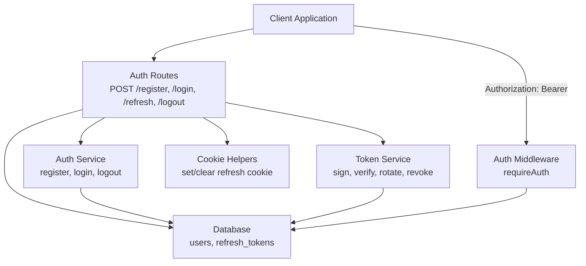
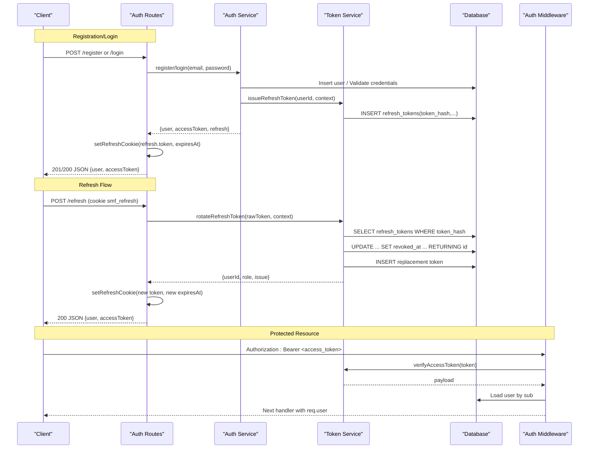
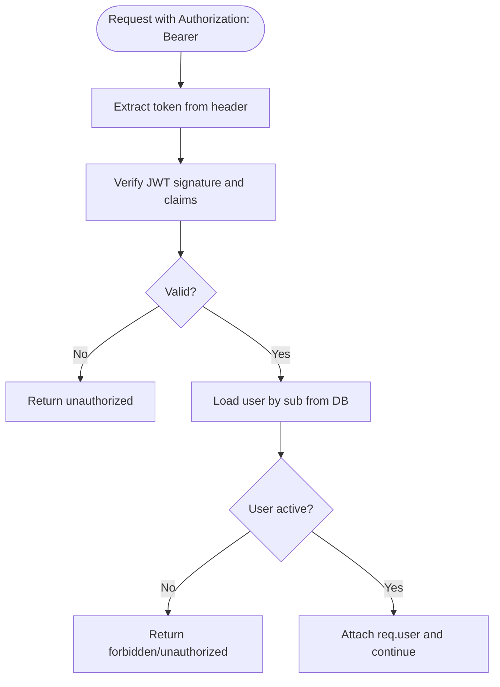
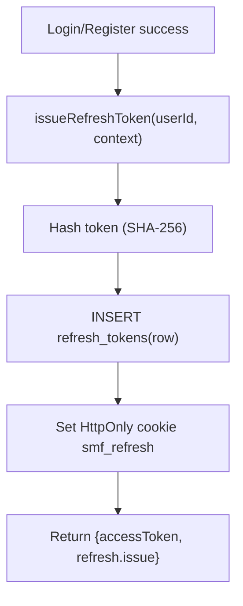
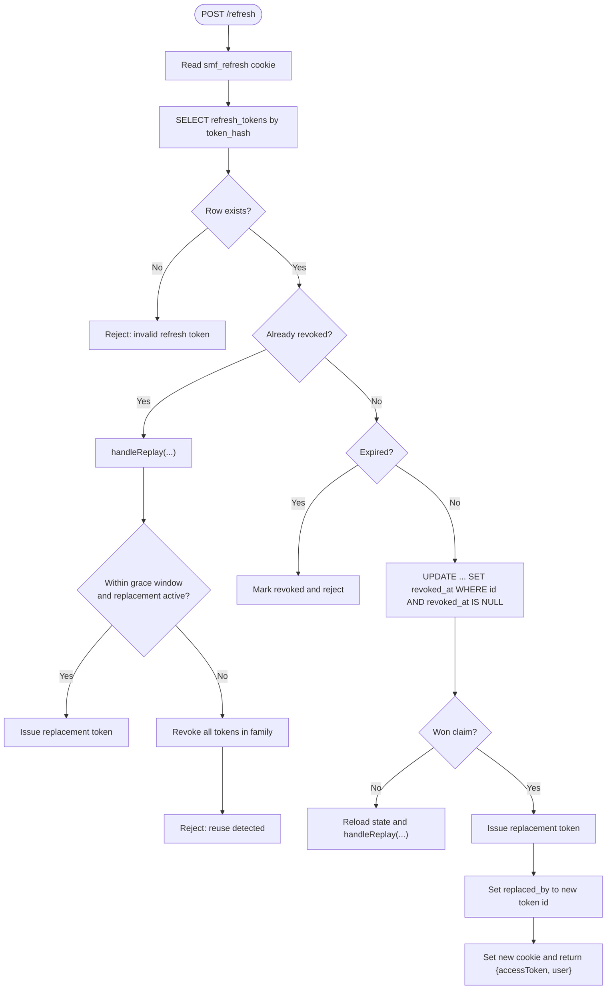
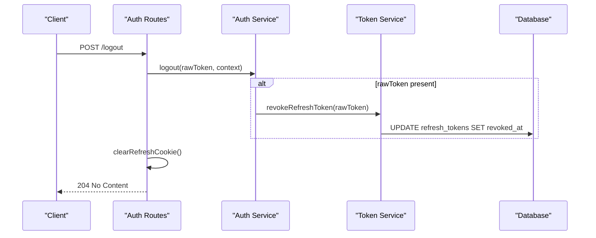
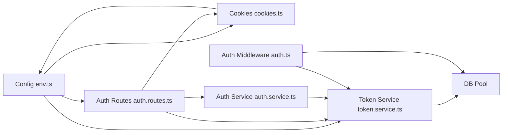

# Token Management

<cite>
**Referenced Files in This Document**
- [token.service.ts](file://backend/src/modules/auth/token.service.ts)
- [auth.service.ts](file://backend/src/modules/auth/auth.service.ts)
- [auth.routes.ts](file://backend/src/modules/auth/auth.routes.ts)
- [cookies.ts](file://backend/src/lib/cookies.ts)
- [auth.ts](file://backend/src/middleware/auth.ts)
- [env.ts](file://backend/src/config/env.ts)
</cite>

## Table of Contents
1. [Introduction](#introduction)
2. [Project Structure](#project-structure)
3. [Core Components](#core-components)
4. [Architecture Overview](#architecture-overview)
5. [Detailed Component Analysis](#detailed-component-analysis)
6. [Dependency Analysis](#dependency-analysis)
7. [Performance Considerations](#performance-considerations)
8. [Troubleshooting Guide](#troubleshooting-guide)
9. [Conclusion](#conclusion)

## Introduction
This document explains the JWT-based token management and rotation system used by the application. It covers:
- Access token generation and verification
- Refresh token issuance, storage, rotation, and revocation
- Token expiration handling and replay protection
- Secure cookie configuration for refresh tokens
- The complete token lifecycle from creation to rotation
- Security best practices and operational guidance

The design separates short-lived access tokens (JWTs) from long-lived opaque refresh tokens. Access tokens are sent explicitly via an Authorization header and kept in memory on the client. Refresh tokens are stored only as a secure, HttpOnly cookie and hashed in the database. Every successful refresh rotates the refresh token and issues a new one, providing strong protection against token theft and replay attacks.

## Project Structure
Token-related logic is implemented across several backend modules:
- Authentication routes expose endpoints for registration, login, refresh, logout, and profile access.
- The authentication service orchestrates user validation, password hashing, session creation, and token issuance.
- The token service implements JWT signing/verification and refresh token lifecycle operations.
- Cookie helpers configure secure refresh token cookies.
- Middleware validates access tokens and enforces role-based authorization.
- Configuration defines token TTLs, cookie names, and security-sensitive settings.

**Diagram sources**
- [auth.routes.ts:53-103](file://backend/src/modules/auth/auth.routes.ts#L53-L103)
- [auth.service.ts:61-197](file://backend/src/modules/auth/auth.service.ts#L61-L197)
- [token.service.ts:28-205](file://backend/src/modules/auth/token.service.ts#L28-L205)
- [cookies.ts:11-28](file://backend/src/lib/cookies.ts#L11-L28)
- [auth.ts:18-41](file://backend/src/middleware/auth.ts#L18-L41)

**Section sources**
- [auth.routes.ts:1-121](file://backend/src/modules/auth/auth.routes.ts#L1-L121)
- [auth.service.ts:1-262](file://backend/src/modules/auth/auth.service.ts#L1-L262)
- [token.service.ts:1-206](file://backend/src/modules/auth/token.service.ts#L1-L206)
- [cookies.ts:1-29](file://backend/src/lib/cookies.ts#L1-L29)
- [auth.ts:1-69](file://backend/src/middleware/auth.ts#L1-L69)
- [env.ts:28-100](file://backend/src/config/env.ts#L28-L100)

## Core Components
- Access tokens: Short-lived JWTs signed with a secret, including subject, role, issuer, audience, and expiration. Verified per request and validated for structure and claims.
- Refresh tokens: Opaque random values stored as SHA-256 hashes in the database, issued with an expiry and family identifier. Rotated on every use; reuse outside a grace window revokes the entire family.
- Cookie storage: Refresh tokens are set in an HttpOnly, SameSite=Strict cookie scoped to the auth path, with secure flag enabled in production.
- Rotation flow: On refresh, the server claims the row atomically, issues a replacement token, links it via a replaced_by pointer, and returns a new cookie.
- Expiration handling: Expired refresh tokens are revoked and rejected; expired or tampered access tokens are treated uniformly as invalid.

Key responsibilities:
- Token Service: JWT signing/verification, refresh token issuance, rotation, revocation, and audit logging.
- Auth Service: User registration/login, password change, session creation, and logout orchestration.
- Auth Routes: HTTP endpoints that bind requests to services and manage cookies.
- Cookie Helpers: Secure cookie setters and clearers.
- Auth Middleware: Access token verification and principal loading.
- Config: Environment-driven settings for secrets, TTLs, cookie name, and security flags.

**Section sources**
- [token.service.ts:10-19](file://backend/src/modules/auth/token.service.ts#L10-L19)
- [token.service.ts:28-46](file://backend/src/modules/auth/token.service.ts#L28-L46)
- [token.service.ts:64-76](file://backend/src/modules/auth/token.service.ts#L64-L76)
- [token.service.ts:154-195](file://backend/src/modules/auth/token.service.ts#L154-L195)
- [cookies.ts:4-18](file://backend/src/lib/cookies.ts#L4-L18)
- [auth.ts:13-41](file://backend/src/middleware/auth.ts#L13-L41)
- [env.ts:37-43](file://backend/src/config/env.ts#L37-L43)

## Architecture Overview
The token architecture follows a layered approach:
- HTTP layer exposes auth endpoints and manages cookies.
- Service layer encapsulates business rules for authentication and token lifecycle.
- Data layer persists users and refresh tokens.
- Middleware protects resource endpoints by validating access tokens and loading current user context.

**Diagram sources**
- [auth.routes.ts:53-96](file://backend/src/modules/auth/auth.routes.ts#L53-L96)
- [auth.service.ts:61-197](file://backend/src/modules/auth/auth.service.ts#L61-L197)
- [token.service.ts:64-76](file://backend/src/modules/auth/token.service.ts#L64-L76)
- [token.service.ts:154-195](file://backend/src/modules/auth/token.service.ts#L154-L195)
- [auth.ts:18-41](file://backend/src/middleware/auth.ts#L18-L41)

## Detailed Component Analysis

### Access Token Lifecycle
Access tokens are short-lived JWTs containing minimal identity information:
- Subject (user id), role, type, issuer, audience, and timestamps.
- Signed with a configured secret and verified with strict issuer/audience checks.
- Sent explicitly via Authorization header; never stored in localStorage.
- Verification throws a uniform unauthorized error for expired/tampered/wrong-audience cases.

**Diagram sources**
- [auth.ts:18-41](file://backend/src/middleware/auth.ts#L18-L41)
- [token.service.ts:28-46](file://backend/src/modules/auth/token.service.ts#L28-L46)

**Section sources**
- [token.service.ts:20-46](file://backend/src/modules/auth/token.service.ts#L20-L46)
- [auth.ts:1-41](file://backend/src/middleware/auth.ts#L1-L41)

### Refresh Token Issuance and Storage
On successful registration or login:
- A fresh opaque refresh token is generated.
- Only its SHA-256 hash is persisted along with user id, family id, expiry, ip, and user agent.
- A secure cookie is set with HttpOnly, SameSite=Strict, path-scoped to the auth route, and secure flag in production.

**Diagram sources**
- [auth.service.ts:106-111](file://backend/src/modules/auth/auth.service.ts#L106-L111)
- [auth.service.ts:192-197](file://backend/src/modules/auth/auth.service.ts#L192-L197)
- [token.service.ts:64-76](file://backend/src/modules/auth/token.service.ts#L64-L76)
- [cookies.ts:11-18](file://backend/src/lib/cookies.ts#L11-L18)

**Section sources**
- [auth.service.ts:61-111](file://backend/src/modules/auth/auth.service.ts#L61-L111)
- [auth.service.ts:192-197](file://backend/src/modules/auth/auth.service.ts#L192-L197)
- [token.service.ts:64-76](file://backend/src/modules/auth/token.service.ts#L64-L76)
- [cookies.ts:11-18](file://backend/src/lib/cookies.ts#L11-L18)

### Refresh Token Rotation Flow
Every refresh request performs these steps:
- Lookup the refresh token by its hash.
- Reject if missing, already revoked, or expired.
- Atomically claim the row to prevent concurrent rotation races.
- If another caller won the race, apply replay logic:
  - Within a configurable grace window and when a replacement exists and is active, treat as benign double-submit and issue a new token.
  - Otherwise, revoke the entire family and reject as potential theft.
- Issue a replacement token, link it via replaced_by, and return the new token and expiry.

**Diagram sources**
- [auth.routes.ts:75-96](file://backend/src/modules/auth/auth.routes.ts#L75-L96)
- [token.service.ts:104-145](file://backend/src/modules/auth/token.service.ts#L104-L145)
- [token.service.ts:154-195](file://backend/src/modules/auth/token.service.ts#L154-L195)

**Section sources**
- [auth.routes.ts:75-96](file://backend/src/modules/auth/auth.routes.ts#L75-L96)
- [token.service.ts:94-145](file://backend/src/modules/auth/token.service.ts#L94-L145)
- [token.service.ts:154-195](file://backend/src/modules/auth/token.service.ts#L154-L195)

### Cookie Configuration and Security
Refresh tokens are stored in a cookie with the following properties:
- Name: configured via environment (default smf_refresh).
- HttpOnly: true to prevent JavaScript access.
- Secure: true in production to enforce HTTPS.
- SameSite: Strict to mitigate CSRF on sensitive endpoints.
- Path: Scoped to the auth API path to limit exposure.
- Expires: Set to the refresh token’s expiry date.

Clearing the cookie occurs on logout and after password changes.

**Section sources**
- [cookies.ts:4-28](file://backend/src/lib/cookies.ts#L4-L28)
- [env.ts:93-100](file://backend/src/config/env.ts#L93-L100)
- [auth.routes.ts:98-103](file://backend/src/modules/auth/auth.routes.ts#L98-L103)
- [auth.routes.ts:110-120](file://backend/src/modules/auth/auth.routes.ts#L110-L120)

### Token Structures
- Access token payload includes:
  - Subject (user id)
  - Role
  - Type (access)
  - Issuer and audience
  - Issued-at and expiration timestamps
- Refresh token data persisted includes:
  - User id
  - Token hash (SHA-256)
  - Family id
  - Expiry timestamp
  - Optional ip and user agent
  - Revocation and replacement pointers

These structures ensure minimal exposure in tokens while enabling robust server-side tracking and rotation.

**Section sources**
- [token.service.ts:20-26](file://backend/src/modules/auth/token.service.ts#L20-L26)
- [token.service.ts:84-92](file://backend/src/modules/auth/token.service.ts#L84-L92)

### Logout and Session Termination
Logout clears the refresh cookie and optionally revokes the presented refresh token. Password changes revoke all sessions for the user, forcing re-authentication.

**Diagram sources**
- [auth.routes.ts:98-103](file://backend/src/modules/auth/auth.routes.ts#L98-L103)
- [auth.service.ts:245-261](file://backend/src/modules/auth/auth.service.ts#L245-L261)
- [token.service.ts:197-201](file://backend/src/modules/auth/token.service.ts#L197-L201)

**Section sources**
- [auth.routes.ts:98-103](file://backend/src/modules/auth/auth.routes.ts#L98-L103)
- [auth.service.ts:245-261](file://backend/src/modules/auth/auth.service.ts#L245-L261)
- [token.service.ts:197-205](file://backend/src/modules/auth/token.service.ts#L197-L205)

## Dependency Analysis
The token system has clear separation of concerns:
- Routes depend on services and cookie helpers.
- Services depend on the token service and database pool.
- Token service depends on crypto utilities, config, and database pool.
- Middleware depends on token service and database pool.
- Config centralizes environment variables and provides derived values like cookie name and production flag.

**Diagram sources**
- [env.ts:93-100](file://backend/src/config/env.ts#L93-L100)
- [token.service.ts:1-8](file://backend/src/modules/auth/token.service.ts#L1-L8)
- [cookies.ts:1-3](file://backend/src/lib/cookies.ts#L1-L3)
- [auth.routes.ts:1-13](file://backend/src/modules/auth/auth.routes.ts#L1-L13)
- [auth.service.ts:1-13](file://backend/src/modules/auth/auth.service.ts#L1-L13)
- [auth.ts:1-6](file://backend/src/middleware/auth.ts#L1-L6)

**Section sources**
- [env.ts:28-100](file://backend/src/config/env.ts#L28-L100)
- [token.service.ts:1-8](file://backend/src/modules/auth/token.service.ts#L1-L8)
- [cookies.ts:1-3](file://backend/src/lib/cookies.ts#L1-L3)
- [auth.routes.ts:1-13](file://backend/src/modules/auth/auth.routes.ts#L1-L13)
- [auth.service.ts:1-13](file://backend/src/modules/auth/auth.service.ts#L1-L13)
- [auth.ts:1-6](file://backend/src/middleware/auth.ts#L1-L6)

## Performance Considerations
- Access token verification is lightweight and stateless; however, middleware also loads the user from the database to enforce immediate account status changes.
- Refresh rotation uses atomic updates to avoid race conditions and minimize contention.
- Audit logging adds overhead but provides essential forensic capability; consider batching or async logging in high-throughput environments.
- Cookie scoping reduces unnecessary cookie transmission on unrelated routes.

[No sources needed since this section provides general guidance]

## Troubleshooting Guide
Common issues and resolutions:
- Missing refresh cookie: Ensure the client sends the smf_refresh cookie on refresh/logout requests and that the cookie path matches the endpoint path.
- Invalid refresh token: Indicates missing, expired, or revoked token; check database entries and rotation logs.
- Refresh token reuse detected: Usually indicates token theft or stale clients; investigate concurrent usage and consider tightening the grace window.
- Account no longer exists: Occurs when the user record is deleted or suspended; force re-login.
- Access token invalid/expired: Verify the Authorization header format and token lifetime; refresh using the refresh flow before retrying protected calls.

Operational tips:
- Monitor audit events for auth.refresh_reuse_detected and auth.refresh_concurrent to detect anomalies.
- Use revokeAllSessions during incident response to invalidate all active sessions for a user.
- Ensure environment variables for JWT secrets, TTLs, and cookie settings are correctly configured per environment.

**Section sources**
- [token.service.ts:104-145](file://backend/src/modules/auth/token.service.ts#L104-L145)
- [token.service.ts:154-195](file://backend/src/modules/auth/token.service.ts#L154-L195)
- [auth.routes.ts:75-96](file://backend/src/modules/auth/auth.routes.ts#L75-L96)
- [auth.ts:18-41](file://backend/src/middleware/auth.ts#L18-L41)

## Conclusion
This token management system combines short-lived JWT access tokens with securely rotated refresh tokens stored as hashed values in the database and delivered via secure cookies. The rotation mechanism prevents token replay and theft through atomic claiming, family-based revocation, and a controlled grace window for benign concurrency. Access tokens are verified per request with strict claims and followed by a database lookup to enforce real-time account status. Together, these patterns provide a robust, auditable, and secure authentication flow suitable for sensitive financial applications.

[No sources needed since this section summarizes without analyzing specific files]