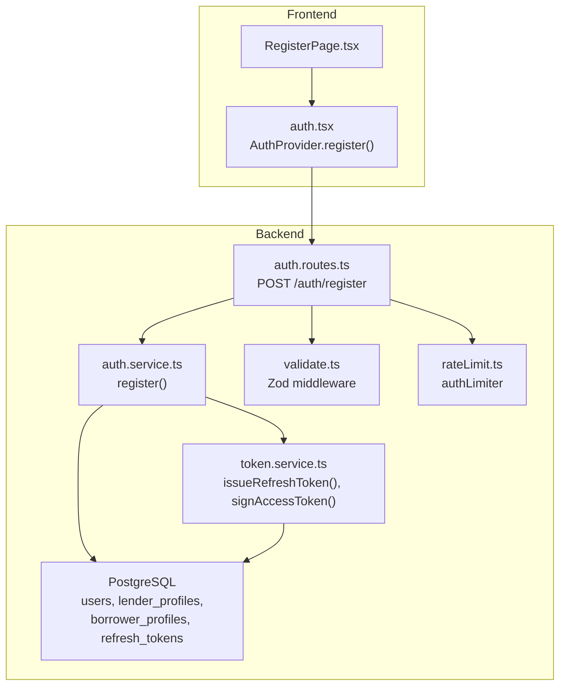
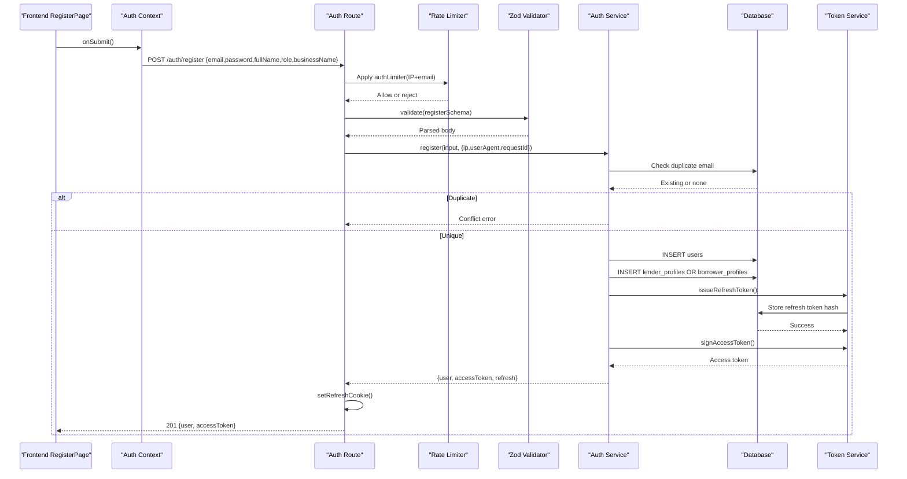
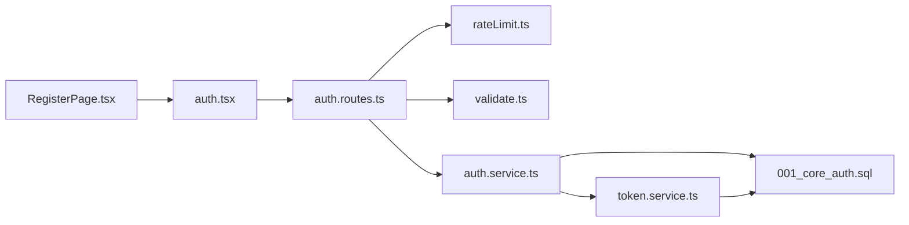

# User Registration

<cite>
**Referenced Files in This Document**
- [auth.routes.ts](file://backend/src/modules/auth/auth.routes.ts)
- [auth.service.ts](file://backend/src/modules/auth/auth.service.ts)
- [token.service.ts](file://backend/src/modules/auth/token.service.ts)
- [validate.ts](file://backend/src/middleware/validate.ts)
- [rateLimit.ts](file://backend/src/middleware/rateLimit.ts)
- [001_core_auth.sql](file://backend/src/db/migrations/001_core_auth.sql)
- [RegisterPage.tsx](file://frontend/src/pages/auth/RegisterPage.tsx)
- [auth.tsx](file://frontend/src/lib/auth.tsx)
</cite>

## Table of Contents
1. [Introduction](#introduction)
2. [Project Structure](#project-structure)
3. [Core Components](#core-components)
4. [Architecture Overview](#architecture-overview)
5. [Detailed Component Analysis](#detailed-component-analysis)
6. [Dependency Analysis](#dependency-analysis)
7. [Performance Considerations](#performance-considerations)
8. [Troubleshooting Guide](#troubleshooting-guide)
9. [Conclusion](#conclusion)

## Introduction
This document explains the user registration system for the application. It covers the complete flow from the frontend registration form to backend validation, database creation, and token issuance. It also documents email validation, password strength requirements, role assignment (borrower or lender), business name handling for lenders, Zod schema validation, database schema, error handling for duplicate emails and invalid inputs, and security measures such as IP tracking and rate limiting during registration.

## Project Structure
The registration feature spans both frontend and backend:

- Frontend:
  - Registration UI collects full name, email, password, confirm password, role, and optional business name.
  - The auth context sends a POST request to `/auth/register` and applies the returned session.

- Backend:
  - Auth routes define the `/auth/register` endpoint with Zod validation and rate limiting.
  - Auth service creates users, handles roles, inserts profile rows, audits the action, and issues tokens.
  - Token service signs access tokens and issues refresh tokens stored securely.
  - Middleware validates input and enforces rate limits.
  - Database migrations define users, borrower/lender profiles, and refresh tokens.



**Diagram sources**
- [RegisterPage.tsx:25-50](file://frontend/src/pages/auth/RegisterPage.tsx#L25-L50)
- [auth.tsx:105-117](file://frontend/src/lib/auth.tsx#L105-L117)
- [auth.routes.ts:53-62](file://backend/src/modules/auth/auth.routes.ts#L53-L62)
- [auth.service.ts:61-112](file://backend/src/modules/auth/auth.service.ts#L61-L112)
- [token.service.ts:64-76](file://backend/src/modules/auth/token.service.ts#L64-L76)
- [validate.ts:11-26](file://backend/src/middleware/validate.ts#L11-L26)
- [rateLimit.ts:23-34](file://backend/src/middleware/rateLimit.ts#L23-L34)
- [001_core_auth.sql:17-31](file://backend/src/db/migrations/001_core_auth.sql#L17-L31)

**Section sources**
- [RegisterPage.tsx:25-50](file://frontend/src/pages/auth/RegisterPage.tsx#L25-L50)
- [auth.tsx:105-117](file://frontend/src/lib/auth.tsx#L105-L117)
- [auth.routes.ts:53-62](file://backend/src/modules/auth/auth.routes.ts#L53-L62)
- [auth.service.ts:61-112](file://backend/src/modules/auth/auth.service.ts#L61-L112)
- [token.service.ts:64-76](file://backend/src/modules/auth/token.service.ts#L64-L76)
- [validate.ts:11-26](file://backend/src/middleware/validate.ts#L11-L26)
- [rateLimit.ts:23-34](file://backend/src/middleware/rateLimit.ts#L23-L34)
- [001_core_auth.sql:17-31](file://backend/src/db/migrations/001_core_auth.sql#L17-L31)

## Core Components
- Registration UI: Collects role, full name, business name (for lenders), email, password, and confirmation. Validates client-side that passwords match and forwards data to the backend.
- Auth route: Defines the register endpoint, applies rate limiting, validates input with Zod, calls the service, sets a refresh cookie, and returns user info plus an access token.
- Auth service: Normalizes email, checks duplicates, hashes password, creates user row, inserts role-specific profile row, audits the registration, and issues refresh and access tokens.
- Token service: Signs short-lived access tokens and issues opaque refresh tokens hashed and stored in the database.
- Validation middleware: Parses and replaces request body/query/params with validated, coerced values using Zod schemas.
- Rate limiter: Enforces global, authentication-specific, and write-specific limits; authentication limiter uses IP + email keying.
- Database schema: Defines users, borrower/lender profiles, and refresh tokens with constraints and indexes.

**Section sources**
- [RegisterPage.tsx:25-50](file://frontend/src/pages/auth/RegisterPage.tsx#L25-L50)
- [auth.routes.ts:20-62](file://backend/src/modules/auth/auth.routes.ts#L20-L62)
- [auth.service.ts:25-112](file://backend/src/modules/auth/auth.service.ts#L25-L112)
- [token.service.ts:28-76](file://backend/src/modules/auth/token.service.ts#L28-L76)
- [validate.ts:11-26](file://backend/src/middleware/validate.ts#L11-L26)
- [rateLimit.ts:23-47](file://backend/src/middleware/rateLimit.ts#L23-L47)
- [001_core_auth.sql:17-31](file://backend/src/db/migrations/001_core_auth.sql#L17-L31)

## Architecture Overview
The registration workflow is a multi-step process involving frontend validation, backend middleware, service logic, database persistence, and token issuance.



**Diagram sources**
- [RegisterPage.tsx:25-50](file://frontend/src/pages/auth/RegisterPage.tsx#L25-L50)
- [auth.tsx:105-117](file://frontend/src/lib/auth.tsx#L105-L117)
- [auth.routes.ts:53-62](file://backend/src/modules/auth/auth.routes.ts#L53-L62)
- [rateLimit.ts:23-34](file://backend/src/middleware/rateLimit.ts#L23-L34)
- [validate.ts:11-26](file://backend/src/middleware/validate.ts#L11-L26)
- [auth.service.ts:61-112](file://backend/src/modules/auth/auth.service.ts#L61-L112)
- [token.service.ts:64-76](file://backend/src/modules/auth/token.service.ts#L64-L76)

## Detailed Component Analysis

### Registration Request and Response
- Request payload:
  - `email`: Validated by Zod regex and length rules.
  - `password`: Minimum 10 characters, must include at least one letter and one number.
  - `fullName`: Trimmed string between 2 and 120 characters.
  - `role`: Enum restricted to `borrower` or `lender`.
  - `businessName`: Optional trimmed string up to 120 characters; only sent when role is `lender`.

- Response payload on success:
  - `user`: Public user object containing id, email, fullName, role, createdAt.
  - `accessToken`: Short-lived JWT used for API authorization.
  - A refresh token is set via an httpOnly cookie and not included in the response body.

Example request:
```json
{
  "email": "jane@example.com",
  "password": "SecurePass1",
  "fullName": "Jane Wanjiku",
  "role": "lender",
  "businessName": "Wanjiku Credit"
}
```

Example response:
```json
{
  "user": {
    "id": "uuid-string",
    "email": "jane@example.com",
    "fullName": "Jane Wanjiku",
    "role": "lender",
    "createdAt": "2024-01-01T00:00:00.000Z"
  },
  "accessToken": "jwt-token-string"
}
```

**Section sources**
- [auth.routes.ts:20-39](file://backend/src/modules/auth/auth.routes.ts#L20-L39)
- [auth.routes.ts:53-62](file://backend/src/modules/auth/auth.routes.ts#L53-L62)
- [auth.service.ts:47-55](file://backend/src/modules/auth/auth.service.ts#L47-L55)

### Email Validation
- Zod schema enforces:
  - Trimmed string.
  - Maximum length of 254 characters.
  - Regex pattern ensuring a valid email-like structure.
- Backend normalizes email to lowercase before checking duplicates and storing it.
- Database constraint ensures emails remain lowercased.

Validation behavior:
- Invalid format triggers a validation error before reaching the service layer.
- Duplicate email results in a conflict error from the service layer.

**Section sources**
- [auth.routes.ts:20-24](file://backend/src/modules/auth/auth.routes.ts#L20-L24)
- [auth.service.ts:57-64](file://backend/src/modules/auth/auth.service.ts#L57-L64)
- [001_core_auth.sql:17-31](file://backend/src/db/migrations/001_core_auth.sql#L17-L31)

### Password Strength Requirements
- Password must be at least 10 characters long.
- Must contain at least one letter.
- Must contain at least one number.
- Maximum length is 128 characters.
- Passwords are never logged; they are hashed using bcrypt with a configured cost factor.

Client-side hint:
- The registration form displays a hint indicating the minimum length and character class requirements.

**Section sources**
- [auth.routes.ts:26-31](file://backend/src/modules/auth/auth.routes.ts#L26-L31)
- [RegisterPage.tsx:122-136](file://frontend/src/pages/auth/RegisterPage.tsx#L122-L136)
- [auth.service.ts:18-24](file://backend/src/modules/auth/auth.service.ts#L18-L24)
- [auth.service.ts:66-67](file://backend/src/modules/auth/auth.service.ts#L66-L67)

### Role Assignment and Business Name Handling
- Roles allowed during registration: `borrower`, `lender`.
- If role is `lender`:
  - A `lender_profiles` row is created with optional `business_name`.
  - The business name is shown on loan agreements per the UI hint.
- If role is `borrower`:
  - A `borrower_profiles` row is created without business name.

Business name rules:
- Optional field for lenders.
- Trimmed and limited to 120 characters by the schema.

**Section sources**
- [auth.routes.ts:33-39](file://backend/src/modules/auth/auth.routes.ts#L33-L39)
- [auth.service.ts:77-84](file://backend/src/modules/auth/auth.service.ts#L77-L84)
- [001_core_auth.sql:64-72](file://backend/src/db/migrations/001_core_auth.sql#L64-L72)
- [RegisterPage.tsx:99-108](file://frontend/src/pages/auth/RegisterPage.tsx#L99-L108)

### Zod Schema Validation
- The registration schema defines strict types and constraints for all fields.
- Unknown keys are stripped automatically by Zod’s default object behavior, providing mass-assignment defense.
- The validator middleware replaces the request source with parsed, typed data so controllers only see validated inputs.

Key validations:
- `email`: String, trimmed, max 254, regex-based email format.
- `password`: Min 10, max 128, requires letter and digit.
- `fullName`: Trimmed, min 2, max 120.
- `role`: Enum of `borrower` or `lender`.
- `businessName`: Optional, trimmed, max 120.

**Section sources**
- [auth.routes.ts:33-39](file://backend/src/modules/auth/auth.routes.ts#L33-L39)
- [validate.ts:6-26](file://backend/src/middleware/validate.ts#L6-L26)

### Database Creation During Registration
Registration creates:
- A `users` row with normalized email, bcrypt-hashed password, role, and full name.
- A role-specific profile row:
  - For lenders: `lender_profiles` with optional business name.
  - For borrowers: `borrower_profiles` initialized without sensitive fields.

Constraints and integrity:
- Email is unique and enforced to be lowercase.
- Profile tables reference users with foreign keys and cascade deletes.
- Audit logging occurs within the same transaction to ensure consistency.

**Section sources**
- [auth.service.ts:68-84](file://backend/src/modules/auth/auth.service.ts#L68-L84)
- [001_core_auth.sql:17-31](file://backend/src/db/migrations/001_core_auth.sql#L17-L31)
- [001_core_auth.sql:40-72](file://backend/src/db/migrations/001_core_auth.sql#L40-L72)

### Initial Token Generation Process
After successful registration:
- An access token is signed as a short-lived JWT with issuer and audience claims.
- A refresh token is issued as an opaque random value, hashed, and stored in the database along with IP and user agent metadata.
- The refresh token is set in an httpOnly cookie; the access token is returned in the JSON response and should be kept in memory by the frontend.

Security properties:
- Refresh tokens are rotated on use; reuse outside a concurrency grace window revokes the entire family.
- Access tokens are short-lived and verified with issuer and audience checks.

**Section sources**
- [auth.service.ts:106-111](file://backend/src/modules/auth/auth.service.ts#L106-L111)
- [token.service.ts:28-34](file://backend/src/modules/auth/token.service.ts#L28-L34)
- [token.service.ts:64-76](file://backend/src/modules/auth/token.service.ts#L64-L76)
- [auth.routes.ts:53-62](file://backend/src/modules/auth/auth.routes.ts#L53-L62)

### Error Handling
Common errors:
- Duplicate email: Returns a conflict error indicating an account already exists.
- Invalid input: Validation errors from Zod are passed through the error pipeline.
- Rate limiting: Too many requests result in a rate-limited error with a descriptive message.

Error propagation:
- Zod validation failures call `next(error)` and are handled by the application’s error middleware.
- Service-level conflicts throw domain-specific errors that map to HTTP status codes.

**Section sources**
- [auth.service.ts:61-64](file://backend/src/modules/auth/auth.service.ts#L61-L64)
- [validate.ts:11-26](file://backend/src/middleware/validate.ts#L11-L26)
- [rateLimit.ts:23-34](file://backend/src/middleware/rateLimit.ts#L23-L34)

### Security Measures
- Rate limiting:
  - Global limiter protects against general abuse.
  - Authentication limiter uses IP + email keying to slow brute-force attempts.
  - Write limiter protects authenticated write endpoints.
- IP and user agent tracking:
  - Registration logs IP and user agent into audit records and refresh token metadata.
- Password hashing:
  - Bcrypt with configurable cost prevents plaintext storage.
- Token security:
  - Access tokens are short-lived JWTs with issuer and audience.
  - Refresh tokens are opaque, hashed, rotated, and stored securely.

**Section sources**
- [rateLimit.ts:14-47](file://backend/src/middleware/rateLimit.ts#L14-L47)
- [auth.service.ts:86-101](file://backend/src/modules/auth/auth.service.ts#L86-L101)
- [token.service.ts:10-19](file://backend/src/modules/auth/token.service.ts#L10-L19)
- [token.service.ts:64-76](file://backend/src/modules/auth/token.service.ts#L64-L76)

## Dependency Analysis
The registration flow depends on several modules and services:



**Diagram sources**
- [RegisterPage.tsx:25-50](file://frontend/src/pages/auth/RegisterPage.tsx#L25-L50)
- [auth.tsx:105-117](file://frontend/src/lib/auth.tsx#L105-L117)
- [auth.routes.ts:53-62](file://backend/src/modules/auth/auth.routes.ts#L53-L62)
- [rateLimit.ts:23-47](file://backend/src/middleware/rateLimit.ts#L23-L47)
- [validate.ts:11-26](file://backend/src/middleware/validate.ts#L11-L26)
- [auth.service.ts:61-112](file://backend/src/modules/auth/auth.service.ts#L61-L112)
- [token.service.ts:64-76](file://backend/src/modules/auth/token.service.ts#L64-L76)
- [001_core_auth.sql:17-31](file://backend/src/db/migrations/001_core_auth.sql#L17-L31)

**Section sources**
- [auth.routes.ts:53-62](file://backend/src/modules/auth/auth.routes.ts#L53-L62)
- [auth.service.ts:61-112](file://backend/src/modules/auth/auth.service.ts#L61-L112)
- [token.service.ts:64-76](file://backend/src/modules/auth/token.service.ts#L64-L76)
- [validate.ts:11-26](file://backend/src/middleware/validate.ts#L11-L26)
- [rateLimit.ts:23-47](file://backend/src/middleware/rateLimit.ts#L23-L47)
- [001_core_auth.sql:17-31](file://backend/src/db/migrations/001_core_auth.sql#L17-L31)

## Performance Considerations
- Validation is performed early via Zod middleware to avoid unnecessary processing.
- Database queries use parameterized statements to prevent SQL injection and leverage indexes where applicable.
- Rate limiting reduces load from abusive clients while allowing legitimate traffic.
- Token operations are lightweight; access tokens are short-lived to minimize exposure.

[No sources needed since this section provides general guidance]

## Troubleshooting Guide
Common issues and resolutions:
- Duplicate email:
  - Cause: Attempting to register with an existing email.
  - Resolution: Use a different email address.
- Invalid input:
  - Cause: Missing or malformed fields (e.g., invalid email, weak password).
  - Resolution: Ensure email format, password meets complexity rules, and required fields are present.
- Rate limited:
  - Cause: Too many registration attempts from the same IP/email combination.
  - Resolution: Wait before retrying or reduce request frequency.
- Frontend errors:
  - Cause: Client-side validation failure or network error.
  - Resolution: Check form fields and network connectivity; inspect error messages returned by the backend.

**Section sources**
- [auth.service.ts:61-64](file://backend/src/modules/auth/auth.service.ts#L61-L64)
- [validate.ts:11-26](file://backend/src/middleware/validate.ts#L11-L26)
- [rateLimit.ts:23-34](file://backend/src/middleware/rateLimit.ts#L23-L34)

## Conclusion
The registration system combines robust frontend validation, strict backend Zod schemas, secure password handling, role-aware profile creation, and comprehensive security measures including rate limiting and IP tracking. Successful registration yields a public user object and a short-lived access token, with a refresh token managed securely via cookies and hashed storage. Errors are clearly categorized for duplicates and invalid inputs, ensuring a predictable and secure user experience.

[No sources needed since this section summarizes without analyzing specific files]