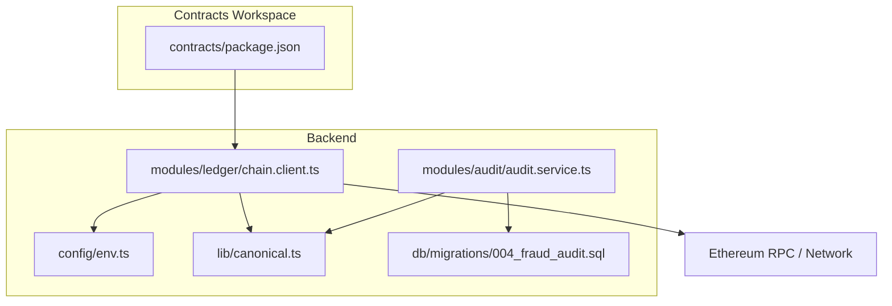
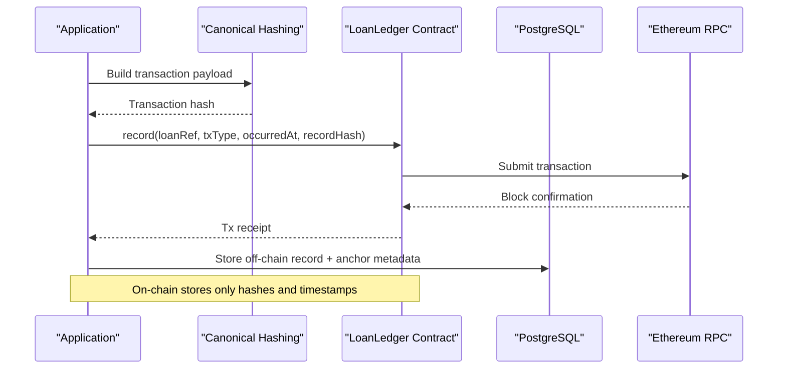
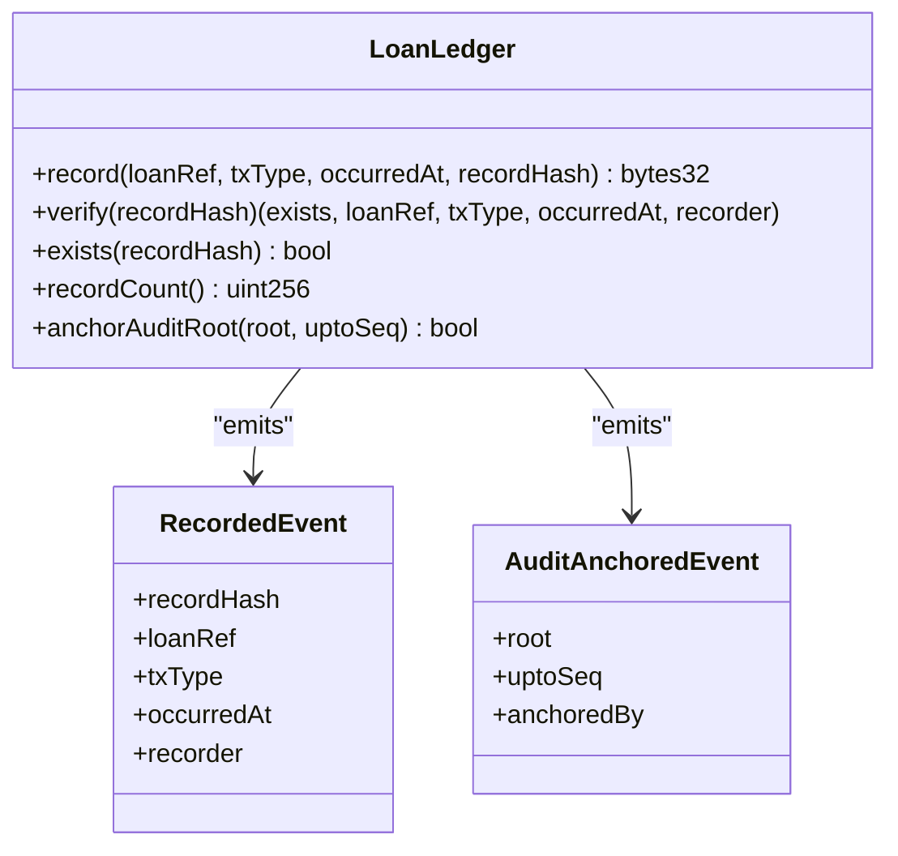
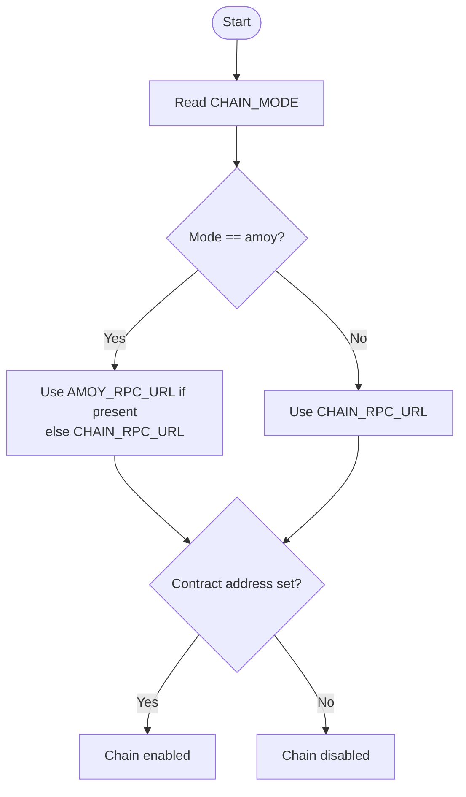
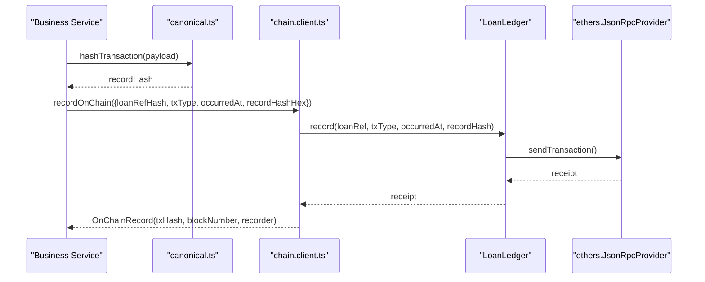
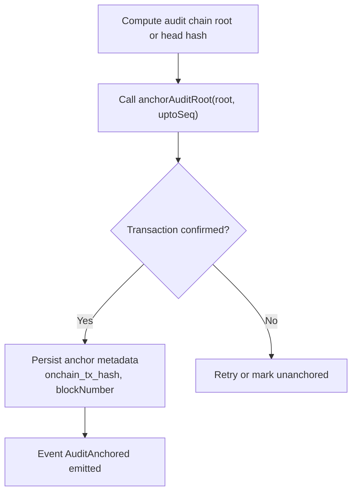
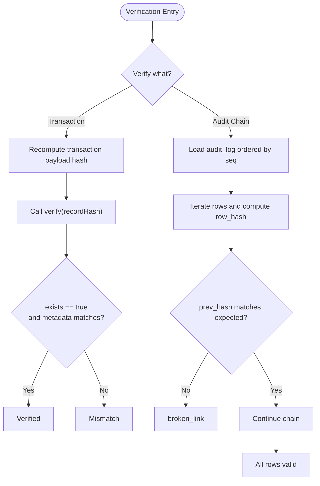
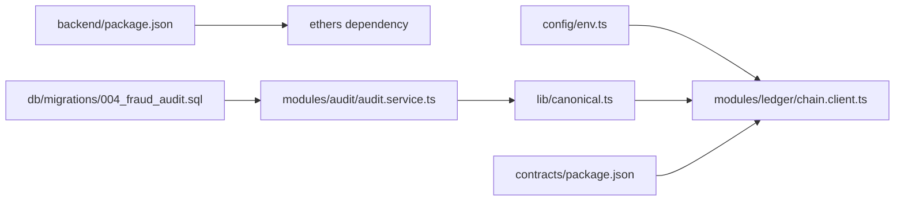

# Blockchain Integration

<cite>
**Referenced Files in This Document**
- [chain.client.ts](file://backend/src/modules/ledger/chain.client.ts)
- [env.ts](file://backend/src/config/env.ts)
- [canonical.ts](file://backend/src/lib/canonical.ts)
- [audit.service.ts](file://backend/src/modules/audit/audit.service.ts)
- [004_fraud_audit.sql](file://backend/src/db/migrations/004_fraud_audit.sql)
- [package.json](file://backend/package.json)
- [contracts package.json](file://contracts/package.json)
</cite>

## Table of Contents
1. [Introduction](#introduction)
2. [Project Structure](#project-structure)
3. [Core Components](#core-components)
4. [Architecture Overview](#architecture-overview)
5. [Detailed Component Analysis](#detailed-component-analysis)
6. [Dependency Analysis](#dependency-analysis)
7. [Performance Considerations](#performance-considerations)
8. [Troubleshooting Guide](#troubleshooting-guide)
9. [Conclusion](#conclusion)

## Introduction
This document explains the blockchain integration layer that anchors financial transaction evidence and audit integrity to an Ethereum-compatible network. The system writes only cryptographic hashes and timestamps on-chain, keeping sensitive data off-chain while providing immutable, publicly verifiable proof that records have not been altered. It also documents how audit chain roots are anchored, how on-chain records are verified, and how configuration controls which blockchain is used.

The design follows a clear separation:
- Off-chain storage holds full transaction details and audit rows.
- On-chain storage holds compact proofs: transaction record hashes and periodic audit root anchors.
- Verification recomputes hashes locally and compares them with on-chain values.

## Project Structure
The blockchain integration spans backend modules, configuration, canonical hashing utilities, database schema, and a Hardhat-based contracts workspace.

**Diagram sources**
- [chain.client.ts:1-152](file://backend/src/modules/ledger/chain.client.ts#L1-L152)
- [env.ts:28-58](file://backend/src/config/env.ts#L28-L58)
- [canonical.ts:35-68](file://backend/src/lib/canonical.ts#L35-L68)
- [audit.service.ts:142-190](file://backend/src/modules/audit/audit.service.ts#L142-L190)
- [004_fraud_audit.sql:113-121](file://backend/src/db/migrations/004_fraud_audit.sql#L113-L121)
- [contracts package.json:1-21](file://contracts/package.json#L1-L21)

**Section sources**
- [chain.client.ts:1-152](file://backend/src/modules/ledger/chain.client.ts#L1-L152)
- [env.ts:28-58](file://backend/src/config/env.ts#L28-L58)
- [canonical.ts:35-68](file://backend/src/lib/canonical.ts#L35-L68)
- [audit.service.ts:142-190](file://backend/src/modules/audit/audit.service.ts#L142-L190)
- [004_fraud_audit.sql:113-121](file://backend/src/db/migrations/004_fraud_audit.sql#L113-L121)
- [contracts package.json:1-21](file://contracts/package.json#L1-L21)

## Core Components
- Ledger client: An ethers.js wrapper around the LoanLedger smart contract. It provides functions to write transaction hashes, read and verify on-chain records, anchor audit chain roots, and inspect chain status.
- Canonical hashing: Deterministic serialization and SHA-256 hashing for both transaction payloads and audit rows.
- Audit service: Append-only, hash-chained audit log with advisory locking and verification routines.
- Database anchoring table: Stores audit chain checkpoints and optional on-chain transaction references.
- Configuration: Environment-driven selection of blockchain mode, RPC URL, chain ID, recorder key, and deployed contract address.

Key responsibilities:
- `recordOnChain`: Submit a transaction record hash to the smart contract.
- `readOnChain`: Verify whether a record exists on-chain and retrieve its metadata.
- `anchorAuditRoot`: Anchor an audit chain Merkle or head hash to the contract.
- `getChainStatus`: Report configured and live chain state.

**Section sources**
- [chain.client.ts:12-20](file://backend/src/modules/ledger/chain.client.ts#L12-L20)
- [chain.client.ts:72-116](file://backend/src/modules/ledger/chain.client.ts#L72-L116)
- [canonical.ts:35-68](file://backend/src/lib/canonical.ts#L35-L68)
- [audit.service.ts:37-94](file://backend/src/modules/audit/audit.service.ts#L37-L94)
- [004_fraud_audit.sql:113-121](file://backend/src/db/migrations/004_fraud_audit.sql#L113-L121)
- [env.ts:51-58](file://backend/src/config/env.ts#L51-L58)

## Architecture Overview
The integration uses a hybrid model:
- Transactions are hashed deterministically off-chain.
- Only the resulting hash and timestamp are written to the blockchain.
- Audits form a hash chain; periodically, a root or head hash is anchored on-chain.
- Verifiers can recompute hashes and compare them against on-chain values.

**Diagram sources**
- [chain.client.ts:72-94](file://backend/src/modules/ledger/chain.client.ts#L72-L94)
- [canonical.ts:44-60](file://backend/src/lib/canonical.ts#L44-L60)

## Detailed Component Analysis

### Smart Contract Interface
The ledger client embeds the ABI for the LoanLedger contract. The interface exposes:
- Writing: `record` to store a transaction record hash.
- Reading and verifying: `verify` and `exists` to check on-chain presence and retrieve metadata.
- Counting: `recordCount` for operational visibility.
- Anchoring: `anchorAuditRoot` to commit an audit chain root.
- Events: `Recorded` and `AuditAnchored` for event-driven observability.

**Diagram sources**
- [chain.client.ts:12-20](file://backend/src/modules/ledger/chain.client.ts#L12-L20)

**Section sources**
- [chain.client.ts:12-20](file://backend/src/modules/ledger/chain.client.ts#L12-L20)

### Network Configuration Options
Configuration is environment-driven and validated at startup. Relevant options include:
- `CHAIN_MODE`: Selects local development, Amoy testnet, or off mode.
- `CHAIN_RPC_URL`: Default RPC endpoint.
- `AMOY_RPC_URL`: Overrides RPC when using Amoy.
- `CHAIN_ID`: Network identifier.
- `CHAIN_RECORDER_PRIVATE_KEY`: Private key for signing transactions.
- `LEDGER_CONTRACT_ADDRESS`: Deployed contract address.

Mode selection logic:
- If `CHAIN_MODE` is `amoy`, the Amoy RPC URL is preferred.
- If `CHAIN_MODE` is `off` or no contract address is set, the chain is disabled and operations remain off-chain.

**Diagram sources**
- [chain.client.ts:24-30](file://backend/src/modules/ledger/chain.client.ts#L24-L30)
- [env.ts:51-58](file://backend/src/config/env.ts#L51-L58)

**Section sources**
- [chain.client.ts:24-30](file://backend/src/modules/ledger/chain.client.ts#L24-L30)
- [env.ts:51-58](file://backend/src/config/env.ts#L51-L58)

### Transaction Management and Anchoring
Transaction anchoring flow:
1. Build a deterministic payload from transaction fields.
2. Compute SHA-256 hash of the payload.
3. Convert the hash to bytes32 format compatible with Solidity.
4. Call `record` on the LoanLedger contract with loan reference, type, timestamp, and record hash.
5. Wait for transaction confirmation and capture receipt metadata.
6. Persist off-chain record and optionally link to on-chain anchor metadata.

**Diagram sources**
- [canonical.ts:44-60](file://backend/src/lib/canonical.ts#L44-L60)
- [chain.client.ts:72-94](file://backend/src/modules/ledger/chain.client.ts#L72-L94)

**Section sources**
- [canonical.ts:44-60](file://backend/src/lib/canonical.ts#L44-L60)
- [chain.client.ts:72-94](file://backend/src/modules/ledger/chain.client.ts#L72-L94)

### Audit Chain Anchoring
The audit trail is append-only and hash-chained. Periodically, a root or head hash is anchored on-chain:
- The application computes the audit chain root or head hash.
- It calls `anchorAuditRoot` with the root and the sequence up to which it covers.
- The contract emits an `AuditAnchored` event.
- The application persists the anchor metadata, including the on-chain transaction hash and block number.

**Diagram sources**
- [chain.client.ts:110-116](file://backend/src/modules/ledger/chain.client.ts#L110-L116)
- [004_fraud_audit.sql:113-121](file://backend/src/db/migrations/004_fraud_audit.sql#L113-L121)

**Section sources**
- [chain.client.ts:110-116](file://backend/src/modules/ledger/chain.client.ts#L110-L116)
- [004_fraud_audit.sql:113-121](file://backend/src/db/migrations/004_fraud_audit.sql#L113-L121)

### Verification Mechanisms
Two complementary verification mechanisms exist:
- On-chain verification: Recompute the transaction payload hash and call `verify` to confirm existence and metadata.
- Off-chain audit chain verification: Recompute each row’s hash and validate prev_hash links across the entire audit log.

**Diagram sources**
- [chain.client.ts:97-108](file://backend/src/modules/ledger/chain.client.ts#L97-L108)
- [audit.service.ts:142-190](file://backend/src/modules/audit/audit.service.ts#L142-L190)
- [canonical.ts:96-113](file://backend/src/lib/canonical.ts#L96-L113)

**Section sources**
- [chain.client.ts:97-108](file://backend/src/modules/ledger/chain.client.ts#L97-L108)
- [audit.service.ts:142-190](file://backend/src/modules/audit/audit.service.ts#L142-L190)
- [canonical.ts:96-113](file://backend/src/lib/canonical.ts#L96-L113)

### Concrete Examples of Interactions
- Recording a disbursement:
  - Build payload with transaction ID, loan reference, type, amount, timestamp, and normalized mobile code.
  - Hash payload to obtain record hash.
  - Call `recordOnChain` with loan reference hash, type, timestamp, and record hash.
  - Capture transaction hash and block number.
- Verifying a repayment:
  - Recompute repayment payload hash.
  - Call `readOnChain` with the record hash.
  - Compare returned metadata with stored values.
- Anchoring audit root:
  - Compute audit chain root or head hash.
  - Call `anchorAuditRoot` with root and sequence limit.
  - Record anchor metadata in the database.

These examples map directly to the functions documented above.

**Section sources**
- [canonical.ts:44-60](file://backend/src/lib/canonical.ts#L44-L60)
- [chain.client.ts:72-116](file://backend/src/modules/ledger/chain.client.ts#L72-L116)

## Dependency Analysis
The blockchain integration depends on:
- `ethers` for provider, signer, and contract interactions.
- Environment configuration for network selection and credentials.
- Canonical hashing utilities for deterministic payloads and audit rows.
- Database schema for audit anchors and integrity checks.

**Diagram sources**
- [package.json:18-33](file://backend/package.json#L18-L33)
- [env.ts:51-58](file://backend/src/config/env.ts#L51-L58)
- [chain.client.ts:1-3](file://backend/src/modules/ledger/chain.client.ts#L1-L3)
- [canonical.ts:1-2](file://backend/src/lib/canonical.ts#L1-L2)
- [audit.service.ts:1-3](file://backend/src/modules/audit/audit.service.ts#L1-L3)
- [004_fraud_audit.sql:113-121](file://backend/src/db/migrations/004_fraud_audit.sql#L113-L121)
- [contracts package.json:1-21](file://contracts/package.json#L1-L21)

**Section sources**
- [package.json:18-33](file://backend/package.json#L18-L33)
- [env.ts:51-58](file://backend/src/config/env.ts#L51-L58)
- [chain.client.ts:1-3](file://backend/src/modules/ledger/chain.client.ts#L1-L3)
- [canonical.ts:1-2](file://backend/src/lib/canonical.ts#L1-L2)
- [audit.service.ts:1-3](file://backend/src/modules/audit/audit.service.ts#L1-L3)
- [004_fraud_audit.sql:113-121](file://backend/src/db/migrations/004_fraud_audit.sql#L113-L121)
- [contracts package.json:1-21](file://contracts/package.json#L1-L21)

## Performance Considerations
- Gas optimization:
  - Only hashes and timestamps are written on-chain, minimizing calldata size.
  - Avoid embedding large payloads or personal data on-chain.
  - Batch operations where possible by anchoring audit roots rather than individual rows.
- Transaction batching strategies:
  - Group multiple audit chain updates into a single anchor operation.
  - Use `anchorAuditRoot(root, uptoSeq)` to commit a range of audit rows efficiently.
  - For high-throughput scenarios, consider constructing Merkle trees of batches and anchoring Merkle roots.
- Network selection trade-offs:
  - Local development (`local`) uses a local node for fast iteration.
  - Testnet (`amoy`) provides public verification without mainnet costs.
  - Production networks incur gas fees and require careful batching and monitoring.
- Security implications:
  - On-chain data is immutable but limited to hashes; confidentiality relies on off-chain encryption.
  - Off-chain data must be protected with strong encryption and access controls.
  - Anchoring audit roots provides tamper-evidence for the entire audit chain.

[No sources needed since this section provides general guidance]

## Troubleshooting Guide
Common issues and resolutions:
- Chain unavailable:
  - Ensure `CHAIN_MODE` is not `off`.
  - Set `LEDGER_CONTRACT_ADDRESS` and appropriate RPC URL.
  - Provide `CHAIN_RECORDER_PRIVATE_KEY` for writing transactions.
- Wrong network:
  - Confirm `CHAIN_ID` matches the target network.
  - For Amoy, ensure `AMOY_RPC_URL` is set when `CHAIN_MODE=amoy`.
- Contract interaction errors:
  - Validate contract ABI matches deployed bytecode.
  - Check gas limits and account balance for write operations.
- Audit chain mismatches:
  - Run `verifyAuditChain` to detect broken links or hash mismatches.
  - Inspect `mismatches` array for specific sequences and reasons.

Operational diagnostics:
- Use `getChainStatus` to inspect mode, RPC URL, chain ID, enabled state, latest block, and record count.
- Monitor events `Recorded` and `AuditAnchored` for real-time observability.

**Section sources**
- [chain.client.ts:28-41](file://backend/src/modules/ledger/chain.client.ts#L28-L41)
- [chain.client.ts:130-151](file://backend/src/modules/ledger/chain.client.ts#L130-L151)
- [audit.service.ts:142-190](file://backend/src/modules/audit/audit.service.ts#L142-L190)

## Conclusion
The blockchain integration layer provides a robust, privacy-preserving mechanism for immutable transaction verification and audit anchoring. By writing only hashes and timestamps on-chain, the system balances transparency with confidentiality. The modular design allows flexible network configuration, efficient anchoring strategies, and comprehensive verification. Proper configuration, secure key management, and thoughtful batching are essential for reliable and cost-effective operation across different blockchain networks.

[No sources needed since this section summarizes without analyzing specific files]