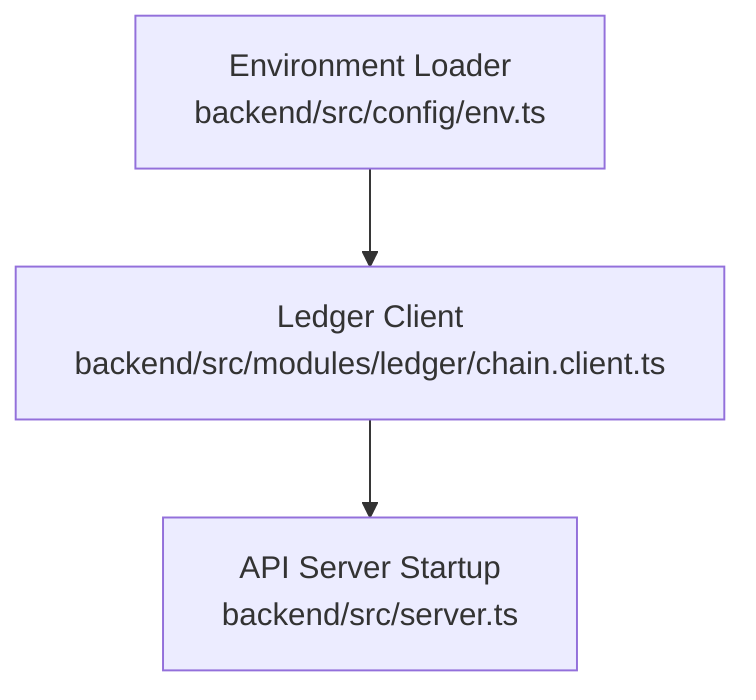
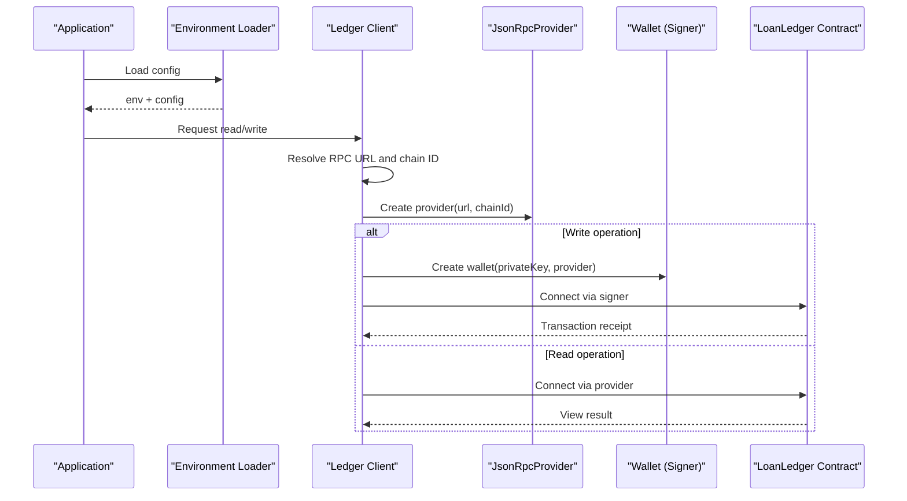
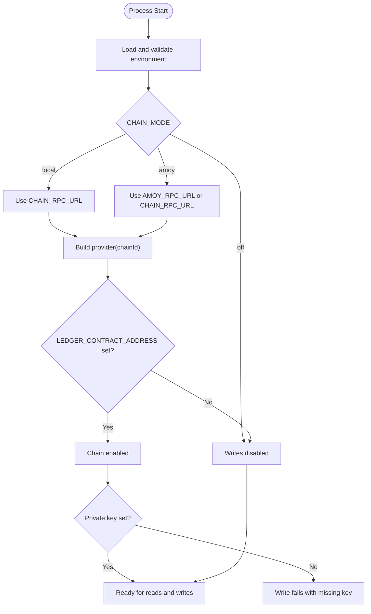
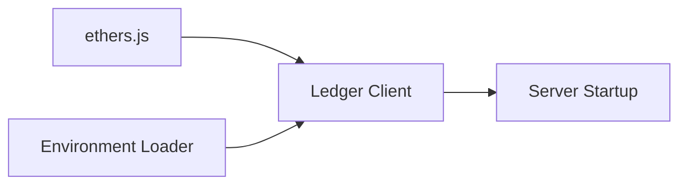

# Network Configuration

<cite>
**Referenced Files in This Document**
- [env.ts](file://backend/src/config/env.ts)
- [chain.client.ts](file://backend/src/modules/ledger/chain.client.ts)
- [server.ts](file://backend/src/server.ts)
</cite>

## Table of Contents
1. [Introduction](#introduction)
2. [Project Structure](#project-structure)
3. [Core Components](#core-components)
4. [Architecture Overview](#architecture-overview)
5. [Detailed Component Analysis](#detailed-component-analysis)
6. [Dependency Analysis](#dependency-analysis)
7. [Performance Considerations](#performance-considerations)
8. [Troubleshooting Guide](#troubleshooting-guide)
9. [Conclusion](#conclusion)
10. [Appendices](#appendices)

## Introduction
This document explains the blockchain network configuration system used by the backend ledger module. It covers:
- CHAIN_MODE settings and their behavior
- RPC URL selection and chain ID configuration
- Provider and signer setup for read and write operations
- Private key management for transaction signing
- Contract address configuration
- Environment variables required for development, testing, and production
- Fallback mechanisms when blockchain services are unavailable

The implementation is intentionally resilient: if the blockchain is disabled or unreachable, the API continues to operate with off-chain records marked as not anchored.

## Project Structure
The blockchain configuration is defined centrally and consumed by the ledger client:
- Environment schema and defaults live in the configuration loader
- The ledger client builds ethers.js provider/signer instances based on that configuration
- The server logs the active ledger mode at startup

**Diagram sources**
- [env.ts:28-79](file://backend/src/config/env.ts#L28-L79)
- [chain.client.ts:24-60](file://backend/src/modules/ledger/chain.client.ts#L24-L60)
- [server.ts:8-12](file://backend/src/server.ts#L8-L12)

**Section sources**
- [env.ts:1-106](file://backend/src/config/env.ts#L1-L106)
- [chain.client.ts:1-152](file://backend/src/modules/ledger/chain.client.ts#L1-L152)
- [server.ts:1-25](file://backend/src/server.ts#L1-L25)

## Core Components
- Environment configuration loader validates and exposes blockchain-related environment variables.
- Ledger client provides typed accessors for provider, signer, contract, and status.
- Server prints the active ledger mode and whether writes are enabled.

Key responsibilities:
- Validate environment variables and provide safe defaults
- Select RPC URL based on CHAIN_MODE
- Enable/disable on-chain writes based on CHAIN_MODE and contract address
- Construct ethers.js provider and signer
- Expose functions to read/write the ledger and report chain status

**Section sources**
- [env.ts:28-79](file://backend/src/config/env.ts#L28-L79)
- [chain.client.ts:24-60](file://backend/src/modules/ledger/chain.client.ts#L24-L60)
- [server.ts:8-12](file://backend/src/server.ts#L8-L12)

## Architecture Overview
The ledger client composes an ethers.js JsonRpcProvider and Wallet using values from the environment configuration. Read-only calls use a provider-backed contract instance; write calls require a signer backed by a private key. If the chain is disabled or missing a contract address, write attempts fail fast with a clear error, while reads remain available when configured.

**Diagram sources**
- [env.ts:28-79](file://backend/src/config/env.ts#L28-L79)
- [chain.client.ts:43-60](file://backend/src/modules/ledger/chain.client.ts#L43-L60)

## Detailed Component Analysis

### Environment Variables and Schema
The configuration loader defines and validates all blockchain-related environment variables:
- CHAIN_MODE: Controls network behavior. Supported values are local, amoy, and off. Default is local.
- CHAIN_RPC_URL: Base RPC URL used for local and non-amoy modes. Default points to a local node.
- CHAIN_ID: Numeric chain identifier passed to the provider. Default is a local development chain ID.
- CHAIN_RECORDER_PRIVATE_KEY: Optional private key used to sign transactions. Required for write operations.
- LEDGER_CONTRACT_ADDRESS: Optional deployed contract address. When present and CHAIN_MODE is not off, on-chain writes are enabled.
- AMOY_RPC_URL: Optional Amoy testnet RPC URL. Used when CHAIN_MODE=amoy, falling back to CHAIN_RPC_URL if unset.
- AMOY_DEPLOYER_PRIVATE_KEY: Optional deployer key for Amoy deployments. Not used by runtime read/write paths.

Validation rules:
- Missing or invalid required fields cause startup failure with a detailed error message.
- Optional keys allow flexible configurations across environments.

Operational notes:
- The loader searches .env in the current working directory and one level up, enabling both workspace and monorepo usage patterns.
- A helper flag indicates whether the process is running tests.

**Section sources**
- [env.ts:1-22](file://backend/src/config/env.ts#L1-L22)
- [env.ts:28-79](file://backend/src/config/env.ts#L28-L79)
- [env.ts:81-106](file://backend/src/config/env.ts#L81-L106)

### Chain Mode Behavior
CHAIN_MODE determines how the ledger behaves:
- local: Uses CHAIN_RPC_URL and CHAIN_ID for local chains such as Hardhat or Foundry nodes.
- amoy: Uses AMOY_RPC_URL if provided; otherwise falls back to CHAIN_RPC_URL. Intended for Amoy testnet.
- off: Disables on-chain writes entirely. The API remains functional with off-chain records.

On-chain write enablement requires both:
- CHAIN_MODE is not off
- LEDGER_CONTRACT_ADDRESS is set

If either condition fails, write operations throw a service-unavailable error indicating that the blockchain ledger is not configured.

**Section sources**
- [env.ts:51-57](file://backend/src/config/env.ts#L51-L57)
- [chain.client.ts:24-41](file://backend/src/modules/ledger/chain.client.ts#L24-L41)

### RPC URL Management and Chain ID
RPC URL resolution:
- For CHAIN_MODE=amoy: prefer AMOY_RPC_URL; fall back to CHAIN_RPC_URL if AMOY_RPC_URL is not set.
- For other modes: use CHAIN_RPC_URL.

Chain ID:
- Always taken from CHAIN_ID and passed to the provider constructor.

This separation allows switching between local and remote networks without changing application code.

**Section sources**
- [chain.client.ts:24-26](file://backend/src/modules/ledger/chain.client.ts#L24-L26)
- [chain.client.ts:43-45](file://backend/src/modules/ledger/chain.client.ts#L43-L45)

### Provider and Signer Setup
Provider:
- Created with the resolved RPC URL and CHAIN_ID.
- Used for read-only contract interactions and block queries.

Signer:
- Created from CHAIN_RECORDER_PRIVATE_KEY and the provider.
- Required for any write operation. If the private key is missing, write operations fail early with a clear error.

Read vs write contracts:
- readContract(): connects the ABI to the provider.
- writeContract(): connects the ABI to the signer.

This design cleanly separates read and write paths and ensures that only signed transactions use the private key.

**Section sources**
- [chain.client.ts:43-60](file://backend/src/modules/ledger/chain.client.ts#L43-L60)

### Private Key Management
- CHAIN_RECORDER_PRIVATE_KEY is optional but mandatory for write operations.
- The signer wraps the private key with the provider so transactions target the correct network.
- AMOY_DEPLOYER_PRIVATE_KEY exists in configuration but is not used by runtime read/write logic; it is intended for deployment tooling.

Security guidance:
- Never commit private keys to version control.
- Use secret managers or secure environment injection in production.
- Rotate recorder keys periodically and restrict permissions.

**Section sources**
- [env.ts:54-57](file://backend/src/config/env.ts#L54-L57)
- [chain.client.ts:47-52](file://backend/src/modules/ledger/chain.client.ts#L47-L52)

### Contract Address Configuration
- LEDGER_CONTRACT_ADDRESS is optional.
- When present and CHAIN_MODE is not off, on-chain writes are enabled.
- Absence of the address disables writes even if CHAIN_MODE is local or amoy.

The ledger client enforces this through a guard that throws a service-unavailable error when writes are attempted without a valid contract address.

**Section sources**
- [env.ts:55](file://backend/src/config/env.ts#L55)
- [chain.client.ts:28-41](file://backend/src/modules/ledger/chain.client.ts#L28-L41)

### On-Chain Operations and Fallbacks
Write path:
- recordOnChain() signs a transaction using the signer and waits for confirmation.
- anchorAuditRoot() anchors an audit root on-chain.

Read path:
- readOnChain() verifies whether a hash exists on-chain and returns metadata if found.

Fallback behavior:
- If CHAIN_MODE=off or LEDGER_CONTRACT_ADDRESS is missing, write operations fail fast with a descriptive error.
- The API can still function with off-chain records marked as not anchored.
- getChainStatus() reports whether the chain is enabled and whether it is reachable; errors are captured without crashing the caller.

Startup logging:
- The server prints the active CHAIN_MODE and whether chain writes are disabled.

**Section sources**
- [chain.client.ts:71-116](file://backend/src/modules/ledger/chain.client.ts#L71-L116)
- [chain.client.ts:130-151](file://backend/src/modules/ledger/chain.client.ts#L130-L151)
- [server.ts:8-12](file://backend/src/server.ts#L8-L12)

### Configuration Flow Diagram

**Diagram sources**
- [env.ts:51-57](file://backend/src/config/env.ts#L51-L57)
- [chain.client.ts:24-52](file://backend/src/modules/ledger/chain.client.ts#L24-L52)

## Dependency Analysis
The ledger client depends on the environment configuration and ethers.js. The server consumes the ledger client’s status helpers during startup.

**Diagram sources**
- [chain.client.ts:1-3](file://backend/src/modules/ledger/chain.client.ts#L1-L3)
- [chain.client.ts:2](file://backend/src/modules/ledger/chain.client.ts#L2)
- [server.ts:4](file://backend/src/server.ts#L4)

**Section sources**
- [chain.client.ts:1-3](file://backend/src/modules/ledger/chain.client.ts#L1-L3)
- [server.ts:1-12](file://backend/src/server.ts#L1-L12)

## Performance Considerations
- Provider reuse: The client constructs providers per call site; consider caching if you perform many reads in tight loops.
- Batched status checks: getChainStatus() uses parallel calls to fetch block number and record count, reducing latency.
- Avoid unnecessary writes: Only invoke write operations when CHAIN_MODE and contract address are configured.
- Error handling: Off-chain fallback keeps the API responsive even when the chain is slow or unavailable.

[No sources needed since this section provides general guidance]

## Troubleshooting Guide
Common issues and resolutions:
- Writes fail with “blockchain ledger is not configured”:
  - Ensure CHAIN_MODE is not off and LEDGER_CONTRACT_ADDRESS is set.
  - Verify CHAIN_RPC_URL or AMOY_RPC_URL points to a reachable endpoint.
- Writes fail with “private key is not configured”:
  - Set CHAIN_RECORDER_PRIVATE_KEY for the recorder account.
- Unexpected network behavior:
  - Confirm CHAIN_MODE matches your intended network.
  - For Amoy, ensure AMOY_RPC_URL is set to a public Amoy RPC.
- Startup does not start due to invalid configuration:
  - Fix missing or invalid environment variables reported by the loader.

Diagnostic helpers:
- Use getChainStatus() to inspect mode, RPC URL, chain ID, contract address, enabled state, reachability, latest block, and record count.
- Observe server startup logs to confirm ledger mode and whether writes are disabled.

**Section sources**
- [chain.client.ts:32-52](file://backend/src/modules/ledger/chain.client.ts#L32-L52)
- [chain.client.ts:130-151](file://backend/src/modules/ledger/chain.client.ts#L130-L151)
- [server.ts:8-12](file://backend/src/server.ts#L8-L12)

## Conclusion
The blockchain configuration system is designed to be explicit, validated, and resilient:
- CHAIN_MODE controls behavior across local, Amoy, and disabled scenarios.
- RPC URL selection adapts to the selected mode.
- Provider and signer construction are separated to enforce security boundaries.
- On-chain writes are opt-in via contract address and private key.
- The API remains operational when the blockchain is unavailable, marking records as not anchored.

Adopt environment-specific configurations to balance convenience in development with security and reliability in production.

[No sources needed since this section summarizes without analyzing specific files]

## Appendices

### Environment Variables Reference
- CHAIN_MODE: local | amoy | off
- CHAIN_RPC_URL: Base RPC URL for local and non-amoy modes
- CHAIN_ID: Numeric chain ID for the provider
- CHAIN_RECORDER_PRIVATE_KEY: Recorder account private key for signing
- LEDGER_CONTRACT_ADDRESS: Deployed LoanLedger contract address
- AMOY_RPC_URL: Amoy testnet RPC URL
- AMOY_DEPLOYER_PRIVATE_KEY: Deployer private key for Amoy deployments

**Section sources**
- [env.ts:51-57](file://backend/src/config/env.ts#L51-L57)

### Example Configurations

Development (local node):
- CHAIN_MODE=local
- CHAIN_RPC_URL=http://127.0.0.1:8545
- CHAIN_ID=31337
- LEDGER_CONTRACT_ADDRESS=<local-deployed-address>
- CHAIN_RECORDER_PRIVATE_KEY=<local-recorder-private-key>

Testing (Amoy testnet):
- CHAIN_MODE=amoy
- AMOY_RPC_URL=https://rpc.amoy.polygonscan.com
- CHAIN_ID=<amoy-chain-id>
- LEDGER_CONTRACT_ADDRESS=<amoy-deployed-address>
- CHAIN_RECORDER_PRIVATE_KEY=<test-recorder-private-key>

Production (disabled chain or managed RPC):
- CHAIN_MODE=off
- Or configure CHAIN_MODE=local/amoy with a managed RPC URL and a secured private key manager.
- LEDGER_CONTRACT_ADDRESS=<production-contract-address>
- CHAIN_RECORDER_PRIVATE_KEY=<managed-secret>

Notes:
- In development, default values are provided for CHAIN_RPC_URL and CHAIN_ID.
- In production, always supply explicit values and avoid defaults.
- Keep private keys out of source control and inject them securely.

**Section sources**
- [env.ts:51-57](file://backend/src/config/env.ts#L51-L57)
- [chain.client.ts:24-26](file://backend/src/modules/ledger/chain.client.ts#L24-L26)