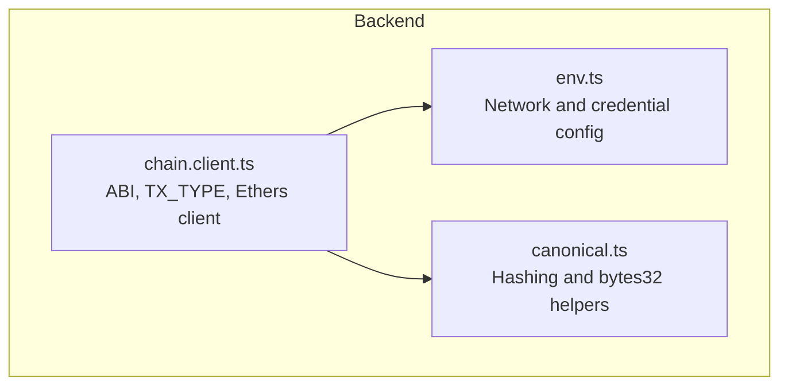
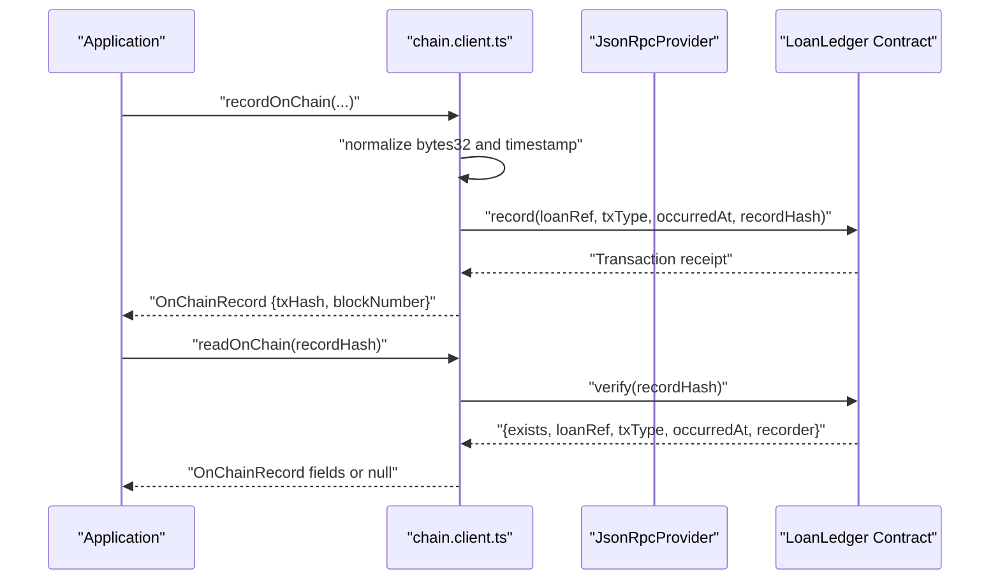
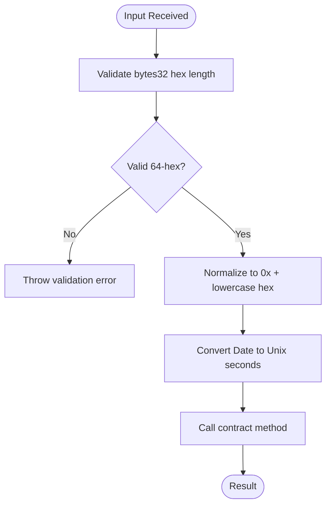
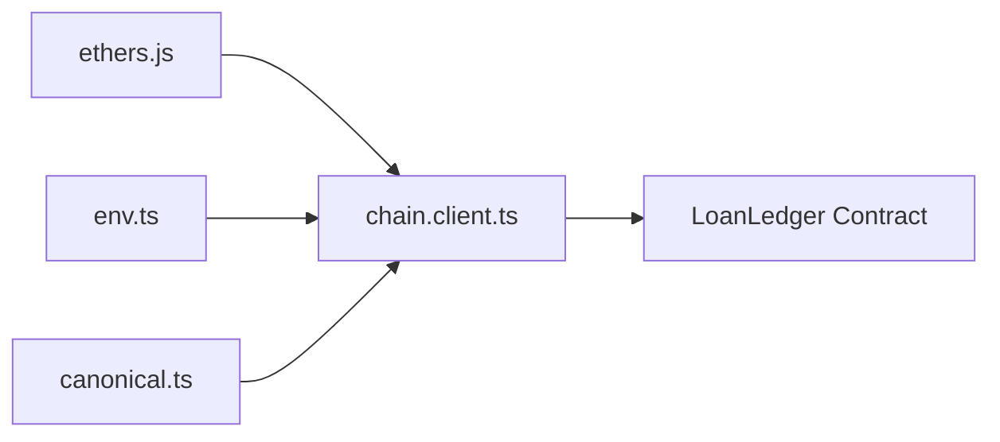

# Smart Contract Interface

<cite>
**Referenced Files in This Document**
- [chain.client.ts](file://backend/src/modules/ledger/chain.client.ts)
- [env.ts](file://backend/src/config/env.ts)
- [canonical.ts](file://backend/src/lib/canonical.ts)
</cite>

## Table of Contents
1. [Introduction](#introduction)
2. [Project Structure](#project-structure)
3. [Core Components](#core-components)
4. [Architecture Overview](#architecture-overview)
5. [Detailed Component Analysis](#detailed-component-analysis)
6. [Dependency Analysis](#dependency-analysis)
7. [Performance Considerations](#performance-considerations)
8. [Troubleshooting Guide](#troubleshooting-guide)
9. [Conclusion](#conclusion)
10. [Appendices](#appendices)

## Introduction
This document describes the Ethereum smart contract interface used by the blockchain integration layer. It focuses on the LoanLedger ABI, data types, transaction type constants, and the client code that interacts with the deployed contract. The backend only writes cryptographic hashes and timestamps to the chain; no sensitive loan details are stored on-chain. When the chain is disabled or not configured, the system continues operating off-chain and marks records as not anchored.

## Project Structure
The smart contract interface is defined and consumed by the backend’s ledger module:
- The ABI, events, and TX_TYPE constants are declared in the ledger client.
- Environment configuration for network selection and credentials lives in the environment loader.
- Canonical payload hashing utilities ensure correct bytes32 values before on-chain submission.

**Diagram sources**
- [chain.client.ts:12-22](file://backend/src/modules/ledger/chain.client.ts#L12-L22)
- [env.ts:51-57](file://backend/src/config/env.ts#L51-L57)
- [canonical.ts:58-68](file://backend/src/lib/canonical.ts#L58-L68)

**Section sources**
- [chain.client.ts:1-22](file://backend/src/modules/ledger/chain.client.ts#L1-L22)
- [env.ts:51-57](file://backend/src/config/env.ts#L51-L57)
- [canonical.ts:58-68](file://backend/src/lib/canonical.ts#L58-L68)

## Core Components
- LoanLedger ABI: Declares functions record, verify, exists, recordCount, anchorAuditRoot and events Recorded, AuditAnchored.
- TX_TYPE constants: Disbursement and repayment identifiers.
- Ethers.js client: Provides read/write accessors, status checks, and helper interfaces.
- Configuration: Network mode, RPC URL, chain ID, recorder private key, and contract address.
- Canonical hashing: Ensures inputs are valid bytes32 values before on-chain submission.

Key responsibilities:
- Define the exact contract interface (ABI).
- Validate and normalize parameters (bytes32 hex strings, timestamps).
- Provide safe read/write paths to the contract.
- Expose chain health and status.

**Section sources**
- [chain.client.ts:12-22](file://backend/src/modules/ledger/chain.client.ts#L12-L22)
- [chain.client.ts:24-60](file://backend/src/modules/ledger/chain.client.ts#L24-L60)
- [env.ts:51-57](file://backend/src/config/env.ts#L51-L57)
- [canonical.ts:58-68](file://backend/src/lib/canonical.ts#L58-L68)

## Architecture Overview
The backend uses ethers.js to interact with a deployed LoanLedger contract. Reads use a public provider; writes require a signer wallet with a private key. The system supports multiple modes: local development, Amoy testnet, or off-chain fallback.

**Diagram sources**
- [chain.client.ts:71-116](file://backend/src/modules/ledger/chain.client.ts#L71-L116)

## Detailed Component Analysis

### LoanLedger ABI and Events
Functions:
- record(loanRef, txType, occurredAt, recordHash): Records a hash and metadata on-chain. Returns a bytes32 value.
- verify(recordHash): View function returning existence and associated metadata.
- exists(recordHash): View function checking existence.
- recordCount(): View function returning total recorded entries.
- anchorAuditRoot(root, uptoSeq): Anchors an audit Merkle root up to a sequence number.

Events:
- Recorded(recordHash, loanRef, txType, occurredAt, recorder): Emitted when a new record is written.
- AuditAnchored(root, uptoSeq, anchoredBy): Emitted when an audit root is anchored.

Data types:
- bytes32: 32-byte hash values (e.g., loan reference hash, record hash, audit root).
- uint8: Small integer flags (e.g., transaction type).
- uint64: Timestamps in seconds since epoch.
- address: Ethereum account addresses (recorder, anchoredBy).
- bool: Boolean flags (existence, return status).
- uint256: Large integers (record count, sequence numbers).

Purpose summary:
- bytes32 ensures fixed-size, collision-resistant identifiers.
- uint8 provides compact enumeration for operation types.
- uint64 stores precise timestamps without fractional seconds.
- address identifies accounts performing actions.
- bool and uint256 support simple flags and counters.

**Section sources**
- [chain.client.ts:12-20](file://backend/src/modules/ledger/chain.client.ts#L12-L20)

### TX_TYPE Constants
- disbursement: 0
- repayment: 1

These constants map application-level operations to the uint8 field expected by the contract.

Usage guidance:
- Always pass TX_TYPE.disbursement or TX_TYPE.repayment to avoid invalid enum values.
- Do not hardcode numeric literals elsewhere to maintain consistency.

**Section sources**
- [chain.client.ts:22](file://backend/src/modules/ledger/chain.client.ts#L22)

### Parameter Validation and Normalization
- bytes32 normalization:
  - Inputs must be 64-character hexadecimal strings (without 0x prefix) for canonical hashing.
  - The client accepts both prefixed and non-prefixed hex for convenience.
- Timestamp conversion:
  - OccurredAt is converted from JavaScript Date to Unix seconds (uint64).
- Hex prefix handling:
  - The client automatically adds or strips 0x prefixes when calling contract methods.

Validation flow:

**Diagram sources**
- [canonical.ts:58-68](file://backend/src/lib/canonical.ts#L58-L68)
- [chain.client.ts:71-94](file://backend/src/modules/ledger/chain.client.ts#L71-L94)

**Section sources**
- [canonical.ts:58-68](file://backend/src/lib/canonical.ts#L58-L68)
- [chain.client.ts:71-94](file://backend/src/modules/ledger/chain.client.ts#L71-L94)

### Contract Interaction Examples

#### Recording a Transaction
Steps:
1. Compute canonical payload and hash for the transaction.
2. Ensure the hash is a valid bytes32 string.
3. Convert occurredAt to Unix seconds.
4. Call recordOnChain with loanRefHash, txType, occurredAt, and recordHashHex.
5. Receive OnChainRecord including txHash and blockNumber.

Expected outcomes:
- Success: Returns OnChainRecord with populated fields.
- Failure: Throws an error if chain is unavailable or transaction fails.

**Section sources**
- [canonical.ts:44-60](file://backend/src/lib/canonical.ts#L44-L60)
- [chain.client.ts:71-94](file://backend/src/modules/ledger/chain.client.ts#L71-L94)

#### Verifying a Record
Steps:
1. Normalize recordHashHex to include 0x prefix if missing.
2. Call readOnChain with the normalized hash.
3. If exists is false, treat as not anchored.
4. Otherwise, use returned metadata (loanRef, txType, occurredAt, recorder).

Expected outcomes:
- Not found: Returns null.
- Found: Returns metadata without txHash and blockNumber.

**Section sources**
- [chain.client.ts:96-108](file://backend/src/modules/ledger/chain.client.ts#L96-L108)

#### Anchoring an Audit Root
Steps:
1. Normalize root hash to bytes32 format.
2. Call anchorAuditRoot with root and uptoSeq.
3. Capture txHash and blockNumber from the receipt.

Expected outcomes:
- Success: Returns txHash and blockNumber.
- Failure: Throws an error if chain is unavailable or transaction fails.

**Section sources**
- [chain.client.ts:110-116](file://backend/src/modules/ledger/chain.client.ts#L110-L116)

### Error Handling
- Chain unavailable:
  - Thrown when CHAIN_MODE is 'off' or LEDGER_CONTRACT_ADDRESS is missing.
  - Error includes a clear message instructing configuration or deployment.
- Missing recorder private key:
  - Thrown when attempting write operations without CHAIN_RECORDER_PRIVATE_KEY.
- Contract call failures:
  - Errors are caught and surfaced with truncated messages in status checks.

Recommended handling:
- Wrap write calls in try/catch blocks.
- Use getChainStatus to pre-check connectivity and configuration.
- Log errors with context (operation, input hash, chain mode).

**Section sources**
- [chain.client.ts:28-52](file://backend/src/modules/ledger/chain.client.ts#L28-L52)
- [chain.client.ts:130-151](file://backend/src/modules/ledger/chain.client.ts#L130-L151)

### Contract Deployment Process and Network Configuration
Configuration options:
- CHAIN_MODE: Selects 'local', 'amoy', or 'off'.
- CHAIN_RPC_URL: Default RPC endpoint for local development.
- AMOY_RPC_URL: Optional RPC endpoint for Amoy testnet.
- CHAIN_ID: Numeric identifier for the target network.
- CHAIN_RECORDER_PRIVATE_KEY: Private key for the signer wallet used to write transactions.
- LEDGER_CONTRACT_ADDRESS: Address of the deployed LoanLedger contract.

Deployment notes:
- The repository does not include Solidity source files or Hardhat scripts in the analyzed scope.
- The client expects a deployed contract address and appropriate network settings.
- For Amoy, set CHAIN_MODE='amoy' and provide AMOY_RPC_URL and LEDGER_CONTRACT_ADDRESS.
- For local development, ensure a local node is running at CHAIN_RPC_URL and deploy the contract there.

Operational behavior:
- If CHAIN_MODE='off' or LEDGER_CONTRACT_ADDRESS is missing, chain writes are disabled.
- The API remains functional using off-chain storage with records marked as not anchored.

**Section sources**
- [env.ts:51-57](file://backend/src/config/env.ts#L51-L57)
- [chain.client.ts:24-41](file://backend/src/modules/ledger/chain.client.ts#L24-L41)

## Dependency Analysis
The ledger client depends on:
- ethers.js for provider and contract interactions.
- Environment configuration for network and credentials.
- Canonical hashing utilities for bytes32 validation.

**Diagram sources**
- [chain.client.ts:1-3](file://backend/src/modules/ledger/chain.client.ts#L1-L3)
- [env.ts:51-57](file://backend/src/config/env.ts#L51-L57)
- [canonical.ts:58-68](file://backend/src/lib/canonical.ts#L58-L68)

**Section sources**
- [chain.client.ts:1-3](file://backend/src/modules/ledger/chain.client.ts#L1-L3)
- [env.ts:51-57](file://backend/src/config/env.ts#L51-L57)
- [canonical.ts:58-68](file://backend/src/lib/canonical.ts#L58-L68)

## Performance Considerations
- Prefer batched reads where possible; the client already performs parallel queries for status checks.
- Avoid unnecessary conversions; normalize bytes32 once per request.
- Cache chain status during short-lived processes to reduce repeated RPC calls.
- Monitor gas costs for anchorAuditRoot and record operations; consider batching anchors when feasible.

[No sources needed since this section provides general guidance]

## Troubleshooting Guide
Common issues and resolutions:
- CHAIN_UNAVAILABLE:
  - Cause: CHAIN_MODE='off' or LEDGER_CONTRACT_ADDRESS missing.
  - Resolution: Set CHAIN_MODE appropriately and provide LEDGER_CONTRACT_ADDRESS.
- Missing recorder private key:
  - Cause: CHAIN_RECORDER_PRIVATE_KEY not configured.
  - Resolution: Provide a valid private key for the signer wallet.
- Invalid bytes32 input:
  - Cause: Hash not exactly 64 hex characters.
  - Resolution: Validate and normalize inputs using canonical utilities.
- Network connectivity errors:
  - Cause: Incorrect RPC URL or chain ID mismatch.
  - Resolution: Verify CHAIN_RPC_URL or AMOY_RPC_URL and CHAIN_ID match the target network.

Diagnostic steps:
- Use getChainStatus to inspect mode, RPC URL, chain ID, enabled state, and live connectivity.
- Inspect error messages from contract calls for truncation limits and adjust logging accordingly.

**Section sources**
- [chain.client.ts:28-52](file://backend/src/modules/ledger/chain.client.ts#L28-L52)
- [chain.client.ts:130-151](file://backend/src/modules/ledger/chain.client.ts#L130-L151)
- [canonical.ts:58-68](file://backend/src/lib/canonical.ts#L58-L68)

## Conclusion
The LoanLedger interface is cleanly abstracted behind a TypeScript client that enforces parameter validation, handles network configuration, and provides robust error reporting. By writing only hashes and timestamps on-chain, the system preserves privacy while enabling verifiable anchoring. Proper configuration of CHAIN_MODE, RPC endpoints, and credentials is essential for successful deployments across local and testnet environments.

[No sources needed since this section summarizes without analyzing specific files]

## Appendices

### ABI Reference Summary
- Functions:
  - record(bytes32 loanRef, uint8 txType, uint64 occurredAt, bytes32 recordHash) returns bytes32
  - verify(bytes32 recordHash) view returns (bool exists, bytes32 loanRef, uint8 txType, uint64 occurredAt, address recorder)
  - exists(bytes32 recordHash) view returns bool
  - recordCount() view returns uint256
  - anchorAuditRoot(bytes32 root, uint256 uptoSeq) returns bool
- Events:
  - Recorded(bytes32 indexed recordHash, bytes32 indexed loanRef, uint8 txType, uint64 occurredAt, address recorder)
  - AuditAnchored(bytes32 indexed root, uint256 uptoSeq, address anchoredBy)

**Section sources**
- [chain.client.ts:12-20](file://backend/src/modules/ledger/chain.client.ts#L12-L20)

### Environment Variables Reference
- CHAIN_MODE: 'local' | 'amoy' | 'off'
- CHAIN_RPC_URL: Default RPC URL
- AMOY_RPC_URL: Optional RPC URL for Amoy
- CHAIN_ID: Target network ID
- CHAIN_RECORDER_PRIVATE_KEY: Signer private key
- LEDGER_CONTRACT_ADDRESS: Deployed contract address

**Section sources**
- [env.ts:51-57](file://backend/src/config/env.ts#L51-L57)