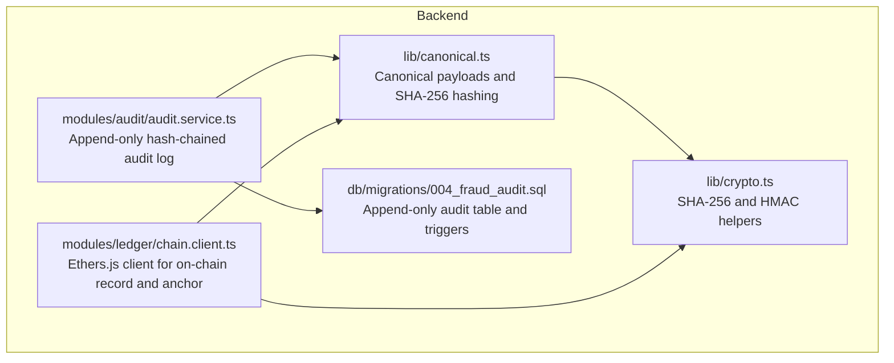
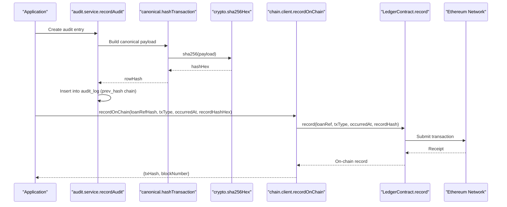
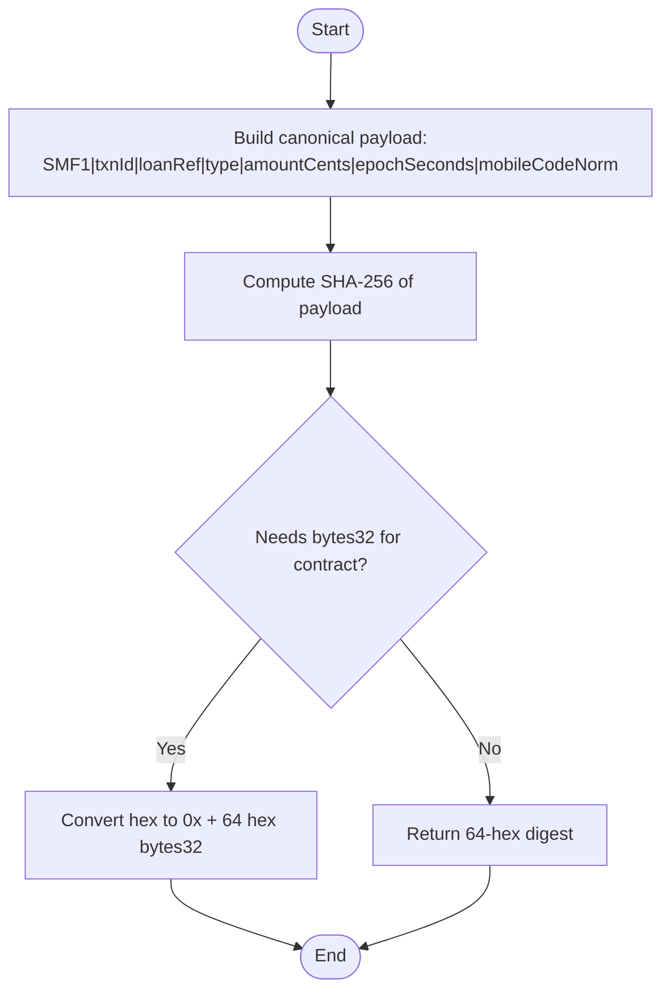
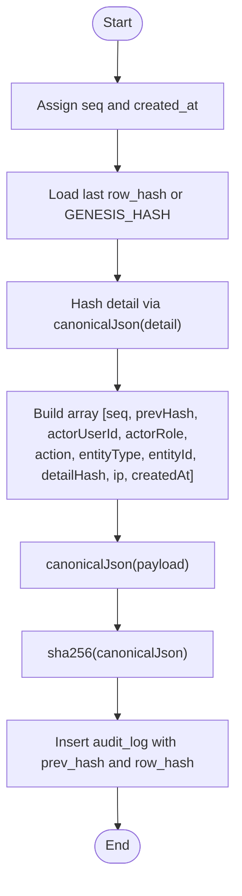
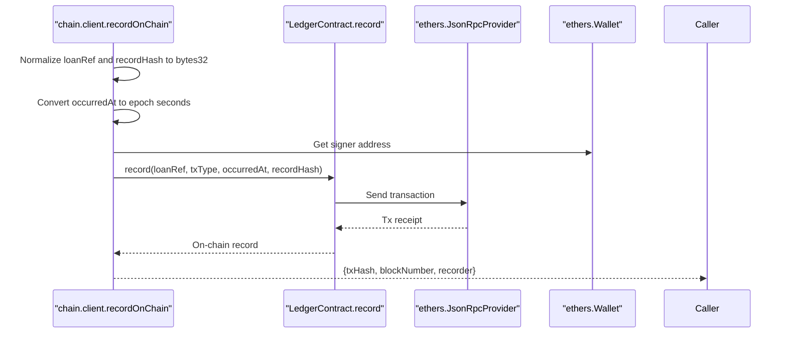
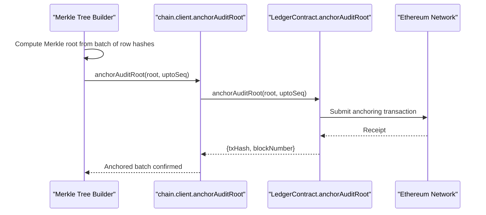
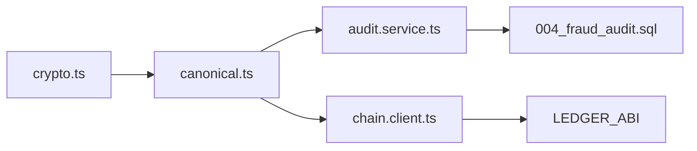

# Transaction Anchoring

<cite>
**Referenced Files in This Document**
- [canonical.ts](file://backend/src/lib/canonical.ts)
- [crypto.ts](file://backend/src/lib/crypto.ts)
- [audit.service.ts](file://backend/src/modules/audit/audit.service.ts)
- [chain.client.ts](file://backend/src/modules/ledger/chain.client.ts)
- [004_fraud_audit.sql](file://backend/src/db/migrations/004_fraud_audit.sql)
</cite>

## Table of Contents
1. [Introduction](#introduction)
2. [Project Structure](#project-structure)
3. [Core Components](#core-components)
4. [Architecture Overview](#architecture-overview)
5. [Detailed Component Analysis](#detailed-component-analysis)
6. [Dependency Analysis](#dependency-analysis)
7. [Performance Considerations](#performance-considerations)
8. [Troubleshooting Guide](#troubleshooting-guide)
9. [Conclusion](#conclusion)

## Introduction
This document explains the transaction anchoring mechanism that writes cryptographic hashes to the Ethereum blockchain. The system anchors immutable audit trails by:
- Computing deterministic SHA-256 hashes for loan transactions and audit rows.
- Calling a smart contract `record` function with loan references, timestamps, and record hashes.
- Storing an on-chain anchor for Merkle tree roots through an `anchorAuditRoot` function.
- Handling receipts and exposing read-only verification endpoints.

The design ensures that only hashes and minimal metadata are written on-chain; sensitive data remains off-chain.

## Project Structure
The anchoring logic spans backend libraries, services, migrations, and an Ethers.js client that interacts with a deployed ledger contract.

**Diagram sources**
- [canonical.ts:1-117](file://backend/src/lib/canonical.ts#L1-L117)
- [crypto.ts:1-97](file://backend/src/lib/crypto.ts#L1-L97)
- [audit.service.ts:1-191](file://backend/src/modules/audit/audit.service.ts#L1-L191)
- [chain.client.ts:1-152](file://backend/src/modules/ledger/chain.client.ts#L1-L152)
- [004_fraud_audit.sql:63-100](file://backend/src/db/migrations/004_fraud_audit.sql#L63-L100)

**Section sources**
- [canonical.ts:1-117](file://backend/src/lib/canonical.ts#L1-L117)
- [crypto.ts:1-97](file://backend/src/lib/crypto.ts#L1-L97)
- [audit.service.ts:1-191](file://backend/src/modules/audit/audit.service.ts#L1-L191)
- [chain.client.ts:1-152](file://backend/src/modules/ledger/chain.client.ts#L1-L152)
- [004_fraud_audit.sql:63-100](file://backend/src/db/migrations/004_fraud_audit.sql#L63-L100)

## Core Components
- Canonical payload builder and SHA-256 hashing for loan transactions and audit rows.
- Append-only audit service that computes row hashes and enforces chain integrity.
- Ethers.js client that calls `record` and `anchorAuditRoot`, and reads back records.
- Database schema ensuring append-only audit logs with hash chaining.

Key responsibilities:
- Compute deterministic hashes from canonical inputs.
- Persist audit entries with prev_hash linking.
- Submit hashes to Ethereum via `record`.
- Anchor Merkle roots via `anchorAuditRoot`.
- Verify existence and contents via `verify`.

**Section sources**
- [canonical.ts:26-60](file://backend/src/lib/canonical.ts#L26-L60)
- [canonical.ts:74-117](file://backend/src/lib/canonical.ts#L74-L117)
- [audit.service.ts:37-94](file://backend/src/modules/audit/audit.service.ts#L37-L94)
- [chain.client.ts:12-20](file://backend/src/modules/ledger/chain.client.ts#L12-L20)
- [chain.client.ts:71-116](file://backend/src/modules/ledger/chain.client.ts#L71-L116)
- [004_fraud_audit.sql:63-100](file://backend/src/db/migrations/004_fraud_audit.sql#L63-L100)

## Architecture Overview
The anchoring flow connects application logic, cryptographic hashing, database audit trails, and Ethereum transactions.

**Diagram sources**
- [audit.service.ts:37-94](file://backend/src/modules/audit/audit.service.ts#L37-L94)
- [canonical.ts:44-60](file://backend/src/lib/canonical.ts#L44-L60)
- [crypto.ts:21-23](file://backend/src/lib/crypto.ts#L21-L23)
- [chain.client.ts:71-94](file://backend/src/modules/ledger/chain.client.ts#L71-L94)

## Detailed Component Analysis

### Loan Transaction Hash Computation
Loan transaction hashes are computed deterministically using a canonical payload and SHA-256:
- Canonical payload layout includes version tag, transaction ID, loan reference, type, amount in cents, epoch seconds, and normalized mobile code.
- The payload is hashed with SHA-256 to produce a 64-hex-character digest.
- The digest can be converted to bytes32 format expected by the Solidity contract.

**Diagram sources**
- [canonical.ts:26-60](file://backend/src/lib/canonical.ts#L26-L60)
- [canonical.ts:62-68](file://backend/src/lib/canonical.ts#L62-L68)
- [crypto.ts:21-23](file://backend/src/lib/crypto.ts#L21-L23)

**Section sources**
- [canonical.ts:26-60](file://backend/src/lib/canonical.ts#L26-L60)
- [canonical.ts:62-68](file://backend/src/lib/canonical.ts#L62-L68)
- [crypto.ts:21-23](file://backend/src/lib/crypto.ts#L21-L23)

### Audit Row Hashing and Chain Integrity
Audit rows form a hash chain where each row’s hash depends on its sequence number, previous row hash, actor context, action, entity details, IP, and timestamp:
- Detail objects are hashed after canonical JSON serialization to ensure deterministic ordering.
- Each new audit row stores `prev_hash` pointing to the previous row’s `row_hash`.
- Genesis hash initializes the chain.

**Diagram sources**
- [canonical.ts:74-117](file://backend/src/lib/canonical.ts#L74-L117)
- [audit.service.ts:37-94](file://backend/src/modules/audit/audit.service.ts#L37-L94)
- [004_fraud_audit.sql:63-100](file://backend/src/db/migrations/004_fraud_audit.sql#L63-L100)

**Section sources**
- [canonical.ts:74-117](file://backend/src/lib/canonical.ts#L74-L117)
- [audit.service.ts:37-94](file://backend/src/modules/audit/audit.service.ts#L37-L94)
- [004_fraud_audit.sql:63-100](file://backend/src/db/migrations/004_fraud_audit.sql#L63-L100)

### On-Chain Record Submission
The ledger client submits loan transaction hashes to the Ethereum contract:
- Inputs include loan reference hash, transaction type, occurrence timestamp, and record hash.
- Timestamps are converted to epoch seconds.
- The contract `record` function is called with these parameters.
- The client waits for the transaction receipt and returns transaction hash and block number.

**Diagram sources**
- [chain.client.ts:43-60](file://backend/src/modules/ledger/chain.client.ts#L43-L60)
- [chain.client.ts:71-94](file://backend/src/modules/ledger/chain.client.ts#L71-L94)

**Section sources**
- [chain.client.ts:43-60](file://backend/src/modules/ledger/chain.client.ts#L43-L60)
- [chain.client.ts:71-94](file://backend/src/modules/ledger/chain.client.ts#L71-L94)

### Merkle Root Anchoring and Batch Verification
The system supports anchoring a Merkle root representing a batch of audit entries:
- The `anchorAuditRoot` function takes a Merkle root hash and an upper bound sequence number.
- It emits an event indicating the anchored root and the range covered.
- Clients can verify that a given audit row belongs to the anchored batch by checking the Merkle proof against the anchored root.

**Diagram sources**
- [chain.client.ts:110-116](file://backend/src/modules/ledger/chain.client.ts#L110-L116)

**Section sources**
- [chain.client.ts:110-116](file://backend/src/modules/ledger/chain.client.ts#L110-L116)

### Concrete Examples

#### Example: Hash Computation
- Input fields: transaction ID, loan reference, type, amount in cents, occurrence time, and normalized mobile code.
- Process:
  - Build canonical payload string.
  - Compute SHA-256 digest.
  - Optionally convert to bytes32 for contract storage.

References:
- [canonical.ts:44-60](file://backend/src/lib/canonical.ts#L44-L60)
- [canonical.ts:62-68](file://backend/src/lib/canonical.ts#L62-L68)
- [crypto.ts:21-23](file://backend/src/lib/crypto.ts#L21-L23)

#### Example: Transaction Submission
- Prepare inputs: loan reference hash, transaction type, occurrence timestamp, record hash.
- Call `recordOnChain`:
  - Normalize values to bytes32.
  - Convert timestamp to epoch seconds.
  - Invoke contract `record`.
  - Wait for receipt and return transaction metadata.

References:
- [chain.client.ts:71-94](file://backend/src/modules/ledger/chain.client.ts#L71-L94)

#### Example: Receipt Handling
- After submitting a transaction:
  - Extract transaction hash and block number from the receipt.
  - Use these identifiers for auditing and monitoring.

References:
- [chain.client.ts:83-93](file://backend/src/modules/ledger/chain.client.ts#L83-L93)

#### Example: Merkle Root Anchoring
- Compute Merkle root over a batch of audit row hashes.
- Call `anchorAuditRoot(root, uptoSeq)` to anchor the root on-chain.
- Confirm anchoring via receipt and event emission.

References:
- [chain.client.ts:110-116](file://backend/src/modules/ledger/chain.client.ts#L110-L116)

## Dependency Analysis
The anchoring subsystem has clear dependencies:
- Canonical hashing depends on crypto utilities.
- Audit service depends on canonical hashing and database schema.
- Ledger client depends on canonical hashing and Ethers.js provider/wallet.
- Database schema enforces append-only behavior and indexes for efficient querying.

**Diagram sources**
- [crypto.ts:1-97](file://backend/src/lib/crypto.ts#L1-L97)
- [canonical.ts:1-117](file://backend/src/lib/canonical.ts#L1-L117)
- [audit.service.ts:1-191](file://backend/src/modules/audit/audit.service.ts#L1-L191)
- [chain.client.ts:1-152](file://backend/src/modules/ledger/chain.client.ts#L1-L152)
- [004_fraud_audit.sql:63-100](file://backend/src/db/migrations/004_fraud_audit.sql#L63-L100)

**Section sources**
- [crypto.ts:1-97](file://backend/src/lib/crypto.ts#L1-L97)
- [canonical.ts:1-117](file://backend/src/lib/canonical.ts#L1-L117)
- [audit.service.ts:1-191](file://backend/src/modules/audit/audit.service.ts#L1-L191)
- [chain.client.ts:1-152](file://backend/src/modules/ledger/chain.client.ts#L1-L152)
- [004_fraud_audit.sql:63-100](file://backend/src/db/migrations/004_fraud_audit.sql#L63-L100)

## Performance Considerations
- Gas optimization strategies:
  - Minimize on-chain data: only hashes and minimal metadata are stored.
  - Batch anchoring: use Merkle roots to anchor multiple audit rows in one transaction.
  - Avoid redundant computations: cache canonical payloads and hashes when possible.
- Transaction batching techniques:
  - Group multiple `record` calls into a single transaction if supported by the contract.
  - Use `anchorAuditRoot` to commit a Merkle root covering many rows, reducing on-chain writes.
  - Monitor gas usage and adjust batch sizes based on network conditions.

[No sources needed since this section provides general guidance]

## Troubleshooting Guide
Common issues and resolutions:
- Blockchain unavailable:
  - Ensure `CHAIN_MODE` and `LEDGER_CONTRACT_ADDRESS` are configured.
  - Validate private key configuration for the recorder wallet.
- Invalid hash formats:
  - Ensure hashes are 64-hex characters before converting to bytes32.
  - Validate input types and lengths before calling contract functions.
- Audit chain mismatches:
  - Recompute row hashes and compare with stored values.
  - Check `prev_hash` links for broken chains.

References:
- [chain.client.ts:24-41](file://backend/src/modules/ledger/chain.client.ts#L24-L41)
- [canonical.ts:62-68](file://backend/src/lib/canonical.ts#L62-L68)
- [audit.service.ts:142-190](file://backend/src/modules/audit/audit.service.ts#L142-L190)

**Section sources**
- [chain.client.ts:24-41](file://backend/src/modules/ledger/chain.client.ts#L24-L41)
- [canonical.ts:62-68](file://backend/src/lib/canonical.ts#L62-L68)
- [audit.service.ts:142-190](file://backend/src/modules/audit/audit.service.ts#L142-L190)

## Conclusion
The transaction anchoring mechanism provides a robust, tamper-evident audit trail by combining deterministic hashing, append-only database logs, and selective on-chain commitments. Loan transaction hashes are computed using SHA-256, recorded via the `record` function, and anchored through `anchorAuditRoot` for batch verification. This approach balances security, privacy, and performance while enabling verifiable immutability on the Ethereum blockchain.

[No sources needed since this section summarizes without analyzing specific files]