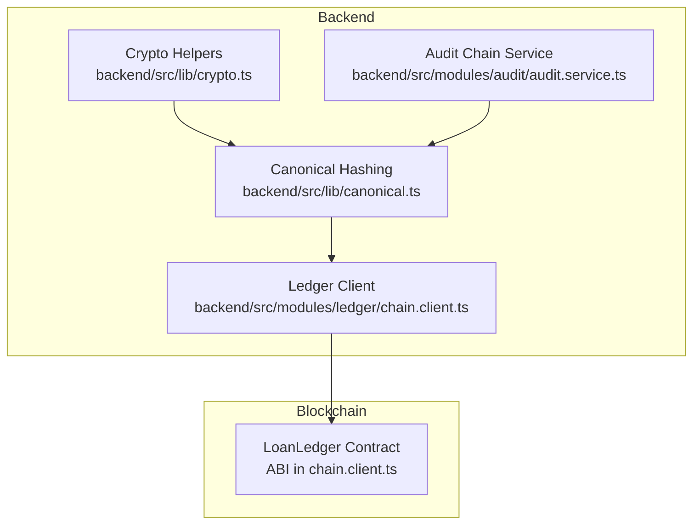
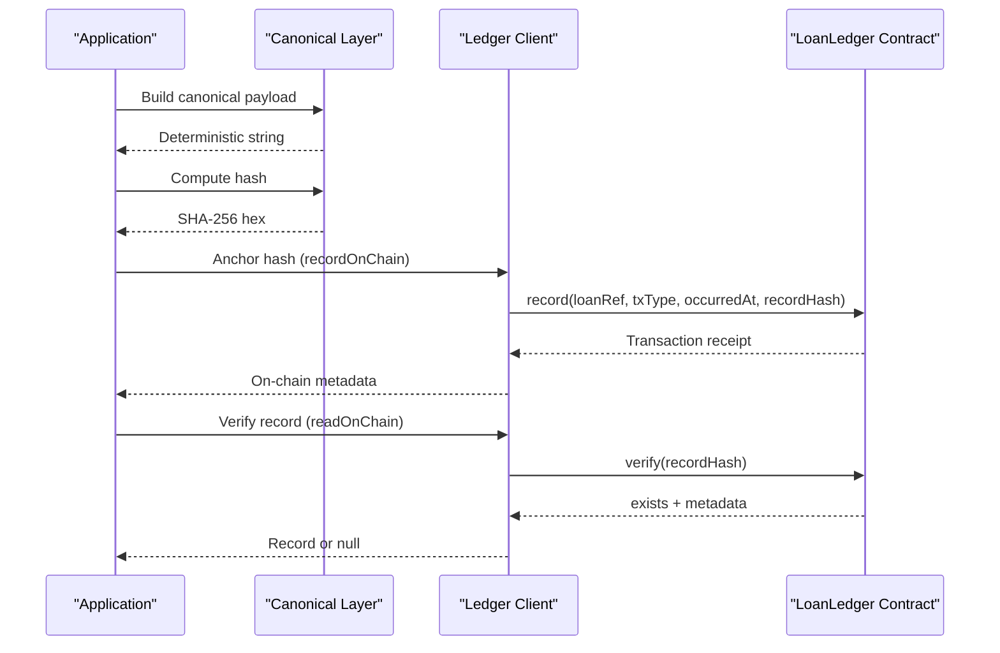
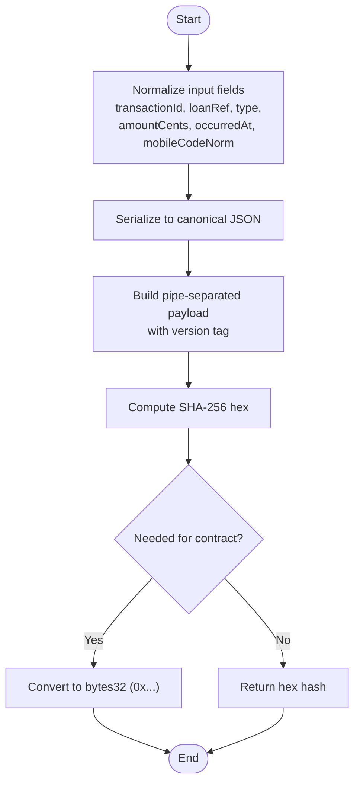
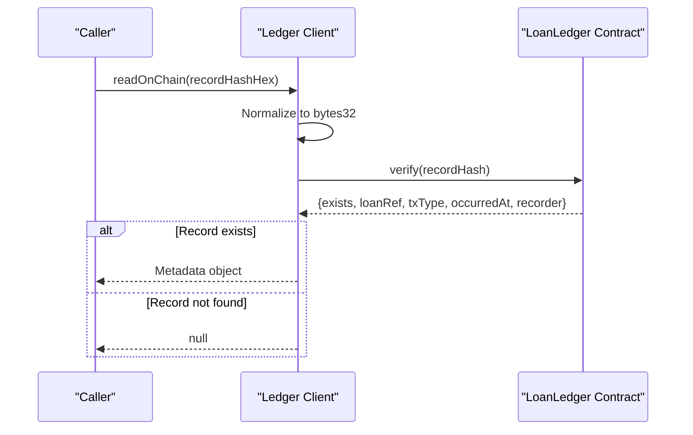
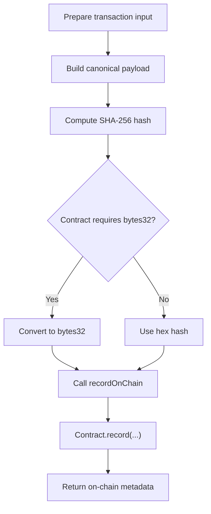
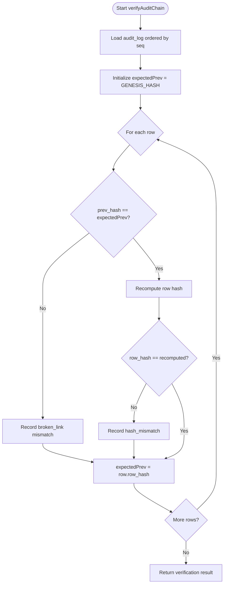
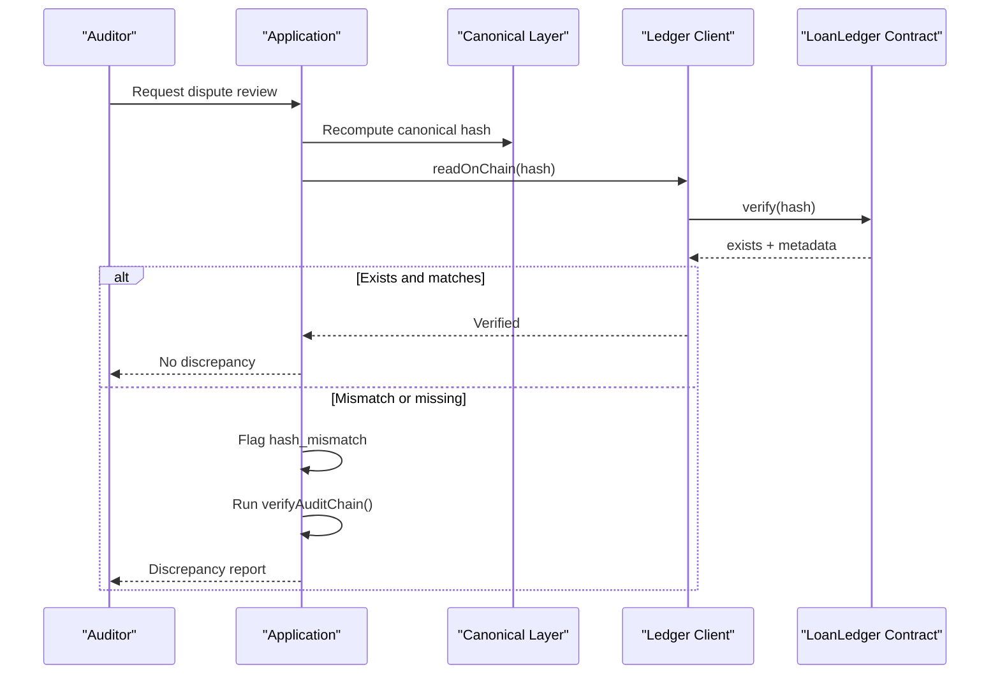
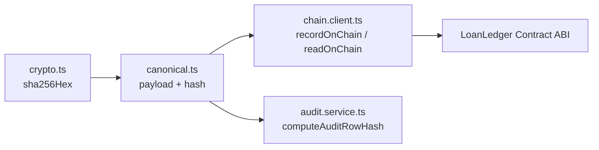

# Verification Mechanisms

<cite>
**Referenced Files in This Document**
- [canonical.ts](file://backend/src/lib/canonical.ts)
- [crypto.ts](file://backend/src/lib/crypto.ts)
- [chain.client.ts](file://backend/src/modules/ledger/chain.client.ts)
- [audit.service.ts](file://backend/src/modules/audit/audit.service.ts)
</cite>

## Table of Contents
1. [Introduction](#introduction)
2. [Project Structure](#project-structure)
3. [Core Components](#core-components)
4. [Architecture Overview](#architecture-overview)
5. [Detailed Component Analysis](#detailed-component-analysis)
6. [Dependency Analysis](#dependency-analysis)
7. [Performance Considerations](#performance-considerations)
8. [Troubleshooting Guide](#troubleshooting-guide)
9. [Conclusion](#conclusion)

## Introduction
This document explains the on-chain verification system that validates data integrity between off-chain records and blockchain anchors. It focuses on:
- Using the `verify` function to check record existence and retrieve on-chain metadata.
- The canonical hashing process that ensures consistent data representation before anchoring.
- End-to-end verification workflows, integrity checks, and dispute resolution mechanisms.
- Performance considerations for large-scale verification and caching strategies for frequently accessed records.

The system is designed so that only hashes and timestamps are written on-chain; sensitive business data remains off-chain.

## Project Structure
The verification mechanism spans two main areas:
- Canonical hashing utilities that produce deterministic byte representations and hashes.
- A ledger client that interacts with an Ethereum-style smart contract to anchor and verify hashes.

**Diagram sources**
- [canonical.ts:1-117](file://backend/src/lib/canonical.ts#L1-L117)
- [crypto.ts:21-23](file://backend/src/lib/crypto.ts#L21-L23)
- [chain.client.ts:12-20](file://backend/src/modules/ledger/chain.client.ts#L12-L20)
- [audit.service.ts:1-191](file://backend/src/modules/audit/audit.service.ts#L1-L191)

**Section sources**
- [canonical.ts:1-117](file://backend/src/lib/canonical.ts#L1-L117)
- [chain.client.ts:1-152](file://backend/src/modules/ledger/chain.client.ts#L1-L152)

## Core Components
- Canonical hashing layer:
  - Produces deterministic JSON serialization.
  - Builds transaction payloads and computes SHA-256 hashes.
  - Converts hashes to bytes32 format compatible with Solidity.
  - Computes audit row hashes forming a hash-chained log.
- Ledger client:
  - Wraps ethers.js calls to the LoanLedger contract.
  - Anchors transaction hashes and audit roots.
  - Reads on-chain records using `verify`.
- Audit service:
  - Maintains an append-only, hash-chained audit trail.
  - Verifies the entire audit chain locally.

**Section sources**
- [canonical.ts:11-24](file://backend/src/lib/canonical.ts#L11-L24)
- [canonical.ts:44-60](file://backend/src/lib/canonical.ts#L44-L60)
- [canonical.ts:62-72](file://backend/src/lib/canonical.ts#L62-L72)
- [canonical.ts:96-113](file://backend/src/lib/canonical.ts#L96-L113)
- [chain.client.ts:71-116](file://backend/src/modules/ledger/chain.client.ts#L71-L116)
- [audit.service.ts:37-94](file://backend/src/modules/audit/audit.service.ts#L37-L94)
- [audit.service.ts:142-190](file://backend/src/modules/audit/audit.service.ts#L142-L190)

## Architecture Overview
The verification architecture connects off-chain data processing with on-chain anchors:

**Diagram sources**
- [canonical.ts:44-60](file://backend/src/lib/canonical.ts#L44-L60)
- [chain.client.ts:71-108](file://backend/src/modules/ledger/chain.client.ts#L71-L108)

## Detailed Component Analysis

### Canonical Hashing Process
The canonical hashing process guarantees that identical logical data always produces the same hash, regardless of object key ordering or minor formatting differences.

Key responsibilities:
- Deterministic JSON serialization via recursive key sorting.
- Construction of a versioned, pipe-delimited transaction payload.
- SHA-256 hashing of the canonical payload.
- Conversion between hex and bytes32 formats used by Solidity.
- Audit row hashing that includes previous hash to form a tamper-evident chain.

**Diagram sources**
- [canonical.ts:11-24](file://backend/src/lib/canonical.ts#L11-L24)
- [canonical.ts:44-60](file://backend/src/lib/canonical.ts#L44-L60)
- [canonical.ts:62-72](file://backend/src/lib/canonical.ts#L62-L72)
- [crypto.ts:21-23](file://backend/src/lib/crypto.ts#L21-L23)

**Section sources**
- [canonical.ts:11-24](file://backend/src/lib/canonical.ts#L11-L24)
- [canonical.ts:44-60](file://backend/src/lib/canonical.ts#L44-L60)
- [canonical.ts:62-72](file://backend/src/lib/canonical.ts#L62-L72)
- [crypto.ts:21-23](file://backend/src/lib/crypto.ts#L21-L23)

### On-Chain Verification with `verify`
The `verify` function is exposed by the LoanLedger contract and is called through the ledger client’s `readOnChain` method. It answers two questions:
- Does a record exist for the given hash?
- What metadata is anchored for that record?

Contract ABI methods relevant to verification:
- `verify(bytes32 recordHash)` returns existence and metadata.
- `exists(bytes32 recordHash)` returns a boolean.

Client behavior:
- Normalizes the provided hash to bytes32 if needed.
- Calls `verify` on the contract.
- Returns structured metadata when the record exists, or null otherwise.

**Diagram sources**
- [chain.client.ts:96-108](file://backend/src/modules/ledger/chain.client.ts#L96-L108)
- [chain.client.ts:12-20](file://backend/src/modules/ledger/chain.client.ts#L12-L20)

**Section sources**
- [chain.client.ts:96-108](file://backend/src/modules/ledger/chain.client.ts#L96-L108)
- [chain.client.ts:12-20](file://backend/src/modules/ledger/chain.client.ts#L12-L20)

### Anchoring Workflow
Anchoring writes only the hash and timestamp to the blockchain. Business-sensitive values remain off-chain.

Steps:
- Build canonical payload from transaction inputs.
- Compute SHA-256 hash.
- Convert to bytes32 if required by the contract.
- Call `recordOnChain`, which invokes the contract’s `record` method.
- Capture transaction receipt and return on-chain metadata.

**Diagram sources**
- [canonical.ts:44-60](file://backend/src/lib/canonical.ts#L44-L60)
- [canonical.ts:62-72](file://backend/src/lib/canonical.ts#L62-L72)
- [chain.client.ts:71-94](file://backend/src/modules/ledger/chain.client.ts#L71-L94)

**Section sources**
- [canonical.ts:44-60](file://backend/src/lib/canonical.ts#L44-L60)
- [canonical.ts:62-72](file://backend/src/lib/canonical.ts#L62-L72)
- [chain.client.ts:71-94](file://backend/src/modules/ledger/chain.client.ts#L71-L94)

### Audit Chain Integrity Checking
The audit service maintains an append-only, hash-chained log. Each row includes its own hash and references the previous row’s hash. This makes silent edits detectable because recomputing any row changes all subsequent hashes.

Verification process:
- Load all audit rows ordered by sequence number.
- Recompute each row’s hash using canonicalization and SHA-256.
- Check that each row’s stored hash matches the recomputed value.
- Check that each row’s `prev_hash` links correctly to the previous row.
- Report mismatches and broken links.

**Diagram sources**
- [audit.service.ts:142-190](file://backend/src/modules/audit/audit.service.ts#L142-L190)
- [canonical.ts:96-113](file://backend/src/lib/canonical.ts#L96-L113)

**Section sources**
- [audit.service.ts:142-190](file://backend/src/modules/audit/audit.service.ts#L142-L190)
- [canonical.ts:96-113](file://backend/src/lib/canonical.ts#L96-L113)

### Dispute Resolution Mechanisms
Disputes can involve:
- Off-chain vs on-chain hash mismatch.
- Missing on-chain anchor for a claimed transaction.
- Tampered audit trail entries.

Resolution workflow:
1. Identify the disputed transaction or audit row.
2. Recompute the canonical payload and hash off-chain.
3. Compare the recomputed hash with the on-chain hash retrieved via `verify`.
4. If the on-chain record does not exist, treat it as unanchored.
5. Run `verifyAuditChain` to detect broken links or hash mismatches in the audit log.
6. Use fraud rules and alerts to escalate critical discrepancies.

**Diagram sources**
- [canonical.ts:44-60](file://backend/src/lib/canonical.ts#L44-L60)
- [chain.client.ts:96-108](file://backend/src/modules/ledger/chain.client.ts#L96-L108)
- [audit.service.ts:142-190](file://backend/src/modules/audit/audit.service.ts#L142-L190)

**Section sources**
- [canonical.ts:44-60](file://backend/src/lib/canonical.ts#L44-L60)
- [chain.client.ts:96-108](file://backend/src/modules/ledger/chain.client.ts#L96-L108)
- [audit.service.ts:142-190](file://backend/src/modules/audit/audit.service.ts#L142-L190)

## Dependency Analysis
The verification system has clear separation of concerns:
- Crypto utilities provide low-level hashing primitives.
- Canonical layer builds deterministic payloads and higher-level hashes.
- Ledger client abstracts blockchain interactions.
- Audit service enforces local integrity of the audit trail.

**Diagram sources**
- [crypto.ts:21-23](file://backend/src/lib/crypto.ts#L21-L23)
- [canonical.ts:44-60](file://backend/src/lib/canonical.ts#L44-L60)
- [chain.client.ts:71-108](file://backend/src/modules/ledger/chain.client.ts#L71-L108)
- [audit.service.ts:142-190](file://backend/src/modules/audit/audit.service.ts#L142-L190)

**Section sources**
- [crypto.ts:21-23](file://backend/src/lib/crypto.ts#L21-L23)
- [canonical.ts:44-60](file://backend/src/lib/canonical.ts#L44-L60)
- [chain.client.ts:71-108](file://backend/src/modules/ledger/chain.client.ts#L71-L108)
- [audit.service.ts:142-190](file://backend/src/modules/audit/audit.service.ts#L142-L190)

## Performance Considerations
- Large-scale verification:
  - Avoid repeated RPC calls by caching frequent `verify` results.
  - Batch audit chain verification where possible; consider pagination for very large logs.
  - Use read-only provider instances for verification queries to minimize overhead.
- Caching strategies:
  - Cache `readOnChain` results keyed by `recordHash` with TTL based on block confirmation expectations.
  - Cache canonical payloads and hashes for repeated operations within a request or worker job.
  - Invalidate cache on new anchor transactions or when chain status changes.
- Network resilience:
  - Handle chain unavailability gracefully; the client supports off-chain mode where records are marked “not anchored.”
  - Retry failed RPC calls with backoff for non-critical verification paths.

[No sources needed since this section provides general guidance]

## Troubleshooting Guide
Common issues and resolutions:
- Chain unavailable:
  - Ensure `CHAIN_MODE` and `LEDGER_CONTRACT_ADDRESS` are configured.
  - Validate `CHAIN_RECORDER_PRIVATE_KEY` for write operations.
- Invalid hash format:
  - Confirm hashes are 64-character hex strings before converting to bytes32.
  - Use the provided conversion helpers to avoid malformed inputs.
- Audit chain breaks:
  - Run `verifyAuditChain` to identify broken links or hash mismatches.
  - Investigate direct database modifications or missing audit entries.
- Discrepancies between off-chain and on-chain:
  - Recompute canonical payload and hash.
  - Compare with on-chain metadata returned by `verify`.

**Section sources**
- [chain.client.ts:24-52](file://backend/src/modules/ledger/chain.client.ts#L24-L52)
- [canonical.ts:62-72](file://backend/src/lib/canonical.ts#L62-L72)
- [audit.service.ts:142-190](file://backend/src/modules/audit/audit.service.ts#L142-L190)

## Conclusion
The verification system combines deterministic canonical hashing with on-chain anchors to ensure data integrity across off-chain records and blockchain state. The `verify` function enables efficient existence checks and metadata retrieval, while the audit chain provides tamper detection for internal operations. For production use, implement caching for frequent verifications, handle chain unavailability gracefully, and integrate dispute resolution workflows that compare recomputed hashes against on-chain anchors.

[No sources needed since this section summarizes without analyzing specific files]