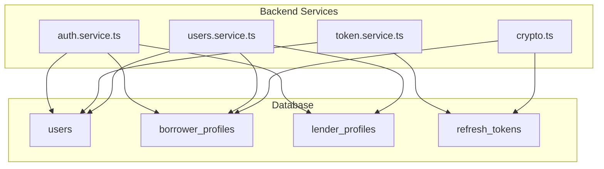
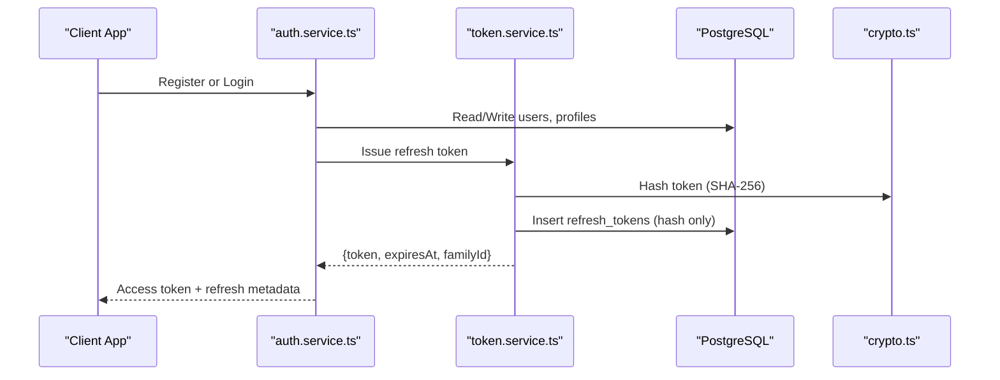
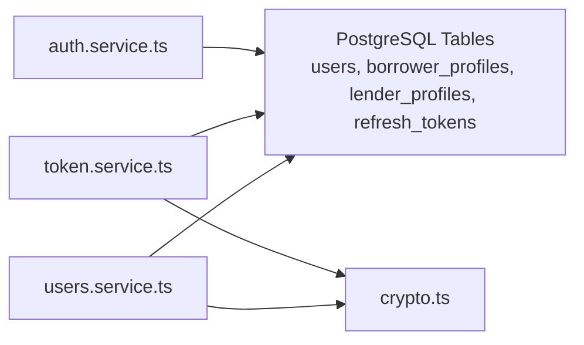

# Core Authentication Schema

<cite>
**Referenced Files in This Document**
- [001_core_auth.sql](file://backend/src/db/migrations/001_core_auth.sql)
- [token.service.ts](file://backend/src/modules/auth/token.service.ts)
- [crypto.ts](file://backend/src/lib/crypto.ts)
- [auth.service.ts](file://backend/src/modules/auth/auth.service.ts)
- [users.service.ts](file://backend/src/modules/users/users.service.ts)
</cite>

## Table of Contents
1. [Introduction](#introduction)
2. [Project Structure](#project-structure)
3. [Core Components](#core-components)
4. [Architecture Overview](#architecture-overview)
5. [Detailed Component Analysis](#detailed-component-analysis)
6. [Dependency Analysis](#dependency-analysis)
7. [Performance Considerations](#performance-considerations)
8. [Troubleshooting Guide](#troubleshooting-guide)
9. [Conclusion](#conclusion)

## Introduction
This document describes the core authentication data model and its security design. It focuses on:
- The users table with role-based access control, status management, failed login tracking, and account locking.
- The borrower_profiles table with encrypted personal fields and HMAC blind indexes for duplicate detection without decryption.
- The lender_profiles table with business settings, lending limits, and rate configuration.
- The refresh_tokens table implementing rotating tokens, SHA-256 hashing, family-scoped session revocation, and concurrency-safe rotation.
It also explains constraints, indexes, triggers, validation rules, common queries, and the security implications of each design decision.

## Project Structure
The authentication schema is defined in a database migration and used by backend services that handle registration, login, token issuance, and profile retrieval.

**Diagram sources**
- [001_core_auth.sql:17-94](file://backend/src/db/migrations/001_core_auth.sql#L17-L94)
- [auth.service.ts:61-111](file://backend/src/modules/auth/auth.service.ts#L61-L111)
- [token.service.ts:64-76](file://backend/src/modules/auth/token.service.ts#L64-L76)
- [users.service.ts:19-58](file://backend/src/modules/users/users.service.ts#L19-L58)
- [crypto.ts:29-77](file://backend/src/lib/crypto.ts#L29-L77)

**Section sources**
- [001_core_auth.sql:1-95](file://backend/src/db/migrations/001_core_auth.sql#L1-L95)
- [auth.service.ts:1-262](file://backend/src/modules/auth/auth.service.ts#L1-L262)
- [token.service.ts:1-206](file://backend/src/modules/auth/token.service.ts#L1-L206)
- [crypto.ts:1-97](file://backend/src/lib/crypto.ts#L1-L97)
- [users.service.ts:1-60](file://backend/src/modules/users/users.service.ts#L1-L60)

## Core Components
This section summarizes the primary tables and their roles in the authentication system.

- users: Identity, role, status, and lockout state.
- borrower_profiles: Encrypted PII and business-relevant attributes for borrowers.
- lender_profiles: Business configuration and lending policy for lenders.
- refresh_tokens: Secure, rotating session tokens stored as hashes.

Key security properties:
- Role-based access control via user_role enum.
- Account lifecycle via user_status enum.
- Brute-force mitigation via failed_attempts and locked_until.
- Field-level encryption at rest for sensitive borrower data.
- Blind indexes for duplicate detection without decrypting data.
- Refresh token rotation with family-scoped revocation and replay protection.

**Section sources**
- [001_core_auth.sql:5-31](file://backend/src/db/migrations/001_core_auth.sql#L5-L31)
- [001_core_auth.sql:40-58](file://backend/src/db/migrations/001_core_auth.sql#L40-L58)
- [001_core_auth.sql:64-72](file://backend/src/db/migrations/001_core_auth.sql#L64-L72)
- [001_core_auth.sql:80-94](file://backend/src/db/migrations/001_core_auth.sql#L80-L94)

## Architecture Overview
The authentication flow integrates the database schema with service logic for secure registration, login, and session management.

**Diagram sources**
- [auth.service.ts:61-111](file://backend/src/modules/auth/auth.service.ts#L61-L111)
- [auth.service.ts:114-197](file://backend/src/modules/auth/auth.service.ts#L114-L197)
- [token.service.ts:64-76](file://backend/src/modules/auth/token.service.ts#L64-L76)
- [crypto.ts:21-23](file://backend/src/lib/crypto.ts#L21-L23)

## Detailed Component Analysis

### Users Table
Purpose:
- Stores identity, credentials, role, status, and lockout state.

Structure highlights:
- Primary key: id (UUID).
- Unique email with enforced lowercase normalization.
- Password stored as bcrypt hash.
- Role from user_role enum: borrower, lender, auditor.
- Status from user_status enum: active, suspended, closed.
- Failed login attempts counter and lockout timestamp.
- Last login timestamp for auditing.
- Updated timestamps managed by trigger.

Constraints and validation:
- Email uniqueness and lowercase enforcement via CHECK constraint.
- Default values for status, created_at, updated_at.
- Trigger set_updated_at ensures updated_at refreshes on updates.

Security implications:
- Lowercase email normalization prevents case-based enumeration and duplicates.
- Lockout mechanism mitigates brute force attacks.
- Audit-friendly fields support monitoring and incident response.

Common queries:
- Find user by email: SELECT * FROM users WHERE email = $1
- Check lockout: SELECT locked_until, failed_attempts FROM users WHERE id = $1
- Reset lockout after success: UPDATE users SET failed_attempts = 0, locked_until = NULL, last_login_at = now() WHERE id = $1

Triggers:
- users_touch_updated_at sets updated_at before update.

**Section sources**
- [001_core_auth.sql:5-35](file://backend/src/db/migrations/001_core_auth.sql#L5-L35)
- [auth.service.ts:114-197](file://backend/src/modules/auth/auth.service.ts#L114-L197)

### Borrower Profiles Table
Purpose:
- Stores sensitive borrower information securely and supports duplicate detection without exposing plaintext.

Structure highlights:
- user_id primary key referencing users(id) with cascade delete.
- Encrypted fields: national_id_enc, phone_enc, date_of_birth_enc, address_enc.
- Blind index columns: national_id_bi, phone_bi.
- Non-sensitive fields: occupation, monthly_income_cents (non-negative), consent_flags (JSONB).
- Timestamps managed by trigger.

Indexes:
- borrower_profiles_nid_bi_idx on national_id_bi.
- borrower_profiles_phone_bi_idx on phone_bi.

Validation:
- monthly_income_cents must be non-negative.
- consent_flags defaults to empty JSON object.

Security implications:
- AES-256-GCM encryption ensures PII is unreadable from dumps.
- HMAC blind indexes enable duplicate checks without decryption.
- Deliberately allowing duplicate national IDs enables fraud detection workflows rather than hard failures.

Common queries:
- Duplicate national ID check: SELECT COUNT(*) FROM borrower_profiles WHERE national_id_bi = $1
- Duplicate phone check: SELECT COUNT(*) FROM borrower_profiles WHERE phone_bi = $1
- Profile read for display: SELECT national_id_enc, phone_enc, occupation, monthly_income_cents FROM borrower_profiles WHERE user_id = $1

Triggers:
- borrower_profiles_touch_updated_at sets updated_at before update.

Encryption and normalization:
- encryptField produces versioned ciphertext blobs.
- normalizeNationalId and normalizePhone prepare values for consistent blind indexing.
- blindIndex uses HMAC-SHA256 with a dedicated key.

**Section sources**
- [001_core_auth.sql:37-62](file://backend/src/db/migrations/001_core_auth.sql#L37-L62)
- [crypto.ts:29-77](file://backend/src/lib/crypto.ts#L29-L77)
- [users.service.ts:43-58](file://backend/src/modules/users/users.service.ts#L43-L58)

### Lender Profiles Table
Purpose:
- Stores business settings and lending policy parameters for lenders.

Structure highlights:
- user_id primary key referencing users(id) with cascade delete.
- business_name optional text.
- max_principal_cents positive integer with default.
- default_rate_bps between 0 and 10000 with default.
- default_penalty_bps_per_day non-negative with default.
- Timestamps managed by trigger.

Validation:
- max_principal_cents > 0.
- default_rate_bps BETWEEN 0 AND 10000.
- default_penalty_bps_per_day >= 0.

Security implications:
- Policy values are not secret but constrained to prevent invalid configurations.
- Defaults provide safe baseline behavior.

Common queries:
- Read lender settings: SELECT business_name, default_rate_bps, max_principal_cents FROM lender_profiles WHERE user_id = $1

Triggers:
- lender_profiles_touch_updated_at sets updated_at before update.

**Section sources**
- [001_core_auth.sql:64-76](file://backend/src/db/migrations/001_core_auth.sql#L64-L76)
- [users.service.ts:23-36](file://backend/src/modules/users/users.service.ts#L23-L36)

### Refresh Tokens Table
Purpose:
- Implements secure, rotating refresh tokens with family-scoped revocation and replay protection.

Structure highlights:
- id primary key (UUID).
- user_id references users(id) with cascade delete.
- token_hash char(64) unique; stores SHA-256 hex digest of the raw token.
- family_id groups related tokens for coordinated revocation.
- replaced_by links to the next token in rotation.
- expires_at and revoked_at manage lifetime and revocation.
- ip and user_agent for auditability.
- created_at timestamp.

Indexes:
- refresh_tokens_user_idx on user_id.
- refresh_tokens_family_idx on family_id.

Security implications:
- Storing only SHA-256 hashes prevents token theft from database leaks.
- Rotation with replaced_by enables graceful handling of concurrent requests.
- Family revocation detects stolen tokens outside a short grace window.
- Concurrency-safe claim via conditional UPDATE avoids token fork.

Common queries:
- Issue token: INSERT INTO refresh_tokens (user_id, token_hash, family_id, expires_at, ip, user_agent) VALUES ($1, $2, $3, $4, $5, $6)
- Rotate token: SELECT ... FROM refresh_tokens JOIN users ON users.id = refresh_tokens.user_id WHERE token_hash = $1
- Revoke single token: UPDATE refresh_tokens SET revoked_at = now() WHERE token_hash = $1 AND revoked_at IS NULL
- Revoke all sessions: UPDATE refresh_tokens SET revoked_at = now() WHERE user_id = $1 AND revoked_at IS NULL

Rotation flow:
- Claim row with conditional UPDATE to ensure exactly one winner.
- If another request already rotated, decide if it’s benign (within grace window and replacement active) or malicious (revoke entire family).

**Section sources**
- [001_core_auth.sql:78-94](file://backend/src/db/migrations/001_core_auth.sql#L78-L94)
- [token.service.ts:64-76](file://backend/src/modules/auth/token.service.ts#L64-L76)
- [token.service.ts:154-195](file://backend/src/modules/auth/token.service.ts#L154-L195)
- [token.service.ts:197-205](file://backend/src/modules/auth/token.service.ts#L197-L205)

### Registration and Login Flow
Registration:
- Normalizes email, checks uniqueness, hashes password with bcrypt, inserts user, creates profile based on role, records audit, issues refresh token, signs access token.

Login:
- Normalizes email, performs constant-time bcrypt comparison regardless of existence, enforces lockout, validates status, resets failed attempts on success, records audit, issues refresh token, signs access token.

Password change:
- Verifies current password, hashes new password, revokes all sessions, records audit.

Logout:
- Optionally revokes provided refresh token, records audit.

**Section sources**
- [auth.service.ts:61-111](file://backend/src/modules/auth/auth.service.ts#L61-L111)
- [auth.service.ts:114-197](file://backend/src/modules/auth/auth.service.ts#L114-L197)
- [auth.service.ts:200-243](file://backend/src/modules/auth/auth.service.ts#L200-L243)
- [auth.service.ts:245-261](file://backend/src/modules/auth/auth.service.ts#L245-L261)

### Encryption and Blind Indexing
Encryption:
- AES-256-GCM with versioned blob format including IV, tag, and ciphertext.
- Decryption validates version and auth tag to detect tampering.

Blind indexes:
- HMAC-SHA256 over normalized values using a dedicated key.
- Separate normalizers for national ID and phone number to ensure canonical forms.

Masking:
- API responses mask sensitive values to avoid leaking full PII.

**Section sources**
- [crypto.ts:29-48](file://backend/src/lib/crypto.ts#L29-L48)
- [crypto.ts:50-77](file://backend/src/lib/crypto.ts#L50-L77)
- [crypto.ts:79-84](file://backend/src/lib/crypto.ts#L79-L84)

## Dependency Analysis
The authentication schema depends on cryptographic utilities and service layers for secure operations.

**Diagram sources**
- [001_core_auth.sql:17-94](file://backend/src/db/migrations/001_core_auth.sql#L17-L94)
- [auth.service.ts:61-111](file://backend/src/modules/auth/auth.service.ts#L61-L111)
- [token.service.ts:64-76](file://backend/src/modules/auth/token.service.ts#L64-L76)
- [users.service.ts:19-58](file://backend/src/modules/users/users.service.ts#L19-L58)
- [crypto.ts:29-77](file://backend/src/lib/crypto.ts#L29-L77)

**Section sources**
- [001_core_auth.sql:17-94](file://backend/src/db/migrations/001_core_auth.sql#L17-L94)
- [auth.service.ts:61-111](file://backend/src/modules/auth/auth.service.ts#L61-L111)
- [token.service.ts:64-76](file://backend/src/modules/auth/token.service.ts#L64-L76)
- [users.service.ts:19-58](file://backend/src/modules/users/users.service.ts#L19-L58)
- [crypto.ts:29-77](file://backend/src/lib/crypto.ts#L29-L77)

## Performance Considerations
- Index usage:
  - borrower_profiles_nid_bi_idx and borrower_profiles_phone_bi_idx accelerate duplicate checks without decryption.
  - refresh_tokens_user_idx and refresh_tokens_family_idx optimize lookup and family revocation.
- Avoiding decryption:
  - Blind indexes allow fast equality checks on sensitive fields without decrypting rows.
- Concurrency safety:
  - Conditional UPDATE during refresh token rotation prevents race conditions and token forks.
- Cost controls:
  - Bcrypt cost factor balances security and performance for password hashing.
- Minimal payload exposure:
  - Masking in API responses reduces risk of accidental leakage.

[No sources needed since this section provides general guidance]

## Troubleshooting Guide
Common issues and resolutions:
- Account temporarily locked:
  - Cause: Exceeded failed login attempts.
  - Resolution: Wait until locked_until passes or reset via administrative process; verify audit logs for suspicious activity.
- Invalid or expired refresh token:
  - Cause: Token expired or was revoked due to reuse detection.
  - Resolution: Re-authenticate; investigate potential theft if reuse detected outside grace window.
- Malformed ciphertext:
  - Cause: Corrupted or incompatible ciphertext blob.
  - Resolution: Validate encryption version and integrity; re-encrypt if necessary.
- Duplicate national ID or phone:
  - Behavior: Allowed but flagged for review.
  - Resolution: Investigate potential fraud; use blind index counts to identify duplicates.

Operational queries:
- Check lockout state: SELECT failed_attempts, locked_until FROM users WHERE id = $1
- Detect duplicate national ID: SELECT COUNT(*) FROM borrower_profiles WHERE national_id_bi = $1
- Detect duplicate phone: SELECT COUNT(*) FROM borrower_profiles WHERE phone_bi = $1
- Revoke all sessions for a user: UPDATE refresh_tokens SET revoked_at = now() WHERE user_id = $1 AND revoked_at IS NULL

**Section sources**
- [auth.service.ts:155-171](file://backend/src/modules/auth/auth.service.ts#L155-L171)
- [token.service.ts:154-195](file://backend/src/modules/auth/token.service.ts#L154-L195)
- [crypto.ts:37-48](file://backend/src/lib/crypto.ts#L37-L48)
- [001_core_auth.sql:55-58](file://backend/src/db/migrations/001_core_auth.sql#L55-L58)

## Conclusion
The core authentication schema implements strong security practices:
- Role-based access control and status management for users.
- Encrypted PII with blind indexes for efficient, secure duplicate detection.
- Lender policy constraints ensuring valid business configurations.
- Rotating refresh tokens with family-scoped revocation and replay protection.
These design decisions collectively protect against credential theft, brute force attacks, unauthorized access, and data leakage while enabling operational visibility through auditing and controlled masking.

[No sources needed since this section summarizes without analyzing specific files]