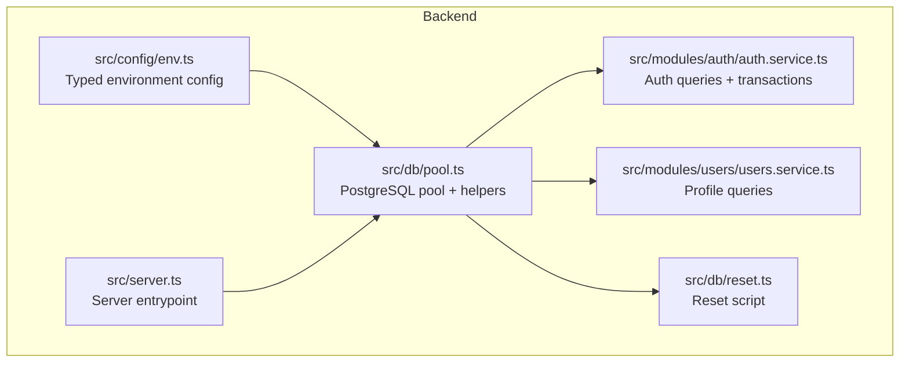
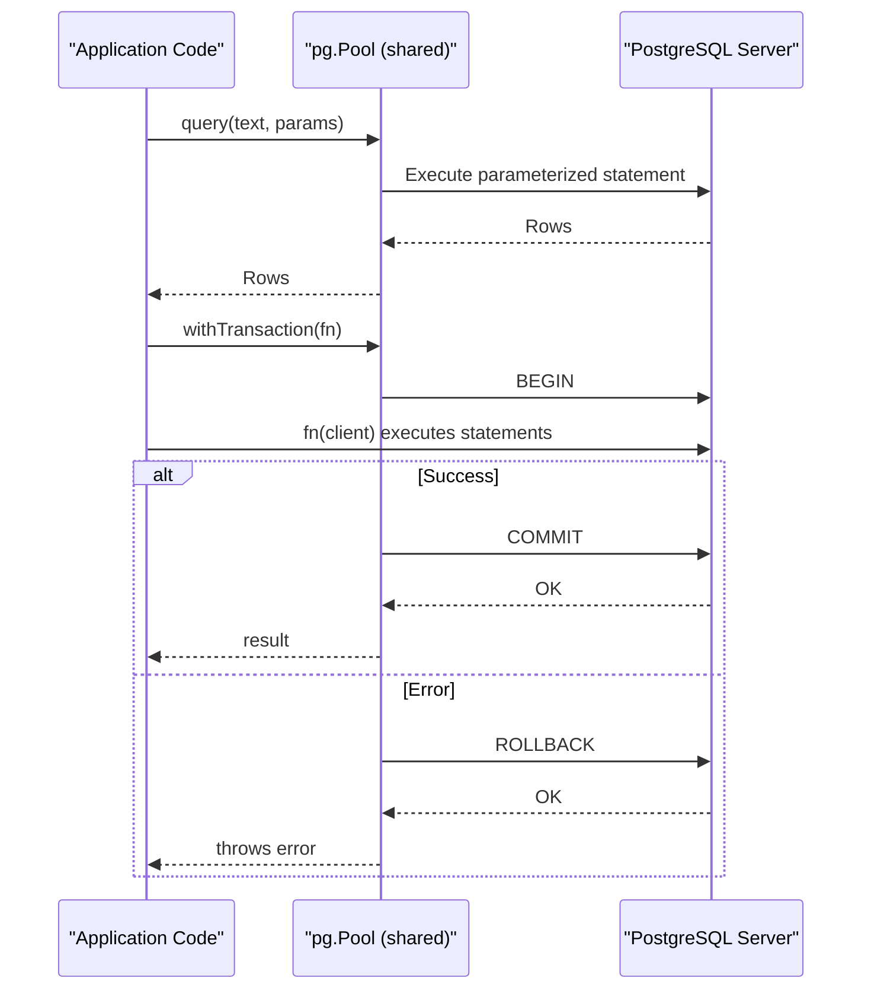
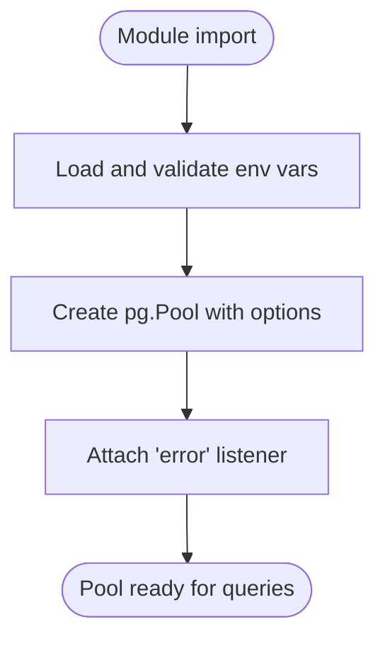
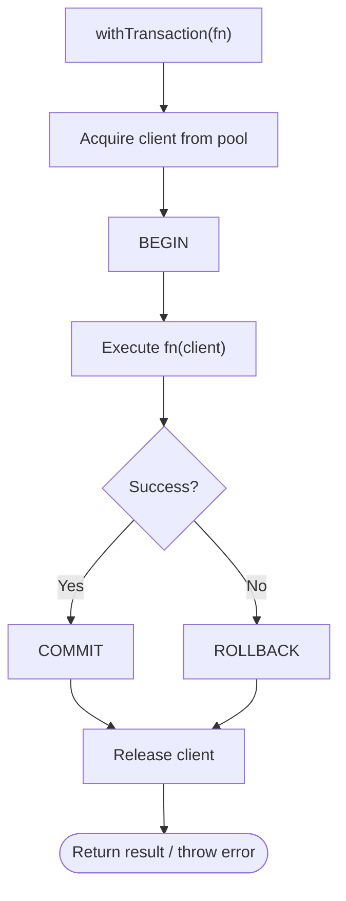
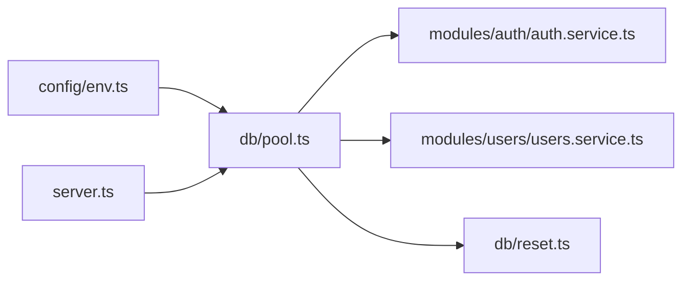

# Database Connection Pooling

<cite>
**Referenced Files in This Document**
- [pool.ts](file://backend/src/db/pool.ts)
- [env.ts](file://backend/src/config/env.ts)
- [package.json](file://backend/package.json)
- [auth.service.ts](file://backend/src/modules/auth/auth.service.ts)
- [users.service.ts](file://backend/src/modules/users/users.service.ts)
- [reset.ts](file://backend/src/db/reset.ts)
- [server.ts](file://backend/src/server.ts)
</cite>

## Table of Contents
1. [Introduction](#introduction)
2. [Project Structure](#project-structure)
3. [Core Components](#core-components)
4. [Architecture Overview](#architecture-overview)
5. [Detailed Component Analysis](#detailed-component-analysis)
6. [Dependency Analysis](#dependency-analysis)
7. [Performance Considerations](#performance-considerations)
8. [Troubleshooting Guide](#troubleshooting-guide)
9. [Conclusion](#conclusion)
10. [Appendices](#appendices)

## Introduction
This document explains the PostgreSQL connection pooling implementation used by the backend service. It covers pool configuration, initialization, lifecycle management, error handling, monitoring, usage patterns, environment-specific settings, scaling considerations, and troubleshooting guidance. The goal is to help developers understand how database connections are created, reused, monitored, and safely closed across the application.

## Project Structure
The database layer is centralized under `backend/src/db`, with the connection pool defined in a single module and consumed by services and scripts throughout the backend. Configuration is loaded from environment variables using a typed loader.

**Diagram sources**
- [pool.ts:1-62](file://backend/src/db/pool.ts#L1-L62)
- [env.ts:28-105](file://backend/src/config/env.ts#L28-L105)
- [auth.service.ts:1-262](file://backend/src/modules/auth/auth.service.ts#L1-L262)
- [users.service.ts:1-60](file://backend/src/modules/users/users.service.ts#L1-L60)
- [reset.ts:1-21](file://backend/src/db/reset.ts#L1-L21)
- [server.ts:1-200](file://backend/src/server.ts#L1-L200)

**Section sources**
- [pool.ts:1-62](file://backend/src/db/pool.ts#L1-L62)
- [env.ts:1-106](file://backend/src/config/env.ts#L1-L106)

## Core Components
- PostgreSQL connection pool: a shared `pg.Pool` instance configured with a connection string, maximum pool size, idle timeout, and connection timeout.
- Typed environment configuration: loads and validates environment variables, including the database URL.
- Query helpers: simple wrappers for parameterized queries, single-row queries, and transactional execution.
- Lifecycle utilities: graceful pool shutdown helper used by scripts and server teardown.

Key responsibilities:
- Centralize connection configuration and reuse.
- Provide safe query helpers that enforce parameterization.
- Encapsulate transaction semantics with automatic rollback on failure.
- Expose a controlled way to close the pool during shutdown.

**Section sources**
- [pool.ts:1-62](file://backend/src/db/pool.ts#L1-L62)
- [env.ts:28-105](file://backend/src/config/env.ts#L28-L105)

## Architecture Overview
At runtime, the application imports the shared pool once. All modules execute parameterized queries through the provided helpers. Transactions are executed via a wrapper that ensures commit or rollback and always releases the client back to the pool.

**Diagram sources**
- [pool.ts:27-57](file://backend/src/db/pool.ts#L27-L57)

## Detailed Component Analysis

### PostgreSQL Connection Pool Configuration
- Connection source: the pool uses a database URL derived from the environment configuration. In test mode, it prefers a dedicated test database URL; otherwise, it uses the primary database URL.
- Maximum connections: fixed at 10.
- Idle timeout: idle clients are closed after 30 seconds.
- Connection timeout: acquiring a connection times out after 10 seconds.
- Type parsing: bigint and money types are parsed into JavaScript numbers to keep JSON responses clean.

Configuration highlights:
- Uses a single shared pool instance for the process lifetime.
- Applies type parsers for numeric types to avoid large integer precision issues.

Best practices reflected here:
- Parameterized queries only (no string interpolation).
- Fixed pool sizing for predictability.
- Explicit timeouts to prevent hanging connections.

**Section sources**
- [pool.ts:1-25](file://backend/src/db/pool.ts#L1-L25)
- [env.ts:93-105](file://backend/src/config/env.ts#L93-L105)

### Pool Initialization Process
Initialization occurs when the module is first imported:
- The environment loader reads `.env` files and validates all required fields.
- The pool is constructed immediately with the resolved database URL and pool options.
- An error listener is attached to handle pooled client errors without crashing the process.

Lifecycle notes:
- The pool remains open for the lifetime of the Node.js process unless explicitly closed.
- Scripts that perform one-off operations should close the pool after completion.

**Diagram sources**
- [env.ts:1-22](file://backend/src/config/env.ts#L1-L22)
- [env.ts:81-105](file://backend/src/config/env.ts#L81-L105)
- [pool.ts:1-19](file://backend/src/db/pool.ts#L1-L19)

**Section sources**
- [env.ts:1-22](file://backend/src/config/env.ts#L1-L22)
- [env.ts:81-105](file://backend/src/config/env.ts#L81-L105)
- [pool.ts:1-19](file://backend/src/db/pool.ts#L1-L19)

### Error Handling Strategies
- Pooled client errors: an error event handler logs idle client errors but does not crash the process.
- Transaction failures: any thrown error inside a transaction triggers a rollback before rethrowing the original error.
- Environment validation: invalid environment configuration fails fast at startup, preventing partially configured deployments.

Operational implications:
- Transient network or server-side errors can be retried at the caller level if needed.
- Misconfiguration is caught early, reducing silent failures.

**Section sources**
- [pool.ts:16-19](file://backend/src/db/pool.ts#L16-L19)
- [pool.ts:44-57](file://backend/src/db/pool.ts#L44-L57)
- [env.ts:81-89](file://backend/src/config/env.ts#L81-L89)

### Connection Monitoring Capabilities
- Event-based monitoring: the pool emits an `error` event for pooled client issues, which is logged.
- Operational visibility: you can extend this with additional listeners such as `acquire`, `release`, `remove`, or `connect` to track pool utilization and latency.
- Application-level metrics: consider wrapping query helpers to record timing, row counts, and error rates.

Recommended additions:
- Add structured logging for pool events.
- Export counters/gauges for active/idle connections.
- Integrate with your observability stack (metrics, tracing, alerts).

**Section sources**
- [pool.ts:16-19](file://backend/src/db/pool.ts#L16-L19)

### Connection Lifecycle Management
- Acquire/release: query helpers use the pool’s internal acquire/release mechanism automatically.
- Transactions: the transaction helper acquires a client, begins a transaction, runs user code, commits on success, rolls back on error, and always releases the client.
- Shutdown: a helper closes the pool gracefully; scripts call it after completing work.

**Diagram sources**
- [pool.ts:44-57](file://backend/src/db/pool.ts#L44-L57)

**Section sources**
- [pool.ts:44-61](file://backend/src/db/pool.ts#L44-L61)
- [reset.ts:15-21](file://backend/src/db/reset.ts#L15-L21)

### Usage Patterns and Best Practices
- Prefer parameterized queries: all query helpers enforce parameterization, preventing SQL injection.
- Use single-row queries where appropriate: prefer the single-row helper to simplify response handling.
- Group related writes in transactions: use the transaction helper to ensure atomicity and consistent rollbacks.
- Avoid long-running transactions: keep transaction scope minimal to reduce lock contention and connection hold time.
- Handle errors at the boundary: let business logic throw domain errors; surface them consistently to API layers.
- Close pools in scripts: one-off scripts should close the pool after completion to free resources.

Examples of usage patterns:
- Authentication flow uses both parameterized queries and transactions for account creation and audit logging.
- User profile retrieval uses single-row queries and masks sensitive data at the edge.

**Section sources**
- [auth.service.ts:61-112](file://backend/src/modules/auth/auth.service.ts#L61-L112)
- [auth.service.ts:114-198](file://backend/src/modules/auth/auth.service.ts#L114-L198)
- [users.service.ts:19-59](file://backend/src/modules/users/users.service.ts#L19-L59)

### Environment-Specific Configuration
- Development/test: environment variables are validated and loaded from `.env`. Test mode selects a separate test database URL when available.
- Production: ensure secure secrets, proper logging levels, and tuned pool parameters.
- Portability: the configuration loader supports running commands from either the backend directory or repository root.

Environment-related behaviors:
- Fail-fast on invalid configuration.
- Derive database URL based on environment.
- Provide flags like production detection for conditional behavior.

**Section sources**
- [env.ts:1-22](file://backend/src/config/env.ts#L1-L22)
- [env.ts:28-79](file://backend/src/config/env.ts#L28-L79)
- [env.ts:93-105](file://backend/src/config/env.ts#L93-L105)

### Scaling Considerations
- Pool sizing: the current maximum pool size is 10. Tune this based on CPU cores, database capacity, and workload characteristics.
- Timeouts: adjust connection and idle timeouts according to expected latency and traffic patterns.
- Read replicas: consider routing read-heavy queries to replicas while keeping writes on the primary.
- Horizontal scaling: each process maintains its own pool; scale horizontally and monitor per-process pool saturation.
- Connection leaks: ensure all paths release clients; prefer helpers over manual connect/release.

Guidance:
- Monitor active vs idle connections and request latency.
- Set alert thresholds for pool exhaustion and slow queries.
- Profile hot paths to reduce transaction duration and query complexity.

[No sources needed since this section provides general guidance]

## Dependency Analysis
The database pool is a central dependency consumed by multiple modules and scripts.

**Diagram sources**
- [env.ts:93-105](file://backend/src/config/env.ts#L93-L105)
- [pool.ts:1-62](file://backend/src/db/pool.ts#L1-L62)
- [auth.service.ts:1-262](file://backend/src/modules/auth/auth.service.ts#L1-L262)
- [users.service.ts:1-60](file://backend/src/modules/users/users.service.ts#L1-L60)
- [reset.ts:1-21](file://backend/src/db/reset.ts#L1-L21)
- [server.ts:1-200](file://backend/src/server.ts#L1-L200)

**Section sources**
- [pool.ts:1-62](file://backend/src/db/pool.ts#L1-L62)
- [auth.service.ts:1-262](file://backend/src/modules/auth/auth.service.ts#L1-L262)
- [users.service.ts:1-60](file://backend/src/modules/users/users.service.ts#L1-L60)
- [reset.ts:1-21](file://backend/src/db/reset.ts#L1-L21)
- [server.ts:1-200](file://backend/src/server.ts#L1-L200)

## Performance Considerations
- Keep queries short and indexed: minimize full table scans and expensive joins.
- Batch operations: group related writes within a transaction to reduce round trips.
- Avoid holding connections too long: do not perform heavy computation inside transactions.
- Tune pool size: match the number of concurrent DB-bound requests to the pool limit.
- Monitor slow queries: add instrumentation around query execution to detect regressions.
- Use appropriate type parsing: the existing numeric type parsers improve JSON serialization performance and correctness.

[No sources needed since this section provides general guidance]

## Troubleshooting Guide
Common issues and resolutions:
- Connection refused or invalid credentials: verify the database URL and server availability.
- Pool exhaustion: increase max connections or reduce concurrent load; investigate long-running transactions.
- Slow queries: analyze query plans and add indexes; break complex operations into smaller steps.
- Idle client errors: check the error logs for transient network issues or database restarts.
- Environment misconfiguration: fix missing or invalid environment variables; the loader will fail fast with details.

Diagnostic tips:
- Inspect pool events (`error`, `acquire`, `release`) to identify leaks or bottlenecks.
- Log transaction boundaries and durations to spot long-lived transactions.
- Validate environment configuration before deployment.

**Section sources**
- [pool.ts:16-19](file://backend/src/db/pool.ts#L16-L19)
- [env.ts:81-89](file://backend/src/config/env.ts#L81-L89)

## Conclusion
The database connection pooling implementation centers around a single shared PostgreSQL pool with explicit timeouts, robust error handling, and transaction support. It enforces safe query practices and integrates cleanly with environment configuration. For production readiness, extend monitoring, tune pool parameters, and adopt disciplined transaction scoping to maintain stability and performance under load.

[No sources needed since this section summarizes without analyzing specific files]

## Appendices

### Configuration Reference
- Database URL: derived from environment variables; test mode may use a separate URL.
- Pool options:
  - Maximum connections: 10
  - Idle timeout: 30 seconds
  - Connection timeout: 10 seconds
- Type parsing: bigint and money types parsed to numbers.

**Section sources**
- [env.ts:93-105](file://backend/src/config/env.ts#L93-L105)
- [pool.ts:9-14](file://backend/src/db/pool.ts#L9-L14)
- [pool.ts:21-25](file://backend/src/db/pool.ts#L21-L25)

### API Surface Summary
- `query(text, params)`: execute parameterized queries returning rows.
- `queryOne(text, params)`: execute parameterized queries returning a single row or null.
- `withTransaction(fn)`: run a function inside a transaction with automatic commit/rollback and client release.
- `closePool()`: gracefully shut down the pool.

**Section sources**
- [pool.ts:27-61](file://backend/src/db/pool.ts#L27-L61)