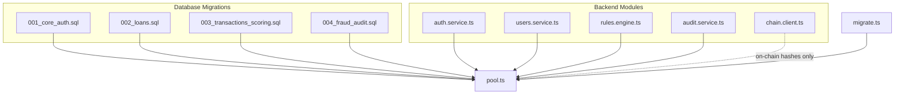
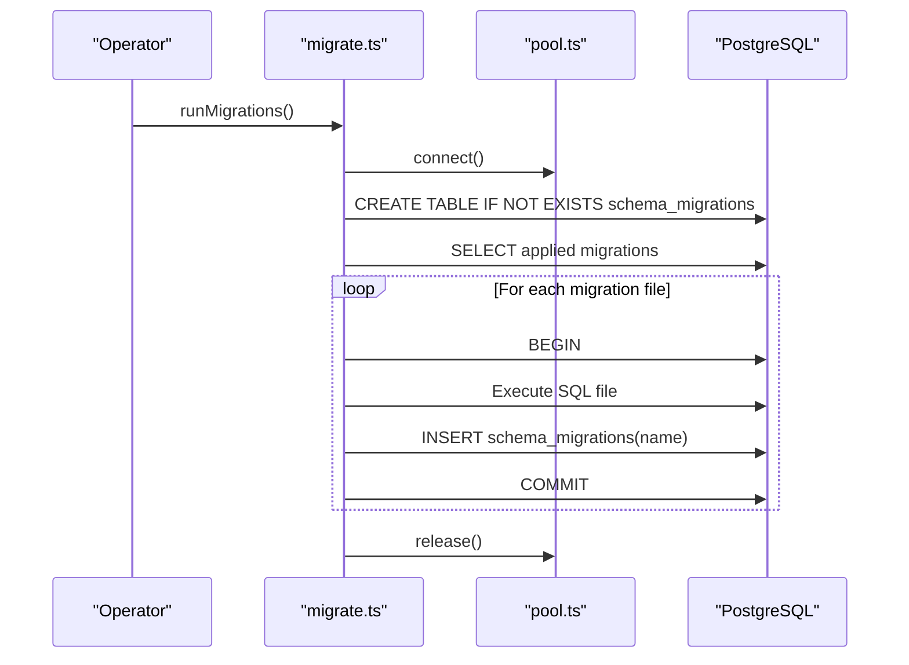
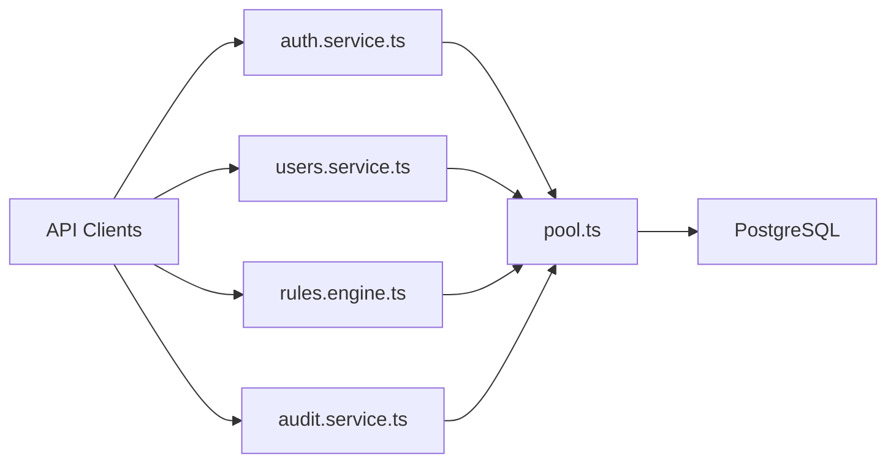
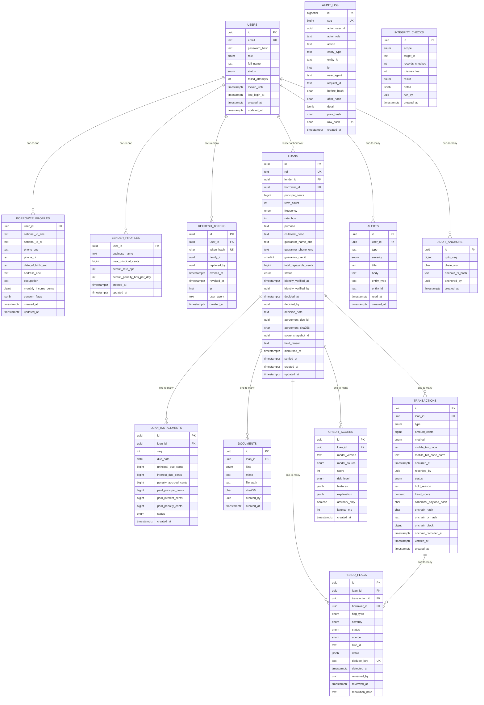
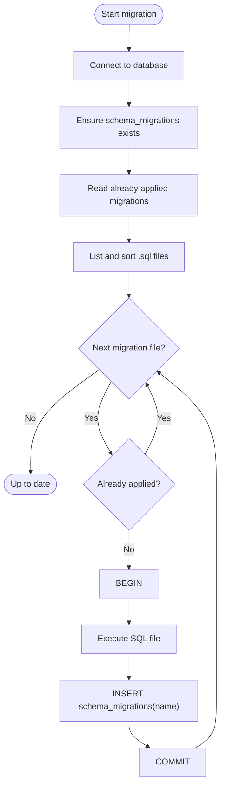
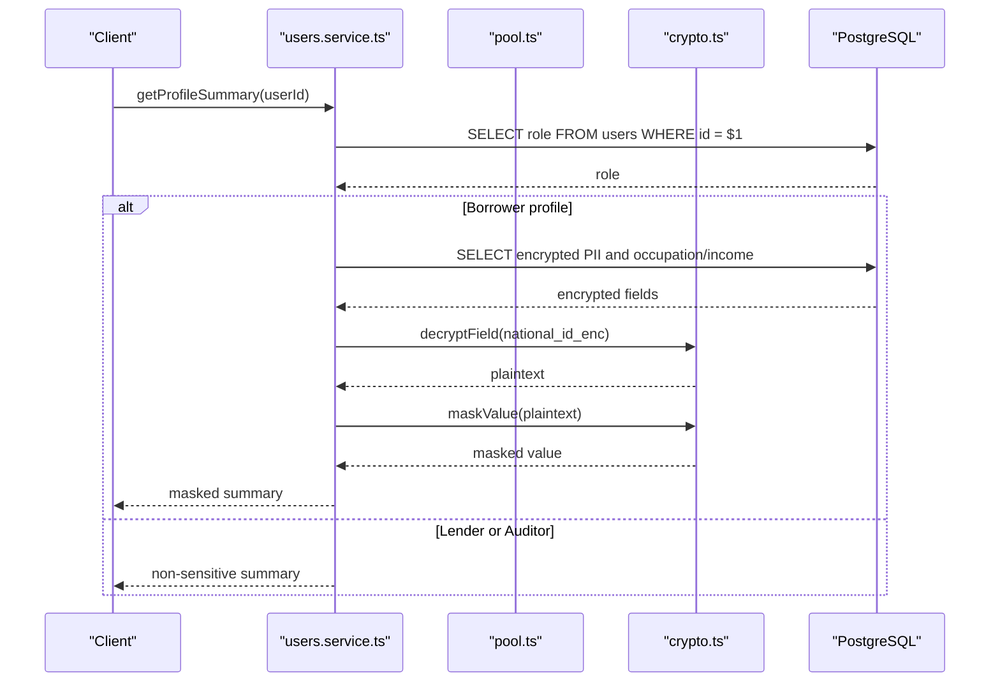
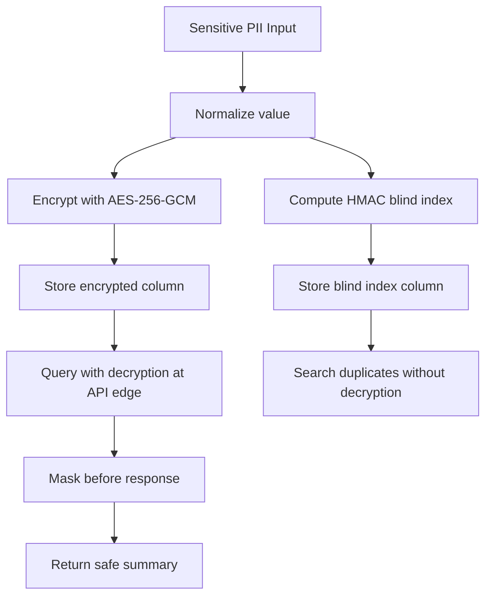
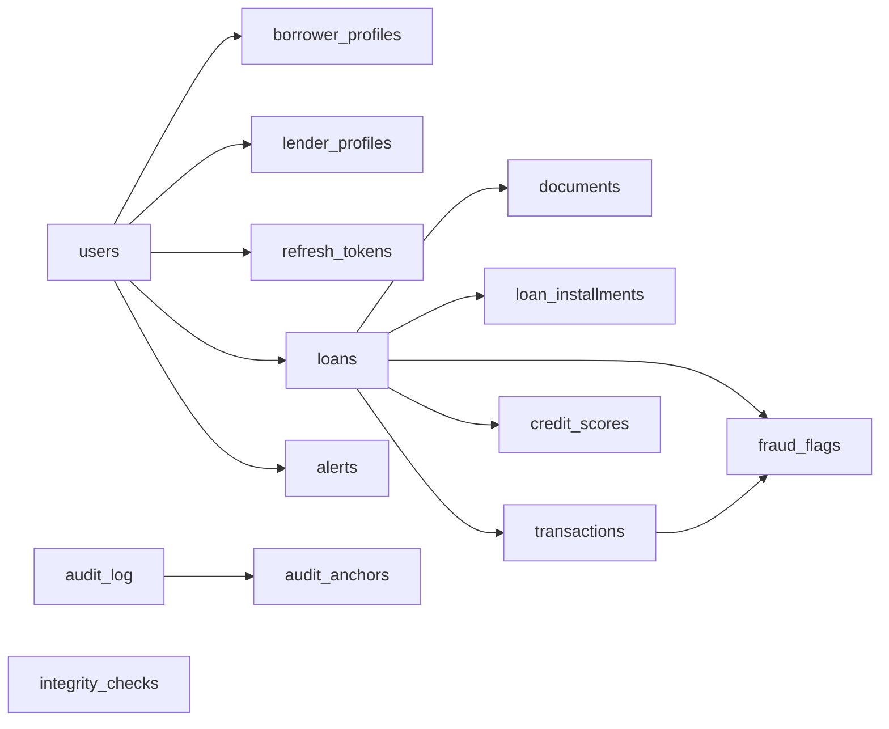

# Database Schema Design

<cite>
**Referenced Files in This Document**
- [001_core_auth.sql](file://backend/src/db/migrations/001_core_auth.sql)
- [002_loans.sql](file://backend/src/db/migrations/002_loans.sql)
- [003_transactions_scoring.sql](file://backend/src/db/migrations/003_transactions_scoring.sql)
- [004_fraud_audit.sql](file://backend/src/db/migrations/004_fraud_audit.sql)
- [pool.ts](file://backend/src/db/pool.ts)
- [migrate.ts](file://backend/src/db/migrate.ts)
- [users.service.ts](file://backend/src/modules/users/users.service.ts)
- [auth.service.ts](file://backend/src/modules/auth/auth.service.ts)
- [audit.service.ts](file://backend/src/modules/audit/audit.service.ts)
- [rules.engine.ts](file://backend/src/modules/fraud/rules.engine.ts)
- [chain.client.ts](file://backend/src/modules/ledger/chain.client.ts)
- [crypto.ts](file://backend/src/lib/crypto.ts)
</cite>

## Table of Contents
1. [Introduction](#introduction)
2. [Project Structure](#project-structure)
3. [Core Components](#core-components)
4. [Architecture Overview](#architecture-overview)
5. [Detailed Component Analysis](#detailed-component-analysis)
6. [Dependency Analysis](#dependency-analysis)
7. [Performance Considerations](#performance-considerations)
8. [Troubleshooting Guide](#troubleshooting-guide)
9. [Conclusion](#conclusion)
10. [Appendices](#appendices)

## Introduction
This document describes the SecureMicrofinance database schema and its operational design. It covers entity relationships among users, loans, transactions, audit logs, fraud flags, alerts, credit scores, and supporting tables. It also documents primary and foreign keys, indexes, constraints, data types, migration strategy, validation rules, access patterns, connection pooling, performance optimizations, retention and archival considerations, backup strategies, and security controls such as encryption at rest and access controls.

The schema is implemented as PostgreSQL SQL migrations and consumed by a Node.js backend that uses parameterized queries, an append-only hash-chained audit log, blind indexes for duplicate detection without decryption, and optional on-chain anchoring of transaction hashes and audit roots.

## Project Structure
The database schema is defined in four ordered SQL migration files under `backend/src/db/migrations`. Application code reads and writes through a shared connection pool and typed query helpers. Business logic modules interact with these tables to implement authentication, user profiles, loan lifecycle, transaction recording, scoring, fraud rules, alerts, and audit integrity.

**Diagram sources**
- [001_core_auth.sql:1-95](file://backend/src/db/migrations/001_core_auth.sql#L1-L95)
- [002_loans.sql:1-100](file://backend/src/db/migrations/002_loans.sql#L1-L100)
- [003_transactions_scoring.sql:1-56](file://backend/src/db/migrations/003_transactions_scoring.sql#L1-L56)
- [004_fraud_audit.sql:1-136](file://backend/src/db/migrations/004_fraud_audit.sql#L1-L136)
- [pool.ts:1-62](file://backend/src/db/pool.ts#L1-L62)
- [migrate.ts:1-70](file://backend/src/db/migrate.ts#L1-L70)
- [auth.service.ts:1-262](file://backend/src/modules/auth/auth.service.ts#L1-L262)
- [users.service.ts:1-60](file://backend/src/modules/users/users.service.ts#L1-L60)
- [rules.engine.ts:1-275](file://backend/src/modules/fraud/rules.engine.ts#L1-L275)
- [audit.service.ts:1-191](file://backend/src/modules/audit/audit.service.ts#L1-L191)
- [chain.client.ts:1-152](file://backend/src/modules/ledger/chain.client.ts#L1-L152)

**Section sources**
- [001_core_auth.sql:1-95](file://backend/src/db/migrations/001_core_auth.sql#L1-L95)
- [002_loans.sql:1-100](file://backend/src/db/migrations/002_loans.sql#L1-L100)
- [003_transactions_scoring.sql:1-56](file://backend/src/db/migrations/003_transactions_scoring.sql#L1-L56)
- [004_fraud_audit.sql:1-136](file://backend/src/db/migrations/004_fraud_audit.sql#L1-L136)
- [pool.ts:1-62](file://backend/src/db/pool.ts#L1-L62)
- [migrate.ts:1-70](file://backend/src/db/migrate.ts#L1-L70)

## Core Components
The database consists of five core domains:

- Identity and profiles: users, borrower_profiles, lender_profiles, refresh_tokens
- Loans and installments: loans, loan_installments, documents
- Transactions and scoring: transactions, credit_scores
- Fraud and alerts: fraud_flags, alerts
- Audit and integrity: audit_log, audit_anchors, integrity_checks

Key design principles:
- All identifiers are UUIDs except audit_log.id and audit_log.seq.
- Monetary amounts use integer cents stored as bigint to avoid floating-point rounding.
- Sensitive PII fields are encrypted at rest; blind indexes enable duplicate checks without decrypting rows.
- The audit_log table is append-only with per-row hashes forming a chain.
- Transactions may be anchored on-chain by storing only their canonical payload hash and metadata.

**Section sources**
- [001_core_auth.sql:17-95](file://backend/src/db/migrations/001_core_auth.sql#L17-L95)
- [002_loans.sql:25-100](file://backend/src/db/migrations/002_loans.sql#L25-L100)
- [003_transactions_scoring.sql:11-56](file://backend/src/db/migrations/003_transactions_scoring.sql#L11-L56)
- [004_fraud_audit.sql:21-136](file://backend/src/db/migrations/004_fraud_audit.sql#L21-L136)
- [crypto.ts:1-97](file://backend/src/lib/crypto.ts#L1-L97)

## Architecture Overview
The database is accessed exclusively via parameterized queries from the application layer. There is no ORM; SQL files are the source of truth. The migration runner applies each file once inside a transaction and records it in schema_migrations.

**Diagram sources**
- [migrate.ts:14-57](file://backend/src/db/migrate.ts#L14-L57)
- [pool.ts:1-14](file://backend/src/db/pool.ts#L1-L14)

At runtime, business services call into the database using `query`, `queryOne`, and `withTransaction` from the pool module. Authentication, profile retrieval, fraud rule evaluation, and audit logging all depend on this layer.

**Diagram sources**
- [auth.service.ts:1-262](file://backend/src/modules/auth/auth.service.ts#L1-L262)
- [users.service.ts:1-60](file://backend/src/modules/users/users.service.ts#L1-L60)
- [rules.engine.ts:1-275](file://backend/src/modules/fraud/rules.engine.ts#L1-L275)
- [audit.service.ts:1-191](file://backend/src/modules/audit/audit.service.ts#L1-L191)
- [pool.ts:27-57](file://backend/src/db/pool.ts#L27-L57)

## Detailed Component Analysis

### Entity Relationship Model
The following diagram shows the main entities and their relationships.

**Diagram sources**
- [001_core_auth.sql:17-95](file://backend/src/db/migrations/001_core_auth.sql#L17-L95)
- [002_loans.sql:25-100](file://backend/src/db/migrations/002_loans.sql#L25-L100)
- [003_transactions_scoring.sql:11-56](file://backend/src/db/migrations/003_transactions_scoring.sql#L11-L56)
- [004_fraud_audit.sql:21-136](file://backend/src/db/migrations/004_fraud_audit.sql#L21-L136)

### Data Types, Keys, Indexes, and Constraints

#### Identity and Sessions
- `users`:
  - Primary key: `id` (uuid).
  - Unique constraint: `email`.
  - Enumerations: `role`, `status`.
  - Security columns: `password_hash`, `failed_attempts`, `locked_until`, `last_login_at`.
  - Constraint: `users_email_lowercase` enforces lowercase emails.
  - Trigger: `updated_at` refreshed on update.
- `borrower_profiles`:
  - Primary key: `user_id` referencing `users(id)` with cascade delete.
  - Encrypted PII columns: `national_id_enc`, `phone_enc`, `date_of_birth_enc`, `address_enc`.
  - Blind index columns: `national_id_bi`, `phone_bi`.
  - Business constraint: `monthly_income_cents >= 0`.
  - JSONB column: `consent_flags`.
  - Indexes: `national_id_bi`, `phone_bi`.
- `lender_profiles`:
  - Primary key: `user_id` referencing `users(id)` with cascade delete.
  - Business constraints: `max_principal_cents > 0`, `default_rate_bps BETWEEN 0 AND 10000`, `default_penalty_bps_per_day >= 0`.
- `refresh_tokens`:
  - Primary key: `id` (uuid).
  - Unique token hash: `token_hash`.
  - Foreign keys: `user_id`, `replaced_by`.
  - Indexes: `user_id`, `family_id`.

**Section sources**
- [001_core_auth.sql:17-95](file://backend/src/db/migrations/001_core_auth.sql#L17-L95)

#### Loans and Documents
- `loans`:
  - Primary key: `id` (uuid).
  - Unique reference: `ref`.
  - Foreign keys: `lender_id`, `borrower_id`, `identity_verified_by`, `decided_by`, `agreement_doc_id`.
  - Enumerations: `status`, `frequency`.
  - Business constraints: positive principal and total repayable, bounded term count and rate basis points, distinct lender and borrower.
  - Encrypted guarantor fields: `guarantor_name_enc`, `guarantor_phone_enc`; `guarantor_credit` between 0 and 100.
  - Indexes: composite `(lender_id, status)`, `(borrower_id, created_at DESC)`, `status`.
- `loan_installments`:
  - Primary key: `id` (uuid).
  - Foreign key: `loan_id` with cascade delete.
  - Unique constraint: `(loan_id, seq)`.
  - Business constraints: non-negative due and paid amounts, positive sequence number.
  - Index: `(loan_id, due_date)`.
- `documents`:
  - Primary key: `id` (uuid).
  - Foreign key: `loan_id` with cascade delete.
  - Enum: `kind`.
  - Integrity: `sha256` stores content digest.
  - Index: `(loan_id, kind)`.

**Section sources**
- [002_loans.sql:25-100](file://backend/src/db/migrations/002_loans.sql#L25-L100)

#### Transactions and Credit Scores
- `transactions`:
  - Primary key: `id` (uuid).
  - Foreign key: `loan_id` with cascade delete.
  - Enumerations: `type`, `method`, `status`, `risk_level`.
  - Business constraints: positive amount, mobile money requires normalized code.
  - Fraud and ledger fields: `fraud_score`, `canonical_payload_hash`, `onchain_hash`, `onchain_tx_hash`, `onchain_block`, `onchain_recorded_at`, `verified_at`.
  - Indexes: `(loan_id, occurred_at DESC)`, `mobile_txn_code_norm`, `status`.
- `credit_scores`:
  - Primary key: `id` (uuid).
  - Foreign key: `loan_id` with cascade delete.
  - Enumerations: `model_source`, `risk_level`.
  - Business constraints: score between 0 and 100.
  - JSONB columns: `features`, `explanation`.
  - Index: `(loan_id, created_at DESC)`.

**Section sources**
- [003_transactions_scoring.sql:11-56](file://backend/src/db/migrations/003_transactions_scoring.sql#L11-L56)

#### Fraud Flags, Alerts, and Audit
- `fraud_flags`:
  - Primary key: `id` (uuid).
  - Optional foreign keys: `loan_id`, `transaction_id`, `borrower_id`.
  - Enumerations: `flag_type`, `severity`, `status`, `source`.
  - Deduplication: unique `dedupe_key`.
  - JSONB: `detail`.
  - Indexes: `(status, severity, detected_at DESC)`, `loan_id`.
- `alerts`:
  - Primary key: `id` (uuid).
  - Foreign key: `user_id` with cascade delete.
  - Index: `(user_id, created_at DESC)`.
- `audit_log`:
  - Primary key: `id` (bigserial), unique `seq`.
  - Append-only enforced by triggers blocking UPDATE, DELETE, and TRUNCATE.
  - Chain integrity: `prev_hash`, `row_hash`.
  - JSONB: `detail`.
  - Indexes: `(entity_type, entity_id, seq)`, `(actor_user_id, created_at DESC)`, `created_at DESC`, GIN on `detail`.
- `audit_anchors`:
  - Primary key: `id` (uuid).
  - Foreign key: `anchored_by`.
- `integrity_checks`:
  - Primary key: `id` (uuid).
  - Enumerations: `scope`, `result`.
  - JSONB: `detail`.
  - Index: `created_at DESC`.

**Section sources**
- [004_fraud_audit.sql:21-136](file://backend/src/db/migrations/004_fraud_audit.sql#L21-L136)

### Migration Strategy
Migrations are forward-only SQL files executed by `migrate.ts`. Each file runs inside its own transaction and is recorded in `schema_migrations`. If any statement fails, the transaction rolls back and the migration is not marked applied. A reset mode drops and recreates the public schema before applying migrations.

**Diagram sources**
- [migrate.ts:14-57](file://backend/src/db/migrate.ts#L14-L57)

**Section sources**
- [migrate.ts:1-70](file://backend/src/db/migrate.ts#L1-L70)

### Data Validation Rules and Business Constraints
- Email normalization and lowercasing are enforced both in application code and via a schema constraint.
- Monetary values are stored as integer cents with explicit non-negative or positive checks.
- Loan terms and rates are bounded within reasonable ranges.
- Mobile payment references are validated and normalized; malformed or forged patterns raise fraud flags.
- Duplicate mobile-money codes across transactions trigger fraud flags, with higher severity when reused across different loans.
- Rapid applications within a configurable time window raise flags based on thresholds.
- Duplicate disbursement attempts are flagged.
- Identity conflicts are detected using blind indexes without decrypting sensitive fields.
- Transaction statuses and fraud scores are constrained to valid ranges.
- Audit log mutations are blocked at the database level.

**Section sources**
- [001_core_auth.sql:17-95](file://backend/src/db/migrations/001_core_auth.sql#L17-L95)
- [002_loans.sql:25-100](file://backend/src/db/migrations/002_loans.sql#L25-L100)
- [003_transactions_scoring.sql:11-56](file://backend/src/db/migrations/003_transactions_scoring.sql#L11-L56)
- [004_fraud_audit.sql:21-136](file://backend/src/db/migrations/004_fraud_audit.sql#L21-L136)
- [rules.engine.ts:40-52](file://backend/src/modules/fraud/rules.engine.ts#L40-L52)
- [rules.engine.ts:94-143](file://backend/src/modules/fraud/rules.engine.ts#L94-L143)
- [rules.engine.ts:148-214](file://backend/src/modules/fraud/rules.engine.ts#L148-L214)
- [rules.engine.ts:216-275](file://backend/src/modules/fraud/rules.engine.ts#L216-L275)

### Data Access Patterns
- Parameterized queries are used everywhere to prevent SQL injection.
- A shared connection pool provides reusable connections with configured timeouts.
- `queryOne` returns a single row or null; `query` returns arrays of rows.
- `withTransaction` wraps operations in explicit BEGIN/COMMIT/ROLLBACK blocks.
- Profile retrieval decrypts sensitive fields at the API edge and masks them before returning responses.
- Authentication uses bcrypt hashing, generic error messages, account lockout, and audit logging.

**Diagram sources**
- [users.service.ts:19-59](file://backend/src/modules/users/users.service.ts#L19-L59)
- [crypto.ts:29-48](file://backend/src/lib/crypto.ts#L29-L48)
- [pool.ts:27-41](file://backend/src/db/pool.ts#L27-L41)

**Section sources**
- [pool.ts:1-62](file://backend/src/db/pool.ts#L1-L62)
- [users.service.ts:1-60](file://backend/src/modules/users/users.service.ts#L1-L60)
- [auth.service.ts:61-112](file://backend/src/modules/auth/auth.service.ts#L61-L112)
- [auth.service.ts:114-198](file://backend/src/modules/auth/auth.service.ts#L114-L198)

### Connection Pooling Configuration
- Pool size: maximum 10 connections.
- Idle timeout: 30 seconds.
- Connection timeout: 10 seconds.
- Error handling: idle client errors are logged without crashing the process.
- Type parsing: bigint and numeric types are parsed to JavaScript numbers for clean JSON output.
- Transaction helper: ensures rollback on failure and releases clients.

**Section sources**
- [pool.ts:9-14](file://backend/src/db/pool.ts#L9-L14)
- [pool.ts:16-25](file://backend/src/db/pool.ts#L16-L25)
- [pool.ts:44-57](file://backend/src/db/pool.ts#L44-L57)

### Performance Optimizations
- Composite indexes support common query patterns:
  - Loans by lender and status.
  - Loans by borrower and creation time.
  - Installments by loan and due date.
  - Transactions by loan and occurrence time.
  - Fraud flags by status, severity, and detection time.
  - Alerts by user and creation time.
  - Audit log by entity and sequence, actor and time, and creation time.
- GIN index on audit_log.detail enables efficient JSONB searches.
- Blind indexes allow duplicate checks without decrypting sensitive columns.
- Enumerations reduce storage and improve query readability.
- Integer cents avoid floating-point precision issues and simplify comparisons.
- On-chain anchoring stores only hashes and timestamps, keeping off-chain payloads compact.

**Section sources**
- [002_loans.sql:58-60](file://backend/src/db/migrations/002_loans.sql#L58-L60)
- [002_loans.sql:82](file://backend/src/db/migrations/002_loans.sql#L82)
- [003_transactions_scoring.sql:37-39](file://backend/src/db/migrations/003_transactions_scoring.sql#L37-L39)
- [004_fraud_audit.sql:40-41](file://backend/src/db/migrations/004_fraud_audit.sql#L40-L41)
- [004_fraud_audit.sql:56](file://backend/src/db/migrations/004_fraud_audit.sql#L56)
- [004_fraud_audit.sql:88-91](file://backend/src/db/migrations/004_fraud_audit.sql#L88-L91)
- [001_core_auth.sql:57-58](file://backend/src/db/migrations/001_core_auth.sql#L57-L58)

### Data Retention Policies, Backup Strategies, and Archival Procedures
The repository does not define automated retention, backup, or archival policies in the database schema or migration scripts. Operational procedures should be implemented outside the schema, for example:

- Retention:
  - Define separate retention windows for active loans, historical loans, transactions, audit logs, and alerts.
  - Use scheduled jobs to archive old rows into partitioned or cold-storage tables.
- Archival:
  - Move expired audit_log rows to an archive table while preserving chain integrity by computing new anchors.
  - Compress archived documents and remove live file paths after successful archival.
- Backups:
  - Schedule regular logical backups of the database and object storage containing documents.
  - Include configuration secrets separately and ensure they are not included in database dumps.
- Compliance:
  - Implement data subject requests by masking or deleting PII where permitted, while preserving required audit trails.

[No sources needed since this section provides general guidance]

### Data Security Measures
- Encryption at rest:
  - AES-256-GCM field-level encryption for sensitive borrower and guarantor data.
  - Versioned ciphertext format supports future key rotation.
- Blind indexes:
  - HMAC-SHA256 blind indexes detect duplicate national IDs and phones without exposing plaintext.
- Authentication security:
  - bcrypt hashing with configurable cost.
  - Generic error messages prevent account enumeration.
  - Account lockout after repeated failures.
  - Refresh tokens store only SHA-256 hashes; token families support rotation.
- Audit integrity:
  - Append-only audit_log with per-row hashes and previous-hash linkage.
  - Database triggers block updates, deletes, and truncation.
  - Advisory lock serializes concurrent writers to maintain chain order.
  - Optional on-chain anchoring of audit root hashes.
- Transport and input security:
  - Parameterized queries eliminate SQL injection risks.
  - Timing-safe comparison utilities for opaque tokens and hashes.

**Diagram sources**
- [crypto.ts:29-48](file://backend/src/lib/crypto.ts#L29-L48)
- [crypto.ts:50-77](file://backend/src/lib/crypto.ts#L50-L77)
- [crypto.ts:79-84](file://backend/src/lib/crypto.ts#L79-L84)
- [users.service.ts:43-59](file://backend/src/modules/users/users.service.ts#L43-L59)

**Section sources**
- [crypto.ts:1-97](file://backend/src/lib/crypto.ts#L1-L97)
- [auth.service.ts:15-24](file://backend/src/modules/auth/auth.service.ts#L15-L24)
- [auth.service.ts:61-112](file://backend/src/modules/auth/auth.service.ts#L61-L112)
- [auth.service.ts:114-198](file://backend/src/modules/auth/auth.service.ts#L114-L198)
- [004_fraud_audit.sql:58-111](file://backend/src/db/migrations/004_fraud_audit.sql#L58-L111)
- [audit.service.ts:34-94](file://backend/src/modules/audit/audit.service.ts#L34-L94)

## Dependency Analysis
The database schema has clear dependency boundaries:

- Identity depends on nothing except built-in functions and sequences.
- Profiles depend on users.
- Loans depend on users and optionally documents.
- Installments and transactions depend on loans.
- Credit scores depend on loans.
- Fraud flags depend on loans, transactions, and users.
- Alerts depend on users.
- Audit structures are self-contained but referenced by business operations.

**Diagram sources**
- [001_core_auth.sql:17-95](file://backend/src/db/migrations/001_core_auth.sql#L17-L95)
- [002_loans.sql:25-100](file://backend/src/db/migrations/002_loans.sql#L25-L100)
- [003_transactions_scoring.sql:11-56](file://backend/src/db/migrations/003_transactions_scoring.sql#L11-L56)
- [004_fraud_audit.sql:21-136](file://backend/src/db/migrations/004_fraud_audit.sql#L21-L136)

**Section sources**
- [001_core_auth.sql:17-95](file://backend/src/db/migrations/001_core_auth.sql#L17-L95)
- [002_loans.sql:25-100](file://backend/src/db/migrations/002_loans.sql#L25-L100)
- [003_transactions_scoring.sql:11-56](file://backend/src/db/migrations/003_transactions_scoring.sql#L11-L56)
- [004_fraud_audit.sql:21-136](file://backend/src/db/migrations/004_fraud_audit.sql#L21-L136)

## Performance Considerations
- Prefer indexed lookups:
  - Use `(lender_id, status)` for lender dashboards.
  - Use `(borrower_id, created_at DESC)` for borrower history.
  - Use `(loan_id, due_date)` for installment scheduling.
  - Use `(loan_id, occurred_at DESC)` for transaction timelines.
  - Use `(status, severity, detected_at DESC)` for fraud triage.
- Avoid decrypting large volumes of PII; rely on blind indexes for duplicate checks.
- Keep audit_log writes minimal and batched where possible; the advisory lock serializes inserts.
- Monitor on-chain anchoring costs; anchor only when necessary and cache chain status.
- Tune pool settings according to workload: increase `max` if connection saturation occurs, adjust timeouts for slow networks.

[No sources needed since this section provides general guidance]

## Troubleshooting Guide
Common issues and diagnostics:

- Migration failures:
  - Check which migration failed and inspect the SQL file.
  - Use reset mode carefully; it drops and recreates the schema.
- Authentication problems:
  - Verify bcrypt cost configuration and account status.
  - Inspect audit_log for login attempts and lockout events.
- Duplicate transaction codes:
  - Review fraud_flags for `duplicate_txn_code` and check whether reuse is cross-loan.
  - Validate mobile_txn_code normalization and pattern checks.
- Audit chain integrity:
  - Run chain verification to detect broken links or hash mismatches.
  - Confirm that audit_log triggers are active and no manual edits occurred.
- Blockchain anchoring:
  - Check chain mode and contract address configuration.
  - Verify RPC connectivity and private key availability.

**Section sources**
- [migrate.ts:48-51](file://backend/src/db/migrate.ts#L48-L51)
- [auth.service.ts:150-177](file://backend/src/modules/auth/auth.service.ts#L150-L177)
- [rules.engine.ts:173-214](file://backend/src/modules/fraud/rules.engine.ts#L173-L214)
- [audit.service.ts:142-190](file://backend/src/modules/audit/audit.service.ts#L142-L190)
- [chain.client.ts:24-41](file://backend/src/modules/ledger/chain.client.ts#L24-L41)

## Conclusion
The SecureMicrofinance database schema implements a secure, auditable, and extensible foundation for microfinance operations. It separates concerns across identity, loans, transactions, fraud, and audit domains while enforcing strong validation, encryption, and immutability guarantees. The migration-driven approach keeps the schema reviewable and deterministic. Operational enhancements should add retention, backup, and archival automation, and tune performance based on production metrics.

[No sources needed since this section summarizes without analyzing specific files]

## Appendices

### Appendix A: Key Tables Summary

- Identity and sessions:
  - `users`: core account record with role, status, and lockout state.
  - `borrower_profiles`: encrypted PII and blind indexes.
  - `lender_profiles`: lending parameters and limits.
  - `refresh_tokens`: hashed token storage with family rotation.
- Loans and related data:
  - `loans`: loan lifecycle and decision metadata.
  - `loan_installments`: repayment schedule and partial payments.
  - `documents`: agreements and forensic reports with content hashes.
- Transactions and scoring:
  - `transactions`: money movements with fraud scores and on-chain linkage.
  - `credit_scores`: advisory model outputs and explanations.
- Fraud and alerts:
  - `fraud_flags`: deterministic and ML-derived flags with deduplication.
  - `alerts`: in-app notifications for lenders and operators.
- Audit and integrity:
  - `audit_log`: append-only, hash-chained audit trail.
  - `audit_anchors`: periodic chain roots anchored on-chain.
  - `integrity_checks`: results of chain and data integrity scans.

**Section sources**
- [001_core_auth.sql:17-95](file://backend/src/db/migrations/001_core_auth.sql#L17-L95)
- [002_loans.sql:25-100](file://backend/src/db/migrations/002_loans.sql#L25-L100)
- [003_transactions_scoring.sql:11-56](file://backend/src/db/migrations/003_transactions_scoring.sql#L11-L56)
- [004_fraud_audit.sql:21-136](file://backend/src/db/migrations/004_fraud_audit.sql#L21-L136)