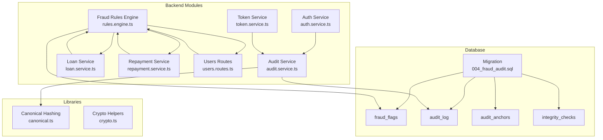
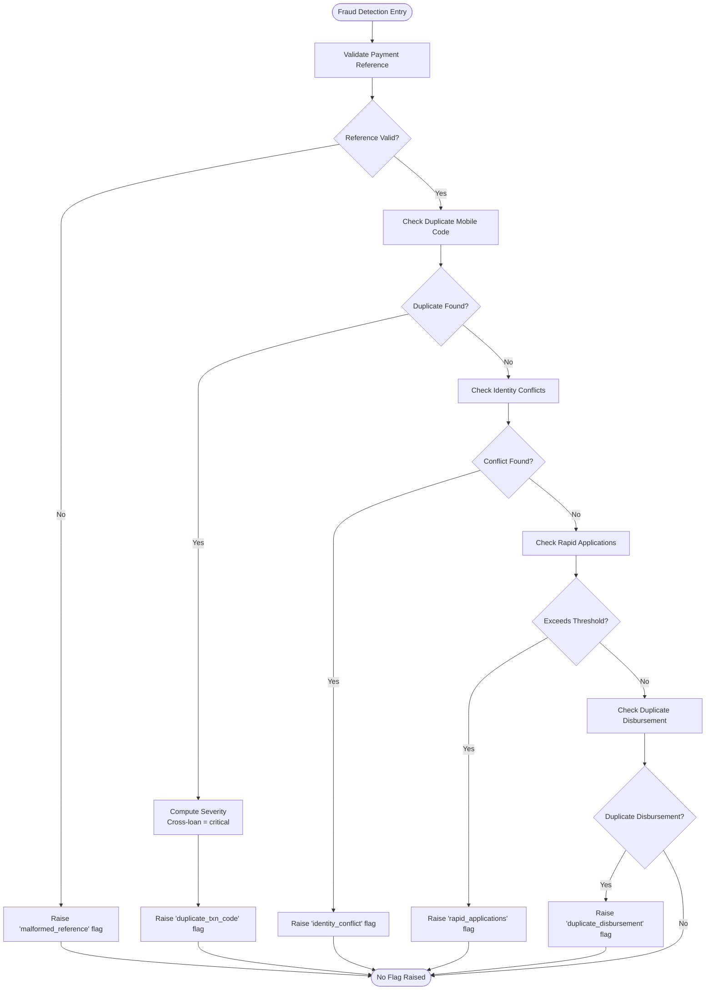
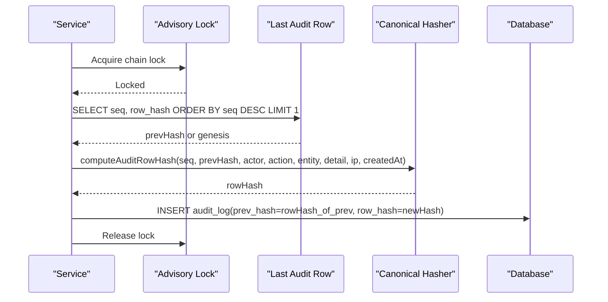
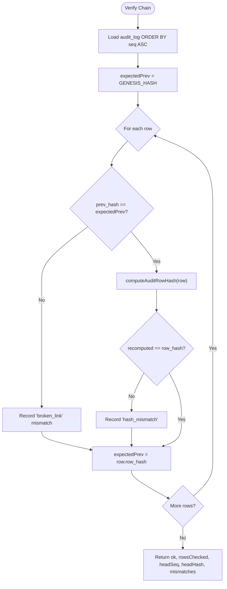
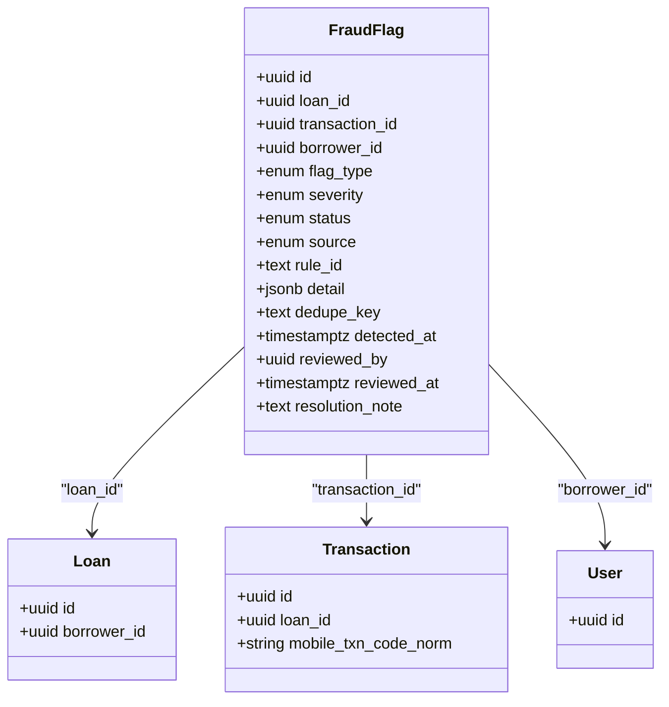
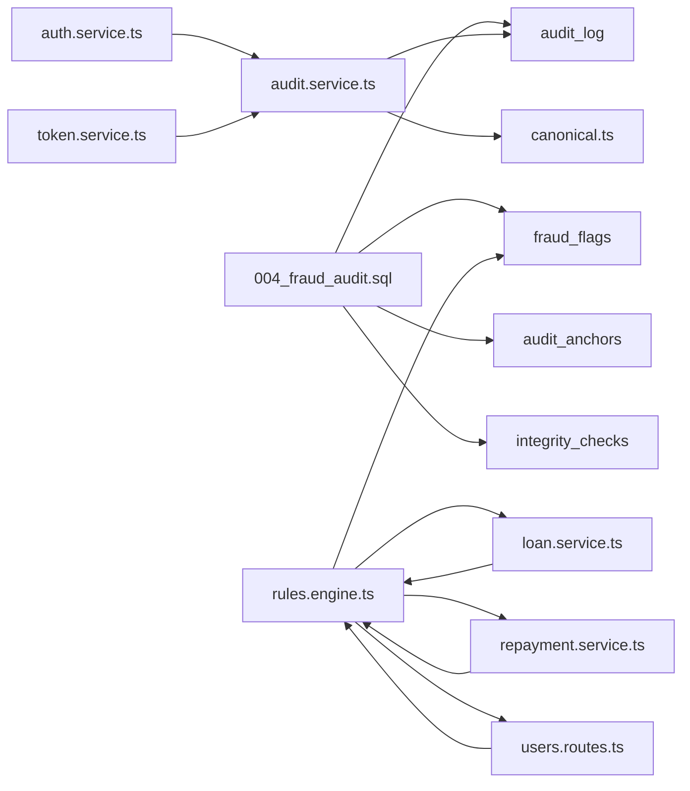

# Fraud Detection & Audit Schema

<cite>
**Referenced Files in This Document**
- [004_fraud_audit.sql](file://backend/src/db/migrations/004_fraud_audit.sql)
- [rules.engine.ts](file://backend/src/modules/fraud/rules.engine.ts)
- [audit.service.ts](file://backend/src/modules/audit/audit.service.ts)
- [canonical.ts](file://backend/src/lib/canonical.ts)
- [crypto.ts](file://backend/src/lib/crypto.ts)
- [loan.service.ts](file://backend/src/modules/loans/loan.service.ts)
- [repayment.service.ts](file://backend/src/modules/repayments/repayment.service.ts)
- [users.routes.ts](file://backend/src/modules/users/users.routes.ts)
- [auth.service.ts](file://backend/src/modules/auth/auth.service.ts)
- [token.service.ts](file://backend/src/modules/auth/token.service.ts)
- [seed.ts](file://backend/src/db/seed.ts)
</cite>

## Table of Contents
1. [Introduction](#introduction)
2. [Project Structure](#project-structure)
3. [Core Components](#core-components)
4. [Architecture Overview](#architecture-overview)
5. [Detailed Component Analysis](#detailed-component-analysis)
6. [Dependency Analysis](#dependency-analysis)
7. [Performance Considerations](#performance-considerations)
8. [Troubleshooting Guide](#troubleshooting-guide)
9. [Conclusion](#conclusion)
10. [Appendices](#appendices)

## Introduction
This document describes the fraud detection and audit schema used by the platform. It focuses on:
- The fraud flags table structure, including anomaly detection results, severity levels, and investigation status.
- The append-only audit logs table with cryptographic hash chains for integrity verification and forensic analysis support.
- How fraud detection results are linked to loans, transactions, and user activities.
- The audit trail generation process and hash chain verification mechanism.
- Data retention considerations and compliance-oriented design choices.
- Examples of fraud detection workflows and audit log analysis queries.

The goal is to make the schema and its surrounding logic understandable to both technical readers and auditors who need to reconstruct events, verify integrity, and investigate suspicious activity.

## Project Structure
The fraud and audit functionality spans database migrations, rule-based fraud detection, audit logging, and supporting cryptographic utilities.



**Diagram sources**
- [004_fraud_audit.sql:21-135](file://backend/src/db/migrations/004_fraud_audit.sql#L21-L135)
- [rules.engine.ts:54-92](file://backend/src/modules/fraud/rules.engine.ts#L54-L92)
- [audit.service.ts:37-94](file://backend/src/modules/audit/audit.service.ts#L37-L94)
- [canonical.ts:101-121](file://backend/src/lib/canonical.ts#L101-L121)

**Section sources**
- [004_fraud_audit.sql:1-136](file://backend/src/db/migrations/004_fraud_audit.sql#L1-L136)
- [rules.engine.ts:1-275](file://backend/src/modules/fraud/rules.engine.ts#L1-L275)
- [audit.service.ts:1-191](file://backend/src/modules/audit/audit.service.ts#L1-L191)
- [canonical.ts:1-122](file://backend/src/lib/canonical.ts#L1-L122)

## Core Components
This section documents the core data model and processing components that implement fraud detection and audit integrity.

### Fraud Flags Model
The fraud flags table records anomaly detection results from rules and machine learning. Each flag links to a loan, transaction, or borrower and includes structured metadata for investigation.

| Column | Type / Constraint | Purpose |
|---|---|---|
| `id` | `uuid`, primary key | Stable identifier for the flag record. |
| `loan_id` | `uuid`, references `loans(id)` | Links the flag to a specific loan. |
| `transaction_id` | `uuid`, references `transactions(id)` | Links the flag to a specific transaction when applicable. |
| `borrower_id` | `uuid`, references `users(id)` | Identifies the borrower associated with the flag. |
| `flag_type` | Enum | Anomaly category such as duplicate mobile-money receipt, malformed reference, identity conflict, rapid applications, ML anomaly, duplicate disbursement, or hash mismatch. |
| `severity` | Enum | Risk level: low, medium, high, critical. |
| `status` | Enum | Investigation lifecycle: open, cleared, confirmed. Default is open. |
| `source` | Enum | Origin of the flag: rule engine or ML system. |
| `rule_id` | Text | Identifier of the rule or detector that produced the flag. |
| `detail` | JSONB | Explainable context for auditors, including matched values, counts, and related IDs. |
| `dedupe_key` | Text, unique | Natural key preventing duplicate reports of the same issue. |
| `detected_at` | Timestamp with timezone | When the flag was created. |
| `reviewed_by` | `uuid`, references `users(id)` | Auditor or reviewer who acted on the flag. |
| `reviewed_at` | Timestamp with timezone | When the flag was reviewed. |
| `resolution_note` | Text | Human-readable resolution or decision note. |

Indexes:
- `(status, severity, detected_at DESC)` supports prioritized review queues.
- `(loan_id)` supports per-loan investigations.

Alerts:
- A separate alerts table notifies lenders about significant fraud events. Alerts include severity, title, body, entity type, entity ID, and read tracking.

**Section sources**
- [004_fraud_audit.sql:5-56](file://backend/src/db/migrations/004_fraud_audit.sql#L5-L56)

### Append-Only Audit Log Model
The audit log provides an immutable, cryptographically chained record of system actions.

| Column | Type / Constraint | Purpose |
|---|---|---|
| `id` | Big serial, primary key | Internal row identifier. |
| `seq` | Bigint, unique | Monotonic sequence number used for ordering and chain linking. |
| `actor_user_id` | `uuid`, nullable | User performing the action. |
| `actor_role` | Text, nullable | Role of the actor (e.g., lender, auditor). |
| `action` | Text | Semantic action name (e.g., repayment.held, profile.update). |
| `entity_type` | Text | Domain entity being audited (e.g., transaction, borrower_profile). |
| `entity_id` | Text, nullable | Identifier of the affected entity. |
| `ip` | Inet, nullable | Client IP address. |
| `user_agent` | Text, nullable | Browser or client user agent. |
| `request_id` | Text, nullable | Correlation ID for distributed tracing. |
| `before_hash` | Char(64), nullable | Hash of the state before the change. |
| `after_hash` | Char(64), nullable | Hash of the state after the change. |
| `detail` | JSONB | Additional structured context. |
| `prev_hash` | Char(64) | Previous row’s `row_hash`; forms the chain. |
| `row_hash` | Char(64), unique | Deterministic hash of this row’s canonical payload. |
| `created_at` | Timestamp with timezone | Creation time. |

Integrity protections:
- Database triggers block UPDATE, DELETE, and TRUNCATE operations on `audit_log`.
- Advisory transaction locks serialize concurrent writers so the chain does not fork.
- Per-row hashes and previous-hash links enable tamper detection.

Chain anchors and integrity checks:
- `audit_anchors` stores checkpoints of the chain head, optionally anchored to an external ledger.
- `integrity_checks` records periodic integrity scans, including scope, target, mismatches, and result.

**Section sources**
- [004_fraud_audit.sql:67-135](file://backend/src/db/migrations/004_fraud_audit.sql#L67-L135)

### Cryptographic Hash Chain Utilities
Hash computation is deterministic and canonical:
- Canonical JSON serialization ensures stable hashing regardless of object key order.
- Audit row hashes incorporate sequence, previous hash, actor, action, entity, detail hash, IP, and creation timestamp.
- Genesis hash initializes the chain.

Transaction payloads are also hashed deterministically for on-chain anchoring, though personal data is not included in the payload.

**Section sources**
- [canonical.ts:12-24](file://backend/src/lib/canonical.ts#L12-L24)
- [canonical.ts:44-60](file://backend/src/lib/canonical.ts#L44-L60)
- [canonical.ts:101-121](file://backend/src/lib/canonical.ts#L101-L121)

### Rule-Based Fraud Detection
The rule engine produces explainable flags:
- Duplicate mobile-money receipts across transactions or loans.
- Malformed or forged payment references.
- Identity conflicts using blind indexes for national ID and phone number comparisons.
- Rapid repeated loan applications within a configured window.
- Duplicate disbursement attempts for the same loan.
- Optional ML anomaly flags.

Each rule constructs a `FlagDraft` with type, severity, source, rule ID, related entities, detail, and deduplication key. Flags are inserted with idempotency via `dedupe_key`. High-severity cross-loan duplicates can trigger lender alerts.

**Section sources**
- [rules.engine.ts:11-32](file://backend/src/modules/fraud/rules.engine.ts#L11-L32)
- [rules.engine.ts:54-92](file://backend/src/modules/fraud/rules.engine.ts#L54-L92)
- [rules.engine.ts:98-143](file://backend/src/modules/fraud/rules.engine.ts#L98-L143)
- [rules.engine.ts:148-214](file://backend/src/modules/fraud/rules.engine.ts#L148-L214)
- [rules.engine.ts:217-274](file://backend/src/modules/fraud/rules.engine.ts#L217-L274)

### Audit Trail Generation
Audit entries are written through a service that:
- Acquires an advisory lock to serialize writes.
- Reads the last audit row to obtain the previous hash.
- Computes a new sequence number and timestamp.
- Computes the row hash using canonical hashing.
- Inserts the audit row with all contextual fields.

Convenience wrappers capture request context (actor, role, IP, user agent, request ID) automatically.

**Section sources**
- [audit.service.ts:37-94](file://backend/src/modules/audit/audit.service.ts#L37-L94)
- [audit.service.ts:97-118](file://backend/src/modules/audit/audit.service.ts#L97-L118)

## Architecture Overview
The fraud detection and audit architecture combines rule engines, services, and database constraints to ensure detectability, explainability, and integrity.

```mermaid
sequenceDiagram
participant Client as "Client"
participant LoanSvc as "Loan Service"
participant RepaySvc as "Repayment Service"
participant UsersRoutes as "Users Routes"
participant Fraud as "Fraud Rules Engine"
participant DB as "Database"
participant Audit as "Audit Service"
Client->>LoanSvc : Create loan
LoanSvc->>Fraud : detectRapidApplications()
Fraud->>DB : Insert fraud_flags
LoanSvc->>Audit : auditRequest("loan.create")
Client->>RepaySvc : Submit repayment
RepaySvc->>Fraud : detectReferenceIssues()
Fraud->>DB : Insert fraud_flags
RepaySvc->>Audit : auditRequest("repayment.held")
Client->>UsersRoutes : Update profile
UsersRoutes->>Fraud : detectIdentityConflicts()
Fraud->>DB : Insert fraud_flags
UsersRoutes->>Audit : auditRequest("profile.update")
Note over DB,Audit : Triggers enforce append-only; service computes hash chain
```

**Diagram sources**
- [loan.service.ts:340-340](file://backend/src/modules/loans/loan.service.ts#L340-L340)
- [repayment.service.ts:148-158](file://backend/src/modules/repayments/repayment.service.ts#L148-L158)
- [users.routes.ts:69-103](file://backend/src/modules/users/users.routes.ts#L69-L103)
- [rules.engine.ts:217-274](file://backend/src/modules/fraud/rules.engine.ts#L217-L274)
- [audit.service.ts:97-118](file://backend/src/modules/audit/audit.service.ts#L97-L118)

## Detailed Component Analysis

### Fraud Flags Table Structure and Workflows
The fraud flags table captures anomaly detection results with rich metadata:
- Linkage:
  - `loan_id` connects flags to loans.
  - `transaction_id` connects flags to transactions.
  - `borrower_id` connects flags to users.
- Classification:
  - `flag_type` categorizes anomalies.
  - `severity` indicates risk level.
  - `source` distinguishes rule vs ML detections.
- Investigation:
  - `status` tracks lifecycle: open, cleared, confirmed.
  - `reviewed_by`, `reviewed_at`, and `resolution_note` support investigator workflow.
- Deduplication:
  - `dedupe_key` prevents duplicate reporting of the same issue.

Example fraud detection workflows:
- Duplicate mobile-money receipt:
  - Detects reuse of the same normalized code across transactions.
  - Cross-loan reuse raises critical severity and may alert the lender.
- Malformed reference:
  - Validates receipt format and known forged patterns.
- Identity conflict:
  - Compares blind indexes for national ID and phone number to find duplicate identities.
- Rapid applications:
  - Counts recent loans per borrower within a configurable window.
- Duplicate disbursement:
  - Prevents multiple disbursements for the same loan.



**Diagram sources**
- [rules.engine.ts:148-214](file://backend/src/modules/fraud/rules.engine.ts#L148-L214)
- [rules.engine.ts:98-143](file://backend/src/modules/fraud/rules.engine.ts#L98-L143)
- [rules.engine.ts:217-274](file://backend/src/modules/fraud/rules.engine.ts#L217-L274)

**Section sources**
- [004_fraud_audit.sql:21-56](file://backend/src/db/migrations/004_fraud_audit.sql#L21-L56)
- [rules.engine.ts:54-92](file://backend/src/modules/fraud/rules.engine.ts#L54-L92)
- [rules.engine.ts:98-274](file://backend/src/modules/fraud/rules.engine.ts#L98-L274)

### Audit Logs Table and Hash Chain Verification
The audit log enforces immutability and integrity:
- Append-only enforcement:
  - Database triggers prevent updates, deletes, and truncates.
- Hash chain:
  - Each row stores `prev_hash` and `row_hash`.
  - `row_hash` is computed deterministically from canonical fields.
- Concurrency control:
  - Advisory transaction lock serializes writers to avoid chain forks.
- Verification:
  - Recomputes every row hash and validates each link against expected previous hash.
  - Reports mismatches and broken links.



**Diagram sources**
- [audit.service.ts:37-94](file://backend/src/modules/audit/audit.service.ts#L37-L94)
- [canonical.ts:101-121](file://backend/src/lib/canonical.ts#L101-L121)

Verification flow:



**Diagram sources**
- [audit.service.ts:142-190](file://backend/src/modules/audit/audit.service.ts#L142-L190)
- [canonical.ts:121-121](file://backend/src/lib/canonical.ts#L121-L121)

**Section sources**
- [004_fraud_audit.sql:67-135](file://backend/src/db/migrations/004_fraud_audit.sql#L67-L135)
- [audit.service.ts:37-94](file://backend/src/modules/audit/audit.service.ts#L37-L94)
- [audit.service.ts:142-190](file://backend/src/modules/audit/audit.service.ts#L142-L190)
- [canonical.ts:101-121](file://backend/src/lib/canonical.ts#L101-L121)

### Linking Fraud Results to Transactions and User Activities
Fraud flags connect to business entities:
- Loans:
  - `loan_id` ties flags to loan-level risks like rapid applications or duplicate disbursements.
- Transactions:
  - `transaction_id` ties flags to payment issues like duplicate receipts or malformed references.
- Users:
  - `borrower_id` ties flags to identity-related risks.

Integration points:
- Loan creation triggers rapid application checks.
- Repayment creation triggers reference validation and potential holds.
- Profile updates trigger identity conflict checks using blind indexes.



**Diagram sources**
- [004_fraud_audit.sql:21-38](file://backend/src/db/migrations/004_fraud_audit.sql#L21-L38)
- [rules.engine.ts:148-214](file://backend/src/modules/fraud/rules.engine.ts#L148-L214)
- [rules.engine.ts:217-274](file://backend/src/modules/fraud/rules.engine.ts#L217-L274)

**Section sources**
- [loan.service.ts:340-340](file://backend/src/modules/loans/loan.service.ts#L340-L340)
- [repayment.service.ts:148-158](file://backend/src/modules/repayments/repayment.service.ts#L148-L158)
- [users.routes.ts:69-103](file://backend/src/modules/users/users.routes.ts#L69-L103)

### Audit Trail Generation Process
Audit trail generation occurs throughout the application:
- Authentication flows record login, registration, password changes, and token operations.
- Loan and repayment services record domain actions.
- User profile updates are audited.
- Seed scripts can insert initial audit entries.

The audit service abstracts context capture and hash chain insertion.

**Section sources**
- [auth.service.ts:88-250](file://backend/src/modules/auth/auth.service.ts#L88-L250)
- [token.service.ts:118-133](file://backend/src/modules/auth/token.service.ts#L118-L133)
- [loan.service.ts:10-10](file://backend/src/modules/loans/loan.service.ts#L10-L10)
- [repayment.service.ts:6-6](file://backend/src/modules/repayments/repayment.service.ts#L6-L6)
- [users.routes.ts:15-15](file://backend/src/modules/users/users.routes.ts#L15-L15)
- [seed.ts:4-120](file://backend/src/db/seed.ts#L4-L120)

## Dependency Analysis
The fraud and audit subsystem has clear dependencies:
- Database migration defines schema and constraints.
- Fraud rules depend on configuration and query helpers.
- Audit service depends on canonical hashing and request context.
- Business services integrate fraud detection and audit logging.



**Diagram sources**
- [004_fraud_audit.sql:21-135](file://backend/src/db/migrations/004_fraud_audit.sql#L21-L135)
- [rules.engine.ts:1-275](file://backend/src/modules/fraud/rules.engine.ts#L1-L275)
- [audit.service.ts:1-191](file://backend/src/modules/audit/audit.service.ts#L1-L191)
- [canonical.ts:1-122](file://backend/src/lib/canonical.ts#L1-L122)

**Section sources**
- [rules.engine.ts:1-275](file://backend/src/modules/fraud/rules.engine.ts#L1-L275)
- [audit.service.ts:1-191](file://backend/src/modules/audit/audit.service.ts#L1-L191)
- [canonical.ts:1-122](file://backend/src/lib/canonical.ts#L1-L122)

## Performance Considerations
- Indexes on `fraud_flags(status, severity, detected_at DESC)` and `fraud_flags(loan_id)` optimize review queues and per-loan investigations.
- GIN index on `audit_log(detail)` enables efficient JSONB queries for forensic searches.
- Advisory transaction locks serialize audit inserts, preventing chain forks at the cost of serialized writes.
- Canonical hashing avoids expensive non-deterministic serialization but adds CPU overhead for large detail objects.
- Blind indexes allow duplicate detection without decrypting sensitive fields, improving performance and privacy.

[No sources needed since this section provides general guidance]

## Troubleshooting Guide
Common issues and resolutions:
- Broken audit chain:
  - Verify `prev_hash` continuity and recompute `row_hash` for each row.
  - Use the chain verification function to identify mismatches and broken links.
- Duplicate fraud flags:
  - Ensure `dedupe_key` uniqueness; check existing flags before raising new ones.
- Lender alerts not received:
  - Confirm lender association with the loan and alert insertion logic.
- Identity conflict false positives:
  - Validate normalization of blind indexes for national ID and phone number.

Operational queries and examples:
- Find open high-severity fraud flags for a loan:
  - Query `fraud_flags` where `loan_id` matches, `status = 'open'`, and `severity IN ('high', 'critical')`.
- Investigate a transaction’s fraud history:
  - Join `fraud_flags` with `transactions` on `transaction_id` and filter by transaction ID.
- Reconstruct user activity timeline:
  - Query `audit_log` filtered by `actor_user_id` or `entity_id`, ordered by `seq`.
- Verify audit integrity:
  - Run chain verification and inspect mismatches list.

**Section sources**
- [004_fraud_audit.sql:40-41](file://backend/src/db/migrations/004_fraud_audit.sql#L40-L41)
- [004_fraud_audit.sql:88-91](file://backend/src/db/migrations/004_fraud_audit.sql#L88-L91)
- [rules.engine.ts:54-92](file://backend/src/modules/fraud/rules.engine.ts#L54-L92)
- [audit.service.ts:142-190](file://backend/src/modules/audit/audit.service.ts#L142-L190)

## Conclusion
The fraud detection and audit schema provides a robust foundation for detecting suspicious activity, investigating anomalies, and maintaining verifiable audit trails. Key strengths include:
- Explainable, deterministic fraud rules with rich metadata.
- Clear linkage between flags, loans, transactions, and users.
- Append-only audit logs with cryptographic hash chains enforced by database triggers and application logic.
- Integrity verification tools for forensic analysis and compliance reporting.

To maintain compliance and operational reliability:
- Regularly run chain verification and integrity checks.
- Monitor high-severity flags and lender alerts.
- Enforce data retention policies for audit records and fraud flags.
- Keep blind indexes and encryption keys secure and rotated according to policy.

[No sources needed since this section summarizes without analyzing specific files]

## Appendices

### Data Retention Policies and Compliance Notes
- Audit logs should be retained for the period required by regulatory obligations and internal policy.
- Integrity checks should be scheduled periodically and results recorded in `integrity_checks`.
- Sensitive fields use field-level encryption and blind indexes to protect PII while enabling necessary comparisons.
- On-chain anchoring of transaction hashes and audit chain roots supports external verification without exposing raw data.

**Section sources**
- [004_fraud_audit.sql:113-135](file://backend/src/db/migrations/004_fraud_audit.sql#L113-L135)
- [crypto.ts:4-16](file://backend/src/lib/crypto.ts#L4-L16)
- [canonical.ts:35-60](file://backend/src/lib/canonical.ts#L35-L60)