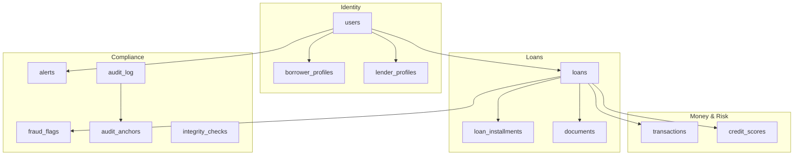
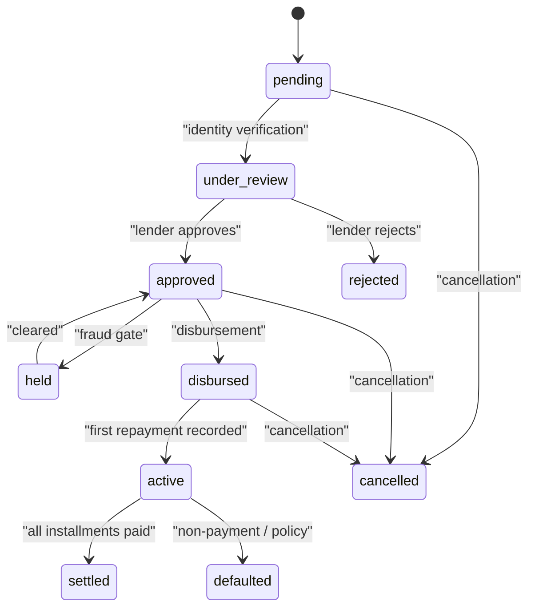
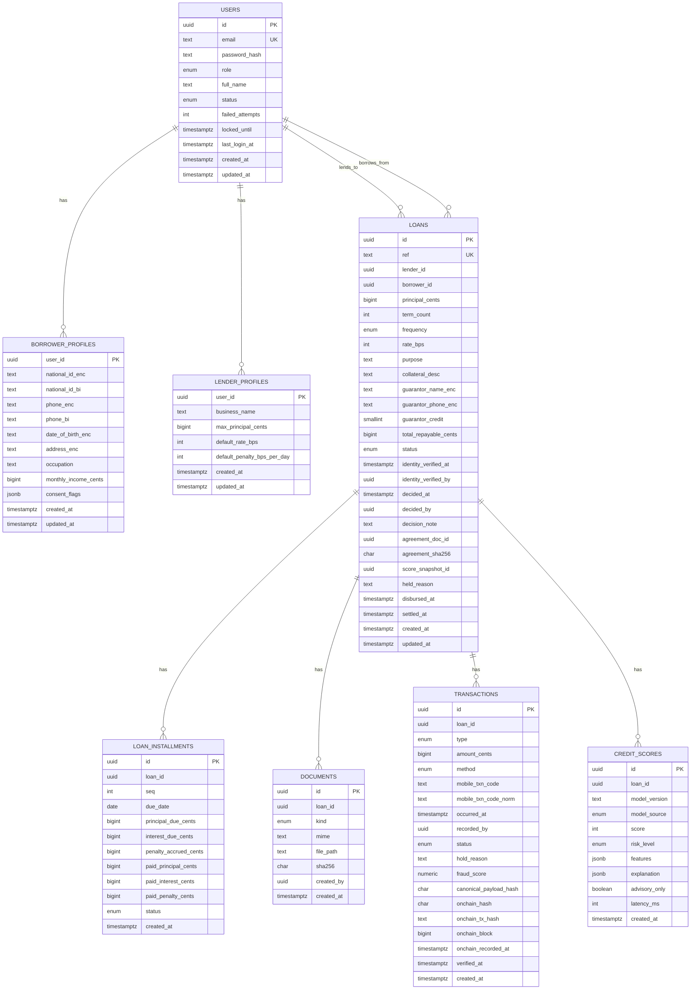
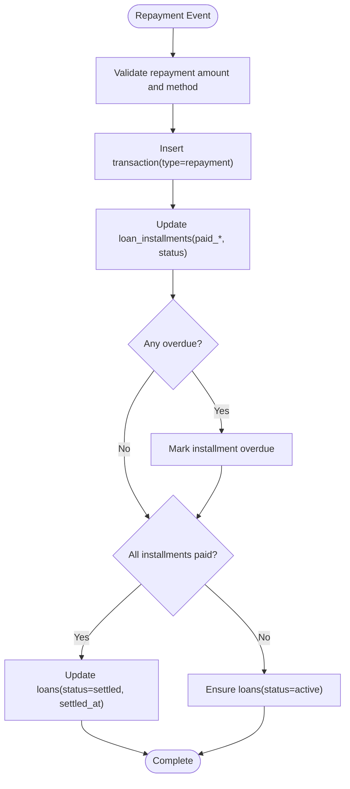
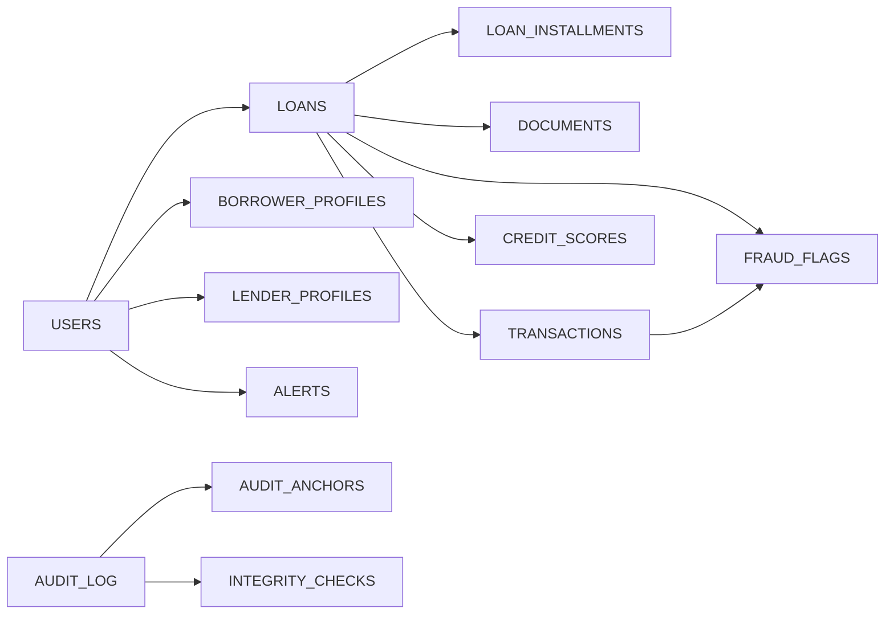

# Loan Management Schema

<cite>
**Referenced Files in This Document**
- [001_core_auth.sql](file://backend/src/db/migrations/001_core_auth.sql)
- [002_loans.sql](file://backend/src/db/migrations/002_loans.sql)
- [003_transactions_scoring.sql](file://backend/src/db/migrations/003_transactions_scoring.sql)
- [004_fraud_audit.sql](file://backend/src/db/migrations/004_fraud_audit.sql)
</cite>

## Table of Contents
1. [Introduction](#introduction)
2. [Project Structure](#project-structure)
3. [Core Components](#core-components)
4. [Architecture Overview](#architecture-overview)
5. [Detailed Component Analysis](#detailed-component-analysis)
6. [Dependency Analysis](#dependency-analysis)
7. [Performance Considerations](#performance-considerations)
8. [Troubleshooting Guide](#troubleshooting-guide)
9. [Conclusion](#conclusion)

## Introduction
This document describes the loan management data model used by the microfinance application. It focuses on how loans are modeled, how borrowers and lenders are linked, how financial terms and repayment schedules are stored, and how lifecycle states evolve from application to settlement or default. It also explains indexes for performance, auditability, fraud detection, and integration with transaction recording and credit scoring.

The schema is implemented as PostgreSQL migrations that define types, tables, constraints, triggers, and indexes. The core entities include users (borrowers and lenders), loans, loan installments, documents, transactions, credit scores, fraud flags, alerts, and an append-only audit log with integrity anchors.

## Project Structure
The loan-related data model is defined across several migration files:
- Core identity and profiles: user roles, borrower/lender profiles, encrypted personal data, and refresh tokens
- Loans: loan applications, approval workflow fields, financial terms, scheduling, and status transitions
- Transactions and scoring: disbursements, repayments, advisory credit scores
- Fraud and audit: fraud flags, alerts, append-only audit chain, and integrity checks



**Diagram sources**
- [001_core_auth.sql:17-95](file://backend/src/db/migrations/001_core_auth.sql#L17-L95)
- [002_loans.sql:25-100](file://backend/src/db/migrations/002_loans.sql#L25-L100)
- [003_transactions_scoring.sql:11-56](file://backend/src/db/migrations/003_transactions_scoring.sql#L11-L56)
- [004_fraud_audit.sql:21-136](file://backend/src/db/migrations/004_fraud_audit.sql#L21-L136)

**Section sources**
- [001_core_auth.sql:1-95](file://backend/src/db/migrations/001_core_auth.sql#L1-L95)
- [002_loans.sql:1-100](file://backend/src/db/migrations/002_loans.sql#L1-L100)
- [003_transactions_scoring.sql:1-56](file://backend/src/db/migrations/003_transactions_scoring.sql#L1-L56)
- [004_fraud_audit.sql:1-136](file://backend/src/db/migrations/004_fraud_audit.sql#L1-L136)

## Core Components
This section summarizes the key tables and their responsibilities in the loan management domain.

- Users and profiles
  - users: identity, role (borrower, lender, auditor), login state, and account status
  - borrower_profiles: encrypted PII, income, consent flags, and blind indexes for duplicate checks
  - lender_profiles: business metadata, lending limits, and default rates/penalties

- Loans and scheduling
  - loans: application details, parties, principal, term, frequency, interest rate, purpose, collateral, guarantor info, total repayable amount, decision timestamps, agreement reference, score snapshot, hold reason, and lifecycle timestamps
  - loan_installments: per-period due dates, principal and interest due, penalties, paid amounts, and installment status

- Documents
  - documents: loan-linked agreements, statements, forensic reports with MIME type, file path, hash, and creator

- Transactions and scoring
  - transactions: disbursements and repayments with method, mobile code normalization, occurrence time, status, fraud score, canonical payload hash, and optional on-chain linkage
  - credit_scores: advisory model outputs per loan including score, risk level, features, explanation, latency, and source

- Fraud, alerts, and audit
  - fraud_flags: deduplicated flags tied to loans, transactions, or borrowers with severity, status, and resolution notes
  - alerts: user-facing notifications about events
  - audit_log: append-only event log with a row hash chain; mutations blocked by triggers
  - audit_anchors: checkpoints of the audit chain head, optionally anchored on-chain
  - integrity_checks: results of integrity scans over scopes like all, loan, entity, or audit_chain

**Section sources**
- [001_core_auth.sql:17-95](file://backend/src/db/migrations/001_core_auth.sql#L17-L95)
- [002_loans.sql:25-100](file://backend/src/db/migrations/002_loans.sql#L25-L100)
- [003_transactions_scoring.sql:11-56](file://backend/src/db/migrations/003_transactions_scoring.sql#L11-L56)
- [004_fraud_audit.sql:21-136](file://backend/src/db/migrations/004_fraud_audit.sql#L21-L136)

## Architecture Overview
The loan lifecycle flows through well-defined states and supporting records:

- Application submission creates a loan record with status pending
- Identity verification may move it to under_review
- Lender review leads to approved or rejected
- Approved loans can be held by fraud gates before disbursed
- Disbursement creates a transaction and moves the loan toward active once repayments begin
- Repayments update installments and transactions; overdue or partial payments are tracked
- Settlement marks full repayment; defaults are recorded when obligations are not met
- All significant actions are captured in the audit log; fraud rules and ML signals generate flags and alerts



**Diagram sources**
- [002_loans.sql:5-16](file://backend/src/db/migrations/002_loans.sql#L5-L16)

**Section sources**
- [002_loans.sql:5-16](file://backend/src/db/migrations/002_loans.sql#L5-L16)

## Detailed Component Analysis

### Loans Table
The loans table captures the complete application and lifecycle of a loan between a lender and a borrower.

Key aspects:
- Primary keys and references
  - id: UUID primary key
  - ref: human-readable unique loan reference
  - lender_id and borrower_id: foreign keys to users; constraint ensures different parties
- Financial terms
  - principal_cents: positive integer representing principal in cents
  - rate_bps: basis points for interest rate, constrained to a reasonable range
  - term_count and frequency: number of periods and repayment cadence (daily, weekly, monthly)
  - total_repayable_cents: aggregate amount expected to be repaid
- Application and approval workflow
  - status: enumerated lifecycle state
  - identity_verified_at and identity_verified_by: identity verification timestamp and actor
  - decided_at and decided_by: decision timestamp and actor
  - decision_note: free-text rationale
  - held_reason: reason if fraud gate blocks approval/disbursement
- Agreement and evidence
  - agreement_doc_id and agreement_sha256: link to a signed agreement document and its hash
  - score_snapshot_id: reference to a credit score snapshot at decision time
- Guarantor information
  - guarantor_name_enc, guarantor_phone_enc: encrypted PII
  - guarantor_credit: numeric credit indicator
- Timestamps
  - disbursed_at, settled_at, created_at, updated_at

Indexes:
- loans_lender_status_idx: supports queries filtering by lender and status
- loans_borrower_created_idx: supports borrower history sorted by creation time
- loans_status_idx: supports dashboard and reporting queries by status

Triggers:
- loans_touch_updated_at: automatically updates updated_at on row changes

Foreign key relationships:
- lender_id and borrower_id reference users(id)
- identity_verified_by and decided_by reference users(id)
- agreement_doc_id references documents(id) with ON DELETE SET NULL

Complexity considerations:
- Row size is moderate; frequent updates occur during status transitions and decisions
- Indexes optimize common lookup patterns for dashboards and workflows

Typical operations:
- Create loan application: insert into loans with status pending
- Approve/reject: update status, decision fields, and timestamps
- Disburse: create a disbursement transaction and update loan status to disbursed
- Settle: mark settled_at after final repayment

**Section sources**
- [002_loans.sql:25-64](file://backend/src/db/migrations/002_loans.sql#L25-L64)
- [002_loans.sql:58-64](file://backend/src/db/migrations/002_loans.sql#L58-L64)
- [002_loans.sql:97-100](file://backend/src/db/migrations/002_loans.sql#L97-L100)

### Loan Installments
The loan_installments table models each scheduled payment period.

Key aspects:
- Uniqueness: UNIQUE(loan_id, seq) ensures one installment per sequence number per loan
- Due date and amounts: due_date, principal_due_cents, interest_due_cents, penalty_accrued_cents
- Payments: paid_principal_cents, paid_interest_cents, paid_penalty_cents
- Status: installment_status (pending, partial, paid, overdue, waived)
- Referential integrity: loan_id references loans(id) with ON DELETE CASCADE

Index:
- loan_installments_due_idx: optimizes queries by loan and due date for scheduling and collections

Complexity considerations:
- Installment rows grow linearly with term_count
- Aggregating paid vs due amounts requires summing columns grouped by loan_id

Typical operations:
- Generate schedule: insert rows based on term_count, frequency, and financial terms
- Record payment: update paid_* columns and status
- Overdue detection: query where due_date < current date and status not paid/waived

**Section sources**
- [002_loans.sql:66-83](file://backend/src/db/migrations/002_loans.sql#L66-L83)

### Documents
The documents table stores loan-related artifacts such as agreements, statements, and forensic reports.

Key aspects:
- loan_id: optional FK to loans with ON DELETE CASCADE
- kind: document_kind enum (agreement, statement, forensic_report)
- mime, file_path, sha256: content metadata and integrity hash
- created_by: user who uploaded the document
- Index: documents_loan_idx supports retrieval by loan and kind

Typical operations:
- Upload agreement: insert document row and set loans.agreement_doc_id
- Retrieve loan documents: query by loan_id and kind

**Section sources**
- [002_loans.sql:84-95](file://backend/src/db/migrations/002_loans.sql#L84-L95)

### Transactions
The transactions table records money movements associated with loans.

Key aspects:
- type: disbursement or repayment
- amount_cents: positive integer
- method: cash, mobile_money, bank; mobile_txn_code required for mobile_money
- occurred_at: business timestamp of the event
- recorded_by: user who recorded the transaction
- status: pending, held, cleared, rejected
- fraud_score: advisory score from ML or heuristic
- canonical_payload_hash: hash of canonical payload anchored on-chain
- onchain_hash, onchain_tx_hash, onchain_block, onchain_recorded_at: optional blockchain linkage
- verified_at: timestamp when transaction was verified

Indexes:
- transactions_loan_idx: loan-scoped chronological access
- transactions_code_idx: deduplication and lookup by normalized mobile code
- transactions_status_idx: operational queries by status

Constraints:
- Ensures mobile_txn_code presence when method is mobile_money

Typical operations:
- Disbursement: insert txn with type disbursement, update loan status to disbursed
- Repayment: insert txn with type repayment, update installment and loan totals
- Hold/reject: update status and hold_reason based on fraud rules

**Section sources**
- [003_transactions_scoring.sql:11-40](file://backend/src/db/migrations/003_transactions_scoring.sql#L11-L40)

### Credit Scores
The credit_scores table stores advisory model outputs used during loan evaluation.

Key aspects:
- loan_id: FK to loans with ON DELETE CASCADE
- model_version and model_source: ml_service or fallback_heuristic
- score: integer 0–100
- risk_level: low, medium, high
- features and explanation: JSON payloads for transparency
- advisory_only: indicates non-binding nature
- latency_ms: model execution timing
- Index: credit_scores_loan_idx supports latest score retrieval per loan

Typical operations:
- Score loan: insert credit_scores row during application review
- Use advisory output: read latest score per loan for decision support

**Section sources**
- [003_transactions_scoring.sql:41-56](file://backend/src/db/migrations/003_transactions_scoring.sql#L41-L56)

### Fraud Flags and Alerts
Fraud detection produces flags and alerts to guide investigations and enforcement.

Key aspects:
- fraud_flags:
  - loan_id, transaction_id, borrower_id: contextual links
  - flag_type: duplicate_txn_code, malformed_reference, identity_conflict, rapid_applications, ml_anomaly, duplicate_disbursement, hash_mismatch
  - severity: low, medium, high, critical
  - status: open, cleared, confirmed
  - source: rule or ml
  - detail: JSON payload with context
  - dedupe_key: prevents duplicate reports
  - reviewed_by, reviewed_at, resolution_note: investigation outcomes
- alerts:
  - user_id: recipient
  - type, severity, title, body: notification content
  - entity_type, entity_id: related entity
  - read_at: acknowledgment

Indexes:
- fraud_flags_status_idx: prioritized triage by status, severity, and recency
- fraud_flags_loan_idx: loan-scoped flag retrieval
- alerts_user_idx: user notification lists

Typical operations:
- Rule engine emits fraud_flags upon suspicious activity
- Auditor reviews and updates status/resolution
- System generates alerts for stakeholders

**Section sources**
- [004_fraud_audit.sql:21-56](file://backend/src/db/migrations/004_fraud_audit.sql#L21-L56)

### Audit Log and Integrity Anchors
The audit system provides tamper-evident logging and integrity verification.

Key aspects:
- audit_log:
  - seq: monotonically increasing sequence
  - actor_user_id, actor_role: who performed the action
  - action, entity_type, entity_id: what changed
  - ip, user_agent, request_id: request context
  - before_hash, after_hash: change deltas
  - prev_hash, row_hash: chain integrity
  - detail: structured event payload
  - Triggers block UPDATE, DELETE, and TRUNCATE to enforce append-only behavior
- audit_anchors:
  - upto_seq: checkpoint boundary
  - chain_root: root hash of the chain segment
  - onchain_tx_hash: optional blockchain anchor
  - anchored_by: user who anchored
- integrity_checks:
  - scope: all, loan, entity, audit_chain
  - target_id: entity identifier
  - records_checked, mismatches: scan metrics
  - result: ok, tampered, error
  - run_by: operator

Indexes:
- audit_log_entity_idx: entity-scoped audit trails
- audit_log_actor_idx: actor-based timelines
- audit_log_created_idx: chronological queries
- audit_log_detail_gin: JSONB search on detail
- integrity_checks_created_idx: recent integrity runs

Typical operations:
- Every mutation writes an audit_log row
- Periodic jobs compute chain roots and write audit_anchors
- Integrity scans compare hashes and record results

**Section sources**
- [004_fraud_audit.sql:67-136](file://backend/src/db/migrations/004_fraud_audit.sql#L67-L136)

### Borrowers and Lenders Relationship
The relationship between borrowers and lenders is enforced via foreign keys:
- loans.lender_id → users.id
- loans.borrower_id → users.id
- loans has a constraint ensuring lender_id <> borrower_id to prevent self-lending

Additional profile data:
- borrower_profiles.user_id → users.id with encrypted PII and blind indexes
- lender_profiles.user_id → users.id with lending parameters

This design supports microfinance workflows where multiple lenders can fund loans and borrowers can have multiple applications.



**Diagram sources**
- [001_core_auth.sql:17-95](file://backend/src/db/migrations/001_core_auth.sql#L17-L95)
- [002_loans.sql:25-100](file://backend/src/db/migrations/002_loans.sql#L25-L100)
- [003_transactions_scoring.sql:11-56](file://backend/src/db/migrations/003_transactions_scoring.sql#L11-L56)

**Section sources**
- [001_core_auth.sql:17-95](file://backend/src/db/migrations/001_core_auth.sql#L17-L95)
- [002_loans.sql:25-56](file://backend/src/db/migrations/002_loans.sql#L25-L56)

### Loan Application Data Flow
The loan application process integrates identity verification, scoring, lender review, and fraud controls.

```mermaid
sequenceDiagram
participant Borrower as "Borrower"
participant API as "Application API"
participant DB as "Database"
participant Scoring as "Credit Scoring"
participant Fraud as "Fraud Rules"
participant Lender as "Lender"
Borrower->>API : Submit loan application
API->>DB : Insert loans(status=pending)
API->>Scoring : Compute advisory credit score
Scoring-->>DB : Insert credit_scores
API->>Fraud : Evaluate rules
Fraud-->>DB : Insert fraud_flags if needed
Note over DB : Identity verification may update loans(identity_verified_at/by)
Lender->>API : Review application
API->>DB : Update loans(status=approved/rejected, decided_at/by, decision_note)
alt Approved
Lender->>API : Authorize disbursement
API->>DB : Insert transactions(type=disbursement)
API->>DB : Update loans(status=disbursed, disbursed_at)
else Rejected
Note over DB : No disbursement; status remains rejected
end
```

**Diagram sources**
- [002_loans.sql:25-64](file://backend/src/db/migrations/002_loans.sql#L25-L64)
- [003_transactions_scoring.sql:11-56](file://backend/src/db/migrations/003_transactions_scoring.sql#L11-L56)
- [004_fraud_audit.sql:21-56](file://backend/src/db/migrations/004_fraud_audit.sql#L21-L56)

**Section sources**
- [002_loans.sql:25-64](file://backend/src/db/migrations/002_loans.sql#L25-L64)
- [003_transactions_scoring.sql:11-56](file://backend/src/db/migrations/003_transactions_scoring.sql#L11-L56)
- [004_fraud_audit.sql:21-56](file://backend/src/db/migrations/004_fraud_audit.sql#L21-L56)

### Payment Tracking and Scheduling
Payment tracking connects loan installments with transactions and updates loan lifecycle states.



**Diagram sources**
- [002_loans.sql:66-83](file://backend/src/db/migrations/002_loans.sql#L66-L83)
- [003_transactions_scoring.sql:11-40](file://backend/src/db/migrations/003_transactions_scoring.sql#L11-L40)

**Section sources**
- [002_loans.sql:66-83](file://backend/src/db/migrations/002_loans.sql#L66-L83)
- [003_transactions_scoring.sql:11-40](file://backend/src/db/migrations/003_transactions_scoring.sql#L11-L40)

## Dependency Analysis
The loan schema depends on core identity and compliance layers:

- Identity dependency
  - loans.lender_id/borrower_id depend on users
  - borrower_profiles/lender_profiles depend on users
- Loan dependency
  - loan_installments depend on loans
  - documents depend on loans
  - transactions depend on loans
  - credit_scores depend on loans
- Compliance dependency
  - fraud_flags depend on loans, transactions, users
  - audit_log is independent but referenced by integrity checks and anchors



**Diagram sources**
- [001_core_auth.sql:17-95](file://backend/src/db/migrations/001_core_auth.sql#L17-L95)
- [002_loans.sql:25-100](file://backend/src/db/migrations/002_loans.sql#L25-L100)
- [003_transactions_scoring.sql:11-56](file://backend/src/db/migrations/003_transactions_scoring.sql#L11-L56)
- [004_fraud_audit.sql:21-136](file://backend/src/db/migrations/004_fraud_audit.sql#L21-L136)

**Section sources**
- [001_core_auth.sql:17-95](file://backend/src/db/migrations/001_core_auth.sql#L17-L95)
- [002_loans.sql:25-100](file://backend/src/db/migrations/002_loans.sql#L25-L100)
- [003_transactions_scoring.sql:11-56](file://backend/src/db/migrations/003_transactions_scoring.sql#L11-L56)
- [004_fraud_audit.sql:21-136](file://backend/src/db/migrations/004_fraud_audit.sql#L21-L136)

## Performance Considerations
- Index usage
  - loans_lender_status_idx: fast filtering by lender and status for lender dashboards
  - loans_borrower_created_idx: efficient listing of borrower applications ordered by creation
  - loans_status_idx: quick aggregation by status for reporting
  - loan_installments_due_idx: efficient scheduling queries by due date
  - documents_loan_idx: fast retrieval of loan documents by kind
  - transactions_loan_idx: chronological access per loan
  - transactions_code_idx: deduplication and lookup by normalized mobile transaction code
  - transactions_status_idx: operational queries by transaction status
  - credit_scores_loan_idx: latest advisory score per loan
  - fraud_flags_status_idx: triage by status, severity, and recency
  - fraud_flags_loan_idx: loan-scoped fraud visibility
  - alerts_user_idx: user notification lists
  - audit_log_entity_idx, actor_idx, created_idx, detail_gin: efficient audit trail queries and JSONB searches
  - integrity_checks_created_idx: recent integrity scan results
- Constraints and validation
  - CHECK constraints ensure valid ranges for amounts, rates, and scores
  - UNIQUE constraints prevent duplicate references and sequences
  - Foreign keys maintain referential integrity and cascade deletes where appropriate
- Triggers
  - Updated-at triggers reduce application-side overhead
  - Append-only audit triggers protect against tampering

[No sources needed since this section provides general guidance]

## Troubleshooting Guide
Common issues and resolutions:

- Duplicate mobile transaction codes
  - Symptom: fraud_flags with flag_type duplicate_txn_code
  - Resolution: normalize codes, investigate potential double-disbursement, and clear or confirm the flag after review
- Malformed loan references
  - Symptom: fraud_flags with flag_type malformed_reference
  - Resolution: validate ref format and correct upstream generation logic
- Identity conflicts
  - Symptom: fraud_flags with flag_type identity_conflict
  - Resolution: reconcile borrower identity data and update borrower_profiles accordingly
- Rapid applications
  - Symptom: fraud_flags with flag_type rapid_applications
  - Resolution: apply rate limiting and review borrower application patterns
- Hash mismatches
  - Symptom: integrity_checks result tampered or fraud_flags hash_mismatch
  - Resolution: recompute chain roots, verify on-chain hashes, and investigate tampering
- Audit log mutation attempts
  - Symptom: errors raised by audit_log_no_update/no_delete/truncate triggers
  - Resolution: avoid direct mutations; use supported APIs that append new audit entries

**Section sources**
- [004_fraud_audit.sql:21-136](file://backend/src/db/migrations/004_fraud_audit.sql#L21-L136)

## Conclusion
The loan management schema provides a robust foundation for microfinance operations. It models borrowers and lenders through strong identity and profile structures, captures comprehensive loan application and approval workflows, and enforces financial integrity via precise constraints and indexes. Repayment scheduling and payment tracking are supported by dedicated installment and transaction tables, while fraud detection, alerts, and an append-only audit chain ensure compliance and traceability. The design balances operational efficiency with security and auditability, enabling scalable microfinance processes.

[No sources needed since this section summarizes without analyzing specific files]