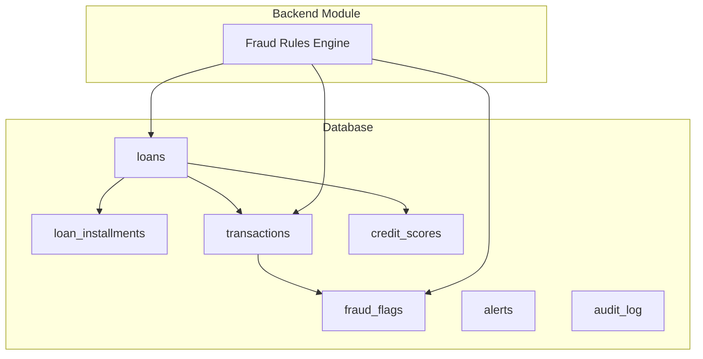
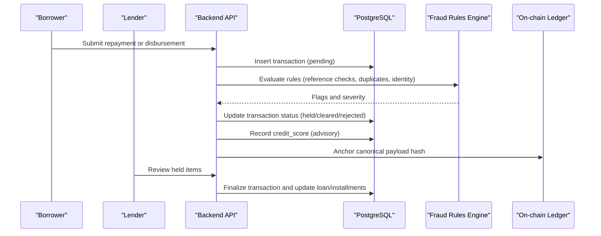
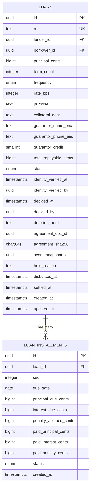
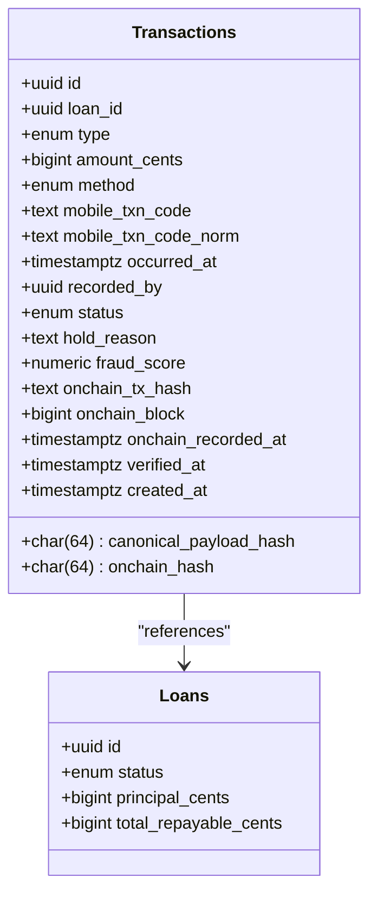
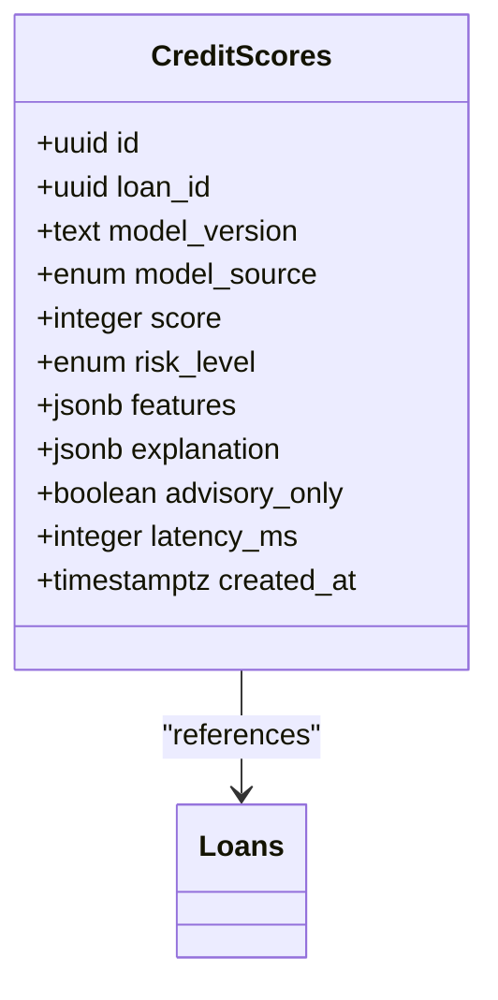
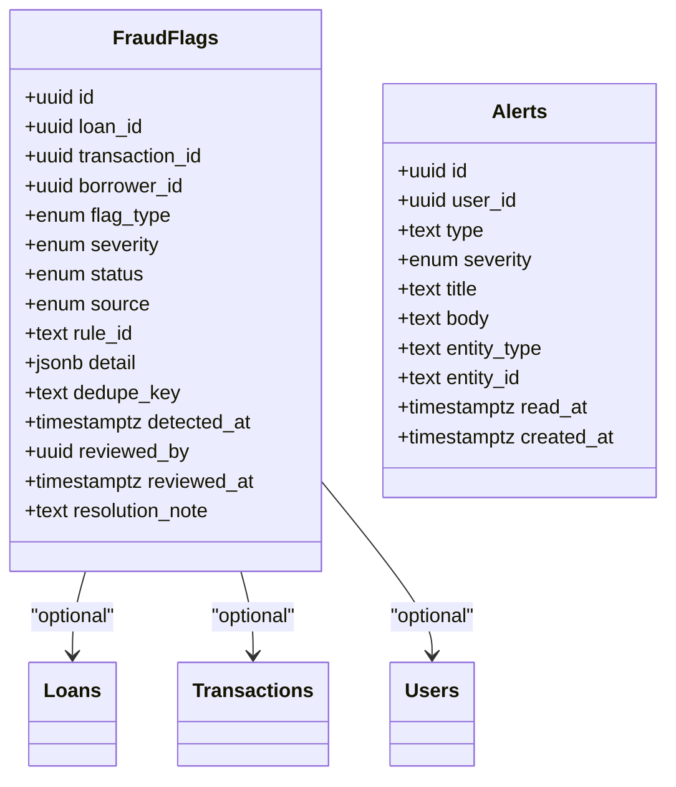
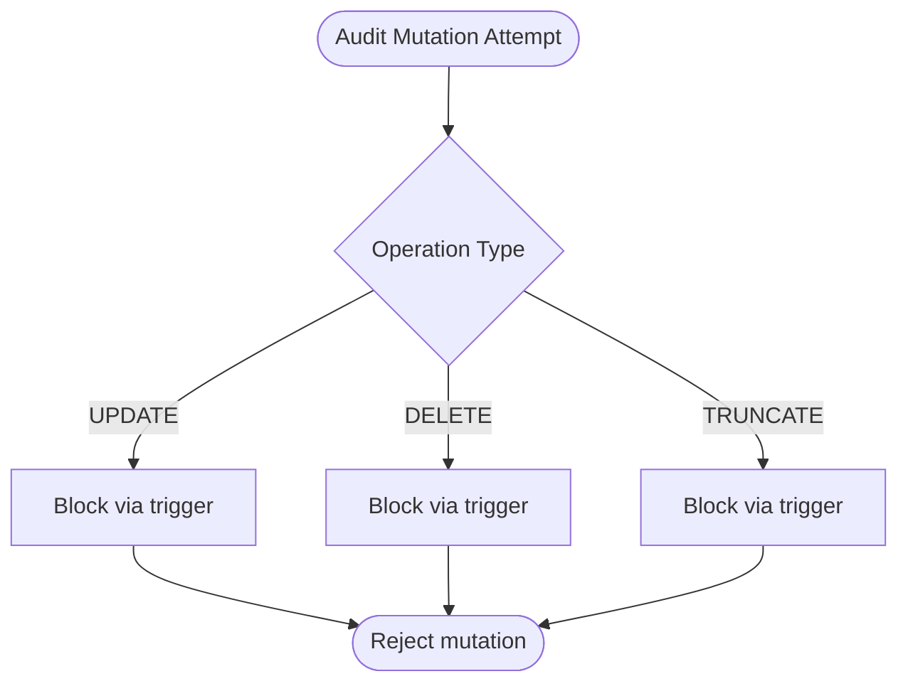
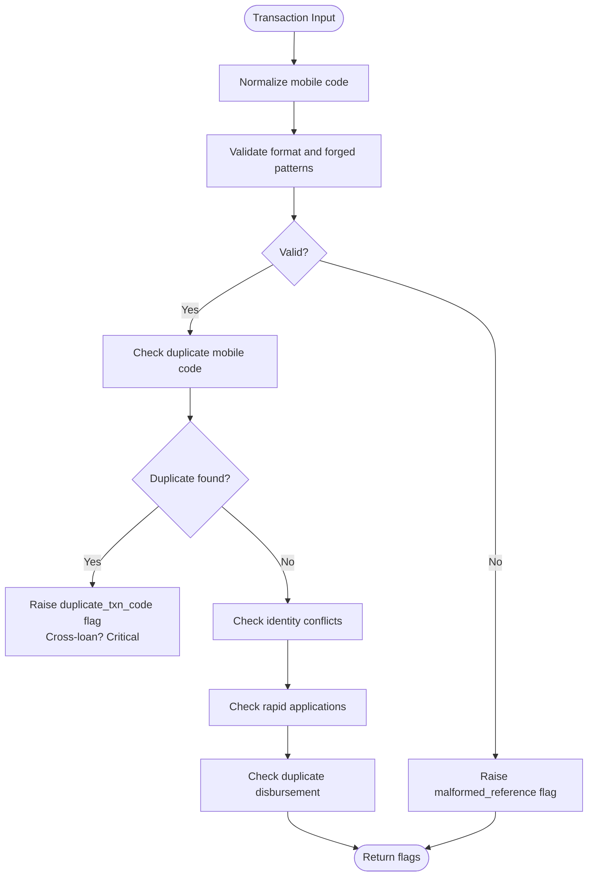
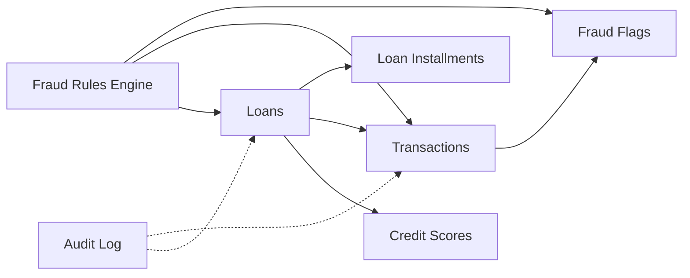

# Transactions & Scoring Schema

<cite>
**Referenced Files in This Document**
- [002_loans.sql](file://backend/src/db/migrations/002_loans.sql)
- [003_transactions_scoring.sql](file://backend/src/db/migrations/003_transactions_scoring.sql)
- [004_fraud_audit.sql](file://backend/src/db/migrations/004_fraud_audit.sql)
- [rules.engine.ts](file://backend/src/modules/fraud/rules.engine.ts)
</cite>

## Table of Contents
1. [Introduction](#introduction)
2. [Project Structure](#project-structure)
3. [Core Components](#core-components)
4. [Architecture Overview](#architecture-overview)
5. [Detailed Component Analysis](#detailed-component-analysis)
6. [Dependency Analysis](#dependency-analysis)
7. [Performance Considerations](#performance-considerations)
8. [Troubleshooting Guide](#troubleshooting-guide)
9. [Conclusion](#conclusion)

## Introduction
This document describes the data model and processing logic for transactions, scoring, and fraud detection. It focuses on:
- The `transactions` table used to record disbursements and repayments.
- The `credit_scores` table that stores advisory credit scores per loan.
- The relationship between loans, installments, and transactions.
- Rule-based fraud detection and how transaction data feeds into risk assessment.
- Data types for monetary values, timestamps, and scoring metrics.
- Constraints that enforce business rules and data integrity.
- Example transaction flows and scoring calculations.

The schema is PostgreSQL-oriented, uses UUIDs for identifiers, stores money in integer cents, and keeps audit trails append-only with hash chaining.

## Project Structure
The relevant parts of the repository are concentrated under the backend database migrations and the fraud rule engine:
- Loan lifecycle and installment schedule live in the loans migration.
- Transaction recording, fraud score fields, and advisory credit scores live in the transactions/scoring migration.
- Fraud flags, alerts, and an append-only audit log live in the fraud audit migration.
- Deterministic fraud rules are implemented in the fraud module.

**Diagram sources**
- [002_loans.sql:25-80](file://backend/src/db/migrations/002_loans.sql#L25-L80)
- [003_transactions_scoring.sql:11-55](file://backend/src/db/migrations/003_transactions_scoring.sql#L11-L55)
- [004_fraud_audit.sql:21-56](file://backend/src/db/migrations/004_fraud_audit.sql#L21-L56)
- [rules.engine.ts:54-92](file://backend/src/modules/fraud/rules.engine.ts#L54-L92)

**Section sources**
- [002_loans.sql:1-100](file://backend/src/db/migrations/002_loans.sql#L1-L100)
- [003_transactions_scoring.sql:1-56](file://backend/src/db/migrations/003_transactions_scoring.sql#L1-L56)
- [004_fraud_audit.sql:1-136](file://backend/src/db/migrations/004_fraud_audit.sql#L1-L136)
- [rules.engine.ts:1-275](file://backend/src/modules/fraud/rules.engine.ts#L1-L275)

## Core Components
This section summarizes the core tables and their roles in the transactions and scoring domain.

- `loans`: Represents a lending agreement, including principal, term, frequency, interest rate, status, and lifecycle timestamps.
- `loan_installments`: Tracks scheduled payments, due dates, and partial or full payment progress per installment.
- `transactions`: Records disbursements and repayments, including method, mobile receipt code, occurrence time, status, fraud score, and optional on-chain anchoring metadata.
- `credit_scores`: Stores advisory credit scores per loan, including model version, source, numeric score, risk level, features, explanation, and latency.
- `fraud_flags`: Append-only records of detected issues such as duplicate receipts, malformed references, identity conflicts, rapid applications, ML anomalies, and duplicate disbursements.
- `alerts`: In-app notifications sent to lenders when high-severity issues occur.
- `audit_log`: Append-only audit trail with hash chaining to detect tampering.

Key design principles:
- Monetary amounts are stored as integers in cents to avoid floating-point rounding errors.
- Timestamps use timezone-aware types for consistent global handling.
- Fraud scoring is advisory; final decisions remain lender-controlled.
- Mobile-money receipts are normalized and validated to prevent double claims.
- On-chain hashes provide external verification anchors for critical payloads.

**Section sources**
- [002_loans.sql:25-80](file://backend/src/db/migrations/002_loans.sql#L25-L80)
- [003_transactions_scoring.sql:11-55](file://backend/src/db/migrations/003_transactions_scoring.sql#L11-L55)
- [004_fraud_audit.sql:21-56](file://backend/src/db/migrations/004_fraud_audit.sql#L21-L56)

## Architecture Overview
The system integrates transaction recording with rule-based fraud detection and advisory credit scoring.

**Diagram sources**
- [003_transactions_scoring.sql:11-39](file://backend/src/db/migrations/003_transactions_scoring.sql#L11-L39)
- [003_transactions_scoring.sql:41-55](file://backend/src/db/migrations/003_transactions_scoring.sql#L41-L55)
- [rules.engine.ts:148-214](file://backend/src/modules/fraud/rules.engine.ts#L148-L214)
- [004_fraud_audit.sql:69-86](file://backend/src/db/migrations/004_fraud_audit.sql#L69-L86)

## Detailed Component Analysis

### Loans and Installments
The loan schema defines the lifecycle and financial terms:
- Identifiers: UUID primary keys.
- Parties: Lender and borrower user IDs.
- Financials: Principal and total repayable amounts in cents; interest rate in basis points.
- Term structure: Number of terms and repayment frequency.
- Status: Lifecycle states including pending, approved, disbursed, active, settled, defaulted, cancelled, and held.
- Evidence: Agreement document reference and SHA-256 fingerprint.
- Score snapshot: Reference to a credit score snapshot associated with the loan decision.
- Lifecycle timestamps: Identity verification, decision, disbursement, settlement.

Installments track each scheduled payment:
- Sequence number and due date.
- Due amounts for principal, interest, and penalties.
- Paid amounts for principal, interest, and penalties.
- Status: pending, partial, paid, overdue, waived.
- Indexes optimize queries by loan and due date.

**Diagram sources**
- [002_loans.sql:25-80](file://backend/src/db/migrations/002_loans.sql#L25-L80)

**Section sources**
- [002_loans.sql:25-80](file://backend/src/db/migrations/002_loans.sql#L25-L80)

### Transactions Table
The `transactions` table captures disbursements and repayments with fraud scoring integration:
- Identifier: UUID primary key.
- Relationship: Foreign key to `loans`.
- Type: Disbursement or repayment.
- Amount: Integer cents with positive value constraint.
- Method: Cash, mobile money, or bank transfer.
- Mobile receipt: Original code and normalized form for deduplication.
- Occurrence time: Timezone-aware timestamp.
- Recorder: Optional user who recorded the transaction.
- Status: Pending, held, cleared, rejected.
- Hold reason: Text explaining why a transaction is held.
- Fraud score: Numeric between 0 and 1 representing probability-like risk.
- Canonical payload hash: SHA-256 of the canonical payload anchored on-chain.
- On-chain metadata: Hash, transaction ID, block number, and recording timestamp.
- Verification timestamp: When the transaction was verified.
- Creation timestamp: Automatic default.

Constraints and indexes:
- Mobile receipt required when method is mobile money.
- Indexes on loan and occurrence time, normalized code, and status.

**Diagram sources**
- [003_transactions_scoring.sql:11-39](file://backend/src/db/migrations/003_transactions_scoring.sql#L11-L39)
- [002_loans.sql:25-56](file://backend/src/db/migrations/002_loans.sql#L25-L56)

**Section sources**
- [003_transactions_scoring.sql:11-39](file://backend/src/db/migrations/003_transactions_scoring.sql#L11-L39)

### Credit Scores Table
Advisory credit scores are stored per loan:
- Identifier: UUID primary key.
- Relationship: Foreign key to `loans`.
- Model version: String identifying the scoring model.
- Model source: Machine learning service or fallback heuristic.
- Score: Integer from 0 to 100.
- Risk level: Low, medium, or high.
- Features: JSON object describing input features.
- Explanation: JSON array describing reasoning.
- Advisory only: Boolean flag indicating non-binding nature.
- Latency: Processing time in milliseconds.
- Creation timestamp: Automatic default.

Indexing optimizes retrieval by loan and creation time.

**Diagram sources**
- [003_transactions_scoring.sql:41-55](file://backend/src/db/migrations/003_transactions_scoring.sql#L41-L55)
- [002_loans.sql:25-56](file://backend/src/db/migrations/002_loans.sql#L25-L56)

**Section sources**
- [003_transactions_scoring.sql:41-55](file://backend/src/db/migrations/003_transactions_scoring.sql#L41-L55)

### Fraud Flags and Alerts
Fraud flags capture deterministic detections:
- Identifier: UUID primary key.
- Relationships: Optional links to loans, transactions, and borrowers.
- Flag type: Duplicate receipt, malformed reference, identity conflict, rapid applications, ML anomaly, duplicate disbursement, hash mismatch.
- Severity: Low, medium, high, critical.
- Status: Open, cleared, confirmed.
- Source: Rule or machine learning.
- Rule ID: Identifier of the rule that fired.
- Detail: JSON payload with context.
- Dedupe key: Natural key preventing duplicate reports.
- Detection and review timestamps and reviewer.

Alerts notify lenders about significant events:
- User recipient, type, severity, title, body, entity type and ID, read timestamp, creation timestamp.

**Diagram sources**
- [004_fraud_audit.sql:21-56](file://backend/src/db/migrations/004_fraud_audit.sql#L21-L56)
- [003_transactions_scoring.sql:11-39](file://backend/src/db/migrations/003_transactions_scoring.sql#L11-L39)
- [002_loans.sql:25-56](file://backend/src/db/migrations/002_loans.sql#L25-L56)

**Section sources**
- [004_fraud_audit.sql:21-56](file://backend/src/db/migrations/004_fraud_audit.sql#L21-L56)

### Audit Log and Integrity
The audit log provides an append-only chain:
- Auto-increment sequence and unique row sequence.
- Actor user and role.
- Action, entity type, entity ID.
- Network and request metadata.
- Before/after hashes and previous hash linking rows.
- Row hash uniqueness.
- Triggers block updates, deletes, and truncates.
- Checkpoints anchor chain roots externally.

Integrity checks record scope, target, counts, mismatches, result, runner, and creation time.

**Diagram sources**
- [004_fraud_audit.sql:93-111](file://backend/src/db/migrations/004_fraud_audit.sql#L93-L111)

**Section sources**
- [004_fraud_audit.sql:69-136](file://backend/src/db/migrations/004_fraud_audit.sql#L69-L136)

### Fraud Rules Engine
The rules engine implements deterministic, explainable checks:
- Mobile receipt normalization and validation.
- Duplicate receipt detection across transactions and loans.
- Malformed reference detection.
- Identity conflict detection using blind indexes.
- Rapid application detection within configurable windows.
- Duplicate disbursement detection per loan.
- Flag insertion with deduplication.
- Alert creation for lenders when severe issues arise.

**Diagram sources**
- [rules.engine.ts:40-52](file://backend/src/modules/fraud/rules.engine.ts#L40-L52)
- [rules.engine.ts:148-214](file://backend/src/modules/fraud/rules.engine.ts#L148-L214)
- [rules.engine.ts:216-274](file://backend/src/modules/fraud/rules.engine.ts#L216-L274)

**Section sources**
- [rules.engine.ts:1-275](file://backend/src/modules/fraud/rules.engine.ts#L1-L275)

## Dependency Analysis
The following diagram shows relationships among core entities and modules:

**Diagram sources**
- [002_loans.sql:25-80](file://backend/src/db/migrations/002_loans.sql#L25-L80)
- [003_transactions_scoring.sql:11-55](file://backend/src/db/migrations/003_transactions_scoring.sql#L11-L55)
- [004_fraud_audit.sql:69-86](file://backend/src/db/migrations/004_fraud_audit.sql#L69-L86)
- [rules.engine.ts:54-92](file://backend/src/modules/fraud/rules.engine.ts#L54-L92)

**Section sources**
- [002_loans.sql:25-80](file://backend/src/db/migrations/002_loans.sql#L25-L80)
- [003_transactions_scoring.sql:11-55](file://backend/src/db/migrations/003_transactions_scoring.sql#L11-L55)
- [004_fraud_audit.sql:69-86](file://backend/src/db/migrations/004_fraud_audit.sql#L69-L86)
- [rules.engine.ts:54-92](file://backend/src/modules/fraud/rules.engine.ts#L54-L92)

## Performance Considerations
- Use indexed columns for frequent queries:
  - `transactions_loan_idx` for loan-scoped transaction history.
  - `transactions_code_idx` for fast duplicate receipt checks.
  - `transactions_status_idx` for filtering by workflow state.
  - `credit_scores_loan_idx` for retrieving recent scores per loan.
  - `fraud_flags_status_idx` for prioritizing open and high-severity flags.
  - `audit_log_entity_idx` and `audit_log_actor_idx` for efficient auditing queries.
- Keep monetary arithmetic in integer cents to avoid precision loss and reduce computation overhead.
- Normalize mobile codes once at ingestion to minimize repeated string operations.
- Prefer batch inserts for flags and audit entries where possible.
- Limit JSON payload sizes in `detail` fields to maintain query performance.

[No sources needed since this section provides general guidance]

## Troubleshooting Guide
Common issues and resolutions:
- Duplicate mobile receipt:
  - Symptom: A repayment or disbursement is flagged as a duplicate.
  - Cause: Same normalized receipt code appears on another transaction.
  - Resolution: Investigate cross-loan reuse; consider holding the transaction and alerting the lender.
- Malformed reference:
  - Symptom: Receipt does not match expected format or matches known forged patterns.
  - Cause: Invalid or test input.
  - Resolution: Reject or hold the transaction and prompt the borrower for a valid receipt.
- Identity conflict:
  - Symptom: Blind index matches multiple accounts.
  - Cause: Potential account sharing or impersonation.
  - Resolution: Raise a critical flag and require additional verification.
- Rapid applications:
  - Symptom: Too many loan applications within a configured window.
  - Cause: Possible coordinated fraud.
  - Resolution: Flag and apply stricter review thresholds.
- Duplicate disbursement:
  - Symptom: Second disbursement attempt for the same loan.
  - Cause: System error or malicious intent.
  - Resolution: Raise a critical flag and prevent further disbursements until resolved.
- Audit mutation attempts:
  - Symptom: Attempts to update, delete, or truncate audit logs fail.
  - Cause: Append-only enforcement via triggers.
  - Resolution: Do not modify historical audit rows; create new entries instead.

**Section sources**
- [rules.engine.ts:148-214](file://backend/src/modules/fraud/rules.engine.ts#L148-L214)
- [rules.engine.ts:216-274](file://backend/src/modules/fraud/rules.engine.ts#L216-L274)
- [004_fraud_audit.sql:93-111](file://backend/src/db/migrations/004_fraud_audit.sql#L93-L111)

## Conclusion
The transactions and scoring schema provides a robust foundation for recording disbursements and repayments while integrating fraud detection and advisory credit scoring. Key strengths include:
- Clear separation of concerns between loans, installments, transactions, scores, and audit trails.
- Strong constraints ensuring data integrity and business rule enforcement.
- Deterministic fraud rules that are explainable and auditable.
- Append-only audit logging with hash chaining for tamper resistance.
- On-chain anchoring for critical payloads to enable external verification.

Operational best practices:
- Treat credit scores as advisory inputs to human decisions.
- Enforce strict validation of mobile receipts and normalize them early.
- Monitor fraud flags and alerts closely, especially cross-loan duplication and identity conflicts.
- Maintain audit integrity by avoiding mutations to historical records.

[No sources needed since this section summarizes without analyzing specific files]