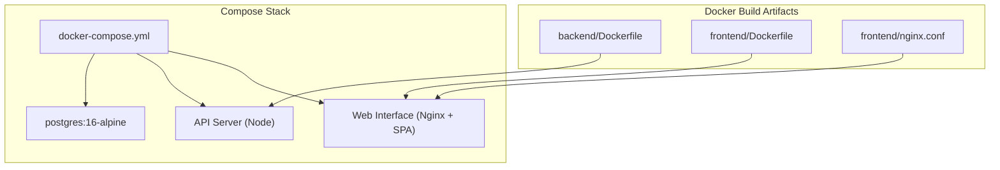
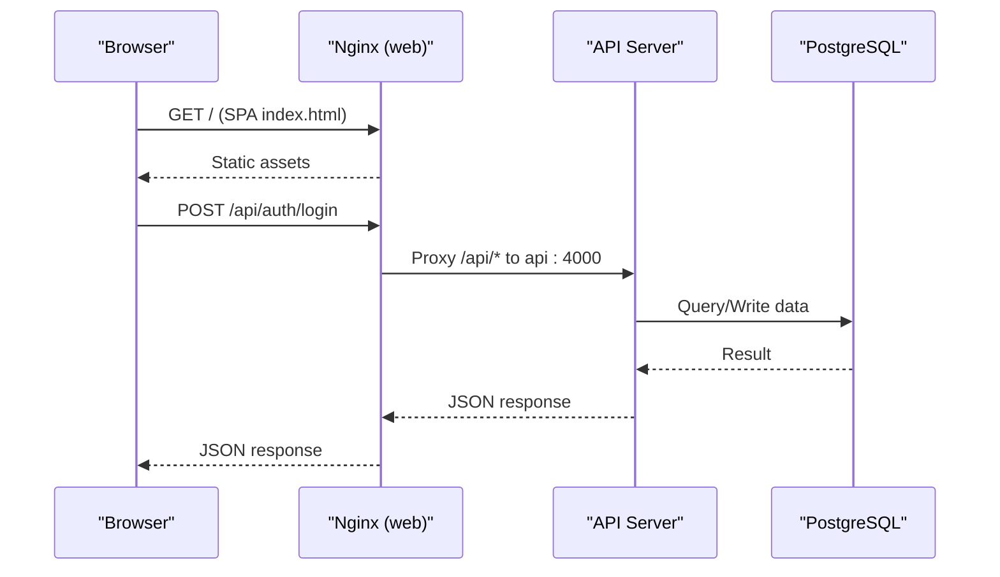
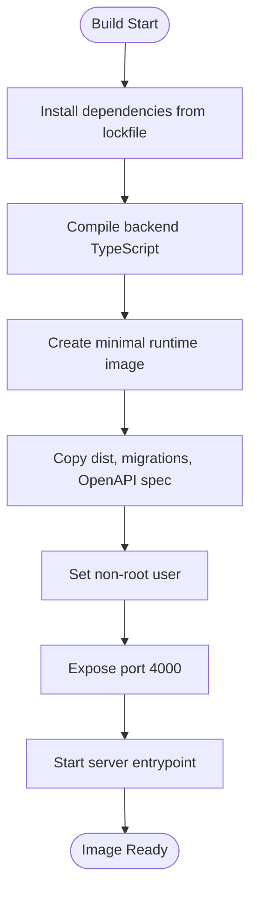
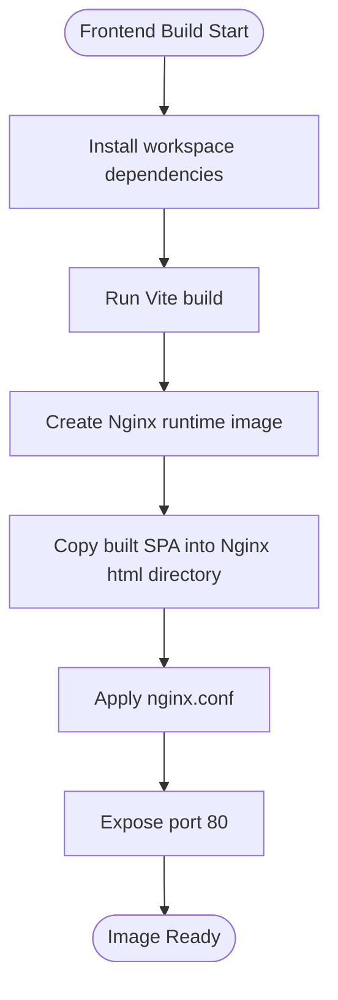
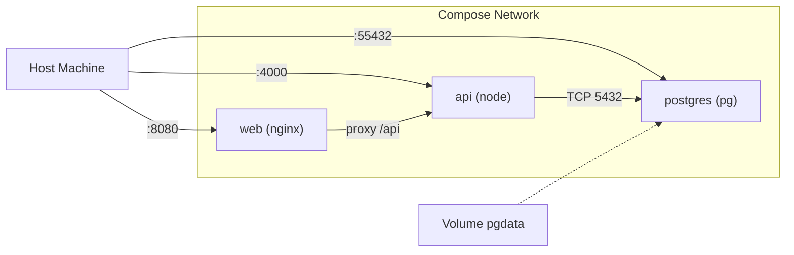
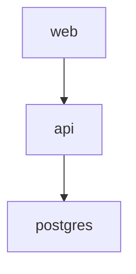

# Containerization with Docker

<cite>
**Referenced Files in This Document**
- [backend/Dockerfile](file://backend/Dockerfile)
- [frontend/Dockerfile](file://frontend/Dockerfile)
- [docker-compose.yml](file://docker-compose.yml)
- [.dockerignore](file://.dockerignore)
- [frontend/nginx.conf](file://frontend/nginx.conf)
- [backend/package.json](file://backend/package.json)
- [frontend/package.json](file://frontend/package.json)
</cite>

## Table of Contents
1. [Introduction](#introduction)
2. [Project Structure](#project-structure)
3. [Core Components](#core-components)
4. [Architecture Overview](#architecture-overview)
5. [Detailed Component Analysis](#detailed-component-analysis)
6. [Dependency Analysis](#dependency-analysis)
7. [Performance Considerations](#performance-considerations)
8. [Troubleshooting Guide](#troubleshooting-guide)
9. [Conclusion](#conclusion)

## Introduction
This document explains the Docker containerization strategy for the SecureMicrofinance application. It covers:
- Multi-stage builds for the backend API and frontend web interface
- Optimization techniques used to reduce image size and improve build reproducibility
- Security considerations applied at the container level
- The Docker Compose stack that orchestrates PostgreSQL, the API server, and the web interface
- Concrete examples of networking, volumes, and service dependencies
- Step-by-step instructions for building, running, and debugging containers across environments

The repository is an npm workspaces monorepo. Both container images are built from the repository root so that the shared lockfile provides reproducible dependency resolution.

## Project Structure
At a high level, the containerization artifacts are:
- Backend production image built from `backend/Dockerfile`
- Frontend static site served by Nginx built from `frontend/Dockerfile`
- A single `docker-compose.yml` defining the development stack
- `.dockerignore` to keep images small and avoid leaking secrets
- `frontend/nginx.conf` for reverse proxying API calls and serving the SPA

**Diagram sources**
- [backend/Dockerfile:1-29](file://backend/Dockerfile#L1-L29)
- [frontend/Dockerfile:1-18](file://frontend/Dockerfile#L1-L18)
- [frontend/nginx.conf:1-31](file://frontend/nginx.conf#L1-L31)
- [docker-compose.yml:1-52](file://docker-compose.yml#L1-L52)

**Section sources**
- [backend/Dockerfile:1-29](file://backend/Dockerfile#L1-L29)
- [frontend/Dockerfile:1-18](file://frontend/Dockerfile#L1-L18)
- [docker-compose.yml:1-52](file://docker-compose.yml#L1-L52)
- [.dockerignore:1-10](file://.dockerignore#L1-L10)
- [frontend/nginx.conf:1-31](file://frontend/nginx.conf#L1-L31)

## Core Components
- Backend container: Node.js runtime serving compiled TypeScript output, migrations, and OpenAPI spec.
- Frontend container: Nginx serving a Vite-built React SPA and proxying `/api` to the API container.
- Database container: PostgreSQL with a named volume for persistence and a healthcheck.
- Compose orchestration: Defines services, environment variables, ports, volumes, and dependencies.

Key responsibilities:
- Reproducible dependency installation using the root lockfile
- Minimal production images
- Non-root execution for the API
- Reverse proxy configuration for SPA routing and API proxying
- Healthchecks and explicit service dependencies

**Section sources**
- [backend/Dockerfile:1-29](file://backend/Dockerfile#L1-L29)
- [frontend/Dockerfile:1-18](file://frontend/Dockerfile#L1-L18)
- [docker-compose.yml:1-52](file://docker-compose.yml#L1-L52)

## Architecture Overview
The deployed stack exposes two host ports:
- Port 8080 for the web interface
- Port 4000 for direct API access (useful for local testing or CI)

Inside the compose network:
- The browser talks only to the web container on port 8080.
- Nginx serves static assets and proxies `/api` requests to the API container on port 4000.
- The API connects to PostgreSQL via the internal service name `postgres`.

**Diagram sources**
- [frontend/nginx.conf:18-25](file://frontend/nginx.conf#L18-L25)
- [docker-compose.yml:23-48](file://docker-compose.yml#L23-L48)

**Section sources**
- [frontend/nginx.conf:1-31](file://frontend/nginx.conf#L1-L31)
- [docker-compose.yml:1-52](file://docker-compose.yml#L1-L52)

## Detailed Component Analysis

### Backend Container Build
The backend uses a three-stage build:
1. Dependency stage: Installs all workspace dependencies using the root lockfile for reproducibility.
2. Build stage: Compiles the backend TypeScript code into `backend/dist`.
3. Runtime stage: Copies only necessary files into a minimal Node image, sets production environment, runs as non-root user, and starts the server.

Optimization techniques:
- Lockfile-driven install (`npm ci`)
- Copy only package manifests before installing dependencies to leverage layer caching
- Copy only compiled output and required assets (migrations, OpenAPI spec) into the final image
- Use Alpine-based images to reduce size
- Run as non-root user for security

Security considerations:
- Non-root process execution
- Production-only dependencies included
- No source code beyond what is needed at runtime

**Diagram sources**
- [backend/Dockerfile:1-29](file://backend/Dockerfile#L1-L29)

**Section sources**
- [backend/Dockerfile:1-29](file://backend/Dockerfile#L1-L29)
- [backend/package.json:1-52](file://backend/package.json#L1-L52)

### Frontend Container Build
The frontend also uses a multi-stage build:
1. Build stage: Uses Node to install dependencies and run the Vite build, producing a static SPA under `frontend/dist`.
2. Runtime stage: Uses Nginx to serve the static files and reverse-proxy `/api` to the API container.

Optimization techniques:
- Separate build and runtime stages
- Serve prebuilt assets with Nginx
- Cache immutable assets aggressively
- Single origin for the browser (no CORS in production)

Security considerations:
- Security headers configured in Nginx
- No server-side runtime dependencies in the runtime image
- Static asset caching reduces exposure surface

**Diagram sources**
- [frontend/Dockerfile:1-18](file://frontend/Dockerfile#L1-L18)
- [frontend/nginx.conf:1-31](file://frontend/nginx.conf#L1-L31)

**Section sources**
- [frontend/Dockerfile:1-18](file://frontend/Dockerfile#L1-L18)
- [frontend/nginx.conf:1-31](file://frontend/nginx.conf#L1-L31)
- [frontend/package.json:1-29](file://frontend/package.json#L1-L29)

### Docker Compose Orchestration
The Compose file defines three services:
- postgres: PostgreSQL 16 Alpine image with persistent volume and healthcheck
- api: Backend API built from `backend/Dockerfile`, depends on healthy postgres
- web: Frontend Nginx SPA built from `frontend/Dockerfile`, depends on api

Networking:
- All services share a default bridge network created by Compose.
- Services resolve each other by service name (e.g., `postgres`, `api`).
- Host ports are mapped for local access: 55432 for Postgres, 4000 for API, 8080 for web.

Volumes:
- Named volume `pgdata` persists database state across container restarts.

Environment and secrets:
- Database credentials are provided via environment variables, with defaults for local use.
- An optional `.env` file is loaded for the API service.

**Diagram sources**
- [docker-compose.yml:7-51](file://docker-compose.yml#L7-L51)

**Section sources**
- [docker-compose.yml:1-52](file://docker-compose.yml#L1-L52)

## Dependency Analysis
Service dependency chain:
- web depends on api
- api depends on postgres being healthy
- postgres has no upstream dependencies

Container image dependencies:
- Backend image depends on Node runtime and compiled backend artifacts
- Frontend image depends on Nginx runtime and built SPA assets
- Database image is pulled from official registry

External integration points:
- Database connection string includes the service name `postgres`
- Web container proxies API traffic to `api:4000`

**Diagram sources**
- [docker-compose.yml:35-48](file://docker-compose.yml#L35-L48)

**Section sources**
- [docker-compose.yml:1-52](file://docker-compose.yml#L1-L52)

## Performance Considerations
- Layer caching: Dependency manifests are copied before source code to maximize cache hits during dependency installation.
- Minimal runtime images: Alpine-based images reduce image size and attack surface.
- Asset caching: Nginx config caches immutable assets for one year to improve load performance.
- Single-origin deployment: Serving SPA through Nginx avoids CORS overhead and simplifies security policy.
- Healthchecks: Prevents dependent services from starting before the database is ready.

[No sources needed since this section provides general guidance]

## Troubleshooting Guide

Common issues and resolutions:
- Database not ready when API starts
  - Ensure the postgres healthcheck passes before the API starts. Compose enforces this via `depends_on` with `condition: service_healthy`.
  - Verify the database URL and credentials match the environment variables.

- Cannot connect to API from the browser
  - Confirm the web container proxies `/api` to `http://api:4000`.
  - Check that the API container is reachable inside the compose network.

- Assets not loading or SPA routes returning 404
  - Ensure Nginx is serving the built SPA and that `try_files` falls back to `index.html`.
  - Verify the build step produced output in the expected location.

- Secrets or large files in images
  - Review `.dockerignore` to ensure `node_modules`, `dist`, logs, and `.env` are excluded.
  - Avoid copying sensitive files into images; use environment variables or secret management.

- Port conflicts on the host
  - Change host port mappings in Compose if another service is already bound to 8080, 4000, or 55432.

- Debugging containers
  - Inspect logs per service using standard container logging commands.
  - For API debugging, attach to the running container and inspect environment variables and mounted paths.
  - For frontend debugging, open the browser developer tools and verify network requests to `/api`.

**Section sources**
- [docker-compose.yml:17-21](file://docker-compose.yml#L17-L21)
- [docker-compose.yml:27-37](file://docker-compose.yml#L27-L37)
- [frontend/nginx.conf:18-25](file://frontend/nginx.conf#L18-L25)
- [.dockerignore:1-10](file://.dockerignore#L1-L10)

## Conclusion
SecureMicrofinance’s containerization strategy emphasizes reproducibility, performance, and security:
- Multi-stage builds produce lean, secure images for both backend and frontend.
- Compose orchestrates a complete development stack with clear service dependencies and health checks.
- Nginx centralizes client access, improves caching, and removes CORS complexity in production.
- Volume persistence and environment-driven configuration support reliable local and CI workflows.

Follow the steps below to build, run, and debug the stack in different environments.

## Appendices

### Building and Running Locally
- Build and start the full stack:
  - Build images and start services defined in Compose.
  - Access the web interface at `http://localhost:8080`.
  - Access the API directly at `http://localhost:4000` if needed.
- Stop and remove resources:
  - Stop services and remove containers, networks, and volumes as appropriate.

### Environment Variables
- Database credentials:
  - Provide `POSTGRES_PASSWORD` or rely on the default value used by Compose.
- API configuration:
  - Load additional variables via an `.env` file for the API service.
  - Adjust `WEB_ORIGIN` if the web container is exposed on a different host/port.

### Networking Reference
- Web container:
  - Exposes port 80 internally; mapped to host port 8080.
  - Proxies `/api` to `http://api:4000`.
- API container:
  - Exposes port 4000 internally; mapped to host port 4000.
  - Connects to PostgreSQL using the service name `postgres`.
- Database container:
  - Exposes port 5432 internally; mapped to host port 55432.
  - Persists data in the named volume `pgdata`.

**Section sources**
- [docker-compose.yml:7-51](file://docker-compose.yml#L7-L51)
- [frontend/nginx.conf:18-25](file://frontend/nginx.conf#L18-L25)