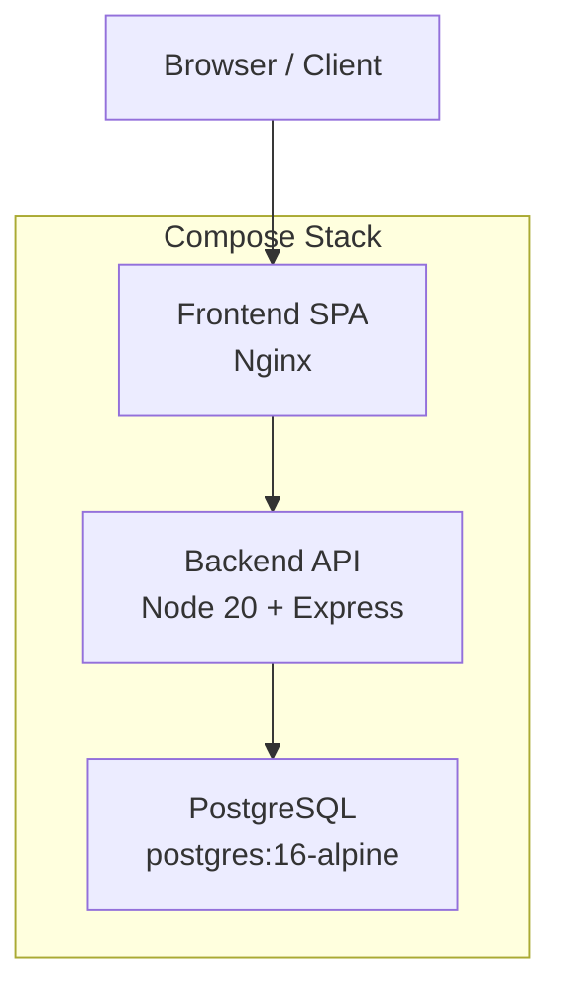
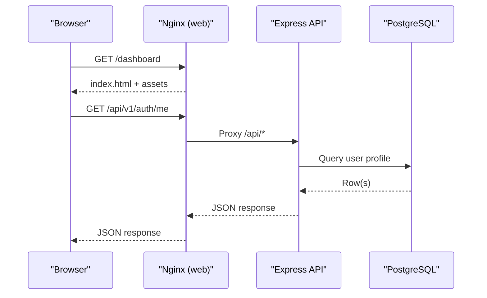
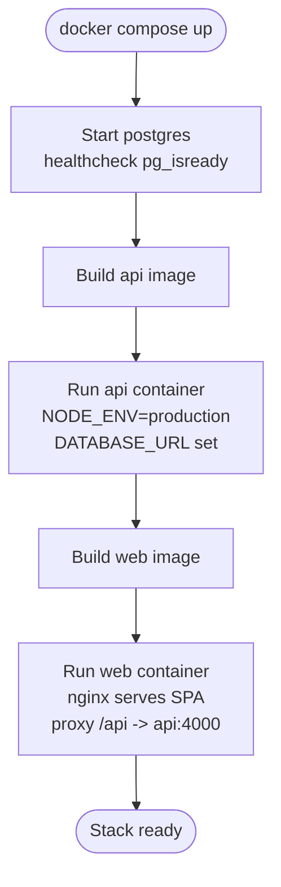
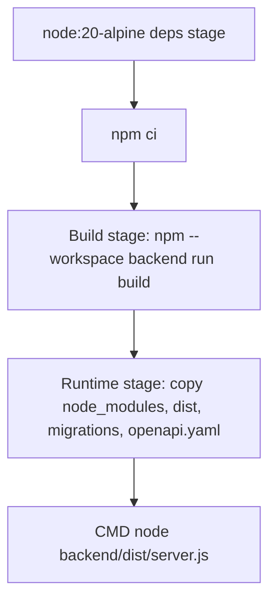
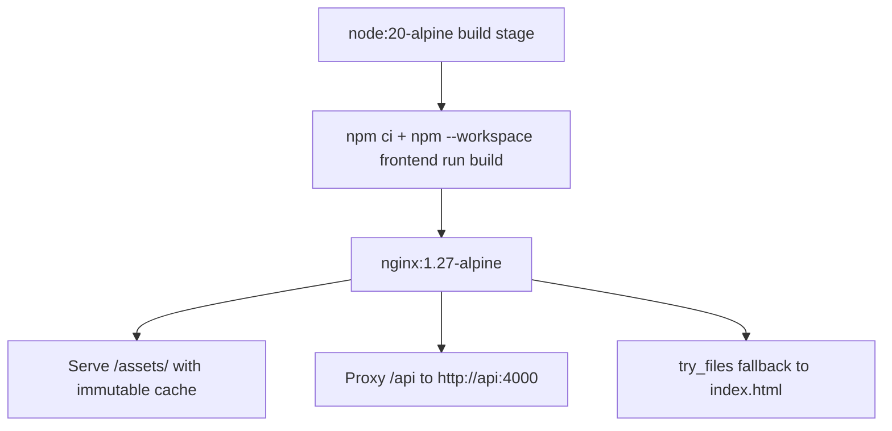
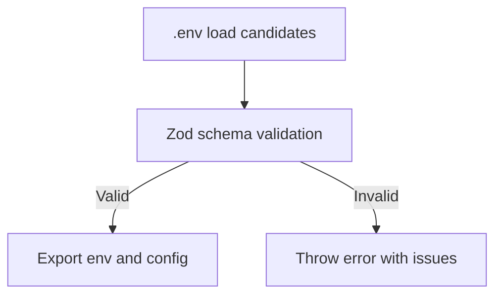
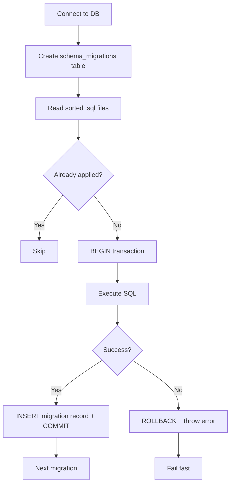
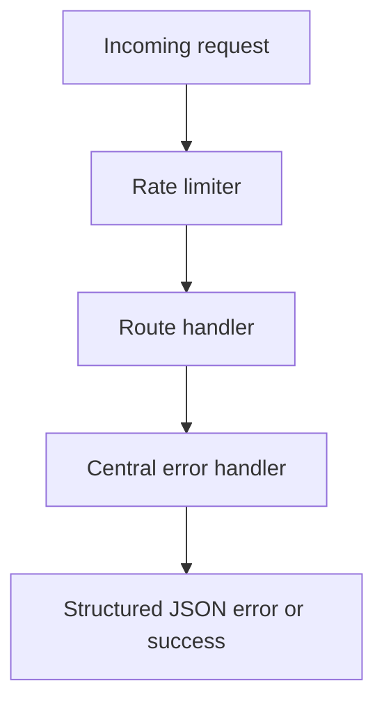

# Deployment & Operations

<cite>
**Referenced Files in This Document**
- [docker-compose.yml](file://docker-compose.yml)
- [backend/Dockerfile](file://backend/Dockerfile)
- [frontend/Dockerfile](file://frontend/Dockerfile)
- [frontend/nginx.conf](file://frontend/nginx.conf)
- [backend/src/config/env.ts](file://backend/src/config/env.ts)
- [backend/package.json](file://backend/package.json)
- [scripts/dev-db.mjs](file://scripts/dev-db.mjs)
- [scripts/smoke-api.mjs](file://scripts/smoke-api.mjs)
- [backend/src/db/migrate.ts](file://backend/src/db/migrate.ts)
- [backend/src/middleware/rateLimit.ts](file://backend/src/middleware/rateLimit.ts)
- [backend/src/middleware/error.ts](file://backend/src/middleware/error.ts)
</cite>

## Table of Contents
1. [Introduction](#introduction)
2. [Project Structure](#project-structure)
3. [Core Components](#core-components)
4. [Architecture Overview](#architecture-overview)
5. [Detailed Component Analysis](#detailed-component-analysis)
6. [Environment Configuration Management](#environment-configuration-management)
7. [Containerization Strategy](#containerization-strategy)
8. [Local Development and Staging with Docker Compose](#local-development-and-staging-with-docker-compose)
9. [Production Deployment Procedures](#production-deployment-procedures)
10. [Monitoring, Logging, and Alerting](#monitoring-logging-and-alerting)
11. [Scaling Considerations](#scaling-considerations)
12. [Performance Optimization](#performance-optimization)
13. [Maintenance Procedures](#maintenance-procedures)
14. [Backup and Disaster Recovery](#backup-and-disaster-recovery)
15. [Troubleshooting Guide](#troubleshooting-guide)
16. [Conclusion](#conclusion)

## Introduction
This document provides deployment and operations guidance for the SecureMicrofinance application. It covers containerization with Docker, environment configuration, local and staging setup using Docker Compose, production deployment procedures, monitoring and logging, scaling, performance tuning, maintenance, and backup and disaster recovery. The goal is to help operators run the system reliably in development, staging, and production environments while maintaining security and auditability.

## Project Structure
The repository is a monorepo with separate backend and frontend services, shared scripts, and Docker artifacts:
- Backend: Express API, PostgreSQL migrations, OpenAPI spec, rate limiting, error handling, and configuration validation.
- Frontend: Vite-built single-page application served by Nginx, which also reverse-proxies API calls.
- Scripts: Local database launcher and API smoke tests.
- Docker Compose: Defines PostgreSQL, API, and web services for local and staging use.

**Diagram sources**
- [docker-compose.yml:6-51](file://docker-compose.yml#L6-L51)
- [backend/Dockerfile:15-29](file://backend/Dockerfile#L15-L29)
- [frontend/Dockerfile:14-17](file://frontend/Dockerfile#L14-L17)

**Section sources**
- [docker-compose.yml:1-52](file://docker-compose.yml#L1-L52)
- [backend/package.json:1-52](file://backend/package.json#L1-L52)

## Core Components
- Database layer: PostgreSQL service managed by Docker Compose; schema migrations are forward-only SQL files executed at startup or via CLI.
- API layer: Node.js Express server built from TypeScript, exposing REST endpoints, JWT-based authentication, rate limiting, and structured error responses.
- Web layer: Static SPA served by Nginx, proxying `/api` requests to the API container.
- Configuration: Environment variables validated at startup; secrets loaded from `.env`.
- Operational scripts: Embedded PostgreSQL launcher for local development and an API smoke test for health checks.

**Section sources**
- [backend/src/db/migrate.ts:1-70](file://backend/src/db/migrate.ts#L1-L70)
- [backend/src/config/env.ts:1-101](file://backend/src/config/env.ts#L1-L101)
- [backend/src/middleware/rateLimit.ts:1-51](file://backend/src/middleware/rateLimit.ts#L1-L51)
- [backend/src/middleware/error.ts:1-77](file://backend/src/middleware/error.ts#L1-L77)

## Architecture Overview
The runtime architecture consists of three primary containers orchestrated by Docker Compose:
- `postgres`: Persistent relational store for users, loans, transactions, and audit data.
- `api`: Application server that serves REST APIs, runs migrations, and enforces security controls.
- `web`: Nginx container serving the SPA and forwarding API calls to the backend.

**Diagram sources**
- [frontend/nginx.conf:18-25](file://frontend/nginx.conf#L18-L25)
- [docker-compose.yml:23-48](file://docker-compose.yml#L23-L48)

## Detailed Component Analysis

### Docker Compose Services
- `postgres`: Uses Alpine image, exposes port 55432 locally, persists data via named volume, and includes a healthcheck.
- `api`: Builds from `backend/Dockerfile`, loads `.env`, sets production mode, maps API_PORT, connects to `postgres`, and exposes port 4000.
- `web`: Builds from `frontend/Dockerfile`, depends on `api`, and exposes port 8080 locally.

**Diagram sources**
- [docker-compose.yml:6-51](file://docker-compose.yml#L6-L51)

**Section sources**
- [docker-compose.yml:1-52](file://docker-compose.yml#L1-L52)

### Backend Container Build
- Multi-stage build: install dependencies once, then build TypeScript into `backend/dist`.
- Production image copies only runtime artifacts: compiled code, migrations, and OpenAPI spec.
- Runs as non-root user and exposes port 4000.

**Diagram sources**
- [backend/Dockerfile:3-29](file://backend/Dockerfile#L3-L29)

**Section sources**
- [backend/Dockerfile:1-30](file://backend/Dockerfile#L1-L30)

### Frontend Container Build and Nginx
- Multi-stage build compiles the SPA with Vite.
- Nginx serves static assets with long-lived caching for hashed assets.
- Reverse proxies `/api` to the backend container, preserving client IP and protocol headers.

**Diagram sources**
- [frontend/Dockerfile:4-17](file://frontend/Dockerfile#L4-L17)
- [frontend/nginx.conf:11-29](file://frontend/nginx.conf#L11-L29)

**Section sources**
- [frontend/Dockerfile:1-18](file://frontend/Dockerfile#L1-L18)
- [frontend/nginx.conf:1-31](file://frontend/nginx.conf#L1-L31)

### Configuration Validation and Runtime Behavior
- Loads `.env` from current working directory or repo root.
- Validates all required environment variables with Zod; fails fast if invalid.
- Exposes derived values such as `isTest`, `databaseUrl`, and storage paths.

**Diagram sources**
- [backend/src/config/env.ts:13-22](file://backend/src/config/env.ts#L13-L22)
- [backend/src/config/env.ts:24-86](file://backend/src/config/env.ts#L24-L86)

**Section sources**
- [backend/src/config/env.ts:1-101](file://backend/src/config/env.ts#L1-L101)

### Database Migration Runner
- Forward-only migration runner executing each SQL file inside its own transaction.
- Tracks applied migrations in `schema_migrations`.
- Supports reset mode for local development.

**Diagram sources**
- [backend/src/db/migrate.ts:14-57](file://backend/src/db/migrate.ts#L14-L57)

**Section sources**
- [backend/src/db/migrate.ts:1-70](file://backend/src/db/migrate.ts#L1-L70)

### Rate Limiting and Error Handling
- Global, auth-specific, and write-specific rate limiters with bypass in test mode.
- Centralized error handler mapping application errors, validation errors, and PostgreSQL constraint codes to consistent JSON responses.

**Diagram sources**
- [backend/src/middleware/rateLimit.ts:14-47](file://backend/src/middleware/rateLimit.ts#L14-L47)
- [backend/src/middleware/error.ts:19-76](file://backend/src/middleware/error.ts#L19-L76)

**Section sources**
- [backend/src/middleware/rateLimit.ts:1-51](file://backend/src/middleware/rateLimit.ts#L1-L51)
- [backend/src/middleware/error.ts:1-77](file://backend/src/middleware/error.ts#L1-L77)

## Environment Configuration Management
SecureMicrofinance uses environment variables for all runtime configuration. Secrets should be provided via `.env` and never committed to source control.

Key environment variables include:
- Application: `NODE_ENV`, `API_PORT`, `WEB_ORIGIN`, `LOG_LEVEL`
- Database: `DATABASE_URL`, `TEST_DATABASE_URL`
- Authentication: `JWT_ACCESS_SECRET`, `JWT_REFRESH_SECRET`, `ACCESS_TOKEN_TTL`, `REFRESH_TOKEN_TTL_DAYS`, `REFRESH_REUSE_GRACE_SECONDS`
- Security: `BCRYPT_COST`, `LOGIN_MAX_ATTEMPTS`, `LOGIN_LOCK_MINUTES`
- Encryption: `FIELD_ENCRYPTION_KEY`, `BLIND_INDEX_KEY`
- Blockchain ledger: `CHAIN_MODE`, `CHAIN_RPC_URL`, `CHAIN_ID`, `CHAIN_RECORDER_PRIVATE_KEY`, `LEDGER_CONTRACT_ADDRESS`, `AMOY_RPC_URL`, `AMOY_DEPLOYER_PRIVATE_KEY`
- ML integration: `ML_SERVICE_URL`, `ML_TIMEOUT_MS`, `ML_FORCE_FALLBACK`
- Business rules: `RAPID_APPLICATION_WINDOW_HOURS`, `RAPID_APPLICATION_MAX_LOANS`, `REPAYMENT_REQUIRES_CLEARANCE`
- Storage: `REPORT_STORAGE_DIR`

Operational notes:
- In Docker Compose, `POSTGRES_PASSWORD` defaults to `postgres` if not provided.
- The API expects `DATABASE_URL` pointing to the `postgres` service host within the Compose network.
- The frontend Nginx proxies `/api` to the backend, so clients should target the web origin.

**Section sources**
- [backend/src/config/env.ts:28-74](file://backend/src/config/env.ts#L28-L74)
- [docker-compose.yml:9-34](file://docker-compose.yml#L9-L34)

## Containerization Strategy
- Backend:
  - Multi-stage build to minimize image size.
  - Copies only compiled output, migrations, and OpenAPI spec into the runtime image.
  - Runs as non-root user and exposes port 4000.
- Frontend:
  - Multi-stage build to compile the SPA.
  - Nginx serves static assets and proxies API calls.
  - Exposes port 80 internally; mapped to 8080 locally.
- Data persistence:
  - PostgreSQL data stored in a named volume `pgdata`.

Best practices:
- Pin base images to specific versions.
- Use `.dockerignore` to exclude unnecessary files.
- Keep secrets out of images; inject via environment variables or secret managers.

**Section sources**
- [backend/Dockerfile:1-30](file://backend/Dockerfile#L1-L30)
- [frontend/Dockerfile:1-18](file://frontend/Dockerfile#L1-L18)
- [docker-compose.yml:15-16](file://docker-compose.yml#L15-L16)

## Local Development and Staging with Docker Compose
To start the stack locally:
- Ensure Docker is installed.
- Run `docker compose up --build` to build and start services.
- Access the frontend at `http://localhost:8080`.
- The API is reachable at `http://localhost:4000` directly or via the web origin.

Database options:
- Use the embedded PostgreSQL launcher when Docker is unavailable:
  - Initialize and start: `npm run db:up`
  - Stop: `npm run db:down`
  - Status: `npm run db:status`
- Alternatively, use Docker Compose’s `postgres` service.

Smoke testing:
- Run the API smoke test against a running instance:
  - `node scripts/smoke-api.mjs http://localhost:4000`

**Section sources**
- [docker-compose.yml:1-52](file://docker-compose.yml#L1-L52)
- [scripts/dev-db.mjs:1-171](file://scripts/dev-db.mjs#L1-L171)
- [scripts/smoke-api.mjs:1-120](file://scripts/smoke-api.mjs#L1-L120)

## Production Deployment Procedures
Recommended steps:
1. Prepare environment variables:
   - Generate strong secrets for JWT access and refresh tokens.
   - Set encryption keys (`FIELD_ENCRYPTION_KEY`, `BLIND_INDEX_KEY`) as 64-character hex strings.
   - Configure `DATABASE_URL` to point to a managed PostgreSQL instance.
   - Set `WEB_ORIGIN` to the public frontend domain.
2. Build images:
   - Build backend and frontend images using the provided Dockerfiles.
   - Push images to a container registry.
3. Deploy services:
   - Define Kubernetes manifests or cloud-native service definitions for `api` and `web`.
   - Mount persistent volumes for PostgreSQL data.
   - Inject secrets via your platform’s secret manager.
4. Run migrations:
   - Execute migrations before starting the API service or as a pre-start job.
5. Health checks:
   - Implement liveness and readiness probes targeting `/api/health`.
6. Smoke tests:
   - Run `scripts/smoke-api.mjs` after deployment to validate core flows.

Security considerations:
- Enforce HTTPS at the ingress level.
- Restrict direct access to the API port; route traffic through the web container or an API gateway.
- Rotate secrets regularly and avoid committing `.env` files.

**Section sources**
- [backend/src/db/migrate.ts:14-57](file://backend/src/db/migrate.ts#L14-L57)
- [scripts/smoke-api.mjs:44-113](file://scripts/smoke-api.mjs#L44-L113)
- [backend/src/config/env.ts:24-86](file://backend/src/config/env.ts#L24-L86)

## Monitoring, Logging, and Alerting
Logging:
- The API logs errors centrally with request IDs for correlation.
- Structured error responses include a `requestId` field to aid tracing.

Alerting:
- Monitor HTTP status codes and error rates from the API.
- Track PostgreSQL health and connection pool metrics.
- Alert on failed migrations or repeated rate-limit violations.

Observability recommendations:
- Collect container logs and ship them to a centralized logging system.
- Instrument the API with metrics for latency, throughput, and error rates.
- Use distributed tracing across the web and API layers.

**Section sources**
- [backend/src/middleware/error.ts:19-76](file://backend/src/middleware/error.ts#L19-L76)

## Scaling Considerations
Horizontal scaling:
- Scale the `api` service independently behind a load balancer.
- Keep stateless API instances; store sessions and tokens securely without relying on in-memory state.
- Use externalized configuration and secrets management.

Database scaling:
- Use a managed PostgreSQL service with read replicas for reporting workloads.
- Tune connection pooling and query performance.

Network and caching:
- Leverage Nginx caching for static assets.
- Consider CDN placement for frontend assets.

**Section sources**
- [frontend/nginx.conf:13-16](file://frontend/nginx.conf#L13-L16)
- [docker-compose.yml:23-48](file://docker-compose.yml#L23-L48)

## Performance Optimization
- Enable HTTP/2 and TLS termination at the ingress or reverse proxy.
- Tune Nginx buffer sizes and keepalive settings for high concurrency.
- Optimize PostgreSQL connection pool parameters based on workload.
- Cache frequently accessed data where appropriate and invalidate caches on writes.
- Profile API endpoints and database queries to identify bottlenecks.

[No sources needed since this section provides general guidance]

## Maintenance Procedures
Routine tasks:
- Rotate JWT secrets and encryption keys according to policy.
- Update base images and dependencies regularly.
- Review and apply database migrations in a staged manner.
- Back up databases and verify restore procedures periodically.

Change management:
- Run migrations in a separate step before rolling updates.
- Validate deployments with smoke tests before promoting changes.

**Section sources**
- [backend/src/db/migrate.ts:14-57](file://backend/src/db/migrate.ts#L14-L57)
- [scripts/smoke-api.mjs:44-113](file://scripts/smoke-api.mjs#L44-L113)

## Backup and Disaster Recovery
Database backups:
- Schedule regular logical backups of PostgreSQL using tools compatible with the managed provider.
- Retain backups according to compliance requirements.
- Test restoration procedures regularly.

Application data:
- Back up report storage directories configured via `REPORT_STORAGE_DIR`.
- Version control migrations and configuration templates.

Recovery plan:
- Define RPO and RTO targets.
- Automate restore workflows and validate data integrity post-restore.
- Maintain runbooks for common failure scenarios.

**Section sources**
- [backend/src/config/env.ts:73-74](file://backend/src/config/env.ts#L73-L74)

## Troubleshooting Guide
Common issues and resolutions:
- Invalid environment configuration:
  - The API will fail fast with detailed validation errors if `.env` is missing or malformed.
  - Ensure all required variables are present and correctly formatted.
- Database connectivity:
  - Verify `DATABASE_URL` points to the correct host and credentials.
  - Confirm PostgreSQL is healthy and accepting connections.
- Rate limiting:
  - If requests are being throttled, check global, auth, and write limits.
  - In test mode, rate limiters are bypassed; ensure production configurations are correct.
- API smoke tests:
  - Use the smoke script to validate login, profile operations, and token rotation behavior.

**Section sources**
- [backend/src/config/env.ts:76-86](file://backend/src/config/env.ts#L76-L86)
- [backend/src/middleware/rateLimit.ts:14-47](file://backend/src/middleware/rateLimit.ts#L14-L47)
- [scripts/smoke-api.mjs:44-113](file://scripts/smoke-api.mjs#L44-L113)

## Conclusion
SecureMicrofinance is designed for secure, auditable financial operations with clear separation between frontend, backend, and database layers. The provided Docker artifacts and scripts enable straightforward local and staging setups, while production deployments should emphasize secret management, observability, scaling, and robust backup and recovery procedures. Following the guidance in this document will help operators maintain a reliable and secure environment.