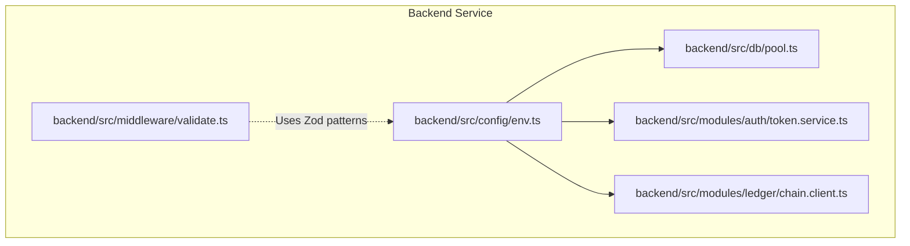
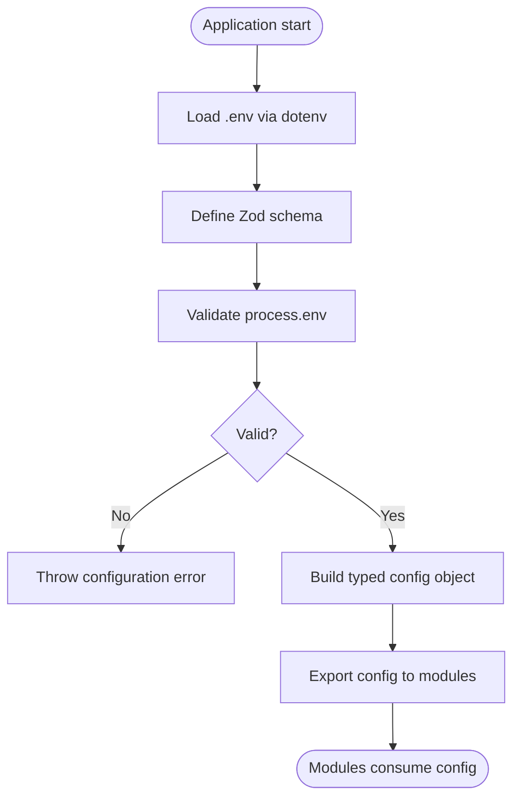
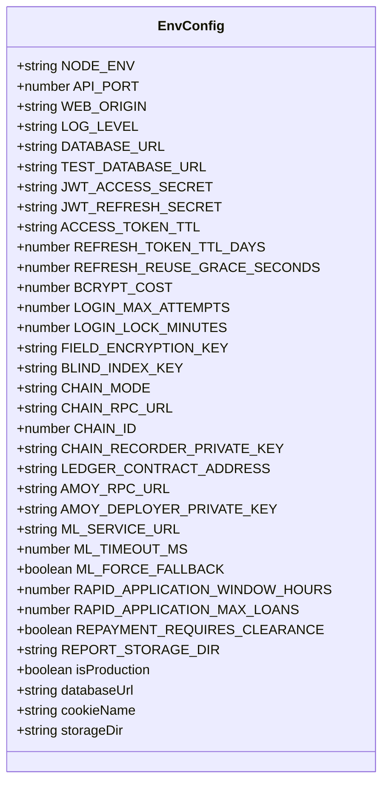
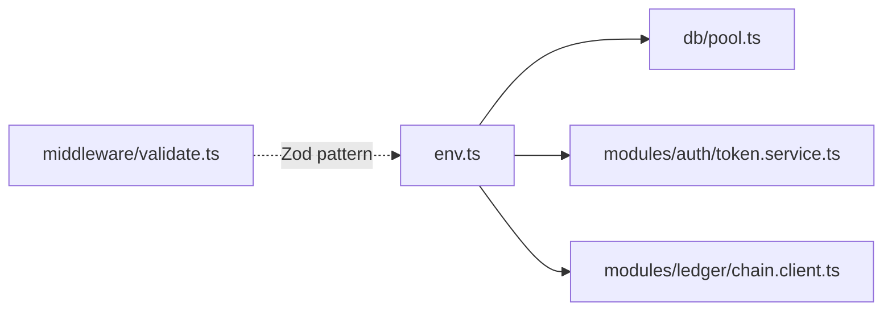

# Environment Configuration Management

<cite>
**Referenced Files in This Document**
- [env.ts](file://backend/src/config/env.ts)
- [pool.ts](file://backend/src/db/pool.ts)
- [token.service.ts](file://backend/src/modules/auth/token.service.ts)
- [chain.client.ts](file://backend/src/modules/ledger/chain.client.ts)
- [validate.ts](file://backend/src/middleware/validate.ts)
- [package.json](file://backend/package.json)
</cite>

## Table of Contents
1. [Introduction](#introduction)
2. [Project Structure](#project-structure)
3. [Core Components](#core-components)
4. [Architecture Overview](#architecture-overview)
5. [Detailed Component Analysis](#detailed-component-analysis)
6. [Environment Variables Reference](#environment-variables-reference)
7. [Environment Examples](#environment-examples)
8. [Security Best Practices](#security-best-practices)
9. [Dependency Analysis](#dependency-analysis)
10. [Performance Considerations](#performance-considerations)
11. [Troubleshooting Guide](#troubleshooting-guide)
12. [Conclusion](#conclusion)

## Introduction
This document explains how the SecureMicrofinance backend manages environment configuration. The system uses a type-safe, fail-fast configuration loader that:

- Loads secrets from `.env` files using `dotenv`.
- Validates every variable with Zod schemas at startup.
- Exposes a strongly typed `config` object consumed by database, authentication, blockchain, and application modules.
- Centralizes defaults, coercion, and validation so runtime misconfiguration cannot silently weaken security.

The goal is to make it easy to understand which variables are required, optional, or derived; how they are validated; and how to configure them safely for development, staging, and production.

## Project Structure
Configuration lives in a single module under the backend service. Other modules import the exported configuration instead of reading `process.env` directly.

**Diagram sources**
- [env.ts:1-101](file://backend/src/config/env.ts#L1-L101)
- [pool.ts:1-62](file://backend/src/db/pool.ts#L1-L62)
- [token.service.ts:1-206](file://backend/src/modules/auth/token.service.ts#L1-L206)
- [chain.client.ts:1-152](file://backend/src/modules/ledger/chain.client.ts#L1-L152)
- [validate.ts:1-39](file://backend/src/middleware/validate.ts#L1-L39)

**Section sources**
- [env.ts:1-101](file://backend/src/config/env.ts#L1-L101)
- [package.json:1-52](file://backend/package.json#L1-L52)

## Core Components
- **Configuration loader**: Reads `.env`, validates all variables with Zod, and exports a typed `config` object plus helpers such as `isTest` and `databaseUrl`.
- **Database pool consumer**: Uses `config.databaseUrl` to create a shared PostgreSQL connection pool.
- **Authentication token service**: Uses JWT secrets and TTL settings from `config`.
- **Blockchain client**: Uses chain mode, RPC URL, chain ID, recorder private key, and contract address from `config`.
- **Validation middleware**: Demonstrates the same Zod-based validation approach used for request data.

**Section sources**
- [env.ts:24-101](file://backend/src/config/env.ts#L24-L101)
- [pool.ts:1-14](file://backend/src/db/pool.ts#L1-L14)
- [token.service.ts:28-46](file://backend/src/modules/auth/token.service.ts#L28-L46)
- [chain.client.ts:24-60](file://backend/src/modules/ledger/chain.client.ts#L24-L60)
- [validate.ts:11-39](file://backend/src/middleware/validate.ts#L11-L39)

## Architecture Overview
At application startup, the configuration module performs these steps:

1. Locate and load `.env` from the current working directory or repository root.
2. Define Zod schemas for all environment variables.
3. Parse and validate `process.env`.
4. Fail fast if any variable is missing or invalid.
5. Export a normalized `config` object for the rest of the application.

**Diagram sources**
- [env.ts:13-22](file://backend/src/config/env.ts#L13-L22)
- [env.ts:28-86](file://backend/src/config/env.ts#L28-L86)

**Section sources**
- [env.ts:13-86](file://backend/src/config/env.ts#L13-L86)

## Detailed Component Analysis

### Configuration Loader (`backend/src/config/env.ts`)
Responsibilities:
- Resolve `.env` location relative to `process.cwd()`.
- Apply Zod validation with explicit types, defaults, coercions, and transforms.
- Provide `isTest`, `databaseUrl`, and a merged `config` object.

Key behaviors:
- `NODE_ENV` controls behavior and defaults.
- Database URL selection prefers `TEST_DATABASE_URL` when running tests.
- Boolean-like string fields are transformed into booleans.
- Hex keys must be exactly 64 hexadecimal characters.
- Missing or invalid configuration throws an error immediately.

**Diagram sources**
- [env.ts:28-101](file://backend/src/config/env.ts#L28-L101)

**Section sources**
- [env.ts:1-101](file://backend/src/config/env.ts#L1-L101)

### Database Pool Consumer (`backend/src/db/pool.ts`)
Responsibilities:
- Create a shared PostgreSQL connection pool.
- Use `config.databaseUrl` rather than raw environment access.
- Provide helper query functions and transaction support.

Integration points:
- Connection string comes from the configuration layer.
- Error handling ensures a dying pooled client does not crash the server.

**Section sources**
- [pool.ts:1-62](file://backend/src/db/pool.ts#L1-L62)

### Authentication Token Service (`backend/src/modules/auth/token.service.ts`)
Responsibilities:
- Sign and verify short-lived access tokens using `JWT_ACCESS_SECRET` and `ACCESS_TOKEN_TTL`.
- Issue and rotate refresh tokens based on `REFRESH_TOKEN_TTL_DAYS` and reuse grace window `REFRESH_REUSE_GRACE_SECONDS`.
- Enforce security policies around token replay and family revocation.

Integration points:
- Secret values and TTLs come from `config`.
- Database operations use the shared pool.

**Section sources**
- [token.service.ts:28-46](file://backend/src/modules/auth/token.service.ts#L28-L46)
- [token.service.ts:60-76](file://backend/src/modules/auth/token.service.ts#L60-L76)
- [token.service.ts:104-145](file://backend/src/modules/auth/token.service.ts#L104-L145)
- [token.service.ts:154-205](file://backend/src/modules/auth/token.service.ts#L154-L205)

### Blockchain Ledger Client (`backend/src/modules/ledger/chain.client.ts`)
Responsibilities:
- Determine whether blockchain anchoring is enabled based on `CHAIN_MODE` and `LEDGER_CONTRACT_ADDRESS`.
- Select RPC URL and chain ID from configuration.
- Require `CHAIN_RECORDER_PRIVATE_KEY` for write operations.
- Provide read/write contract accessors and status reporting.

Integration points:
- All chain-related configuration is sourced from `config`.
- Errors indicate when the ledger is unavailable due to missing configuration.

**Section sources**
- [chain.client.ts:24-60](file://backend/src/modules/ledger/chain.client.ts#L24-L60)
- [chain.client.ts:71-116](file://backend/src/modules/ledger/chain.client.ts#L71-L116)
- [chain.client.ts:130-151](file://backend/src/modules/ledger/chain.client.ts#L130-L151)

### Validation Middleware Pattern (`backend/src/middleware/validate.ts`)
Responsibilities:
- Demonstrate Zod-based validation for request bodies, queries, and parameters.
- Replace request source data with parsed, coerced, allow-listed values.
- Provide shared primitives such as UUID, money, and pagination schemas.

Relevance to environment configuration:
- Shows the same validation philosophy applied to runtime inputs as to environment variables.

**Section sources**
- [validate.ts:1-39](file://backend/src/middleware/validate.ts#L1-L39)

## Environment Variables Reference

### Application Runtime
- `NODE_ENV`
  - Required: Yes (has default).
  - Type: Enum.
  - Values: `development`, `test`, `production`.
  - Default: `development`.
  - Purpose: Controls environment behavior and feature flags.

- `API_PORT`
  - Required: No.
  - Type: Positive integer.
  - Default: `4000`.
  - Purpose: HTTP server port.

- `WEB_ORIGIN`
  - Required: No.
  - Type: String.
  - Default: `http://localhost:5173`.
  - Purpose: Frontend origin for CORS and session cookies.

- `LOG_LEVEL`
  - Required: No.
  - Type: Enum.
  - Values: `debug`, `info`, `warn`, `error`.
  - Default: `info`.
  - Purpose: Logging verbosity.

### Database
- `DATABASE_URL`
  - Required: Yes.
  - Type: Non-empty string.
  - Purpose: Primary PostgreSQL connection string.

- `TEST_DATABASE_URL`
  - Required: No.
  - Type: Optional string.
  - Purpose: Test runner database override.

Derived value:
- `databaseUrl`: Uses `TEST_DATABASE_URL` when `NODE_ENV=test`; otherwise uses `DATABASE_URL`.

**Section sources**
- [env.ts:34-35](file://backend/src/config/env.ts#L34-L35)
- [env.ts:88-91](file://backend/src/config/env.ts#L88-L91)
- [pool.ts:9-14](file://backend/src/db/pool.ts#L9-L14)

### Authentication Secrets and Behavior
- `JWT_ACCESS_SECRET`
  - Required: Yes.
  - Type: String with minimum length.
  - Purpose: Secret for signing and verifying access tokens.

- `JWT_REFRESH_SECRET`
  - Required: Yes.
  - Type: String with minimum length.
  - Purpose: Secret used for refresh token operations.

- `ACCESS_TOKEN_TTL`
  - Required: No.
  - Type: String representing time span.
  - Default: `15m`.
  - Purpose: Access token lifetime.

- `REFRESH_TOKEN_TTL_DAYS`
  - Required: No.
  - Type: Positive integer.
  - Default: `7`.
  - Purpose: Refresh token lifetime in days.

- `REFRESH_REUSE_GRACE_SECONDS`
  - Required: No.
  - Type: Integer between `0` and `120`.
  - Default: `15`.
  - Purpose: Grace window for concurrent refresh-token double-submit detection.

- `BCRYPT_COST`
  - Required: No.
  - Type: Integer between `10` and `14`.
  - Default: `12`.
  - Purpose: Password hashing cost factor.

- `LOGIN_MAX_ATTEMPTS`
  - Required: No.
  - Type: Positive integer.
  - Default: `5`.
  - Purpose: Maximum login attempts before lockout.

- `LOGIN_LOCK_MINUTES`
  - Required: No.
  - Type: Positive integer.
  - Default: `15`.
  - Purpose: Login lockout duration.

**Section sources**
- [env.ts:37-46](file://backend/src/config/env.ts#L37-L46)
- [token.service.ts:28-46](file://backend/src/modules/auth/token.service.ts#L28-L46)
- [token.service.ts:60-76](file://backend/src/modules/auth/token.service.ts#L60-L76)
- [token.service.ts:104-145](file://backend/src/modules/auth/token.service.ts#L104-L145)

### Field Encryption and Blind Indexing
- `FIELD_ENCRYPTION_KEY`
  - Required: Yes.
  - Type: Exactly 64 hexadecimal characters.
  - Purpose: Key for field-level encryption.

- `BLIND_INDEX_KEY`
  - Required: Yes.
  - Type: Exactly 64 hexadecimal characters.
  - Purpose: Key for blind indexing.

**Section sources**
- [env.ts:24-26](file://backend/src/config/env.ts#L24-L26)
- [env.ts:48-49](file://backend/src/config/env.ts#L48-L49)

### Blockchain Settings
- `CHAIN_MODE`
  - Required: No.
  - Type: Enum.
  - Values: `local`, `amoy`, `off`.
  - Default: `local`.
  - Purpose: Blockchain integration mode.

- `CHAIN_RPC_URL`
  - Required: No.
  - Type: String.
  - Default: `http://127.0.0.1:8545`.
  - Purpose: Local chain RPC endpoint.

- `CHAIN_ID`
  - Required: No.
  - Type: Integer.
  - Default: `31337`.
  - Purpose: Chain identifier.

- `CHAIN_RECORDER_PRIVATE_KEY`
  - Required: No.
  - Type: Optional string.
  - Purpose: Private key for writing to the ledger.

- `LEDGER_CONTRACT_ADDRESS`
  - Required: No.
  - Type: Optional string.
  - Purpose: Deployed ledger contract address.

- `AMOY_RPC_URL`
  - Required: No.
  - Type: Optional string.
  - Purpose: Polygon Amoy RPC when `CHAIN_MODE=amoy`.

- `AMOY_DEPLOYER_PRIVATE_KEY`
  - Required: No.
  - Type: Optional string.
  - Purpose: Deployer private key for Amoy deployments.

Behavioral rules:
- When `CHAIN_MODE=off` or no contract address is set, blockchain anchoring is disabled.
- When `CHAIN_MODE=amoy`, the client prefers `AMOY_RPC_URL` over `CHAIN_RPC_URL`.
- Write operations require `CHAIN_RECORDER_PRIVATE_KEY`.

**Section sources**
- [env.ts:51-57](file://backend/src/config/env.ts#L51-L57)
- [chain.client.ts:24-60](file://backend/src/modules/ledger/chain.client.ts#L24-L60)
- [chain.client.ts:130-151](file://backend/src/modules/ledger/chain.client.ts#L130-L151)

### Machine Learning Service Integration
- `ML_SERVICE_URL`
  - Required: No.
  - Type: String.
  - Default: `http://127.0.0.1:8000`.
  - Purpose: ML service base URL.

- `ML_TIMEOUT_MS`
  - Required: No.
  - Type: Positive integer.
  - Default: `3000`.
  - Purpose: ML service call timeout.

- `ML_FORCE_FALLBACK`
  - Required: No.
  - Type: String transformed to boolean.
  - Default: `false`.
  - Purpose: Force fallback behavior when ML calls fail.

**Section sources**
- [env.ts:59-64](file://backend/src/config/env.ts#L59-L64)

### Business Rules and Reporting
- `RAPID_APPLICATION_WINDOW_HOURS`
  - Required: No.
  - Type: Positive integer.
  - Default: `48`.
  - Purpose: Window for rapid loan applications.

- `RAPID_APPLICATION_MAX_LOANS`
  - Required: No.
  - Type: Positive integer.
  - Default: `3`.
  - Purpose: Maximum loans allowed within the rapid application window.

- `REPAYMENT_REQUIRES_CLEARANCE`
  - Required: No.
  - Type: String transformed to boolean.
  - Default: `true`.
  - Purpose: Whether repayments require clearance.

- `REPORT_STORAGE_DIR`
  - Required: No.
  - Type: String.
  - Default: `storage/reports`.
  - Purpose: Directory for generated reports.

Derived value:
- `storageDir`: Absolute path resolved from `REPORT_STORAGE_DIR`.

**Section sources**
- [env.ts:66-74](file://backend/src/config/env.ts#L66-L74)
- [env.ts:93-100](file://backend/src/config/env.ts#L93-L100)

## Environment Examples

### Development
Recommended characteristics:
- Run locally with a local chain and local database.
- Enable debug logging during development.
- Keep refresh token TTL short for faster iteration.
- Do not enable blockchain anchoring unless testing locally.

Example variables:
- `NODE_ENV=development`
- `API_PORT=4000`
- `WEB_ORIGIN=http://localhost:5173`
- `LOG_LEVEL=debug`
- `DATABASE_URL=<local-postgres-url>`
- `JWT_ACCESS_SECRET=<minimum-16-character-secret>`
- `JWT_REFRESH_SECRET=<minimum-16-character-secret>`
- `ACCESS_TOKEN_TTL=15m`
- `REFRESH_TOKEN_TTL_DAYS=7`
- `REFRESH_REUSE_GRACE_SECONDS=15`
- `BCRYPT_COST=12`
- `LOGIN_MAX_ATTEMPTS=5`
- `LOGIN_LOCK_MINUTES=15`
- `FIELD_ENCRYPTION_KEY=<64-hex-characters>`
- `BLIND_INDEX_KEY=<64-hex-characters>`
- `CHAIN_MODE=local`
- `CHAIN_RPC_URL=http://127.0.0.1:8545`
- `CHAIN_ID=31337`
- `CHAIN_RECORDER_PRIVATE_KEY=<optional-local-key>`
- `LEDGER_CONTRACT_ADDRESS=<optional-local-contract-address>`
- `ML_SERVICE_URL=http://127.0.0.1:8000`
- `ML_TIMEOUT_MS=3000`
- `ML_FORCE_FALLBACK=false`
- `RAPID_APPLICATION_WINDOW_HOURS=48`
- `RAPID_APPLICATION_MAX_LOANS=3`
- `REPAYMENT_REQUIRES_CLEARANCE=true`
- `REPORT_STORAGE_DIR=storage/reports`

### Staging
Recommended characteristics:
- Point to a real database and possibly a testnet RPC.
- Use strong secrets and reasonable performance tuning.
- Disable public-facing features until deployment is verified.
- Keep ML fallback enabled for resilience.

Example variables:
- `NODE_ENV=production`
- `API_PORT=4000`
- `WEB_ORIGIN=https://app.example.com`
- `LOG_LEVEL=info`
- `DATABASE_URL=<staging-postgres-url>`
- `JWT_ACCESS_SECRET=<strong-secret>`
- `JWT_REFRESH_SECRET=<strong-secret>`
- `ACCESS_TOKEN_TTL=15m`
- `REFRESH_TOKEN_TTL_DAYS=7`
- `REFRESH_REUSE_GRACE_SECONDS=15`
- `BCRYPT_COST=12`
- `LOGIN_MAX_ATTEMPTS=5`
- `LOGIN_LOCK_MINUTES=15`
- `FIELD_ENCRYPTION_KEY=<64-hex-characters>`
- `BLIND_INDEX_KEY=<64-hex-characters>`
- `CHAIN_MODE=amoy`
- `AMOY_RPC_URL=<polygon-amoy-rpc-url>`
- `CHAIN_ID=<amoy-chain-id>`
- `CHAIN_RECORDER_PRIVATE_KEY=<deployer-or-recorder-private-key>`
- `LEDGER_CONTRACT_ADDRESS=<deployed-contract-address>`
- `ML_SERVICE_URL=<ml-service-url>`
- `ML_TIMEOUT_MS=3000`
- `ML_FORCE_FALLBACK=true`
- `RAPID_APPLICATION_WINDOW_HOURS=48`
- `RAPID_APPLICATION_MAX_LOANS=3`
- `REPAYMENT_REQUIRES_CLEARANCE=true`
- `REPORT_STORAGE_DIR=/data/reports`

### Production
Recommended characteristics:
- Strong secrets managed through secure infrastructure.
- Strict logging levels.
- Conservative timeouts and limits.
- Explicitly disable blockchain anchoring unless fully deployed and audited.
- Use absolute paths for report storage.

Example variables:
- `NODE_ENV=production`
- `API_PORT=4000`
- `WEB_ORIGIN=https://secure-microfinance.example.com`
- `LOG_LEVEL=warn`
- `DATABASE_URL=<production-postgres-url>`
- `JWT_ACCESS_SECRET=<strong-secret-from-secrets-manager>`
- `JWT_REFRESH_SECRET=<strong-secret-from-secrets-manager>`
- `ACCESS_TOKEN_TTL=15m`
- `REFRESH_TOKEN_TTL_DAYS=7`
- `REFRESH_REUSE_GRACE_SECONDS=15`
- `BCRYPT_COST=12`
- `LOGIN_MAX_ATTEMPTS=5`
- `LOGIN_LOCK_MINUTES=15`
- `FIELD_ENCRYPTION_KEY=<64-hex-characters-from-secrets-manager>`
- `BLIND_INDEX_KEY=<64-hex-characters-from-secrets-manager>`
- `CHAIN_MODE=off`
- `ML_SERVICE_URL=<production-ml-service-url>`
- `ML_TIMEOUT_MS=3000`
- `ML_FORCE_FALLBACK=true`
- `RAPID_APPLICATION_WINDOW_HOURS=48`
- `RAPID_APPLICATION_MAX_LOANS=3`
- `REPAYMENT_REQUIRES_CLEARANCE=true`
- `REPORT_STORAGE_DIR=/var/data/reports`

[No sources needed since this section provides example configurations]

## Security Best Practices
- Never commit `.env` files. The configuration loader expects `.env` to be git-ignored.
- Use long, random secrets for `JWT_ACCESS_SECRET`, `JWT_REFRESH_SECRET`, `FIELD_ENCRYPTION_KEY`, and `BLIND_INDEX_KEY`.
- Ensure hex keys are exactly 64 hexadecimal characters.
- Store private keys only where necessary and restrict access.
- Prefer `CHAIN_MODE=off` in production unless the ledger is deployed and configured.
- Set `NODE_ENV` explicitly so environment-specific defaults apply correctly.
- Use strong `BCRYPT_COST` values appropriate for your hardware and compliance requirements.
- Limit `LOGIN_MAX_ATTEMPTS` and `LOGIN_LOCK_MINUTES` according to threat model.
- Avoid exposing sensitive configuration in logs or error messages.
- Use separate databases for development, staging, and production.
- For tests, prefer `TEST_DATABASE_URL` to avoid mutating primary data.

**Section sources**
- [env.ts:6-22](file://backend/src/config/env.ts#L6-L22)
- [env.ts:24-26](file://backend/src/config/env.ts#L24-L26)
- [env.ts:37-49](file://backend/src/config/env.ts#L37-L49)
- [env.ts:51-57](file://backend/src/config/env.ts#L51-L57)
- [env.ts:76-84](file://backend/src/config/env.ts#L76-L84)

## Dependency Analysis
The configuration module is a central dependency. Modules consume it rather than reading environment variables directly.

**Diagram sources**
- [env.ts:1-101](file://backend/src/config/env.ts#L1-L101)
- [pool.ts:1-14](file://backend/src/db/pool.ts#L1-L14)
- [token.service.ts:1-10](file://backend/src/modules/auth/token.service.ts#L1-L10)
- [chain.client.ts:1-6](file://backend/src/modules/ledger/chain.client.ts#L1-L6)
- [validate.ts:1-11](file://backend/src/middleware/validate.ts#L1-L11)

**Section sources**
- [env.ts:1-101](file://backend/src/config/env.ts#L1-L101)
- [pool.ts:1-14](file://backend/src/db/pool.ts#L1-L14)
- [token.service.ts:1-10](file://backend/src/modules/auth/token.service.ts#L1-L10)
- [chain.client.ts:1-6](file://backend/src/modules/ledger/chain.client.ts#L1-L6)
- [validate.ts:1-11](file://backend/src/middleware/validate.ts#L1-L11)

## Performance Considerations
- `BCRYPT_COST` affects CPU usage during password hashing; tune according to server capacity.
- `REFRESH_TOKEN_TTL_DAYS` influences database retention and rotation frequency.
- `ML_TIMEOUT_MS` should reflect network latency and ML service performance.
- `LOGIN_MAX_ATTEMPTS` and `LOGIN_LOCK_MINUTES` affect lockout behavior and user experience.
- Report storage path should point to a high-throughput filesystem in production.

[No sources needed since this section provides general guidance]

## Troubleshooting Guide

Common configuration errors:
- Missing required variables cause immediate startup failure with a list of validation issues.
- Invalid hex keys fail because they must be exactly 64 hexadecimal characters.
- Invalid enum values fail because only allowed strings are accepted.
- Negative or non-integer numeric values fail because of coercion and range checks.

Symptoms and fixes:
- Server fails to start with a configuration error:
  - Check that `.env` exists and contains all required variables.
  - Verify enum values match allowed options.
  - Confirm hex keys have exactly 64 hexadecimal characters.
- Database connection fails:
  - Ensure `DATABASE_URL` is correct.
  - In tests, ensure `TEST_DATABASE_URL` is set when expected.
- Blockchain writes fail:
  - Ensure `CHAIN_MODE` and `LEDGER_CONTRACT_ADDRESS` are configured.
  - Ensure `CHAIN_RECORDER_PRIVATE_KEY` is present for write operations.
- Refresh token reuse errors:
  - Review `REFRESH_REUSE_GRACE_SECONDS` and token rotation logic.

**Section sources**
- [env.ts:76-84](file://backend/src/config/env.ts#L76-L84)
- [env.ts:24-26](file://backend/src/config/env.ts#L24-L26)
- [env.ts:28-74](file://backend/src/config/env.ts#L28-L74)
- [chain.client.ts:32-52](file://backend/src/modules/ledger/chain.client.ts#L32-L52)
- [token.service.ts:104-145](file://backend/src/modules/auth/token.service.ts#L104-L145)

## Conclusion
SecureMicrofinance’s environment configuration is centralized, type-safe, and fail-fast. By validating all variables with Zod and exporting a normalized configuration object, the application avoids silent misconfiguration and makes security-sensitive settings explicit. Developers can rely on clear defaults, strict validation, and well-defined behavior across database, authentication, blockchain, and business rule components. Following the recommended environment examples and security practices helps keep development, staging, and production environments safe and predictable.

[No sources needed since this section summarizes without analyzing specific files]