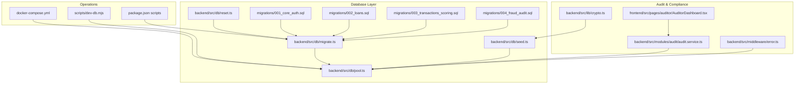
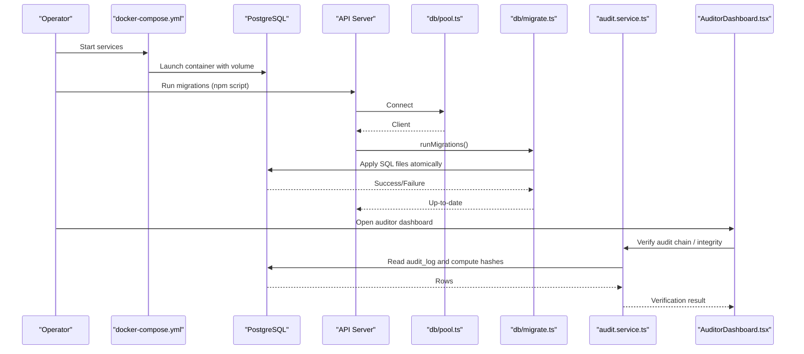
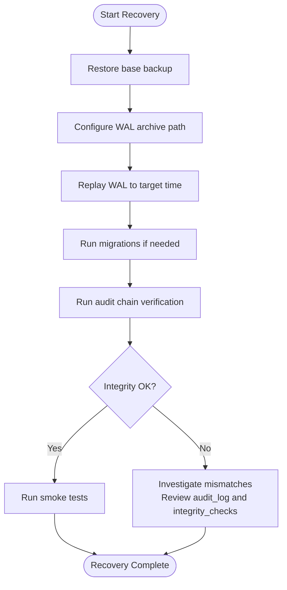
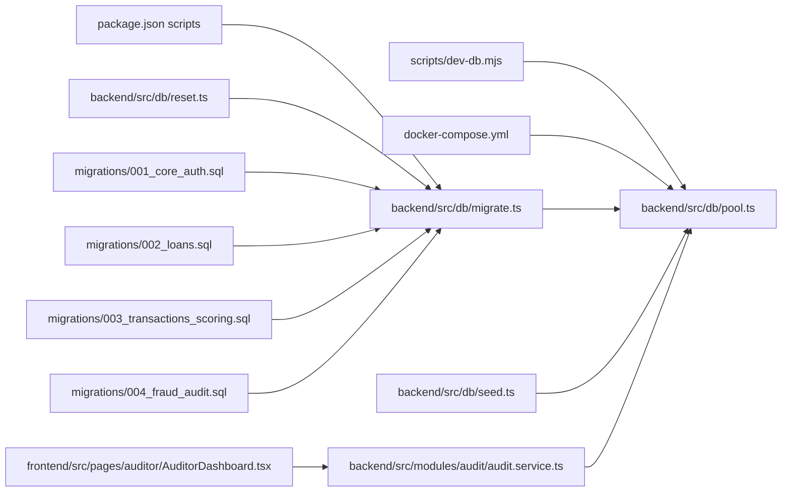

# Maintenance and Backup Procedures

<cite>
**Referenced Files in This Document**
- [docker-compose.yml](file://docker-compose.yml)
- [package.json](file://package.json)
- [scripts/dev-db.mjs](file://scripts/dev-db.mjs)
- [backend/src/db/pool.ts](file://backend/src/db/pool.ts)
- [backend/src/db/migrate.ts](file://backend/src/db/migrate.ts)
- [backend/src/db/reset.ts](file://backend/src/db/reset.ts)
- [backend/src/db/seed.ts](file://backend/src/db/seed.ts)
- [backend/src/db/migrations/001_core_auth.sql](file://backend/src/db/migrations/001_core_auth.sql)
- [backend/src/db/migrations/002_loans.sql](file://backend/src/db/migrations/002_loans.sql)
- [backend/src/db/migrations/003_transactions_scoring.sql](file://backend/src/db/migrations/003_transactions_scoring.sql)
- [backend/src/db/migrations/004_fraud_audit.sql](file://backend/src/db/migrations/004_fraud_audit.sql)
- [backend/src/modules/audit/audit.service.ts](file://backend/src/modules/audit/audit.service.ts)
- [backend/src/lib/crypto.ts](file://backend/src/lib/crypto.ts)
- [backend/src/middleware/error.ts](file://backend/src/middleware/error.ts)
- [frontend/src/pages/auditor/AuditorDashboard.tsx](file://frontend/src/pages/auditor/AuditorDashboard.tsx)
</cite>

## Table of Contents
1. [Introduction](#introduction)
2. [Project Structure](#project-structure)
3. [Core Components](#core-components)
4. [Architecture Overview](#architecture-overview)
5. [Detailed Component Analysis](#detailed-component-analysis)
6. [Dependency Analysis](#dependency-analysis)
7. [Performance Considerations](#performance-considerations)
8. [Troubleshooting Guide](#troubleshooting-guide)
9. [Conclusion](#conclusion)
10. [Appendices](#appendices)

## Introduction
This document defines maintenance and backup procedures for the SecureMicrofinance application with a focus on PostgreSQL data safety, schema evolution, audit integrity, and operational reliability. It covers:

- Database backup and recovery strategies, including point-in-time recovery guidance and data integrity verification using the built-in audit chain.
- Routine maintenance tasks such as migration management, log cleanup, dependency updates, and health checks.
- Disaster recovery plans, data archival procedures, and compliance reporting capabilities exposed through the auditor interface and audit trail.
- Performance monitoring, capacity planning, and proactive maintenance schedules to ensure application reliability and data safety.

The repository provides both Docker-based deployment and an embedded PostgreSQL launcher for local development. Schema changes are managed via forward-only SQL migrations, and the system includes an append-only, hash-chained audit log that supports tamper detection and forensic analysis.

## Project Structure
The maintenance-relevant parts of the project include:

- Deployment and environment configuration under docker-compose.yml.
- Scripts for local database lifecycle management.
- Database connection pooling and transaction helpers.
- Migration runner and demo seed/reset utilities.
- SQL schema definitions for identity, loans, transactions, scoring, fraud flags, and audit trails.
- Audit service implementation and integrity verification logic.
- Auditor-facing UI entry points for forensic workflows.

**Diagram sources**
- [docker-compose.yml:1-52](file://docker-compose.yml#L1-L52)
- [scripts/dev-db.mjs:1-171](file://scripts/dev-db.mjs#L1-L171)
- [package.json:11-29](file://package.json#L11-L29)
- [backend/src/db/pool.ts:1-62](file://backend/src/db/pool.ts#L1-L62)
- [backend/src/db/migrate.ts:1-70](file://backend/src/db/migrate.ts#L1-L70)
- [backend/src/db/reset.ts:1-22](file://backend/src/db/reset.ts#L1-L22)
- [backend/src/db/seed.ts:1-157](file://backend/src/db/seed.ts#L1-L157)
- [backend/src/db/migrations/001_core_auth.sql:1-95](file://backend/src/db/migrations/001_core_auth.sql#L1-L95)
- [backend/src/db/migrations/002_loans.sql:1-100](file://backend/src/db/migrations/002_loans.sql#L1-L100)
- [backend/src/db/migrations/003_transactions_scoring.sql:1-56](file://backend/src/db/migrations/003_transactions_scoring.sql#L1-L56)
- [backend/src/db/migrations/004_fraud_audit.sql:1-136](file://backend/src/db/migrations/004_fraud_audit.sql#L1-L136)
- [backend/src/modules/audit/audit.service.ts:1-39](file://backend/src/modules/audit/audit.service.ts#L1-L39)
- [backend/src/lib/crypto.ts:32-61](file://backend/src/lib/crypto.ts#L32-L61)
- [backend/src/middleware/error.ts:35-76](file://backend/src/middleware/error.ts#L35-L76)
- [frontend/src/pages/auditor/AuditorDashboard.tsx:1-84](file://frontend/src/pages/auditor/AuditorDashboard.tsx#L1-L84)

**Section sources**
- [docker-compose.yml:1-52](file://docker-compose.yml#L1-L52)
- [scripts/dev-db.mjs:1-171](file://scripts/dev-db.mjs#L1-L171)
- [package.json:11-29](file://package.json#L11-L29)

## Core Components
This section summarizes the components most relevant to maintenance and backup operations.

- Database connectivity and transactions
  - A shared connection pool is configured with timeouts and error handling. All queries use parameterized statements to prevent injection. Transactions are wrapped to ensure rollback on failure.
  - Key responsibilities: connection lifecycle, query helpers, transaction wrapper, numeric type parsing for money values.

- Migration and schema evolution
  - Forward-only migration runner applies SQL files once per file, records applied migrations, and supports reset mode for destructive rebuilds.
  - Each migration runs inside its own transaction for atomicity.

- Demo seed and reset
  - Seed creates demo users and encrypted profile fields, recording audit events.
  - Reset drops the schema, re-applies migrations, and seeds data; used by tests and developer workflows.

- Audit trail and integrity verification
  - Append-only audit log with per-row hashes and prev_hash links.
  - Integrity verification recomputes hashes and detects broken links or mismatches.
  - Fraud flags, alerts, and integrity check results are persisted for compliance reporting.

- Local database launcher
  - Embedded PostgreSQL launcher initializes a cluster, starts the server, creates databases, and handles graceful shutdown.

- Auditor dashboard
  - Provides read-only access to platform state and links to forensic tools, including integrity checks and timeline reconstruction.

**Section sources**
- [backend/src/db/pool.ts:1-62](file://backend/src/db/pool.ts#L1-L62)
- [backend/src/db/migrate.ts:1-70](file://backend/src/db/migrate.ts#L1-L70)
- [backend/src/db/reset.ts:1-22](file://backend/src/db/reset.ts#L1-L22)
- [backend/src/db/seed.ts:1-157](file://backend/src/db/seed.ts#L1-L157)
- [backend/src/modules/audit/audit.service.ts:1-39](file://backend/src/modules/audit/audit.service.ts#L1-L39)
- [scripts/dev-db.mjs:1-171](file://scripts/dev-db.mjs#L1-L171)
- [frontend/src/pages/auditor/AuditorDashboard.tsx:1-84](file://frontend/src/pages/auditor/AuditorDashboard.tsx#L1-L84)

## Architecture Overview
The maintenance architecture centers around PostgreSQL as the primary data store, with the API layer managing schema migrations, transactions, and audit logging. The auditor UI provides visibility into integrity and forensic data.

**Diagram sources**
- [docker-compose.yml:1-52](file://docker-compose.yml#L1-L52)
- [backend/src/db/pool.ts:1-62](file://backend/src/db/pool.ts#L1-L62)
- [backend/src/db/migrate.ts:1-70](file://backend/src/db/migrate.ts#L1-L70)
- [backend/src/modules/audit/audit.service.ts:1-39](file://backend/src/modules/audit/audit.service.ts#L1-L39)
- [frontend/src/pages/auditor/AuditorDashboard.tsx:1-84](file://frontend/src/pages/auditor/AuditorDashboard.tsx#L1-L84)

## Detailed Component Analysis

### Database Backup and Recovery Procedures
- Backup strategy
  - Use PostgreSQL-native logical backups (e.g., pg_dump) against the production database instance referenced by DATABASE_URL.
  - For Docker environments, back up the persistent volume mounted at the PostgreSQL data directory.
  - Schedule regular full backups and enable WAL archiving for point-in-time recovery (PITR). Ensure WAL segments are retained according to your RPO.

- Point-in-time recovery
  - Configure continuous WAL archiving on the PostgreSQL server.
  - Restore a base backup, replay archived WAL logs to the desired recovery target time.
  - Validate PITR by running integrity checks after recovery.

- Data integrity verification
  - Use the audit chain verification function to recompute row hashes and detect broken links or mismatches.
  - Record integrity check results in the integrity_checks table for auditability.

- Recovery validation
  - After restore, run migrations to ensure schema consistency.
  - Execute smoke tests to verify API endpoints and authentication flows.
  - Confirm that sensitive fields remain encrypted and cannot be decrypted without keys.

**Diagram sources**
- [backend/src/modules/audit/audit.service.ts:120-165](file://backend/src/modules/audit/audit.service.ts#L120-L165)
- [backend/src/db/migrations/004_fraud_audit.sql:113-136](file://backend/src/db/migrations/004_fraud_audit.sql#L113-L136)

**Section sources**
- [backend/src/modules/audit/audit.service.ts:120-165](file://backend/src/modules/audit/audit.service.ts#L120-L165)
- [backend/src/db/migrations/004_fraud_audit.sql:113-136](file://backend/src/db/migrations/004_fraud_audit.sql#L113-L136)

### Routine Maintenance Tasks
- Database optimization
  - Analyze and vacuum tables periodically to maintain statistics and reclaim space.
  - Review indexes defined in migrations for coverage and performance.
  - Monitor long-running queries and adjust connection pool settings if necessary.

- Log cleanup
  - Rotate and archive PostgreSQL server logs and CLI logs produced by the embedded launcher.
  - Clean up old audit logs only through approved archival processes; do not truncate due to append-only constraints.

- Dependency updates
  - Update Node.js dependencies and review security advisories.
  - Test migrations and seed routines after upgrades to ensure compatibility.

- Health checks
  - Use the health endpoint to monitor API status.
  - Integrate health checks into CI/CD pipelines and production monitoring.

**Section sources**
- [backend/src/db/migrations/001_core_auth.sql:1-95](file://backend/src/db/migrations/001_core_auth.sql#L1-L95)
- [backend/src/db/migrations/002_loans.sql:1-100](file://backend/src/db/migrations/002_loans.sql#L1-L100)
- [backend/src/db/migrations/003_transactions_scoring.sql:1-56](file://backend/src/db/migrations/003_transactions_scoring.sql#L1-L56)
- [backend/src/db/migrations/004_fraud_audit.sql:1-136](file://backend/src/db/migrations/004_fraud_audit.sql#L1-L136)
- [scripts/dev-db.mjs:67-83](file://scripts/dev-db.mjs#L67-L83)
- [frontend/src/pages/auditor/AuditorDashboard.tsx:19-32](file://frontend/src/pages/auditor/AuditorDashboard.tsx#L19-L32)

### Disaster Recovery Plan
- Roles and responsibilities
  - Define who can initiate recovery, approve PITR targets, and validate restored data.
  - Maintain contact lists for DBAs, security team, and auditors.

- Recovery objectives
  - Define RTO (recovery time objective) and RPO (recovery point objective).
  - Align backup frequency and WAL retention with these objectives.

- Recovery steps
  - Stop write traffic to the affected database.
  - Restore from the latest base backup.
  - Replay WAL archives to the target time.
  - Run migrations and seed routines only if required.
  - Perform integrity verification and smoke tests.
  - Resume operations and monitor closely.

- Post-incident actions
  - Document root cause and remediation steps.
  - Update runbooks and training materials.
  - Conduct a compliance review if PII was involved.

[No sources needed since this section provides general guidance]

### Data Archival Procedures
- Archival scope
  - Archive historical audit logs, fraud flags, alerts, and completed loan documents according to retention policies.
  - Preserve cryptographic hashes and anchors for forensic continuity.

- Archival process
  - Export archived data using secure methods (e.g., encrypted dumps or object storage with encryption).
  - Store checksums and manifests alongside archived datasets.
  - Retain encryption keys securely and separately from data.

- Compliance considerations
  - Ensure archival meets regulatory requirements for financial and personal data.
  - Provide auditable export reports and chain-of-custody documentation.

[No sources needed since this section provides general guidance]

### Compliance Reporting Capabilities
- Audit trail
  - The append-only audit log captures actor, action, entity, timestamps, and cryptographic hashes.
  - Integrity checks record mismatches and results for auditing.

- Auditor dashboard
  - Provides read-only access to platform state and links to forensic tools.
  - Supports rebuilding timelines and running integrity checks.

- Reports
  - Generate reports from audit_log and integrity_checks for compliance reviews.
  - Include summaries of fraud flags and their resolutions.

**Section sources**
- [backend/src/modules/audit/audit.service.ts:1-39](file://backend/src/modules/audit/audit.service.ts#L1-L39)
- [backend/src/db/migrations/004_fraud_audit.sql:58-136](file://backend/src/db/migrations/004_fraud_audit.sql#L58-L136)
- [frontend/src/pages/auditor/AuditorDashboard.tsx:36-84](file://frontend/src/pages/auditor/AuditorDashboard.tsx#L36-L84)

### Performance Monitoring and Capacity Planning
- Monitoring
  - Track database connections, query latency, and lock contention.
  - Monitor audit log growth and integrity check durations.

- Capacity planning
  - Size storage based on expected growth of loans, transactions, and audit logs.
  - Plan index maintenance and partitioning strategies for large tables.

- Proactive maintenance schedule
  - Weekly: health checks, dependency scans, and log rotation.
  - Monthly: vacuum/analyze, backup verification, and integrity audits.
  - Quarterly: disaster recovery drills and compliance report reviews.

[No sources needed since this section provides general guidance]

## Dependency Analysis
The following diagram shows key dependencies among maintenance-related modules.

**Diagram sources**
- [scripts/dev-db.mjs:1-171](file://scripts/dev-db.mjs#L1-L171)
- [docker-compose.yml:1-52](file://docker-compose.yml#L1-L52)
- [package.json:11-29](file://package.json#L11-L29)
- [backend/src/db/pool.ts:1-62](file://backend/src/db/pool.ts#L1-L62)
- [backend/src/db/migrate.ts:1-70](file://backend/src/db/migrate.ts#L1-L70)
- [backend/src/db/reset.ts:1-22](file://backend/src/db/reset.ts#L1-L22)
- [backend/src/db/seed.ts:1-157](file://backend/src/db/seed.ts#L1-L157)
- [backend/src/db/migrations/001_core_auth.sql:1-95](file://backend/src/db/migrations/001_core_auth.sql#L1-L95)
- [backend/src/db/migrations/002_loans.sql:1-100](file://backend/src/db/migrations/002_loans.sql#L1-L100)
- [backend/src/db/migrations/003_transactions_scoring.sql:1-56](file://backend/src/db/migrations/003_transactions_scoring.sql#L1-L56)
- [backend/src/db/migrations/004_fraud_audit.sql:1-136](file://backend/src/db/migrations/004_fraud_audit.sql#L1-L136)
- [backend/src/modules/audit/audit.service.ts:1-39](file://backend/src/modules/audit/audit.service.ts#L1-L39)
- [frontend/src/pages/auditor/AuditorDashboard.tsx:1-84](file://frontend/src/pages/auditor/AuditorDashboard.tsx#L1-L84)

**Section sources**
- [package.json:11-29](file://package.json#L11-L29)
- [backend/src/db/migrate.ts:1-70](file://backend/src/db/migrate.ts#L1-L70)
- [backend/src/db/pool.ts:1-62](file://backend/src/db/pool.ts#L1-L62)

## Performance Considerations
- Connection pool tuning
  - Adjust max connections based on workload and database capacity.
  - Monitor idle timeout and connection timeout to avoid resource exhaustion.

- Query performance
  - Leverage parameterized queries already in place to prevent injection and improve plan reuse.
  - Add or refine indexes based on query patterns observed in loans, transactions, and audit logs.

- Audit chain overhead
  - Hash computation and advisory locking serialize writes to the audit log; consider batching where appropriate.
  - Monitor sequence usage and table growth to plan archival and partitioning.

- Storage and I/O
  - Ensure sufficient disk space for WAL archives and audit logs.
  - Use fast storage for active tables and cold storage for archives.

[No sources needed since this section provides general guidance]

## Troubleshooting Guide
Common issues and resolutions:

- Database connection errors
  - Verify PostgreSQL is running and reachable.
  - Check connection pool configuration and environment variables.

- Migration failures
  - Inspect migration logs and SQL files for syntax or constraint violations.
  - Use reset mode cautiously; it drops and recreates the schema.

- Append-only constraint violations
  - Attempts to update or delete audit_log rows trigger explicit errors.
  - Use integrity checks to detect tampering rather than direct edits.

- Duplicate or constraint violations
  - Unique constraints and business rules return structured error responses.
  - Review input validation and referential integrity before retrying.

**Section sources**
- [backend/src/db/migrate.ts:42-51](file://backend/src/db/migrate.ts#L42-L51)
- [backend/src/db/reset.ts:9-13](file://backend/src/db/reset.ts#L9-L13)
- [backend/src/middleware/error.ts:41-76](file://backend/src/middleware/error.ts#L41-L76)
- [backend/src/db/migrations/004_fraud_audit.sql:93-111](file://backend/src/db/migrations/004_fraud_audit.sql#L93-L111)

## Conclusion
SecureMicrofinance provides robust foundations for maintenance and backup operations:

- PostgreSQL-backed data persistence with clear migration and transaction management.
- An append-only, hash-chained audit trail enabling tamper detection and forensic analysis.
- Operational tooling for local development and Docker-based deployments.
- Auditor-facing interfaces supporting compliance reporting and integrity verification.

Adopting the recommended backup, recovery, and maintenance practices will ensure data safety, regulatory compliance, and reliable operation under changing conditions.

[No sources needed since this section summarizes without analyzing specific files]

## Appendices

### Appendix A: Maintenance Checklist
- Daily
  - Verify health endpoints and database connectivity.
  - Review error logs and audit anomalies.
- Weekly
  - Rotate logs and clean temporary files.
  - Scan dependencies for vulnerabilities.
- Monthly
  - Run vacuum/analyze and review index usage.
  - Verify backups and test restore procedures.
  - Execute audit chain integrity checks.
- Quarterly
  - Conduct disaster recovery drills.
  - Review compliance reports and retention policies.

[No sources needed since this section provides general guidance]

### Appendix B: Environment Variables and Configuration
- DATABASE_URL
  - Points to the PostgreSQL instance used by the API.
- POSTGRES_PASSWORD
  - Used by Docker Compose to configure the PostgreSQL service.
- WEB_ORIGIN
  - Configures frontend origin within Docker Compose.

**Section sources**
- [docker-compose.yml:7-34](file://docker-compose.yml#L7-L34)