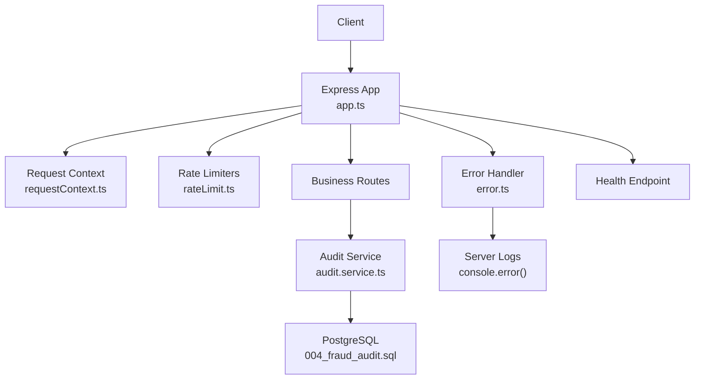
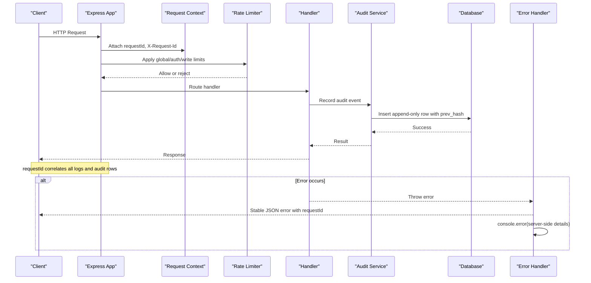
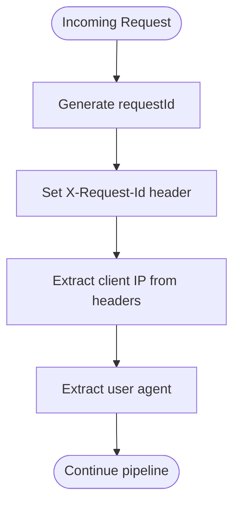
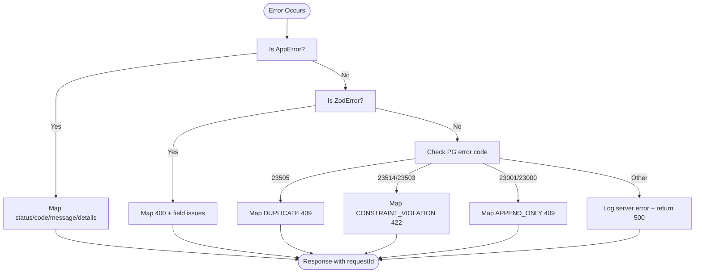
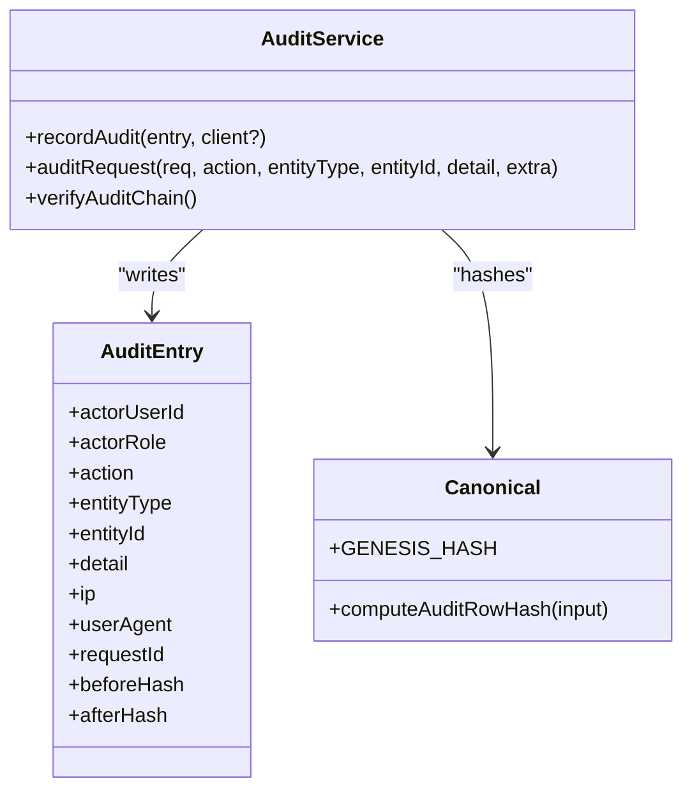
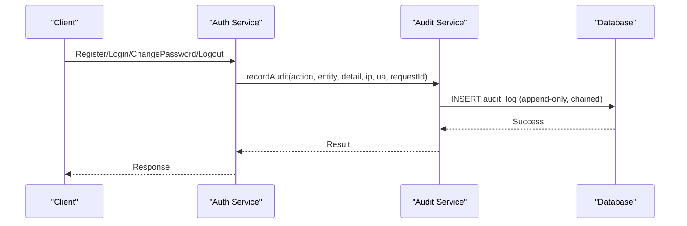
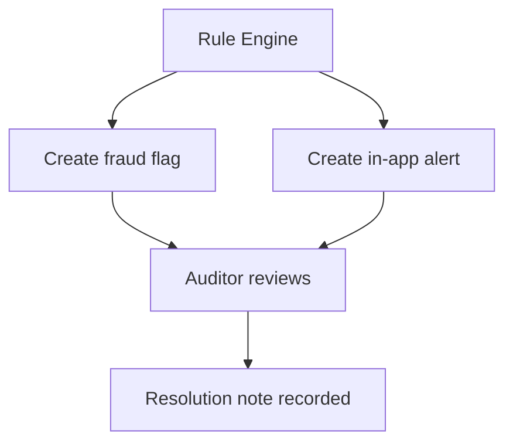
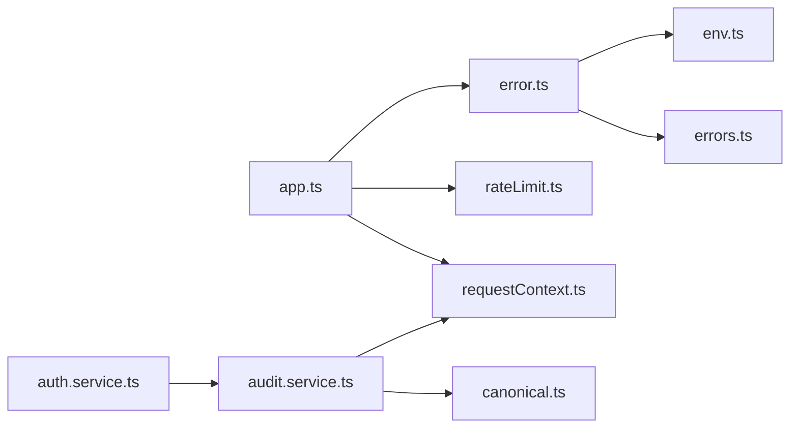

# Monitoring and Logging

<cite>
**Referenced Files in This Document**
- [app.ts](file://backend/src/app.ts)
- [server.ts](file://backend/src/server.ts)
- [env.ts](file://backend/src/config/env.ts)
- [error.ts](file://backend/src/middleware/error.ts)
- [requestContext.ts](file://backend/src/middleware/requestContext.ts)
- [rateLimit.ts](file://backend/src/middleware/rateLimit.ts)
- [errors.ts](file://backend/src/lib/errors.ts)
- [canonical.ts](file://backend/src/lib/canonical.ts)
- [audit.service.ts](file://backend/src/modules/audit/audit.service.ts)
- [004_fraud_audit.sql](file://backend/src/db/migrations/004_fraud_audit.sql)
- [auth.service.ts](file://backend/src/modules/auth/auth.service.ts)
- [users.service.ts](file://backend/src/modules/users/users.service.ts)
</cite>

## Table of Contents
1. [Introduction](#introduction)
2. [Project Structure](#project-structure)
3. [Core Components](#core-components)
4. [Architecture Overview](#architecture-overview)
5. [Detailed Component Analysis](#detailed-component-analysis)
6. [Dependency Analysis](#dependency-analysis)
7. [Performance Considerations](#performance-considerations)
8. [Troubleshooting Guide](#troubleshooting-guide)
9. [Conclusion](#conclusion)
10. [Appendices](#appendices)

## Introduction
This document explains the monitoring, logging, and audit strategies used by the SecureMicrofinance application. It focuses on structured request correlation, centralized error handling, append-only hash-chained audit trails, fraud alerting, and operational safeguards such as rate limiting. It also provides guidance for log aggregation, performance metrics collection, alerting mechanisms, retention policies, and compliance considerations relevant to financial applications.

## Project Structure
The monitoring and logging capabilities are implemented primarily in the backend:
- Application bootstrap wires security headers, CORS, request context, rate limiting, routes, and error handlers.
- Middleware adds correlation identifiers, client IP, and user agent context.
- A central error handler normalizes errors into a stable JSON shape and logs server-side details.
- An audit service writes tamper-evident rows to an append-only database table with cryptographic linking.
- Configuration defines environment-driven behavior including log levels and production flags.

**Diagram sources**
- [app.ts:24-94](file://backend/src/app.ts#L24-L94)
- [requestContext.ts:9-13](file://backend/src/middleware/requestContext.ts#L9-L13)
- [rateLimit.ts:14-40](file://backend/src/middleware/rateLimit.ts#L14-L40)
- [audit.service.ts:37-94](file://backend/src/modules/audit/audit.service.ts#L37-L94)
- [004_fraud_audit.sql:67-121](file://backend/src/db/migrations/004_fraud_audit.sql#L67-L121)
- [error.ts:19-76](file://backend/src/middleware/error.ts#L19-L76)

**Section sources**
- [app.ts:24-94](file://backend/src/app.ts#L24-L94)
- [server.ts:6-25](file://backend/src/server.ts#L6-L25)

## Core Components
- Structured request correlation: Every request receives a unique identifier that is returned in a response header and persisted in audit entries.
- Centralized error handling: All exceptions are converted into a consistent JSON structure; internal stack traces and SQL details never leak to clients.
- Append-only audit trail: Database-level immutability enforced by triggers, plus per-row hashes forming a chain that detects silent edits.
- Fraud alerts and flags: Rule-based detection creates persistent alerts and flags for review.
- Rate limiting: Global, authentication-specific, and write-specific limits protect against abuse and scraping.
- Environment configuration: Log level and production mode influence error detail exposure and runtime behavior.

**Section sources**
- [requestContext.ts:9-28](file://backend/src/middleware/requestContext.ts#L9-L28)
- [error.ts:19-76](file://backend/src/middleware/error.ts#L19-L76)
- [audit.service.ts:37-191](file://backend/src/modules/audit/audit.service.ts#L37-L191)
- [004_fraud_audit.sql:67-121](file://backend/src/db/migrations/004_fraud_audit.sql#L67-L121)
- [rateLimit.ts:14-40](file://backend/src/middleware/rateLimit.ts#L14-L40)
- [env.ts:28-33](file://backend/src/config/env.ts#L28-L33)

## Architecture Overview
The request lifecycle integrates monitoring and auditing at multiple layers:
- Security and CORS are applied first.
- Request context attaches a correlation ID and prepares client IP/user agent helpers.
- Rate limiters throttle traffic before route handlers execute.
- Business logic invokes the audit service to record immutable events.
- Errors are caught by a single middleware that returns safe responses and logs server-side diagnostics.

**Diagram sources**
- [app.ts:31-64](file://backend/src/app.ts#L31-L64)
- [requestContext.ts:9-13](file://backend/src/middleware/requestContext.ts#L9-L13)
- [rateLimit.ts:14-40](file://backend/src/middleware/rateLimit.ts#L14-L40)
- [audit.service.ts:37-94](file://backend/src/modules/audit/audit.service.ts#L37-L94)
- [error.ts:19-76](file://backend/src/middleware/error.ts#L19-L76)

## Detailed Component Analysis

### Structured Logging and Request Correlation
- The request context middleware generates a UUID for each request, sets it on the request object, and echoes it back via a response header.
- Helper functions extract the best-effort client IP (honoring proxy headers) and user agent, which are included in audit entries.
- These values enable cross-referencing between client-visible errors, server logs, and audit records.

**Diagram sources**
- [requestContext.ts:9-28](file://backend/src/middleware/requestContext.ts#L9-L28)

**Section sources**
- [requestContext.ts:9-28](file://backend/src/middleware/requestContext.ts#L9-L28)

### Centralized Error Handling and Standardized Error Shape
- The error handler maps typed application errors, validation errors, and specific PostgreSQL error codes to stable JSON responses.
- Internal details are suppressed in production; development may include hints derived from the thrown error message.
- All error responses include the correlation ID for traceability.

**Diagram sources**
- [error.ts:19-76](file://backend/src/middleware/error.ts#L19-L76)
- [errors.ts:8-39](file://backend/src/lib/errors.ts#L8-L39)

**Section sources**
- [error.ts:19-76](file://backend/src/middleware/error.ts#L19-L76)
- [errors.ts:8-39](file://backend/src/lib/errors.ts#L8-L39)

### Audit Trail System and Hash Chain Integrity
- The audit service writes append-only rows containing actor identity, action, entity type, optional entity ID, contextual IP/user agent/request ID, and a detail payload.
- Each row stores the previous row’s hash and computes its own hash using canonical serialization and SHA-256.
- Database triggers prevent updates, deletes, and truncation of the audit table.
- Verification recomputes every row hash and validates the prev_hash link to detect tampering.

**Diagram sources**
- [audit.service.ts:15-32](file://backend/src/modules/audit/audit.service.ts#L15-L32)
- [audit.service.ts:37-94](file://backend/src/modules/audit/audit.service.ts#L37-L94)
- [audit.service.ts:142-191](file://backend/src/modules/audit/audit.service.ts#L142-L191)
- [canonical.ts:96-116](file://backend/src/lib/canonical.ts#L96-L116)
- [004_fraud_audit.sql:67-121](file://backend/src/db/migrations/004_fraud_audit.sql#L67-L121)

**Section sources**
- [audit.service.ts:37-191](file://backend/src/modules/audit/audit.service.ts#L37-L191)
- [canonical.ts:96-116](file://backend/src/lib/canonical.ts#L96-L116)
- [004_fraud_audit.sql:67-121](file://backend/src/db/migrations/004_fraud_audit.sql#L67-L121)

### Authentication Events and Audit Integration
- Registration, login success/failure, password changes, and logout all emit audit events with contextual data.
- Failed login attempts update lockout state and are audited to support forensic analysis.
- Successful operations revoke sessions where appropriate and record session lifecycle events.

**Diagram sources**
- [auth.service.ts:61-112](file://backend/src/modules/auth/auth.service.ts#L61-L112)
- [auth.service.ts:114-198](file://backend/src/modules/auth/auth.service.ts#L114-L198)
- [auth.service.ts:200-261](file://backend/src/modules/auth/auth.service.ts#L200-L261)
- [audit.service.ts:37-94](file://backend/src/modules/audit/audit.service.ts#L37-L94)

**Section sources**
- [auth.service.ts:61-261](file://backend/src/modules/auth/auth.service.ts#L61-L261)
- [audit.service.ts:37-94](file://backend/src/modules/audit/audit.service.ts#L37-L94)

### Fraud Flags, Alerts, and Forensic Visibility
- Rule-based fraud detection produces flags and alerts stored in dedicated tables with severity, source, and deduplication keys.
- Alerts are persisted for users to review and resolve, enabling operational visibility into suspicious activity.
- The audit chain complements these signals by providing an immutable record of who did what, when, and from where.

**Diagram sources**
- [004_fraud_audit.sql:21-56](file://backend/src/db/migrations/004_fraud_audit.sql#L21-L56)

**Section sources**
- [004_fraud_audit.sql:21-56](file://backend/src/db/migrations/004_fraud_audit.sql#L21-L56)

### Rate Limiting and Operational Safeguards
- Global, authentication-specific, and write-specific rate limiters protect against brute force, credential stuffing, and scraping.
- Limits are bypassed in test environments to ensure deterministic tests.
- Responses for rate-limited requests use the standardized error shape with a clear code and message.

**Section sources**
- [rateLimit.ts:14-40](file://backend/src/middleware/rateLimit.ts#L14-L40)
- [error.ts:29-38](file://backend/src/middleware/error.ts#L29-L38)

### Data Privacy and Sensitive Field Handling
- Profile retrieval masks sensitive fields after decryption at the edge, ensuring raw values do not leave the API.
- This pattern reduces risk during logging and transport while preserving necessary display information.

**Section sources**
- [users.service.ts:19-59](file://backend/src/modules/users/users.service.ts#L19-L59)

## Dependency Analysis
Monitoring and logging components interact as follows:
- app.ts composes middleware and routes, placing request context and rate limiting early in the pipeline.
- requestContext.ts depends only on Node crypto and Express types.
- error.ts depends on typed application errors and environment configuration.
- audit.service.ts depends on database pool utilities, canonical hashing, and request context helpers.
- auth.service.ts uses audit.service.ts to record lifecycle events.

**Diagram sources**
- [app.ts:24-94](file://backend/src/app.ts#L24-L94)
- [requestContext.ts:9-28](file://backend/src/middleware/requestContext.ts#L9-L28)
- [rateLimit.ts:14-40](file://backend/src/middleware/rateLimit.ts#L14-L40)
- [error.ts:19-76](file://backend/src/middleware/error.ts#L19-L76)
- [errors.ts:8-39](file://backend/src/lib/errors.ts#L8-L39)
- [env.ts:98-105](file://backend/src/config/env.ts#L98-L105)
- [audit.service.ts:37-94](file://backend/src/modules/audit/audit.service.ts#L37-L94)
- [canonical.ts:96-116](file://backend/src/lib/canonical.ts#L96-L116)
- [auth.service.ts:61-261](file://backend/src/modules/auth/auth.service.ts#L61-L261)

**Section sources**
- [app.ts:24-94](file://backend/src/app.ts#L24-L94)
- [error.ts:19-76](file://backend/src/middleware/error.ts#L19-L76)
- [audit.service.ts:37-191](file://backend/src/modules/audit/audit.service.ts#L37-L191)
- [auth.service.ts:61-261](file://backend/src/modules/auth/auth.service.ts#L61-L261)

## Performance Considerations
- Audit writes are serialized using an advisory transaction lock to prevent chain forks under concurrency.
- Canonical JSON serialization ensures deterministic hashing without expensive object construction.
- Indexes on audit tables optimize queries by entity, actor, time, and detail content.
- Rate limiters reduce load from abusive traffic and protect downstream systems.
- Avoid logging large payloads or secrets; prefer minimal structured fields and correlation IDs.

[No sources needed since this section provides general guidance]

## Troubleshooting Guide
- Use the X-Request-Id header to correlate client errors with server logs and audit rows.
- For duplicate or constraint violations, inspect the standardized error code and details returned by the error handler.
- If the audit chain appears broken, run the verification routine to identify mismatches and broken links.
- In production, detailed error messages are suppressed; collect requestId and contact support with that identifier.

**Section sources**
- [error.ts:19-76](file://backend/src/middleware/error.ts#L19-L76)
- [audit.service.ts:142-191](file://backend/src/modules/audit/audit.service.ts#L142-L191)

## Conclusion
SecureMicrofinance implements a robust monitoring and logging strategy centered on structured request correlation, centralized error handling, and an append-only, hash-chained audit trail. Combined with fraud alerting, rate limiting, and privacy-preserving data handling, these mechanisms provide strong visibility, integrity, and compliance readiness for financial workloads.

[No sources needed since this section summarizes without analyzing specific files]

## Appendices

### Log Aggregation Patterns
- Emit structured JSON lines with fields such as timestamp, level, requestId, method, path, statusCode, and error code.
- Include correlation IDs consistently across services to enable distributed tracing.
- Avoid logging sensitive data; mask or omit PII and secrets.

[No sources needed since this section provides general guidance]

### Performance Metrics Collection
- Track request latency, error rates, and throughput per endpoint.
- Monitor audit write latency and chain verification duration.
- Instrument rate limiter rejections and database connection pool utilization.

[No sources needed since this section provides general guidance]

### Alerting Mechanisms
- Alert on high error rates, repeated rate limit rejections, and audit chain verification failures.
- Surface fraud flags and unresolved alerts to operators and auditors.

[No sources needed since this section provides general guidance]

### Custom Log Formats and Error Tracking Integration
- Adopt a standard schema for logs (e.g., timestamp, level, requestId, component, message, metadata).
- Integrate with external error tracking by sending structured error objects with requestId and context, excluding secrets.

[No sources needed since this section provides general guidance]

### Forensic Analysis Capabilities
- Reconstruct user journeys using requestId-linked audit rows.
- Validate chain integrity to detect tampering.
- Cross-reference fraud flags and alerts with audit events for root cause analysis.

**Section sources**
- [audit.service.ts:142-191](file://backend/src/modules/audit/audit.service.ts#L142-L191)

### Log Rotation, Retention Policies, and Compliance
- Implement log rotation based on size and age to manage storage costs.
- Define retention periods aligned with regulatory requirements; archive immutable audit data separately.
- Ensure access controls and encryption for stored logs and audit records.
- Maintain audit chain anchors and periodic integrity checks for compliance reporting.

[No sources needed since this section provides general guidance]