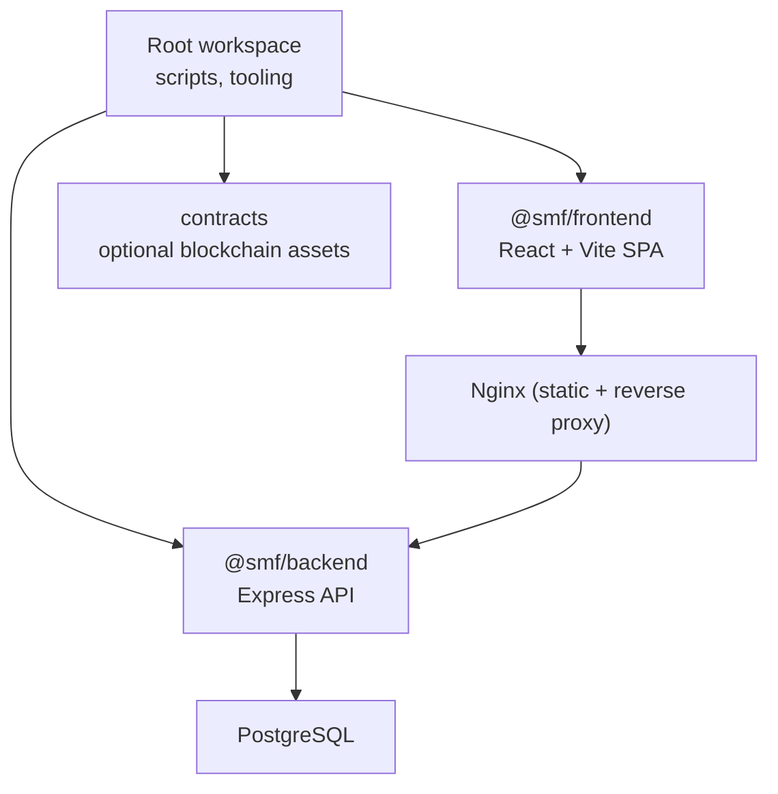
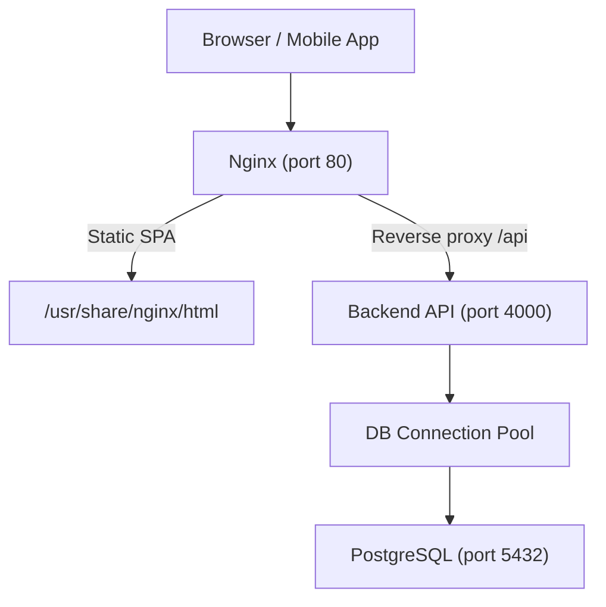
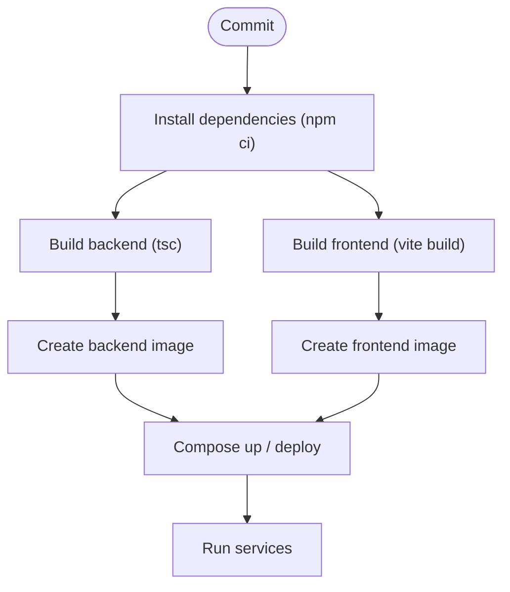
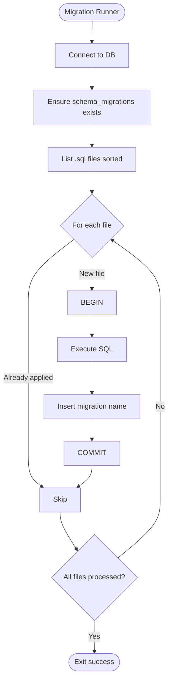
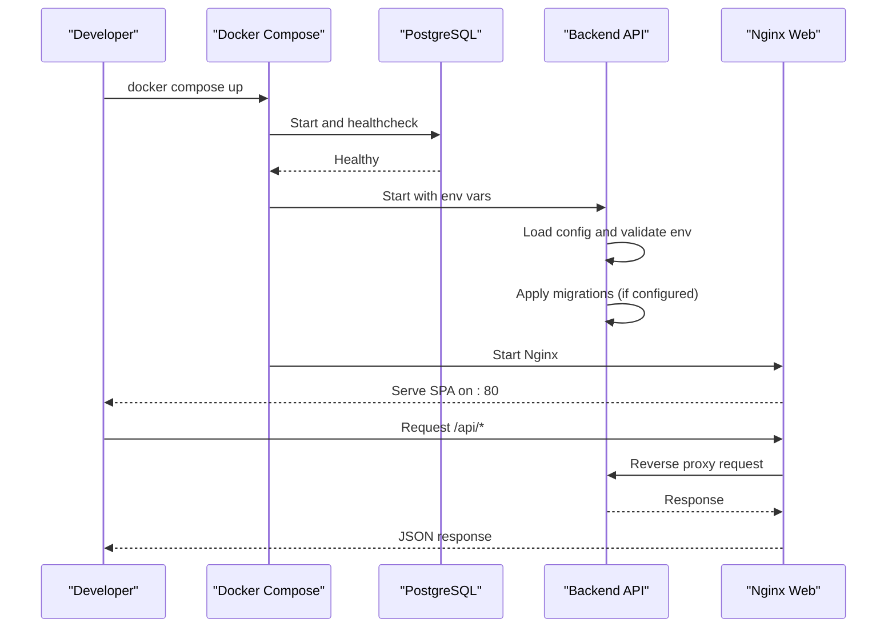
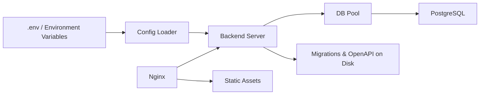

# Production Deployment Procedures

<cite>
**Referenced Files in This Document**
- [package.json](file://package.json)
- [backend/package.json](file://backend/package.json)
- [frontend/package.json](file://frontend/package.json)
- [docker-compose.yml](file://docker-compose.yml)
- [backend/Dockerfile](file://backend/Dockerfile)
- [frontend/Dockerfile](file://frontend/Dockerfile)
- [backend/src/config/env.ts](file://backend/src/config/env.ts)
- [backend/src/server.ts](file://backend/src/server.ts)
- [backend/src/db/pool.ts](file://backend/src/db/pool.ts)
- [backend/src/db/migrate.ts](file://backend/src/db/migrate.ts)
- [frontend/vite.config.ts](file://frontend/vite.config.ts)
</cite>

## Table of Contents
1. Introduction
2. Project Structure
3. Core Components
4. Architecture Overview
5. Detailed Component Analysis
6. Dependency Analysis
7. Performance Considerations
8. Troubleshooting Guide
9. Conclusion
10. Appendices

## Introduction
This document defines the production deployment procedures for SecureMicrofinance, covering the complete pipeline from code commit to a safe, observable production release. It details database migrations, asset compilation, service orchestration, scaling and load balancing strategies, rollback procedures, health checks, and verification steps. It also addresses cloud platform considerations, CI/CD integration, and automated testing gates required before deployment.

The application consists of:
- A Node.js Express API (TypeScript) with PostgreSQL and optional blockchain ledger integrations.
- A React + Vite frontend SPA served by Nginx.
- Docker Compose-based local stack and containerized artifacts suitable for cloud deployment.

## Project Structure
At a high level, the repository is an npm workspaces monorepo containing backend, frontend, and contracts packages. The root package.json orchestrates common scripts such as building both components, running tests, and managing the database.

**Diagram sources**
- [package.json:6-29](file://package.json#L6-L29)
- [docker-compose.yml:6-48](file://docker-compose.yml#L6-L48)

Key responsibilities:
- Root scripts coordinate builds, tests, and database operations across workspaces.
- Backend exposes REST endpoints, manages authentication, and runs schema migrations at startup or via CLI.
- Frontend builds static assets and is served through Nginx, which proxies API calls to the backend.

**Section sources**
- [package.json:1-39](file://package.json#L1-L39)
- [docker-compose.yml:1-52](file://docker-compose.yml#L1-L52)

## Core Components
- Backend runtime: compiled TypeScript server entrypoint that starts the Express app, listens on a configurable port, and handles graceful shutdown.
- Database layer: shared connection pool with typed query helpers and transaction support; migration runner applies SQL files forward-only.
- Configuration: environment validation using Zod with strict defaults and fail-fast behavior for missing secrets.
- Frontend build: Vite produces optimized static assets; development server proxies /api to the backend.

Operational implications:
- Migrations must be applied before serving requests.
- All sensitive values are provided via environment variables validated at startup.
- Container images are multi-stage and minimal for production.

**Section sources**
- [backend/src/server.ts:1-26](file://backend/src/server.ts#L1-L26)
- [backend/src/db/pool.ts:1-62](file://backend/src/db/pool.ts#L1-L62)
- [backend/src/db/migrate.ts:1-70](file://backend/src/db/migrate.ts#L1-L70)
- [backend/src/config/env.ts:1-106](file://backend/src/config/env.ts#L1-L106)
- [frontend/vite.config.ts:1-24](file://frontend/vite.config.ts#L1-L24)

## Architecture Overview
The production architecture uses containers orchestrated by Docker Compose locally and can be adapted to Kubernetes or managed services in the cloud.

Deployment notes:
- Nginx serves the built SPA and proxies /api to the backend, eliminating CORS concerns in production.
- The backend reads migrations from disk and applies them before accepting traffic.
- Health checks are defined for the database; additional readiness/liveness probes should be added for the API and web layers in production.

**Diagram sources**
- [docker-compose.yml:6-48](file://docker-compose.yml#L6-L48)
- [frontend/Dockerfile:14-18](file://frontend/Dockerfile#L14-L18)
- [backend/Dockerfile:15-29](file://backend/Dockerfile#L15-L29)

## Detailed Component Analysis

### Build and Packaging Pipeline
- Backend image:
  - Multi-stage build installs dependencies once, compiles TypeScript, and copies only runtime artifacts (dist, migrations, OpenAPI spec).
  - Runs as non-root user and exposes port 4000.
- Frontend image:
  - Builds the SPA with Vite and serves it via Nginx, copying built assets into the Nginx HTML directory.
  - Exposes port 80.

**Diagram sources**
- [backend/Dockerfile:1-29](file://backend/Dockerfile#L1-L29)
- [frontend/Dockerfile:1-18](file://frontend/Dockerfile#L1-L18)
- [backend/package.json:7-16](file://backend/package.json#L7-L16)
- [frontend/package.json:7-12](file://frontend/package.json#L7-L12)

**Section sources**
- [backend/Dockerfile:1-29](file://backend/Dockerfile#L1-L29)
- [frontend/Dockerfile:1-18](file://frontend/Dockerfile#L1-L18)
- [backend/package.json:7-16](file://backend/package.json#L7-L16)
- [frontend/package.json:7-12](file://frontend/package.json#L7-L12)

### Database Migration Process
Migrations are forward-only SQL files executed in order within transactions and tracked in a schema_migrations table. The migration runner supports an optional reset mode for local environments.

Operational guidance:
- Always run migrations before starting the API in production.
- Use the provided script to apply migrations in CI/CD.
- Avoid reset mode in production; it drops and recreates the schema.

**Diagram sources**
- [backend/src/db/migrate.ts:14-58](file://backend/src/db/migrate.ts#L14-L58)

**Section sources**
- [backend/src/db/migrate.ts:1-70](file://backend/src/db/migrate.ts#L1-L70)
- [backend/package.json:12-14](file://backend/package.json#L12-L14)

### Service Orchestration and Runtime
- docker-compose defines three services: PostgreSQL, API, and Web.
- The API depends on a healthy Postgres instance and exposes port 4000.
- The Web service depends on the API and exposes port 80.

**Diagram sources**
- [docker-compose.yml:6-48](file://docker-compose.yml#L6-L48)
- [backend/src/config/env.ts:81-105](file://backend/src/config/env.ts#L81-L105)

**Section sources**
- [docker-compose.yml:1-52](file://docker-compose.yml#L1-L52)
- [backend/src/server.ts:1-26](file://backend/src/server.ts#L1-L26)
- [backend/src/config/env.ts:1-106](file://backend/src/config/env.ts#L1-L106)

### Environment Configuration and Secrets
- Configuration is loaded from .env files with fallbacks and validated against a strict schema.
- Missing or invalid configuration causes a hard failure at startup to prevent insecure operation.
- Sensitive keys include JWT secrets, encryption keys, and database credentials.

Production checklist:
- Provide DATABASE_URL, JWT_ACCESS_SECRET, JWT_REFRESH_SECRET, FIELD_ENCRYPTION_KEY, BLIND_INDEX_KEY, and other required variables.
- Set NODE_ENV=production and LOG_LEVEL appropriately.
- Configure WEB_ORIGIN for CORS in development; in production, Nginx proxies /api so CORS is not needed.

**Section sources**
- [backend/src/config/env.ts:1-106](file://backend/src/config/env.ts#L1-L106)

### Frontend Asset Compilation and Proxying
- Development server proxies /api to the backend to maintain a single origin.
- Production builds output static assets served by Nginx, which also proxies /api to the backend.

**Section sources**
- [frontend/vite.config.ts:1-24](file://frontend/vite.config.ts#L1-L24)
- [frontend/Dockerfile:14-18](file://frontend/Dockerfile#L14-L18)

## Dependency Analysis
The following diagram shows runtime dependencies between services and external components.

**Diagram sources**
- [backend/src/config/env.ts:1-106](file://backend/src/config/env.ts#L1-L106)
- [backend/src/db/pool.ts:1-62](file://backend/src/db/pool.ts#L1-L62)
- [backend/Dockerfile:23-25](file://backend/Dockerfile#L23-L25)
- [frontend/Dockerfile:14-18](file://frontend/Dockerfile#L14-L18)

Coupling and cohesion:
- The API depends on configuration, database pool, and filesystem for migrations/OpenAPI.
- Nginx is decoupled from application logic and only proxies and serves static content.
- Database interactions are centralized in the pool module, improving cohesion.

Potential circular dependencies:
- None observed in the analyzed files.

External dependencies:
- PostgreSQL for persistence.
- Optional blockchain ledger integration controlled by environment variables.

**Section sources**
- [backend/src/config/env.ts:1-106](file://backend/src/config/env.ts#L1-L106)
- [backend/src/db/pool.ts:1-62](file://backend/src/db/pool.ts#L1-L62)
- [backend/Dockerfile:23-25](file://backend/Dockerfile#L23-L25)
- [frontend/Dockerfile:14-18](file://frontend/Dockerfile#L14-L18)

## Performance Considerations
- Connection pooling: The database pool size is set to 10 with idle and connection timeouts. Tune based on expected concurrency and database capacity.
- Resource allocation:
  - Allocate sufficient CPU and memory for Node.js processes; consider horizontal scaling over vertical scaling for stateless API instances.
  - Use managed PostgreSQL with appropriate instance sizing and read replicas if needed.
- Caching: Introduce caching layers (e.g., Redis) for hot reads if latency becomes critical.
- Static assets: Nginx efficiently serves SPA assets; enable gzip/brotli compression at the CDN or edge layer.
- Rate limiting: Enable rate limiting middleware in production to protect against abuse.

[No sources needed since this section provides general guidance]

## Troubleshooting Guide
Common issues and resolutions:
- Startup fails due to invalid environment configuration:
  - Ensure all required variables are present and valid; the loader will list validation errors and abort.
- Database connection failures:
  - Verify DATABASE_URL and network connectivity; check Postgres healthcheck and credentials.
- Migration failures:
  - Inspect the failing migration file; ensure idempotent DDL where possible and review error messages.
- Graceful shutdown hangs:
  - The server enforces a timeout to force exit if connections do not close; investigate stuck queries or long-running transactions.

Health checks and observability:
- Add HTTP health endpoints (/healthz, /readyz) to the API for liveness and readiness probes.
- Expose metrics (e.g., Prometheus) and structured logging.
- Monitor database connection pool saturation and query latency.

Rollback procedures:
- Database:
  - Maintain backward-compatible migrations; avoid destructive changes without a corresponding rollback plan.
  - If a migration fails, fix the SQL and re-run; use backups for recovery if necessary.
- Application:
  - Use immutable container images tagged with commit SHAs.
  - Roll back to the previous known-good image tag.
- Frontend:
  - Re-deploy the previous frontend image; static assets are versioned by build output.

Verification steps:
- Smoke test the API endpoints.
- Validate that the SPA loads and API routes resolve under Nginx.
- Confirm database migrations are applied and schema matches expectations.
- Check logs for errors and verify health endpoints return OK.

**Section sources**
- [backend/src/config/env.ts:81-105](file://backend/src/config/env.ts#L81-L105)
- [backend/src/server.ts:14-25](file://backend/src/server.ts#L14-L25)
- [backend/src/db/migrate.ts:48-51](file://backend/src/db/migrate.ts#L48-L51)
- [docker-compose.yml:17-21](file://docker-compose.yml#L17-L21)

## Conclusion
SecureMicrofinance’s production deployment relies on containerized services, strict environment validation, and forward-only database migrations. By following the outlined pipeline—build, migrate, deploy, verify—and adopting the scaling, observability, and rollback practices described here, teams can safely operate the application in production environments.

[No sources needed since this section summarizes without analyzing specific files]

## Appendices

### End-to-End Deployment Checklist
- Pre-deployment
  - Run type checks and unit/integration tests.
  - Build backend and frontend artifacts.
  - Review and approve database migrations.
- Deployment
  - Provision infrastructure (managed Postgres, container runtime).
  - Inject environment variables securely.
  - Apply database migrations.
  - Deploy backend and frontend images.
  - Configure DNS and TLS termination.
- Post-deployment
  - Run smoke tests against production endpoints.
  - Verify health checks and monitoring dashboards.
  - Perform end-to-end user flows.

**Section sources**
- [package.json:11-29](file://package.json#L11-L29)
- [backend/package.json:7-16](file://backend/package.json#L7-L16)
- [frontend/package.json:7-12](file://frontend/package.json#L7-L12)
- [docker-compose.yml:6-48](file://docker-compose.yml#L6-L48)