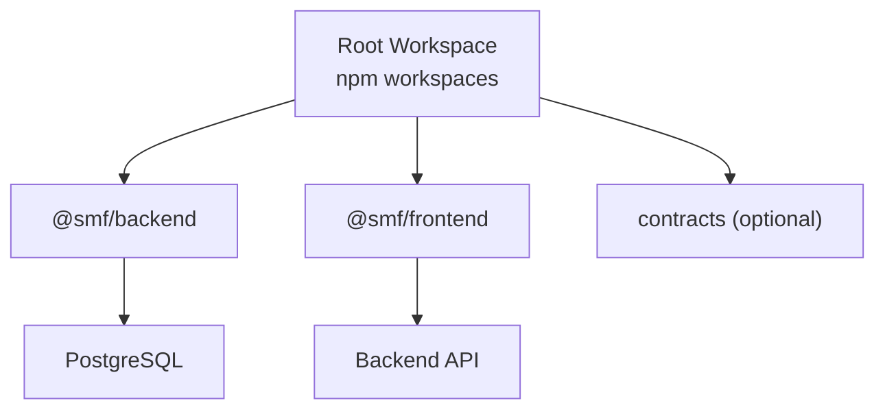
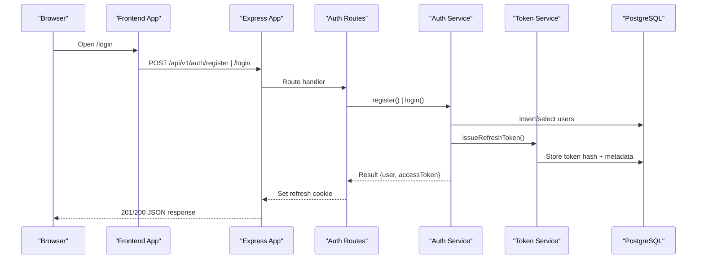
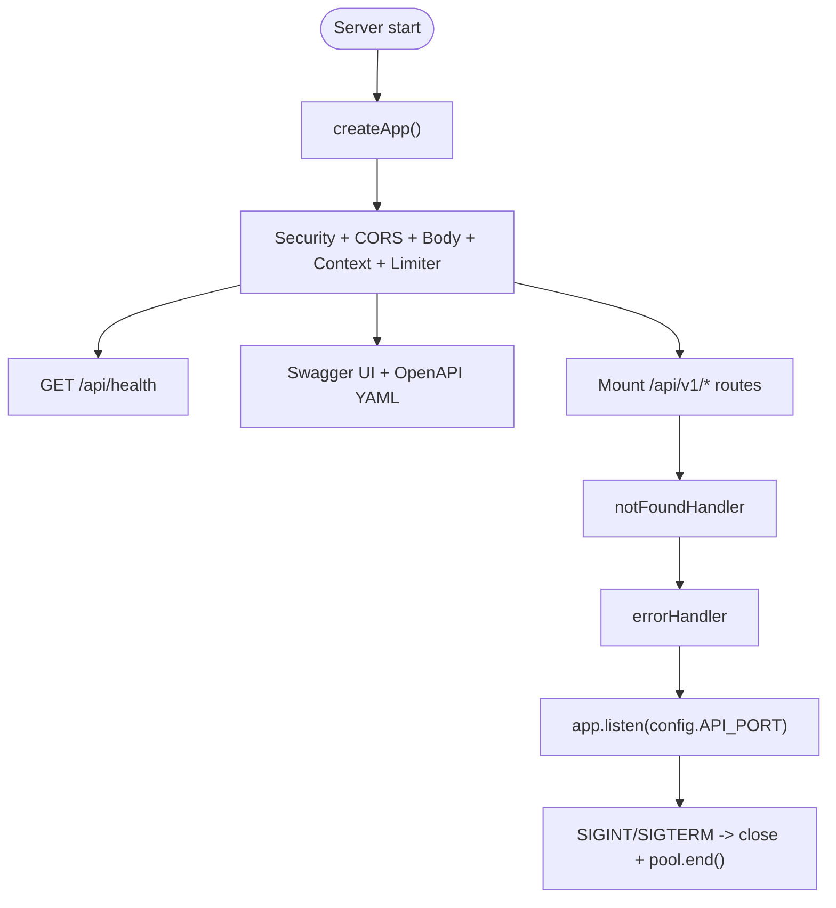
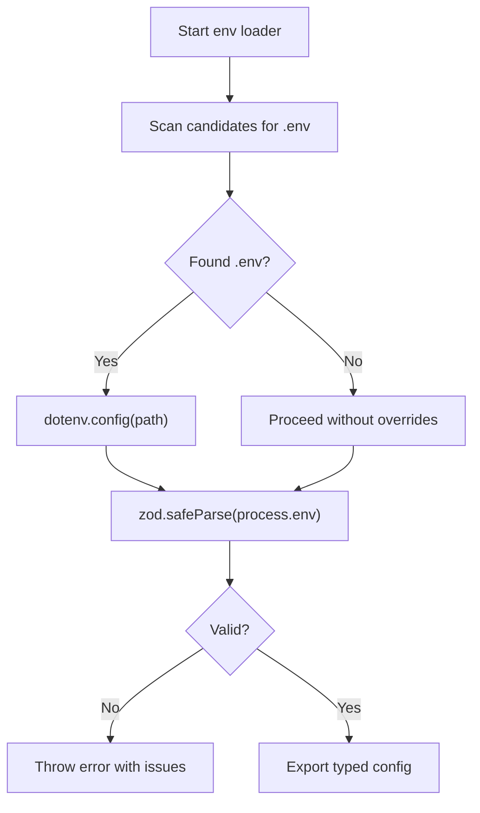
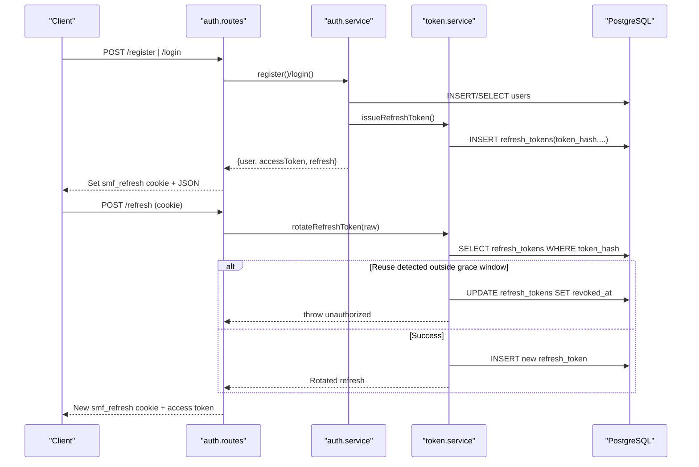
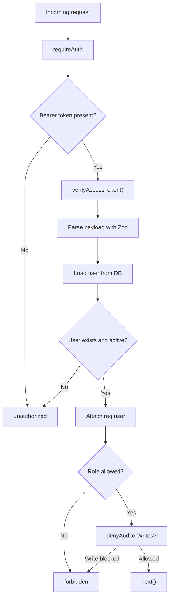
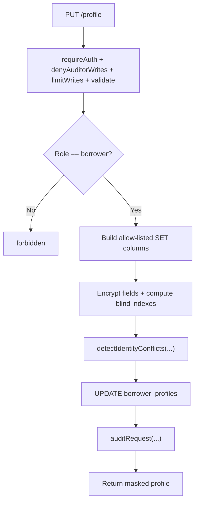
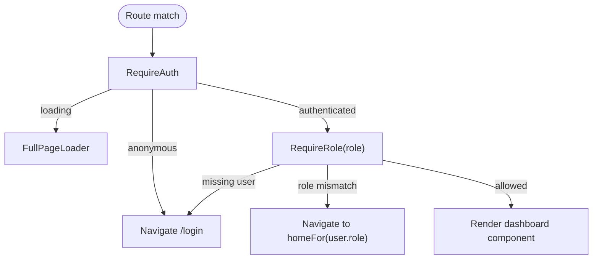
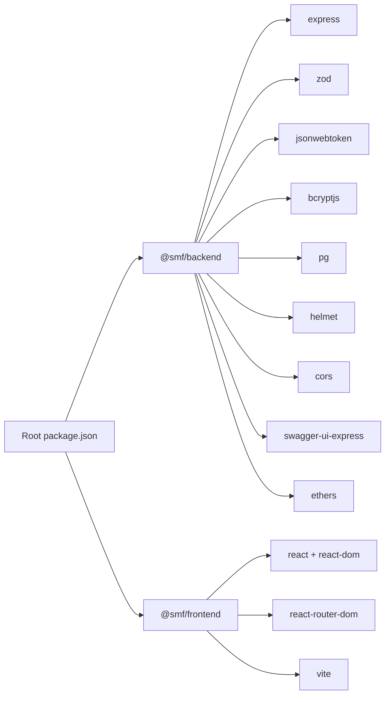

# Developer Guide

<cite>
**Referenced Files in This Document**
- [package.json](file://package.json)
- [backend/package.json](file://backend/package.json)
- [frontend/package.json](file://frontend/package.json)
- [backend/tsconfig.json](file://backend/tsconfig.json)
- [frontend/tsconfig.json](file://frontend/tsconfig.json)
- [docker-compose.yml](file://docker-compose.yml)
- [backend/src/app.ts](file://backend/src/app.ts)
- [backend/src/server.ts](file://backend/src/server.ts)
- [backend/src/config/env.ts](file://backend/src/config/env.ts)
- [backend/vitest.config.mts](file://backend/vitest.config.mts)
- [backend/src/modules/auth/auth.routes.ts](file://backend/src/modules/auth/auth.routes.ts)
- [backend/src/modules/auth/auth.service.ts](file://backend/src/modules/auth/auth.service.ts)
- [backend/src/modules/auth/token.service.ts](file://backend/src/modules/auth/token.service.ts)
- [backend/src/middleware/auth.ts](file://backend/src/middleware/auth.ts)
- [backend/src/modules/users/users.routes.ts](file://backend/src/modules/users/users.routes.ts)
- [backend/src/modules/users/users.service.ts](file://backend/src/modules/users/users.service.ts)
- [frontend/src/App.tsx](file://frontend/src/App.tsx)
- [frontend/src/main.tsx](file://frontend/src/main.tsx)
</cite>

## Table of Contents
1. Introduction
2. Project Structure
3. Core Components
4. Architecture Overview
5. Detailed Component Analysis
6. Dependency Analysis
7. Performance Considerations
8. Troubleshooting Guide
9. Contribution Process and Code Review Guidelines
10. Release Procedures
11. Extension Points for New Features
12. Conclusion

## Introduction
This developer guide explains how to contribute to SecureMicrofinance, a security-focused microfinance prototype with a Node.js/Express backend, React frontend, PostgreSQL database, optional blockchain ledger integration, and an audit trail. It covers coding conventions, TypeScript configuration, project structure guidelines, development workflow, debugging techniques, profiling approaches, code review practices, release procedures, troubleshooting, and extension points.

## Project Structure
The repository is a monorepo using npm workspaces:
- Root package.json defines shared scripts and workspace members: backend, frontend, contracts.
- Backend implements the REST API, authentication, user profiles, rate limiting, validation, OpenAPI docs, and optional on-chain ledger operations.
- Frontend is a React + Vite application with role-based routing and PWA service worker registration in production.
- Docker Compose provisions PostgreSQL, API, and web containers for local or CI environments.

**Diagram sources**
- [package.json:6-10](file://package.json#L6-L10)
- [docker-compose.yml:6-52](file://docker-compose.yml#L6-L52)

**Section sources**
- [package.json:1-39](file://package.json#L1-L39)
- [docker-compose.yml:1-52](file://docker-compose.yml#L1-L52)

## Core Components
- Backend app factory wires middleware in a strict order: security headers, CORS, JSON parsing, cookies, request context, global rate limiter, routes, not found handler, error handler.
- Authentication routes implement register/login/refresh/logout/password change with Zod validation, cookie handling, and audit logging.
- Token service manages short-lived access tokens and rotated refresh tokens with family scoping and replay detection.
- User profile endpoints encrypt sensitive fields at rest and expose masked values.
- Frontend App sets up route guards for authentication and roles, and mounts dashboards per role.

Key responsibilities:
- Configuration: centralized environment schema with fail-fast validation.
- Security: Helmet, CORS allowlist, JWT, bcrypt, blind indexes, audit trail.
- Reliability: graceful shutdown, health endpoint, OpenAPI docs.

**Section sources**
- [backend/src/app.ts:16-93](file://backend/src/app.ts#L16-L93)
- [backend/src/modules/auth/auth.routes.ts:15-121](file://backend/src/modules/auth/auth.routes.ts#L15-L121)
- [backend/src/modules/auth/token.service.ts:10-206](file://backend/src/modules/auth/token.service.ts#L10-L206)
- [backend/src/modules/users/users.routes.ts:19-108](file://backend/src/modules/users/users.routes.ts#L19-L108)
- [frontend/src/App.tsx:15-37](file://frontend/src/App.tsx#L15-L37)

## Architecture Overview
The backend exposes a secure REST API behind Express middleware. The frontend consumes it via HTTP and manages auth state client-side. PostgreSQL provides persistence; optional blockchain ledger integration is controlled by configuration.

**Diagram sources**
- [backend/src/app.ts:86-90](file://backend/src/app.ts#L86-L90)
- [backend/src/modules/auth/auth.routes.ts:53-73](file://backend/src/modules/auth/auth.routes.ts#L53-L73)
- [backend/src/modules/auth/auth.service.ts:61-112](file://backend/src/modules/auth/auth.service.ts#L61-L112)
- [backend/src/modules/auth/token.service.ts:64-76](file://backend/src/modules/auth/token.service.ts#L64-L76)

## Detailed Component Analysis

### Backend Application Server
- Creates the Express app with security and CORS configured.
- Serves OpenAPI documentation when available.
- Mounts versioned API routes under /api/v1.
- Graceful shutdown closes server and releases DB connections.

**Diagram sources**
- [backend/src/app.ts:23-93](file://backend/src/app.ts#L23-L93)
- [backend/src/server.ts:6-25](file://backend/src/server.ts#L6-L25)

**Section sources**
- [backend/src/app.ts:16-93](file://backend/src/app.ts#L16-L93)
- [backend/src/server.ts:1-26](file://backend/src/server.ts#L1-L26)

### Configuration Management
- Loads .env from current working directory or repo root.
- Validates all required secrets and settings with Zod; fails fast if invalid.
- Exposes typed config object and helper flags like isProduction and databaseUrl.

**Diagram sources**
- [backend/src/config/env.ts:6-101](file://backend/src/config/env.ts#L6-L101)

**Section sources**
- [backend/src/config/env.ts:1-101](file://backend/src/config/env.ts#L1-L101)

### Authentication Flow
- Register/Login validate inputs with Zod, hash passwords with bcrypt, create users, write audit records, and issue tokens.
- Refresh flow rotates tokens, detects reuse, and revokes families when necessary.
- Access tokens are short-lived JWTs; refresh tokens are opaque, httpOnly, and stored hashed.

**Diagram sources**
- [backend/src/modules/auth/auth.routes.ts:53-96](file://backend/src/modules/auth/auth.routes.ts#L53-L96)
- [backend/src/modules/auth/auth.service.ts:61-112](file://backend/src/modules/auth/auth.service.ts#L61-L112)
- [backend/src/modules/auth/token.service.ts:64-195](file://backend/src/modules/auth/token.service.ts#L64-L195)

**Section sources**
- [backend/src/modules/auth/auth.routes.ts:15-121](file://backend/src/modules/auth/auth.routes.ts#L15-L121)
- [backend/src/modules/auth/auth.service.ts:15-262](file://backend/src/modules/auth/auth.service.ts#L15-L262)
- [backend/src/modules/auth/token.service.ts:10-206](file://backend/src/modules/auth/token.service.ts#L10-L206)

### Authorization Middleware
- requireAuth verifies bearer token, validates payload shape, reloads user from DB, and enforces active status.
- requireRole restricts routes to specific roles.
- denyAuditorWrites blocks auditors from mutating data.

**Diagram sources**
- [backend/src/middleware/auth.ts:18-68](file://backend/src/middleware/auth.ts#L18-L68)

**Section sources**
- [backend/src/middleware/auth.ts:1-69](file://backend/src/middleware/auth.ts#L1-L69)

### User Profile Endpoints
- GET /profile returns masked sensitive fields based on role.
- PUT /profile updates borrower profile fields with encryption and blind indexes, then triggers fraud identity conflict checks.

**Diagram sources**
- [backend/src/modules/users/users.routes.ts:45-107](file://backend/src/modules/users/users.routes.ts#L45-L107)
- [backend/src/modules/users/users.service.ts:19-59](file://backend/src/modules/users/users.service.ts#L19-L59)

**Section sources**
- [backend/src/modules/users/users.routes.ts:19-108](file://backend/src/modules/users/users.routes.ts#L19-L108)
- [backend/src/modules/users/users.service.ts:1-60](file://backend/src/modules/users/users.service.ts#L1-L60)

### Frontend Routing and Guards
- RequireAuth blocks unauthenticated navigation and shows a full-page loader while session status resolves.
- RequireRole prevents cross-role navigation and redirects to the appropriate home page.
- App defines role-scoped routes and placeholder pages for upcoming features.

**Diagram sources**
- [frontend/src/App.tsx:15-37](file://frontend/src/App.tsx#L15-L37)
- [frontend/src/App.tsx:39-204](file://frontend/src/App.tsx#L39-L204)

**Section sources**
- [frontend/src/App.tsx:1-205](file://frontend/src/App.tsx#L1-L205)
- [frontend/src/main.tsx:1-30](file://frontend/src/main.tsx#L1-L30)

## Dependency Analysis
Workspace-level scripts orchestrate backend and frontend tasks. Backend depends on Express, Zod, JWT, bcrypt, pg, helmet, cors, swagger-ui-express, ethers, and js-yaml. Frontend uses React, React Router, Vite, Tailwind, and PostCSS.

**Diagram sources**
- [package.json:11-29](file://package.json#L11-L29)
- [backend/package.json:18-49](file://backend/package.json#L18-L49)
- [frontend/package.json:13-27](file://frontend/package.json#L13-L27)

**Section sources**
- [package.json:1-39](file://package.json#L1-L39)
- [backend/package.json:1-52](file://backend/package.json#L1-L52)
- [frontend/package.json:1-29](file://frontend/package.json#L1-L29)

## Performance Considerations
- Use embedded PostgreSQL for local dev via npm scripts; use Docker Compose for consistent environments.
- Keep test bcrypt cost low (configured in tests) to speed suites.
- Avoid large payloads; JSON body limit is set in the app factory.
- Prefer parameterized queries and allow-listed column updates to reduce SQL injection risk and improve query clarity.
- For performance profiling:
  - Backend: run with Node’s built-in profiler or sampling profiler; capture CPU/memory snapshots during load tests.
  - Frontend: use browser DevTools Performance panel and React Profiler to identify re-renders and heavy computations.
  - Database: enable slow query logs and analyze EXPLAIN plans for hot paths.

[No sources needed since this section provides general guidance]

## Troubleshooting Guide
Common issues and resolutions:
- Invalid environment configuration:
  - Symptom: startup throws with a list of missing or invalid variables.
  - Resolution: copy .env.example to .env and fill required keys; ensure DATABASE_URL, JWT secrets, and encryption keys are correct.
- CORS errors from the frontend:
  - Symptom: requests blocked due to origin policy.
  - Resolution: set WEB_ORIGIN to match the frontend dev server URL; verify allowed origins in the app factory.
- Refresh token reuse errors:
  - Symptom: “Refresh token reuse detected; all sessions revoked.”
  - Resolution: this indicates potential theft; force re-login. If caused by concurrent tabs, ensure your client handles rotation gracefully.
- Test suite slowness or flakiness:
  - Symptom: timeouts or concurrency issues.
  - Resolution: tests disable fileParallelism and use a single test database; avoid parallel test execution and ensure proper setup/teardown.

**Section sources**
- [backend/src/config/env.ts:76-84](file://backend/src/config/env.ts#L76-L84)
- [backend/src/app.ts:39-57](file://backend/src/app.ts#L39-L57)
- [backend/src/modules/auth/token.service.ts:104-145](file://backend/src/modules/auth/token.service.ts#L104-L145)
- [backend/vitest.config.mts:10-26](file://backend/vitest.config.mts#L10-L26)

## Contribution Process and Code Review Guidelines
Development workflow:
- Install dependencies at the repository root.
- Start services:
  - Local DB: npm run db:up
  - Backend dev: npm run dev:api
  - Frontend dev: npm run dev:web
  - All together: npm run dev:all
- Run type checks and tests:
  - npm run typecheck
  - npm run test
- Build artifacts:
  - npm run build

Coding conventions:
- TypeScript:
  - Backend: CommonJS output, strict mode enabled, source maps on, types limited to node.
  - Frontend: ESNext modules, JSX runtime automatic, isolatedModules enabled.
- Validation:
  - Use Zod schemas at route boundaries for input validation.
- Security:
  - Never log secrets; use environment variables.
  - Encrypt sensitive fields before storage; store blind indexes for duplicate detection.
  - Enforce role-based access via middleware.
- Naming:
  - Services: camelCase functions and PascalCase interfaces/types.
  - Modules: feature folders with clear separation of concerns (routes, services, middleware).
- Error handling:
  - Centralized error handlers; return consistent error shapes.
- Testing:
  - Vitest for backend; keep tests against real DB where integrity guarantees matter.

Code review checklist:
- Are inputs validated with Zod?
- Are secrets handled via environment configuration?
- Is there adequate audit logging for state-changing actions?
- Are SQL queries parameterized and columns allow-listed?
- Are roles enforced via middleware where appropriate?
- Are tests covering critical flows and edge cases?

**Section sources**
- [backend/tsconfig.json:1-22](file://backend/tsconfig.json#L1-L22)
- [frontend/tsconfig.json:1-18](file://frontend/tsconfig.json#L1-L18)
- [backend/src/modules/auth/auth.routes.ts:20-49](file://backend/src/modules/auth/auth.routes.ts#L20-L49)
- [backend/src/modules/users/users.routes.ts:52-101](file://backend/src/modules/users/users.routes.ts#L52-L101)
- [backend/vitest.config.mts:10-26](file://backend/vitest.config.mts#L10-L26)

## Release Procedures
- Pre-release checks:
  - Type check both workspaces: npm run typecheck
  - Run backend tests: npm run test
  - Build backend and frontend: npm run build
- Environment preparation:
  - Ensure .env contains production values for DATABASE_URL, JWT secrets, encryption keys, and CHAIN_MODE.
  - Verify docker-compose.yml ports and environment variables align with deployment targets.
- Deployment:
  - Use Docker Compose for containerized deployments or follow the server deployment guide referenced in compose comments.
  - Confirm health endpoint responds and docs are accessible.

**Section sources**
- [package.json:11-29](file://package.json#L11-L29)
- [docker-compose.yml:23-48](file://docker-compose.yml#L23-L48)

## Extension Points for New Features
- Add new API routes:
  - Create a new module folder under backend/src/modules/<feature>.
  - Define routes in <feature>.routes.ts with Zod validation and middleware composition.
  - Implement business logic in <feature>.service.ts.
  - Wire routes into app.ts under /api/v1.
- Extend authentication:
  - Use requireAuth and requireRole middleware to protect new endpoints.
  - Log relevant events via audit service.
- Integrate additional services:
  - Configure external service URLs and timeouts in env.ts and consume via typed config.
- Frontend additions:
  - Add new pages under frontend/src/pages/<role>/<FeaturePage.tsx>.
  - Register routes in App.tsx with appropriate RequireRole guards.
  - Consume API via existing lib/api patterns and handle auth state through lib/auth.

**Section sources**
- [backend/src/app.ts:86-90](file://backend/src/app.ts#L86-L90)
- [backend/src/middleware/auth.ts:43-68](file://backend/src/middleware/auth.ts#L43-L68)
- [frontend/src/App.tsx:46-199](file://frontend/src/App.tsx#L46-L199)

## Conclusion
SecureMicrofinance follows a disciplined architecture emphasizing security, auditability, and maintainability. By adhering to the coding conventions, TypeScript configurations, and workflows outlined here, contributors can safely extend functionality, debug effectively, and ship reliable changes. Use the provided diagrams and section references to navigate the codebase and understand key flows such as authentication, authorization, and profile management.