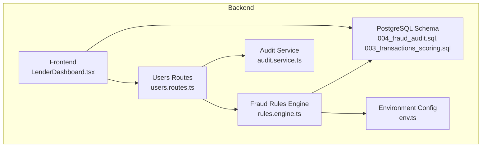
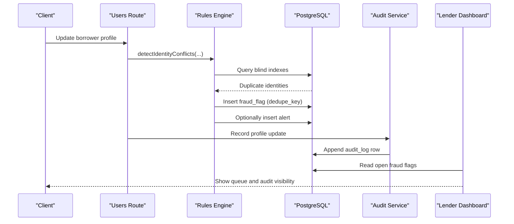
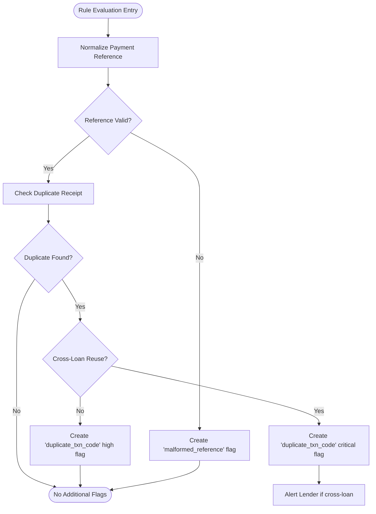
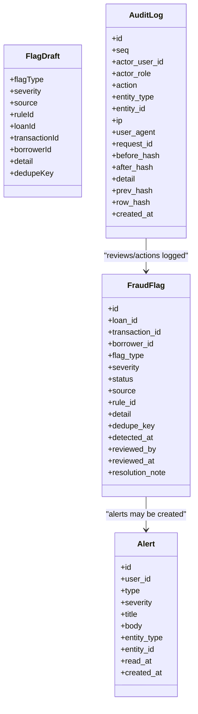
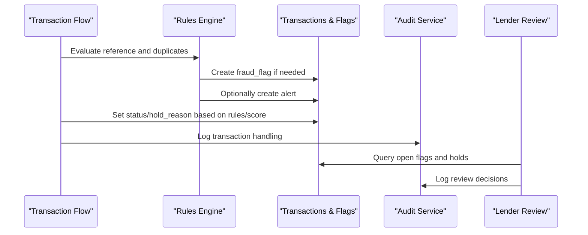
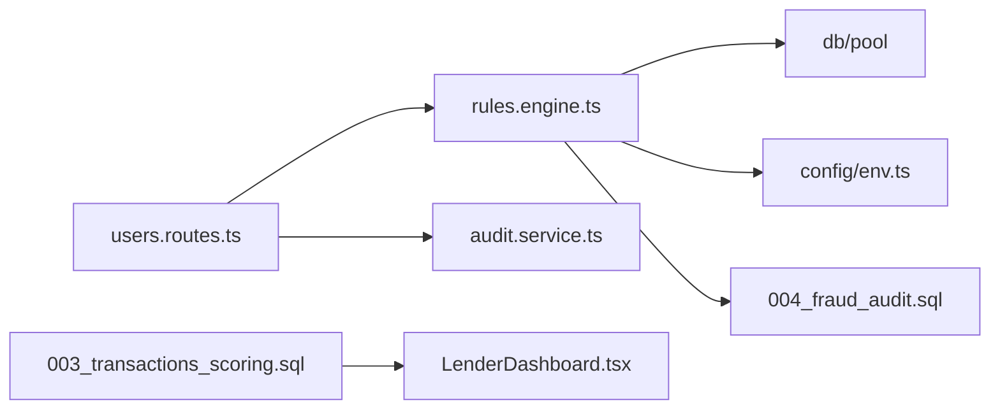

# Fraud Detection Engine

<cite>
**Referenced Files in This Document**
- [rules.engine.ts](file://backend/src/modules/fraud/rules.engine.ts)
- [004_fraud_audit.sql](file://backend/src/db/migrations/004_fraud_audit.sql)
- [audit.service.ts](file://backend/src/modules/audit/audit.service.ts)
- [users.routes.ts](file://backend/src/modules/users/users.routes.ts)
- [env.ts](file://backend/src/config/env.ts)
- [003_transactions_scoring.sql](file://backend/src/db/migrations/003_transactions_scoring.sql)
- [LenderDashboard.tsx](file://frontend/src/pages/lender/LenderDashboard.tsx)
</cite>

## Table of Contents
1. [Introduction](#introduction)
2. [Project Structure](#project-structure)
3. [Core Components](#core-components)
4. [Architecture Overview](#architecture-overview)
5. [Detailed Component Analysis](#detailed-component-analysis)
6. [Dependency Analysis](#dependency-analysis)
7. [Performance Considerations](#performance-considerations)
8. [Troubleshooting Guide](#troubleshooting-guide)
9. [Conclusion](#conclusion)

## Introduction
This document explains the fraud detection engine implemented in the backend. It focuses on:
- The rule-based detection system and its built-in rules.
- How flags are created, deduplicated, and escalated to lenders.
- Integration with transaction monitoring and advisory scoring.
- The append-only audit trail used for forensic review.
- Manual review workflow signals exposed to the lender interface.
- Performance characteristics and strategies for adding or optimizing custom rules.

The engine is intentionally deterministic and explainable at layer one. A separate machine-learning anomaly layer is referenced but not implemented in this repository snapshot.

## Project Structure
The fraud-related implementation spans a small set of focused files:
- Rule engine and flag management live under the fraud module.
- Database schema defines fraud flags, alerts, and an append-only audit log.
- User profile updates trigger identity conflict checks.
- Transaction schema includes fields for fraud score, status, and hold reasons.
- Configuration exposes thresholds for rapid application detection.
- The frontend lender dashboard surfaces open fraud flags and audit visibility.

**Diagram sources**
- [LenderDashboard.tsx:1-69](file://frontend/src/pages/lender/LenderDashboard.tsx#L1-L69)
- [users.routes.ts:1-108](file://backend/src/modules/users/users.routes.ts#L1-L108)
- [rules.engine.ts:1-275](file://backend/src/modules/fraud/rules.engine.ts#L1-L275)
- [audit.service.ts:1-191](file://backend/src/modules/audit/audit.service.ts#L1-L191)
- [004_fraud_audit.sql:1-136](file://backend/src/db/migrations/004_fraud_audit.sql#L1-L136)
- [003_transactions_scoring.sql:1-56](file://backend/src/db/migrations/003_transactions_scoring.sql#L1-L56)
- [env.ts:66-71](file://backend/src/config/env.ts#L66-L71)

**Section sources**
- [rules.engine.ts:1-275](file://backend/src/modules/fraud/rules.engine.ts#L1-L275)
- [004_fraud_audit.sql:1-136](file://backend/src/db/migrations/004_fraud_audit.sql#L1-L136)
- [audit.service.ts:1-191](file://backend/src/modules/audit/audit.service.ts#L1-L191)
- [users.routes.ts:1-108](file://backend/src/modules/users/users.routes.ts#L1-L108)
- [env.ts:66-71](file://backend/src/config/env.ts#L66-L71)
- [003_transactions_scoring.sql:1-56](file://backend/src/db/migrations/003_transactions_scoring.sql#L1-L56)
- [LenderDashboard.tsx:1-69](file://frontend/src/pages/lender/LenderDashboard.tsx#L1-L69)

## Core Components
- Rule engine: Implements deterministic fraud rules, mobile reference validation, flag creation, deduplication, and lender alerting.
- Flag model: Defines flag types, severity levels, source classification, and structured detail payloads.
- Audit service: Provides an append-only, hash-chained audit trail with tamper verification.
- Transaction schema: Stores money movements, statuses, hold reasons, and advisory fraud scores.
- Environment configuration: Exposes thresholds controlling rule behavior such as rapid application windows.
- Frontend integration: Surfaces open fraud flags and emphasizes auditability for lenders.

Key responsibilities:
- Detect suspicious patterns early (identity conflicts, duplicate references, rapid applications, duplicate disbursements).
- Persist explainable evidence via JSONB details.
- Prevent duplicate reporting through natural dedupe keys.
- Notify lenders when high-risk conditions occur.
- Keep all actions auditable with cryptographic linkage.

**Section sources**
- [rules.engine.ts:11-32](file://backend/src/modules/fraud/rules.engine.ts#L11-L32)
- [rules.engine.ts:54-92](file://backend/src/modules/fraud/rules.engine.ts#L54-L92)
- [004_fraud_audit.sql:21-56](file://backend/src/db/migrations/004_fraud_audit.sql#L21-L56)
- [audit.service.ts:7-32](file://backend/src/modules/audit/audit.service.ts#L7-L32)
- [003_transactions_scoring.sql:11-35](file://backend/src/db/migrations/003_transactions_scoring.sql#L11-L35)
- [env.ts:66-71](file://backend/src/config/env.ts#L66-L71)
- [LenderDashboard.tsx:23-63](file://frontend/src/pages/lender/LenderDashboard.tsx#L23-L63)

## Architecture Overview
The fraud detection architecture combines rule evaluation, database-backed state, and audit integrity.

**Diagram sources**
- [users.routes.ts:45-103](file://backend/src/modules/users/users.routes.ts#L45-L103)
- [rules.engine.ts:94-143](file://backend/src/modules/fraud/rules.engine.ts#L94-L143)
- [rules.engine.ts:54-92](file://backend/src/modules/fraud/rules.engine.ts#L54-L92)
- [audit.service.ts:37-94](file://backend/src/modules/audit/audit.service.ts#L37-L94)
- [LenderDashboard.tsx:23-63](file://frontend/src/pages/lender/LenderDashboard.tsx#L23-L63)

## Detailed Component Analysis

### Rule-Based Detection System
The rule engine implements five core rules plus shared utilities:
- R1: Duplicate mobile-money receipt across transactions.
- R2: Malformed or forged payment reference.
- R3: Identity inconsistency using blind indexes.
- R4: Rapid repeated loan applications within a configured window.
- R5: Duplicate disbursement attempt for the same loan.

Shared utilities:
- Mobile code normalization and validation.
- Flag persistence with deduplication.
- Lender alert insertion.

**Diagram sources**
- [rules.engine.ts:40-52](file://backend/src/modules/fraud/rules.engine.ts#L40-L52)
- [rules.engine.ts:148-214](file://backend/src/modules/fraud/rules.engine.ts#L148-L214)

Built-in rule behaviors:
- R1 duplicate_txn_code:
  - Detects reuse of the same normalized mobile-money receipt.
  - Assigns higher severity when reused across different loans.
  - Emits detailed context including other transaction IDs and whether it is cross-loan.
- R2 malformed_reference:
  - Validates M-Pesa-style receipts and rejects known forged/test patterns.
  - Records the reason for rejection in flag detail.
- R3 identity_conflict:
  - Compares blind indexes for national ID and phone number.
  - Produces critical flags when duplicates exist across accounts.
  - Masks emails in flag detail to avoid data dumps while preserving investigability.
- R4 rapid_applications:
  - Counts recent loans per borrower within a configurable time window.
  - Uses environment variables for window hours and threshold.
  - Escalates severity based on how many times the threshold is exceeded.
- R5 duplicate_disbursement:
  - Checks for existing cleared or held disbursements on the same loan.
  - Creates a critical flag when a second disbursement attempt is detected.

Flag lifecycle:
- Each rule constructs a FlagDraft containing type, severity, source, ruleId, entity links, detail, and a dedupeKey.
- raiseFlag inserts into fraud_flags with ON CONFLICT DO NOTHING on dedupe_key.
- If already present, the function returns the existing flag id without duplication.

Lender alerting:
- For specific high-severity cases, alertLender inserts an alert record targeting the loan’s lender user.

**Section sources**
- [rules.engine.ts:11-32](file://backend/src/modules/fraud/rules.engine.ts#L11-L32)
- [rules.engine.ts:40-52](file://backend/src/modules/fraud/rules.engine.ts#L40-L52)
- [rules.engine.ts:54-92](file://backend/src/modules/fraud/rules.engine.ts#L54-L92)
- [rules.engine.ts:94-143](file://backend/src/modules/fraud/rules.engine.ts#L94-L143)
- [rules.engine.ts:148-214](file://backend/src/modules/fraud/rules.engine.ts#L148-L214)
- [rules.engine.ts:216-274](file://backend/src/modules/fraud/rules.engine.ts#L216-L274)

### Anomaly Scoring and Risk Levels
The transaction schema supports advisory fraud scoring and risk classification:
- transactions.fraud_score stores a numeric value between 0 and 1.
- credit_scores records model version, source, integer score, risk_level, features, explanation, latency, and advisory_only flag.
- The ML service URL and timeout are configurable; fallback heuristic scoring is supported by schema design.

Important note:
- The repository references an Isolation Forest anomaly client in comments but does not include its implementation here. Therefore, actual ML scoring logic is not present in this snapshot.

Integration points:
- Transactions can be held pending clearance depending on configuration and rule outcomes.
- The presence of fraud_score and risk_level enables downstream workflows to prioritize reviews.

**Section sources**
- [003_transactions_scoring.sql:1-56](file://backend/src/db/migrations/003_transactions_scoring.sql#L1-L56)
- [env.ts:59-64](file://backend/src/config/env.ts#L59-L64)
- [rules.engine.ts:4-10](file://backend/src/modules/fraud/rules.engine.ts#L4-L10)

### Flag Management Mechanisms
Flags are modeled with:
- Enumerated types for flag_type, severity, status, and source.
- Natural dedupe_key to prevent duplicate reports.
- JSONB detail for explainability.
- Indexes for efficient querying by status, severity, and loan association.

Alerts:
- Separate table for in-app notifications to lenders.
- Includes severity, title, body, entity type, and entity id.

Audit chain:
- Append-only audit_log with prev_hash and row_hash.
- Triggers block updates, deletes, and truncation.
- Verification recomputes hashes and checks chain continuity.

**Diagram sources**
- [rules.engine.ts:22-32](file://backend/src/modules/fraud/rules.engine.ts#L22-L32)
- [004_fraud_audit.sql:21-56](file://backend/src/db/migrations/004_fraud_audit.sql#L21-L56)
- [004_fraud_audit.sql:69-91](file://backend/src/db/migrations/004_fraud_audit.sql#L69-L91)

**Section sources**
- [004_fraud_audit.sql:5-19](file://backend/src/db/migrations/004_fraud_audit.sql#L5-L19)
- [004_fraud_audit.sql:21-56](file://backend/src/db/migrations/004_fraud_audit.sql#L21-L56)
- [004_fraud_audit.sql:69-136](file://backend/src/db/migrations/004_fraud_audit.sql#L69-L136)
- [rules.engine.ts:54-92](file://backend/src/modules/fraud/rules.engine.ts#L54-L92)

### Adding and Configuring Custom Fraud Rules
To add a new rule:
1. Define a new flag type in the database enum if needed.
2. Implement a dedicated detection function in the rule engine that:
   - Accepts relevant inputs (loan, transaction, borrower).
   - Performs deterministic checks against the database.
   - Builds a FlagDraft with a stable dedupeKey.
   - Calls raiseFlag to persist the flag.
   - Optionally calls alertLender for high-severity outcomes.
3. Integrate the rule into the appropriate workflow:
   - Profile updates: identity checks.
   - Transaction processing: reference and duplicate checks.
   - Loan application flow: rapid application checks.
4. Configure thresholds via environment variables where applicable.

Configuration knobs currently used by rules:
- RAPID_APPLICATION_WINDOW_HOURS: Time window for counting recent applications.
- RAPID_APPLICATION_MAX_LOANS: Threshold triggering rapid application flags.
- REPAYMENT_REQUIRES_CLEARANCE: Controls whether repayments require clearance.

Example integration pattern:
- The users route invokes identity conflict detection during profile updates.
- Transaction flows would similarly call reference and duplicate checks before clearing payments.

**Section sources**
- [rules.engine.ts:94-143](file://backend/src/modules/fraud/rules.engine.ts#L94-L143)
- [rules.engine.ts:148-214](file://backend/src/modules/fraud/rules.engine.ts#L148-L214)
- [rules.engine.ts:216-274](file://backend/src/modules/fraud/rules.engine.ts#L216-L274)
- [users.routes.ts:45-103](file://backend/src/modules/users/users.routes.ts#L45-L103)
- [env.ts:66-71](file://backend/src/config/env.ts#L66-L71)
- [004_fraud_audit.sql:5-13](file://backend/src/db/migrations/004_fraud_audit.sql#L5-L13)

### Built-In Rule Examples and Evaluation Logic
- Duplicate mobile-money receipt (R1):
  - Normalizes the receipt code.
  - Queries transactions for matching codes excluding rejected ones.
  - Determines cross-loan reuse and sets severity accordingly.
  - Emits detailed context for investigation.
- Malformed reference (R2):
  - Enforces format and rejects known test/fake patterns.
  - Records the exact reason in flag detail.
- Identity conflict (R3):
  - Uses blind indexes to compare sensitive identifiers without decryption.
  - Reports duplicate account IDs and masked emails.
- Rapid applications (R4):
  - Counts recent loans per borrower within the configured window.
  - Scales severity based on exceeding the threshold multiple times.
- Duplicate disbursement (R5):
  - Detects additional disbursement attempts when one is already cleared or held.

These rules are designed to be cheap, deterministic, and fully explainable through JSONB detail.

**Section sources**
- [rules.engine.ts:148-214](file://backend/src/modules/fraud/rules.engine.ts#L148-L214)
- [rules.engine.ts:94-143](file://backend/src/modules/fraud/rules.engine.ts#L94-L143)
- [rules.engine.ts:216-274](file://backend/src/modules/fraud/rules.engine.ts#L216-L274)

### Integration With Transaction Monitoring and Audit Trails
Transaction monitoring:
- Transactions carry status, hold_reason, and fraud_score.
- Status values include pending, held, cleared, and rejected.
- The schema enforces constraints such as requiring a mobile_txn_code for mobile_money methods.

Audit trails:
- Every action can be recorded via the audit service.
- The audit log is append-only and cryptographically chained.
- Verification recomputes hashes and detects broken links or mismatches.

Manual review workflow:
- High and critical flags automatically block clearing according to the lender dashboard messaging.
- Lenders see open fraud flags and can navigate to the queue for review.
- All reviewer actions should be audited to maintain traceability.

**Diagram sources**
- [003_transactions_scoring.sql:11-35](file://backend/src/db/migrations/003_transactions_scoring.sql#L11-L35)
- [rules.engine.ts:148-214](file://backend/src/modules/fraud/rules.engine.ts#L148-L214)
- [audit.service.ts:37-94](file://backend/src/modules/audit/audit.service.ts#L37-L94)
- [LenderDashboard.tsx:51-63](file://frontend/src/pages/lender/LenderDashboard.tsx#L51-L63)

**Section sources**
- [003_transactions_scoring.sql:11-35](file://backend/src/db/migrations/003_transactions_scoring.sql#L11-L35)
- [audit.service.ts:37-94](file://backend/src/modules/audit/audit.service.ts#L37-L94)
- [audit.service.ts:142-190](file://backend/src/modules/audit/audit.service.ts#L142-L190)
- [LenderDashboard.tsx:51-63](file://frontend/src/pages/lender/LenderDashboard.tsx#L51-L63)

### Manual Review Workflow and Scoring System
Manual review workflow:
- Open fraud flags appear in the lender queue.
- High and critical flags are treated as blockers for clearing.
- Auditors can inspect flag details and related audit entries.

Scoring system:
- Advisory credit scores are stored with model metadata and explanations.
- Risk levels are represented as low, medium, or high.
- ML service integration is configurable, with fallback heuristic support.

Note:
- Actual ML scoring logic is not included in this repository snapshot; only schema and configuration are present.

**Section sources**
- [LenderDashboard.tsx:23-63](file://frontend/src/pages/lender/LenderDashboard.tsx#L23-L63)
- [003_transactions_scoring.sql:41-56](file://backend/src/db/migrations/003_transactions_scoring.sql#L41-L56)
- [env.ts:59-64](file://backend/src/config/env.ts#L59-L64)

## Dependency Analysis
The fraud engine depends on:
- Database pool utilities for queries.
- Environment configuration for thresholds.
- Audit service for recording actions.
- User routes for identity checks.
- Transaction schema for monitoring and scoring.

**Diagram sources**
- [rules.engine.ts:1-2](file://backend/src/modules/fraud/rules.engine.ts#L1-L2)
- [users.routes.ts:1-16](file://backend/src/modules/users/users.routes.ts#L1-L16)
- [audit.service.ts:1-5](file://backend/src/modules/audit/audit.service.ts#L1-L5)
- [004_fraud_audit.sql:1-136](file://backend/src/db/migrations/004_fraud_audit.sql#L1-L136)
- [003_transactions_scoring.sql:1-56](file://backend/src/db/migrations/003_transactions_scoring.sql#L1-L56)
- [LenderDashboard.tsx:1-69](file://frontend/src/pages/lender/LenderDashboard.tsx#L1-L69)

**Section sources**
- [rules.engine.ts:1-2](file://backend/src/modules/fraud/rules.engine.ts#L1-L2)
- [users.routes.ts:1-16](file://backend/src/modules/users/users.routes.ts#L1-L16)
- [audit.service.ts:1-5](file://backend/src/modules/audit/audit.service.ts#L1-L5)
- [004_fraud_audit.sql:1-136](file://backend/src/db/migrations/004_fraud_audit.sql#L1-L136)
- [003_transactions_scoring.sql:1-56](file://backend/src/db/migrations/003_transactions_scoring.sql#L1-L56)
- [LenderDashboard.tsx:1-69](file://frontend/src/pages/lender/LenderDashboard.tsx#L1-L69)

## Performance Considerations
- Deterministic rules are lightweight and rely on indexed database queries.
- Dedupe keys prevent redundant flag writes and reduce noise.
- Blind index comparisons avoid decrypting sensitive fields during identity checks.
- Alerts are inserted only for specific high-severity scenarios to limit overhead.
- Audit logging uses advisory locks to serialize writers and preserve chain order.

Optimization strategies:
- Add targeted indexes for frequently queried flag combinations.
- Batch rule evaluations where possible to minimize round trips.
- Cache static rule configurations in memory if thresholds change infrequently.
- Use pagination and filtering for auditor dashboards to handle large flag volumes.
- Keep rule functions pure and side-effect-free except for flag/alert persistence.

[No sources needed since this section provides general guidance]

## Troubleshooting Guide
Common issues and diagnostics:
- Duplicate flags appearing unexpectedly:
  - Verify dedupe_key construction is stable and unique per condition.
  - Confirm database constraints on dedupe_key are enforced.
- Missing lender alerts:
  - Ensure the loan exists and has a lender_id.
  - Check alert insertion queries and permissions.
- Audit chain verification failures:
  - Run verifyAuditChain to detect broken links or hash mismatches.
  - Inspect audit_log rows around the mismatch sequence numbers.
- Identity conflict false positives:
  - Validate blind index generation and normalization steps.
  - Confirm that blind indexes are updated consistently with encrypted fields.

Operational tips:
- Use flag detail JSONB to understand why each rule fired.
- Correlate fraud_flags with alerts and audit_log entries.
- Monitor transactions.status and hold_reason to understand clearing blocks.

**Section sources**
- [rules.engine.ts:54-92](file://backend/src/modules/fraud/rules.engine.ts#L54-L92)
- [rules.engine.ts:94-143](file://backend/src/modules/fraud/rules.engine.ts#L94-L143)
- [audit.service.ts:142-190](file://backend/src/modules/audit/audit.service.ts#L142-L190)
- [004_fraud_audit.sql:93-111](file://backend/src/db/migrations/004_fraud_audit.sql#L93-L111)

## Conclusion
The fraud detection engine provides a transparent, rule-first defense layer backed by strong database integrity and auditability. Built-in rules address common fraud vectors such as duplicate receipts, malformed references, identity conflicts, rapid applications, and duplicate disbursements. Flags are deduplicated and explained via structured details, while lenders receive actionable alerts. The append-only, hash-chained audit trail ensures every action remains verifiable. While ML-based anomaly scoring is planned, the current implementation focuses on deterministic, explainable detection and integrates cleanly with transaction monitoring and manual review workflows.

[No sources needed since this section summarizes without analyzing specific files]