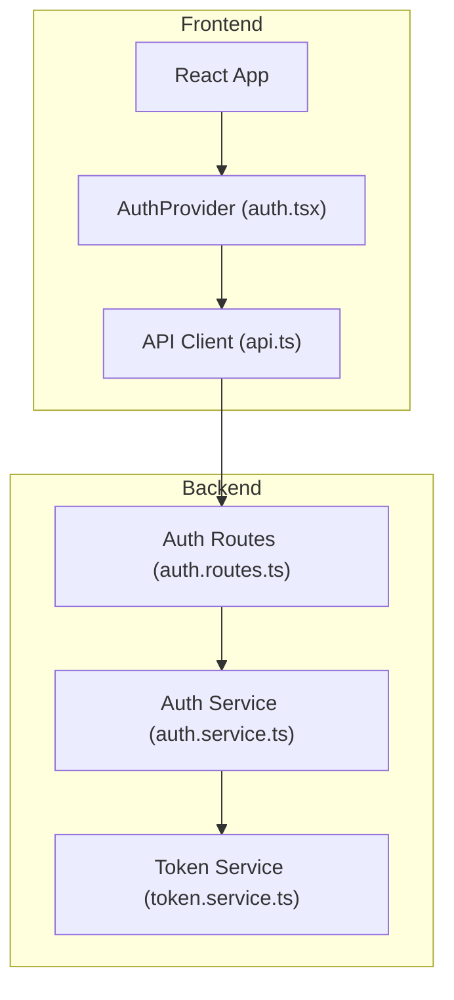
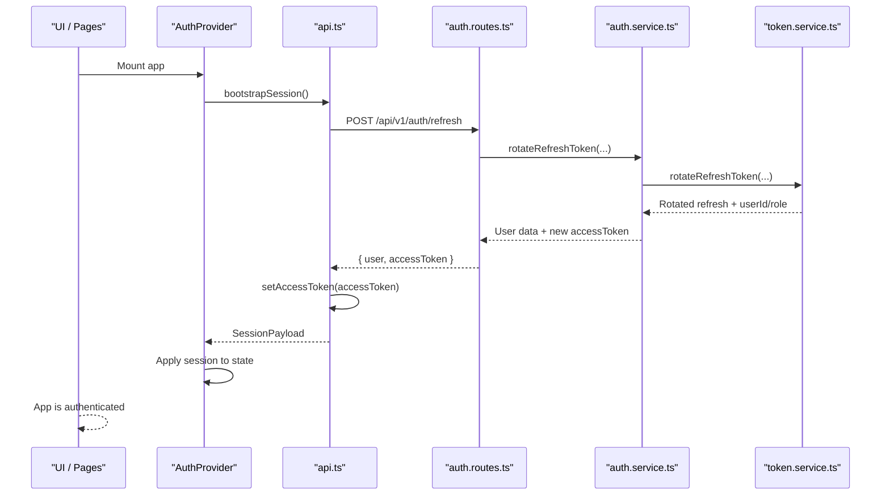
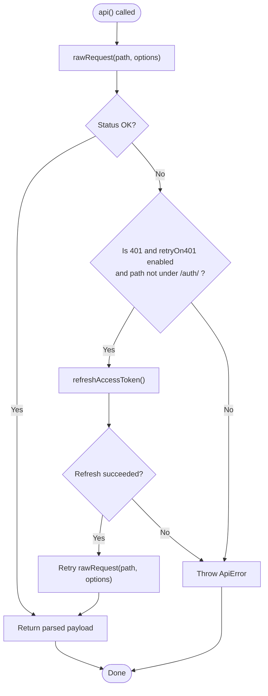
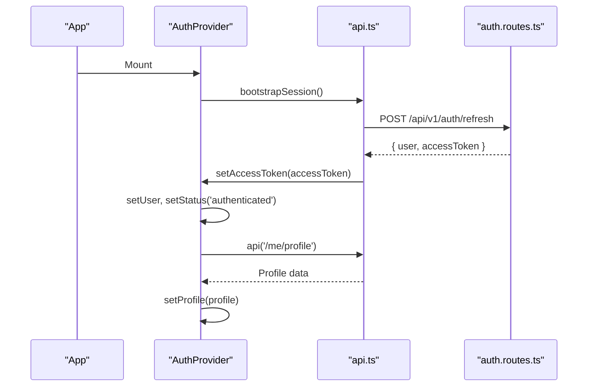
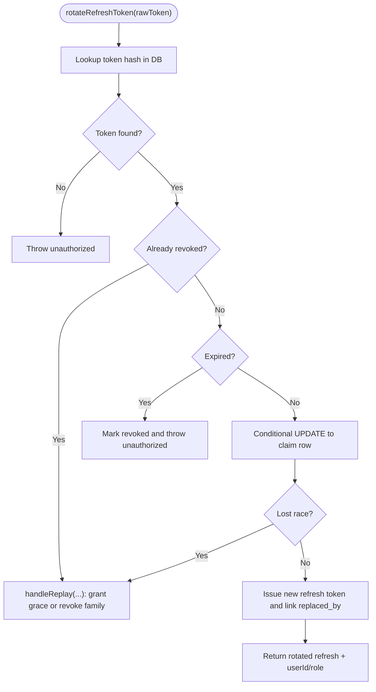
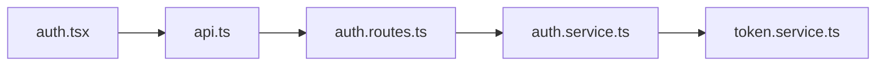

# API Client Integration

<cite>
**Referenced Files in This Document**
- [api.ts](file://frontend/src/lib/api.ts)
- [auth.tsx](file://frontend/src/lib/auth.tsx)
- [auth.routes.ts](file://backend/src/modules/auth/auth.routes.ts)
- [auth.service.ts](file://backend/src/modules/auth/auth.service.ts)
- [token.service.ts](file://backend/src/modules/auth/token.service.ts)
</cite>

## Table of Contents
1. [Introduction](#introduction)
2. [Project Structure](#project-structure)
3. [Core Components](#core-components)
4. [Architecture Overview](#architecture-overview)
5. [Detailed Component Analysis](#detailed-component-analysis)
6. [Dependency Analysis](#dependency-analysis)
7. [Performance Considerations](#performance-considerations)
8. [Troubleshooting Guide](#troubleshooting-guide)
9. [Conclusion](#conclusion)

## Introduction
This document explains how the frontend integrates with the authentication system through a thin API client. It covers:
- How to call authenticated endpoints using the `api` function
- Request and response handling, including body serialization and error mapping
- Session restoration on application startup via `bootstrapSession`
- Access token management with `setAccessToken`
- Automatic retry behavior when receiving 401 responses
- HTTP method configuration and cookie-based refresh flow
- Practical examples for login, registration, logout, and protected resource access

The design keeps the access token in memory only and uses an httpOnly refresh cookie to minimize XSS risk while supporting automatic session restoration.

## Project Structure
The integration spans two layers:
- Frontend API client and React auth provider
- Backend authentication routes, services, and token utilities

**Diagram sources**
- [auth.tsx:1-161](file://frontend/src/lib/auth.tsx#L1-L161)
- [api.ts:1-144](file://frontend/src/lib/api.ts#L1-L144)
- [auth.routes.ts:1-121](file://backend/src/modules/auth/auth.routes.ts#L1-L121)
- [auth.service.ts:1-262](file://backend/src/modules/auth/auth.service.ts#L1-L262)
- [token.service.ts:1-206](file://backend/src/modules/auth/token.service.ts#L1-L206)

**Section sources**
- [api.ts:1-144](file://frontend/src/lib/api.ts#L1-L144)
- [auth.tsx:1-161](file://frontend/src/lib/auth.tsx#L1-L161)
- [auth.routes.ts:1-121](file://backend/src/modules/auth/auth.routes.ts#L1-L121)
- [auth.service.ts:1-262](file://backend/src/modules/auth/auth.service.ts#L1-L262)
- [token.service.ts:1-206](file://backend/src/modules/auth/token.service.ts#L1-L206)

## Core Components
- API client (`api.ts`)
  - Provides `api`, `bootstrapSession`, `refreshAccessToken`, `setAccessToken`, and `getAccessToken`
  - Defines `ApiError`, `SessionPayload`, `SessionUser`, and request options
- Auth provider (`auth.tsx`)
  - Initializes session at app start, manages login/register/logout, and applies sessions to UI state
- Backend auth routes (`auth.routes.ts`)
  - Exposes `/register`, `/login`, `/refresh`, `/logout`, `/me`, and password change endpoints
- Auth service (`auth.service.ts`)
  - Implements user registration, login, password changes, and logout logic with security controls
- Token service (`token.service.ts`)
  - Signs/verifies access tokens and issues/rotates refresh tokens with replay protection

Key responsibilities:
- The client serializes JSON bodies and attaches the Authorization header when available
- On 401, the client attempts one shared refresh before retrying the original request once
- The provider bootstraps the session from the refresh cookie during app initialization
- The backend rotates refresh tokens and returns a new access token plus user info

**Section sources**
- [api.ts:10-144](file://frontend/src/lib/api.ts#L10-L144)
- [auth.tsx:47-136](file://frontend/src/lib/auth.tsx#L47-L136)
- [auth.routes.ts:53-121](file://backend/src/modules/auth/auth.routes.ts#L53-L121)
- [auth.service.ts:61-262](file://backend/src/modules/auth/auth.service.ts#L61-L262)
- [token.service.ts:28-206](file://backend/src/modules/auth/token.service.ts#L28-L206)

## Architecture Overview
The authentication flow combines short-lived access tokens sent in headers with long-lived refresh cookies managed by the browser.

**Diagram sources**
- [api.ts:117-143](file://frontend/src/lib/api.ts#L117-L143)
- [auth.tsx:62-92](file://frontend/src/lib/auth.tsx#L62-L92)
- [auth.routes.ts:75-96](file://backend/src/modules/auth/auth.routes.ts#L75-L96)
- [auth.service.ts:245-262](file://backend/src/modules/auth/auth.service.ts#L245-L262)
- [token.service.ts:154-195](file://backend/src/modules/auth/token.service.ts#L154-L195)

## Detailed Component Analysis

### API Client (`api.ts`)
Responsibilities:
- Centralized fetch wrapper with consistent headers and credentials
- JSON body serialization and Accept header
- Error normalization into `ApiError` with status, code, message, and optional details
- Automatic 401 retry with a single shared refresh attempt
- In-memory access token storage and session bootstrap

Key types:
- `ApiErrorBody`: standardized error payload shape returned by the server
- `ApiError`: typed error thrown by the client with status and code
- `RequestOptions`: HTTP method, body, AbortSignal, and `retryOn401` flag
- `SessionUser`: minimal user profile used by the UI
- `SessionPayload`: `{ user, accessToken }` returned after successful authentication or refresh

Important functions:
- `setAccessToken(token)`: updates the in-memory access token
- `getAccessToken()`: reads the current in-memory token
- `api(path, options)`: performs requests; retries once after refresh on 401 unless disabled
- `bootstrapSession()`: exchanges the refresh cookie for a fresh session; deduplicates concurrent calls
- `refreshAccessToken()`: triggers session bootstrap and returns whether it succeeded

Behavior highlights:
- Requests are made to `/api/v1{path}` with `credentials: 'include'` so cookies are sent automatically
- If no body is provided, Content-Type is not set; otherwise JSON.stringify is used
- 204 responses return undefined instead of parsing JSON
- Non-ok responses throw `ApiError` with mapped fields from the server’s error envelope

**Diagram sources**
- [api.ts:50-94](file://frontend/src/lib/api.ts#L50-L94)
- [api.ts:117-120](file://frontend/src/lib/api.ts#L117-L120)

**Section sources**
- [api.ts:10-144](file://frontend/src/lib/api.ts#L10-L144)

### Auth Provider (`auth.tsx`)
Responsibilities:
- Initialize session on mount using `bootstrapSession()`
- Manage login, register, logout, and profile loading
- Apply sessions to React state and update UI status
- Provide helpers like `homeFor(role)` and role labels

Initialization flow:
- On mount, call `bootstrapSession()`
- If session exists, set access token via `setAccessToken`, set user, mark authenticated, and load profile
- Otherwise, mark anonymous

Login/Register:
- Call `api('/auth/login', ...)` or `api('/auth/register', ...)` with POST and JSON body
- On success, apply session to state and load profile

Logout:
- Call `api('/auth/logout', { method: 'POST', retryOn401: false })`
- Clear in-memory token and reset UI state

**Diagram sources**
- [auth.tsx:62-92](file://frontend/src/lib/auth.tsx#L62-L92)
- [api.ts:123-143](file://frontend/src/lib/api.ts#L123-L143)

**Section sources**
- [auth.tsx:47-136](file://frontend/src/lib/auth.tsx#L47-L136)

### Backend Authentication Routes (`auth.routes.ts`)
Endpoints:
- `POST /api/v1/auth/register`
  - Validates input, creates user, sets refresh cookie, returns user and access token
- `POST /api/v1/auth/login`
  - Validates credentials, sets refresh cookie, returns user and access token
- `POST /api/v1/auth/refresh`
  - Reads refresh cookie, rotates token, returns updated user and access token
- `POST /api/v1/auth/logout`
  - Revokes refresh token if present, clears cookie, returns 204
- `GET /api/v1/auth/me`
  - Requires authentication, returns user and profile summary
- `PATCH /api/v1/auth/password`
  - Requires authentication, validates current password, updates password, revokes all sessions

Security notes:
- Rate limiting applied to register and login
- Input validation via Zod schemas
- Audit logging for sensitive actions
- Password change revokes all sessions to force re-authentication

**Section sources**
- [auth.routes.ts:20-121](file://backend/src/modules/auth/auth.routes.ts#L20-L121)

### Auth Service (`auth.service.ts`)
Responsibilities:
- Registration with duplicate email checks, bcrypt hashing, role-specific profiles, and audit logging
- Login with constant-time comparison patterns, lockout handling, and audit logging
- Password change with verification, hashing, session revocation, and audit logging
- Logout with optional token revocation and audit logging

Security properties:
- bcrypt cost configured centrally
- Generic messages for invalid credentials to prevent enumeration
- Account lockout after repeated failures
- Audit trail for auth events

**Section sources**
- [auth.service.ts:15-262](file://backend/src/modules/auth/auth.service.ts#L15-L262)

### Token Service (`token.service.ts`)
Responsibilities:
- Sign and verify short-lived JWT access tokens
- Issue and rotate opaque refresh tokens stored as SHA-256 hashes
- Handle concurrent refreshes and detect reuse outside a grace window
- Revoke individual or all sessions

Access token strategy:
- Short TTL, signed JWT with issuer and audience constraints
- Sent in Authorization header by the client

Refresh token strategy:
- Opaque random value stored in httpOnly cookie
- Stored hashed in database with family tracking
- Rotation ensures replay protection and theft detection

**Diagram sources**
- [token.service.ts:154-195](file://backend/src/modules/auth/token.service.ts#L154-L195)
- [token.service.ts:104-145](file://backend/src/modules/auth/token.service.ts#L104-L145)

**Section sources**
- [token.service.ts:10-206](file://backend/src/modules/auth/token.service.ts#L10-L206)

## Dependency Analysis
The following diagram shows how components depend on each other across frontend and backend.

**Diagram sources**
- [auth.tsx:1-161](file://frontend/src/lib/auth.tsx#L1-L161)
- [api.ts:1-144](file://frontend/src/lib/api.ts#L1-L144)
- [auth.routes.ts:1-121](file://backend/src/modules/auth/auth.routes.ts#L1-L121)
- [auth.service.ts:1-262](file://backend/src/modules/auth/auth.service.ts#L1-L262)
- [token.service.ts:1-206](file://backend/src/modules/auth/token.service.ts#L1-L206)

**Section sources**
- [auth.tsx:1-161](file://frontend/src/lib/auth.tsx#L1-L161)
- [api.ts:1-144](file://frontend/src/lib/api.ts#L1-L144)
- [auth.routes.ts:1-121](file://backend/src/modules/auth/auth.routes.ts#L1-L121)
- [auth.service.ts:1-262](file://backend/src/modules/auth/auth.service.ts#L1-L262)
- [token.service.ts:1-206](file://backend/src/modules/auth/token.service.ts#L1-L206)

## Performance Considerations
- Single in-flight refresh: `bootstrapSession` caches the promise so concurrent calls share one refresh request, preventing redundant rotations and reducing server load.
- Minimal network overhead: Only the access token is sent per request; refresh happens only on 401 or explicit bootstrap.
- Avoids heavy payloads: The client sends only necessary JSON bodies and parses only when needed.
- Deduplication prevents token reuse storms in development environments where effects may run twice.

[No sources needed since this section provides general guidance]

## Troubleshooting Guide
Common issues and resolutions:
- 401 Unauthorized on protected endpoints
  - Ensure the refresh cookie is present and valid
  - Confirm that `retryOn401` is enabled (default) for non-auth paths
  - Check that `bootstrapSession` succeeds and sets the access token
- Stale session after password change
  - Password change revokes all refresh tokens; require re-login
- Logout not clearing state
  - Verify that logout calls `api('/auth/logout', { method: 'POST', retryOn401: false })` and clears in-memory token and UI state
- Network errors or malformed responses
  - The client throws `ApiError` with status and code; inspect `error.code` and `error.message`
  - For 204 responses, expect undefined rather than a parsed object

**Section sources**
- [api.ts:17-29](file://frontend/src/lib/api.ts#L17-L29)
- [api.ts:64-79](file://frontend/src/lib/api.ts#L64-L79)
- [auth.tsx:119-128](file://frontend/src/lib/auth.tsx#L119-L128)
- [auth.routes.ts:98-103](file://backend/src/modules/auth/auth.routes.ts#L98-L103)

## Conclusion
The API client provides a secure, ergonomic way to interact with the authentication system:
- Use `api` for all endpoints; it handles headers, credentials, JSON serialization, and error mapping
- Rely on `bootstrapSession` at app startup to restore sessions silently via the refresh cookie
- Manage access tokens in memory with `setAccessToken`; never persist them in localStorage
- Leverage automatic 401 retry with a single shared refresh to keep the UI responsive
- Follow the backend contracts defined by the auth routes and services for consistent behavior