# Authentication Context Provider

<cite>
**Referenced Files in This Document**
- [auth.tsx](file://frontend/src/lib/auth.tsx)
- [api.ts](file://frontend/src/lib/api.ts)
- [App.tsx](file://frontend/src/App.tsx)
- [LoginPage.tsx](file://frontend/src/pages/auth/LoginPage.tsx)
- [RegisterPage.tsx](file://frontend/src/pages/auth/RegisterPage.tsx)
- [ProfilePage.tsx](file://frontend/src/pages/ProfilePage.tsx)
</cite>

## Table of Contents
1. [Introduction](#introduction)
2. [Project Structure](#project-structure)
3. [Core Components](#core-components)
4. [Architecture Overview](#architecture-overview)
5. [Detailed Component Analysis](#detailed-component-analysis)
6. [Dependency Analysis](#dependency-analysis)
7. [Performance Considerations](#performance-considerations)
8. [Troubleshooting Guide](#troubleshooting-guide)
9. [Conclusion](#conclusion)

## Introduction
This document explains the frontend authentication context provider implementation. It covers the `AuthProvider` component, its React state model for user sessions, the authentication lifecycle from bootstrap to logout, and the exported context value interface. It also documents token handling through `setAccessToken`, automatic session restoration via `bootstrapSession`, and how other components consume the auth context using the `useAuth` hook. Role-based routing helpers such as `homeFor` and profile data loading patterns are included with concrete usage references.

## Project Structure
The authentication logic is implemented in the frontend module:

- `frontend/src/lib/auth.tsx`: Defines the React context, `AuthProvider`, `useAuth`, role routing helper, and profile summary type.
- `frontend/src/lib/api.ts`: Provides the HTTP client, access-token storage, refresh flow, and session bootstrap function.
- `frontend/src/App.tsx`: Uses the auth context to protect routes and redirect users by role.
- `frontend/src/pages/auth/LoginPage.tsx` and `RegisterPage.tsx`: Consume `login` and `register` from the context.
- `frontend/src/pages/ProfilePage.tsx`: Consumes `user`, `profile`, and `refreshProfile`.

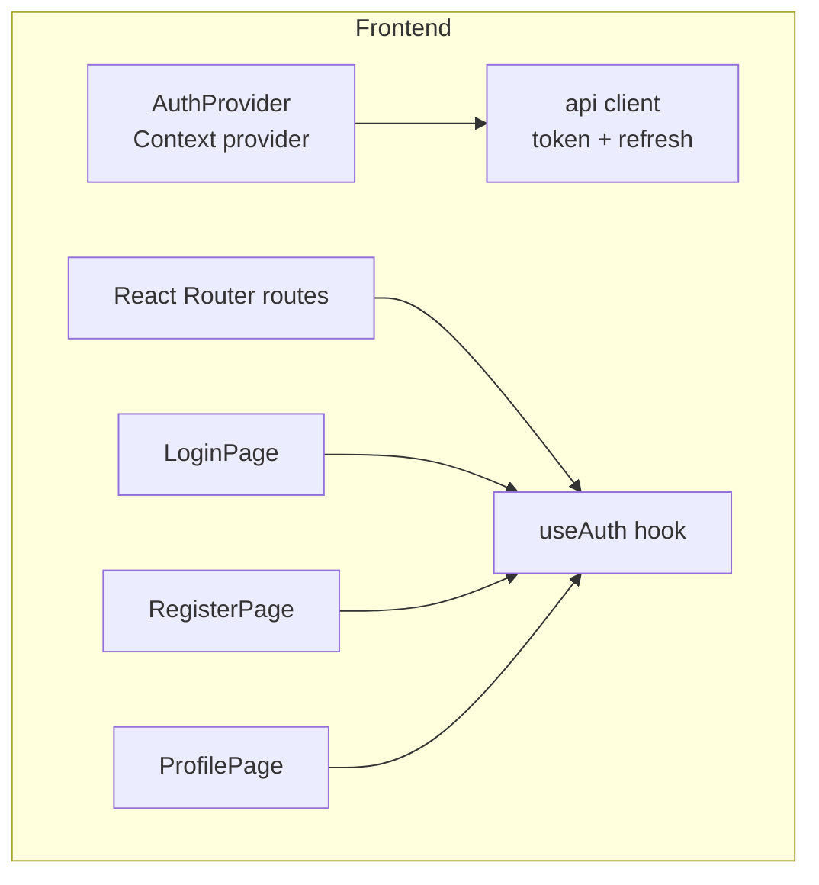

**Diagram sources**
- [auth.tsx:47-136](file://frontend/src/lib/auth.tsx#L47-L136)
- [api.ts:31-143](file://frontend/src/lib/api.ts#L31-L143)
- [App.tsx:19-41](file://frontend/src/App.tsx#L19-L41)
- [LoginPage.tsx:14-40](file://frontend/src/pages/auth/LoginPage.tsx#L14-L40)
- [RegisterPage.tsx:10-51](file://frontend/src/pages/auth/RegisterPage.tsx#L10-L51)
- [ProfilePage.tsx:14-72](file://frontend/src/pages/ProfilePage.tsx#L14-L72)

**Section sources**
- [auth.tsx:1-161](file://frontend/src/lib/auth.tsx#L1-L161)
- [api.ts:1-144](file://frontend/src/lib/api.ts#L1-L144)
- [App.tsx:1-192](file://frontend/src/App.tsx#L1-L192)
- [LoginPage.tsx:1-117](file://frontend/src/pages/auth/LoginPage.tsx#L1-L117)
- [RegisterPage.tsx:1-165](file://frontend/src/pages/auth/RegisterPage.tsx#L1-L165)
- [ProfilePage.tsx:1-223](file://frontend/src/pages/ProfilePage.tsx#L1-L223)

## Core Components
- `AuthProvider`: A React context provider that owns the application’s authentication state. It initializes status, user, and profile, bootstraps a session on mount, exposes login/register/logout/profile-refresh methods, and memoizes the context value.
- `useAuth`: A hook that reads the auth context and throws if used outside `AuthProvider`.
- `homeFor`: A helper that maps a user role to the appropriate landing route.
- API client utilities: `setAccessToken`, `bootstrapSession`, `refreshAccessToken`, and typed `api` calls.

Key responsibilities:
- Session initialization and restoration without persisting tokens in browser storage.
- Centralized error-safe transitions between loading, authenticated, and anonymous states.
- Profile fetching and caching within the provider.
- Role-aware navigation helpers for protected routes.

**Section sources**
- [auth.tsx:12-43](file://frontend/src/lib/auth.tsx#L12-L43)
- [auth.tsx:47-136](file://frontend/src/lib/auth.tsx#L47-L136)
- [auth.tsx:138-160](file://frontend/src/lib/auth.tsx#L138-L160)
- [api.ts:31-41](file://frontend/src/lib/api.ts#L31-L41)
- [api.ts:81-143](file://frontend/src/lib/api.ts#L81-L143)

## Architecture Overview
The authentication architecture separates concerns between UI state (context provider), network transport (API client), and routing (React Router). Tokens are kept in memory only; refresh cookies are handled automatically by the API client.

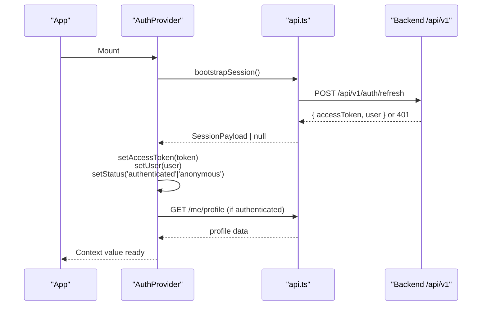

**Diagram sources**
- [auth.tsx:62-92](file://frontend/src/lib/auth.tsx#L62-L92)
- [api.ts:122-143](file://frontend/src/lib/api.ts#L122-L143)

## Detailed Component Analysis

### AuthProvider Component
`AuthProvider` manages three pieces of state:
- `status`: `'loading' | 'authenticated' | 'anonymous'`
- `user`: The current `SessionUser` or `null`
- `profile`: The current `ProfileSummary` or `null`

Lifecycle:
1. On mount, it attempts to restore the session via `bootstrapSession`.
2. If a session exists, it sets the access token, user, and status to authenticated, then loads the profile.
3. If no session exists, it sets status to anonymous.
4. Errors during bootstrap result in an anonymous state.

State mutation helpers:
- `applySession`: Sets the access token via `setAccessToken`, updates user and status, and loads the profile.
- `loadProfile`: Fetches `/me/profile` and stores the result; failures clear the profile rather than blocking the app.

Authentication methods:
- `login(email, password)`: Calls `/auth/login`, applies the returned session.
- `register(input)`: Calls `/auth/register`, applies the returned session.
- `logout()`: Attempts a server-side logout call, then clears token, user, profile, and sets status to anonymous.

Context value:
- Exposes `status`, `user`, `profile`, `login`, `register`, `logout`, and `refreshProfile`.
- Memoized to avoid unnecessary re-renders.

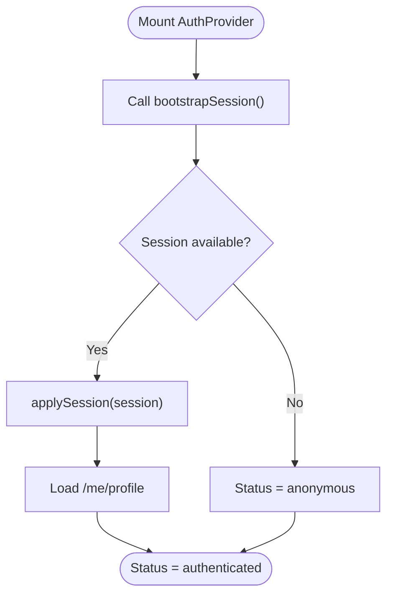

**Diagram sources**
- [auth.tsx:62-92](file://frontend/src/lib/auth.tsx#L62-L92)
- [auth.tsx:94-128](file://frontend/src/lib/auth.tsx#L94-L128)

**Section sources**
- [auth.tsx:47-136](file://frontend/src/lib/auth.tsx#L47-L136)

### Context Value Interface
The context value provides:
- `status`: Current authentication state.
- `user`: Current user object when authenticated.
- `profile`: Masked or role-specific profile data.
- `login`: Authenticate with email and password.
- `register`: Create an account and immediately sign in.
- `logout`: Sign out and reset local state.
- `refreshProfile`: Reload profile data.

Types:
- `ProfileSummary`: Contains masked PII fields and lender-specific settings.
- `SessionUser`: User identity and role.
- `SessionPayload`: Token plus user returned by login/register/refresh.

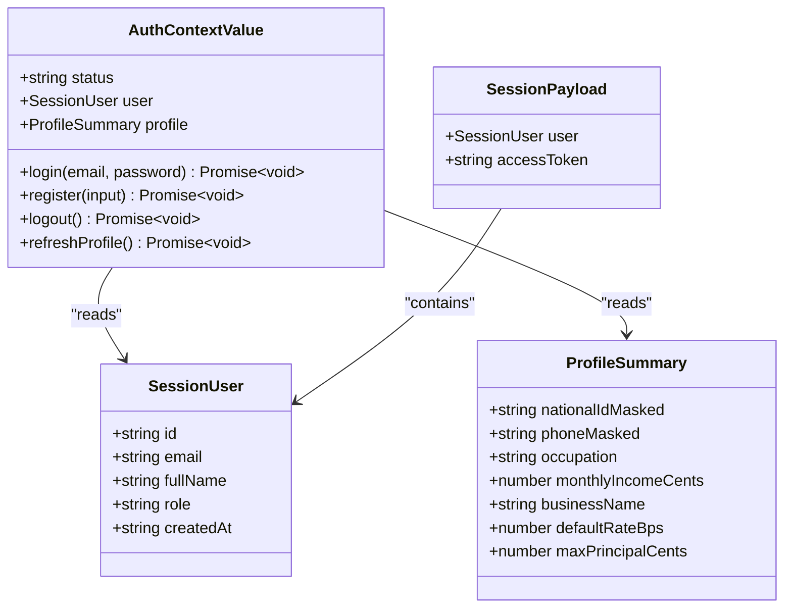

**Diagram sources**
- [auth.tsx:19-43](file://frontend/src/lib/auth.tsx#L19-L43)
- [api.ts:96-107](file://frontend/src/lib/api.ts#L96-L107)

**Section sources**
- [auth.tsx:19-43](file://frontend/src/lib/auth.tsx#L19-L43)
- [api.ts:96-107](file://frontend/src/lib/api.ts#L96-L107)

### Token Management and Automatic Session Restoration
Token handling rules:
- Access tokens are stored in memory only via `setAccessToken`; they are never persisted to localStorage or sessionStorage.
- Refresh cookies are sent with every request using `credentials: include`.
- `bootstrapSession` performs a single in-flight refresh request; concurrent callers share the same promise to prevent duplicate rotations.
- `refreshAccessToken` delegates to `bootstrapSession` and returns whether a fresh session was obtained.
- The `api` wrapper automatically retries once after a successful refresh when encountering a 401 on non-auth endpoints.

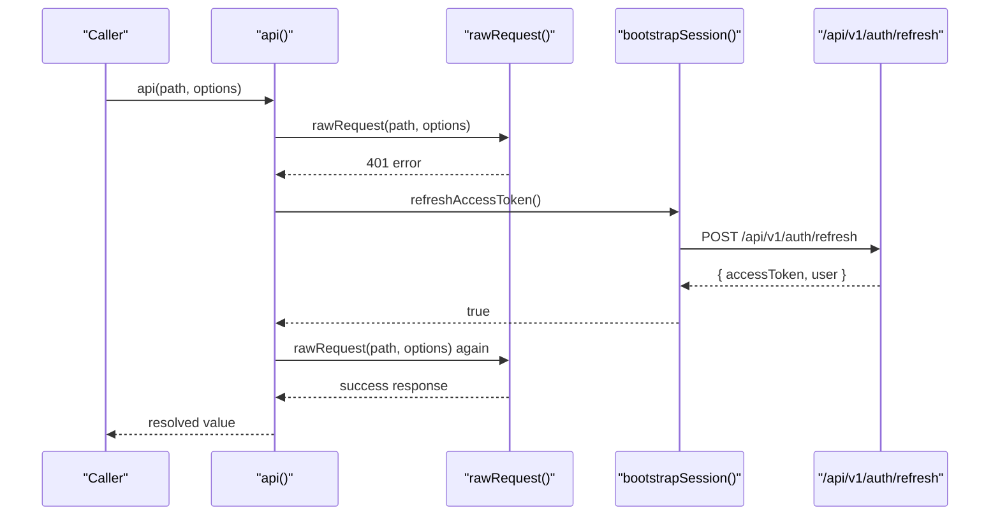

**Diagram sources**
- [api.ts:31-41](file://frontend/src/lib/api.ts#L31-L41)
- [api.ts:81-143](file://frontend/src/lib/api.ts#L81-L143)

**Section sources**
- [api.ts:31-41](file://frontend/src/lib/api.ts#L31-L41)
- [api.ts:81-143](file://frontend/src/lib/api.ts#L81-L143)

### Login Flow
The login page uses `useAuth().login` to authenticate. After success, it navigates based on the user’s role.

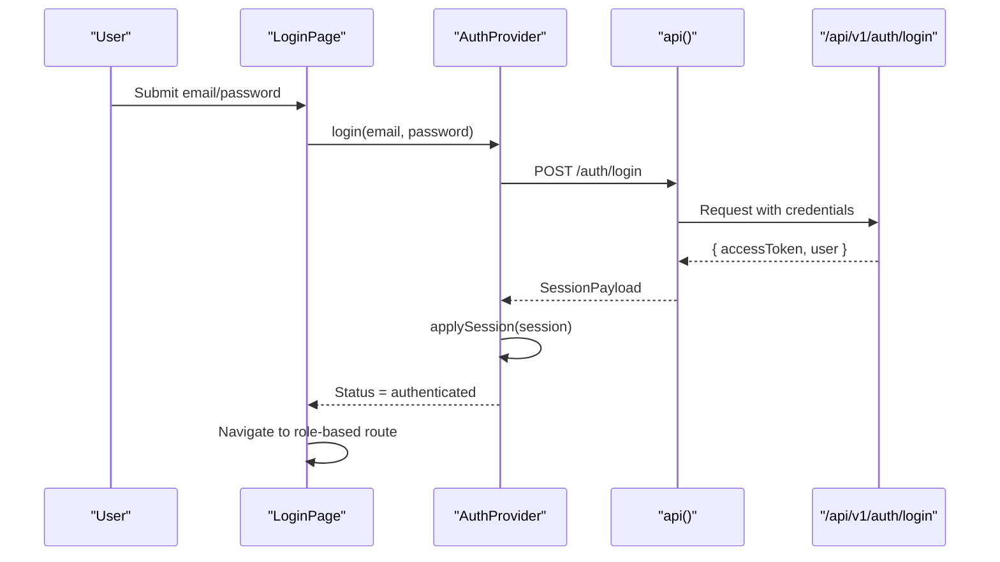

**Diagram sources**
- [LoginPage.tsx:25-40](file://frontend/src/pages/auth/LoginPage.tsx#L25-L40)
- [auth.tsx:94-103](file://frontend/src/lib/auth.tsx#L94-L103)
- [auth.tsx:84-92](file://frontend/src/lib/auth.tsx#L84-L92)

**Section sources**
- [LoginPage.tsx:14-40](file://frontend/src/pages/auth/LoginPage.tsx#L14-L40)
- [auth.tsx:94-103](file://frontend/src/lib/auth.tsx#L94-L103)

### Register Flow
Registration collects role, personal details, and optional business information, then calls `useAuth().register`. On success, it redirects to the appropriate dashboard.

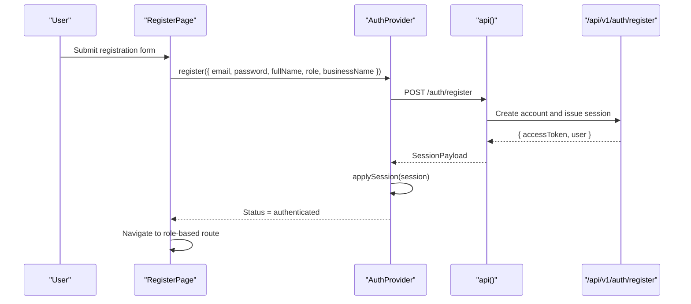

**Diagram sources**
- [RegisterPage.tsx:25-51](file://frontend/src/pages/auth/RegisterPage.tsx#L25-L51)
- [auth.tsx:105-117](file://frontend/src/lib/auth.tsx#L105-L117)
- [auth.tsx:84-92](file://frontend/src/lib/auth.tsx#L84-L92)

**Section sources**
- [RegisterPage.tsx:10-51](file://frontend/src/pages/auth/RegisterPage.tsx#L10-L51)
- [auth.tsx:105-117](file://frontend/src/lib/auth.tsx#L105-L117)

### Logout Flow
Logout attempts a server-side logout call and then resets all local state.

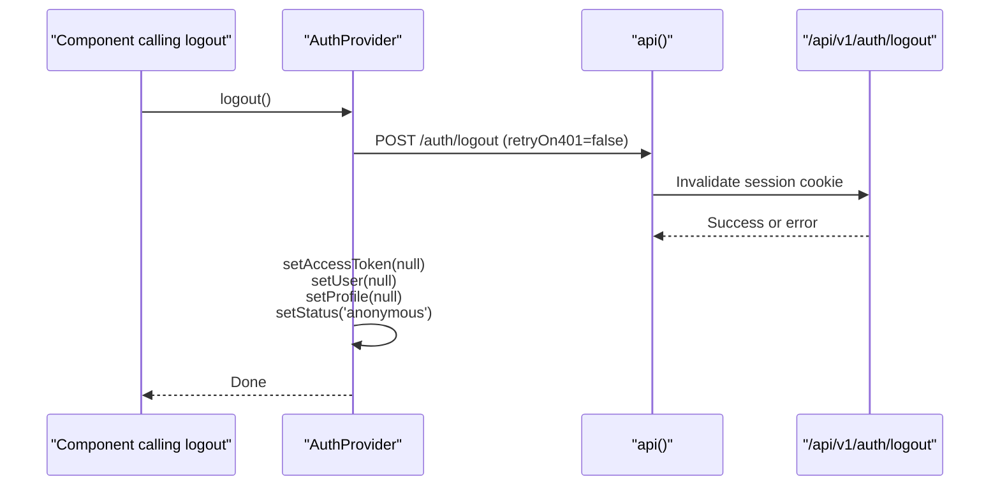

**Diagram sources**
- [auth.tsx:119-128](file://frontend/src/lib/auth.tsx#L119-L128)
- [api.ts:81-94](file://frontend/src/lib/api.ts#L81-L94)

**Section sources**
- [auth.tsx:119-128](file://frontend/src/lib/auth.tsx#L119-L128)

### Profile Data Loading Patterns
The provider fetches the profile after authentication. Pages can also explicitly refresh it.

- Provider behavior:
  - Loads `/me/profile` after applying a session.
  - Catches errors and clears the profile instead of failing the app.
- Profile page behavior:
  - Subscribes to `profile` changes to populate editable fields.
  - Sends partial updates to `/me/profile` and calls `refreshProfile()` to synchronize.

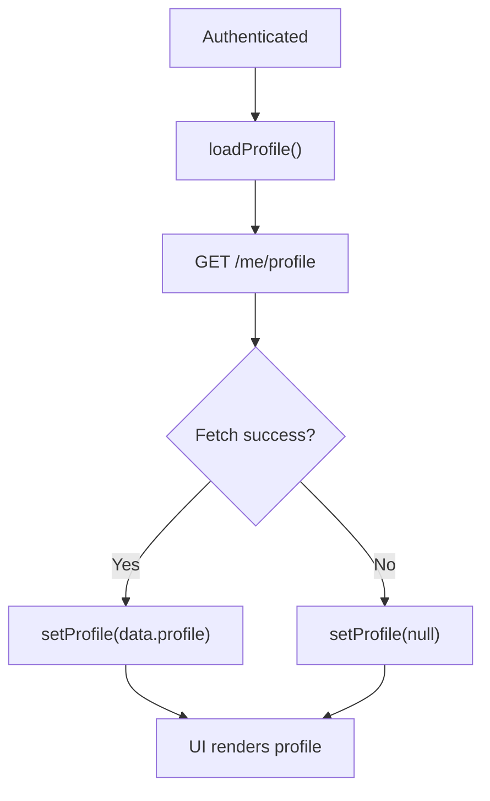

**Diagram sources**
- [auth.tsx:52-60](file://frontend/src/lib/auth.tsx#L52-L60)
- [ProfilePage.tsx:27-31](file://frontend/src/pages/ProfilePage.tsx#L27-L31)
- [ProfilePage.tsx:58-72](file://frontend/src/pages/ProfilePage.tsx#L58-L72)

**Section sources**
- [auth.tsx:52-60](file://frontend/src/lib/auth.tsx#L52-L60)
- [ProfilePage.tsx:27-31](file://frontend/src/pages/ProfilePage.tsx#L27-L31)
- [ProfilePage.tsx:58-72](file://frontend/src/pages/ProfilePage.tsx#L58-L72)

### Role-Based Routing with homeFor
The app protects routes using two higher-order components:
- `RequireAuth`: Shows a loader while status is loading; redirects unauthenticated users to `/login`.
- `RequireRole`: Ensures the current user has the required role; otherwise redirects to the user’s home route.
- `RootRedirect`: Redirects root to `/login` for anonymous users or to the user’s home route for authenticated users.
- `homeFor(role)`: Maps roles to routes (`lender` → `/lender`, `auditor` → `/auditor`, default → `/borrower`).

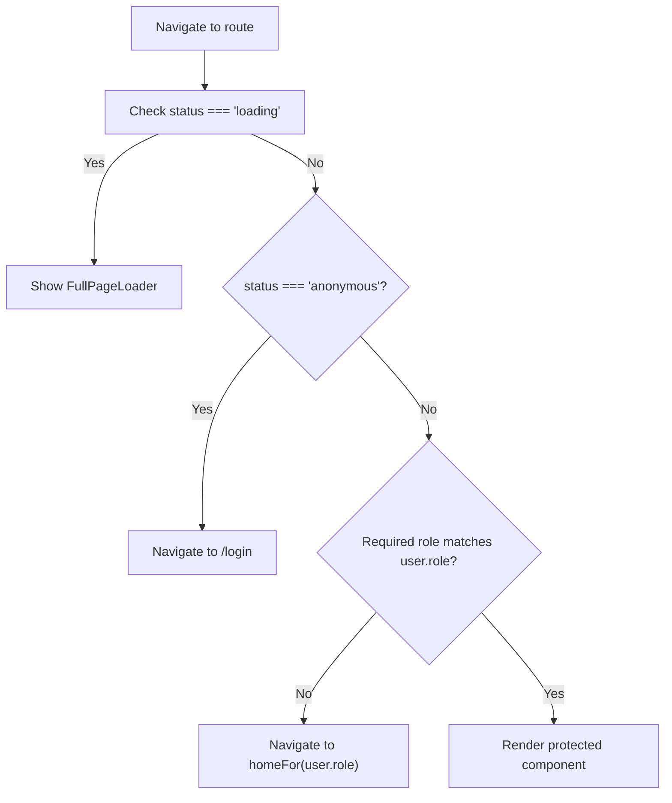

**Diagram sources**
- [App.tsx:19-41](file://frontend/src/App.tsx#L19-L41)
- [auth.tsx:144-154](file://frontend/src/lib/auth.tsx#L144-L154)

**Section sources**
- [App.tsx:19-41](file://frontend/src/App.tsx#L19-L41)
- [auth.tsx:144-154](file://frontend/src/lib/auth.tsx#L144-L154)

## Dependency Analysis
The following diagram shows how the authentication context depends on the API client and how pages consume it.

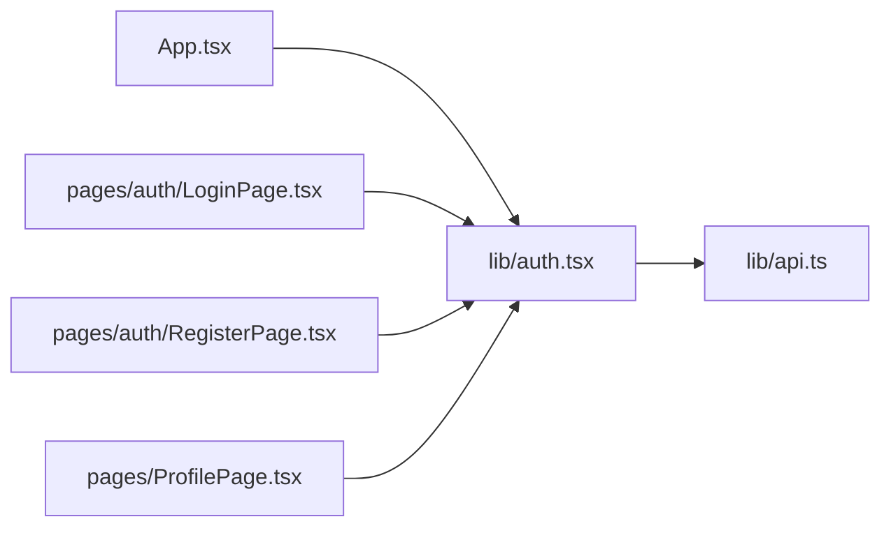

**Diagram sources**
- [auth.tsx:1-10](file://frontend/src/lib/auth.tsx#L1-L10)
- [api.ts:1-144](file://frontend/src/lib/api.ts#L1-L144)
- [App.tsx:1-18](file://frontend/src/App.tsx#L1-L18)
- [LoginPage.tsx:1-6](file://frontend/src/pages/auth/LoginPage.tsx#L1-L6)
- [RegisterPage.tsx:1-6](file://frontend/src/pages/auth/RegisterPage.tsx#L1-L6)
- [ProfilePage.tsx:1-6](file://frontend/src/pages/ProfilePage.tsx#L1-L6)

**Section sources**
- [auth.tsx:1-10](file://frontend/src/lib/auth.tsx#L1-L10)
- [api.ts:1-144](file://frontend/src/lib/api.ts#L1-L144)
- [App.tsx:1-18](file://frontend/src/App.tsx#L1-L18)
- [LoginPage.tsx:1-6](file://frontend/src/pages/auth/LoginPage.tsx#L1-L6)
- [RegisterPage.tsx:1-6](file://frontend/src/pages/auth/RegisterPage.tsx#L1-L6)
- [ProfilePage.tsx:1-6](file://frontend/src/pages/ProfilePage.tsx#L1-L6)

## Performance Considerations
- In-memory token storage avoids long-lived XSS exposure and reduces persistence overhead.
- Single in-flight refresh request prevents redundant network calls under StrictMode or concurrent requests.
- Memoization of the context value minimizes re-renders for consumers.
- Profile loading is decoupled from authentication so missing profiles do not block the app.

[No sources needed since this section provides general guidance]

## Troubleshooting Guide
Common issues and resolutions:
- Using `useAuth` outside `AuthProvider`:
  - Symptom: Error thrown indicating the hook must be used inside `AuthProvider`.
  - Resolution: Wrap your application tree with `<AuthProvider>`.
- Unexpected anonymous state after refresh:
  - Cause: Refresh endpoint returns 401 or fails.
  - Resolution: Verify refresh cookie presence and backend `/api/v1/auth/refresh` behavior.
- Profile not displayed:
  - Cause: `/me/profile` failed or profile not yet loaded.
  - Resolution: Call `refreshProfile()` or wait for provider to load profile after authentication.
- Route redirection loops:
  - Cause: Mismatch between user role and route guards.
  - Resolution: Ensure `homeFor` mapping aligns with actual roles and routes.

**Section sources**
- [auth.tsx:138-142](file://frontend/src/lib/auth.tsx#L138-L142)
- [api.ts:122-143](file://frontend/src/lib/api.ts#L122-L143)
- [auth.tsx:52-60](file://frontend/src/lib/auth.tsx#L52-L60)
- [App.tsx:19-41](file://frontend/src/App.tsx#L19-L41)

## Conclusion
The authentication context provider centralizes session management, token handling, and profile loading behind a simple React context. It enforces secure token practices, supports automatic session restoration, and integrates cleanly with role-based routing. Consumers interact with a small, well-defined interface, making it straightforward to add new authenticated features while maintaining consistent security and UX behavior.

[No sources needed since this section summarizes without analyzing specific files]