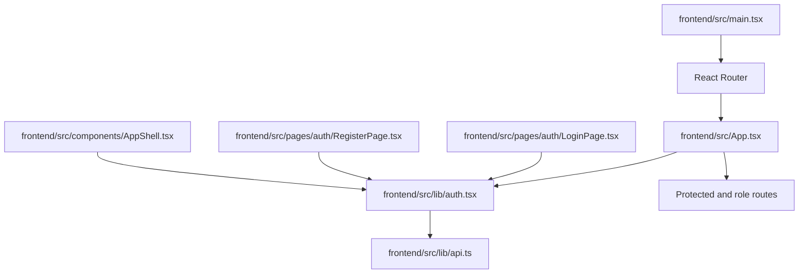
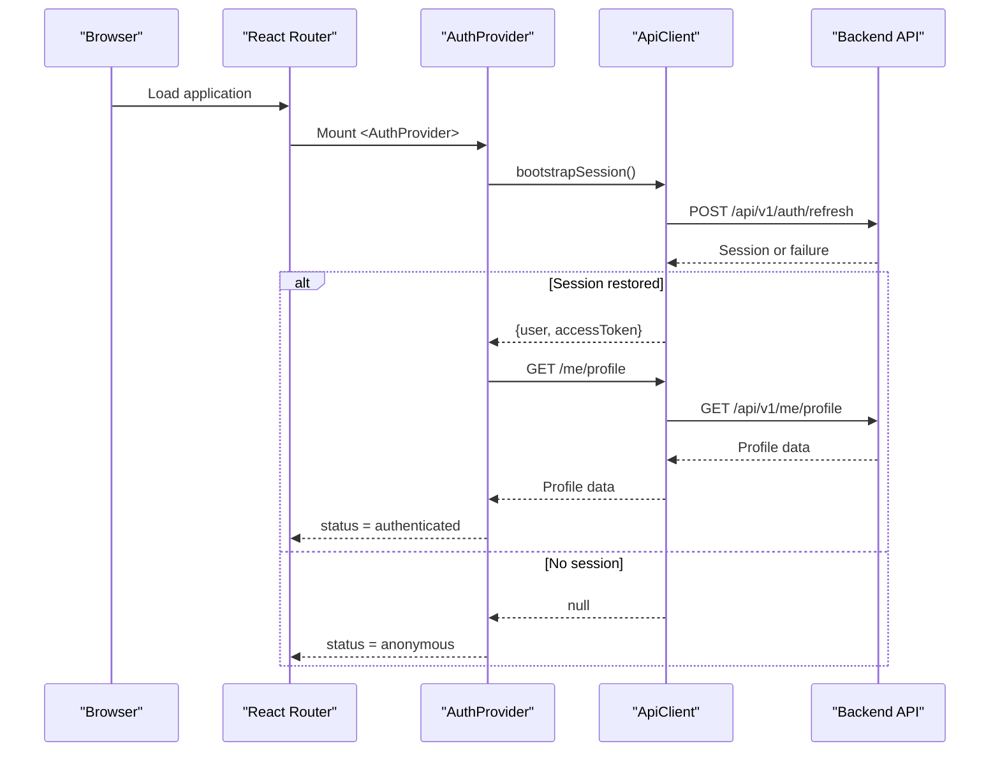
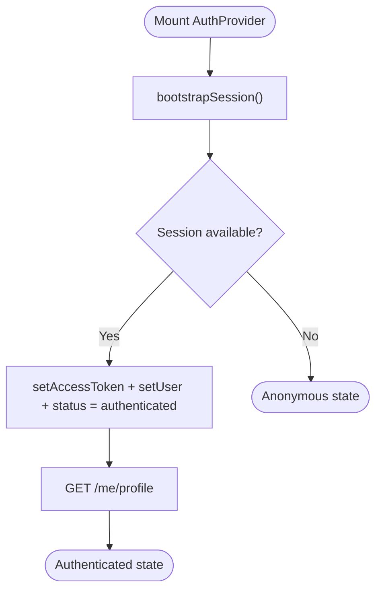
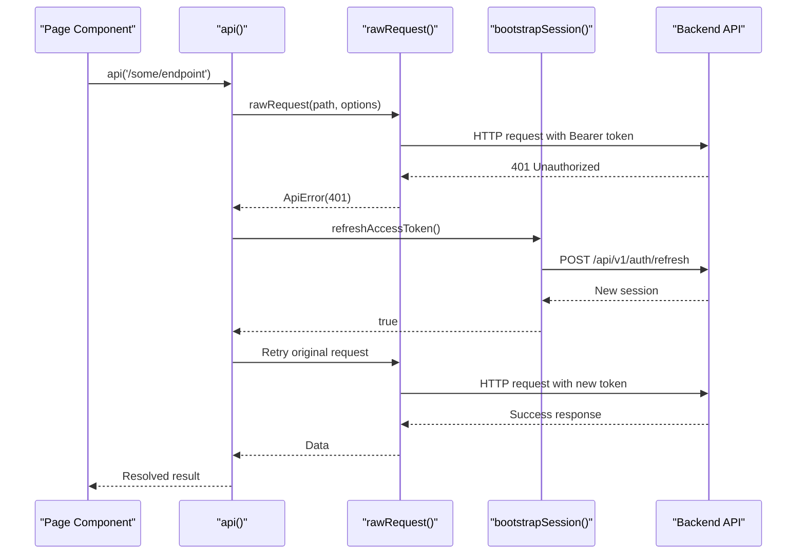
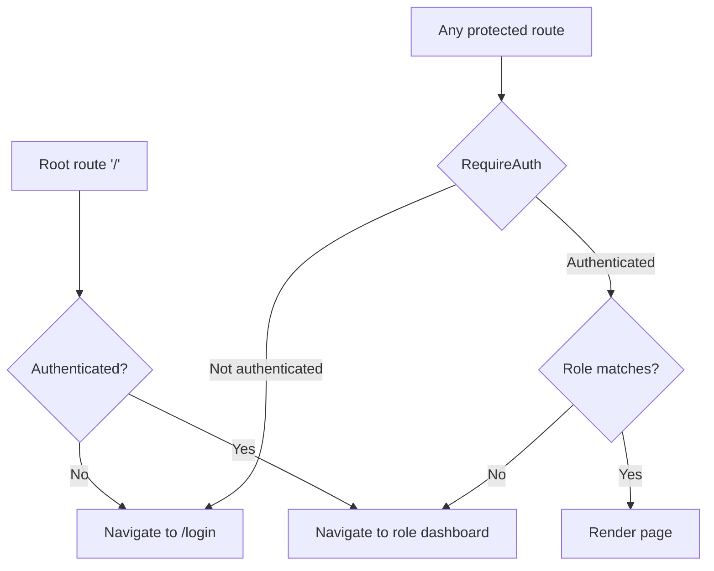
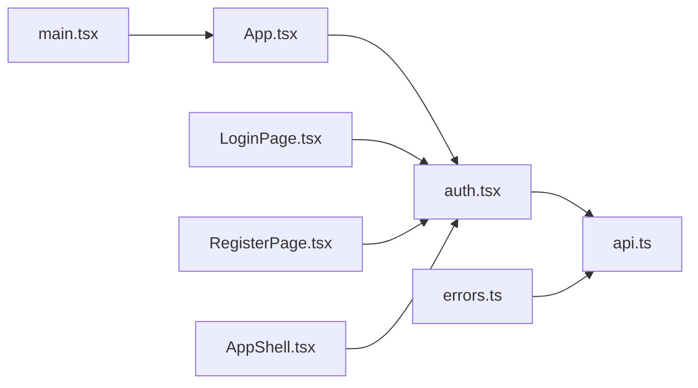

# Authentication Flow

<cite>
**Referenced Files in This Document**
- [main.tsx](file://frontend/src/main.tsx)
- [App.tsx](file://frontend/src/App.tsx)
- [auth.tsx](file://frontend/src/lib/auth.tsx)
- [api.ts](file://frontend/src/lib/api.ts)
- [errors.ts](file://frontend/src/lib/errors.ts)
- [LoginPage.tsx](file://frontend/src/pages/auth/LoginPage.tsx)
- [RegisterPage.tsx](file://frontend/src/pages/auth/RegisterPage.tsx)
- [AppShell.tsx](file://frontend/src/components/AppShell.tsx)
</cite>

## Table of Contents
1. [Introduction](#introduction)
2. [Project Structure](#project-structure)
3. [Core Components](#core-components)
4. [Architecture Overview](#architecture-overview)
5. [Detailed Component Analysis](#detailed-component-analysis)
6. [Dependency Analysis](#dependency-analysis)
7. [Performance Considerations](#performance-considerations)
8. [Troubleshooting Guide](#troubleshooting-guide)
9. [Security Considerations](#security-considerations)
10. [Conclusion](#conclusion)

## Introduction
This document explains the frontend authentication system for the application. It covers how user sessions are initialized, how login and registration work, how tokens are managed without using local storage, how protected routes and role-based access control are enforced, and how automatic token refresh is implemented. It also documents error handling, form validation patterns, and security considerations around session persistence.

## Project Structure
The authentication-related frontend code is organized into a small set of focused modules:

- Application bootstrap wraps routing and authentication context.
- Routing defines public pages, protected routes, and role-gated dashboards.
- The authentication context provides login, register, logout, and session state.
- The API client handles HTTP requests, token injection, 401 retry logic, and silent session bootstrapping.
- Login and registration pages implement forms, validation, and navigation.
- The application shell renders role-specific navigation and sign-out behavior.

**Diagram sources**
- [main.tsx:11-19](file://frontend/src/main.tsx#L11-L19)
- [App.tsx:43-190](file://frontend/src/App.tsx#L43-L190)
- [auth.tsx:47-135](file://frontend/src/lib/auth.tsx#L47-L135)
- [api.ts:50-143](file://frontend/src/lib/api.ts#L50-L143)
- [LoginPage.tsx:14-116](file://frontend/src/pages/auth/LoginPage.tsx#L14-L116)
- [RegisterPage.tsx:10-164](file://frontend/src/pages/auth/RegisterPage.tsx#L10-L164)
- [AppShell.tsx:62-113](file://frontend/src/components/AppShell.tsx#L62-L113)

**Section sources**
- [main.tsx:11-19](file://frontend/src/main.tsx#L11-L19)
- [App.tsx:43-190](file://frontend/src/App.tsx#L43-L190)

## Core Components
The authentication system is built around these core pieces:

- **Authentication context provider**: Holds loading, authenticated, and anonymous states; exposes login, register, logout, profile refresh, and current user data.
- **API client**: Adds authorization headers, handles JSON responses, throws typed errors, retries once on 401, and performs silent refresh via an httpOnly cookie.
- **Session bootstrap**: Exchanges the refresh cookie for a new access token without storing it in local storage.
- **Protected route guards**: Require authentication and enforce per-role access.
- **Login and registration pages**: Handle form submission, display field-level and global errors, and navigate to role-appropriate dashboards.
- **Application shell**: Renders role-based navigation and a sign-out action.

Key responsibilities:
- Session initialization happens at app startup through the authentication context.
- Tokens are kept only in memory.
- Refresh tokens live in httpOnly cookies sent with credentials.
- Role-based UI and routing prevent users from accessing screens outside their role.

**Section sources**
- [auth.tsx:12-43](file://frontend/src/lib/auth.tsx#L12-L43)
- [api.ts:1-10](file://frontend/src/lib/api.ts#L1-L10)
- [api.ts:31-41](file://frontend/src/lib/api.ts#L31-L41)
- [api.ts:81-94](file://frontend/src/lib/api.ts#L81-L94)
- [api.ts:109-143](file://frontend/src/lib/api.ts#L109-L143)
- [App.tsx:19-41](file://frontend/src/App.tsx#L19-L41)
- [LoginPage.tsx:14-40](file://frontend/src/pages/auth/LoginPage.tsx#L14-L40)
- [RegisterPage.tsx:10-51](file://frontend/src/pages/auth/RegisterPage.tsx#L10-L51)
- [AppShell.tsx:62-113](file://frontend/src/components/AppShell.tsx#L62-L113)

## Architecture Overview
The frontend follows a layered approach:

1. React bootstrap mounts `BrowserRouter` and `AuthProvider`.
2. `AuthProvider` attempts a silent session bootstrap on mount.
3. If a valid session exists, the app becomes authenticated and loads the user profile.
4. Protected routes block unauthenticated users and redirect them to login.
5. Role-based routes redirect users to their default dashboard if they try to access another role’s area.
6. API calls attach the in-memory access token and automatically refresh when needed.

**Diagram sources**
- [main.tsx:11-19](file://frontend/src/main.tsx#L11-L19)
- [auth.tsx:62-82](file://frontend/src/lib/auth.tsx#L62-L82)
- [api.ts:122-143](file://frontend/src/lib/api.ts#L122-L143)

## Detailed Component Analysis

### Authentication Context Provider
The authentication context manages three states: loading, authenticated, and anonymous. On mount, it tries to restore the session silently. If successful, it sets the access token in memory, stores the current user, marks the app authenticated, and fetches the user profile. Login and registration call the corresponding API endpoints and apply the returned session. Logout clears the in-memory token and resets state.

Important behaviors:
- Silent session restoration avoids prompting the user.
- Access tokens are never persisted to local storage or session storage.
- Profile loading failures do not block the app; missing profiles are treated gracefully.
- Logout sends a server-side logout request but always clears local state afterward.

**Diagram sources**
- [auth.tsx:62-92](file://frontend/src/lib/auth.tsx#L62-L92)
- [api.ts:122-143](file://frontend/src/lib/api.ts#L122-L143)

**Section sources**
- [auth.tsx:12-43](file://frontend/src/lib/auth.tsx#L12-L43)
- [auth.tsx:62-135](file://frontend/src/lib/auth.tsx#L62-L135)

### Token Management and Automatic Refresh
Token management is centralized in the API client:

- The access token is stored in a module-scoped variable, not in browser storage.
- Every request adds an Authorization header when a token exists.
- A 401 response triggers exactly one refresh attempt for non-auth endpoints.
- The refresh endpoint exchanges the httpOnly refresh cookie for a new access token.
- Multiple concurrent refresh attempts share a single in-flight promise to avoid duplicate rotations.

**Diagram sources**
- [api.ts:50-79](file://frontend/src/lib/api.ts#L50-L79)
- [api.ts:81-94](file://frontend/src/lib/api.ts#L81-L94)
- [api.ts:117-143](file://frontend/src/lib/api.ts#L117-L143)

**Section sources**
- [api.ts:1-10](file://frontend/src/lib/api.ts#L1-L10)
- [api.ts:31-41](file://frontend/src/lib/api.ts#L31-L41)
- [api.ts:50-94](file://frontend/src/lib/api.ts#L50-L94)
- [api.ts:109-143](file://frontend/src/lib/api.ts#L109-L143)

### Login Page Implementation
The login page:
- Uses the authentication context to call `login`.
- Redirects already authenticated users to their role-based home route.
- Prevents form submission while busy.
- Displays global errors and field-level validation errors.
- Navigates to `/lender`, `/auditor`, or `/borrower` based on email hints in demo mode.

Form fields:
- Email address
- Password

Validation and error handling:
- Global errors come from API responses.
- Field errors are extracted from structured validation payloads.

**Section sources**
- [LoginPage.tsx:14-40](file://frontend/src/pages/auth/LoginPage.tsx#L14-L40)
- [LoginPage.tsx:47-116](file://frontend/src/pages/auth/LoginPage.tsx#L47-L116)
- [errors.ts:1-25](file://frontend/src/lib/errors.ts#L1-L25)

### Registration Page Implementation
The registration page:
- Uses the authentication context to call `register`.
- Redirects already authenticated users to their role-based home route.
- Requires password confirmation before submitting.
- Sends optional business name for lenders.
- Navigates to `/lender` or `/borrower` after success.

Form fields:
- Role selection: borrower or lender
- Full name
- Business name (conditional for lenders)
- Email address
- Password
- Confirm password

Validation and error handling:
- Client-side check ensures passwords match.
- Server-side validation errors are mapped to field-level messages.

**Section sources**
- [RegisterPage.tsx:10-51](file://frontend/src/pages/auth/RegisterPage.tsx#L10-L51)
- [RegisterPage.tsx:53-164](file://frontend/src/pages/auth/RegisterPage.tsx#L53-L164)
- [errors.ts:1-25](file://frontend/src/lib/errors.ts#L1-L25)

### Protected Routes and Role-Based Access Control
The routing layer enforces two levels of protection:

1. **Authentication guard**: Blocks unauthenticated users and shows a full-page loader while session state is unknown.
2. **Role guard**: Ensures a user can only access routes matching their role. If a user tries to open another role’s screen, they are redirected to their correct home route.

Public routes:
- `/login`
- `/register`

Protected routes:
- `/profile`
- `/borrower/*`
- `/lender/*`
- `/auditor/*`

Root redirect behavior:
- Unknown or anonymous users go to `/login`.
- Authenticated users go to their role-based dashboard.

**Diagram sources**
- [App.tsx:19-41](file://frontend/src/App.tsx#L19-L41)
- [App.tsx:43-190](file://frontend/src/App.tsx#L43-L190)
- [auth.tsx:144-154](file://frontend/src/lib/auth.tsx#L144-L154)

**Section sources**
- [App.tsx:19-41](file://frontend/src/App.tsx#L19-L41)
- [App.tsx:43-190](file://frontend/src/App.tsx#L43-L190)
- [auth.tsx:144-154](file://frontend/src/lib/auth.tsx#L144-L154)

### Application Shell and Sign-Out
The application shell:
- Renders a sidebar for desktop and a drawer for mobile.
- Derives navigation items from the authenticated user’s role.
- Shows the current user’s initials, full name, and role label.
- Provides a sign-out button that calls the authentication context’s logout function.

This keeps navigation consistent with backend-enforced roles and prevents accidental exposure of unrelated routes.

**Section sources**
- [AppShell.tsx:7-11](file://frontend/src/components/AppShell.tsx#L7-L11)
- [AppShell.tsx:41-60](file://frontend/src/components/AppShell.tsx#L41-L60)
- [AppShell.tsx:62-113](file://frontend/src/components/AppShell.tsx#L62-L113)

## Dependency Analysis
The following diagram shows how the main authentication files depend on each other:

**Diagram sources**
- [main.tsx:11-19](file://frontend/src/main.tsx#L11-L19)
- [App.tsx:1-18](file://frontend/src/App.tsx#L1-L18)
- [auth.tsx:1-10](file://frontend/src/lib/auth.tsx#L1-L10)
- [api.ts:1-10](file://frontend/src/lib/api.ts#L1-L10)
- [LoginPage.tsx:1-6](file://frontend/src/pages/auth/LoginPage.tsx#L1-L6)
- [RegisterPage.tsx:1-6](file://frontend/src/pages/auth/RegisterPage.tsx#L1-L6)
- [AppShell.tsx:1-5](file://frontend/src/components/AppShell.tsx#L1-L5)
- [errors.ts:1-1](file://frontend/src/lib/errors.ts#L1-L1)

**Section sources**
- [main.tsx:11-19](file://frontend/src/main.tsx#L11-L19)
- [App.tsx:1-18](file://frontend/src/App.tsx#L1-L18)
- [auth.tsx:1-10](file://frontend/src/lib/auth.tsx#L1-L10)
- [api.ts:1-10](file://frontend/src/lib/api.ts#L1-L10)
- [LoginPage.tsx:1-6](file://frontend/src/pages/auth/LoginPage.tsx#L1-L6)
- [RegisterPage.tsx:1-6](file://frontend/src/pages/auth/RegisterPage.tsx#L1-L6)
- [AppShell.tsx:1-5](file://frontend/src/components/AppShell.tsx#L1-L5)
- [errors.ts:1-1](file://frontend/src/lib/errors.ts#L1-L1)

## Performance Considerations
- Silent session bootstrap runs once per app load and is deduplicated across concurrent callers.
- Profile fetching is decoupled from authentication state so missing profiles do not block rendering.
- The API client avoids unnecessary refresh attempts by skipping auth endpoints and allowing only one retry on 401.
- React StrictMode may mount effects twice in development; the shared in-flight refresh promise prevents duplicate refresh requests.

[No sources needed since this section provides general guidance]

## Troubleshooting Guide
Common issues and how the code handles them:

- **Global error display**: Pages use a helper to convert thrown values into safe user-facing messages.
- **Field-level validation errors**: Validation payloads are transformed into a map of field names to messages.
- **401 responses**: Non-auth API calls automatically refresh the token once and retry the original request.
- **Logout flow**: Logout clears the in-memory token and resets UI state even if the server logout fails.
- **Missing profile**: Profile loading failures are caught and treated as a missing profile rather than a fatal error.

Recommended debugging steps:
- Check whether the app is in loading, authenticated, or anonymous state.
- Verify that the refresh endpoint returns a valid session.
- Inspect whether 401 responses occur on auth endpoints; those should not trigger refresh.
- Confirm that field errors are being mapped from structured validation payloads.

**Section sources**
- [errors.ts:1-25](file://frontend/src/lib/errors.ts#L1-L25)
- [api.ts:81-94](file://frontend/src/lib/api.ts#L81-L94)
- [auth.tsx:119-128](file://frontend/src/lib/auth.tsx#L119-L128)
- [auth.tsx:52-60](file://frontend/src/lib/auth.tsx#L52-L60)

## Security Considerations
The frontend implements several security-focused practices:

- **Access token storage**: The access token is held only in memory. It is never written to local storage or session storage.
- **Refresh token storage**: The refresh token is delivered as an httpOnly cookie and sent with `credentials: include`.
- **XSS mitigation**: Because the access token is not exposed to JavaScript-accessible storage, XSS cannot easily steal a long-lived credential.
- **Automatic refresh**: Only one refresh request runs at a time, reducing race conditions and token reuse risks.
- **Protected routes**: Both authentication and role checks are enforced in the frontend routing layer.
- **Backend enforcement**: Navigation is derived from the authenticated role, and the backend enforces the same rules.

Local storage usage:
- The authentication implementation intentionally avoids local storage for sensitive tokens.
- Any persistent state should be handled carefully and preferably delegated to secure server-side mechanisms.

Session persistence strategy:
- Persistence relies on the httpOnly refresh cookie.
- On app start, the frontend silently restores the session without requiring user interaction.
- If the refresh fails, the user is treated as anonymous and redirected to login.

**Section sources**
- [api.ts:1-10](file://frontend/src/lib/api.ts#L1-L10)
- [api.ts:50-62](file://frontend/src/lib/api.ts#L50-L62)
- [api.ts:109-143](file://frontend/src/lib/api.ts#L109-L143)
- [auth.tsx:12-18](file://frontend/src/lib/auth.tsx#L12-L18)
- [AppShell.tsx:7-11](file://frontend/src/components/AppShell.tsx#L7-L11)

## Conclusion
The frontend authentication system centers on a secure, memory-only access token, an httpOnly refresh cookie, and a clear separation between authentication state, API networking, and UI routing. The authentication context provides a simple interface for login, registration, logout, and profile management. The API client handles token injection, error mapping, and automatic refresh. Protected routes and role-based guards ensure users see only the screens appropriate for their role. This design reduces exposure of sensitive tokens, improves resilience against token expiration, and keeps the user experience smooth during silent session restoration.

[No sources needed since this section summarizes without analyzing specific files]