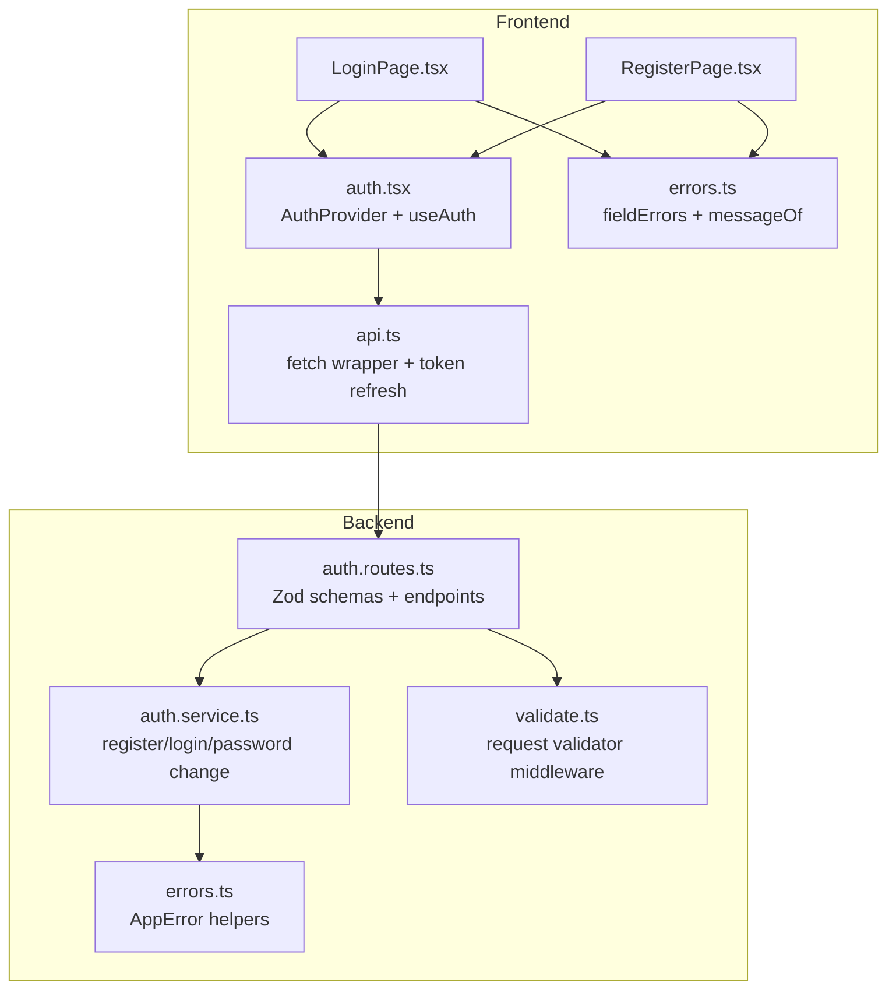
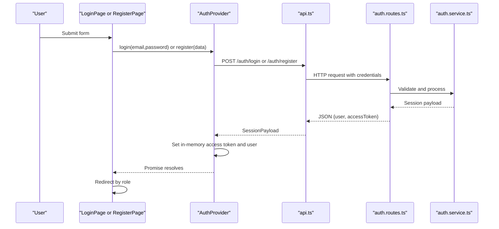
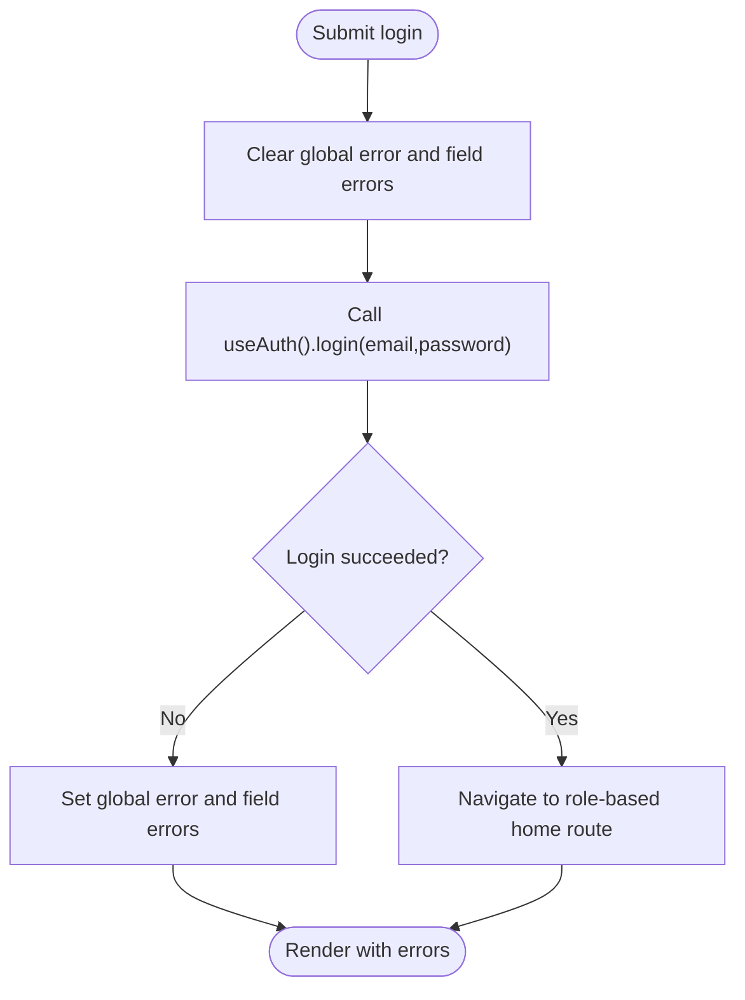
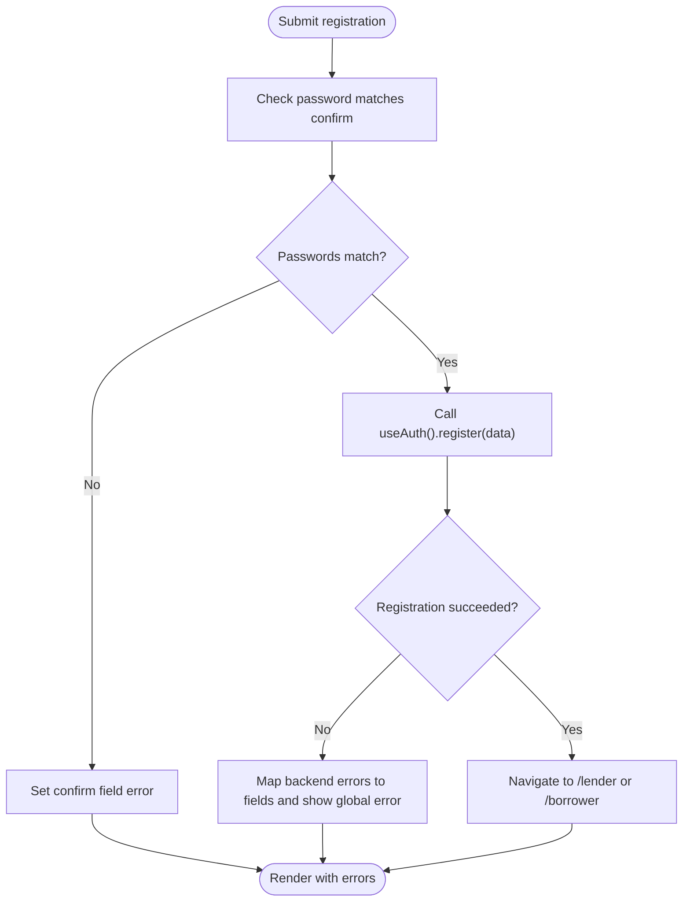
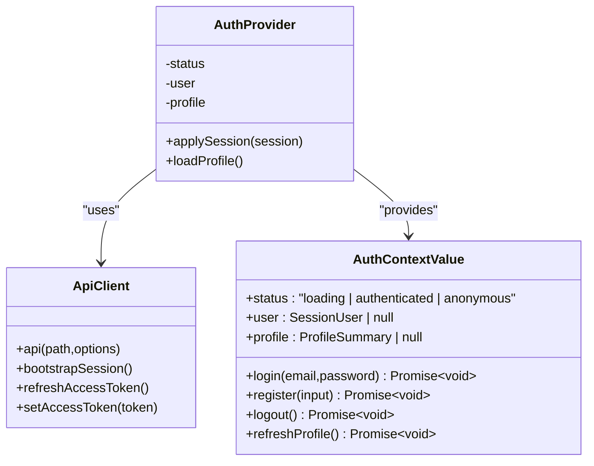
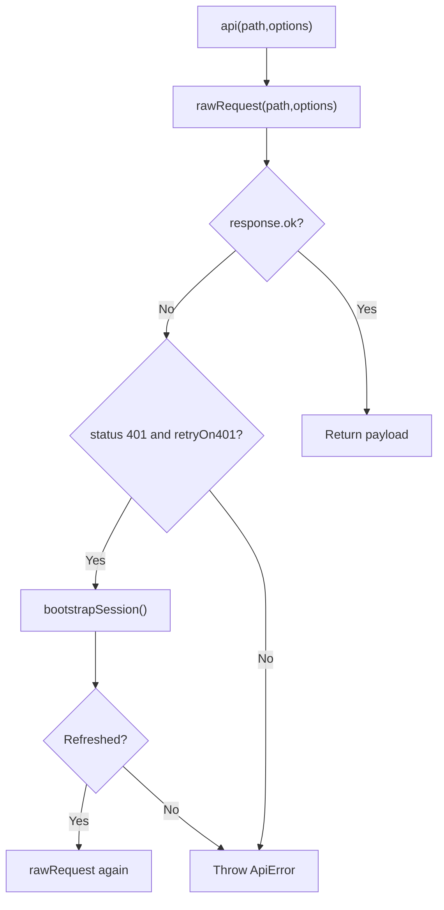
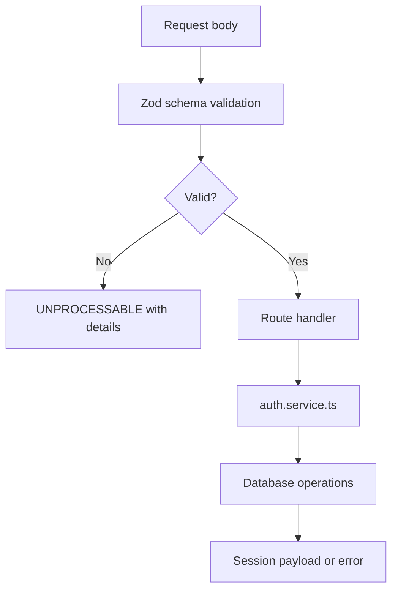
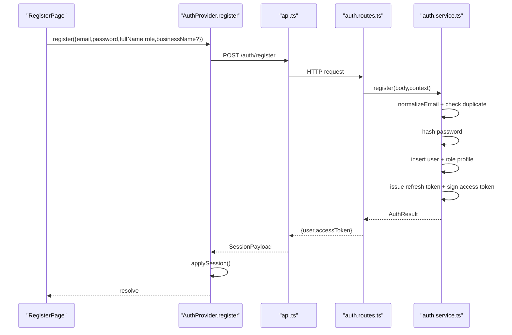
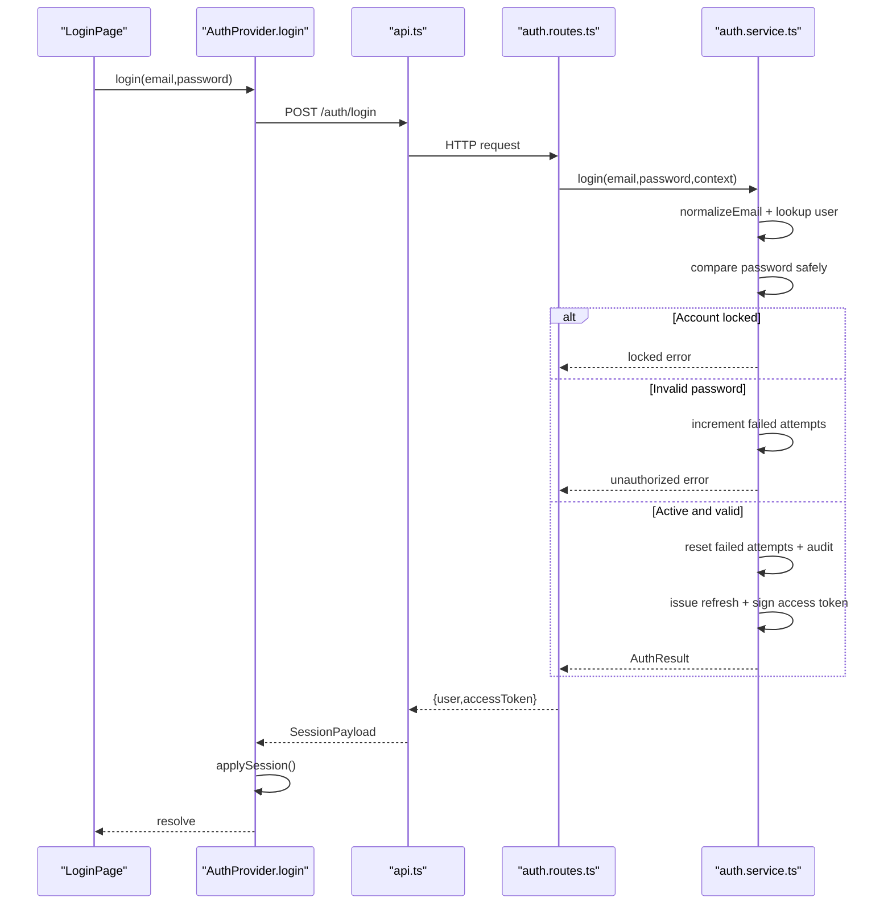
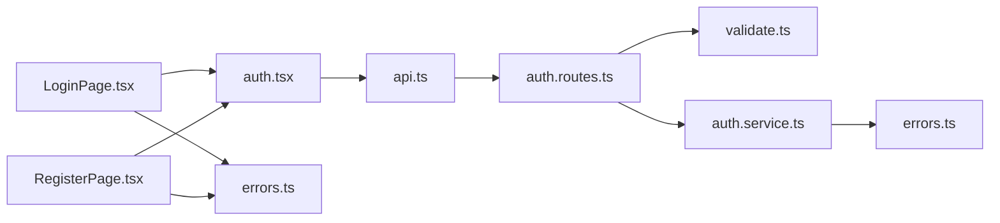

# Login and Registration Pages

<cite>
**Referenced Files in This Document**
- [LoginPage.tsx](file://frontend/src/pages/auth/LoginPage.tsx)
- [RegisterPage.tsx](file://frontend/src/pages/auth/RegisterPage.tsx)
- [auth.tsx](file://frontend/src/lib/auth.tsx)
- [api.ts](file://frontend/src/lib/api.ts)
- [errors.ts](file://frontend/src/lib/errors.ts)
- [auth.routes.ts](file://backend/src/modules/auth/auth.routes.ts)
- [auth.service.ts](file://backend/src/modules/auth/auth.service.ts)
- [validate.ts](file://backend/src/middleware/validate.ts)
- [errors.ts](file://backend/src/lib/errors.ts)
</cite>

## Table of Contents
1. [Introduction](#introduction)
2. [Project Structure](#project-structure)
3. [Core Components](#core-components)
4. [Architecture Overview](#architecture-overview)
5. [Detailed Component Analysis](#detailed-component-analysis)
6. [Dependency Analysis](#dependency-analysis)
7. [Performance Considerations](#performance-considerations)
8. [Troubleshooting Guide](#troubleshooting-guide)
9. [Conclusion](#conclusion)

## Introduction
This document explains the login and registration user flows for the application, focusing on how the frontend pages collect input, validate it, interact with the authentication context provider, call the backend API, and present feedback to users. It also covers server-side validation, error handling, account lockout behavior, and redirect logic after successful authentication.

The implementation uses:
- React components for form UI and state management
- An authentication context provider that manages session state and token refresh
- A thin API client that attaches access tokens and handles 401 refresh
- Backend routes with Zod-based validation and a service layer implementing secure password handling, audit logging, and lockout logic

## Project Structure
The relevant parts of the project are split between frontend pages, shared authentication utilities, and backend authentication modules.

**Diagram sources**
- [LoginPage.tsx:1-117](file://frontend/src/pages/auth/LoginPage.tsx#L1-L117)
- [RegisterPage.tsx:1-165](file://frontend/src/pages/auth/RegisterPage.tsx#L1-L165)
- [auth.tsx:1-161](file://frontend/src/lib/auth.tsx#L1-L161)
- [api.ts:1-144](file://frontend/src/lib/api.ts#L1-L144)
- [errors.ts:1-25](file://frontend/src/lib/errors.ts#L1-L25)
- [auth.routes.ts:1-121](file://backend/src/modules/auth/auth.routes.ts#L1-L121)
- [auth.service.ts:1-262](file://backend/src/modules/auth/auth.service.ts#L1-L262)
- [validate.ts:1-40](file://backend/src/middleware/validate.ts#L1-L40)
- [errors.ts:1-40](file://backend/src/lib/errors.ts#L1-L40)

**Section sources**
- [LoginPage.tsx:1-117](file://frontend/src/pages/auth/LoginPage.tsx#L1-L117)
- [RegisterPage.tsx:1-165](file://frontend/src/pages/auth/RegisterPage.tsx#L1-L165)
- [auth.tsx:1-161](file://frontend/src/lib/auth.tsx#L1-L161)
- [api.ts:1-144](file://frontend/src/lib/api.ts#L1-L144)
- [errors.ts:1-25](file://frontend/src/lib/errors.ts#L1-L25)
- [auth.routes.ts:1-121](file://backend/src/modules/auth/auth.routes.ts#L1-L121)
- [auth.service.ts:1-262](file://backend/src/modules/auth/auth.service.ts#L1-L262)
- [validate.ts:1-40](file://backend/src/middleware/validate.ts#L1-L40)
- [errors.ts:1-40](file://backend/src/lib/errors.ts#L1-L40)

## Core Components
- LoginPage: Collects email and password, calls `useAuth().login`, shows global errors and field errors, and redirects based on role.
- RegisterPage: Collects role selection, full name, optional business name for lenders, email, password, and confirm password; validates locally and calls `useAuth().register`.
- AuthProvider: Provides `login`, `register`, `logout`, and session state; stores the access token only in memory and refreshes via an httpOnly cookie.
- API Client: Wraps fetch, sets Authorization headers, handles 401 refresh once per in-flight request, and throws typed `ApiError` objects.
- Backend Auth Routes: Define Zod schemas for register and login, set refresh cookies, and return session payloads.
- Backend Auth Service: Implements secure registration, login with lockout, password hashing, audit logging, and token issuance.

**Section sources**
- [LoginPage.tsx:14-40](file://frontend/src/pages/auth/LoginPage.tsx#L14-L40)
- [RegisterPage.tsx:10-51](file://frontend/src/pages/auth/RegisterPage.tsx#L10-L51)
- [auth.tsx:47-135](file://frontend/src/lib/auth.tsx#L47-L135)
- [api.ts:17-94](file://frontend/src/lib/api.ts#L17-L94)
- [auth.routes.ts:20-73](file://backend/src/modules/auth/auth.routes.ts#L20-L73)
- [auth.service.ts:61-112](file://backend/src/modules/auth/auth.service.ts#L61-L112)
- [auth.service.ts:114-198](file://backend/src/modules/auth/auth.service.ts#L114-L198)

## Architecture Overview
The authentication flow connects React components to the backend through a secure, token-aware API client.

**Diagram sources**
- [LoginPage.tsx:25-40](file://frontend/src/pages/auth/LoginPage.tsx#L25-L40)
- [RegisterPage.tsx:25-51](file://frontend/src/pages/auth/RegisterPage.tsx#L25-L51)
- [auth.tsx:94-117](file://frontend/src/lib/auth.tsx#L94-L117)
- [api.ts:81-94](file://frontend/src/lib/api.ts#L81-L94)
- [auth.routes.ts:53-73](file://backend/src/modules/auth/auth.routes.ts#L53-L73)
- [auth.service.ts:61-112](file://backend/src/modules/auth/auth.service.ts#L61-L112)
- [auth.service.ts:114-198](file://backend/src/modules/auth/auth.service.ts#L114-L198)

## Detailed Component Analysis

### Login Page
The login page is a controlled form that collects email and password, displays errors, and delegates authentication to the auth context.

Key behaviors:
- Prevents default form submission and clears previous errors before attempting login.
- Calls `login(email, password)` from `useAuth()`.
- On success, navigates to a role-based route using `homeFor(user.role)`.
- On failure, extracts a user-facing message and field-level errors for display.
- Includes demo account buttons that prefill email and password for quick testing.

Form structure:
- Email address input with required attribute and username autocomplete.
- Password input with required attribute and current-password autocomplete.
- Global alert for non-field errors.
- Field-level error hints bound to `errors.email` and `errors.password`.

Redirect logic:
- If already authenticated, the page redirects immediately to the home route for the current user’s role.
- After successful login, the page navigates to `/lender`, `/auditor`, or `/borrower` depending on the user’s role.

Error handling:
- Uses `messageOf(caught)` for a safe top-level error message.
- Uses `fieldErrors(caught)` to map backend validation details to field names.

**Diagram sources**
- [LoginPage.tsx:25-40](file://frontend/src/pages/auth/LoginPage.tsx#L25-L40)
- [auth.tsx:94-103](file://frontend/src/lib/auth.tsx#L94-L103)
- [auth.tsx:145-154](file://frontend/src/lib/auth.tsx#L145-L154)

**Section sources**
- [LoginPage.tsx:14-40](file://frontend/src/pages/auth/LoginPage.tsx#L14-L40)
- [LoginPage.tsx:47-117](file://frontend/src/pages/auth/LoginPage.tsx#L47-L117)
- [auth.tsx:94-103](file://frontend/src/lib/auth.tsx#L94-L103)
- [auth.tsx:145-154](file://frontend/src/lib/auth.tsx#L145-L154)
- [errors.ts:1-25](file://frontend/src/lib/errors.ts#L1-L25)

### Registration Page
The registration page supports two roles: borrower and moneylender. It includes local validation and forwards data to the backend through the auth context.

Key behaviors:
- Role selection toggles whether the business name field is shown.
- Local validation ensures password and confirm password match before sending the request.
- For lenders, the business name is sent only if provided; otherwise it is omitted.
- On success, navigates to `/lender` or `/borrower` based on the selected role.
- On failure, maps backend validation errors to fields and shows a global error message.

Form structure:
- Role selector with accessible button group.
- Full name input (required).
- Business name input (optional, visible only for lenders).
- Email input (required).
- Password input with hint about minimum length and character requirements.
- Confirm password input (required).
- Submit button disabled while busy.

Validation rules:
- Frontend checks that password equals confirm password.
- Backend enforces stricter validation using Zod schemas.

**Diagram sources**
- [RegisterPage.tsx:25-51](file://frontend/src/pages/auth/RegisterPage.tsx#L25-L51)
- [RegisterPage.tsx:65-151](file://frontend/src/pages/auth/RegisterPage.tsx#L65-L151)

**Section sources**
- [RegisterPage.tsx:10-51](file://frontend/src/pages/auth/RegisterPage.tsx#L10-L51)
- [RegisterPage.tsx:53-165](file://frontend/src/pages/auth/RegisterPage.tsx#L53-L165)
- [auth.tsx:105-117](file://frontend/src/lib/auth.tsx#L105-L117)
- [errors.ts:1-25](file://frontend/src/lib/errors.ts#L1-L25)

### Authentication Context Provider
The auth context centralizes session state, login, registration, logout, and profile loading.

Responsibilities:
- Bootstraps the session on mount by exchanging the httpOnly refresh cookie for an access token.
- Stores the access token in memory only; never persists it to localStorage or sessionStorage.
- Exposes `login`, `register`, and `logout` functions that call the API and update state.
- Loads a profile summary after successful authentication.
- Provides `homeFor(role)` to compute the correct dashboard route.

Session lifecycle:
- Initial status is `loading`.
- If bootstrap succeeds, status becomes `authenticated` and the user object is set.
- If bootstrap fails, status becomes `anonymous`.
- Logout clears the in-memory token, user, profile, and resets status to `anonymous`.

**Diagram sources**
- [auth.tsx:29-43](file://frontend/src/lib/auth.tsx#L29-L43)
- [auth.tsx:47-135](file://frontend/src/lib/auth.tsx#L47-L135)
- [api.ts:31-41](file://frontend/src/lib/api.ts#L31-L41)
- [api.ts:81-144](file://frontend/src/lib/api.ts#L81-L144)

**Section sources**
- [auth.tsx:12-43](file://frontend/src/lib/auth.tsx#L12-L43)
- [auth.tsx:47-135](file://frontend/src/lib/auth.tsx#L47-L135)
- [auth.tsx:145-161](file://frontend/src/lib/auth.tsx#L145-L161)

### API Client and Token Refresh
The API client wraps fetch requests and implements secure token handling.

Key features:
- Adds `Authorization: Bearer <token>` when an access token exists.
- Sends cookies with every request so the httpOnly refresh cookie is included.
- Throws `ApiError` with status, code, message, and optional details.
- Retries once after refreshing the access token for non-auth endpoints when a 401 occurs.
- Shares one in-flight refresh request to avoid concurrent rotations.

Token storage:
- Access token is stored in module-scoped memory only.
- Refresh token is managed by the browser cookie and exchanged via `/api/v1/auth/refresh`.

**Diagram sources**
- [api.ts:50-79](file://frontend/src/lib/api.ts#L50-L79)
- [api.ts:81-94](file://frontend/src/lib/api.ts#L81-L94)
- [api.ts:117-144](file://frontend/src/lib/api.ts#L117-L144)

**Section sources**
- [api.ts:1-144](file://frontend/src/lib/api.ts#L1-L144)

### Backend Validation and Error Handling
The backend validates incoming requests using Zod and returns structured errors.

Validation:
- Email must be a valid format and not exceed a maximum length.
- Password must meet minimum length, maximum length, letter, and number requirements.
- Register body requires email, password, fullName, role, and optional businessName.
- Login body requires email and password.

Error mapping:
- Validation failures produce field-level details that the frontend converts into inline field errors.
- Application errors such as unauthorized, conflict, locked, and rate-limited responses are represented by typed error constructors.

**Diagram sources**
- [auth.routes.ts:20-49](file://backend/src/modules/auth/auth.routes.ts#L20-L49)
- [validate.ts:11-26](file://backend/src/middleware/validate.ts#L11-L26)
- [errors.ts:8-40](file://backend/src/lib/errors.ts#L8-L40)

**Section sources**
- [auth.routes.ts:20-73](file://backend/src/modules/auth/auth.routes.ts#L20-L73)
- [validate.ts:1-40](file://backend/src/middleware/validate.ts#L1-L40)
- [errors.ts:1-40](file://backend/src/lib/errors.ts#L1-L40)

### Registration Flow Details
Registration creates a user, optionally a lender profile, issues a refresh token, signs an access token, and returns a session payload.

Behavior:
- Normalizes email and checks for existing accounts.
- Hashes the password securely.
- Inserts user and role-specific profile within a transaction.
- Records an audit event for registration.
- Issues a refresh token and signs an access token.
- Sets the refresh cookie and returns `{ user, accessToken }`.

Role and business name:
- Role must be `borrower` or `lender`.
- Business name is optional and only used when the role is `lender`.

**Diagram sources**
- [RegisterPage.tsx:25-51](file://frontend/src/pages/auth/RegisterPage.tsx#L25-L51)
- [auth.tsx:105-117](file://frontend/src/lib/auth.tsx#L105-L117)
- [auth.routes.ts:53-62](file://backend/src/modules/auth/auth.routes.ts#L53-L62)
- [auth.service.ts:61-112](file://backend/src/modules/auth/auth.service.ts#L61-L112)

**Section sources**
- [RegisterPage.tsx:25-51](file://frontend/src/pages/auth/RegisterPage.tsx#L25-L51)
- [auth.routes.ts:53-62](file://backend/src/modules/auth/auth.routes.ts#L53-L62)
- [auth.service.ts:61-112](file://backend/src/modules/auth/auth.service.ts#L61-L112)

### Login Flow Details
Login authenticates the user, handles lockout, updates failed attempts, and returns a session payload.

Behavior:
- Normalizes email and retrieves the user row.
- Performs constant-time-like password comparison even when the user does not exist.
- Handles inactive accounts and temporary lockouts.
- Resets failed attempts and last login timestamp on success.
- Issues a refresh token and signs an access token.
- Sets the refresh cookie and returns `{ user, accessToken }`.

Error responses:
- Invalid email or password returns an unauthorized response.
- Locked accounts return a locked response.
- Inactive accounts return an unauthorized response.

**Diagram sources**
- [LoginPage.tsx:25-40](file://frontend/src/pages/auth/LoginPage.tsx#L25-L40)
- [auth.tsx:94-103](file://frontend/src/lib/auth.tsx#L94-L103)
- [auth.routes.ts:64-73](file://backend/src/modules/auth/auth.routes.ts#L64-L73)
- [auth.service.ts:114-198](file://backend/src/modules/auth/auth.service.ts#L114-L198)

**Section sources**
- [LoginPage.tsx:25-40](file://frontend/src/pages/auth/LoginPage.tsx#L25-L40)
- [auth.routes.ts:64-73](file://backend/src/modules/auth/auth.routes.ts#L64-L73)
- [auth.service.ts:114-198](file://backend/src/modules/auth/auth.service.ts#L114-L198)

## Dependency Analysis
The following diagram shows how the frontend pages depend on shared libraries and how those libraries depend on the backend routes.

**Diagram sources**
- [LoginPage.tsx:1-6](file://frontend/src/pages/auth/LoginPage.tsx#L1-L6)
- [RegisterPage.tsx:1-6](file://frontend/src/pages/auth/RegisterPage.tsx#L1-L6)
- [auth.tsx:1-10](file://frontend/src/lib/auth.tsx#L1-L10)
- [api.ts:1-10](file://frontend/src/lib/api.ts#L1-L10)
- [errors.ts:1-25](file://frontend/src/lib/errors.ts#L1-L25)
- [auth.routes.ts:1-13](file://backend/src/modules/auth/auth.routes.ts#L1-L13)
- [validate.ts:1-10](file://backend/src/middleware/validate.ts#L1-L10)
- [auth.service.ts:1-13](file://backend/src/modules/auth/auth.service.ts#L1-L13)
- [errors.ts:1-40](file://backend/src/lib/errors.ts#L1-L40)

**Section sources**
- [LoginPage.tsx:1-6](file://frontend/src/pages/auth/LoginPage.tsx#L1-L6)
- [RegisterPage.tsx:1-6](file://frontend/src/pages/auth/RegisterPage.tsx#L1-L6)
- [auth.tsx:1-10](file://frontend/src/lib/auth.tsx#L1-L10)
- [api.ts:1-10](file://frontend/src/lib/api.ts#L1-L10)
- [errors.ts:1-25](file://frontend/src/lib/errors.ts#L1-L25)
- [auth.routes.ts:1-13](file://backend/src/modules/auth/auth.routes.ts#L1-L13)
- [validate.ts:1-10](file://backend/src/middleware/validate.ts#L1-L10)
- [auth.service.ts:1-13](file://backend/src/modules/auth/auth.service.ts#L1-L13)
- [errors.ts:1-40](file://backend/src/lib/errors.ts#L1-L40)

## Performance Considerations
- The API client avoids repeated refresh requests by sharing one in-flight bootstrap session promise.
- Access tokens are kept in memory to reduce exposure and avoid unnecessary persistence overhead.
- Backend password hashing uses a configurable cost factor, balancing security and performance.
- Lockout logic prevents brute-force attacks without blocking legitimate users indefinitely.

[No sources needed since this section provides general guidance]

## Troubleshooting Guide
Common issues and how they appear:

- Field validation errors:
  - Backend returns validation details with paths and messages.
  - Frontend maps these to field-level errors using `fieldErrors`.
  - Example fields: `email`, `password`, `confirm`, `fullName`, `businessName`.

- Global error messages:
  - Non-field errors are displayed using `messageOf`.
  - Examples include invalid credentials, locked accounts, and unexpected network failures.

- Redirect problems:
  - Ensure the user’s role is correctly returned by the backend.
  - Verify `homeFor(role)` maps to the expected dashboard route.

- Token refresh failures:
  - If the refresh endpoint fails, the access token is cleared and the user becomes anonymous.
  - Subsequent protected requests will fail until the user logs in again.

**Section sources**
- [errors.ts:1-25](file://frontend/src/lib/errors.ts#L1-L25)
- [auth.tsx:62-82](file://frontend/src/lib/auth.tsx#L62-L82)
- [api.ts:117-144](file://frontend/src/lib/api.ts#L117-L144)
- [auth.routes.ts:75-96](file://backend/src/modules/auth/auth.routes.ts#L75-L96)

## Conclusion
The login and registration pages provide clear forms, robust validation, and consistent error handling. They integrate tightly with the authentication context provider, which manages secure session state and token refresh. The backend enforces strict validation, secure password handling, audit logging, and lockout protection. Together, these layers deliver a secure, user-friendly authentication experience with predictable redirects and actionable feedback.

[No sources needed since this section summarizes without analyzing specific files]