# Frontend Application

<cite>
**Referenced Files in This Document**
- [main.tsx](file://frontend/src/main.tsx)
- [App.tsx](file://frontend/src/App.tsx)
- [package.json](file://frontend/package.json)
- [vite.config.ts](file://frontend/vite.config.ts)
- [tailwind.config.js](file://frontend/tailwind.config.js)
- [auth.tsx](file://frontend/src/lib/auth.tsx)
- [api.ts](file://frontend/src/lib/api.ts)
- [errors.ts](file://frontend/src/lib/errors.ts)
- [format.ts](file://frontend/src/lib/format.ts)
- [AppShell.tsx](file://frontend/src/components/AppShell.tsx)
- [ui.tsx](file://frontend/src/components/ui.tsx)
- [LoginPage.tsx](file://frontend/src/pages/auth/LoginPage.tsx)
- [RegisterPage.tsx](file://frontend/src/pages/auth/RegisterPage.tsx)
- [BorrowerDashboard.tsx](file://frontend/src/pages/borrower/BorrowerDashboard.tsx)
- [LenderDashboard.tsx](file://frontend/src/pages/lender/LenderDashboard.tsx)
- [AuditorDashboard.tsx](file://frontend/src/pages/auditor/AuditorDashboard.tsx)
</cite>

## Table of Contents
1. [Introduction](#introduction)
2. [Project Structure](#project-structure)
3. [Core Components](#core-components)
4. [Architecture Overview](#architecture-overview)
5. [Detailed Component Analysis](#detailed-component-analysis)
6. [Dependency Analysis](#dependency-analysis)
7. [Performance Considerations](#performance-considerations)
8. [Troubleshooting Guide](#troubleshooting-guide)
9. [Conclusion](#conclusion)

## Introduction
This document explains the React frontend application for a secure microfinance platform. It covers the application structure, component hierarchy, state management, routing and role-based access control, authentication flow, API client behavior, error handling, styling with Tailwind CSS, responsive design, accessibility considerations, performance optimizations, and build configuration. The goal is to make the codebase understandable for both developers and non-technical stakeholders.

## Project Structure
The frontend is a Vite + React + TypeScript project styled with Tailwind CSS. It uses react-router-dom for routing and implements a minimal but robust authentication layer using an in-memory access token and an httpOnly refresh cookie.

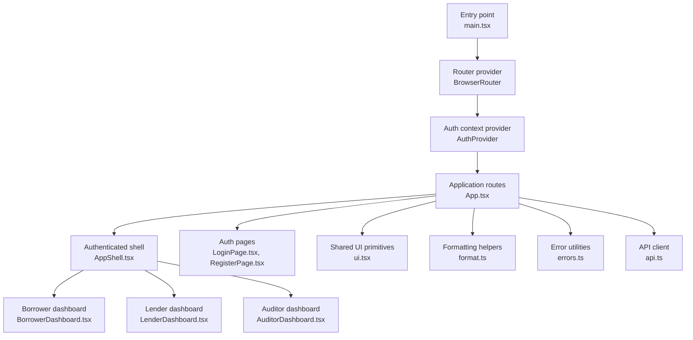

**Diagram sources**
- [main.tsx:11-18](file://frontend/src/main.tsx#L11-L18)
- [App.tsx:39-203](file://frontend/src/App.tsx#L39-L203)
- [AppShell.tsx:116-174](file://frontend/src/components/AppShell.tsx#L116-L174)
- [ui.tsx:1-218](file://frontend/src/components/ui.tsx#L1-L218)
- [format.ts:1-67](file://frontend/src/lib/format.ts#L1-L67)
- [errors.ts:1-25](file://frontend/src/lib/errors.ts#L1-L25)
- [api.ts:1-144](file://frontend/src/lib/api.ts#L1-L144)

**Section sources**
- [main.tsx:1-30](file://frontend/src/main.tsx#L1-L30)
- [package.json:1-29](file://frontend/package.json#L1-L29)

## Core Components
- Authentication context and providers:
  - AuthProvider manages session status, user profile, login, register, logout, and profile refresh.
  - useAuth provides typed access to auth state and actions across components.
- API client:
  - Centralized fetch wrapper with Bearer token injection, httpOnly cookie support, automatic 401 retry via refresh, and structured ApiError.
- Shared UI primitives:
  - Presentational components such as PageHeader, Card, StatCard, Badge, Field, TextInput, Select, Alert, Spinner, FullPageLoader, VerifiedBadge, LogoMark, and ShieldIcon.
- Formatting utilities:
  - Money formatting in KES, date/time formatting, hash shortening, basis points conversion, and initials generation.

Key responsibilities:
- State management is centralized in the auth context; page components consume it rather than maintaining local auth state.
- Routing enforces authentication and role-based access through route-level guards.
- Styling is declarative via Tailwind utility classes, with custom theme extensions for brand colors, fonts, and shadows.

**Section sources**
- [auth.tsx:1-161](file://frontend/src/lib/auth.tsx#L1-L161)
- [api.ts:1-144](file://frontend/src/lib/api.ts#L1-L144)
- [ui.tsx:1-218](file://frontend/src/components/ui.tsx#L1-L218)
- [format.ts:1-67](file://frontend/src/lib/format.ts#L1-L67)

## Architecture Overview
The frontend architecture follows a layered approach:
- Presentation layer: Pages and shared UI components.
- Domain layer: Role-specific dashboards (borrower, lender, auditor).
- Infrastructure layer: API client, auth context, error utilities, and formatting helpers.
- Routing layer: Declarative routes with authentication and role guards.

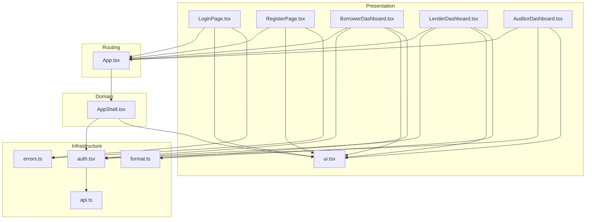

**Diagram sources**
- [App.tsx:39-203](file://frontend/src/App.tsx#L39-L203)
- [AppShell.tsx:116-174](file://frontend/src/components/AppShell.tsx#L116-L174)
- [auth.tsx:1-161](file://frontend/src/lib/auth.tsx#L1-L161)
- [api.ts:1-144](file://frontend/src/lib/api.ts#L1-L144)
- [errors.ts:1-25](file://frontend/src/lib/errors.ts#L1-L25)
- [format.ts:1-67](file://frontend/src/lib/format.ts#L1-L67)
- [LoginPage.tsx:1-117](file://frontend/src/pages/auth/LoginPage.tsx#L1-L117)
- [RegisterPage.tsx:1-165](file://frontend/src/pages/auth/RegisterPage.tsx#L1-L165)
- [BorrowerDashboard.tsx:1-76](file://frontend/src/pages/borrower/BorrowerDashboard.tsx#L1-L76)
- [LenderDashboard.tsx:1-70](file://frontend/src/pages/lender/LenderDashboard.tsx#L1-L70)
- [AuditorDashboard.tsx:1-85](file://frontend/src/pages/auditor/AuditorDashboard.tsx#L1-L85)

## Detailed Component Analysis

### Routing and Role-Based Access Control
- Root entry wraps the app with BrowserRouter and AuthProvider.
- App defines public routes (/login, /register), protected routes under AppShell, and role-scoped routes (/borrower, /lender, /auditor).
- RequireAuth blocks unauthenticated users and redirects to /login.
- RequireRole ensures the current user’s role matches the route; otherwise, redirects to the home route for that role.
- RootRedirect sends anonymous users to /login and authenticated users to their role home.

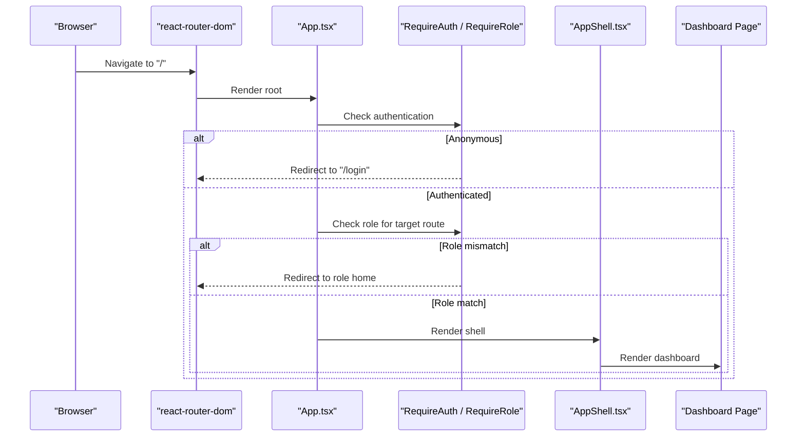

**Diagram sources**
- [App.tsx:15-37](file://frontend/src/App.tsx#L15-L37)
- [App.tsx:39-203](file://frontend/src/App.tsx#L39-L203)
- [AppShell.tsx:116-174](file://frontend/src/components/AppShell.tsx#L116-L174)

**Section sources**
- [App.tsx:15-37](file://frontend/src/App.tsx#L15-L37)
- [App.tsx:39-203](file://frontend/src/App.tsx#L39-L203)

### Authentication Flow
- On app start, AuthProvider attempts bootstrapSession to silently restore the session from the httpOnly refresh cookie.
- If successful, the access token is set in memory and the user profile is loaded.
- Login calls /auth/login, sets the access token, updates user state, and loads the profile.
- Register calls /auth/register, then applies the returned session.
- Logout calls /auth/logout, clears the access token, resets user/profile state, and sets status to anonymous.
- Any 401 on non-auth endpoints triggers a single refreshAccessToken call before retrying the original request.

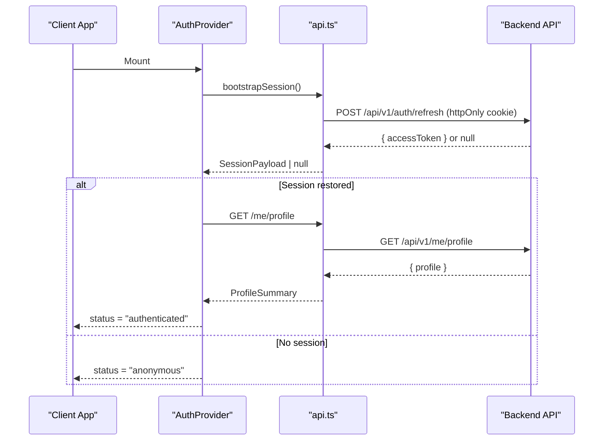

**Diagram sources**
- [auth.tsx:47-92](file://frontend/src/lib/auth.tsx#L47-L92)
- [api.ts:109-143](file://frontend/src/lib/api.ts#L109-L143)

**Section sources**
- [auth.tsx:47-135](file://frontend/src/lib/auth.tsx#L47-L135)
- [api.ts:81-143](file://frontend/src/lib/api.ts#L81-L143)

### API Client Implementation
- rawRequest builds headers, injects Authorization when available, and handles JSON payloads.
- api wraps rawRequest with 401 retry logic, delegating to refreshAccessToken once per conflict.
- bootstrapSession serializes refresh requests to avoid concurrent token rotation.
- ApiError carries status, code, message, and optional details for structured error handling.

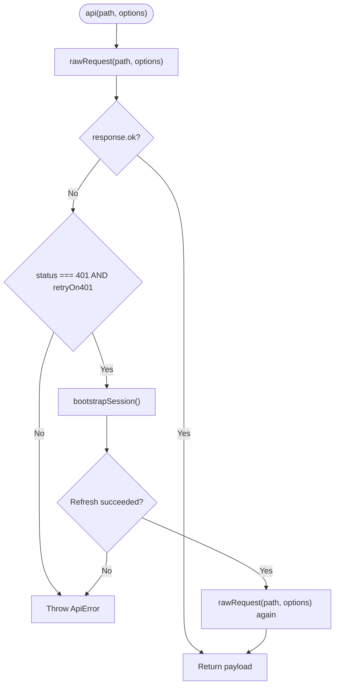

**Diagram sources**
- [api.ts:50-94](file://frontend/src/lib/api.ts#L50-L94)
- [api.ts:117-143](file://frontend/src/lib/api.ts#L117-L143)

**Section sources**
- [api.ts:1-144](file://frontend/src/lib/api.ts#L1-L144)

### Error Handling Strategies
- ApiError encapsulates backend errors with structured fields.
- fieldErrors maps validation detail arrays into field-to-message objects for inline form hints.
- messageOf returns safe, user-facing messages for any thrown value.
- Login and Register pages surface global alerts and per-field errors.

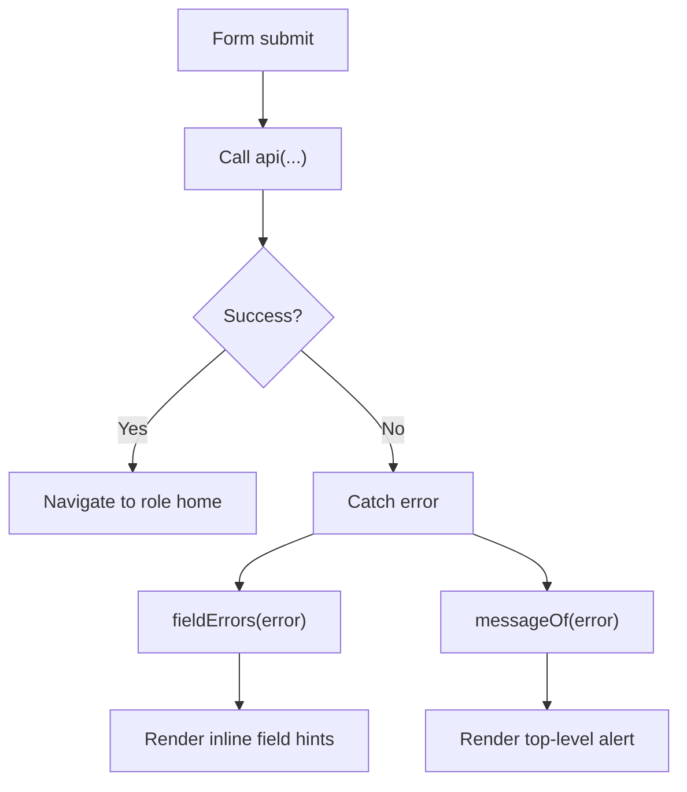

**Diagram sources**
- [errors.ts:1-25](file://frontend/src/lib/errors.ts#L1-L25)
- [LoginPage.tsx:25-40](file://frontend/src/pages/auth/LoginPage.tsx#L25-L40)
- [RegisterPage.tsx:25-51](file://frontend/src/pages/auth/RegisterPage.tsx#L25-L51)

**Section sources**
- [errors.ts:1-25](file://frontend/src/lib/errors.ts#L1-L25)
- [LoginPage.tsx:25-40](file://frontend/src/pages/auth/LoginPage.tsx#L25-L40)
- [RegisterPage.tsx:25-51](file://frontend/src/pages/auth/RegisterPage.tsx#L25-L51)

### Role-Based UI Components

#### Borrower Dashboard
- Displays profile completeness checks, income display, and active loans count.
- Links to loan application and profile update flows.
- Uses format helpers for money and UI primitives for cards and badges.

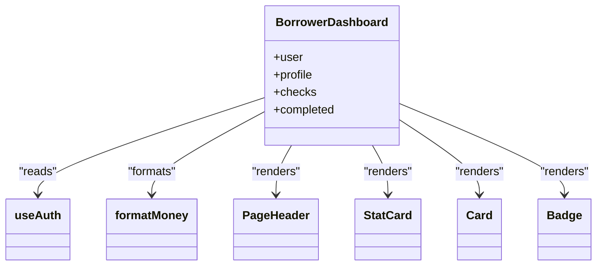

**Diagram sources**
- [BorrowerDashboard.tsx:11-76](file://frontend/src/pages/borrower/BorrowerDashboard.tsx#L11-L76)
- [format.ts:17-25](file://frontend/src/lib/format.ts#L17-L25)
- [ui.tsx:8-81](file://frontend/src/components/ui.tsx#L8-L81)

**Section sources**
- [BorrowerDashboard.tsx:1-76](file://frontend/src/pages/borrower/BorrowerDashboard.tsx#L1-L76)

#### Lender Dashboard
- Shows default rate and maximum principal derived from profile.
- Provides quick links to applications and fraud queue.
- Highlights platform guarantees and controls owned by lenders.

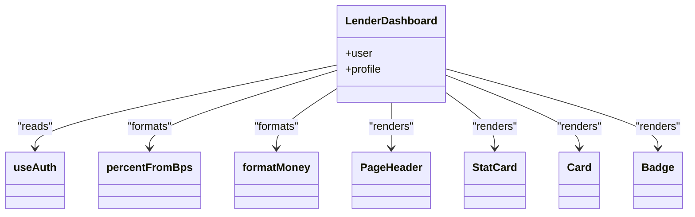

**Diagram sources**
- [LenderDashboard.tsx:7-70](file://frontend/src/pages/lender/LenderDashboard.tsx#L7-L70)
- [format.ts:55-57](file://frontend/src/lib/format.ts#L55-L57)
- [ui.tsx:8-95](file://frontend/src/components/ui.tsx#L8-L95)

**Section sources**
- [LenderDashboard.tsx:1-70](file://frontend/src/pages/lender/LenderDashboard.tsx#L1-L70)

#### Auditor Dashboard
- Reads platform health via a direct fetch to /api/health.
- Presents ledger mode, audit chain integrity, and investigation entry points.
- Uses read-only messaging and evidence descriptions.

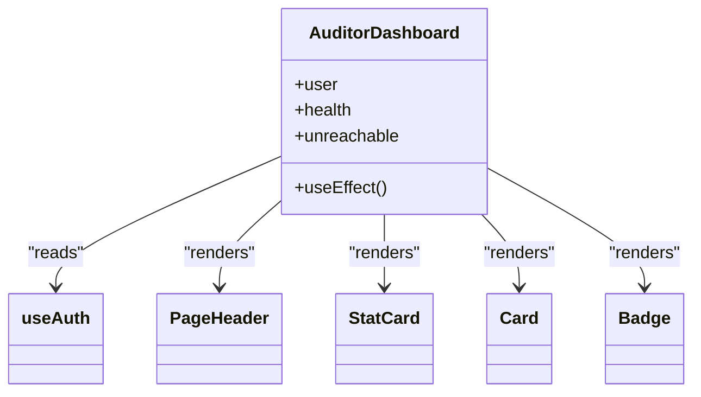

**Diagram sources**
- [AuditorDashboard.tsx:14-85](file://frontend/src/pages/auditor/AuditorDashboard.tsx#L14-L85)
- [ui.tsx:8-95](file://frontend/src/components/ui.tsx#L8-L95)

**Section sources**
- [AuditorDashboard.tsx:1-85](file://frontend/src/pages/auditor/AuditorDashboard.tsx#L1-L85)

### Styling Approach and Responsive Design
- Tailwind CSS is configured with custom brand colors, ink palette, font families, and card shadow.
- Components are built with utility-first classes, ensuring consistent spacing, typography, and color usage.
- AppShell provides a responsive layout: fixed sidebar on desktop and slide-over menu on mobile, with proper aria attributes for accessibility.

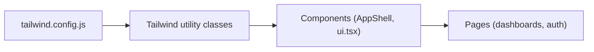

**Diagram sources**
- [tailwind.config.js:1-36](file://frontend/tailwind.config.js#L1-L36)
- [AppShell.tsx:116-174](file://frontend/src/components/AppShell.tsx#L116-L174)
- [ui.tsx:1-218](file://frontend/src/components/ui.tsx#L1-L218)

**Section sources**
- [tailwind.config.js:1-36](file://frontend/tailwind.config.js#L1-L36)
- [AppShell.tsx:116-174](file://frontend/src/components/AppShell.tsx#L116-L174)

### Accessibility Considerations
- Navigation elements include aria-label and aria-expanded for toggle buttons.
- Status indicators use role="status" and aria-live="polite" for dynamic content.
- Alerts use role="alert" for screen reader announcements.
- Decorative icons use aria-hidden="true".
- Form fields are labeled and associate labels with inputs via htmlFor.

**Section sources**
- [AppShell.tsx:139-149](file://frontend/src/components/AppShell.tsx#L139-L149)
- [ui.tsx:153-156](file://frontend/src/components/ui.tsx#L153-L156)
- [ui.tsx:177-184](file://frontend/src/components/ui.tsx#L177-L184)
- [ui.tsx:197-217](file://frontend/src/components/ui.tsx#L197-L217)

## Dependency Analysis
The frontend has minimal external dependencies beyond React, ReactDOM, and react-router-dom. Build tooling includes Vite, PostCSS, Autoprefixer, and Tailwind CSS.

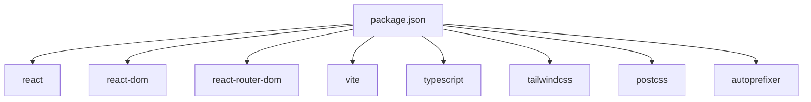

**Diagram sources**
- [package.json:13-27](file://frontend/package.json#L13-L27)

**Section sources**
- [package.json:1-29](file://frontend/package.json#L1-L29)

## Performance Considerations
- In-memory access tokens reduce XSS risk and avoid unnecessary persistence overhead.
- bootstrapSession serializes refresh requests to prevent concurrent rotations and redundant network calls.
- Vite dev server proxies API calls to keep SameSite cookies working without CORS complexity.
- Production builds disable sourcemaps to reduce bundle size.
- Service worker registration is gated behind production checks to avoid caching during development.

Recommendations:
- Keep API responses lean and leverage pagination where needed.
- Use React.lazy and Suspense for route-level code splitting if additional pages are added.
- Consider memoizing expensive computations in dashboards using useMemo and useCallback.
- Monitor bundle size with Vite’s built-in analysis tools.

**Section sources**
- [api.ts:109-143](file://frontend/src/lib/api.ts#L109-L143)
- [vite.config.ts:1-24](file://frontend/vite.config.ts#L1-L24)
- [main.tsx:21-29](file://frontend/src/main.tsx#L21-L29)

## Troubleshooting Guide
Common issues and resolutions:
- 401 Unauthorized loops:
  - Ensure the backend refresh endpoint is reachable and the httpOnly cookie is present.
  - Verify that non-auth endpoints allow retryOn401 and that bootstrapSession resolves correctly.
- Validation errors not showing:
  - Confirm the backend returns structured details array with path and message fields.
  - Use fieldErrors to map details to per-field hints.
- Styling not applied:
  - Ensure Tailwind content paths include all source files and that index.css imports Tailwind directives.
- Mobile navigation not closing:
  - Check that route changes trigger useEffect to close the drawer.

**Section sources**
- [api.ts:81-94](file://frontend/src/lib/api.ts#L81-L94)
- [api.ts:117-143](file://frontend/src/lib/api.ts#L117-L143)
- [errors.ts:1-25](file://frontend/src/lib/errors.ts#L1-L25)
- [AppShell.tsx:121-124](file://frontend/src/components/AppShell.tsx#L121-L124)

## Conclusion
The frontend application provides a clear, role-aware interface for borrowers, lenders, and auditors. It leverages React context for state management, a robust API client with automatic refresh, and Tailwind CSS for consistent, accessible, and responsive UI. The routing architecture enforces authentication and role-based access, while shared UI primitives and formatting utilities promote consistency and maintainability. With thoughtful error handling and performance-conscious patterns, the application is well-positioned for further feature expansion and scaling.