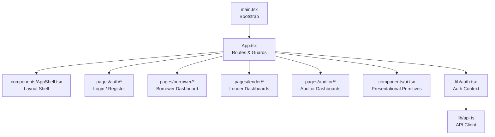
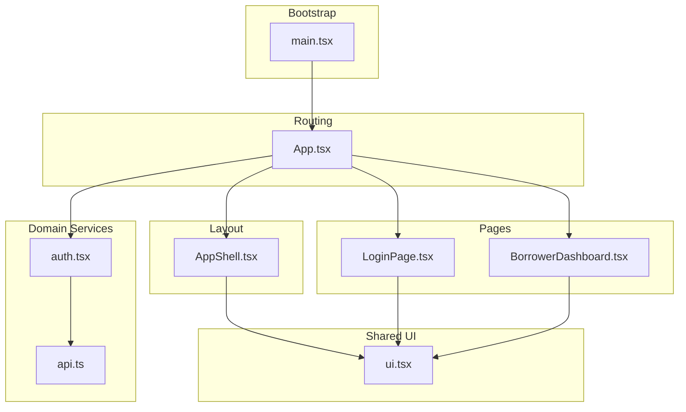
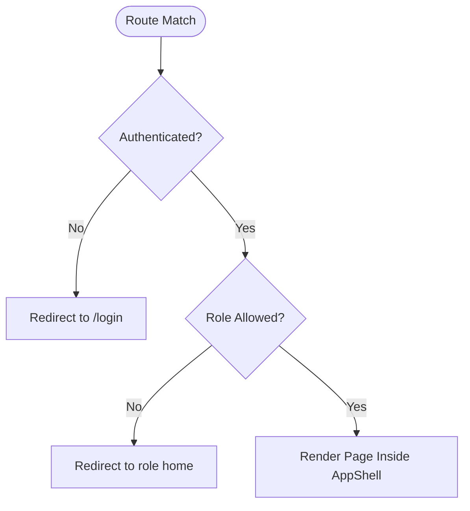
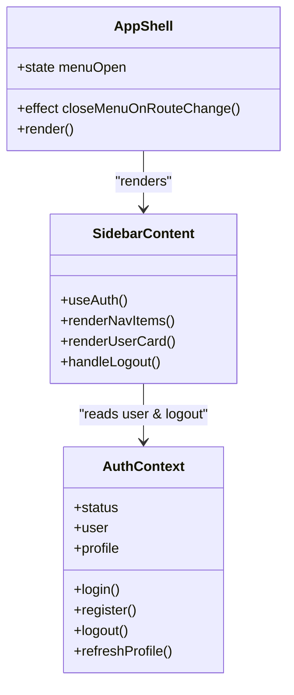
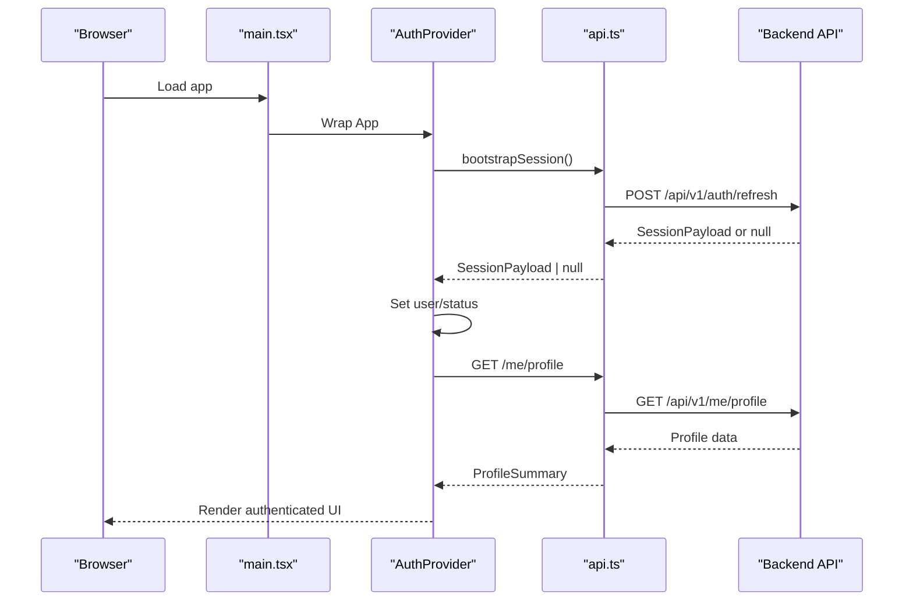
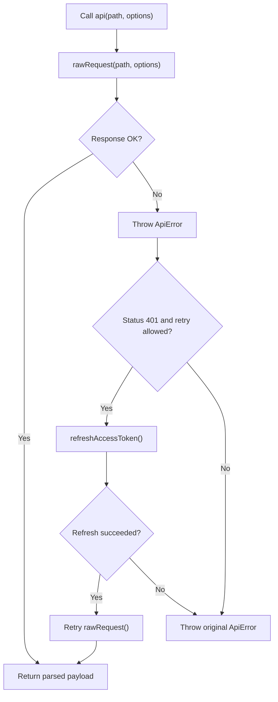
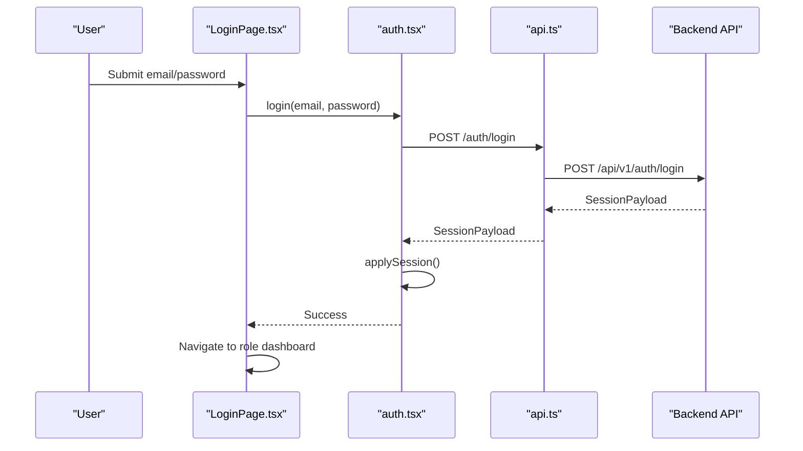
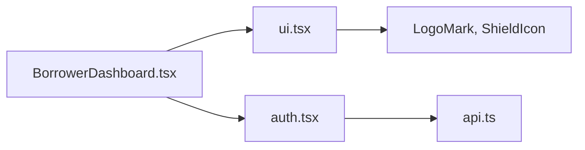
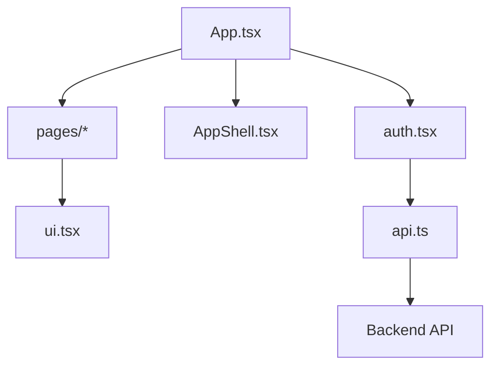

# React Application Structure

<cite>
**Referenced Files in This Document**
- [main.tsx](file://frontend/src/main.tsx)
- [App.tsx](file://frontend/src/App.tsx)
- [AppShell.tsx](file://frontend/src/components/AppShell.tsx)
- [ui.tsx](file://frontend/src/components/ui.tsx)
- [auth.tsx](file://frontend/src/lib/auth.tsx)
- [api.ts](file://frontend/src/lib/api.ts)
- [LoginPage.tsx](file://frontend/src/pages/auth/LoginPage.tsx)
- [BorrowerDashboard.tsx](file://frontend/src/pages/borrower/BorrowerDashboard.tsx)
- [vite.config.ts](file://frontend/vite.config.ts)
- [package.json](file://frontend/package.json)
</cite>

## Table of Contents
1. [Introduction](#introduction)
2. [Project Structure](#project-structure)
3. [Core Components](#core-components)
4. [Architecture Overview](#architecture-overview)
5. [Detailed Component Analysis](#detailed-component-analysis)
6. [Dependency Analysis](#dependency-analysis)
7. [Performance Considerations](#performance-considerations)
8. [Troubleshooting Guide](#troubleshooting-guide)
9. [Conclusion](#conclusion)

## Introduction
This document explains the React application structure and architecture for the SecureMicrofinance frontend. It covers the entry points, component hierarchy, routing configuration, layout shell, authentication state management, API integration, Vite build configuration, module organization, error handling, and performance strategies. The goal is to make the codebase understandable for both new contributors and maintainers while preserving technical precision.

## Project Structure
The frontend is a React 19 application built with Vite, styled with Tailwind CSS, and uses React Router for navigation. The most important directories are:

- `src/main.tsx`: Application bootstrap, global providers, and service worker registration.
- `src/App.tsx`: Top-level routes, authentication guards, and role-based redirects.
- `src/components/`: Shared UI primitives and the application layout shell.
- `src/lib/`: Cross-cutting concerns such as authentication context, API client, formatting, and error helpers.
- `src/pages/`: Route-specific page components grouped by feature or role.

**Diagram sources**
- [main.tsx:1-30](file://frontend/src/main.tsx#L1-L30)
- [App.tsx:1-205](file://frontend/src/App.tsx#L1-L205)
- [AppShell.tsx:1-194](file://frontend/src/components/AppShell.tsx#L1-L194)
- [ui.tsx:1-218](file://frontend/src/components/ui.tsx#L1-L218)
- [auth.tsx:1-161](file://frontend/src/lib/auth.tsx#L1-L161)
- [api.ts:1-144](file://frontend/src/lib/api.ts#L1-L144)

**Section sources**
- [main.tsx:1-30](file://frontend/src/main.tsx#L1-L30)
- [App.tsx:1-205](file://frontend/src/App.tsx#L1-L205)
- [AppShell.tsx:1-194](file://frontend/src/components/AppShell.tsx#L1-L194)
- [ui.tsx:1-218](file://frontend/src/components/ui.tsx#L1-L218)
- [auth.tsx:1-161](file://frontend/src/lib/auth.tsx#L1-L161)
- [api.ts:1-144](file://frontend/src/lib/api.ts#L1-L144)

## Core Components
- Application bootstrap (`main.tsx`): Creates the React root, wraps the app in `BrowserRouter`, `AuthProvider`, and `React.StrictMode`. Registers the PWA service worker only in production builds.
- Routing and guards (`App.tsx`): Defines all routes, protects authenticated routes with `RequireAuth`, enforces role access with `RequireRole`, and redirects anonymous users to login or their role home.
- Layout shell (`AppShell.tsx`): Provides responsive sidebar navigation on desktop and a slide-over menu on mobile. Navigation items are derived from the authenticated user’s role.
- Presentational UI (`ui.tsx`): Reusable, composition-friendly components like `PageHeader`, `Card`, `StatCard`, `Badge`, `Field`, `TextInput`, `Alert`, `Spinner`, `FullPageLoader`, `ShieldIcon`, and `LogoMark`.
- Authentication context (`auth.tsx`): Holds session status, user profile, and actions for login, register, logout, and profile refresh. Uses an httpOnly cookie strategy for refresh tokens and keeps the access token in memory.
- API client (`api.ts`): Centralized fetch wrapper that attaches Bearer tokens, handles 401 retry via a single shared refresh request, and throws typed `ApiError` objects.

**Section sources**
- [main.tsx:1-30](file://frontend/src/main.tsx#L1-L30)
- [App.tsx:1-205](file://frontend/src/App.tsx#L1-L205)
- [AppShell.tsx:1-194](file://frontend/src/components/AppShell.tsx#L1-L194)
- [ui.tsx:1-218](file://frontend/src/components/ui.tsx#L1-L218)
- [auth.tsx:1-161](file://frontend/src/lib/auth.tsx#L1-L161)
- [api.ts:1-144](file://frontend/src/lib/api.ts#L1-L144)

## Architecture Overview
The application follows a layered approach:

- Bootstrap layer: `main.tsx` initializes React, routing, and authentication provider.
- Routing layer: `App.tsx` configures routes and applies authentication and role guards.
- Layout layer: `AppShell.tsx` renders the consistent layout and navigation framework.
- Feature layer: Role-specific dashboards and pages render domain content using shared UI primitives.
- Domain services: `lib/auth.tsx` and `lib/api.ts` encapsulate authentication state and HTTP communication.

**Diagram sources**
- [main.tsx:1-30](file://frontend/src/main.tsx#L1-L30)
- [App.tsx:1-205](file://frontend/src/App.tsx#L1-L205)
- [AppShell.tsx:1-194](file://frontend/src/components/AppShell.tsx#L1-L194)
- [ui.tsx:1-218](file://frontend/src/components/ui.tsx#L1-L218)
- [auth.tsx:1-161](file://frontend/src/lib/auth.tsx#L1-L161)
- [api.ts:1-144](file://frontend/src/lib/api.ts#L1-L144)
- [LoginPage.tsx:1-117](file://frontend/src/pages/auth/LoginPage.tsx#L1-L117)
- [BorrowerDashboard.tsx:1-76](file://frontend/src/pages/borrower/BorrowerDashboard.tsx#L1-L76)

## Detailed Component Analysis

### Application Entry Point and Bootstrap
`main.tsx` performs the following responsibilities:
- Mounts the React tree under the root DOM node.
- Wraps the app with `BrowserRouter`, `AuthProvider`, and `React.StrictMode`.
- Registers the service worker only when running in production.

Key behaviors:
- If the root container is missing, it throws an error early.
- Service worker registration is optional and never breaks the app if it fails.

**Section sources**
- [main.tsx:1-30](file://frontend/src/main.tsx#L1-L30)

### Routing Configuration and Guarding
`App.tsx` defines the top-level route tree:
- Public routes: `/login`, `/register`.
- Protected routes: All routes inside `AppShell` require authentication.
- Role-based routes: Borrower, lender, and auditor screens are guarded by `RequireRole`.
- Root redirect: Redirects anonymous users to `/login` and authenticated users to their role home.

Guard logic:
- `RequireAuth` shows a full-page loader while session status is loading, otherwise redirects unauthenticated users.
- `RequireRole` ensures the current user’s role matches the expected role; otherwise, it redirects to the appropriate home route.

**Diagram sources**
- [App.tsx:15-37](file://frontend/src/App.tsx#L15-L37)
- [App.tsx:39-205](file://frontend/src/App.tsx#L39-L205)

**Section sources**
- [App.tsx:1-205](file://frontend/src/App.tsx#L1-L205)

### AppShell Layout and Navigation Framework
`AppShell.tsx` provides:
- A fixed desktop sidebar with role-derived navigation links.
- A mobile header with a toggleable drawer.
- An `<Outlet />` area where routed pages render.
- User info and sign-out controls in the sidebar.

Navigation model:
- `NAV_BY_ROLE` maps each role to its allowed destinations.
- Active link highlighting is handled through `NavLink`.
- Mobile drawer closes automatically when the route changes.

**Diagram sources**
- [AppShell.tsx:1-194](file://frontend/src/components/AppShell.tsx#L1-L194)
- [auth.tsx:1-161](file://frontend/src/lib/auth.tsx#L1-L161)

**Section sources**
- [AppShell.tsx:1-194](file://frontend/src/components/AppShell.tsx#L1-L194)

### Authentication State Management
`auth.tsx` implements a React Context-based authentication system:
- On mount, it attempts a silent session bootstrap using the httpOnly refresh cookie.
- Successful bootstrap sets the user and loads the profile; failure marks the user as anonymous.
- Login and register call the backend, then apply the returned session.
- Logout clears in-memory state and resets the session to anonymous.

State shape:
- `status`: `loading`, `authenticated`, or `anonymous`.
- `user`: Current session user object.
- `profile`: Optional profile summary fetched from `/me/profile`.

**Diagram sources**
- [main.tsx:11-19](file://frontend/src/main.tsx#L11-L19)
- [auth.tsx:47-92](file://frontend/src/lib/auth.tsx#L47-L92)
- [api.ts:122-143](file://frontend/src/lib/api.ts#L122-L143)

**Section sources**
- [auth.tsx:1-161](file://frontend/src/lib/auth.tsx#L1-L161)

### API Integration and Error Handling
`api.ts` centralizes HTTP requests:
- Adds `Authorization: Bearer <token>` when available.
- Sends credentials with requests to support httpOnly cookies.
- Throws `ApiError` with structured fields for status, code, message, and details.
- Implements automatic 401 retry by refreshing the access token once per in-flight refresh.

Refresh strategy:
- `bootstrapSession()` caches the in-flight promise so concurrent calls share one refresh attempt.
- `refreshAccessToken()` delegates to `bootstrapSession()` and returns whether a fresh session was obtained.

**Diagram sources**
- [api.ts:50-94](file://frontend/src/lib/api.ts#L50-L94)
- [api.ts:117-143](file://frontend/src/lib/api.ts#L117-L143)

**Section sources**
- [api.ts:1-144](file://frontend/src/lib/api.ts#L1-L144)

### Example: Login Flow
The login page demonstrates form submission, error handling, and navigation:
- Submits credentials through `auth.login`.
- Navigates to the appropriate dashboard based on the email pattern used in demo accounts.
- Displays server errors and field-level validation messages.

**Diagram sources**
- [LoginPage.tsx:25-40](file://frontend/src/pages/auth/LoginPage.tsx#L25-L40)
- [auth.tsx:94-103](file://frontend/src/lib/auth.tsx#L94-L103)
- [api.ts:81-94](file://frontend/src/lib/api.ts#L81-L94)

**Section sources**
- [LoginPage.tsx:1-117](file://frontend/src/pages/auth/LoginPage.tsx#L1-L117)
- [auth.tsx:94-103](file://frontend/src/lib/auth.tsx#L94-L103)

### Example: Borrower Dashboard Composition
The borrower dashboard composes shared UI components to display profile completeness, security guarantees, and quick actions:
- Reads user and profile from `useAuth`.
- Renders statistics and verification checklist using `StatCard`, `Card`, and `Badge`.
- Links to loan application and profile update flows.

**Diagram sources**
- [BorrowerDashboard.tsx:1-76](file://frontend/src/pages/borrower/BorrowerDashboard.tsx#L1-L76)
- [ui.tsx:1-218](file://frontend/src/components/ui.tsx#L1-L218)
- [auth.tsx:1-161](file://frontend/src/lib/auth.tsx#L1-L161)

**Section sources**
- [BorrowerDashboard.tsx:1-76](file://frontend/src/pages/borrower/BorrowerDashboard.tsx#L1-L76)

### Vite Build Configuration and Module Organization
Vite configuration:
- Uses the React plugin.
- Proxies `/api` to the backend at `http://127.0.0.1:4000` during development to keep SameSite cookies working.
- Builds output to `dist` with sourcemaps disabled.

Module organization patterns:
- Feature-based pages under `src/pages/<role>/`.
- Shared UI primitives under `src/components/ui.tsx`.
- Cross-cutting concerns under `src/lib/`.
- Single layout shell under `src/components/AppShell.tsx`.

Dependency management:
- Runtime dependencies include React, ReactDOM, and React Router.
- Development dependencies include Vite, TypeScript, Tailwind CSS, PostCSS, and Autoprefixer.

**Section sources**
- [vite.config.ts:1-24](file://frontend/vite.config.ts#L1-L24)
- [package.json:1-29](file://frontend/package.json#L1-L29)

## Dependency Analysis
The frontend has clear separation between routing, layout, features, and domain services:

Coupling and cohesion:
- `App.tsx` depends on routing and guards but not on specific page implementations beyond imports.
- `AppShell.tsx` depends on `auth.tsx` for user context and on `ui.tsx` for branding.
- `auth.tsx` depends on `api.ts` for session operations and profile fetching.
- `api.ts` is independent of React except for types and is the lowest-level integration point.

Potential circular dependencies:
- None observed among the analyzed files. Imports flow from higher layers (routing/pages) down to shared libraries.

External integrations:
- Backend API endpoints: `/api/v1/auth/login`, `/api/v1/auth/register`, `/api/v1/auth/logout`, `/api/v1/auth/refresh`, `/api/v1/me/profile`.
- Service worker: `/sw.js` registered in production.

**Diagram sources**
- [App.tsx:1-205](file://frontend/src/App.tsx#L1-L205)
- [AppShell.tsx:1-194](file://frontend/src/components/AppShell.tsx#L1-L194)
- [auth.tsx:1-161](file://frontend/src/lib/auth.tsx#L1-L161)
- [api.ts:1-144](file://frontend/src/lib/api.ts#L1-L144)

**Section sources**
- [App.tsx:1-205](file://frontend/src/App.tsx#L1-L205)
- [AppShell.tsx:1-194](file://frontend/src/components/AppShell.tsx#L1-L194)
- [auth.tsx:1-161](file://frontend/src/lib/auth.tsx#L1-L161)
- [api.ts:1-144](file://frontend/src/lib/api.ts#L1-L144)

## Performance Considerations
- Strict Mode: The app runs under `React.StrictMode` in development, which double-invokes effects to surface side-effect issues. This can cause multiple refresh attempts if not deduplicated; the API client already shares a single in-flight refresh promise.
- Token storage: Access tokens are kept in memory only, reducing XSS risk and avoiding unnecessary persistence overhead.
- Conditional rendering: Loading states use a full-page loader to avoid partial UI flicker during session bootstrap.
- Navigation efficiency: `NavLink` handles active state efficiently without extra re-renders.
- Build optimizations: Sourcemaps are disabled in production builds to reduce bundle size.
- Service worker: Registered only in production to avoid dev-server caching issues.

[No sources needed since this section provides general guidance]

## Troubleshooting Guide
Common issues and resolutions:

- Missing root container:
  - Symptom: Application fails to mount.
  - Cause: The DOM element with id `root` is absent.
  - Resolution: Ensure the HTML template includes the root element before mounting.

- Anonymous user redirected unexpectedly:
  - Symptom: Users see login even after successful login.
  - Cause: Session bootstrap failed or refresh endpoint returned non-ok.
  - Resolution: Verify backend `/api/v1/auth/refresh` is reachable and returns a valid session.

- 401 retry not working:
  - Symptom: Multiple 401 errors occur instead of a single refresh.
  - Cause: Calls may bypass the shared refresh guard or use paths starting with `/auth/`.
  - Resolution: Use the centralized `api()` function and ensure non-auth paths trigger retry.

- Navigation not updating mobile drawer:
  - Symptom: Mobile menu remains open after route change.
  - Cause: Drawer state not reset on route change.
  - Resolution: Confirm the effect closing the drawer on location change is present.

- Profile not loading:
  - Symptom: Dashboard shows incomplete profile data.
  - Cause: `/me/profile` request failed or returned unexpected shape.
  - Resolution: Inspect network logs and verify the backend response structure.

**Section sources**
- [main.tsx:8-19](file://frontend/src/main.tsx#L8-L19)
- [api.ts:50-94](file://frontend/src/lib/api.ts#L50-L94)
- [api.ts:122-143](file://frontend/src/lib/api.ts#L122-L143)
- [AppShell.tsx:121-124](file://frontend/src/components/AppShell.tsx#L121-L124)

## Conclusion
The SecureMicrofinance frontend is a well-structured React application with clear boundaries between routing, layout, features, and domain services. Authentication is implemented securely using httpOnly cookies and in-memory access tokens. The layout shell provides a consistent, role-aware navigation experience. Vite configuration simplifies local development with API proxying, and the module organization promotes maintainability. For future enhancements, consider adding explicit error boundaries around major route segments and introducing lightweight state caching for frequently accessed profiles.

[No sources needed since this section summarizes without analyzing specific files]