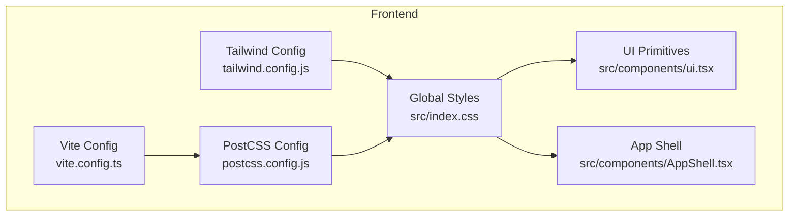
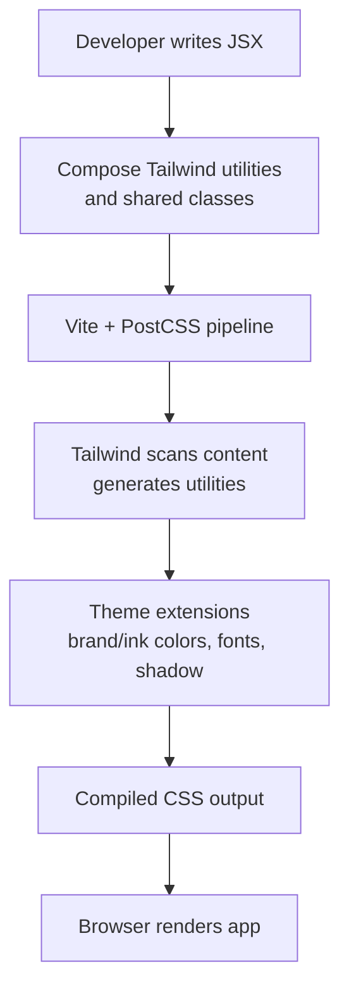
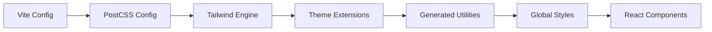

# Styling and Design System

<cite>
**Referenced Files in This Document**
- [tailwind.config.js](file://frontend/tailwind.config.js)
- [index.css](file://frontend/src/index.css)
- [postcss.config.js](file://frontend/postcss.config.js)
- [vite.config.ts](file://frontend/vite.config.ts)
- [ui.tsx](file://frontend/src/components/ui.tsx)
- [AppShell.tsx](file://frontend/src/components/AppShell.tsx)
</cite>

## Table of Contents
1. [Introduction](#introduction)
2. [Project Structure](#project-structure)
3. [Core Components](#core-components)
4. [Architecture Overview](#architecture-overview)
5. [Detailed Component Analysis](#detailed-component-analysis)
6. [Dependency Analysis](#dependency-analysis)
7. [Performance Considerations](#performance-considerations)
8. [Troubleshooting Guide](#troubleshooting-guide)
9. [Conclusion](#conclusion)

## Introduction
This document explains the styling approach and design system used by the frontend application. It covers Tailwind CSS configuration, custom theme extensions, global styles, reusable component patterns, responsive breakpoints, accessibility considerations, and build-time optimizations. The goal is to help developers understand how visual consistency is achieved while keeping components readable and maintainable.

## Project Structure
The styling system lives under the frontend directory and is composed of:
- A Tailwind configuration that extends colors, fonts, and shadows.
- A global stylesheet that defines base styles and reusable component primitives.
- React components that compose Tailwind utilities and shared CSS classes for consistent UI.
- Build tooling (Vite, PostCSS, Autoprefixer) that compiles and optimizes CSS.

**Diagram sources**
- [tailwind.config.js:1-36](file://frontend/tailwind.config.js#L1-L36)
- [index.css:1-80](file://frontend/src/index.css#L1-L80)
- [ui.tsx:1-218](file://frontend/src/components/ui.tsx#L1-L218)
- [AppShell.tsx:1-194](file://frontend/src/components/AppShell.tsx#L1-L194)
- [postcss.config.js:1-7](file://frontend/postcss.config.js#L1-L7)
- [vite.config.ts:1-24](file://frontend/vite.config.ts#L1-L24)

**Section sources**
- [tailwind.config.js:1-36](file://frontend/tailwind.config.js#L1-L36)
- [index.css:1-80](file://frontend/src/index.css#L1-L80)
- [postcss.config.js:1-7](file://frontend/postcss.config.js#L1-L7)
- [vite.config.ts:1-24](file://frontend/vite.config.ts#L1-L24)

## Core Components
The design system is built around a small set of primitives defined in the global stylesheet and reused across components:
- Base layer: body background, typography defaults, and focus-visible ring behavior.
- Component layer: card, buttons, labels, inputs, hints, error text, badges, navigation links, and table base styles.
- Utility composition: components use Tailwind utility classes for layout, spacing, color, and responsiveness.

Key responsibilities:
- Global styles establish consistent defaults and accessibility behaviors.
- Reusable classes encapsulate common visual patterns.
- Components combine these classes to produce predictable UI elements.

**Section sources**
- [index.css:9-19](file://frontend/src/index.css#L9-L19)
- [index.css:21-79](file://frontend/src/index.css#L21-L79)

## Architecture Overview
The styling architecture follows a layered approach:
- Tailwind provides utility-first building blocks.
- Tailwind config extends the design tokens (colors, fonts, shadows).
- Global CSS layers define base and component-level styles.
- React components compose utilities and shared classes to render UI.

**Diagram sources**
- [vite.config.ts:1-24](file://frontend/vite.config.ts#L1-L24)
- [postcss.config.js:1-7](file://frontend/postcss.config.js#L1-L7)
- [tailwind.config.js:1-36](file://frontend/tailwind.config.js#L1-L36)
- [index.css:1-80](file://frontend/src/index.css#L1-L80)

## Detailed Component Analysis

### Tailwind Configuration and Theme Extensions
The Tailwind configuration:
- Scans HTML and TypeScript/TSX files for class usage.
- Extends the default theme with brand and ink color palettes.
- Overrides font families for sans and mono.
- Adds a reusable card shadow token.

Design tokens introduced:
- Brand palette: a green spectrum from light to dark shades.
- Ink palette: dark slate tones for high-contrast text and backgrounds.
- Font stacks: Inter as primary sans; monospace stack for code-like text.
- Shadow: a subtle elevation for cards.

Best practices demonstrated:
- Centralized tokens reduce duplication and ensure consistency.
- Using semantic names like brand and ink improves readability.

**Section sources**
- [tailwind.config.js:1-36](file://frontend/tailwind.config.js#L1-L36)

### Global Styles and Layered CSS
The global stylesheet uses Tailwind’s @layer directives:
- Base layer sets html/body defaults and accessible focus behavior.
- Component layer defines reusable classes for cards, buttons, form fields, badges, navigation, and tables.

Accessibility highlights:
- Focus-visible ring ensures keyboard users see clear focus indicators.
- Semantic roles are used in components (e.g., alert role).

Responsive design:
- Mobile-first approach with sm: breakpoints applied in components and layouts.
- Consistent spacing and typography scales across sizes.

**Section sources**
- [index.css:1-80](file://frontend/src/index.css#L1-L80)

### Reusable UI Components
The UI primitives provide consistent presentation:
- PageHeader: responsive header with title, subtitle, and actions.
- Card: container with optional header and actions area.
- StatCard: metric display with tone variants.
- Badge: status indicator with multiple tones.
- VerifiedBadge: contextual badge indicating on-chain verification.
- Field: label/hint/error wrapper for form inputs.
- TextInput and Select: styled input wrappers using shared input class.
- Alert: contextual messages with danger/warning/info tones.
- EmptyState: placeholder state for empty data.
- Spinner and FullPageLoader: loading indicators with accessible attributes.
- Icon and LogoMark: SVG-based icons with aria-hidden where appropriate.

Styling patterns:
- Shared classes (card, btn, input, badge, nav-link) keep visuals consistent.
- Tone maps centralize color choices per variant.
- Composition over inheritance: components combine utilities and shared classes.

Accessibility patterns:
- aria-live and role attributes for dynamic content.
- aria-hidden for decorative icons.
- Keyboard-friendly focus rings via global styles.

**Section sources**
- [ui.tsx:1-218](file://frontend/src/components/ui.tsx#L1-L218)

### Application Shell and Layout
The AppShell implements a responsive layout:
- Desktop sidebar with navigation derived from user role.
- Mobile header with toggle button and slide-over drawer.
- Main content area with consistent padding and max-width.
- AuthLayout wraps authentication pages with branding and footer.

Responsive behavior:
- Hidden sidebar on mobile, visible on lg screens.
- Drawer appears only on smaller screens.
- Content area adjusts left padding when sidebar is present.

Navigation styling:
- Uses shared nav-link and nav-link-active classes.
- Active state toggled via router integration.

**Section sources**
- [AppShell.tsx:1-194](file://frontend/src/components/AppShell.tsx#L1-L194)

### Typography Standards
Typography is standardized through:
- Font family overrides in Tailwind config.
- Consistent text sizes and weights in components.
- Tracking and uppercase conventions for labels and headers.

Examples:
- Page headings use semibold and tight tracking.
- Labels use uppercase and medium weight.
- Body text uses neutral slate tones for readability.

**Section sources**
- [tailwind.config.js:25-28](file://frontend/tailwind.config.js#L25-L28)
- [ui.tsx:18-21](file://frontend/src/components/ui.tsx#L18-L21)
- [ui.tsx:44-47](file://frontend/src/components/ui.tsx#L44-L47)

### Color Schemes and Spacing Conventions
Color scheme:
- Brand greens for emphasis and interactive states.
- Ink darks for high-contrast text and active navigation.
- Slate neutrals for backgrounds, borders, and secondary text.
- Semantic colors (red, amber, emerald, sky) for alerts and badges.

Spacing conventions:
- Consistent padding and margins using Tailwind spacing scale.
- Gap utilities for flex layouts.
- Card and container padding standardized.

**Section sources**
- [tailwind.config.js:6-24](file://frontend/tailwind.config.js#L6-L24)
- [ui.tsx:68-91](file://frontend/src/components/ui.tsx#L68-L91)
- [ui.tsx:146-157](file://frontend/src/components/ui.tsx#L146-L157)

### Responsive Breakpoints
Breakpoint usage:
- sm: used for small-screen adjustments (e.g., header layout, typography scaling).
- lg: used for desktop-specific features (sidebar visibility, main content padding).

Patterns:
- Mobile-first layout with progressive enhancement at larger breakpoints.
- Conditional rendering of navigation modes based on screen size.

**Section sources**
- [ui.tsx:18-21](file://frontend/src/components/ui.tsx#L18-L21)
- [AppShell.tsx:127-171](file://frontend/src/components/AppShell.tsx#L127-L171)

### Dark Mode Support
Current implementation:
- No explicit dark mode configuration or media query toggles are present in the analyzed files.
- Colors and components rely on light-mode defaults.

Recommendation:
- Extend Tailwind theme with dark variants for brand and ink colors.
- Add dark: modifiers to components and global styles.
- Implement a theme toggle mechanism if needed.

[No sources needed since this section provides general guidance]

### Accessibility Considerations in Styling
Implemented:
- Focus-visible ring for keyboard navigation.
- Semantic roles (alert) and aria-live regions for dynamic content.
- aria-hidden on decorative icons.

Guidelines:
- Maintain contrast ratios between text and backgrounds.
- Ensure interactive elements have visible focus states.
- Use semantic HTML and ARIA attributes alongside styles.

**Section sources**
- [index.css:16-18](file://frontend/src/index.css#L16-L18)
- [ui.tsx:177-183](file://frontend/src/components/ui.tsx#L177-L183)
- [ui.tsx:197-217](file://frontend/src/components/ui.tsx#L197-L217)

## Dependency Analysis
The styling dependencies flow as follows:
- Vite orchestrates the build process and includes React plugin.
- PostCSS runs Tailwind and Autoprefixer.
- Tailwind scans configured content paths and generates utilities based on theme extensions.
- Global CSS imports Tailwind layers and defines component primitives.
- Components consume utilities and shared classes.

**Diagram sources**
- [vite.config.ts:1-24](file://frontend/vite.config.ts#L1-L24)
- [postcss.config.js:1-7](file://frontend/postcss.config.js#L1-L7)
- [tailwind.config.js:1-36](file://frontend/tailwind.config.js#L1-L36)
- [index.css:1-80](file://frontend/src/index.css#L1-L80)

**Section sources**
- [vite.config.ts:1-24](file://frontend/vite.config.ts#L1-L24)
- [postcss.config.js:1-7](file://frontend/postcss.config.js#L1-L7)
- [tailwind.config.js:1-36](file://frontend/tailwind.config.js#L1-L36)

## Performance Considerations
Build-time optimizations:
- Sourcemaps disabled in production builds to reduce bundle size.
- Tailwind purges unused utilities based on content scanning.
- PostCSS autoprefixer adds vendor prefixes as needed.

Bundle size management:
- Keep content paths accurate to avoid generating unused CSS.
- Prefer shared classes and tokens to minimize duplication.
- Avoid excessive inline styles; rely on Tailwind utilities and component classes.

Recommendations:
- Monitor generated CSS size during development.
- Use Tailwind’s JIT mode (enabled by default in v3) to optimize output.
- Consider splitting large pages into smaller components to limit class explosion.

**Section sources**
- [vite.config.ts:19-22](file://frontend/vite.config.ts#L19-L22)
- [tailwind.config.js:3-3](file://frontend/tailwind.config.js#L3-L3)
- [postcss.config.js:1-7](file://frontend/postcss.config.js#L1-L7)

## Troubleshooting Guide
Common issues and resolutions:
- Missing styles: verify content paths in Tailwind config include all relevant files.
- Unexpected colors/fonts: check theme extensions and ensure tokens are correctly named.
- Focus styles not appearing: confirm :focus-visible rules are applied and not overridden.
- Large CSS bundle: review content scanning and remove unused classes or components.

Debugging tips:
- Inspect compiled CSS to verify utilities are generated.
- Temporarily add console logs in components to confirm class composition.
- Use browser dev tools to inspect computed styles and identify overrides.

**Section sources**
- [tailwind.config.js:3-3](file://frontend/tailwind.config.js#L3-L3)
- [index.css:16-18](file://frontend/src/index.css#L16-L18)

## Conclusion
The styling system combines Tailwind’s utility-first approach with a focused design system of shared classes and theme extensions. This results in consistent, accessible, and responsive UI components. By centralizing tokens, defining reusable primitives, and leveraging build-time optimizations, the project maintains visual coherence while keeping code readable and performant. Future enhancements can include dark mode support and further refinement of accessibility and performance metrics.