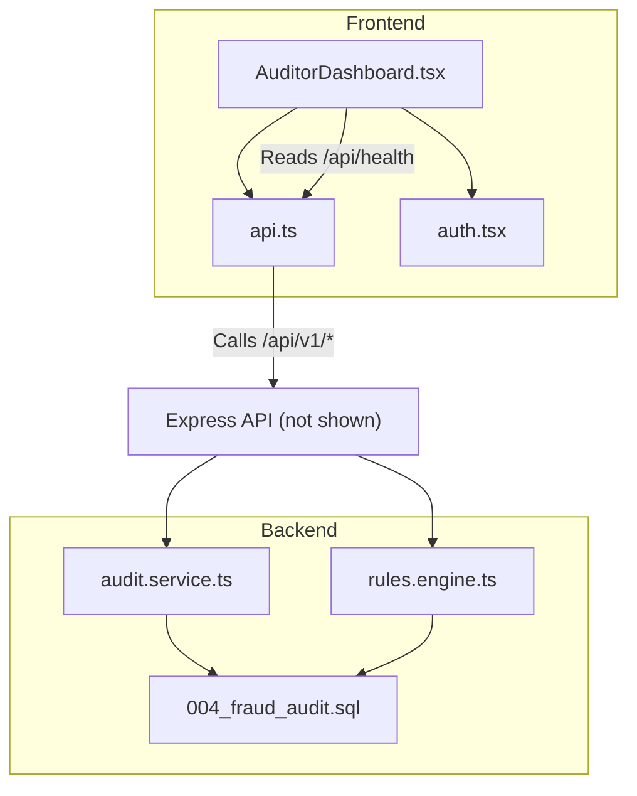
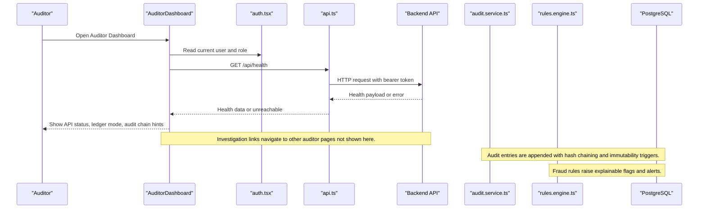
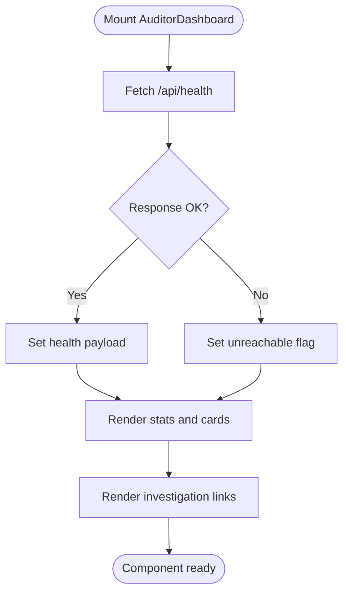
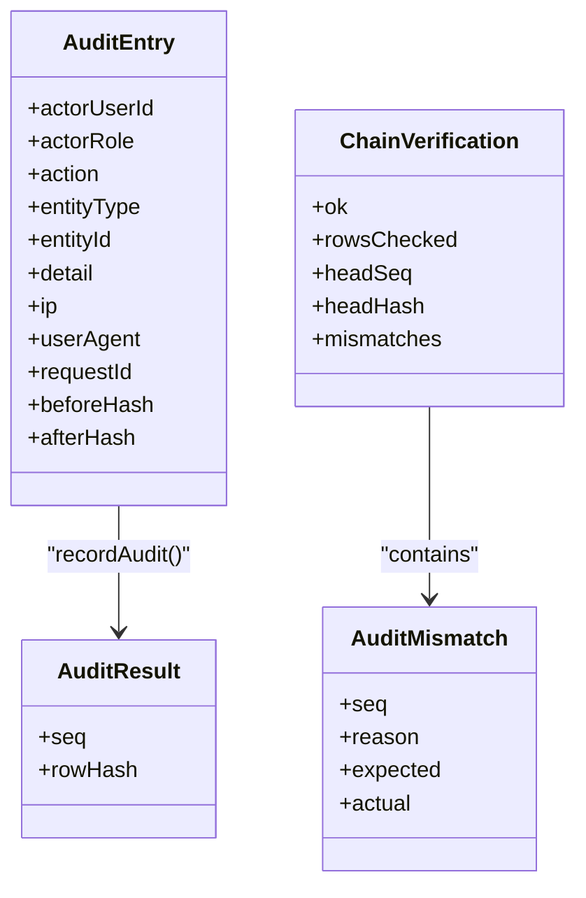
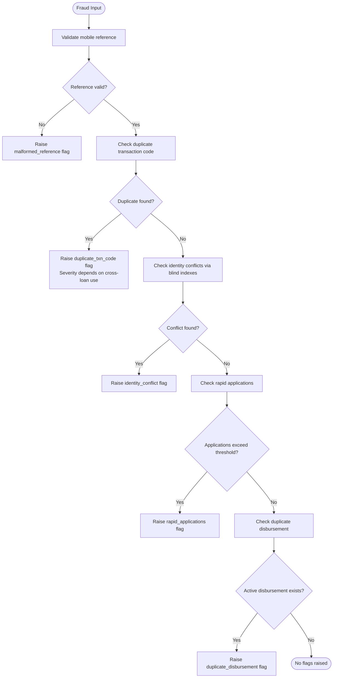
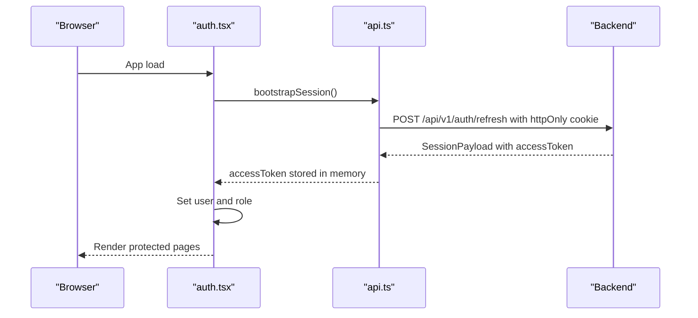
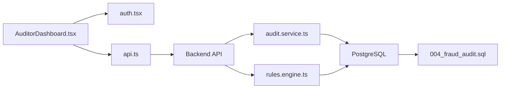

# Auditor Dashboard

<cite>
**Referenced Files in This Document**
- [AuditorDashboard.tsx](file://frontend/src/pages/auditor/AuditorDashboard.tsx)
- [api.ts](file://frontend/src/lib/api.ts)
- [auth.tsx](file://frontend/src/lib/auth.tsx)
- [audit.service.ts](file://backend/src/modules/audit/audit.service.ts)
- [rules.engine.ts](file://backend/src/modules/fraud/rules.engine.ts)
- [004_fraud_audit.sql](file://backend/src/db/migrations/004_fraud_audit.sql)
</cite>

## Table of Contents
1. [Introduction](#introduction)
2. [Project Structure](#project-structure)
3. [Core Components](#core-components)
4. [Architecture Overview](#architecture-overview)
5. [Detailed Component Analysis](#detailed-component-analysis)
6. [Dependency Analysis](#dependency-analysis)
7. [Performance Considerations](#performance-considerations)
8. [Troubleshooting Guide](#troubleshooting-guide)
9. [Conclusion](#conclusion)

## Introduction
The AuditorDashboard component is the auditor-facing entry point for forensic and compliance work. It provides a read-only overview of platform health, immutable audit trail guarantees, and quick links to investigation workflows such as searching the audit log, rebuilding loan timelines, and running integrity checks. Behind the UI, the system implements append-only, hash-chained audit logging, rule-based fraud flagging, and database-level immutability controls that auditors can inspect and verify.

This document explains how the dashboard presents audit trails, fraud flags, and compliance metrics; how auditors investigate events; and what security and access-control properties apply specifically to the auditor role.

## Project Structure
At a high level:
- The frontend exposes an auditor page under `frontend/src/pages/auditor`.
- The backend provides audit logging, fraud detection rules, and schema definitions for audit logs, fraud flags, alerts, and integrity records.
- The dashboard itself is intentionally lightweight: it shows system status, evidence guarantees, and navigation to deeper auditor tools.

**Diagram sources**
- [AuditorDashboard.tsx:1-85](file://frontend/src/pages/auditor/AuditorDashboard.tsx#L1-L85)
- [api.ts:50-94](file://frontend/src/lib/api.ts#L50-L94)
- [audit.service.ts:1-191](file://backend/src/modules/audit/audit.service.ts#L1-L191)
- [rules.engine.ts:1-275](file://backend/src/modules/fraud/rules.engine.ts#L1-L275)
- [004_fraud_audit.sql:1-136](file://backend/src/db/migrations/004_fraud_audit.sql#L1-L136)

**Section sources**
- [AuditorDashboard.tsx:1-85](file://frontend/src/pages/auditor/AuditorDashboard.tsx#L1-L85)
- [api.ts:1-144](file://frontend/src/lib/api.ts#L1-L144)
- [auth.tsx:1-161](file://frontend/src/lib/auth.tsx#L1-L161)
- [audit.service.ts:1-191](file://backend/src/modules/audit/audit.service.ts#L1-L191)
- [rules.engine.ts:1-275](file://backend/src/modules/fraud/rules.engine.ts#L1-L275)
- [004_fraud_audit.sql:1-136](file://backend/src/db/migrations/004_fraud_audit.sql#L1-L136)

## Core Components
- AuditorDashboard: React component that renders the auditor’s overview, including health indicators, evidence guarantees, and investigation shortcuts.
- Audit service: Backend module implementing append-only, hash-chained audit logging and chain verification.
- Fraud rules engine: Rule-based detection producing explainable fraud flags with severity and detail.
- Database schema: Defines audit logs, fraud flags, alerts, anchors, and integrity check records with immutability triggers.

Key responsibilities:
- Present audit-specific functionality without allowing data mutation from the auditor UI.
- Surface immutable evidence and integrity signals.
- Provide clear navigation into audit log search, timeline reconstruction, and integrity checks.

**Section sources**
- [AuditorDashboard.tsx:13-85](file://frontend/src/pages/auditor/AuditorDashboard.tsx#L13-L85)
- [audit.service.ts:7-118](file://backend/src/modules/audit/audit.service.ts#L7-L118)
- [rules.engine.ts:4-32](file://backend/src/modules/fraud/rules.engine.ts#L4-L32)
- [004_fraud_audit.sql:21-136](file://backend/src/db/migrations/004_fraud_audit.sql#L21-L136)

## Architecture Overview
The auditor experience is composed of three layers:
- Presentation layer: AuditorDashboard displays read-only insights and routes to auditor tools.
- Client integration layer: api.ts manages authenticated requests and token refresh; auth.tsx manages session state and user roles.
- Data and policy layer: audit.service.ts writes and verifies the audit chain; rules.engine.ts detects fraud; migrations define immutable structures.

**Diagram sources**
- [AuditorDashboard.tsx:19-32](file://frontend/src/pages/auditor/AuditorDashboard.tsx#L19-L32)
- [api.ts:50-94](file://frontend/src/lib/api.ts#L50-L94)
- [auth.tsx:47-92](file://frontend/src/lib/auth.tsx#L47-L92)
- [audit.service.ts:37-94](file://backend/src/modules/audit/audit.service.ts#L37-L94)
- [rules.engine.ts:54-81](file://backend/src/modules/fraud/rules.engine.ts#L54-L81)
- [004_fraud_audit.sql:67-111](file://backend/src/db/migrations/004_fraud_audit.sql#L67-L111)

## Detailed Component Analysis

### AuditorDashboard Component
Purpose:
- Display platform health and immutable-audit guarantees.
- Provide read-only context via a “Read-only role” badge.
- Offer quick links to audit log search, loan timeline reconstruction, and integrity checks.

Behavior:
- On mount, fetches `/api/health` and updates local state with service status, chain mode, and reachability.
- Renders stat cards for API status, ledger mode, and audit chain characteristics.
- Shows evidence guarantees such as append-only rows, per-row hashes, on-chain anchoring, and encrypted identity documents.
- Renders navigation items to auditor tools.

Security and access control:
- The component requires an authenticated user; if no user is present, it returns null.
- The UI labels the auditor role as read-only, aligning with the intended forensic inspection workflow.

Data presentation:
- Health status: Online, Unreachable, or pending.
- Ledger mode: local or testnet indicator.
- Audit chain: Hash-chained, append-only behavior.

Navigation examples:
- Search the audit log.
- Rebuild a loan timeline.
- Run an integrity check.

**Diagram sources**
- [AuditorDashboard.tsx:19-32](file://frontend/src/pages/auditor/AuditorDashboard.tsx#L19-L32)
- [AuditorDashboard.tsx:36-81](file://frontend/src/pages/auditor/AuditorDashboard.tsx#L36-L81)

**Section sources**
- [AuditorDashboard.tsx:13-85](file://frontend/src/pages/auditor/AuditorDashboard.tsx#L13-L85)

### Audit Trail and Integrity Verification
The audit trail is designed for forensic inspection:
- Append-only insertion with advisory locking to prevent concurrent chain forks.
- Per-row SHA-256 hash computed from sequence number, previous hash, actor metadata, action, entity details, IP, user agent, request ID, timestamps, and change hashes.
- Database triggers block UPDATE, DELETE, and TRUNCATE operations on the audit log.
- Chain verification recomputes every row hash and validates prev_hash linkage, reporting mismatches and broken links.

**Diagram sources**
- [audit.service.ts:15-32](file://backend/src/modules/audit/audit.service.ts#L15-L32)
- [audit.service.ts:120-133](file://backend/src/modules/audit/audit.service.ts#L120-L133)
- [audit.service.ts:37-94](file://backend/src/modules/audit/audit.service.ts#L37-L94)
- [audit.service.ts:142-190](file://backend/src/modules/audit/audit.service.ts#L142-L190)

Implementation highlights:
- recordAudit serializes writers using an advisory lock, computes the next sequence, derives the previous hash, calculates the new row hash, and inserts the audit entry within a transaction.
- auditRequest extracts actor, IP, user agent, and request context from Express requests.
- verifyAuditChain reads all audit rows in order, validates prev_hash linkage, recomputes row hashes, and aggregates mismatches.

Database constraints:
- audit_log table enforces immutability via BEFORE UPDATE, BEFORE DELETE, and BEFORE TRUNCATE triggers.
- Indexes support efficient queries by entity, actor, creation time, and JSONB detail.

**Section sources**
- [audit.service.ts:7-118](file://backend/src/modules/audit/audit.service.ts#L7-L118)
- [audit.service.ts:142-190](file://backend/src/modules/audit/audit.service.ts#L142-L190)
- [004_fraud_audit.sql:58-111](file://backend/src/db/migrations/004_fraud_audit.sql#L58-L111)

### Fraud Detection Monitoring
The fraud rules engine produces deterministic, explainable flags:
- Flag types include duplicate transaction codes, malformed references, identity conflicts, rapid applications, ML anomalies, duplicate disbursements, and hash mismatches.
- Severity levels range from low to critical.
- Flags are deduplicated by natural keys to avoid repeated reports.

Rule examples:
- Identity conflict detection compares blind indexes across borrower profiles without decrypting sensitive data.
- Reference validation rejects malformed mobile-money receipts and known forged patterns.
- Duplicate receipt detection identifies reuse across transactions and loans, raising higher severity when cross-loan duplication occurs.
- Rapid application detection counts recent loan applications within a configurable window.
- Duplicate disbursement detection prevents multiple active disbursements for the same loan.

Alerting:
- Critical cross-loan duplicate receipts trigger in-app alerts to the lender owning the affected book.

**Diagram sources**
- [rules.engine.ts:40-52](file://backend/src/modules/fraud/rules.engine.ts#L40-L52)
- [rules.engine.ts:98-143](file://backend/src/modules/fraud/rules.engine.ts#L98-L143)
- [rules.engine.ts:148-214](file://backend/src/modules/fraud/rules.engine.ts#L148-L214)
- [rules.engine.ts:217-248](file://backend/src/modules/fraud/rules.engine.ts#L217-L248)
- [rules.engine.ts:250-274](file://backend/src/modules/fraud/rules.engine.ts#L250-L274)

**Section sources**
- [rules.engine.ts:4-32](file://backend/src/modules/fraud/rules.engine.ts#L4-L32)
- [rules.engine.ts:54-92](file://backend/src/modules/fraud/rules.engine.ts#L54-L92)
- [rules.engine.ts:98-274](file://backend/src/modules/fraud/rules.engine.ts#L98-L274)
- [004_fraud_audit.sql:5-54](file://backend/src/db/migrations/004_fraud_audit.sql#L5-L54)

### Compliance Checking and Forensic Tools
Compliance and forensic capabilities are centered around:
- Immutable audit logs with cryptographic hashing and database-level mutation protection.
- Chain verification routines that detect tampering through mismatched hashes or broken links.
- Integrity checkpoints and anchors that can be optionally anchored on-chain.
- Structured integrity check results stored for historical review.

Forensic workflows supported by the dashboard:
- Search the audit log to trace actions by actor, entity, timestamp, or detail fields.
- Rebuild loan timelines by correlating audit entries with transaction and loan records.
- Run integrity checks to validate the entire chain or scoped targets like specific loans or entities.

Data models relevant to compliance:
- fraud_flags: Stores flagged events with type, severity, source, detail, and resolution metadata.
- alerts: In-app notifications to lenders based on fraud detections.
- audit_anchors: Checkpoints of the audit chain head, optionally anchored on-chain.
- integrity_checks: Records of integrity runs with scope, result, and mismatch counts.

**Section sources**
- [audit.service.ts:142-190](file://backend/src/modules/audit/audit.service.ts#L142-L190)
- [004_fraud_audit.sql:113-136](file://backend/src/db/migrations/004_fraud_audit.sql#L113-L136)

### Security Considerations and Access Controls
Frontend security:
- Access tokens are held in memory only; they are never persisted to localStorage or sessionStorage.
- Refresh tokens are httpOnly cookies sent with credentials included.
- A 401 response triggers a single shared refresh attempt before retrying the original request.

Session management:
- The authentication provider bootstraps a session silently using the refresh cookie.
- If successful, the user object and role are set; otherwise, the app treats the user as anonymous.
- Role-based routing maps the auditor role to the auditor landing path.

Auditor role specifics:
- The dashboard labels the auditor role as read-only, reinforcing that the UI is for inspection rather than mutation.
- Auditors rely on immutable audit logs and integrity checks to validate system behavior without altering evidence.

**Diagram sources**
- [api.ts:117-143](file://frontend/src/lib/api.ts#L117-L143)
- [auth.tsx:47-92](file://frontend/src/lib/auth.tsx#L47-L92)
- [auth.tsx:144-161](file://frontend/src/lib/auth.tsx#L144-L161)

**Section sources**
- [api.ts:1-144](file://frontend/src/lib/api.ts#L1-L144)
- [auth.tsx:1-161](file://frontend/src/lib/auth.tsx#L1-L161)
- [AuditorDashboard.tsx:34-42](file://frontend/src/pages/auditor/AuditorDashboard.tsx#L34-L42)

## Dependency Analysis
The AuditorDashboard depends on:
- Authentication context for user presence and role.
- API client for health checks and future auditor endpoints.
- Navigation links to auditor tooling pages.

Backend dependencies:
- Audit service depends on database pool utilities, canonical hashing, and request context middleware.
- Fraud rules depend on database pool and environment configuration.
- Schema defines immutable audit logs, fraud flags, alerts, anchors, and integrity checks.

**Diagram sources**
- [AuditorDashboard.tsx:1-85](file://frontend/src/pages/auditor/AuditorDashboard.tsx#L1-L85)
- [api.ts:50-94](file://frontend/src/lib/api.ts#L50-L94)
- [audit.service.ts:1-191](file://backend/src/modules/audit/audit.service.ts#L1-L191)
- [rules.engine.ts:1-275](file://backend/src/modules/fraud/rules.engine.ts#L1-L275)
- [004_fraud_audit.sql:1-136](file://backend/src/db/migrations/004_fraud_audit.sql#L1-L136)

**Section sources**
- [AuditorDashboard.tsx:1-85](file://frontend/src/pages/auditor/AuditorDashboard.tsx#L1-L85)
- [api.ts:1-144](file://frontend/src/lib/api.ts#L1-L144)
- [auth.tsx:1-161](file://frontend/src/lib/auth.tsx#L1-L161)
- [audit.service.ts:1-191](file://backend/src/modules/audit/audit.service.ts#L1-L191)
- [rules.engine.ts:1-275](file://backend/src/modules/fraud/rules.engine.ts#L1-L275)
- [004_fraud_audit.sql:1-136](file://backend/src/db/migrations/004_fraud_audit.sql#L1-L136)

## Performance Considerations
- Audit chain verification scans all rows in sequence order; for large datasets, consider pagination or incremental verification strategies.
- Advisory locking ensures chain consistency but serializes concurrent audit writes; monitor write throughput during peak periods.
- Fraud rule checks perform targeted queries; ensure appropriate indexes exist on referenced columns to minimize latency.
- The dashboard performs a single health check on mount; additional polling should be implemented cautiously to avoid excessive network traffic.

[No sources needed since this section provides general guidance]

## Troubleshooting Guide
Common issues and resolutions:
- API unreachable: The dashboard shows “Unreachable” when the health endpoint fails; verify backend availability and network connectivity.
- Token refresh failures: If the refresh endpoint fails, the session becomes anonymous; re-authenticate to restore access.
- Audit chain mismatches: verifyAuditChain reports hash_mismatch or broken_link reasons; investigate potential tampering or inconsistent writes.
- Fraud flag noise: Dedupe keys prevent repeated flags; confirm rule inputs and thresholds if flags appear unexpectedly.

Operational checks:
- Confirm audit_log triggers are active and not disabled.
- Validate that integrity_checks records reflect expected scopes and results.
- Review alerts for critical fraud events requiring lender attention.

**Section sources**
- [audit.service.ts:142-190](file://backend/src/modules/audit/audit.service.ts#L142-L190)
- [004_fraud_audit.sql:93-111](file://backend/src/db/migrations/004_fraud_audit.sql#L93-L111)
- [rules.engine.ts:54-81](file://backend/src/modules/fraud/rules.engine.ts#L54-L81)

## Conclusion
The AuditorDashboard provides a secure, read-only interface for forensic inspection, emphasizing immutable audit trails, fraud detection transparency, and compliance verification. Its design integrates frontend authentication and session management with backend audit logging and rule-based fraud detection. Auditors can rely on cryptographic hashing, database-level immutability, and structured integrity checks to investigate events, validate system behavior, and produce defensible findings.

[No sources needed since this section summarizes without analyzing specific files]