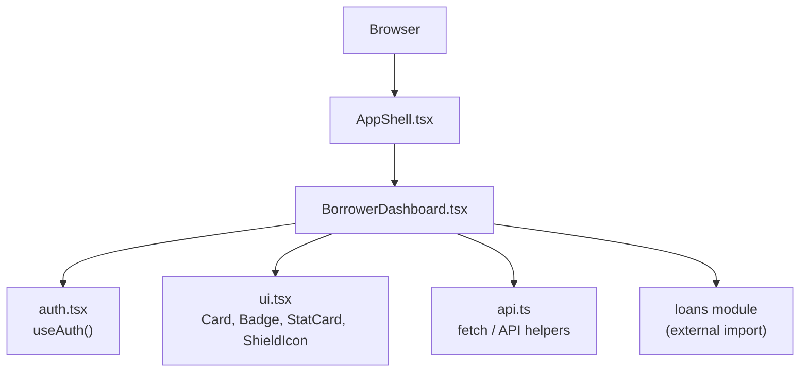
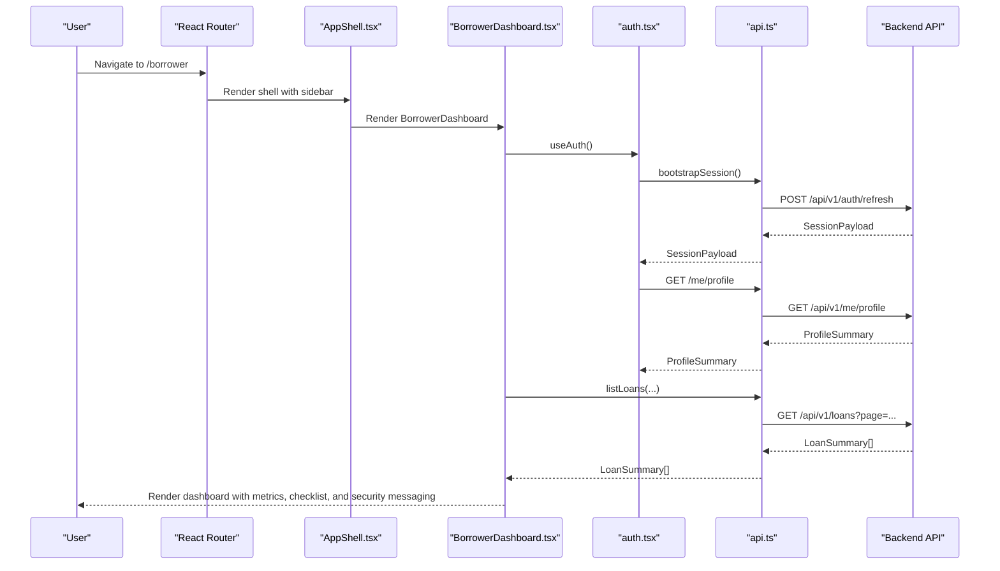
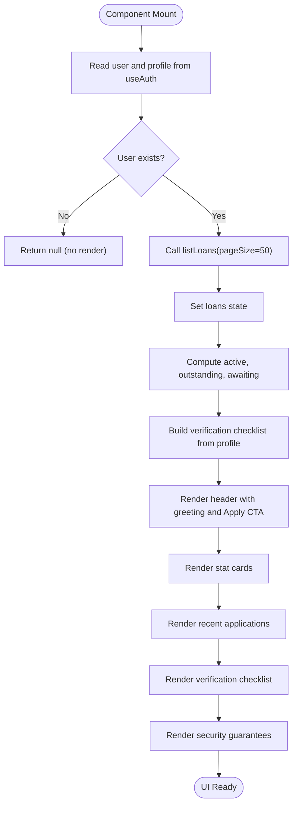
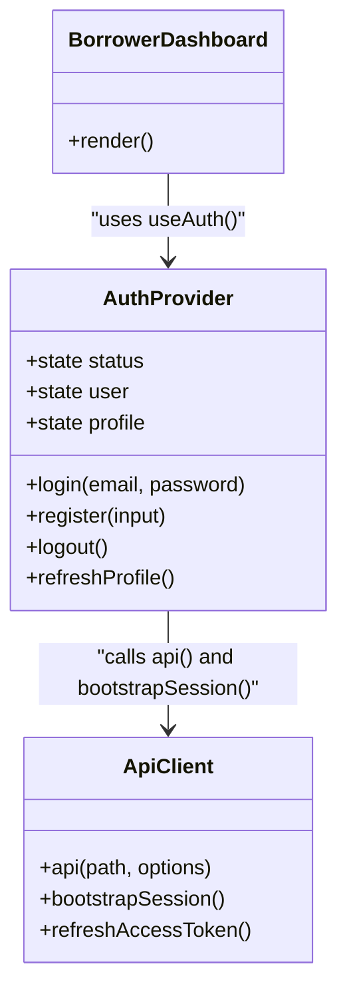
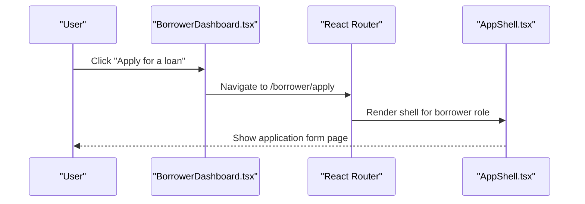
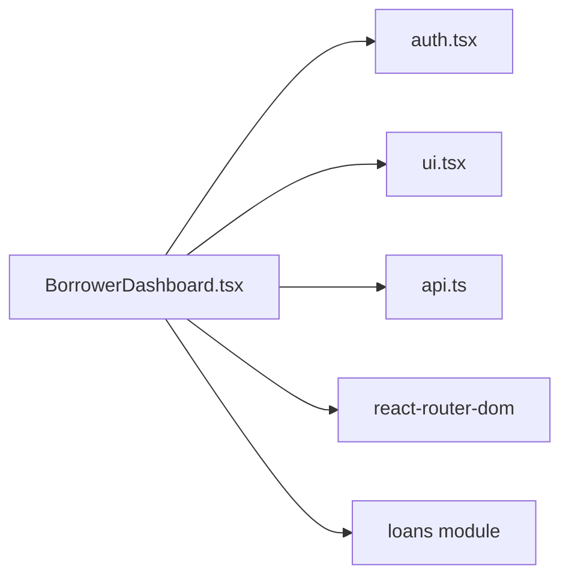

# Borrower Dashboard

<cite>
**Referenced Files in This Document**
- [BorrowerDashboard.tsx](file://frontend/src/pages/borrower/BorrowerDashboard.tsx)
- [auth.tsx](file://frontend/src/lib/auth.tsx)
- [api.ts](file://frontend/src/lib/api.ts)
- [ui.tsx](file://frontend/src/components/ui.tsx)
- [AppShell.tsx](file://frontend/src/components/AppShell.tsx)
</cite>

## Table of Contents
1. [Introduction](#introduction)
2. [Project Structure](#project-structure)
3. [Core Components](#core-components)
4. [Architecture Overview](#architecture-overview)
5. [Detailed Component Analysis](#detailed-component-analysis)
6. [Dependency Analysis](#dependency-analysis)
7. [Performance Considerations](#performance-considerations)
8. [Troubleshooting Guide](#troubleshooting-guide)
9. [Conclusion](#conclusion)

## Introduction
The BorrowerDashboard component is the borrower-facing landing page after authentication. It presents:
- Profile completeness based on the authenticated user’s profile data.
- A verification checklist that guides borrowers to complete required identity and income fields before applying for a loan.
- Security guarantees explaining how repayments are hashed and anchored on a public ledger, how sensitive identifiers are masked, and how duplicate or forged references are handled.
- A summary of recent loan applications with status badges and links to detailed views.
- A prominent call-to-action to apply for a loan.

The component uses React state for local loan data, the `useAuth` hook for session and profile information, and UI primitives from a shared component library.

## Project Structure
The dashboard lives under the borrower pages and composes several frontend modules:
- Page logic and rendering: `frontend/src/pages/borrower/BorrowerDashboard.tsx`
- Authentication context and profile loading: `frontend/src/lib/auth.tsx`
- HTTP client, token handling, and session bootstrap: `frontend/src/lib/api.ts`
- Shared presentational components such as cards, badges, stat cards, and icons: `frontend/src/components/ui.tsx`
- Application shell navigation and role-based routing: `frontend/src/components/AppShell.tsx`

**Diagram sources**
- [AppShell.tsx:41-60](file://frontend/src/components/AppShell.tsx#L41-L60)
- [BorrowerDashboard.tsx:1-133](file://frontend/src/pages/borrower/BorrowerDashboard.tsx#L1-L133)
- [auth.tsx:47-142](file://frontend/src/lib/auth.tsx#L47-L142)
- [api.ts:50-94](file://frontend/src/lib/api.ts#L50-L94)
- [ui.tsx:8-95](file://frontend/src/components/ui.tsx#L8-L95)

**Section sources**
- [BorrowerDashboard.tsx:1-133](file://frontend/src/pages/borrower/BorrowerDashboard.tsx#L1-L133)
- [AppShell.tsx:41-60](file://frontend/src/components/AppShell.tsx#L41-L60)

## Core Components
- BorrowerDashboard: Renders the borrower overview, including greeting, key metrics, recent applications, verification checklist, and security messaging.
- useAuth: Provides authenticated user, profile summary, login/register/logout actions, and profile refresh.
- api: Handles HTTP requests, access tokens, refresh flow, and error mapping.
- ui: Provides reusable presentation components used by the dashboard.

Key responsibilities:
- BorrowerDashboard computes profile completeness, outstanding balances, and awaiting application counts; it renders recent applications and guidance for completing the profile.
- useAuth manages session lifecycle and loads the borrower profile from `/me/profile`.
- api centralizes token injection, refresh-on-401 behavior, and session bootstrapping.
- ui supplies consistent visual building blocks like cards, badges, stat cards, and shield iconography.

**Section sources**
- [BorrowerDashboard.tsx:12-133](file://frontend/src/pages/borrower/BorrowerDashboard.tsx#L12-L133)
- [auth.tsx:19-43](file://frontend/src/lib/auth.tsx#L19-L43)
- [auth.tsx:47-142](file://frontend/src/lib/auth.tsx#L47-L142)
- [api.ts:31-94](file://frontend/src/lib/api.ts#L31-L94)
- [ui.tsx:8-95](file://frontend/src/components/ui.tsx#L8-L95)

## Architecture Overview
The dashboard follows a simple React component architecture:
- The AppShell provides role-based navigation and wraps route content.
- BorrowerDashboard consumes auth context and fetches loan data through an external loans module.
- Data presentation is composed using shared UI primitives.
- Security messaging is static text within the component, describing hashing, anchoring, encryption, and fraud detection.

**Diagram sources**
- [AppShell.tsx:116-174](file://frontend/src/components/AppShell.tsx#L116-L174)
- [BorrowerDashboard.tsx:12-28](file://frontend/src/pages/borrower/BorrowerDashboard.tsx#L12-L28)
- [auth.tsx:62-90](file://frontend/src/lib/auth.tsx#L62-L90)
- [api.ts:117-143](file://frontend/src/lib/api.ts#L117-L143)

## Detailed Component Analysis

### BorrowerDashboard Rendering Flow
The component performs these steps:
1. Reads authenticated user and profile via `useAuth`.
2. Loads recent loans via `listLoans`, storing results in local state.
3. Computes active loans, total outstanding balance, and count of awaiting applications.
4. Builds a verification checklist from profile fields.
5. Renders:
   - Greeting header with a call-to-action link to apply for a loan.
   - Three stat cards: profile completeness, monthly income, and outstanding balance.
   - Recent applications list with status badges and links to details.
   - Verification checklist card with “Complete” or “Missing” badges and a link to update the profile.
   - Security guarantees card explaining blockchain anchoring, encrypted storage, and duplicate/forged reference detection.

**Diagram sources**
- [BorrowerDashboard.tsx:12-42](file://frontend/src/pages/borrower/BorrowerDashboard.tsx#L12-L42)
- [BorrowerDashboard.tsx:44-133](file://frontend/src/pages/borrower/BorrowerDashboard.tsx#L44-L133)

**Section sources**
- [BorrowerDashboard.tsx:12-42](file://frontend/src/pages/borrower/BorrowerDashboard.tsx#L12-L42)
- [BorrowerDashboard.tsx:44-133](file://frontend/src/pages/borrower/BorrowerDashboard.tsx#L44-L133)

### State Management with useAuth
- `useAuth` exposes:
  - `status`: loading, authenticated, or anonymous.
  - `user`: current session user object.
  - `profile`: borrower profile summary including masked ID, phone, occupation, and monthly income.
  - `login`, `register`, `logout`, and `refreshProfile`.
- On app mount, `AuthProvider` attempts a silent refresh via `bootstrapSession`. If successful, it sets the user and loads the profile from `/me/profile`.
- BorrowerDashboard destructures `user` and `profile` directly from `useAuth`, avoiding manual session management.

**Diagram sources**
- [auth.tsx:47-142](file://frontend/src/lib/auth.tsx#L47-L142)
- [api.ts:81-143](file://frontend/src/lib/api.ts#L81-L143)
- [BorrowerDashboard.tsx:12-14](file://frontend/src/pages/borrower/BorrowerDashboard.tsx#L12-L14)

**Section sources**
- [auth.tsx:47-142](file://frontend/src/lib/auth.tsx#L47-L142)
- [api.ts:81-143](file://frontend/src/lib/api.ts#L81-L143)
- [BorrowerDashboard.tsx:12-14](file://frontend/src/pages/borrower/BorrowerDashboard.tsx#L12-L14)

### Data Presentation Patterns
- Profile completeness:
  - Derived from four profile fields: national ID masked, phone masked, occupation, and monthly income cents.
  - Displays a fraction indicating completed checks versus total checks.
- Income display:
  - Uses `formatMoney` to convert cents into a human-readable currency string.
- Loan status:
  - Recent applications show status labels and tone mappings provided by the loans module.
  - Active loans include statuses like disbursed or active; awaiting includes pending or under review.
- Navigation:
  - Links to `/borrower/apply` for new applications.
  - Links to `/borrower/loans` for full list and `/borrower/loans/:id` for detail view.
  - Link to `/profile` to update missing fields.

**Section sources**
- [BorrowerDashboard.tsx:32-42](file://frontend/src/pages/borrower/BorrowerDashboard.tsx#L32-L42)
- [BorrowerDashboard.tsx:56-64](file://frontend/src/pages/borrower/BorrowerDashboard.tsx#L56-L64)
- [BorrowerDashboard.tsx:66-96](file://frontend/src/pages/borrower/BorrowerDashboard.tsx#L66-L96)
- [BorrowerDashboard.tsx:98-111](file://frontend/src/pages/borrower/BorrowerDashboard.tsx#L98-L111)

### User Interaction Flows
- Applying for a loan:
  - Header action navigates to `/borrower/apply`.
  - Sidebar also exposes “Apply for a loan” for quick access.
- Updating profile:
  - Verification checklist encourages completion of missing items and links to `/profile`.
- Viewing loan details:
  - Each recent application links to its detail page.

**Diagram sources**
- [BorrowerDashboard.tsx:46-54](file://frontend/src/pages/borrower/BorrowerDashboard.tsx#L46-L54)
- [AppShell.tsx:41-60](file://frontend/src/components/AppShell.tsx#L41-L60)

**Section sources**
- [BorrowerDashboard.tsx:46-54](file://frontend/src/pages/borrower/BorrowerDashboard.tsx#L46-L54)
- [AppShell.tsx:41-60](file://frontend/src/components/AppShell.tsx#L41-L60)

### Blockchain Verification Messaging and Security Guarantees
The dashboard communicates three core security guarantees:
- Repayment hashing and anchoring on a public ledger to prevent retroactive alteration.
- Encryption of sensitive identifiers in the database with staff seeing only masked values.
- Automatic flagging of duplicate payment codes or forged references for review.

These messages appear in a dedicated card and reinforce trust without requiring additional API calls.

**Section sources**
- [BorrowerDashboard.tsx:113-128](file://frontend/src/pages/borrower/BorrowerDashboard.tsx#L113-L128)

## Dependency Analysis
The dashboard depends on:
- `useAuth` for session and profile data.
- `listLoans` from the loans module for recent applications.
- UI primitives for consistent presentation.
- React Router for navigation.

**Diagram sources**
- [BorrowerDashboard.tsx:1-6](file://frontend/src/pages/borrower/BorrowerDashboard.tsx#L1-L6)
- [auth.tsx:47-142](file://frontend/src/lib/auth.tsx#L47-L142)
- [ui.tsx:8-95](file://frontend/src/components/ui.tsx#L8-L95)
- [api.ts:81-143](file://frontend/src/lib/api.ts#L81-L143)

**Section sources**
- [BorrowerDashboard.tsx:1-6](file://frontend/src/pages/borrower/BorrowerDashboard.tsx#L1-L6)

## Performance Considerations
- Local loan state: The dashboard stores fetched loans in component state, minimizing re-renders and allowing simple slicing for recent applications.
- Error resilience: If fetching loans fails, the component sets an empty array rather than blocking the entire page.
- Token handling: The API client avoids storing tokens in persistent storage and consolidates refresh attempts to prevent concurrent rotation issues.
- Profile loading: Missing profiles do not block the app; the dashboard gracefully shows zero-completion hints.

[No sources needed since this section provides general guidance]

## Troubleshooting Guide
Common issues and resolutions:
- Dashboard does not render:
  - Ensure the user is authenticated; the component returns null when no user is present.
  - Verify that `AuthProvider` has mounted and `bootstrapSession` succeeded.
- Profile fields missing:
  - Confirm that `/me/profile` returns expected fields; if absent, the checklist will mark items as missing.
  - Direct users to `/profile` to complete required fields.
- Loan list empty or stale:
  - Check network connectivity and backend availability for the loans endpoint.
  - Inspect API errors thrown by the client; failures default to an empty list.
- Navigation not working:
  - Confirm routes exist for `/borrower/apply`, `/borrower/loans`, and `/borrower/loans/:id`.
  - Ensure AppShell renders the correct sidebar for the borrower role.

**Section sources**
- [BorrowerDashboard.tsx:30-30](file://frontend/src/pages/borrower/BorrowerDashboard.tsx#L30-L30)
- [BorrowerDashboard.tsx:16-28](file://frontend/src/pages/borrower/BorrowerDashboard.tsx#L16-L28)
- [auth.tsx:62-90](file://frontend/src/lib/auth.tsx#L62-L90)
- [api.ts:81-94](file://frontend/src/lib/api.ts#L81-L94)

## Conclusion
The BorrowerDashboard provides a clear, trustworthy overview for borrowers:
- It highlights profile completeness and guides users to finish required fields.
- It summarizes income and outstanding balances while showing recent loan statuses.
- It reinforces security through explicit messaging about hashing, anchoring, encryption, and fraud detection.
- It integrates cleanly with authentication, API, and UI layers, offering straightforward navigation to apply for loans and manage profiles.

[No sources needed since this section summarizes without analyzing specific files]