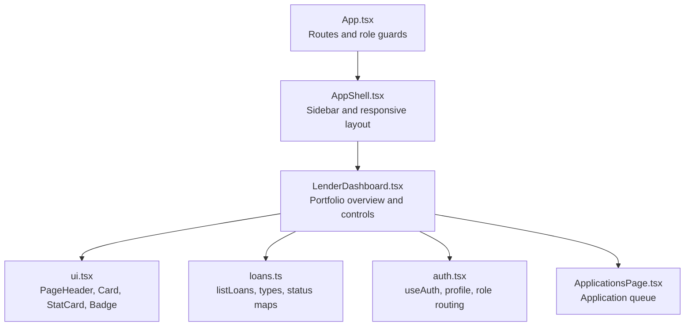
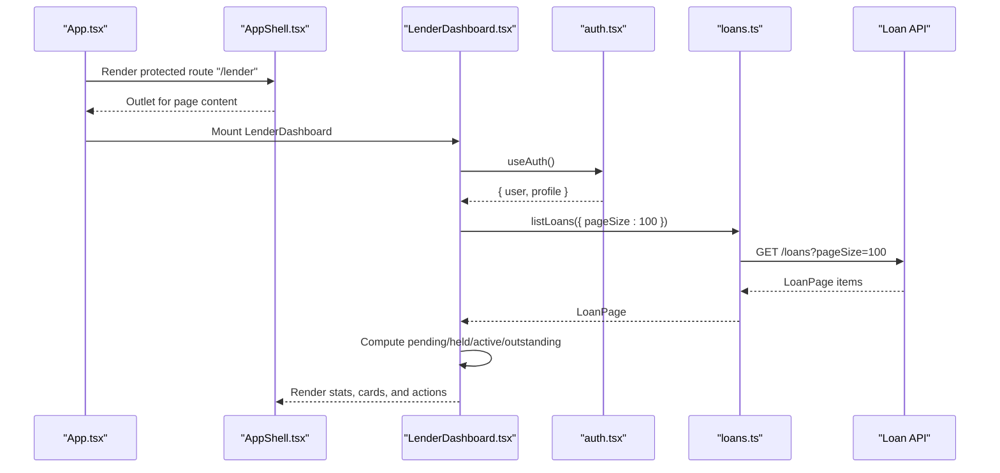
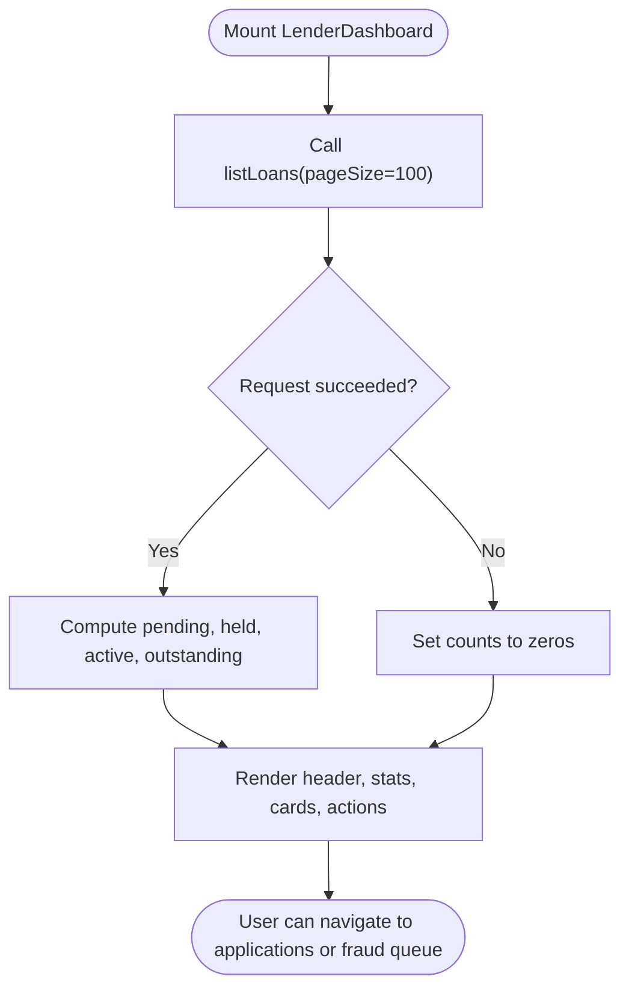
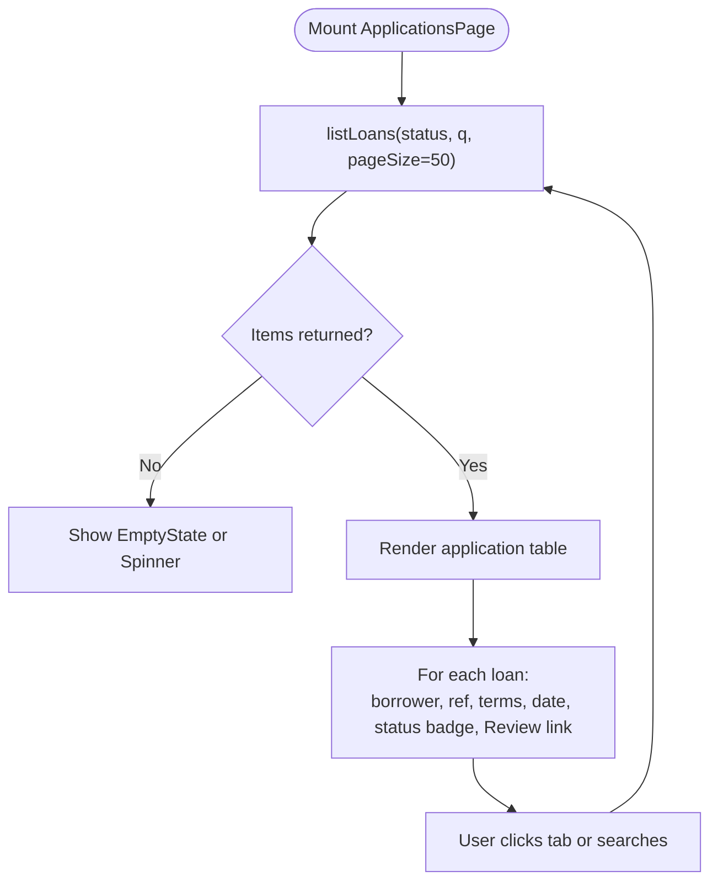
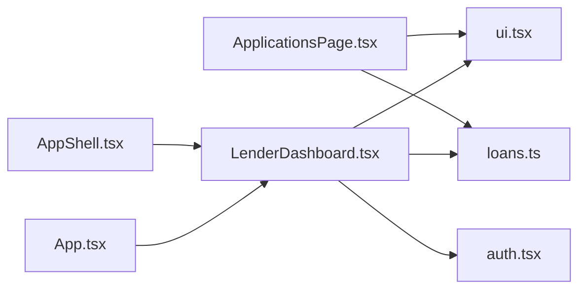

# Lender Dashboard

<cite>
**Referenced Files in This Document**
- [LenderDashboard.tsx](file://frontend/src/pages/lender/LenderDashboard.tsx)
- [ApplicationsPage.tsx](file://frontend/src/pages/lender/ApplicationsPage.tsx)
- [App.tsx](file://frontend/src/App.tsx)
- [AppShell.tsx](file://frontend/src/components/AppShell.tsx)
- [ui.tsx](file://frontend/src/components/ui.tsx)
- [loans.ts](file://frontend/src/lib/loans.ts)
- [auth.tsx](file://frontend/src/lib/auth.tsx)
</cite>

## Table of Contents
1. [Introduction](#introduction)
2. [Project Structure](#project-structure)
3. [Core Components](#core-components)
4. [Architecture Overview](#architecture-overview)
5. [Detailed Component Analysis](#detailed-component-analysis)
6. [Dependency Analysis](#dependency-analysis)
7. [Performance Considerations](#performance-considerations)
8. [Troubleshooting Guide](#troubleshooting-guide)
9. [Conclusion](#conclusion)

## Introduction
The Lender Dashboard is the primary lending operations surface for a moneylender user. It presents an overview of the lender’s loan portfolio, highlights approval-related metrics, and provides quick access to application review and fraud monitoring workflows. The component composes shared UI primitives, reads authenticated session data, and fetches loan summaries from the frontend API layer.

Key responsibilities:
- Display lender-specific metrics such as applications awaiting decision, active loans, outstanding exposure, and default-rate context.
- Provide navigation into the application queue and fraud queue.
- Communicate platform guarantees relevant to lenders, including identity verification, digital agreements, ledger anchoring, and auditability.

## Project Structure
The Lender Dashboard lives under the lender feature folder and is wired into the application router alongside other role-based pages. It relies on shared components for layout, headers, cards, badges, and status indicators, and it consumes typed loan data through a centralized library module.

**Diagram sources**
- [App.tsx:92-107](file://frontend/src/App.tsx#L92-L107)
- [AppShell.tsx:41-60](file://frontend/src/components/AppShell.tsx#L41-L60)
- [LenderDashboard.tsx:1-10](file://frontend/src/pages/lender/LenderDashboard.tsx#L1-L10)
- [ui.tsx:8-95](file://frontend/src/components/ui.tsx#L8-L95)
- [loans.ts:153-160](file://frontend/src/lib/loans.ts#L153-L160)
- [auth.tsx:144-160](file://frontend/src/lib/auth.tsx#L144-L160)

**Section sources**
- [App.tsx:92-107](file://frontend/src/App.tsx#L92-L107)
- [AppShell.tsx:41-60](file://frontend/src/components/AppShell.tsx#L41-L60)

## Core Components
- LenderDashboard: Renders the lender’s own-book summary, key metrics, and control links.
- ApplicationsPage: Provides the application queue with filtering by status and search.
- Shared UI primitives: PageHeader, Card, StatCard, Badge, EmptyState, Spinner.
- Data layer: loans.ts exposes typed loan models, status labels, and listLoans.
- Authentication: auth.tsx supplies user, profile, and role-aware routing helpers.

Responsibilities and interactions:
- LenderDashboard calls listLoans to compute counts for pending, held, active, and outstanding amounts.
- It uses useAuth to read the current user and profile fields like businessName, defaultRateBps, and maxPrincipalCents.
- It renders StatCard values using formatMoney and percentFromBps helpers.
- Navigation links point to /lender/applications and /lender/fraud.

**Section sources**
- [LenderDashboard.tsx:1-100](file://frontend/src/pages/lender/LenderDashboard.tsx#L1-L100)
- [ApplicationsPage.tsx:1-139](file://frontend/src/pages/lender/ApplicationsPage.tsx#L1-L139)
- [ui.tsx:8-95](file://frontend/src/components/ui.tsx#L8-L95)
- [loans.ts:116-140](file://frontend/src/lib/loans.ts#L116-L140)
- [auth.tsx:19-43](file://frontend/src/lib/auth.tsx#L19-L43)

## Architecture Overview
The Lender Dashboard follows a simple React page pattern:
- Routing and role protection are handled at the app level.
- The dashboard composes presentational components.
- Data fetching is performed inside useEffect with cancellation handling.
- Status mapping and formatting utilities keep presentation logic separate from domain logic.

**Diagram sources**
- [App.tsx:92-107](file://frontend/src/App.tsx#L92-L107)
- [LenderDashboard.tsx:13-32](file://frontend/src/pages/lender/LenderDashboard.tsx#L13-L32)
- [loans.ts:153-160](file://frontend/src/lib/loans.ts#L153-L160)
- [auth.tsx:47-82](file://frontend/src/lib/auth.tsx#L47-L82)

## Detailed Component Analysis

### LenderDashboard
Purpose:
- Present lender-specific portfolio metrics.
- Surface high-level platform capabilities and lender controls.
- Provide quick entry points to application review and fraud queue.

Data flow:
- On mount, fetch loan summaries via listLoans.
- Filter items by status to compute:
  - Pending: applications with status pending or under_review.
  - Held: applications with status held.
  - Active: disbursed or active loans.
  - Outstanding: sum of outstandingCents across active loans.
- Use profile fields to display default rate and maximum principal hints.

User interaction flows:
- Clicking “Review applications” navigates to the application queue.
- Links to the fraud queue open the dedicated fraud workflow (currently a placeholder).

Error handling:
- If the loan list request fails, counts reset to zero rather than blocking the page.
- The component returns null while the user is not yet available.

Responsive design:
- Uses a responsive grid for stat cards and two-column card layout on larger screens.

Accessibility:
- Relies on semantic headings from PageHeader.
- Uses consistent spacing and readable typography through shared UI components.

**Diagram sources**
- [LenderDashboard.tsx:13-32](file://frontend/src/pages/lender/LenderDashboard.tsx#L13-L32)
- [loans.ts:153-160](file://frontend/src/lib/loans.ts#L153-L160)

**Section sources**
- [LenderDashboard.tsx:1-100](file://frontend/src/pages/lender/LenderDashboard.tsx#L1-L100)

### ApplicationsPage
Purpose:
- Show the lender’s application queue scoped to their book.
- Allow filtering by status tabs and free-text search.
- Provide direct links to individual loan reviews.

Key behaviors:
- Tabs include New, Verified, Approved, Held, Disbursed, and All.
- Query parameters are sent to listLoans when the tab or search input changes.
- Displays loading spinner, empty state, error message, and a table of applications.
- Each row shows borrower name and email, loan reference and purpose, terms, applied date, and status badge.

Status visualization:
- STATUS_LABEL maps each LoanStatus to a human-readable label.
- STATUS_TONE maps each LoanStatus to a visual tone for the Badge component.

**Diagram sources**
- [ApplicationsPage.tsx:23-41](file://frontend/src/pages/lender/ApplicationsPage.tsx#L23-L41)
- [loans.ts:116-140](file://frontend/src/lib/loans.ts#L116-L140)

**Section sources**
- [ApplicationsPage.tsx:1-139](file://frontend/src/pages/lender/ApplicationsPage.tsx#L1-L139)
- [loans.ts:116-140](file://frontend/src/lib/loans.ts#L116-L140)

### Shared UI Primitives Used by the Dashboard
- PageHeader: Renders title, subtitle, and optional action buttons.
- Card: Groups related information with a title and content area.
- StatCard: Shows a metric label, value, hint text, and optional tone.
- Badge: Presents small status chips with tone variants.
- EmptyState and Spinner: Communicate no-data and loading states.

These components ensure consistent styling, accessibility attributes, and predictable behavior across lender-facing pages.

**Section sources**
- [ui.tsx:8-95](file://frontend/src/components/ui.tsx#L8-L95)
- [ui.tsx:159-184](file://frontend/src/components/ui.tsx#L159-L184)

### Data Models and Status Mapping
The loans.ts module defines the core types used by the dashboard:
- LoanSummary: High-level loan metadata including status, amounts, frequency, parties, and timestamps.
- LoanDetail: Extended detail including installments, transactions, flags, and summary totals.
- LoanStatus enum: Covers the full lifecycle from pending to settled or defaulted.
- STATUS_LABEL and STATUS_TONE: Map statuses to readable labels and visual tones.

This separation allows the dashboard to focus on presentation while reusing consistent status semantics.

**Section sources**
- [loans.ts:5-45](file://frontend/src/lib/loans.ts#L5-L45)
- [loans.ts:116-140](file://frontend/src/lib/loans.ts#L116-L140)

### Authentication and Profile Context
The dashboard consumes:
- user: Current session user object.
- profile: Lender profile containing businessName, defaultRateBps, and maxPrincipalCents.
- homeFor: Role-aware routing helper that resolves the lender landing path.

The authentication provider bootstraps the session silently, sets the authenticated status, and loads the profile without exposing tokens to storage.

**Section sources**
- [auth.tsx:19-43](file://frontend/src/lib/auth.tsx#L19-L43)
- [auth.tsx:47-82](file://frontend/src/lib/auth.tsx#L47-L82)
- [auth.tsx:144-160](file://frontend/src/lib/auth.tsx#L144-L160)

## Dependency Analysis
The Lender Dashboard depends on several modules:
- Routing and role guards: App.tsx ensures only lenders see lender routes.
- Layout: AppShell.tsx provides sidebar navigation and responsive shell.
- Presentation: ui.tsx provides reusable components.
- Domain data: loans.ts provides typed models and listLoans.
- Session: auth.tsx provides user and profile context.

**Diagram sources**
- [App.tsx:92-107](file://frontend/src/App.tsx#L92-L107)
- [AppShell.tsx:41-60](file://frontend/src/components/AppShell.tsx#L41-L60)
- [LenderDashboard.tsx:1-10](file://frontend/src/pages/lender/LenderDashboard.tsx#L1-L10)
- [ApplicationsPage.tsx:1-10](file://frontend/src/pages/lender/ApplicationsPage.tsx#L1-L10)

**Section sources**
- [App.tsx:92-107](file://frontend/src/App.tsx#L92-L107)
- [AppShell.tsx:41-60](file://frontend/src/components/AppShell.tsx#L41-L60)
- [LenderDashboard.tsx:1-10](file://frontend/src/pages/lender/LenderDashboard.tsx#L1-L10)
- [ApplicationsPage.tsx:1-10](file://frontend/src/pages/lender/ApplicationsPage.tsx#L1-L10)

## Performance Considerations
- Single initial fetch: The dashboard fetches up to 100 loan records once on mount.
- Client-side aggregation: Counts and outstanding sums are computed locally after receiving the page.
- Cancellation guard: A cancelled flag prevents stale updates if the component unmounts before the response arrives.
- Lightweight rendering: Stats are rendered as plain numbers and formatted strings; no heavy charting libraries are used.

Recommendations:
- If the number of loans grows significantly, consider server-side pagination or incremental refresh strategies.
- Debounce search inputs in the applications queue to reduce repeated requests.
- Cache recent loan pages in memory to avoid redundant network calls during short sessions.

[No sources needed since this section provides general guidance]

## Troubleshooting Guide
Common issues and resolutions:
- No metrics displayed:
  - Verify that listLoans returns data and that the component does not return null due to missing user.
  - Check that the authenticated session is established and that the user has the lender role.
- Incorrect status counts:
  - Confirm the status filter logic matches expected statuses: pending, under_review, held, disbursed, active.
  - Validate that outstandingCents is correctly summed for active loans.
- Navigation not working:
  - Ensure routes for /lender/applications and /lender/fraud are registered and accessible to lenders.
- Error states:
  - The dashboard resets counts to zero on failure; verify backend availability and API permissions.
  - ApplicationsPage shows an EmptyState or Spinner; check query parameters and tab selection.

**Section sources**
- [LenderDashboard.tsx:13-32](file://frontend/src/pages/lender/LenderDashboard.tsx#L13-L32)
- [ApplicationsPage.tsx:23-41](file://frontend/src/pages/lender/ApplicationsPage.tsx#L23-L41)

## Conclusion
The LenderDashboard provides a focused, lender-centric view of loan portfolio health and operational controls. It integrates cleanly with the application’s routing, authentication, and shared UI system. Its data model and status mappings enable consistent presentation across the dashboard and application queue. Future enhancements can expand performance metrics, add interactive charts, and deepen integration with the fraud and audit workflows while preserving the clear, accessible structure already in place.

[No sources needed since this section summarizes without analyzing specific files]