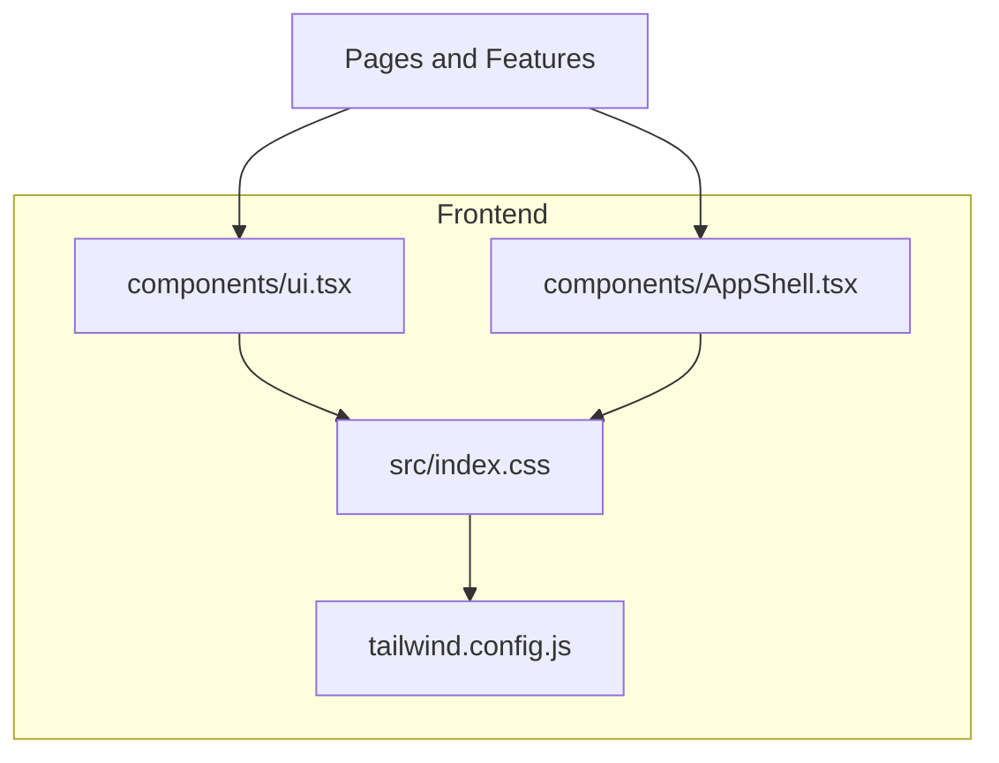

# Shared UI Components

<cite>
**Referenced Files in This Document**
- [ui.tsx](file://frontend/src/components/ui.tsx)
- [AppShell.tsx](file://frontend/src/components/AppShell.tsx)
- [index.css](file://frontend/src/index.css)
- [tailwind.config.js](file://frontend/tailwind.config.js)
</cite>

## Table of Contents
1. [Introduction](#introduction)
2. [Project Structure](#project-structure)
3. [Design System Principles](#design-system-principles)
4. [Core Components](#core-components)
5. [Layout and Shell Components](#layout-and-shell-components)
6. [Component Composition Guidelines](#component-composition-guidelines)
7. [Accessibility Compliance](#accessibility-compliance)
8. [Responsive Behavior](#responsive-behavior)
9. [Customization and Theming](#customization-and-theming)
10. [Usage Examples](#usage-examples)
11. [Troubleshooting Guide](#troubleshooting-guide)
12. [Conclusion](#conclusion)

## Introduction
This document describes the shared UI components library used by the frontend application. It covers reusable presentation components, layout shells, design tokens, styling conventions, accessibility guidance, responsive behavior, and customization options. The goal is to help developers compose consistent, accessible, and maintainable user interfaces using a small but powerful set of primitives.

The library focuses on:
- Presentational React components for common UI patterns
- A compact design system built with Tailwind CSS
- Mobile-first responsive layouts
- Accessibility-friendly defaults
- Clear composition guidelines for pages and feature modules

## Project Structure
The shared UI lives primarily under the frontend package:
- `frontend/src/components/ui.tsx`: Reusable presentational components such as cards, badges, fields, alerts, and loading indicators
- `frontend/src/components/AppShell.tsx`: Application shell, navigation sidebar, mobile drawer, and auth layout
- `frontend/src/index.css`: Global base styles and component-level CSS classes for buttons, inputs, labels, badges, tables, and navigation links
- `frontend/tailwind.config.js`: Design tokens including brand colors, ink colors, fonts, and custom shadows

**Diagram sources**
- [ui.tsx:1-218](file://frontend/src/components/ui.tsx#L1-L218)
- [AppShell.tsx:1-194](file://frontend/src/components/AppShell.tsx#L1-L194)
- [index.css:1-80](file://frontend/src/index.css#L1-L80)
- [tailwind.config.js:1-36](file://frontend/tailwind.config.js#L1-L36)

**Section sources**
- [ui.tsx:1-218](file://frontend/src/components/ui.tsx#L1-L218)
- [AppShell.tsx:1-194](file://frontend/src/components/AppShell.tsx#L1-L194)
- [index.css:1-80](file://frontend/src/index.css#L1-L80)
- [tailwind.config.js:1-36](file://frontend/tailwind.config.js#L1-L36)

## Design System Principles
The design system emphasizes clarity, consistency, and accessibility:
- Mobile-first layout and spacing
- Semantic HTML elements where appropriate
- Consistent color roles for status and actions
- Predictable typography scale and spacing
- Focus-visible ring for keyboard navigation
- Component classes that encapsulate visual rules

Key tokens and conventions:
- Colors:
  - Brand palette for primary actions and success states
  - Ink palette for high-contrast text and active navigation
  - Slate palette for neutral backgrounds, borders, and secondary text
- Typography:
  - Sans-serif font stack with Inter as the primary typeface
  - Monospace font stack for code or tabular data when needed
- Shadows:
  - Custom card shadow for elevated surfaces
- Spacing:
  - Tailwind spacing utilities for margins, padding, and gaps
- States:
  - Hover, active, disabled, focus-visible, and error states are consistently styled

**Section sources**
- [index.css:9-19](file://frontend/src/index.css#L9-L19)
- [index.css:21-79](file://frontend/src/index.css#L21-L79)
- [tailwind.config.js:4-32](file://frontend/tailwind.config.js#L4-L32)

## Core Components
This section documents the reusable presentational components exported from the UI module. Each component includes props, styling behavior, event handling notes, and usage guidance.

### PageHeader
A page header that displays a title, optional subtitle, and an optional actions area. It adapts layout between stacked and row-based arrangements on larger screens.

Props:
- `title` (string): Required heading text
- `subtitle` (string, optional): Supporting description
- `actions` (ReactNode, optional): Buttons or controls placed to the right

Styling:
- Uses responsive flex layout
- Title uses a prominent semibold style; subtitle is smaller and muted
- Actions container aligns items horizontally

Accessibility:
- Semantic heading hierarchy is preserved by the parent page
- No interactive elements inside this component

Usage example:
- Place at the top of dashboard pages to introduce content and action buttons

**Section sources**
- [ui.tsx:8-26](file://frontend/src/components/ui.tsx#L8-L26)

### Card
A generic container for grouping related content with an optional header and actions.

Props:
- `title` (string, optional): Section title
- `description` (string, optional): Supporting text below the title
- `actions` (ReactNode, optional): Controls aligned to the right of the header
- `children` (ReactNode): Main content area
- `className` (string, optional): Additional Tailwind classes

Styling:
- Applies a rounded border, white background, and subtle elevation via a custom shadow
- Header area is optional and conditionally rendered when title or actions exist

Accessibility:
- Uses semantic `<section>` element
- Optional header uses `<header>` for structure

Usage example:
- Wrap form sections, metric summaries, or data panels

**Section sources**
- [ui.tsx:28-55](file://frontend/src/components/ui.tsx#L28-L55)
- [index.css:21-24](file://frontend/src/index.css#L21-L24)

### StatCard
A compact card for displaying a labeled metric value with optional hint text and tone-based coloring.

Props:
- `label` (string): Metric label
- `value` (ReactNode): Primary value display
- `hint` (string, optional): Secondary explanatory text
- `tone` ('default' | 'brand' | 'warning' | 'danger', optional): Color role for the value

Styling:
- Uses the shared card style
- Value text changes color based on tone

Accessibility:
- Label and value are plain text; use meaningful labels for screen readers

Usage example:
- Dashboard KPIs such as loan count, risk score, or balance

**Section sources**
- [ui.tsx:57-81](file://frontend/src/components/ui.tsx#L57-L81)

### Badge
A small inline indicator for status or category.

Props:
- `tone` ('neutral' | 'success' | 'warning' | 'danger' | 'info', optional): Visual role
- `children` (ReactNode): Text or icon content

Styling:
- Pill shape with small padding and semibold text
- Tone maps to specific background and text color combinations

Accessibility:
- Use descriptive text so screen readers can convey meaning

Usage example:
- Status chips like “Pending”, “Verified”, “At Risk”

**Section sources**
- [ui.tsx:83-95](file://frontend/src/components/ui.tsx#L83-L95)
- [index.css:58-60](file://frontend/src/index.css#L58-L60)

### VerifiedBadge
A specialized badge that shows whether an item has been verified on-chain.

Props:
- `verified` (boolean): Whether the item is verified

Behavior:
- When verified, renders a success badge with a shield icon and verification text
- Otherwise, renders a neutral badge indicating not anchored

Accessibility:
- Icon is decorative and hidden from assistive technology
- Text conveys verification state

Usage example:
- Transaction or audit entries with chain verification status

**Section sources**
- [ui.tsx:97-106](file://frontend/src/components/ui.tsx#L97-L106)

### Field
A form field wrapper that provides a label, optional hint, and error message.

Props:
- `label` (string): Accessible label text
- `error` (string, optional): Error message
- `hint` (string, optional): Helper text
- `htmlFor` (string, optional): Associates label with an input id
- `children` (ReactNode): Input element(s)

Styling:
- Label uses a dedicated class for consistent appearance
- Hint and error messages use distinct styles

Accessibility:
- Supports `htmlFor` to connect label to input
- Error text is visually distinct

Usage example:
- Wrap TextInput or Select to provide structured form fields

**Section sources**
- [ui.tsx:108-130](file://frontend/src/components/ui.tsx#L108-L130)
- [index.css:43-56](file://frontend/src/index.css#L43-L56)

### TextInput
A styled text input that forwards standard input attributes.

Props:
- Inherits all standard HTML input attributes
- Accepts `className` for additional styling

Styling:
- Full-width input with rounded corners, border, and focus ring
- Placeholder text is muted

Accessibility:
- Pair with Field for label association

Usage example:
- Name, email, amount, or search inputs

**Section sources**
- [ui.tsx:132-135](file://frontend/src/components/ui.tsx#L132-L135)
- [index.css:46-50](file://frontend/src/index.css#L46-L50)

### Select
A styled select dropdown that forwards standard select attributes.

Props:
- Inherits all standard HTML select attributes
- Accepts `className` for additional styling

Styling:
- Matches the input style family

Accessibility:
- Pair with Field for label association

Usage example:
- Role selection, status filters, or category pickers

**Section sources**
- [ui.tsx:137-144](file://frontend/src/components/ui.tsx#L137-L144)
- [index.css:46-50](file://frontend/src/index.css#L46-L50)

### Alert
A contextual message box for danger, warning, or informational notices.

Props:
- `tone` ('danger' | 'warning' | 'info', optional): Message role
- `children` (ReactNode): Notice content

Styling:
- Rounded container with border and tone-specific background and text color

Accessibility:
- Uses `role="alert"` for live region semantics

Usage example:
- Form submission feedback, system warnings, or policy notices

**Section sources**
- [ui.tsx:146-157](file://frontend/src/components/ui.tsx#L146-L157)

### EmptyState
A placeholder for empty lists or missing data.

Props:
- `title` (string): Primary message
- `description` (string, optional): Supporting explanation
- `action` (ReactNode, optional): Call-to-action button or link

Styling:
- Centered dashed-border container with muted background

Accessibility:
- Descriptive text helps users understand the empty state

Usage example:
- No loans found, no applications submitted, or no transactions available

**Section sources**
- [ui.tsx:159-175](file://frontend/src/components/ui.tsx#L159-L175)

### Spinner
A lightweight loading indicator with optional label.

Props:
- `label` (string, optional): Screen reader friendly loading text

Styling:
- Small animated spinner with brand-colored accent

Accessibility:
- Uses `role="status"` and `aria-live="polite"` for non-intrusive updates

Usage example:
- Inline loading next to data or actions

**Section sources**
- [ui.tsx:177-184](file://frontend/src/components/ui.tsx#L177-L184)

### FullPageLoader
A full-screen loading view with logo and spinner.

Props:
- `label` (string, optional): Loading message

Styling:
- Centers content vertically and horizontally on a light background

Accessibility:
- Communicates loading state globally

Usage example:
- Initial app bootstrap or authentication checks

**Section sources**
- [ui.tsx:186-195](file://frontend/src/components/ui.tsx#L186-L195)

### ShieldIcon and LogoMark
Decorative SVG icons used across the application.

Props:
- `ShieldIcon`: accepts `className` for sizing
- `LogoMark`: accepts `className` for sizing

Accessibility:
- Both icons are marked as decorative with `aria-hidden="true"`

Usage example:
- Branding in headers, navbars, and loaders

**Section sources**
- [ui.tsx:197-217](file://frontend/src/components/ui.tsx#L197-L217)

## Layout and Shell Components
These components provide the application’s structural layout and navigation.

### AppShell
The main application shell that renders:
- Desktop sidebar navigation
- Mobile header with toggle button
- Mobile drawer overlay
- Main content area with routing outlet

Responsiveness:
- Sidebar is visible on large screens
- Mobile header and drawer appear on smaller screens
- Drawer closes automatically when route changes

Navigation:
- Navigation items are derived from the authenticated user’s role
- Active link styling is applied dynamically

User profile and logout:
- Displays user initials, name, and role
- Provides sign-out action

Accessibility:
- Toggle button exposes `aria-expanded` and `aria-label`
- Drawer close button has an accessible label

Usage example:
- Wrap routes that require authenticated navigation

**Section sources**
- [AppShell.tsx:1-194](file://frontend/src/components/AppShell.tsx#L1-L194)

### AuthLayout
A minimal layout for authentication pages.

Props:
- `children` (ReactNode): Authentication form content

Structure:
- Header with branding
- Centered main content
- Footer with disclaimer text

Usage example:
- Login and registration pages

**Section sources**
- [AppShell.tsx:176-193](file://frontend/src/components/AppShell.tsx#L176-L193)

## Component Composition Guidelines
Follow these guidelines to compose UI components consistently:

- Prefer semantic HTML:
  - Use headings for page titles and section titles
  - Use `<section>` for grouped content
  - Use `<header>` for component headers
- Compose complex views from primitives:
  - Build dashboards with PageHeader, Card, StatCard, Badge, and EmptyState
  - Build forms with Field, TextInput, Select, and Alert
  - Build lists and tables using table base classes and status badges
- Keep styling centralized:
  - Use shared component classes and Tailwind utilities
  - Avoid duplicating style strings across pages
- Handle events at the page layer:
  - Pass handlers down as props when necessary
  - Keep business logic out of presentational components
- Maintain accessibility:
  - Associate labels with inputs
  - Provide meaningful alt text or aria attributes for interactive elements
  - Use alert roles for dynamic messages

**Section sources**
- [ui.tsx:1-218](file://frontend/src/components/ui.tsx#L1-L218)
- [index.css:21-79](file://frontend/src/index.css#L21-L79)

## Accessibility Compliance
The shared components follow these accessibility practices:

- Keyboard navigation:
  - Focus-visible ring is applied globally for clear focus indication
- Screen readers:
  - Decorative icons use `aria-hidden="true"`
  - Alerts use `role="alert"` for live announcements
  - Spinners use `role="status"` and `aria-live="polite"`
- Labels and associations:
  - Field supports `htmlFor` to connect labels to inputs
- Navigation:
  - Toggle buttons expose `aria-expanded` and `aria-label`
  - Drawer close button has an accessible label
- Contrast and readability:
  - Text colors and backgrounds adhere to readable contrast levels
  - Status tones are paired with sufficient contrast

Recommendations:
- Always pair Field with an input element and provide a label
- Avoid relying solely on color to convey meaning; include text or icons
- Test keyboard-only interactions for all interactive components

**Section sources**
- [index.css:9-19](file://frontend/src/index.css#L9-L19)
- [ui.tsx:146-157](file://frontend/src/components/ui.tsx#L146-L157)
- [ui.tsx:177-184](file://frontend/src/components/ui.tsx#L177-L184)
- [AppShell.tsx:139-149](file://frontend/src/components/AppShell.tsx#L139-L149)

## Responsive Behavior
The UI is mobile-first:
- Base styles apply to all screen sizes
- Breakpoints adjust layout for tablets and desktops
- Sidebar appears on large screens; mobile drawer is used on smaller screens
- Cards and fields adapt width and spacing appropriately

Guidelines:
- Use responsive Tailwind utilities for layout shifts
- Ensure touch targets are adequately sized on mobile
- Verify drawer and modal overlays do not trap focus unexpectedly

**Section sources**
- [AppShell.tsx:116-174](file://frontend/src/components/AppShell.tsx#L116-L174)
- [index.css:21-79](file://frontend/src/index.css#L21-L79)

## Customization and Theming
Theming is primarily driven by Tailwind configuration and CSS layers:

- Colors:
  - Extend the brand palette for primary actions and success states
  - Use ink colors for high-contrast text and active navigation
  - Use slate colors for neutral surfaces and secondary text
- Fonts:
  - Configure sans and mono font stacks
- Shadows:
  - Define custom shadows for elevated surfaces like cards
- Component classes:
  - Override or extend `.btn`, `.input`, `.badge`, `.nav-link`, and `.table-base` in CSS layers

Customization strategies:
- Add new tones by extending tone maps in components
- Introduce new variants by adding new CSS classes in the components layer
- Adjust spacing and typography through Tailwind theme extensions

**Section sources**
- [tailwind.config.js:4-32](file://frontend/tailwind.config.js#L4-L32)
- [index.css:21-79](file://frontend/src/index.css#L21-L79)
- [ui.tsx:68-91](file://frontend/src/components/ui.tsx#L68-L91)

## Usage Examples
Below are conceptual examples showing how to compose components. Replace placeholders with your actual data and handlers.

- Dashboard page:
  - Use PageHeader for title and actions
  - Display metrics with StatCard
  - Group details in Card
  - Show statuses with Badge
  - Render EmptyState when data is missing

- Data entry form:
  - Wrap inputs with Field
  - Use TextInput and Select for data capture
  - Show validation feedback with Alert or error-text
  - Submit via page-level event handler

- List or table view:
  - Use table base classes for consistent table styling
  - Apply Badge for status columns
  - Use Card for grouped sections if needed

Note: These are conceptual examples. Refer to the component prop definitions above for exact usage.

[No sources needed since this section provides conceptual usage guidance]

## Troubleshooting Guide
Common issues and resolutions:

- Inputs lose focus ring:
  - Ensure global focus-visible styles are included
  - Do not override focus styles without providing an alternative

- Labels not associated with inputs:
  - Use Field with htmlFor matching the input id
  - Verify label text is provided

- Alerts not announced:
  - Ensure role="alert" is present for dynamic messages
  - Avoid placing alerts outside live regions if they need to be read immediately

- Drawer does not close:
  - Confirm toggle button state is updated
  - Check that route changes reset drawer state

- Inconsistent button styles:
  - Use shared button classes instead of ad-hoc styles
  - Extend existing variants rather than creating duplicates

**Section sources**
- [index.css:9-19](file://frontend/src/index.css#L9-L19)
- [ui.tsx:108-130](file://frontend/src/components/ui.tsx#L108-L130)
- [ui.tsx:146-157](file://frontend/src/components/ui.tsx#L146-L157)
- [AppShell.tsx:116-174](file://frontend/src/components/AppShell.tsx#L116-L174)

## Conclusion
The shared UI components library provides a focused set of presentational primitives, layout shells, and design tokens that enable consistent, accessible, and responsive user interfaces. By composing PageHeader, Card, StatCard, Badge, Field, TextInput, Select, Alert, EmptyState, Spinner, and FullPageLoader within AppShell and AuthLayout, teams can build cohesive experiences while maintaining a clear separation between presentation and business logic. The design system’s emphasis on mobile-first responsiveness, semantic structure, and accessible defaults ensures a strong foundation for scalable frontend development.

[No sources needed since this section summarizes without analyzing specific files]