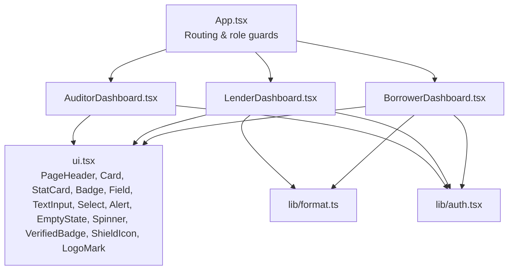
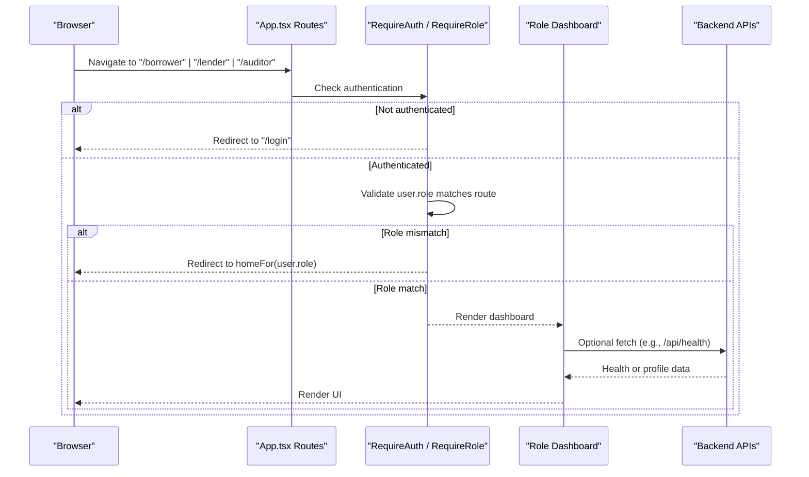
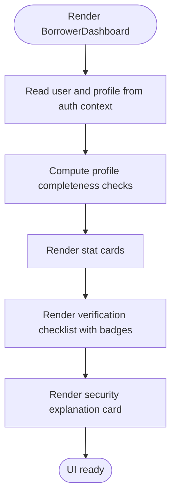
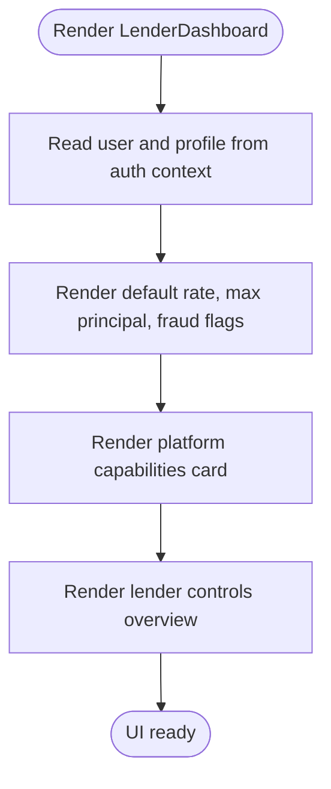
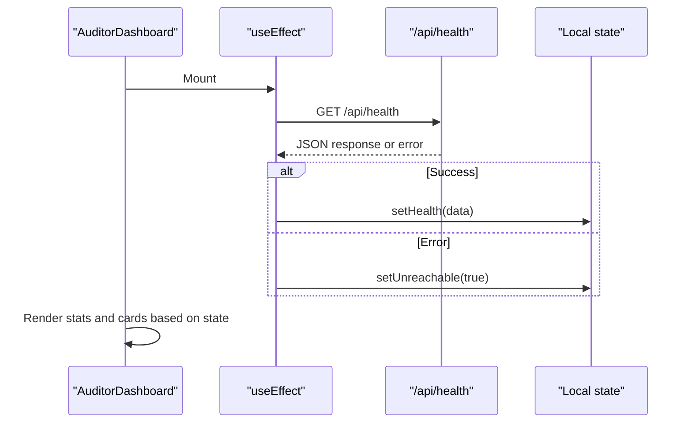
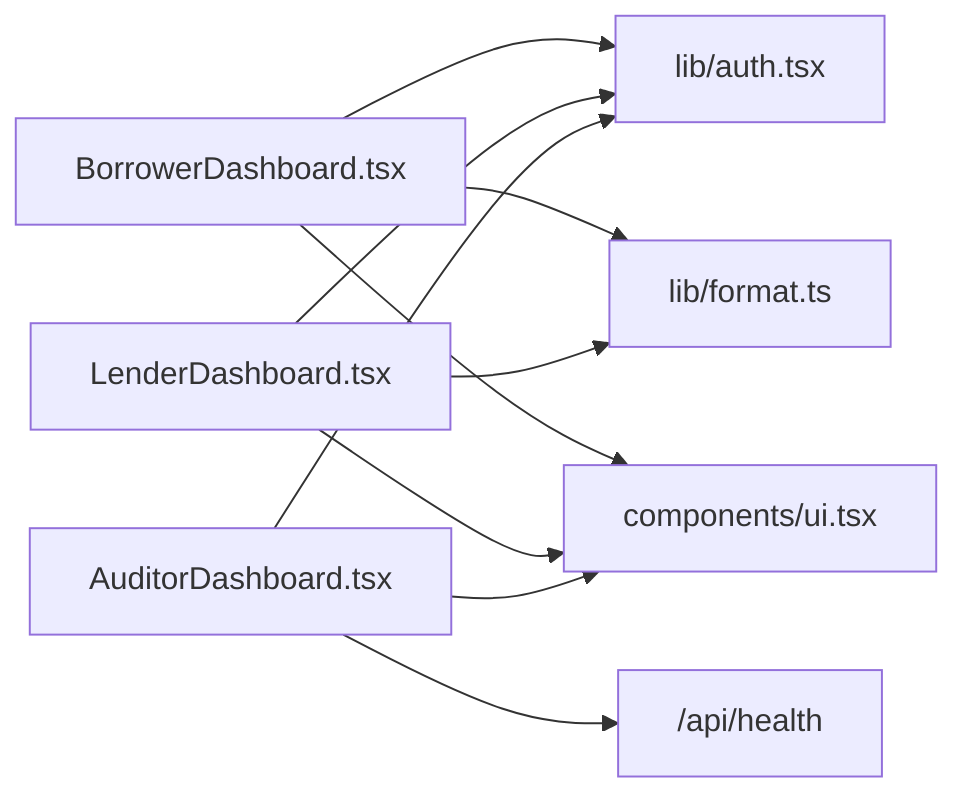

# User Interface Components

<cite>
**Referenced Files in This Document**
- [App.tsx](file://frontend/src/App.tsx)
- [BorrowerDashboard.tsx](file://frontend/src/pages/borrower/BorrowerDashboard.tsx)
- [LenderDashboard.tsx](file://frontend/src/pages/lender/LenderDashboard.tsx)
- [AuditorDashboard.tsx](file://frontend/src/pages/auditor/AuditorDashboard.tsx)
- [ui.tsx](file://frontend/src/components/ui.tsx)
- [auth.tsx](file://frontend/src/lib/auth.tsx)
- [format.ts](file://frontend/src/lib/format.ts)
</cite>

## Table of Contents
1. [Introduction](#introduction)
2. [Project Structure](#project-structure)
3. [Core Components](#core-components)
4. [Architecture Overview](#architecture-overview)
5. [Detailed Component Analysis](#detailed-component-analysis)
6. [Dependency Analysis](#dependency-analysis)
7. [Performance Considerations](#performance-considerations)
8. [Troubleshooting Guide](#troubleshooting-guide)
9. [Conclusion](#conclusion)

## Introduction
This document explains the role-based user interface components for borrowers, lenders, and auditors, along with the reusable UI primitives they compose. It focuses on:
- How each dashboard presents data and guides user interactions.
- The shared UI components used across dashboards.
- Role-based routing and access control.
- State handling, event processing, and data fetching patterns.
- Responsive design, accessibility, and cross-browser considerations.

The goal is to help developers understand how to extend or modify these screens while preserving consistency, security, and usability.

## Project Structure
The relevant frontend code is organized by feature area:
- Role-specific dashboards live under `frontend/src/pages/{borrower,lender,auditor}`.
- Shared presentational components are defined in `frontend/src/components/ui.tsx`.
- Routing and role guards are implemented in `frontend/src/App.tsx`.
- Authentication context and helpers are provided by `frontend/src/lib/auth.tsx`.
- Formatting utilities are in `frontend/src/lib/format.ts`.

**Diagram sources**
- [App.tsx:39-204](file://frontend/src/App.tsx#L39-L204)
- [BorrowerDashboard.tsx:1-76](file://frontend/src/pages/borrower/BorrowerDashboard.tsx#L1-L76)
- [LenderDashboard.tsx:1-70](file://frontend/src/pages/lender/LenderDashboard.tsx#L1-L70)
- [AuditorDashboard.tsx:1-85](file://frontend/src/pages/auditor/AuditorDashboard.tsx#L1-L85)
- [ui.tsx:1-218](file://frontend/src/components/ui.tsx#L1-L218)
- [auth.tsx](file://frontend/src/lib/auth.tsx)
- [format.ts](file://frontend/src/lib/format.ts)

**Section sources**
- [App.tsx:39-204](file://frontend/src/App.tsx#L39-L204)
- [BorrowerDashboard.tsx:1-76](file://frontend/src/pages/borrower/BorrowerDashboard.tsx#L1-L76)
- [LenderDashboard.tsx:1-70](file://frontend/src/pages/lender/LenderDashboard.tsx#L1-L70)
- [AuditorDashboard.tsx:1-85](file://frontend/src/pages/auditor/AuditorDashboard.tsx#L1-L85)
- [ui.tsx:1-218](file://frontend/src/components/ui.tsx#L1-L218)

## Core Components
This section summarizes the three role-based dashboards and their responsibilities.

- BorrowerDashboard
  - Displays borrower profile completeness, income, and active loan counts.
  - Shows a verification checklist with status badges.
  - Explains platform security guarantees using informational cards.
  - Uses reusable UI components for layout and presentation.

- LenderDashboard
  - Presents lender-specific metrics such as default rate, maximum principal, and fraud flags.
  - Provides quick links to applications and fraud queue.
  - Highlights platform capabilities and controls owned by the lender.

- AuditorDashboard
  - Fetches and displays service health and ledger mode.
  - Emphasizes read-only forensic access and integrity guarantees.
  - Offers navigation to audit log, timeline, and integrity checks.

These dashboards rely on:
- `useAuth` from `lib/auth.tsx` for current user and profile data.
- `formatMoney`, `percentFromBps` from `lib/format.ts` for consistent number formatting.
- Shared UI components from `components/ui.tsx`.

**Section sources**
- [BorrowerDashboard.tsx:1-76](file://frontend/src/pages/borrower/BorrowerDashboard.tsx#L1-L76)
- [LenderDashboard.tsx:1-70](file://frontend/src/pages/lender/LenderDashboard.tsx#L1-L70)
- [AuditorDashboard.tsx:1-85](file://frontend/src/pages/auditor/AuditorDashboard.tsx#L1-L85)
- [ui.tsx:1-218](file://frontend/src/components/ui.tsx#L1-L218)
- [format.ts](file://frontend/src/lib/format.ts)

## Architecture Overview
Role-based access is enforced at the routing layer. The app:
- Requires authentication before rendering protected routes.
- Redirects anonymous users to login.
- Restricts each dashboard to its intended role.
- Uses a home redirect helper to route authenticated users to their correct dashboard.

**Diagram sources**
- [App.tsx:15-37](file://frontend/src/App.tsx#L15-L37)
- [App.tsx:46-156](file://frontend/src/App.tsx#L46-L156)
- [AuditorDashboard.tsx:19-32](file://frontend/src/pages/auditor/AuditorDashboard.tsx#L19-L32)

**Section sources**
- [App.tsx:15-37](file://frontend/src/App.tsx#L15-L37)
- [App.tsx:46-156](file://frontend/src/App.tsx#L46-L156)

## Detailed Component Analysis

### BorrowerDashboard
Purpose:
- Show borrower profile completeness and key financial indicators.
- Provide guidance and next actions like applying for a loan.

Key behaviors:
- Reads user and profile via `useAuth`.
- Computes a completion score based on masked national ID, phone, occupation, and monthly income fields.
- Renders stat cards for profile completeness, monthly income, and active loans.
- Displays a checklist with success/warning badges.
- Links to profile update and loan application flows.

Props and composition:
- Uses `PageHeader` for title, subtitle, and action button.
- Uses `StatCard` for metrics.
- Uses `Card` for grouped information sections.
- Uses `Badge` to indicate checklist status.

State and events:
- No local state; relies on auth context.
- Navigation handled via React Router `Link`.

Responsive behavior:
- Uses Tailwind grid classes to adapt layout across screen sizes.

Accessibility:
- Semantic headings and paragraphs.
- Icons use `aria-hidden` where appropriate.

**Diagram sources**
- [BorrowerDashboard.tsx:11-75](file://frontend/src/pages/borrower/BorrowerDashboard.tsx#L11-L75)

**Section sources**
- [BorrowerDashboard.tsx:1-76](file://frontend/src/pages/borrower/BorrowerDashboard.tsx#L1-L76)

### LenderDashboard
Purpose:
- Present lender-specific metrics and controls.
- Provide quick access to applications and fraud review.

Key behaviors:
- Reads user and profile via `useAuth`.
- Displays default rate, maximum principal, and open fraud flags.
- Highlights platform capabilities and lender-owned controls.
- Links to applications and fraud queue.

Props and composition:
- Uses `PageHeader` for header and primary action.
- Uses `StatCard` for metrics.
- Uses `Card` for grouped content.
- Uses `Badge` to show defaults and enforcement status.

State and events:
- No local state; relies on auth context.
- Navigation handled via React Router `Link`.

Responsive behavior:
- Uses Tailwind grid classes to adapt layout across screen sizes.

Accessibility:
- Semantic headings and paragraphs.
- Clear link affordances.

**Diagram sources**
- [LenderDashboard.tsx:7-69](file://frontend/src/pages/lender/LenderDashboard.tsx#L7-L69)

**Section sources**
- [LenderDashboard.tsx:1-70](file://frontend/src/pages/lender/LenderDashboard.tsx#L1-L70)

### AuditorDashboard
Purpose:
- Provide a forensic overview of platform health and integrity.
- Offer read-only access to audit trails and evidence.

Key behaviors:
- Reads user via `useAuth`.
- Fetches `/api/health` on mount and updates local state for health and reachability.
- Renders API status, ledger mode, and audit chain info.
- Links to audit log, timeline, and integrity checks.

Props and composition:
- Uses `PageHeader` for title and role badge.
- Uses `StatCard` for system metrics.
- Uses `Card` for evidence and investigation entry points.

State and events:
- Local state for health payload and unreachable flag.
- Effect to fetch health endpoint and handle errors.
- Cleanup function to prevent state updates after unmount.

Responsive behavior:
- Uses Tailwind grid classes to adapt layout across screen sizes.

Accessibility:
- Semantic headings and paragraphs.
- Status text is clear and descriptive.

**Diagram sources**
- [AuditorDashboard.tsx:14-32](file://frontend/src/pages/auditor/AuditorDashboard.tsx#L14-L32)
- [AuditorDashboard.tsx:36-83](file://frontend/src/pages/auditor/AuditorDashboard.tsx#L36-L83)

**Section sources**
- [AuditorDashboard.tsx:1-85](file://frontend/src/pages/auditor/AuditorDashboard.tsx#L1-L85)

### Reusable UI Components (ui.tsx)
Overview:
- Presentational primitives that ensure consistent styling and behavior across dashboards.
- Encapsulate common patterns like headers, cards, stat blocks, badges, form fields, alerts, empty states, spinners, and icons.

Components and responsibilities:
- PageHeader: Title, optional subtitle, and action slot.
- Card: Container with optional title, description, actions, and children.
- StatCard: Metric display with label, value, hint, and tone variants.
- Badge: Small status indicator with multiple tones.
- VerifiedBadge: Conditional badge indicating on-chain verification.
- Field: Labelled field wrapper with optional error/hint.
- TextInput: Styled input element.
- Select: Styled select element.
- Alert: Themed alert box with semantic role.
- EmptyState: Placeholder for empty data scenarios.
- Spinner: Loading indicator with accessible attributes.
- FullPageLoader: Centered loading view with logo and spinner.
- ShieldIcon: Security-related icon.
- LogoMark: Brand mark icon.

Props examples:
- PageHeader
  - title: string
  - subtitle?: string
  - actions?: ReactNode
- Card
  - title?: string
  - description?: string
  - actions?: ReactNode
  - children: ReactNode
  - className?: string
- StatCard
  - label: string
  - value: ReactNode
  - hint?: string
  - tone?: 'default' | 'brand' | 'warning' | 'danger'
- Badge
  - tone?: 'neutral' | 'success' | 'warning' | 'danger' | 'info'
  - children: ReactNode
- VerifiedBadge
  - verified: boolean
- Field
  - label: string
  - error?: string
  - hint?: string
  - htmlFor?: string
  - children: ReactNode
- TextInput
  - Inherits InputHTMLAttributes<HTMLInputElement>
- Select
  - Inherits SelectHTMLAttributes<HTMLSelectElement>
- Alert
  - tone?: 'danger' | 'warning' | 'info'
  - children: ReactNode
- EmptyState
  - title: string
  - description?: string
  - action?: ReactNode
- Spinner
  - label?: string
- FullPageLoader
  - label?: string
- ShieldIcon
  - className?: string
- LogoMark
  - className?: string

Accessibility highlights:
- Alert uses `role="alert"` for screen readers.
- Spinner uses `role="status"` and `aria-live="polite"`.
- Icons use `aria-hidden="true"` when decorative.

Responsive behavior:
- Layouts rely on Tailwind utility classes applied by parent components.
- Cards and stat grids adapt via responsive breakpoints.

Cross-browser compatibility:
- Standard HTML elements and ARIA attributes supported across modern browsers.
- SVG icons are inline and scalable.

```mermaid
classDiagram
class PageHeader {
+title : string
+subtitle? : string
+actions? : ReactNode
}
class Card {
+title? : string
+description? : string
+actions? : ReactNode
+children : ReactNode
+className? : string
}
class StatCard {
+label : string
+value : ReactNode
+hint? : string
+tone? : "default"|"brand"|"warning"|"danger"
}
class Badge {
+tone? : "neutral"|"success"|"warning"|"danger"|"info"
+children : ReactNode
}
class VerifiedBadge {
+verified : boolean
}
class Field {
+label : string
+error? : string
+hint? : string
+htmlFor? : string
+children : ReactNode
}
class TextInput
class Select
class Alert {
+tone? : "danger"|"warning"|"info"
+children : ReactNode
}
class EmptyState {
+title : string
+description? : string
+action? : ReactNode
}
class Spinner {
+label? : string
}
class FullPageLoader {
+label? : string
}
class ShieldIcon {
+className? : string
}
class LogoMark {
+className? : string
}
```

**Diagram sources**
- [ui.tsx:8-217](file://frontend/src/components/ui.tsx#L8-L217)

**Section sources**
- [ui.tsx:1-218](file://frontend/src/components/ui.tsx#L1-L218)

## Dependency Analysis
Dashboards depend on:
- Authentication context for user identity and profile data.
- Formatting utilities for monetary and percentage values.
- Shared UI components for consistent presentation.
- React Router for navigation.

**Diagram sources**
- [BorrowerDashboard.tsx:1-76](file://frontend/src/pages/borrower/BorrowerDashboard.tsx#L1-L76)
- [LenderDashboard.tsx:1-70](file://frontend/src/pages/lender/LenderDashboard.tsx#L1-L70)
- [AuditorDashboard.tsx:1-85](file://frontend/src/pages/auditor/AuditorDashboard.tsx#L1-L85)
- [ui.tsx:1-218](file://frontend/src/components/ui.tsx#L1-L218)

**Section sources**
- [BorrowerDashboard.tsx:1-76](file://frontend/src/pages/borrower/BorrowerDashboard.tsx#L1-L76)
- [LenderDashboard.tsx:1-70](file://frontend/src/pages/lender/LenderDashboard.tsx#L1-L70)
- [AuditorDashboard.tsx:1-85](file://frontend/src/pages/auditor/AuditorDashboard.tsx#L1-L85)
- [ui.tsx:1-218](file://frontend/src/components/ui.tsx#L1-L218)

## Performance Considerations
- Dashboards are lightweight and primarily render static data from auth context.
- AuditorDashboard performs one network request on mount; consider caching or debouncing if polling becomes necessary.
- Avoid unnecessary re-renders by keeping state minimal and derived from context.
- Use memoization for expensive computations if checklist logic grows.

[No sources needed since this section provides general guidance]

## Troubleshooting Guide
Common issues and resolutions:
- Anonymous user sees login page instead of dashboard
  - Ensure authentication status is resolved before rendering protected routes.
  - Verify `homeFor` returns the correct destination for the user’s role.
- Role mismatch redirects unexpectedly
  - Confirm the user’s role matches the route guard.
  - Check that `user.role` is correctly set by the backend session.
- AuditorDashboard shows “Unreachable”
  - Verify `/api/health` endpoint availability and CORS settings.
  - Inspect network tab for failed requests and error responses.
- Missing UI elements
  - Ensure required props are passed to shared components.
  - Validate Tailwind configuration and CSS classes.

**Section sources**
- [App.tsx:15-37](file://frontend/src/App.tsx#L15-L37)
- [App.tsx:46-156](file://frontend/src/App.tsx#L46-L156)
- [AuditorDashboard.tsx:19-32](file://frontend/src/pages/auditor/AuditorDashboard.tsx#L19-L32)

## Conclusion
The role-based dashboards provide focused interfaces for borrowers, lenders, and auditors, built on a consistent set of reusable UI components. Routing and role guards enforce secure access, while shared components ensure visual and behavioral consistency. Extending these screens involves composing existing primitives, leveraging auth context, and following established patterns for state and navigation.

[No sources needed since this section summarizes without analyzing specific files]