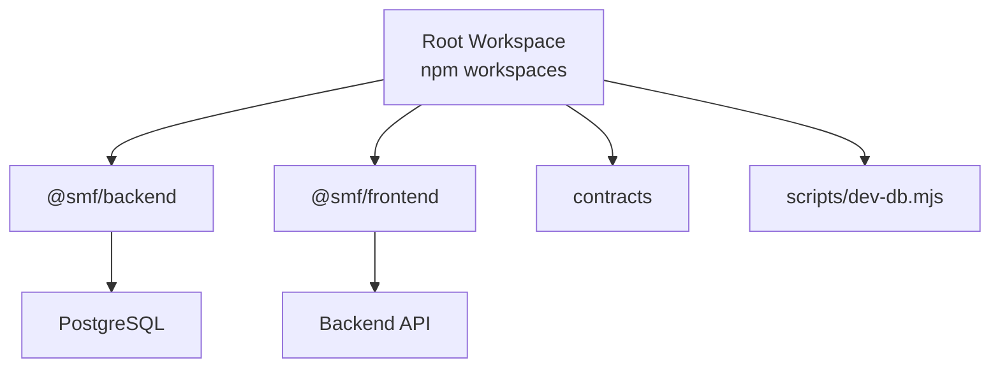
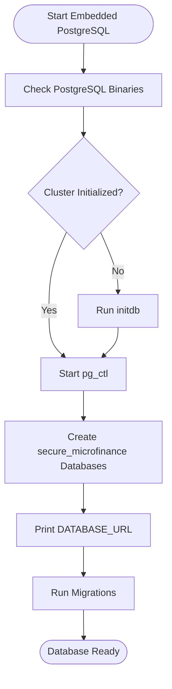
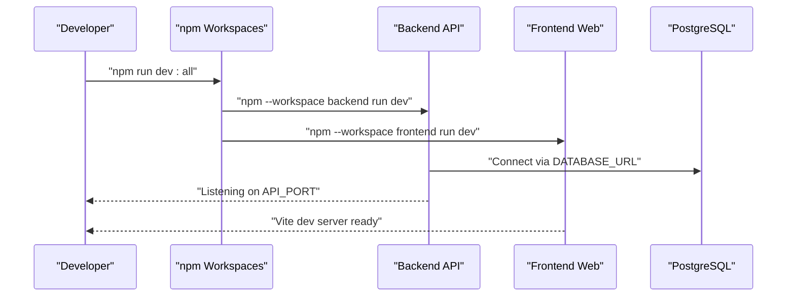

# Getting Started

<cite>
**Referenced Files in This Document**
- [package.json](file://package.json)
- [backend/package.json](file://backend/package.json)
- [frontend/package.json](file://frontend/package.json)
- [docker-compose.yml](file://docker-compose.yml)
- [scripts/dev-db.mjs](file://scripts/dev-db.mjs)
- [backend/src/config/env.ts](file://backend/src/config/env.ts)
- [backend/src/db/migrate.ts](file://backend/src/db/migrate.ts)
- [backend/src/db/pool.ts](file://backend/src/db/pool.ts)
- [backend/src/server.ts](file://backend/src/server.ts)
</cite>

## Table of Contents
1. [Introduction](#introduction)
2. [Prerequisites](#prerequisites)
3. [Project Structure](#project-structure)
4. [Installation](#installation)
5. [Environment Setup](#environment-setup)
6. [Database Initialization](#database-initialization)
7. [Running the Development Server](#running-the-development-server)
8. [Available npm Scripts](#available-npm-scripts)
9. [Verification Steps](#verification-steps)
10. [Troubleshooting](#troubleshooting)
11. [Conclusion](#conclusion)

## Introduction
SecureMicrofinance is a security-focused microfinance prototype with a Node.js backend API, a React frontend, and optional blockchain and machine-learning integrations. The repository uses npm workspaces to manage multiple packages from one root project. You can run everything locally without Docker by using an embedded PostgreSQL instance, or you can use Docker Compose for a containerized stack.

This guide walks you through installing dependencies, configuring environment variables, initializing the database, and starting the development services. It also documents the available npm scripts and provides troubleshooting tips for common setup issues.

## Prerequisites
- Node.js version 20 or newer.
- A terminal that supports npm workspaces (Node.js 20+ includes this).
- Optional: Docker and Docker Compose if you prefer running PostgreSQL and services in containers.

The project enforces Node.js version requirements at the workspace root. If your installed Node.js version is too old, package installation may fail.

**Section sources**
- [package.json:35-37](file://package.json#L35-L37)

## Project Structure
At a high level, the repository contains:
- Root workspace configuration and shared scripts.
- Backend API implemented in TypeScript with Express, PostgreSQL, JWT authentication, rate limiting, and optional ledger integration.
- Frontend web application built with Vite, React, and Tailwind CSS.
- Docker Compose configuration for local and CI stacks.
- Embedded PostgreSQL launcher script for local development without Docker.

**Diagram sources**
- [package.json:6-10](file://package.json#L6-L10)
- [backend/package.json:1-17](file://backend/package.json#L1-L17)
- [frontend/package.json:1-12](file://frontend/package.json#L1-L12)
- [docker-compose.yml:1-52](file://docker-compose.yml#L1-L52)

**Section sources**
- [package.json:1-30](file://package.json#L1-L30)
- [backend/package.json:1-17](file://backend/package.json#L1-L17)
- [frontend/package.json:1-12](file://frontend/package.json#L1-L12)

## Installation
Follow these steps to install dependencies using npm workspaces:

1. Open a terminal in the repository root directory.
2. Install all workspace dependencies:
   - `npm install`
3. Verify that the workspace packages are linked:
   - `npm ls --workspaces`

The root `package.json` defines workspaces for `backend`, `frontend`, and `contracts`. Running `npm install` once installs dependencies for all packages.

**Section sources**
- [package.json:6-10](file://package.json#L6-L10)

## Environment Setup
Before starting any service, create a `.env` file in the repository root. The backend configuration loader searches for `.env` in the current working directory first and then in the parent directory, so placing it at the repository root works for both workspace commands and direct backend execution.

Required and recommended environment variables include:
- `DATABASE_URL`: Connection string for PostgreSQL.
- `JWT_ACCESS_SECRET` and `JWT_REFRESH_SECRET`: Secrets for signing access and refresh tokens.
- `API_PORT`: Port for the backend API server.
- `WEB_ORIGIN`: Origin used for CORS and cookie configuration.
- `FIELD_ENCRYPTION_KEY` and `BLIND_INDEX_KEY`: Hex-encoded keys for field encryption and blind indexing.
- Optional chain-related settings such as `CHAIN_MODE`, `CHAIN_RPC_URL`, `CHAIN_ID`, and contract addresses.
- Optional ML service URL and timeout settings.

The configuration loader validates every required variable and fails fast if anything is missing or invalid. This prevents starting a partially configured server.

If you are using Docker Compose, the compose file sets `DATABASE_URL` and `WEB_ORIGIN` for the API service. For local development without Docker, set `DATABASE_URL` to point to the embedded PostgreSQL instance started by the dev script.

**Section sources**
- [backend/src/config/env.ts:6-22](file://backend/src/config/env.ts#L6-L22)
- [backend/src/config/env.ts:24-86](file://backend/src/config/env.ts#L24-L86)
- [docker-compose.yml:23-39](file://docker-compose.yml#L23-L39)

## Database Initialization
You have two options for the database:

### Option A: Embedded PostgreSQL (No Docker)
Use the embedded PostgreSQL launcher when Docker is not available:

1. Start the embedded PostgreSQL server:
   - `npm run db:up`
2. Run migrations to create tables and seed data:
   - `npm run db:migrate`
3. Optionally reset the database schema:
   - `npm run db:reset`

The embedded PostgreSQL script:
- Locates native PostgreSQL binaries under `node_modules/@embedded-postgres/<platform>/native`.
- Initializes the cluster if needed.
- Starts `pg_ctl` on port `55432` by default.
- Creates the `secure_microfinance` and `secure_microfinance_test` databases.
- Prints the expected `DATABASE_URL` for local development.

The migration runner:
- Reads SQL files from `backend/src/db/migrations`.
- Applies each migration inside its own transaction.
- Records applied migrations in `schema_migrations`.
- Rolls back on failure.

The database pool:
- Uses `config.databaseUrl`.
- Provides parameterized query helpers.
- Handles connection errors gracefully.

**Diagram sources**
- [scripts/dev-db.mjs:85-153](file://scripts/dev-db.mjs#L85-L153)
- [backend/src/db/migrate.ts:14-58](file://backend/src/db/migrate.ts#L14-L58)
- [backend/src/db/pool.ts:9-14](file://backend/src/db/pool.ts#L9-L14)

**Section sources**
- [scripts/dev-db.mjs:1-171](file://scripts/dev-db.mjs#L1-L171)
- [backend/src/db/migrate.ts:1-70](file://backend/src/db/migrate.ts#L1-L70)
- [backend/src/db/pool.ts:1-62](file://backend/src/db/pool.ts#L1-L62)

### Option B: Docker Compose
If Docker is available, you can run PostgreSQL and services in containers:

1. Start the stack:
   - `docker compose up -d`
2. Run migrations against the containerized database:
   - `npm run db:migrate`

The compose file exposes PostgreSQL on port `55432`, builds the API and web services, and waits for PostgreSQL to be healthy before starting the API.

**Section sources**
- [docker-compose.yml:1-52](file://docker-compose.yml#L1-L52)

## Running the Development Server
After setting up the environment and database, start the development services:

- Start only the backend API:
  - `npm run dev:api`
- Start only the frontend web app:
  - `npm run dev:web`
- Start both backend and frontend together:
  - `npm run dev:all`

The backend starts an Express server, prints the API URL and Swagger docs URL, and logs the active chain mode. The frontend starts the Vite development server.

**Diagram sources**
- [package.json:18-21](file://package.json#L18-L21)
- [backend/package.json:7-16](file://backend/package.json#L7-L16)
- [frontend/package.json:7-12](file://frontend/package.json#L7-L12)
- [backend/src/server.ts:6-12](file://backend/src/server.ts#L6-L12)

**Section sources**
- [package.json:18-21](file://package.json#L18-L21)
- [backend/package.json:7-16](file://backend/package.json#L7-L16)
- [frontend/package.json:7-12](file://frontend/package.json#L7-L12)
- [backend/src/server.ts:1-26](file://backend/src/server.ts#L1-L26)

## Available npm Scripts
The root workspace provides convenience scripts for common tasks:

- Database lifecycle:
  - `npm run db:up`
  - `npm run db:down`
  - `npm run db:status`
- Database operations:
  - `npm run db:migrate`
  - `npm run db:seed`
  - `npm run db:reset`
- Development servers:
  - `npm run dev:api`
  - `npm run dev:web`
  - `npm run dev:all`
- Testing and quality:
  - `npm test`
  - `npm run test:all`
  - `npm run typecheck`
- Build:
  - `npm run build`
- Smoke test:
  - `npm run smoke`

The backend workspace also exposes `dev`, `build`, `start`, `typecheck`, `db:migrate`, `db:seed`, `db:reset`, and test scripts.

**Section sources**
- [package.json:11-30](file://package.json#L11-L30)
- [backend/package.json:7-16](file://backend/package.json#L7-L16)

## Verification Steps
Use these checks to confirm that your environment is working correctly:

1. Verify Node.js version:
   - Ensure Node.js is version 20 or newer.
2. Verify workspace installation:
   - Run `npm ls --workspaces` and confirm backend and frontend packages are listed.
3. Verify database connectivity:
   - For embedded PostgreSQL: run `npm run db:status`.
   - For Docker: run `docker compose ps` and check that PostgreSQL is healthy.
4. Verify migrations:
   - Run `npm run db:migrate` and confirm no migration failures.
5. Verify backend API:
   - Start the API with `npm run dev:api`.
   - Open the Swagger docs URL printed by the server.
6. Verify frontend:
   - Start the frontend with `npm run dev:web`.
   - Open the Vite dev server URL in your browser.
7. Verify end-to-end flow:
   - Use the frontend to call backend endpoints.
   - Confirm successful responses and logged activity.

**Section sources**
- [package.json:35-37](file://package.json#L35-L37)
- [scripts/dev-db.mjs:112-153](file://scripts/dev-db.mjs#L112-L153)
- [backend/src/server.ts:8-12](file://backend/src/server.ts#L8-L12)

## Troubleshooting
Common setup issues and resolutions:

- **Node.js version too old**:
  - Symptom: Installation or workspace commands fail.
  - Resolution: Upgrade to Node.js 20 or newer.

- **Embedded PostgreSQL binaries missing**:
  - Symptom: `npm run db:up` reports missing binaries.
  - Resolution: Run `npm install` again, or use Docker Compose.

- **Port already in use**:
  - Symptom: Embedded PostgreSQL cannot start on the default port.
  - Resolution: Stop another PostgreSQL process, or configure a different port via environment variables.

- **Invalid environment configuration**:
  - Symptom: Backend startup throws an error about missing or invalid environment variables.
  - Resolution: Create `.env` with required variables, especially `DATABASE_URL`, `JWT_ACCESS_SECRET`, `JWT_REFRESH_SECRET`, `FIELD_ENCRYPTION_KEY`, and `BLIND_INDEX_KEY`.

- **Migration failures**:
  - Symptom: Migration script reports an error for a specific SQL file.
  - Resolution: Inspect the failing migration file, fix the SQL, and rerun `npm run db:migrate`.

- **Database connection errors**:
  - Symptom: API cannot connect to PostgreSQL.
  - Resolution: Ensure the database is running and `DATABASE_URL` points to the correct host, port, user, and database name.

- **CORS or origin mismatch**:
  - Symptom: Frontend requests are blocked.
  - Resolution: Set `WEB_ORIGIN` to match the frontend dev server URL.

- **Docker Compose health check delays**:
  - Symptom: API container starts before PostgreSQL is ready.
  - Resolution: Wait for the health check to pass; the compose file configures retries and conditions.

**Section sources**
- [package.json:35-37](file://package.json#L35-L37)
- [scripts/dev-db.mjs:85-90](file://scripts/dev-db.mjs#L85-L90)
- [backend/src/config/env.ts:76-86](file://backend/src/config/env.ts#L76-L86)
- [backend/src/db/migrate.ts:48-51](file://backend/src/db/migrate.ts#L48-L51)
- [docker-compose.yml:7-21](file://docker-compose.yml#L7-L21)

## Conclusion
You now have everything needed to set up SecureMicrofinance locally. Install dependencies with npm workspaces, configure environment variables, initialize the database using either embedded PostgreSQL or Docker Compose, and start the backend and frontend development servers. Use the documented npm scripts to manage the database, run tests, and build the project. If you encounter issues, consult the troubleshooting section for common fixes and verification steps.