# Loan Application Workflow

<cite>
**Referenced Files in This Document**
- [openapi.yaml](file://backend/openapi.yaml)
- [002_loans.sql](file://backend/src/db/migrations/002_loans.sql)
- [users.routes.ts](file://backend/src/modules/users/users.routes.ts)
- [users.service.ts](file://backend/src/modules/users/users.service.ts)
- [rules.engine.ts](file://backend/src/modules/fraud/rules.engine.ts)
- [loans.ts](file://frontend/src/lib/loans.ts)
- [BorrowerDashboard.tsx](file://frontend/src/pages/borrower/BorrowerDashboard.tsx)
- [RegisterPage.tsx](file://frontend/src/pages/auth/RegisterPage.tsx)
- [App.tsx](file://frontend/src/App.tsx)
</cite>

## Table of Contents
1. [Introduction](#introduction)
2. [Project Structure](#project-structure)
3. [Core Components](#core-components)
4. [Architecture Overview](#architecture-overview)
5. [Detailed Component Analysis](#detailed-component-analysis)
6. [Dependency Analysis](#dependency-analysis)
7. [Performance Considerations](#performance-considerations)
8. [Troubleshooting Guide](#troubleshooting-guide)
9. [Conclusion](#conclusion)

## Introduction
This document explains the end-to-end loan application workflow: borrower registration, profile completion with identity data, loan application submission, validation and fraud checks, lender review, and status transitions. It also documents the loan data model, eligibility rules, integration points with identity verification, and how applications are queued for lender review. The borrower’s dashboard experience is included to show how applicants track their applications and verification checklist.

## Project Structure
The loan workflow spans authentication, borrower profile management, loan application endpoints, fraud rule evaluation, database schema, and frontend pages.

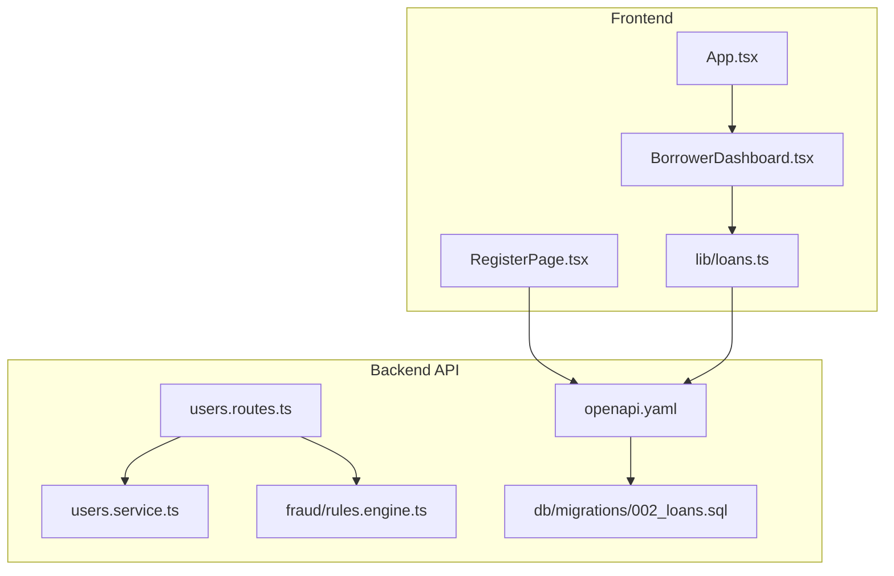

**Diagram sources**
- [RegisterPage.tsx:1-165](file://frontend/src/pages/auth/RegisterPage.tsx#L1-L165)
- [BorrowerDashboard.tsx:1-133](file://frontend/src/pages/borrower/BorrowerDashboard.tsx#L1-L133)
- [loans.ts:1-242](file://frontend/src/lib/loans.ts#L1-L242)
- [App.tsx:67-135](file://frontend/src/App.tsx#L67-L135)
- [openapi.yaml:1-286](file://backend/openapi.yaml#L1-L286)
- [users.routes.ts:1-108](file://backend/src/modules/users/users.routes.ts#L1-L108)
- [users.service.ts:1-60](file://backend/src/modules/users/users.service.ts#L1-L60)
- [rules.engine.ts:78-274](file://backend/src/modules/fraud/rules.engine.ts#L78-L274)
- [002_loans.sql:1-100](file://backend/src/db/migrations/002_loans.sql#L1-L100)

**Section sources**
- [openapi.yaml:1-286](file://backend/openapi.yaml#L1-L286)
- [App.tsx:67-135](file://frontend/src/App.tsx#L67-L135)

## Core Components
- Borrower registration and login via the public auth endpoints defined in the OpenAPI spec.
- Borrower profile update that encrypts sensitive fields (national ID, phone, date of birth, address), stores blind indexes for duplicate detection, and triggers identity conflict checks.
- Loan application submission through typed frontend helpers that call the loan endpoints.
- Fraud rules engine that evaluates identity conflicts, rapid applications, duplicate references, and duplicate disbursements.
- Database schema defining loan statuses, installments, and documents.
- Borrower dashboard showing verification checklist, recent applications, and outstanding balances.

**Section sources**
- [openapi.yaml:38-174](file://backend/openapi.yaml#L38-L174)
- [users.routes.ts:19-108](file://backend/src/modules/users/users.routes.ts#L19-L108)
- [users.service.ts:5-59](file://backend/src/modules/users/users.service.ts#L5-L59)
- [loans.ts:167-208](file://frontend/src/lib/loans.ts#L167-L208)
- [rules.engine.ts:94-274](file://backend/src/modules/fraud/rules.engine.ts#L94-L274)
- [002_loans.sql:5-100](file://backend/src/db/migrations/002_loans.sql#L5-L100)
- [BorrowerDashboard.tsx:1-133](file://frontend/src/pages/borrower/BorrowerDashboard.tsx#L1-L133)

## Architecture Overview
The loan application lifecycle flows from the frontend through authenticated API routes into service logic, database persistence, and fraud checks. Lenders review applications and make decisions; certain events trigger fraud flags that can hold approvals or disbursements.

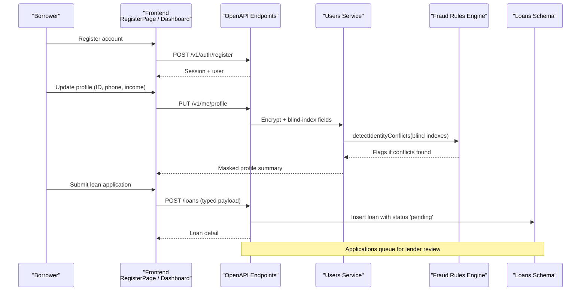

**Diagram sources**
- [openapi.yaml:38-223](file://backend/openapi.yaml#L38-L223)
- [users.routes.ts:45-108](file://backend/src/modules/users/users.routes.ts#L45-L108)
- [users.service.ts:19-59](file://backend/src/modules/users/users.service.ts#L19-L59)
- [rules.engine.ts:94-112](file://backend/src/modules/fraud/rules.engine.ts#L94-L112)
- [002_loans.sql:25-56](file://backend/src/db/migrations/002_loans.sql#L25-L56)
- [loans.ts:167-182](file://frontend/src/lib/loans.ts#L167-L182)

## Detailed Component Analysis

### Borrower Registration and Role Selection
- The registration form supports selecting borrower or lender role, collecting full name, email, password, and business name for lenders.
- On success, users are redirected to their role-specific home.

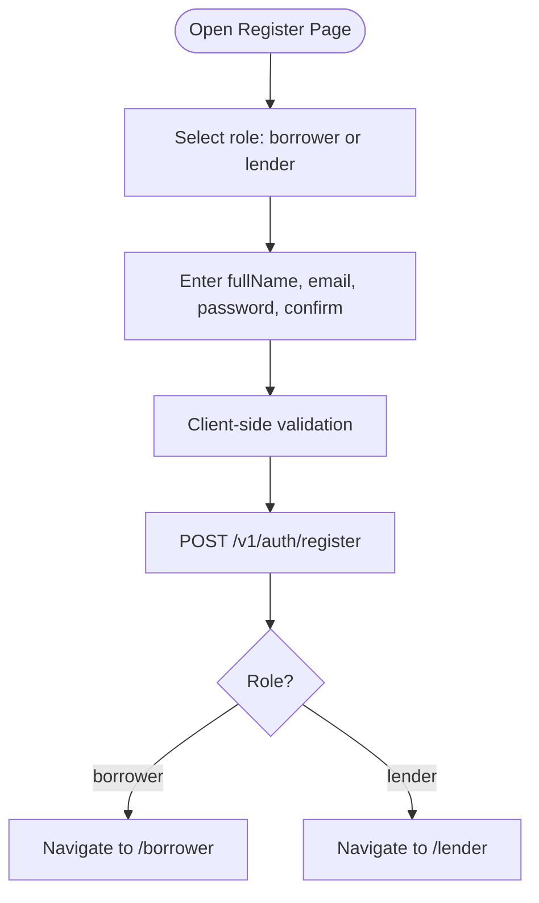

**Diagram sources**
- [RegisterPage.tsx:10-51](file://frontend/src/pages/auth/RegisterPage.tsx#L10-L51)
- [RegisterPage.tsx:53-165](file://frontend/src/pages/auth/RegisterPage.tsx#L53-L165)
- [openapi.yaml:38-80](file://backend/openapi.yaml#L38-L80)

**Section sources**
- [RegisterPage.tsx:10-51](file://frontend/src/pages/auth/RegisterPage.tsx#L10-L51)
- [RegisterPage.tsx:53-165](file://frontend/src/pages/auth/RegisterPage.tsx#L53-L165)
- [openapi.yaml:38-80](file://backend/openapi.yaml#L38-L80)

### Borrower Profile Completion and Identity Verification Integration
- Borrowers update national ID, phone, occupation, monthly income, date of birth, and address.
- Sensitive fields are encrypted at rest; blind indexes enable duplicate detection without decryption.
- Updating identity fields triggers fraud checks for cross-account identity conflicts.
- The profile summary returned to clients masks sensitive values.

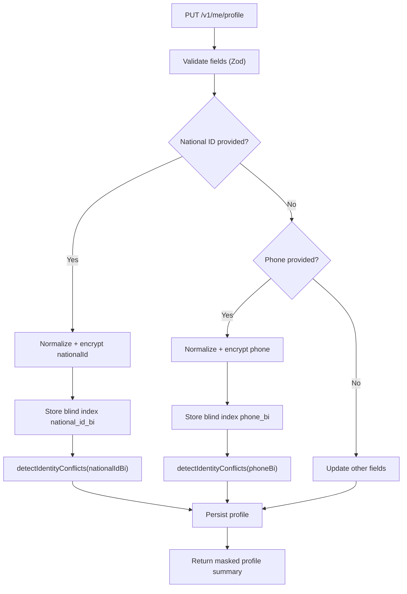

**Diagram sources**
- [users.routes.ts:26-36](file://backend/src/modules/users/users.routes.ts#L26-L36)
- [users.routes.ts:45-108](file://backend/src/modules/users/users.routes.ts#L45-L108)
- [users.service.ts:19-59](file://backend/src/modules/users/users.service.ts#L19-L59)
- [rules.engine.ts:94-112](file://backend/src/modules/fraud/rules.engine.ts#L94-L112)

**Section sources**
- [users.routes.ts:19-108](file://backend/src/modules/users/users.routes.ts#L19-L108)
- [users.service.ts:5-59](file://backend/src/modules/users/users.service.ts#L5-L59)
- [rules.engine.ts:94-112](file://backend/src/modules/fraud/rules.engine.ts#L94-L112)

### Loan Application Submission and Validation
- The frontend exposes a typed applyLoan function that posts a structured payload including lender selection, principal, term, frequency, purpose, optional collateral/guarantor details.
- The backend creates a loan record with an initial status of pending and generates a human-readable reference.

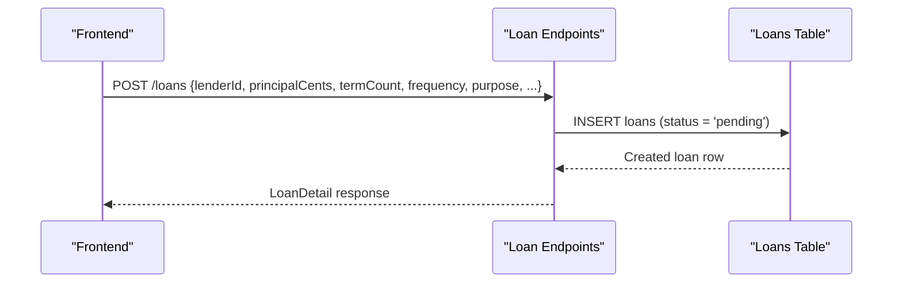

**Diagram sources**
- [loans.ts:167-182](file://frontend/src/lib/loans.ts#L167-L182)
- [002_loans.sql:25-56](file://backend/src/db/migrations/002_loans.sql#L25-L56)

**Section sources**
- [loans.ts:167-182](file://frontend/src/lib/loans.ts#L167-L182)
- [002_loans.sql:25-56](file://backend/src/db/migrations/002_loans.sql#L25-L56)

### Initial Fraud Checks on Application Events
- Identity conflict checks run when borrowers update national ID or phone.
- Rapid application detection counts recent applications per borrower within a configurable window.
- Duplicate mobile-money reference checks flag reused payment codes across transactions/loans.
- Duplicate disbursement checks prevent multiple disbursements for the same loan.

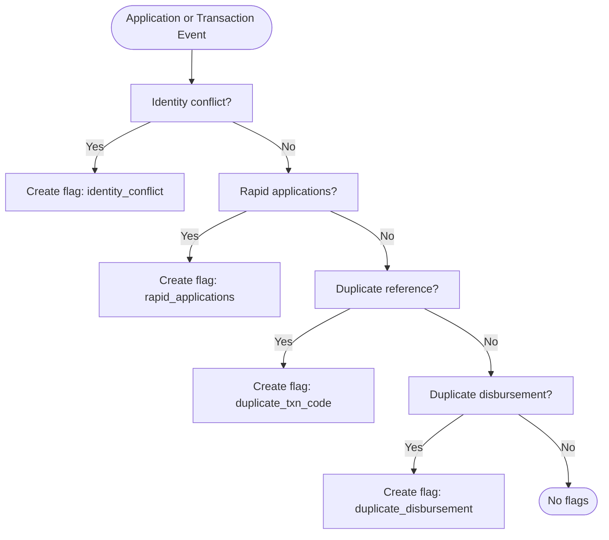

**Diagram sources**
- [rules.engine.ts:94-112](file://backend/src/modules/fraud/rules.engine.ts#L94-L112)
- [rules.engine.ts:216-248](file://backend/src/modules/fraud/rules.engine.ts#L216-L248)
- [rules.engine.ts:187-214](file://backend/src/modules/fraud/rules.engine.ts#L187-L214)
- [rules.engine.ts:250-274](file://backend/src/modules/fraud/rules.engine.ts#L250-L274)

**Section sources**
- [rules.engine.ts:94-112](file://backend/src/modules/fraud/rules.engine.ts#L94-L112)
- [rules.engine.ts:187-214](file://backend/src/modules/fraud/rules.engine.ts#L187-L214)
- [rules.engine.ts:216-248](file://backend/src/modules/fraud/rules.engine.ts#L216-L248)
- [rules.engine.ts:250-274](file://backend/src/modules/fraud/rules.engine.ts#L250-L274)

### Loan Status Transitions and Eligibility Rules
- Loans start in pending state after submission.
- Additional states include under_review, approved, rejected, held, disbursed, active, settled, defaulted, cancelled.
- Installments track due dates, amounts, penalties, and payment progress.
- Documents such as agreements and forensic reports are attached to loans.

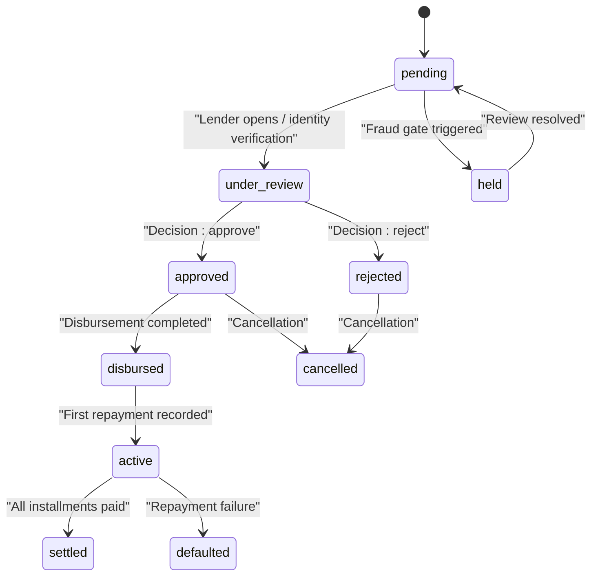

**Diagram sources**
- [002_loans.sql:5-16](file://backend/src/db/migrations/002_loans.sql#L5-L16)
- [002_loans.sql:66-80](file://backend/src/db/migrations/002_loans.sql#L66-L80)
- [002_loans.sql:84-95](file://backend/src/db/migrations/002_loans.sql#L84-L95)

**Section sources**
- [002_loans.sql:5-16](file://backend/src/db/migrations/002_loans.sql#L5-L16)
- [002_loans.sql:66-80](file://backend/src/db/migrations/002_loans.sql#L66-L80)
- [002_loans.sql:84-95](file://backend/src/db/migrations/002_loans.sql#L84-L95)

### Application Data Model Structure
The core entities include loans, loan_installments, and documents. Key attributes capture parties, financial terms, compliance metadata, and lifecycle timestamps.

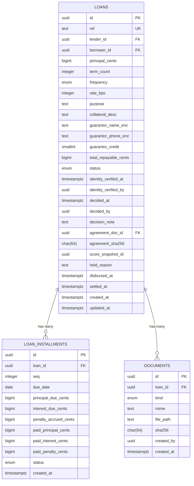

**Diagram sources**
- [002_loans.sql:25-56](file://backend/src/db/migrations/002_loans.sql#L25-L56)
- [002_loans.sql:66-80](file://backend/src/db/migrations/002_loans.sql#L66-L80)
- [002_loans.sql:84-95](file://backend/src/db/migrations/002_loans.sql#L84-L95)

**Section sources**
- [002_loans.sql:25-56](file://backend/src/db/migrations/002_loans.sql#L25-L56)
- [002_loans.sql:66-80](file://backend/src/db/migrations/002_loans.sql#L66-L80)
- [002_loans.sql:84-95](file://backend/src/db/migrations/002_loans.sql#L84-L95)

### Borrower Dashboard Experience
- The dashboard shows a verification checklist (national ID, phone, occupation, monthly income).
- It displays recent applications with status badges and allows navigation to view all loans or apply for a new loan.
- Outstanding balance and active loan count are summarized.

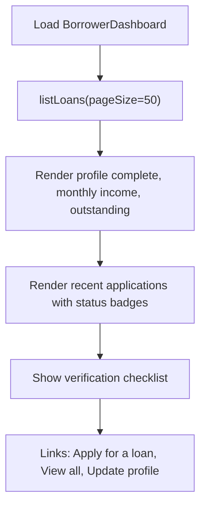

**Diagram sources**
- [BorrowerDashboard.tsx:12-43](file://frontend/src/pages/borrower/BorrowerDashboard.tsx#L12-L43)
- [BorrowerDashboard.tsx:44-133](file://frontend/src/pages/borrower/BorrowerDashboard.tsx#L44-L133)
- [loans.ts:153-165](file://frontend/src/lib/loans.ts#L153-L165)

**Section sources**
- [BorrowerDashboard.tsx:12-43](file://frontend/src/pages/borrower/BorrowerDashboard.tsx#L12-L43)
- [BorrowerDashboard.tsx:44-133](file://frontend/src/pages/borrower/BorrowerDashboard.tsx#L44-L133)
- [loans.ts:153-165](file://frontend/src/lib/loans.ts#L153-L165)

### Lender Review Queue and Decision Flow
- Applications are queued by default in pending state for lender review.
- Lenders can verify identity, decide approve/reject, and disburse funds.
- Frontend provides helper functions for listing lenders, applying, verifying, deciding, and disbursing.

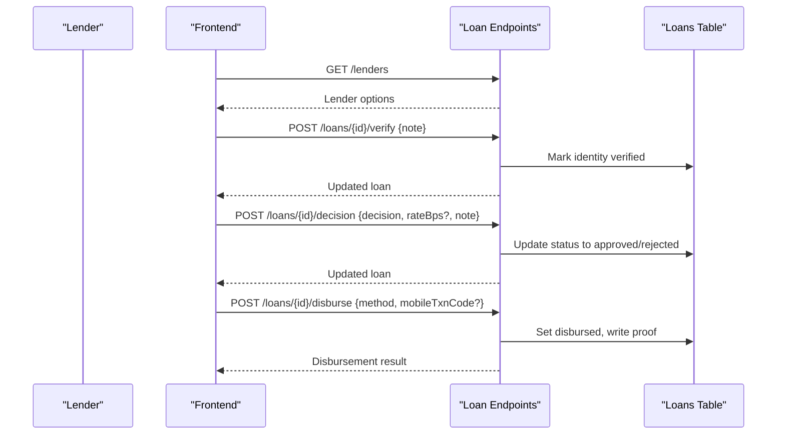

**Diagram sources**
- [loans.ts:148-208](file://frontend/src/lib/loans.ts#L148-L208)
- [002_loans.sql:25-56](file://backend/src/db/migrations/002_loans.sql#L25-L56)

**Section sources**
- [loans.ts:148-208](file://frontend/src/lib/loans.ts#L148-L208)
- [002_loans.sql:25-56](file://backend/src/db/migrations/002_loans.sql#L25-L56)

## Dependency Analysis
- Frontend components depend on typed API helpers for loan operations and route definitions for navigation.
- Backend user routes depend on crypto utilities for encryption and blind indexing, and on the fraud rules engine for identity conflict detection.
- Database schema defines constraints and indexes that support efficient querying by lender, borrower, and status.

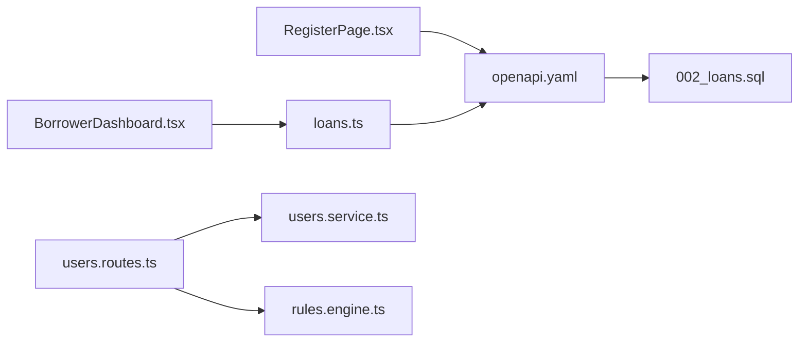

**Diagram sources**
- [RegisterPage.tsx:1-165](file://frontend/src/pages/auth/RegisterPage.tsx#L1-L165)
- [BorrowerDashboard.tsx:1-133](file://frontend/src/pages/borrower/BorrowerDashboard.tsx#L1-L133)
- [loans.ts:1-242](file://frontend/src/lib/loans.ts#L1-L242)
- [openapi.yaml:1-286](file://backend/openapi.yaml#L1-L286)
- [users.routes.ts:1-108](file://backend/src/modules/users/users.routes.ts#L1-L108)
- [users.service.ts:1-60](file://backend/src/modules/users/users.service.ts#L1-L60)
- [rules.engine.ts:78-274](file://backend/src/modules/fraud/rules.engine.ts#L78-L274)
- [002_loans.sql:1-100](file://backend/src/db/migrations/002_loans.sql#L1-L100)

**Section sources**
- [users.routes.ts:1-108](file://backend/src/modules/users/users.routes.ts#L1-L108)
- [loans.ts:1-242](file://frontend/src/lib/loans.ts#L1-L242)
- [002_loans.sql:1-100](file://backend/src/db/migrations/002_loans.sql#L1-L100)

## Performance Considerations
- Use indexed queries for lender and borrower lookups; the schema includes indexes on lender_id+status and borrower_id+created_at.
- Avoid decrypting sensitive fields in hot paths; rely on masked summaries and blind indexes for duplicate checks.
- Keep fraud rule evaluations lightweight and deduplicated using stable keys to prevent redundant alerts.
- Paginate loan listings to reduce payload size on the borrower dashboard.

[No sources needed since this section provides general guidance]

## Troubleshooting Guide
- Registration errors: Ensure passwords match and meet complexity requirements; check field-level error mapping.
- Profile update failures: Validate input lengths and formats; ensure at least one field is supplied; check for forbidden roles.
- Identity conflicts: If duplicate national ID or phone is detected, flags will be raised; resolve conflicts before approval.
- Application submission: Verify required fields (principal, term, frequency, purpose); ensure lender selection is valid.
- Status stuck in pending: Confirm lender has reviewed and made a decision; check for fraud holds that require resolution.

**Section sources**
- [RegisterPage.tsx:25-51](file://frontend/src/pages/auth/RegisterPage.tsx#L25-L51)
- [users.routes.ts:45-108](file://backend/src/modules/users/users.routes.ts#L45-L108)
- [rules.engine.ts:94-112](file://backend/src/modules/fraud/rules.engine.ts#L94-L112)
- [loans.ts:167-182](file://frontend/src/lib/loans.ts#L167-L182)

## Conclusion
The loan application workflow integrates secure borrower registration, encrypted profile management, robust validation, and proactive fraud checks. Applications enter a pending queue for lender review, with clear status transitions and comprehensive auditability. The borrower dashboard provides transparency into verification completeness and application status, while the backend enforces data integrity and security through encryption, blind indexes, and constrained database schemas.

[No sources needed since this section summarizes without analyzing specific files]