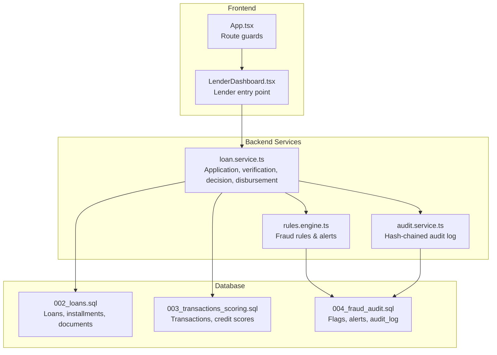
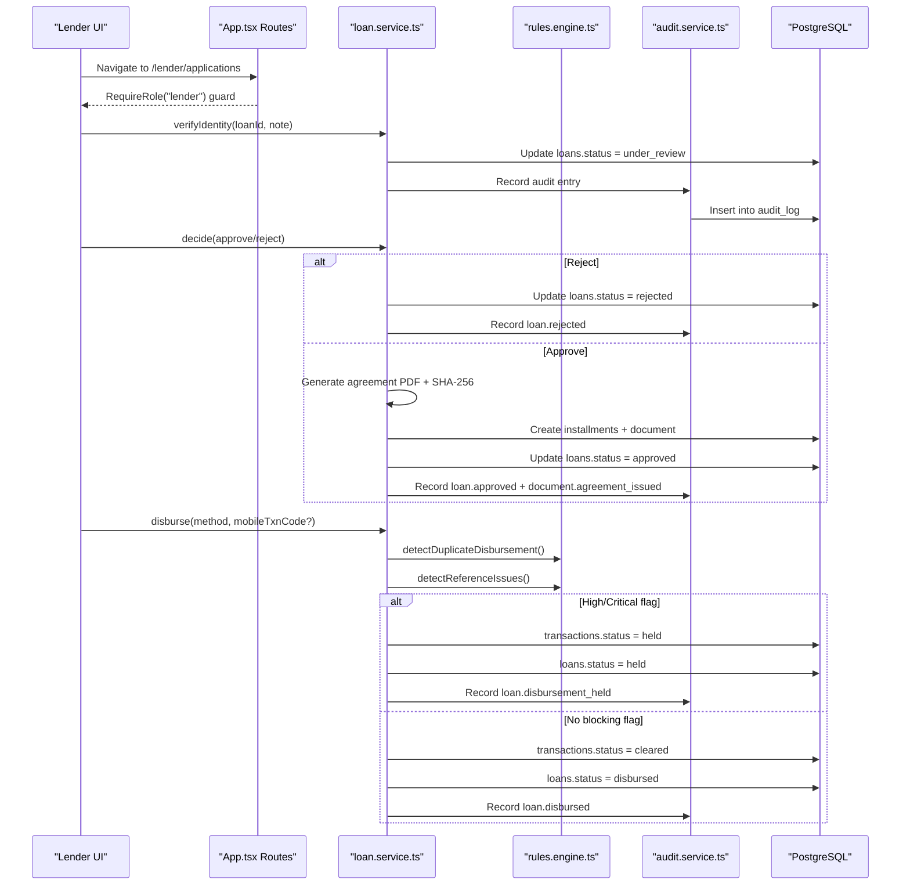
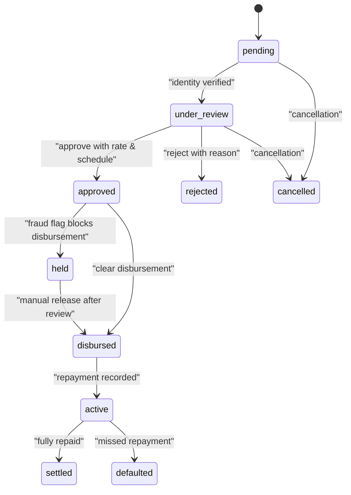
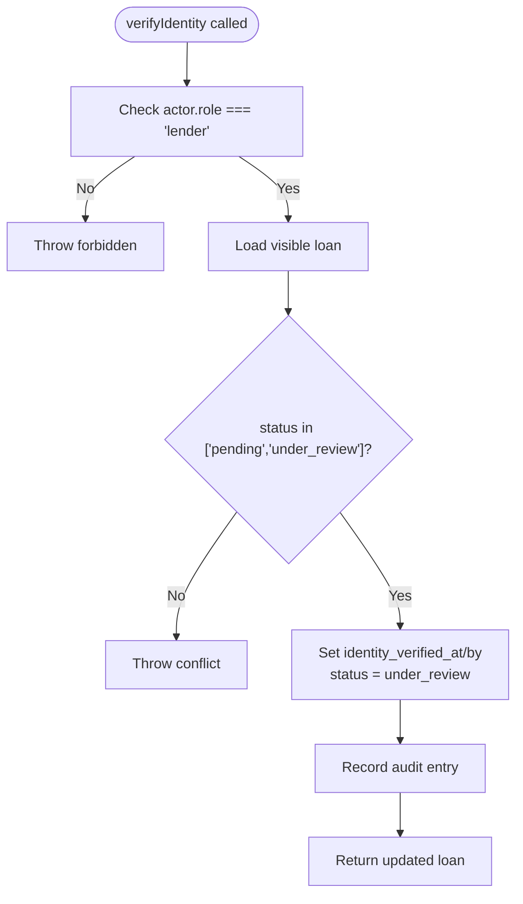
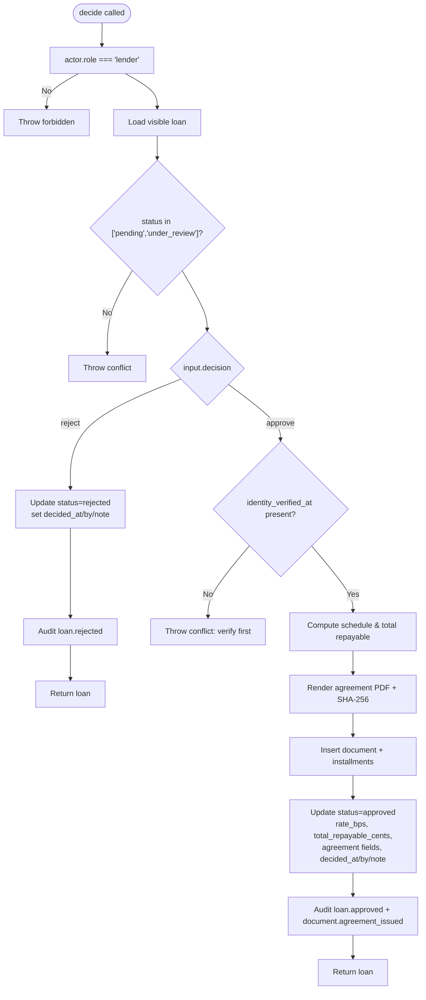
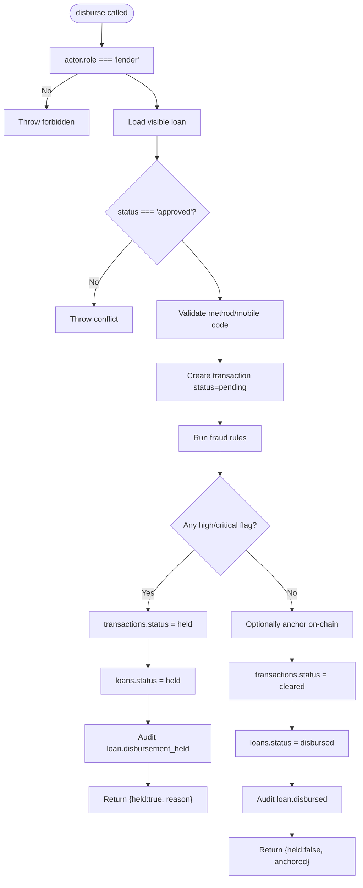
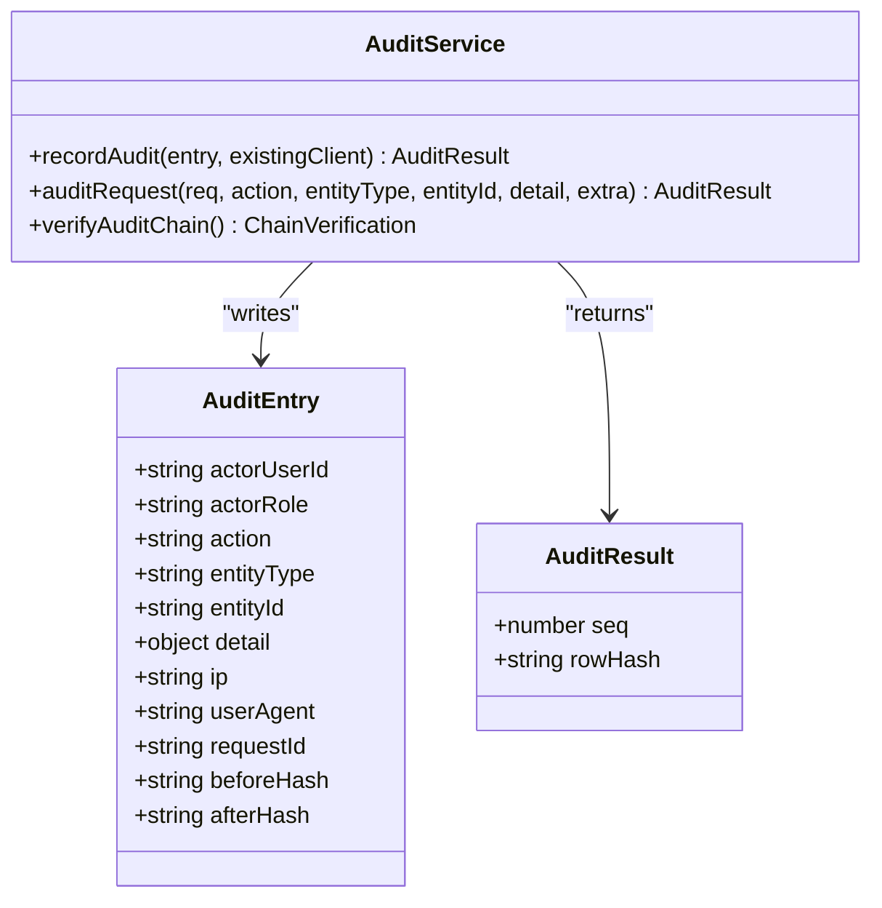
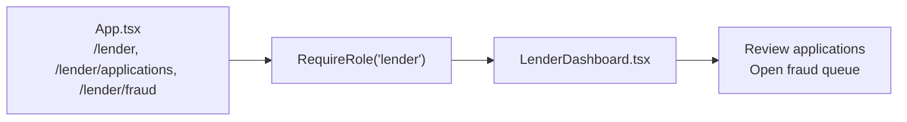
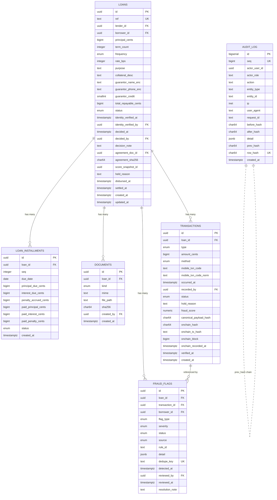
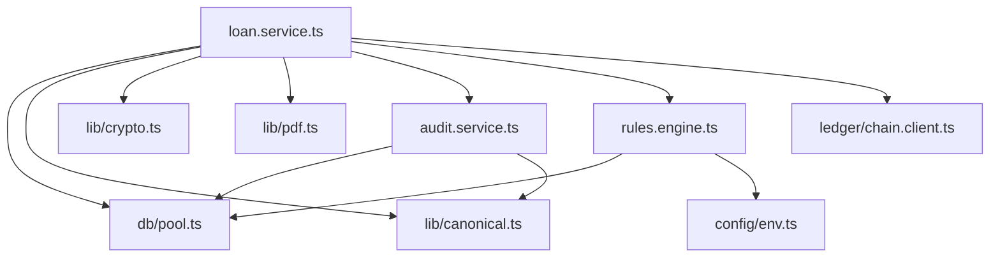

# Loan Approval Process

<cite>
**Referenced Files in This Document**   
- [loan.service.ts](file://backend/src/modules/loans/loan.service.ts)
- [loan.schemas.ts](file://backend/src/modules/loans/loan.schemas.ts)
- [002_loans.sql](file://backend/src/db/migrations/002_loans.sql)
- [003_transactions_scoring.sql](file://backend/src/db/migrations/003_transactions_scoring.sql)
- [004_fraud_audit.sql](file://backend/src/db/migrations/004_fraud_audit.sql)
- [rules.engine.ts](file://backend/src/modules/fraud/rules.engine.ts)
- [audit.service.ts](file://backend/src/modules/audit/audit.service.ts)
- [LenderDashboard.tsx](file://frontend/src/pages/lender/LenderDashboard.tsx)
- [App.tsx](file://frontend/src/App.tsx)
</cite>

## Table of Contents
1. [Introduction](#introduction)
2. [Project Structure](#project-structure)
3. [Core Components](#core-components)
4. [Architecture Overview](#architecture-overview)
5. [Detailed Component Analysis](#detailed-component-analysis)
6. [Dependency Analysis](#dependency-analysis)
7. [Performance Considerations](#performance-considerations)
8. [Troubleshooting Guide](#troubleshooting-guide)
9. [Conclusion](#conclusion)

## Introduction
This document explains the loan approval and decision-making process for lenders, including identity verification, status transitions from `under_review` to `approved` or `rejected`, fraud integration through the `held` status, decision recording, and audit trail requirements. It also describes the lender dashboard’s role-based access controls and how pending applications are surfaced for review.

The system is designed so that:
- A borrower submits a loan application.
- The lender reviews it, verifies identity, and makes an approval or rejection decision.
- Fraud rules can block disbursement by placing the loan in `held`.
- Every important action is recorded in an append-only, hash-chained audit log.
- Frontend routes enforce role-based access for lender-specific pages.

## Project Structure
The loan approval workflow spans backend services, database migrations, fraud detection, audit logging, and frontend routing/dashboard components.

**Diagram sources**
- [App.tsx:102-135](file://frontend/src/App.tsx#L102-L135)
- [LenderDashboard.tsx:1-70](file://frontend/src/pages/lender/LenderDashboard.tsx#L1-L70)
- [loan.service.ts:22-31](file://backend/src/modules/loans/loan.service.ts#L22-L31)
- [rules.engine.ts:1-32](file://backend/src/modules/fraud/rules.engine.ts#L1-L32)
- [audit.service.ts:7-14](file://backend/src/modules/audit/audit.service.ts#L7-L14)
- [002_loans.sql:5-16](file://backend/src/db/migrations/002_loans.sql#L5-L16)
- [003_transactions_scoring.sql:1-10](file://backend/src/db/migrations/003_transactions_scoring.sql#L1-L10)
- [004_fraud_audit.sql:1-20](file://backend/src/db/migrations/004_fraud_audit.sql#L1-L20)

**Section sources**
- [App.tsx:102-135](file://frontend/src/App.tsx#L102-L135)
- [LenderDashboard.tsx:1-70](file://frontend/src/pages/lender/LenderDashboard.tsx#L1-L70)
- [loan.service.ts:22-31](file://backend/src/modules/loans/loan.service.ts#L22-L31)

## Core Components
The loan approval process is implemented primarily in the loan service, with supporting schemas, database models, fraud rules, and audit logging.

Key responsibilities:
- **Loan service**: Application creation, identity verification, decision making, agreement generation, disbursement, and fraud-integrated holds.
- **Schemas**: Input validation for applications, decisions, disbursements, and list filters.
- **Database migrations**: Loan lifecycle states, transaction states, fraud flags, alerts, and audit log structure.
- **Fraud rules engine**: Deterministic checks that raise flags and alert lenders.
- **Audit service**: Append-only, hash-chained audit entries capturing actor, IP, request context, and before/after hashes.

**Section sources**
- [loan.service.ts:284-351](file://backend/src/modules/loans/loan.service.ts#L284-L351)
- [loan.schemas.ts:11-47](file://backend/src/modules/loans/loan.schemas.ts#L11-L47)
- [002_loans.sql:5-56](file://backend/src/db/migrations/002_loans.sql#L5-L56)
- [003_transactions_scoring.sql:11-35](file://backend/src/db/migrations/003_transactions_scoring.sql#L11-L35)
- [004_fraud_audit.sql:21-54](file://backend/src/db/migrations/004_fraud_audit.sql#L21-L54)
- [rules.engine.ts:54-92](file://backend/src/modules/fraud/rules.engine.ts#L54-L92)
- [audit.service.ts:37-94](file://backend/src/modules/audit/audit.service.ts#L37-L94)

## Architecture Overview
The loan approval architecture connects frontend lender interfaces to backend business logic, fraud detection, and immutable audit storage.

**Diagram sources**
- [App.tsx:102-135](file://frontend/src/App.tsx#L102-L135)
- [loan.service.ts:470-492](file://backend/src/modules/loans/loan.service.ts#L470-L492)
- [loan.service.ts:547-641](file://backend/src/modules/loans/loan.service.ts#L547-L641)
- [loan.service.ts:650-763](file://backend/src/modules/loans/loan.service.ts#L650-L763)
- [rules.engine.ts:216-274](file://backend/src/modules/fraud/rules.engine.ts#L216-L274)
- [audit.service.ts:97-118](file://backend/src/modules/audit/audit.service.ts#L97-L118)

## Detailed Component Analysis

### Loan Lifecycle and Status Transitions
The loan lifecycle defines the allowed states and their meaning:
- `pending`: Borrower applied; awaiting lender review.
- `under_review`: Lender opened it or identity verification is in progress.
- `approved`: Lender approved; agreement generated; not yet disbursed.
- `rejected`: Decision made without approval.
- `held`: Fraud gate blocks approval or disbursement.
- `disbursed`: Money released; on-chain proof written.
- `active`, `settled`, `defaulted`, `cancelled`: Post-disbursement lifecycle states.

**Diagram sources**
- [002_loans.sql:5-16](file://backend/src/db/migrations/002_loans.sql#L5-L16)
- [loan.service.ts:22-31](file://backend/src/modules/loans/loan.service.ts#L22-L31)

**Section sources**
- [002_loans.sql:5-16](file://backend/src/db/migrations/002_loans.sql#L5-L16)
- [loan.service.ts:22-31](file://backend/src/modules/loans/loan.service.ts#L22-L31)

### Identity Verification
Only lenders can verify identity. When a lender verifies identity:
- The loan must be in `pending` or `under_review`.
- The system updates `identity_verified_at`, `identity_verified_by`, and sets status to `under_review`.
- An audit entry records the action with actor, IP, user agent, and request ID.

**Diagram sources**
- [loan.service.ts:470-492](file://backend/src/modules/loans/loan.service.ts#L470-L492)
- [audit.service.ts:97-118](file://backend/src/modules/audit/audit.service.ts#L97-L118)

**Section sources**
- [loan.service.ts:470-492](file://backend/src/modules/loans/loan.service.ts#L470-L492)

### Decision-Making: Approve or Reject
Decisions are restricted to lenders and only allowed when the loan is in `pending` or `under_review`.

- **Reject**: Sets status to `rejected`, records `decided_at`, `decided_by`, and optional `decision_note`. Audits `loan.rejected`.
- **Approve**: Requires prior identity verification. Generates a deterministic agreement PDF, computes its SHA-256, stores the document, creates installments, updates rate and total repayable, sets status to `approved`, and audits both the loan approval and document issuance.

**Diagram sources**
- [loan.service.ts:547-641](file://backend/src/modules/loans/loan.service.ts#L547-L641)
- [loan.schemas.ts:29-40](file://backend/src/modules/loans/loan.schemas.ts#L29-L40)

**Section sources**
- [loan.service.ts:547-641](file://backend/src/modules/loans/loan.service.ts#L547-L641)
- [loan.schemas.ts:29-40](file://backend/src/modules/loans/loan.schemas.ts#L29-L40)

### Disbursement and Fraud Integration via `held`
Disbursement is lender-only and requires the loan to be `approved`. The flow:
1. Validate method and mobile-money reference if applicable.
2. Create a transaction record with initial status `pending`.
3. Run fraud rules: duplicate disbursement and reference checks.
4. If any high/critical severity flags exist:
   - Set transaction status to `held`.
   - Set loan status to `held`.
   - Record `loan.disbursement_held` in the audit log.
5. Otherwise:
   - Optionally anchor the canonical payload hash on-chain.
   - Set transaction status to `cleared`.
   - Set loan status to `disbursed`.
   - Record `loan.disbursed` in the audit log.

**Diagram sources**
- [loan.service.ts:650-763](file://backend/src/modules/loans/loan.service.ts#L650-L763)
- [rules.engine.ts:216-274](file://backend/src/modules/fraud/rules.engine.ts#L216-L274)
- [003_transactions_scoring.sql:11-35](file://backend/src/db/migrations/003_transactions_scoring.sql#L11-L35)

**Section sources**
- [loan.service.ts:650-763](file://backend/src/modules/loans/loan.service.ts#L650-L763)
- [rules.engine.ts:216-274](file://backend/src/modules/fraud/rules.engine.ts#L216-L274)
- [003_transactions_scoring.sql:11-35](file://backend/src/db/migrations/003_transactions_scoring.sql#L11-L35)

### Audit Trail Requirements
The audit system provides an append-only, hash-chained log:
- Each entry includes actor user ID, actor role, action, entity type, entity ID, detail, IP, user agent, request ID, before/after hashes, previous row hash, and computed row hash.
- Advisory locks serialize concurrent writers to prevent chain forks.
- Database triggers block updates, deletes, and truncates on the audit log.
- Chain verification recomputes every row hash and validates previous links.

**Diagram sources**
- [audit.service.ts:15-32](file://backend/src/modules/audit/audit.service.ts#L15-L32)
- [audit.service.ts:37-94](file://backend/src/modules/audit/audit.service.ts#L37-L94)
- [audit.service.ts:142-190](file://backend/src/modules/audit/audit.service.ts#L142-L190)
- [004_fraud_audit.sql:67-111](file://backend/src/db/migrations/004_fraud_audit.sql#L67-L111)

**Section sources**
- [audit.service.ts:37-94](file://backend/src/modules/audit/audit.service.ts#L37-L94)
- [audit.service.ts:142-190](file://backend/src/modules/audit/audit.service.ts#L142-L190)
- [004_fraud_audit.sql:67-111](file://backend/src/db/migrations/004_fraud_audit.sql#L67-L111)

### Lender Dashboard and Role-Based Access Controls
The frontend enforces role-based access for lender routes:
- `/lender` renders the lender dashboard.
- `/lender/applications` is protected by `RequireRole("lender")`.
- `/lender/fraud` is protected by `RequireRole("lender")`.

The lender dashboard displays:
- Business name or greeting.
- Default default rate and maximum principal.
- Open fraud flags count (placeholder).
- Links to review applications and fraud queue.
- Notes about platform capabilities: advisory credit score, digital agreement with SHA-256, on-chain disbursement/repayment proofs, and fraud queue holding suspicious payments.

**Diagram sources**
- [App.tsx:102-135](file://frontend/src/App.tsx#L102-L135)
- [LenderDashboard.tsx:1-70](file://frontend/src/pages/lender/LenderDashboard.tsx#L1-L70)

**Section sources**
- [App.tsx:102-135](file://frontend/src/App.tsx#L102-L135)
- [LenderDashboard.tsx:1-70](file://frontend/src/pages/lender/LenderDashboard.tsx#L1-L70)

### Data Models and Relationships
The core data model for loans, transactions, fraud flags, and audit logs supports the approval workflow.

**Diagram sources**
- [002_loans.sql:25-100](file://backend/src/db/migrations/002_loans.sql#L25-L100)
- [003_transactions_scoring.sql:11-53](file://backend/src/db/migrations/003_transactions_scoring.sql#L11-L53)
- [004_fraud_audit.sql:21-136](file://backend/src/db/migrations/004_fraud_audit.sql#L21-L136)

**Section sources**
- [002_loans.sql:25-100](file://backend/src/db/migrations/002_loans.sql#L25-L100)
- [003_transactions_scoring.sql:11-53](file://backend/src/db/migrations/003_transactions_scoring.sql#L11-L53)
- [004_fraud_audit.sql:21-136](file://backend/src/db/migrations/004_fraud_audit.sql#L21-L136)

## Dependency Analysis
The loan approval process depends on several modules:
- **Loan service** depends on:
  - Database pool utilities for queries and transactions.
  - Canonical hashing for transaction payloads.
  - Crypto utilities for encryption and hashing.
  - PDF rendering for agreements.
  - Audit service for immutable logging.
  - Fraud rules engine for risk checks.
  - Ledger client for on-chain anchoring.
- **Fraud rules engine** depends on:
  - Database pool for querying loans and transactions.
  - Configuration for thresholds.
- **Audit service** depends on:
  - Database pool for insertions and verification.
  - Canonical hashing for row hashes.
  - Request context for IP/user agent/request ID.

**Diagram sources**
- [loan.service.ts:1-20](file://backend/src/modules/loans/loan.service.ts#L1-L20)
- [rules.engine.ts:1-3](file://backend/src/modules/fraud/rules.engine.ts#L1-L3)
- [audit.service.ts:1-5](file://backend/src/modules/audit/audit.service.ts#L1-L5)

**Section sources**
- [loan.service.ts:1-20](file://backend/src/modules/loans/loan.service.ts#L1-L20)
- [rules.engine.ts:1-3](file://backend/src/modules/fraud/rules.engine.ts#L1-L3)
- [audit.service.ts:1-5](file://backend/src/modules/audit/audit.service.ts#L1-L5)

## Performance Considerations
- **Indexes**: The schema includes indexes on lender/status, borrower/created_at, status, transactions/loan_id, transactions/mobile_txn_code_norm, fraud_flags/status/severity/detected_at, fraud_flags/loan_id, and audit_log/entity_type/entity_id/seq. These support efficient listing, filtering, and audit queries.
- **Advisory locks**: The audit service uses an advisory lock to serialize concurrent writes, preventing chain forks and ensuring consistent ordering.
- **Append-only audit log**: Triggers block mutations, reducing risk of silent edits and simplifying integrity checks.
- **Transaction scoping**: Critical operations like agreement persistence and loan updates are wrapped in transactions to maintain consistency.
- **Pagination**: Loan listing supports pagination to handle large portfolios efficiently.

[No sources needed since this section provides general guidance]

## Troubleshooting Guide
Common issues and diagnostics:
- **Cannot verify identity**: Ensure the loan is in `pending` or `under_review` and the actor is a lender.
- **Cannot approve without identity verification**: Complete identity verification before approving.
- **Decision already made**: Loans cannot be re-decided once they leave `pending` or `under_review`.
- **Disbursement blocked**: Check fraud flags for high/critical severity; review the `held_reason` and resolve the flagged issue before clearing.
- **Audit chain mismatch**: Use the audit chain verification function to detect tampering or broken links.

**Section sources**
- [loan.service.ts:470-492](file://backend/src/modules/loans/loan.service.ts#L470-L492)
- [loan.service.ts:547-641](file://backend/src/modules/loans/loan.service.ts#L547-L641)
- [loan.service.ts:650-763](file://backend/src/modules/loans/loan.service.ts#L650-L763)
- [audit.service.ts:142-190](file://backend/src/modules/audit/audit.service.ts#L142-L190)

## Conclusion
The loan approval process is a controlled, auditable workflow:
- Applications start as `pending`.
- Lenders verify identity and move loans to `under_review`.
- Decisions transition loans to `approved` or `rejected`.
- Disbursement integrates fraud detection; high/critical flags place loans in `held`.
- Every significant action is recorded in an immutable, hash-chained audit log.
- Frontend routes enforce role-based access for lender dashboards and queues.

This design ensures transparency, security, and accountability across the lending lifecycle.

[No sources needed since this section summarizes without analyzing specific files]