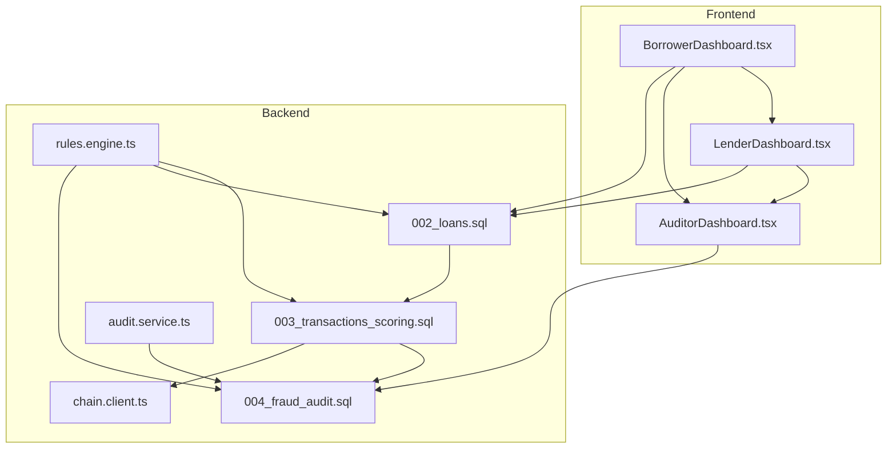
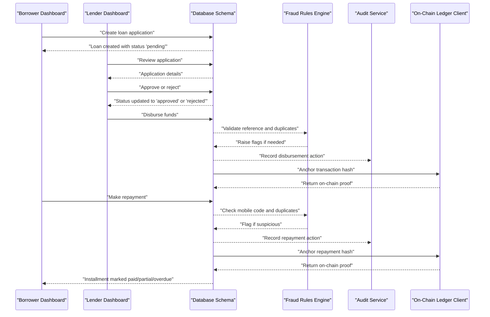
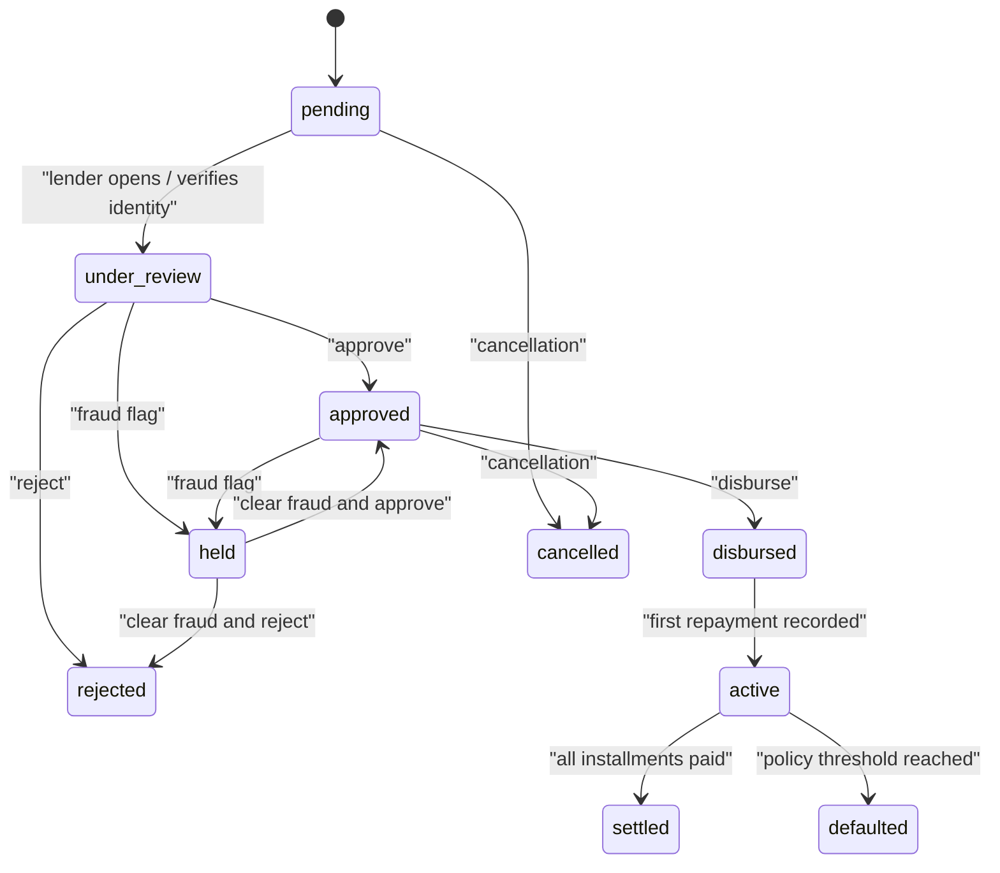
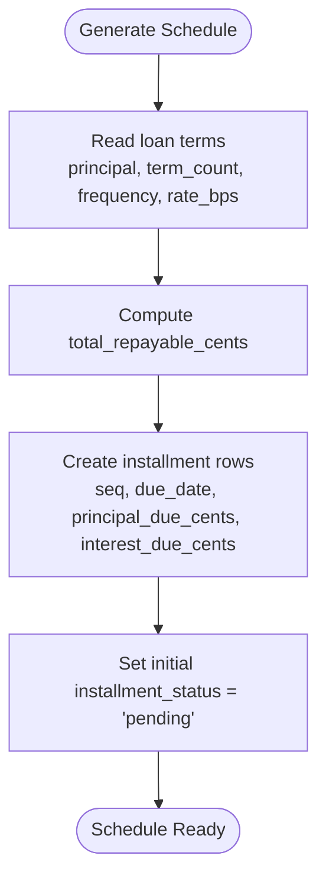
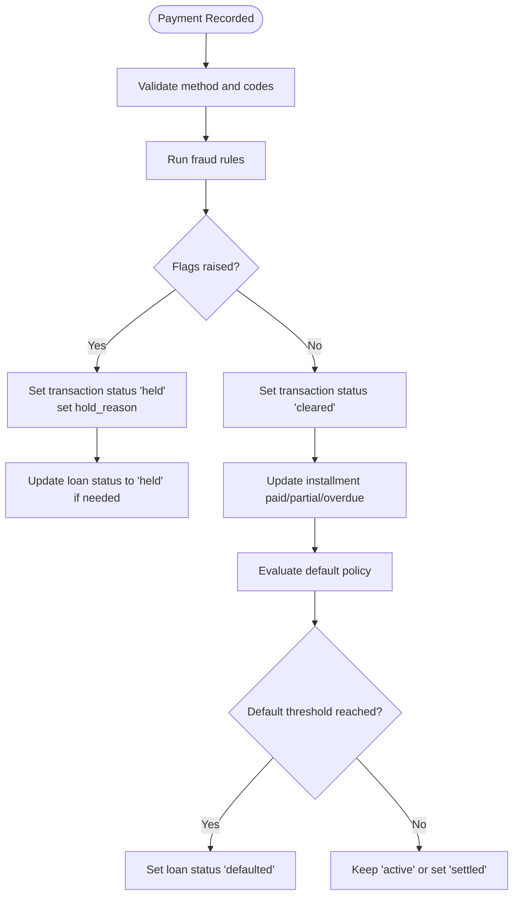
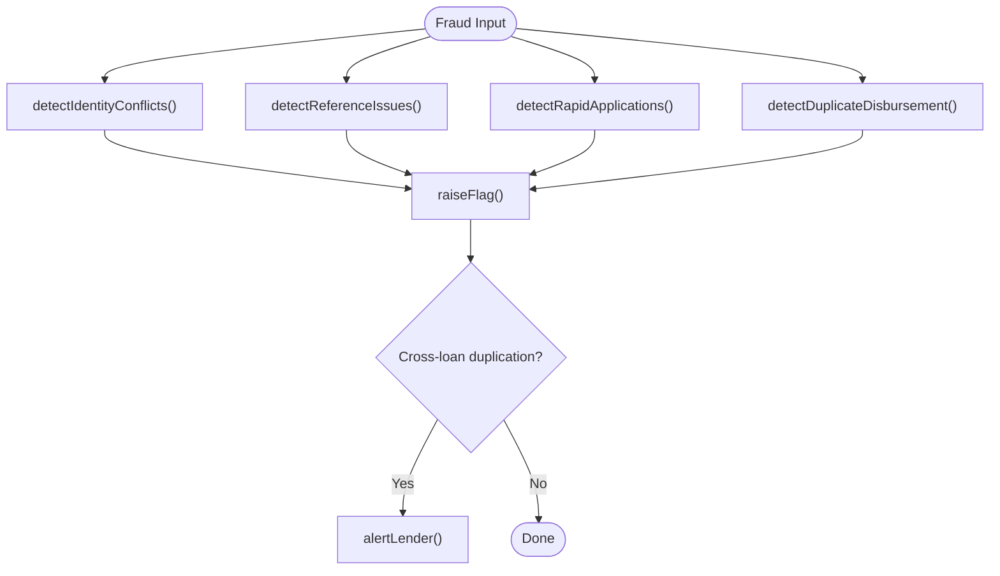
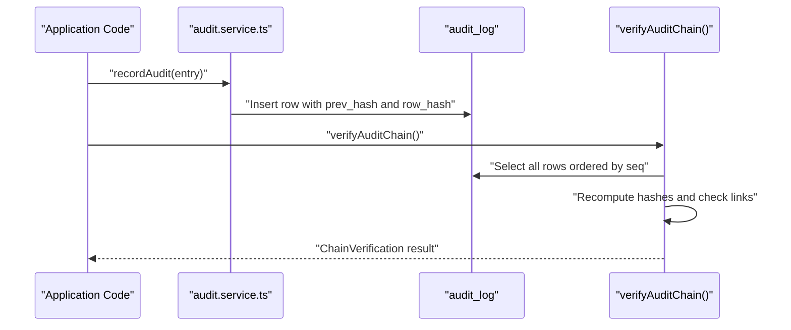
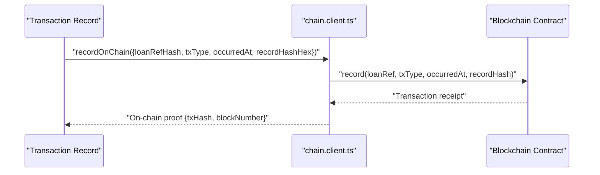
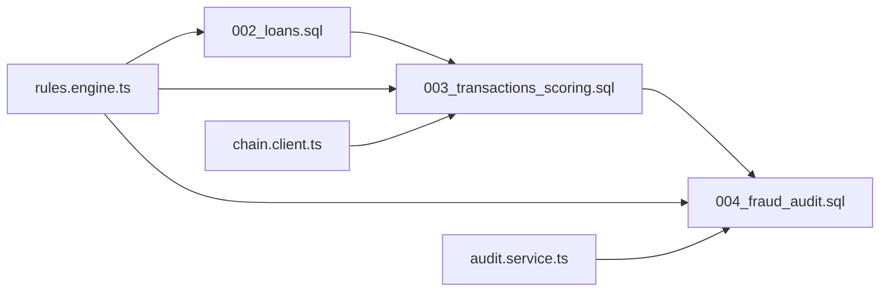

# Loan Management

<cite>
**Referenced Files in This Document**
- [002_loans.sql](file://backend/src/db/migrations/002_loans.sql)
- [003_transactions_scoring.sql](file://backend/src/db/migrations/003_transactions_scoring.sql)
- [004_fraud_audit.sql](file://backend/src/db/migrations/004_fraud_audit.sql)
- [rules.engine.ts](file://backend/src/modules/fraud/rules.engine.ts)
- [audit.service.ts](file://backend/src/modules/audit/audit.service.ts)
- [chain.client.ts](file://backend/src/modules/ledger/chain.client.ts)
- [BorrowerDashboard.tsx](file://frontend/src/pages/borrower/BorrowerDashboard.tsx)
- [LenderDashboard.tsx](file://frontend/src/pages/lender/LenderDashboard.tsx)
- [AuditorDashboard.tsx](file://frontend/src/pages/auditor/AuditorDashboard.tsx)
</cite>

## Table of Contents
1. [Introduction](#introduction)
2. [Project Structure](#project-structure)
3. [Core Components](#core-components)
4. [Architecture Overview](#architecture-overview)
5. [Detailed Component Analysis](#detailed-component-analysis)
6. [Dependency Analysis](#dependency-analysis)
7. [Performance Considerations](#performance-considerations)
8. [Troubleshooting Guide](#troubleshooting-guide)
9. [Conclusion](#conclusion)

## Introduction
This document explains the loan management system as implemented in the repository. It covers the complete loan lifecycle from application submission through approval, disbursement, repayment tracking, and closure. It documents the loan data model, status transitions, business rules, schedule generation concepts, payment tracking, default handling, fraud detection integration, audit trail integrity, and the user interfaces for borrowers, lenders, and auditors.

The system is designed around:
- A relational database schema that models loans, installments, transactions, credit scores, fraud flags, alerts, and an append-only hash-chained audit log.
- A rule-based fraud engine that inspects identity, payment references, application frequency, and duplicate disbursements.
- An on-chain ledger client that anchors transaction hashes to a blockchain contract for tamper-evident receipts.
- Role-based dashboards that expose platform guarantees and operational controls.

## Project Structure
The loan-related functionality spans backend migrations, fraud and audit modules, a ledger integration client, and frontend dashboards:

**Diagram sources**
- [002_loans.sql:5-19](file://backend/src/db/migrations/002_loans.sql#L5-L19)
- [003_transactions_scoring.sql:5-10](file://backend/src/db/migrations/003_transactions_scoring.sql#L5-L10)
- [004_fraud_audit.sql:5-18](file://backend/src/db/migrations/004_fraud_audit.sql#L5-L18)
- [rules.engine.ts:1-18](file://backend/src/modules/fraud/rules.engine.ts#L1-L18)
- [audit.service.ts:7-14](file://backend/src/modules/audit/audit.service.ts#L7-L14)
- [chain.client.ts:71-94](file://backend/src/modules/ledger/chain.client.ts#L71-L94)
- [BorrowerDashboard.tsx:6-10](file://frontend/src/pages/borrower/BorrowerDashboard.tsx#L6-L10)
- [LenderDashboard.tsx:6-16](file://frontend/src/pages/lender/LenderDashboard.tsx#L6-L16)
- [AuditorDashboard.tsx:13-17](file://frontend/src/pages/auditor/AuditorDashboard.tsx#L13-L17)

**Section sources**
- [002_loans.sql:5-19](file://backend/src/db/migrations/002_loans.sql#L5-L19)
- [003_transactions_scoring.sql:5-10](file://backend/src/db/migrations/003_transactions_scoring.sql#L5-L10)
- [004_fraud_audit.sql:5-18](file://backend/src/db/migrations/004_fraud_audit.sql#L5-L18)
- [rules.engine.ts:1-18](file://backend/src/modules/fraud/rules.engine.ts#L1-L18)
- [audit.service.ts:7-14](file://backend/src/modules/audit/audit.service.ts#L7-L14)
- [chain.client.ts:71-94](file://backend/src/modules/ledger/chain.client.ts#L71-L94)
- [BorrowerDashboard.tsx:6-10](file://frontend/src/pages/borrower/BorrowerDashboard.tsx#L6-L10)
- [LenderDashboard.tsx:6-16](file://frontend/src/pages/lender/LenderDashboard.tsx#L6-L16)
- [AuditorDashboard.tsx:13-17](file://frontend/src/pages/auditor/AuditorDashboard.tsx#L13-L17)

## Core Components
The loan management system is built around these core components:

- Loan data model and lifecycle states:
  - The `loans` table defines principal, term, frequency, rate, purpose, collateral, guarantor fields, total repayable amount, timestamps, decision metadata, agreement linkage, and status.
  - Statuses include pending, under_review, approved, rejected, held, disbursed, active, settled, defaulted, and cancelled.
  - Installments are modeled separately with due dates, principal and interest due, penalties, paid amounts, and installment-level status.

- Transactions and scoring:
  - Transactions record disbursements and repayments, including method, mobile receipt code, occurrence time, recorded by user, status, hold reason, fraud score, canonical payload hash, and on-chain anchoring fields.
  - Credit scores are advisory records per loan, including model version, source, score, risk level, features, explanation, and latency.

- Fraud detection:
  - Rule-based checks detect malformed or duplicated payment references, identity conflicts via blind indexes, rapid applications within a configured window, and duplicate disbursement attempts.
  - Flags are deduplicated by natural keys and can alert lenders when severity warrants it.

- Audit trail:
  - An append-only audit log stores actor, action, entity, IP, user agent, request ID, before/after hashes, detail JSON, previous row hash, and computed row hash.
  - Database triggers block updates, deletes, and truncation; chain verification recomputes hashes and detects broken links.

- On-chain ledger:
  - The ledger client writes hashes of disbursements and repayments to a blockchain contract and reads back verification results.

- Dashboards:
  - Borrower dashboard shows profile completeness, income hints, security guarantees, and a link to apply.
  - Lender dashboard shows default rate, maximum principal, open fraud flags, and controls such as rate setting and fraud queue access.
  - Auditor dashboard exposes health, ledger mode, audit chain description, and investigation entry points.

**Section sources**
- [002_loans.sql:5-80](file://backend/src/db/migrations/002_loans.sql#L5-L80)
- [003_transactions_scoring.sql:5-55](file://backend/src/db/migrations/003_transactions_scoring.sql#L5-L55)
- [004_fraud_audit.sql:5-136](file://backend/src/db/migrations/004_fraud_audit.sql#L5-L136)
- [rules.engine.ts:4-18](file://backend/src/modules/fraud/rules.engine.ts#L4-L18)
- [audit.service.ts:7-32](file://backend/src/modules/audit/audit.service.ts#L7-L32)
- [chain.client.ts:71-94](file://backend/src/modules/ledger/chain.client.ts#L71-L94)
- [BorrowerDashboard.tsx:6-10](file://frontend/src/pages/borrower/BorrowerDashboard.tsx#L6-L10)
- [LenderDashboard.tsx:6-16](file://frontend/src/pages/lender/LenderDashboard.tsx#L6-L16)
- [AuditorDashboard.tsx:13-17](file://frontend/src/pages/auditor/AuditorDashboard.tsx#L13-L17)

## Architecture Overview
The loan lifecycle integrates database state, fraud rules, audit logging, and on-chain anchoring. The following diagram maps the main flows:

**Diagram sources**
- [002_loans.sql:5-19](file://backend/src/db/migrations/002_loans.sql#L5-L19)
- [003_transactions_scoring.sql:5-35](file://backend/src/db/migrations/003_transactions_scoring.sql#L5-L35)
- [004_fraud_audit.sql:21-38](file://backend/src/db/migrations/004_fraud_audit.sql#L21-L38)
- [rules.engine.ts:148-214](file://backend/src/modules/fraud/rules.engine.ts#L148-L214)
- [audit.service.ts:37-94](file://backend/src/modules/audit/audit.service.ts#L37-L94)
- [chain.client.ts:71-94](file://backend/src/modules/ledger/chain.client.ts#L71-L94)
- [BorrowerDashboard.tsx:23-33](file://frontend/src/pages/borrower/BorrowerDashboard.tsx#L23-L33)
- [LenderDashboard.tsx:11-21](file://frontend/src/pages/lender/LenderDashboard.tsx#L11-L21)

## Detailed Component Analysis

### Loan Data Model and Lifecycle
The loan data model centers on two primary tables:

- `loans`:
  - Identifiers: `id`, `ref`.
  - Parties: `lender_id`, `borrower_id`.
  - Financials: `principal_cents`, `term_count`, `frequency`, `rate_bps`, `total_repayable_cents`.
  - Purpose and collateral: `purpose`, `collateral_desc`.
  - Guarantor PII: encrypted fields plus optional credit score.
  - Decision metadata: `identity_verified_at/by`, `decided_at/by`, `decision_note`, `agreement_doc_id/sha256`, `score_snapshot_id`.
  - State: `status`, `held_reason`, `disbursed_at`, `settled_at`, timestamps.

- `loan_installments`:
  - Per-installment accounting: `seq`, `due_date`, `principal_due_cents`, `interest_due_cents`, `penalty_accrued_cents`, paid amounts, `status`.

Lifecycle statuses:
- `pending`: borrower applied, awaiting lender review.
- `under_review`: lender opened it or identity verification is in progress.
- `approved`: lender approved, agreement generated, not yet disbursed.
- `rejected`: lender declined.
- `held`: fraud gate blocks approval or disbursement.
- `disbursed`: money released and on-chain proof written.
- `active`: at least one repayment recorded, still outstanding.
- `settled`: fully repaid.
- `defaulted`: significant delinquency or policy-driven default.
- `cancelled`: application or process cancelled.

**Diagram sources**
- [002_loans.sql:5-19](file://backend/src/db/migrations/002_loans.sql#L5-L19)

**Section sources**
- [002_loans.sql:25-56](file://backend/src/db/migrations/002_loans.sql#L25-L56)
- [002_loans.sql:66-80](file://backend/src/db/migrations/002_loans.sql#L66-L80)

### Schedule Generation for Repayments
Repayment scheduling is represented by the `loan_installments` table. Each installment tracks:
- Sequence number and due date.
- Principal and interest due.
- Accrued penalty.
- Paid principal, interest, and penalty.
- Installment status: pending, partial, paid, overdue, waived.

Conceptual schedule generation flow:

Operational notes:
- Frequency supports daily, weekly, monthly.
- Penalty accrual is tracked per installment.
- Partial payments update paid amounts without changing the full due immediately.
- Overdue status reflects missed due dates until paid or waived.

**Diagram sources**
- [002_loans.sql:18-19](file://backend/src/db/migrations/002_loans.sql#L18-L19)
- [002_loans.sql:66-80](file://backend/src/db/migrations/002_loans.sql#L66-L80)

**Section sources**
- [002_loans.sql:18-19](file://backend/src/db/migrations/002_loans.sql#L18-L19)
- [002_loans.sql:66-80](file://backend/src/db/migrations/002_loans.sql#L66-L80)

### Payment Tracking and Default Handling
Transactions capture all money movements:
- Type: disbursement or repayment.
- Method: cash, mobile_money, bank.
- Mobile receipt code and normalized code for fraud checks.
- Occurrence timestamp and recorder.
- Status: pending, held, cleared, rejected.
- Hold reason and fraud score.
- Canonical payload hash and on-chain anchoring fields.

Default handling is reflected in loan status transitions:
- Loans move to `defaulted` when policy thresholds are met (e.g., repeated overdue installments).
- Installments can be marked `overdue` or `waived`.

**Diagram sources**
- [003_transactions_scoring.sql:5-35](file://backend/src/db/migrations/003_transactions_scoring.sql#L5-L35)
- [002_loans.sql:5-19](file://backend/src/db/migrations/002_loans.sql#L5-L19)
- [002_loans.sql:66-80](file://backend/src/db/migrations/002_loans.sql#L66-L80)

**Section sources**
- [003_transactions_scoring.sql:5-35](file://backend/src/db/migrations/003_transactions_scoring.sql#L5-L35)
- [002_loans.sql:5-19](file://backend/src/db/migrations/002_loans.sql#L5-L19)
- [002_loans.sql:66-80](file://backend/src/db/migrations/002_loans.sql#L66-L80)

### Fraud Detection Integration
The fraud rules engine implements deterministic, explainable checks:

- Identity conflict detection:
  - Compares blind indexes for national ID and phone number across borrower profiles.
  - Raises critical flags with masked email exposure for investigation.

- Reference validation:
  - Validates mobile-money receipt format and known forged patterns.
  - Detects duplicate usage of the same receipt across transactions or loans.
  - Alerts lenders when cross-loan duplication occurs.

- Rapid applications:
  - Counts recent applications per borrower within a configurable window.
  - Raises medium/high severity flags based on thresholds.

- Duplicate disbursement:
  - Checks for existing disbursement transactions with cleared or held status.
  - Raises critical flags to prevent double payouts.

**Diagram sources**
- [rules.engine.ts:98-143](file://backend/src/modules/fraud/rules.engine.ts#L98-L143)
- [rules.engine.ts:148-214](file://backend/src/modules/fraud/rules.engine.ts#L148-L214)
- [rules.engine.ts:216-248](file://backend/src/modules/fraud/rules.engine.ts#L216-L248)
- [rules.engine.ts:250-274](file://backend/src/modules/fraud/rules.engine.ts#L250-L274)
- [rules.engine.ts:54-92](file://backend/src/modules/fraud/rules.engine.ts#L54-L92)

**Section sources**
- [rules.engine.ts:98-143](file://backend/src/modules/fraud/rules.engine.ts#L98-L143)
- [rules.engine.ts:148-214](file://backend/src/modules/fraud/rules.engine.ts#L148-L214)
- [rules.engine.ts:216-248](file://backend/src/modules/fraud/rules.engine.ts#L216-L248)
- [rules.engine.ts:250-274](file://backend/src/modules/fraud/rules.engine.ts#L250-L274)
- [004_fraud_audit.sql:21-38](file://backend/src/db/migrations/004_fraud_audit.sql#L21-L38)

### Audit Trail and Integrity Verification
The audit service provides an append-only, hash-chained log:
- Records actor user ID and role, action, entity type and ID, IP, user agent, request ID, before/after hashes, detail JSON, previous row hash, and computed row hash.
- Uses an advisory lock to serialize writers and maintain chain order.
- Provides a convenience wrapper to pull context from requests.
- Offers chain verification that recomputes hashes and detects broken links or mismatches.

**Diagram sources**
- [audit.service.ts:37-94](file://backend/src/modules/audit/audit.service.ts#L37-L94)
- [audit.service.ts:142-190](file://backend/src/modules/audit/audit.service.ts#L142-L190)
- [004_fraud_audit.sql:69-111](file://backend/src/db/migrations/004_fraud_audit.sql#L69-L111)

**Section sources**
- [audit.service.ts:7-32](file://backend/src/modules/audit/audit.service.ts#L7-L32)
- [audit.service.ts:37-94](file://backend/src/modules/audit/audit.service.ts#L37-L94)
- [audit.service.ts:142-190](file://backend/src/modules/audit/audit.service.ts#L142-L190)
- [004_fraud_audit.sql:69-111](file://backend/src/db/migrations/004_fraud_audit.sql#L69-L111)

### On-Chain Ledger Integration
The ledger client anchors transaction hashes to a blockchain contract:
- Writes canonical payload hashes for disbursements and repayments.
- Returns on-chain transaction hash and block number.
- Supports reading verification results for a given record hash.

**Diagram sources**
- [chain.client.ts:71-94](file://backend/src/modules/ledger/chain.client.ts#L71-L94)
- [003_transactions_scoring.sql:24-30](file://backend/src/db/migrations/003_transactions_scoring.sql#L24-L30)

**Section sources**
- [chain.client.ts:71-94](file://backend/src/modules/ledger/chain.client.ts#L71-L94)
- [003_transactions_scoring.sql:24-30](file://backend/src/db/migrations/003_transactions_scoring.sql#L24-L30)

### User Interfaces for Loan Management Dashboards

#### Borrower Dashboard
- Shows greeting, profile completeness checklist, monthly income hint, active loans count, and security guarantees.
- Provides a link to apply for a loan and navigate to profile updates.
- Communicates protections: hashed and anchored repayments, encrypted identity fields, automatic fraud flags for duplicate or forged references.

**Section sources**
- [BorrowerDashboard.tsx:6-10](file://frontend/src/pages/borrower/BorrowerDashboard.tsx#L6-L10)
- [BorrowerDashboard.tsx:23-33](file://frontend/src/pages/borrower/BorrowerDashboard.tsx#L23-L33)
- [BorrowerDashboard.tsx:35-39](file://frontend/src/pages/borrower/BorrowerDashboard.tsx#L35-L39)
- [BorrowerDashboard.tsx:41-71](file://frontend/src/pages/borrower/BorrowerDashboard.tsx#L41-L71)

#### Lender Dashboard
- Displays business name, subtitle about reviewing applications and verifying identity, and a link to review applications.
- Shows default rate, maximum principal, and open fraud flags.
- Explains platform capabilities: advisory credit scores, digital agreements with SHA-256 fingerprints, on-chain anchoring, fraud queue holds.
- Exposes controls: interest rate setting per approval, fraud review queue, audit visibility enforcement.

**Section sources**
- [LenderDashboard.tsx:6-16](file://frontend/src/pages/lender/LenderDashboard.tsx#L6-L16)
- [LenderDashboard.tsx:23-27](file://frontend/src/pages/lender/LenderDashboard.tsx#L23-L27)
- [LenderDashboard.tsx:29-65](file://frontend/src/pages/lender/LenderDashboard.tsx#L29-L65)

#### Auditor Dashboard
- Presents forensic overview with read-only badge.
- Shows API status, ledger mode, and audit chain description.
- Lists evidence guarantees: append-only rows, hash chaining, on-chain anchoring, encrypted identity documents.
- Provides investigation entry points: search audit log, rebuild loan timeline, run integrity check.

**Section sources**
- [AuditorDashboard.tsx:13-17](file://frontend/src/pages/auditor/AuditorDashboard.tsx#L13-L17)
- [AuditorDashboard.tsx:36-53](file://frontend/src/pages/auditor/AuditorDashboard.tsx#L36-L53)
- [AuditorDashboard.tsx:55-80](file://frontend/src/pages/auditor/AuditorDashboard.tsx#L55-L80)

## Dependency Analysis
Key dependencies between components:

- Migrations define types and constraints used throughout:
  - Loan statuses, frequencies, installment statuses, document kinds.
  - Transaction types, methods, statuses, risk levels, score sources.
  - Fraud flag types, severities, statuses, sources, integrity scopes/results.

- Fraud rules depend on:
  - Database queries against loans, transactions, and borrower profiles.
  - Configuration values for rapid application windows and thresholds.
  - Alerting mechanism to notify lenders.

- Audit service depends on:
  - Database pool utilities and advisory locks.
  - Canonical hashing utilities and request context middleware.

- Ledger client depends on:
  - Environment configuration for chain mode and contract address.
  - Blockchain provider and signer setup.

**Diagram sources**
- [002_loans.sql:5-19](file://backend/src/db/migrations/002_loans.sql#L5-L19)
- [003_transactions_scoring.sql:5-10](file://backend/src/db/migrations/003_transactions_scoring.sql#L5-L10)
- [004_fraud_audit.sql:5-18](file://backend/src/db/migrations/004_fraud_audit.sql#L5-L18)
- [rules.engine.ts:1-18](file://backend/src/modules/fraud/rules.engine.ts#L1-L18)
- [audit.service.ts:7-14](file://backend/src/modules/audit/audit.service.ts#L7-L14)
- [chain.client.ts:71-94](file://backend/src/modules/ledger/chain.client.ts#L71-L94)

**Section sources**
- [002_loans.sql:5-19](file://backend/src/db/migrations/002_loans.sql#L5-L19)
- [003_transactions_scoring.sql:5-10](file://backend/src/db/migrations/003_transactions_scoring.sql#L5-L10)
- [004_fraud_audit.sql:5-18](file://backend/src/db/migrations/004_fraud_audit.sql#L5-L18)
- [rules.engine.ts:1-18](file://backend/src/modules/fraud/rules.engine.ts#L1-L18)
- [audit.service.ts:7-14](file://backend/src/modules/audit/audit.service.ts#L7-L14)
- [chain.client.ts:71-94](file://backend/src/modules/ledger/chain.client.ts#L71-L94)

## Performance Considerations
- Indexing:
  - Loans: indexed by lender+status, borrower+created_at, and status for efficient filtering.
  - Installments: indexed by loan_id+due_date for schedule queries.
  - Transactions: indexed by loan_id+occurred_at, mobile_txn_code_norm, and status for fraud and reporting queries.
  - Fraud flags: indexed by status+severity+detected_at and loan_id for queue operations.
  - Audit log: indexed by entity_type+entity_id+seq, actor_user_id+created_at, created_at, and GIN index on detail for flexible searches.
  - Credit scores: indexed by loan_id+created_at for latest advisory scores.

- Chain integrity:
  - Advisory lock serializes audit inserts to prevent chain forks.
  - Hash computation is O(n) over audit rows during verification; consider periodic incremental checks.

- Fraud checks:
  - Dedupe keys avoid redundant flag creation.
  - Queries use normalized mobile codes and bounded windows to limit scan scope.

[No sources needed since this section provides general guidance]

## Troubleshooting Guide
Common issues and how to diagnose them:

- Fraud flags blocking approvals or disbursements:
  - Check fraud_flags for open/critical flags related to the loan or transaction.
  - Review alert entries for lender notifications about duplicate references or identity conflicts.
  - Use flag detail JSON to understand rule reasons and affected entities.

- Audit chain integrity failures:
  - Run verifyAuditChain to detect broken links or hash mismatches.
  - Inspect mismatches for expected vs actual hashes and sequence numbers.
  - Confirm that no direct mutations occurred on audit_log; triggers block updates/deletes/truncates.

- On-chain anchoring problems:
  - Ensure CHAIN_MODE and LEDGER_CONTRACT_ADDRESS are configured.
  - Verify that canonical_payload_hash matches the onchain_hash stored in transactions.
  - Use readOnChain to confirm whether the record exists on the ledger.

**Section sources**
- [004_fraud_audit.sql:21-38](file://backend/src/db/migrations/004_fraud_audit.sql#L21-L38)
- [004_fraud_audit.sql:43-56](file://backend/src/db/migrations/004_fraud_audit.sql#L43-L56)
- [audit.service.ts:142-190](file://backend/src/modules/audit/audit.service.ts#L142-L190)
- [chain.client.ts:71-94](file://backend/src/modules/ledger/chain.client.ts#L71-L94)

## Conclusion
The loan management system provides a robust, auditable, and fraud-aware workflow for borrowing and lending. Its data model captures the full lifecycle, while fraud rules protect against common abuse patterns. The append-only audit trail and on-chain anchoring ensure verifiable records. Dashboards expose actionable insights for borrowers, lenders, and auditors. Future enhancements may include more sophisticated ML anomaly detection, richer repayment strategies, and expanded lender controls, but the current foundation offers strong transparency and integrity guarantees.